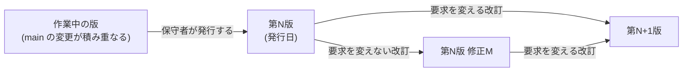

本ページは、本標準の保守者が版を発行する手続を定めます。本標準を適用する者への要求(表明と主張に版を書く、追従していない版を主張しない)は、[第1章 1.10.3](/process-compass/phase4-process-design/overview/)にあります。判断の根拠は [ADR-0083](/process-compass/adr/0083-standard-edition-end-of-application-and-deviation/)の決定1 と決定4 によります。

## 版の状態

| 状態 | 示し方 | 適用の表明 | 2つの適合の主張 |
| --- | --- | --- | --- |
| 発行した版 | 「第N版」と発行日。要求事項を変えない改訂は「第N版 修正M」と発行日。発行の時点のコミットの配布物に限る | 名指せる | 名指せる |
| 作業中の版 | 「作業中の版(未発行)」、または「作業中の版(第N版の後)」。発行の時点のコミットより後に変わった配布物 | コミットの識別とともに名指せる | 名指せない |

2026-10-24 の時点で、本標準は版を発行していません。公開のサイトと配布物の内容は、すべて作業中の版です。採用者は、作業中の版をコミットの識別とともに名指して、適用の表明をできます。適合の主張と逸脱を伴う適合の主張は、どの採用者もできません(第1章 1.10.2)。第1版の発行は、取り消せない外部への発行であり、本リポジトリの所有者が判断します。

## 付番の規則

- 版の番号 N を上げる改訂は、次のいずれかを変える改訂とする。要求事項、禁止、適用範囲、判定基準、テーラリングの規則データ(`src/data/tailoring/`)、準拠テンプレートの必須欄(`src/data/template-fields.yaml`)
- 逸脱の閉じた列挙(第1章 1.10.2)への追加と削除は、要求事項の変更として N を上げる
- 上のどれにも当たらない改訂(誤記の訂正、説明の追記、図の差し替え、参考の附属書の改訂など)は、修正 M とする。M は、同じ N の中で 1 から数える
- N と M のどちらに当たるか迷う改訂は、N を上げる
- 版の番号を飛ばさない。発行した版を取り消さない。誤りは、次の版または修正で正す

区分の境の根拠の水準は、第1章 1.10.3 の EV-0158 によります。

## 発行の手続

1. 発行する内容のコミットを決める。`npm run check` が通っていることを確かめる
2. 前の版からの改訂を読み、付番の規則で N と M のどちらに当たるかを決める
3. 引用規格を棚卸しし(下記)、記録を残す
4. `src/data/edition.yaml` の `edition` と `issuedAt` を書き、`history` の先頭に1行を足す。行は、版・発行日・発行の時点のコミット(手順1 のコミット。40 桁)・区分(N または M)・要約・引用の棚卸しの記録の所在を持つ。過去の行を書き換えない。この記録を足すコミットは、`edition.yaml` と準拠テンプレートの参照のほかを変えない
5. `npm run template:kb` で知識ベースを再生成する。発行の時点のコミット(または手順4 の記録だけを足したコミット)で生成した知識ベースだけが、`source.edition` と `source.editionIssuedAt` に版を持つ
6. 準拠テンプレートの複製を更新し、配布する。配布の `VERSION.md` に、版とコミットが併記される
7. 発行を公開する(リリースの記録、変更の要約)

発行は人が行います。AI は、手順1〜3 の材料(改訂の一覧、区分の案、棚卸しの表)を起案できます。区分の決定と発行の記名は、保守者が行います。

## 配布物への版の記録

| 配布物 | 記録する値 | 生成元 |
| --- | --- | --- |
| `dist/standard/VERSION.md` | 版(発行の時点のコミットのときだけ版の名。それ以外は「作業中の版(第N版の後)」または「作業中の版(未発行)」)と、コミット | CI(`ci.yml`)が `scripts/lib/edition.mjs --label --commit <配る コミット>` から書く |
| 知識ベース(`template/scripts/vendor/tailoring-kb.json`) | `source.edition`(発行の時点のコミットのときだけ版。それ以外は `null`)、`source.editionIssuedAt`、`source.basedOn`(最後に発行した版。発行が無ければ `null`)、`source.commit` | `scripts/build-template-kb.mjs` |

- コミットは機械の識別であり、版の代わりにしない。2つを併記する
- 知識ベースの乖離の検査(`npm run check` の中の `check-template-drift`)は、コミットを除いて比べる。版は比べる
- `check-gate-criteria` は、`edition.yaml` の書式と、知識ベースの版が生成元のコミットに当たる版と一致することを確かめる
- 発行の後に本標準を変えると、知識ベースの版は `null`(作業中の版。`basedOn` が発行した版)になる。乖離の検査が再生成を求めるので、`npm run template:kb` を実行する。準拠テンプレートは、版を持たない知識ベースからは、構成の版を発行した版へ切り替えない
- 版の解決は `npm run test:edition` が一時の git リポジトリで確かめる

## 受け取り側が生成元を確かめる手順

本標準は、この確認を採用者に課しません([ADR-0157](/process-compass/adr/0157-recipient-origin-check-is-guidance-and-kb-source-limited-to-main-history/))。適用の表明の読み手・監査する者・採用者のだれでも、適用の開始と版の切り替えのときに行えます。確かめた結果を表明に添えてもかまいません。

確かめるのは2つの条件です。標準の正本のリポジトリ(`https://github.com/Takenori-Kusaka/process-compass`)から履歴ごと取得した clone(`origin/main` と `origin/dist/standard` を持つもの)の中で実行します。fork や、配布物の中の `VERSION.md` の「出所」の値は、正本の代わりに使いません(どちらも自由に書けるため)。以下の `S` は名指されたコミット、`D` は `dist/standard` のコミットです。

| 取り込みの形 | 条件1(来歴) | 条件2(中身) |
| --- | --- | --- |
| `dist/standard` のコミット `D` を固定する | `D` の `VERSION.md` の「コミット」の値を `S` とする。`git merge-base --is-ancestor S origin/main` が成功する。`git merge-base --is-ancestor D origin/dist/standard` が成功する(`D` が `dist/standard` の履歴の上にある)。`D` の `tailoring-kb.json` の `source.commit` が `S` と一致する | `git diff --quiet S:src/content/docs D:docs` が成功する |
| 準拠テンプレートの同梱の知識ベース(`scripts/vendor/tailoring-kb.json`、`source.commit` が `S`) | `git merge-base --is-ancestor S origin/main` が成功する | `git log origin/dist/standard --fixed-strings --grep=S --format=%H` で `source.commit` が `S` の配布のコミット `D` を見つけ、`git show D:tailoring-kb.json` と同梱の知識ベースが `cmp` でバイト一致する。`D` が無いときは「未確認」とし、「一致」とも「不一致」とも書かない |

- 同梱の知識ベースの比較は、`git show <テンプレートのコミット>:scripts/vendor/tailoring-kb.json` で取り出したものに対して行う(作業ツリーのファイルは、改行コードの自動変換でバイトが変わりうる)
- 条件1 の `D` の確認は、`dist/standard` の履歴の外に置いた配布物(`docs/` が同じで、`tailoring-kb.json` の判定基準だけを差し替え、`source.commit` は `S` のまま)を落とすために置く。`docs/` の比較と `source.commit` の一致だけでは通る
- 配布のコミットの題に生成元のコミットが入る現行の形(「標準の本文を配布する (S)」)に、準拠テンプレートの同梱の知識ベースの行の `D` の探し方は依る。題の形が変わると、正しい配布物も「未確認」になる(誤って通す向きではない)
- 同じ `S` の配布のコミットが複数あるとき(再実行)は、いずれか1つと一致すればよい
- 確かめられるのは、名指したコミットが確かめた時点で既定ブランチの上にあること、`dist/standard` のコミットなら `dist/standard` の履歴の上にあること、`docs/` の本文が CI の生成物と一致すること、同梱の知識ベースが配布のコミットの知識ベースと一致すること
- 本文が正しいことは確かめない
- 確かめた後の既定ブランチの書き換えは検出しない
- 保守者の権限で既定ブランチへ書かれた変更は、CI が配布するため検出しない
- 書き込みの権限を持つ者が `dist/standard` へ早送りで積んだコミット(知識ベースの差し替えを含む)は検出しない。`dist/standard` の更新はルールセットで限っていない([プロジェクト運営](/process-compass/community/project-management/))。`VERSION.md` の実行の番号と Actions の実行の記録との突き合わせは、ADR-0090 決定8 の候補のままである
- `D` が正本の clone に無いときは、条件1 を満たさないものとする(失敗の向きは通さない側である)

手順は、使い捨ての git リポジトリに作った例で確かめました。正常な配布物は両条件を通ります。次の配布物は条件1 の `D` の確認で落ちます。`VERSION.md` と `source.commit` に実在の `S` を書き、`docs/` は同じで `tailoring-kb.json` の判定基準だけを差し替えて `dist/standard` の履歴の外に置いた配布物です。`docs/` の比較と `source.commit` の一致だけでは通ります。`VERSION.md` に実在の `main` のコミットを書いて本文を1文変えた配布物は、条件1 を通り、条件2 で落ちます(祖先の確認だけでは通ります)。`main` に無い枝のコミットを名指した配布物は条件1 で落ち、`VERSION.md` と知識ベースの `source.commit` が食い違う配布物も条件1 で落ちます。実物では、`dist/standard` の本文と生成元の本文の差が空であること、同梱の知識ベースの `source.commit` を直して判定基準の1行を変えた写しが条件2 で落ちることを確かめました。

**既知の食い違い(2026-11-17)**: 準拠テンプレートの main が同梱する知識ベースの `source.commit`(59425d2e21db…)は、標準の `main` の祖先ではありません。上の手順は、条件1 でこれを不一致とします。なお知識ベースの中身は、`source.commit` の行を除いて `dist/standard` の知識ベース(生成元 154c2086…)とバイト一致しました。誤っているのは識別だけです。配る側の検査(標準の履歴の上にあることを求める)は、標準のリポジトリの検査としてはまだ実装しておらず(降りていない)、降ろすまでこの食い違いは直りません。検査は、準拠テンプレートの知識ベースを再生成する束で入れる予定です([ADR-0157](/process-compass/adr/0157-recipient-origin-check-is-guidance-and-kb-source-limited-to-main-history/) の決定3)。

:::caution[暫定 EV-0301 / 見直し 2027-05]
**対象**: 受け取り側が、2つの条件で、名指したコミットの偽装、`docs/` の差し替え、`dist/standard` の履歴の外に置いた知識ベースの差し替えを検出できること。`dist/standard` へ早送りで積まれた差し替えは対象に含めない。
**根拠の水準**: E1(間接)。
**差し替え条件**: 採用者または監査する者が実際に手順を行った記録が1件以上できたとき、実施で食い違いが見つかれば見直します。

手順が偽装を落とすことは、使い捨ての git リポジトリの例と、2026-11-17 の `dist/standard` および準拠テンプレートの同梱の知識ベースの1時点で確かめただけです。確認は1時点の事実で、既定ブランチの書き換えの後は結果が変わります。
:::

## 引用規格の棚卸し

版を発行するたびに、修正 M を含めて、本標準が引く規格と文書の改訂の有無を確かめます。

| # | 確かめること | 記録 |
| --- | --- | --- |
| 1 | 第1章 1.3 の各行の文書に、引用した版の後の改訂・追補・廃止があるか。対応表を持つ文書(附属書H H.10 の ISO 9001)は、改訂版の番号と題を一次の資料(ISO または JIS の公開の目次)で確かめたか | 文書ごとに、確かめた日付と結果。対応表を持つ文書は、確かめていないならその旨と次の見直しの期日 |
| 2 | 改訂があった文書について、新しい版へ追従するか | 文書ごとの決定と理由。追従しない場合もその旨 |
| 3 | 1.3 の外の本文の引用に、版の無いものがないか | 見つけた所在と、付けた版。読んだ版が分からなければ、その旨 |
| 4 | 引用した版に、出典台帳(`research/sources/`)のカードがあるか | `npm run lint:citations` の結果 |

- 追従するかは、文書ごとに決める。改訂があったことだけを理由に、自動で追従しない
- 追従して本標準の要求事項が変わる場合は、N を上げる
- 棚卸しの記録の所在を、`edition.yaml` の `history` の行の `citationReview` に書く
- 対応表を持つ文書の改訂版は、番号と題を一次の資料で確かめるまで、旧版の対応を保つ。確かめるのは保守者である。契機は、本標準の次の版の発行の棚卸しと、根拠水準のマーク EV-0257 の見直し期日のうち早い方である。確かめた後は、旧版の認証の移行期間が終わるまで両版を併記し、移行期間が終わった後の最初の版の発行の棚卸しで旧版の列を外す。一次の資料が見つからなければ、見つからなかったことを記録し、EV-0257 を改版して期日を延ばす
- 12207:2026 への引用の更新(#341)と、ISO 9001 の追従の扱い(#336)は、この手続の適用である。次の版の発行の棚卸しの記録(`citationReview`)に、この 2 件を引き継ぐ

`npm run lint:citations` が機械で確かめるのは、1.3 の範囲(版の有無と台帳のカードの対応)だけです。1.3 の外の本文の引用は、手順3 で人が確かめます。機械は、引用がどの版を指すつもりかを判定できないためです。

## 準拠テンプレートの更新で、既存の採用者を落とす変更を出すとき

準拠テンプレートの検査・構成の形式・強制層を改める更新のうち、既存の採用者のリポジトリで、取り込みの前に通っていた検査を落としうるものを出すときの、保守者の手続です。採用者への要求事項ではありません([ADR-0085](/process-compass/adr/0085-adoption-into-existing-repositories/) 決定6)。

| # | 保守者が行うこと | 記録 |
| --- | --- | --- |
| 1 | 落ちうる検査と、その直し方を列挙する | 更新の告知(準拠テンプレートの README の「テンプレート更新時の既存案件への影響と運用ルール」の節) |
| 2 | 書き込まずに試す手段を同梱する(`--dry-run`、事前点検、`/process-change` の種別 `migrate` の差分の表示など) | 同じ告知に、試すコマンドを書く |
| 3 | 構成の形式を改める場合は、形式の版(`formatVersion`)を上げ、旧い版ごとに現行の版への直接の変換を足す | 準拠テンプレートの `scripts/gate/config.mjs` の変換の一覧と、その試験 |
| 4 | 要求事項の検査を変える更新かどうかを書く。変えるなら、本標準の版の発行と組にする | 告知と `edition.yaml` の `history` |

- 猶予の期間を置かない。旧い形式の構成を、期間を区切って通す定めを設けない(第1章 1.10.3)
- 緩める向きの補いを、読み込みで黙って行わない。読み込みで既定値を補うのは、結果が同じか厳しくなる場合に限る
- 準拠テンプレートの git のタグを要求しない。採用者は、取り込んだテンプレートをコミットで記録する
- 配布物の真正性と受け取る側の検査は、[#332](https://github.com/Takenori-Kusaka/process-compass/issues/332) で扱う。本節は、記録と告知までである

## 準拠テンプレートの更新で、再導出すると緩める向きの差分になる変更を出すとき

準拠テンプレートの規則・知識ベース・構成の導出を改める更新のうち、既存の採用者の構成を再導出すると、統制を緩める向きの差分(承認の数・ブランチ保護・検査の下限を下げるなど)になるものを出すときの、保守者の手続です。何も落とさない更新でも、採用者は後の再導出で、理由の分からない記名を求められます。採用者への要求事項ではありません([ADR-0088](/process-compass/adr/0088-organizational-distance-steps-and-cl1-stage-relaxation/) 決定7)。

| # | 保守者が行うこと | 記録 |
| --- | --- | --- |
| 1 | 緩める向きの差分になる構成の条件と、差分の行を列挙する | 更新の告知(準拠テンプレートの README の「テンプレート更新時の既存案件への影響と運用ルール」の節) |
| 2 | 差分の理由(本標準のどの決定によるか)を書く | 同じ告知 |
| 3 | 採用者が記名して適用する経路(`/process-change` の種別と入力)を書く | 同じ告知 |
| 4 | 旧い値のまま残した構成が不適合になるか、どう表示されるかを書く | 同じ告知 |
| 5 | 取り込み(`/process-change` の種別 `intake`)で、該当する構成に案内を出す。構成の値は変えない | 準拠テンプレートの取り込みの出力と、その試験 |

- 緩める向きの差分を、取り込み・移行(種別 `migrate`)・読み込みで適用しない。適用するのは、採用者の記名を伴う構成の変更だけである
- 厳しくする向きの更新は、本節ではなく、前節(落としうる更新)の手続と、第8章「再実行の時点と向き」の「未適用の厳格化」の行による。取り込みは値を変えず、再導出で厳しくなる差を適用されるまで表示し続ける。安全重要度 CL1 以上の G-6・G-7 の差は、適用されるまで出荷できない
- 本節は、ADR-0085 が採らないと決めた「緩める向きの黙った読み替え」と当たらない。値を変えずに告げ、記名で適用するためである

## 定めないこと

- **移行の期間と旧い版の失効を定めない**。旧い版に従う案件は、旧い版への主張を期限なく続けてよい(第1章 1.10.3、EV-0159)
- 版の発行の周期を定めない。改訂の内容で発行を決める
- 版ごとの英語の名称を定めない。英語の版を設けるときに決める
- 受け取り側の生成元の確認を採用者に課さない。確認の結果の併記も求めない([ADR-0157](/process-compass/adr/0157-recipient-origin-check-is-guidance-and-kb-source-limited-to-main-history/)。手順は上の節に置く)
