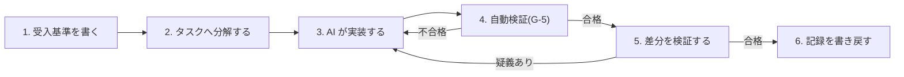

本附属書は、[第5章](/process-compass/phase4-process-design/human-ai-boundary/)が規定する役割境界を、開発者の日々の作業手順へ落としたものです。**本附属書は参考です**(第1章 1.5)。要求事項の正本は本文各章であり、本附属書は実施の手引きです。本附属書の記述は、適合の条件に数えません。

## E.1 作業の重心

AIエージェントが実装を主導する前提では、開発者の作業の重心が移動します。

| 従来の作業 | 本標準での扱い |
| --- | --- |
| 実装コードを1行ずつ記述する | AIエージェントへ委譲する |
| 仕様を作業者の記憶に保持する | 検証可能な受入基準として外部化する |
| 生成された変更を全行読む | 検証の順序に従い、範囲を絞って読む |
| 動作確認を手作業で繰り返す | 自動検証へ移し、人は不合格時の判断に集中する |
| 設計判断を暗黙に処理する | 判断記録(ADR)として残す |

委譲するのは実装であり、判断ではありません。何を作るか、どこまでを正しいとするかを決める作業は移譲の対象になりません。

## E.2 1機能あたりの作業サイクル

工程3と工程4の往復はエージェントが自律的に回します。人確定・協働の変更では、人が関与するのは工程1・2・5・6です。開発者の席の委任の範囲の変更([第5章 5.5.6](/process-compass/phase4-process-design/human-ai-boundary/))では、工程5 の差分の検証を担い手が行い、実行結果の証拠を PR の検証欄へ書きます。挙動要約と検証の順序による確認は、事前に承認する独立レビュア(人)が行います。工程1・2 は、委任の範囲にかかわらず人が行います。

## E.3 受入基準を書く

- 受入基準は「条件 + 期待動作」の形式で書く([附属書B](/process-compass/phase4-process-design/ears-guide/))
- 曖昧語を使用しない。類と検出語は[第4章 G-2](/process-compass/phase4-process-design/gate-criteria/)「曖昧語(基準2)」参照
- スコープ外の事項を明記する。書かれていない事項は実装されるか否かが不定になる

**完了の条件を曖昧さなく書けない機能は、書けるところまで分解してからAIへ渡すことを勧めます**。エージェントが停滞する原因には、能力の不足のほかに、完了条件の不在があります。

:::caution[暫定 EV-0091 / 見直し 2027-04]
**対象**: エージェントが停滞する原因に完了条件の不在があるという記述と、完了の条件を書けない機能を分解してから渡すという手引き。
**根拠の水準**: E0(なし)。
**差し替え条件**: 自己修正のループが停止条件(第3章 3.12.10)で止まったタスクの記録と、そのうち受入基準の不備に戻して解消した件数。

停滞の原因の内訳を測った資料は確認できていません。ベンチマークの課題に仕様不足のものが含まれるという報告(2024〜2026 年)はありますが、抜粋で読んだ範囲にとどまり、出典台帳へ登録していません(所在は `research/300-book-intake/survey-B-hollowing-bandwidth.md` 4.3)。
:::

本標準は、AIエージェントに受入基準の草案を生成させることを認めています(第5章 5.5.6)。生成された基準を、読まずに承認しないことを推奨します。受入基準の確定は、人が版を特定して判定記録へ記名する行為です([第4章 G-2](/process-compass/phase4-process-design/gate-criteria/)参照)。基準の確定は、[第5章 5.5](/process-compass/phase4-process-design/human-ai-boundary/)の価値判断に該当します。受入基準の内容の良否に、本標準は判定基準を課していません。

## E.4 タスクへ分解する

- 1タスクは、独立レビューが単独で完結できる大きさに収める([第4章 G-4](/process-compass/phase4-process-design/gate-criteria/))
- 各タスクが、どの受入基準に対応するかを明記する
- 依存のないタスクは並列可と明示する

### 分解しすぎない

事前に細かく割り切ると、かえって手戻りが増えます。実行時の状況に応じて構造化する分解のほうが、静的に決め打ちした分解より再試行の費用を抑えたという報告があります(2026年)。**分解は、依存関係と検証の単位が決まる粒度で止めます**。

### 並行して実行する場合

複数のエージェントを同時に走らせる場合は、実行主体ごとに作業ツリーを分けます。この要求事項の正本は[第3章 3.5.1](/process-compass/phase4-process-design/roles-responsibilities/)です。あわせて、次を推奨します。

- 共有される設定・登録・経路定義のファイルを、同時に変更する組み合わせを避ける
- 完了後に、同一機能の重複実装が生じていないかを確認する

同一ディレクトリでの並行実行は、ファイルの上書きと版管理の索引破損を即座に引き起こします。

## E.5 差分を検証する

### 検証の順序

上から順に確認し、不合格が出た時点で以降を見ずに差し戻すことを勧めます。本項の順序と止め方は推奨であり、本標準は課しません。差分の確認そのものは、[第5章 5.8.5 の禁止事項4](/process-compass/phase4-process-design/human-ai-boundary/) と[第4章 G-6](/process-compass/phase4-process-design/gate-criteria/)によります。

| 順 | 見るもの | 確認する内容 |
| --- | --- | --- |
| 1 | 受入基準とテストの対応 | 受入基準ごとに、違反すると失敗するテストが1つ以上存在するか |
| 2 | 外部インタフェースの差分 | API・データ構造・権限・設定の変更が、仕様の範囲に収まっているか |
| 3 | 差分の性質 | 追加か、移動か、複製か。既存の実装を再発明していないか |
| 4 | 実行トレース | 拒否が働いた記録と、機械の検出が付けたラベル(E.6、第5章 5.8.6)。痕跡を遡って読む作業は求めない |
| 5 | 実装コード | 順1〜4で疑義が生じた箇所に限定して読む |

### 二つの止め方

最初の不合格で止める本項の向きと、[附属書C](/process-compass/phase4-process-design/review-guide/)の「指摘はまとめて出す」の向きは、どちらも推奨です。使い分けは次のとおりです。

- 開発者が自らの差分を確かめる場面(本項)では、最初の不合格で止める。後の順の確認は、直した後の差分でやり直すことになるため
- 独立レビュアが他者の差分を確かめる場面(附属書C)では、指摘をまとめて出す。往復の回数が、作成者と確認者の双方の待ち時間を増やすため

### 全行を読むことを求めない理由

エージェントは人間が読める速度を超えて変更を生成します。規模の大きい差分に対する逐行確認は、時間の制約のもとで実質的な承認操作へ縮退します。判断の質は、読んだ行数ではなく確認した観点の数で決まります。

順1〜4は、いずれも確認の範囲が有界です。受入基準の数、外部インタフェースの変更数、遮断の記録とラベルの件数はすべて数え上げられます。順5だけが範囲の定まらない作業であり、だからこそ最後に置き、対象を限定します。

### テストで担保できないもの

テストは、書かれた基準しか守りません。**基準そのものの欠落はテストでは検出できません**。順1で受入基準を数え上げるのは、この欠落を人が確認するためです。

受入基準に現れない性質(性能・セキュリティ・可用性)は、[第4章 G-5](/process-compass/phase4-process-design/gate-criteria/)の機械検査と[フェーズ5(非機能の検証)](/process-compass/phase5-implementation/nonfunctional-verify/)で扱います。

## E.6 実行トレースの確認

エージェントが何を読み、何を実行したかについて、検出すべき事象と本文の所在を示します。要求事項の正本は、[第5章 5.8.6](/process-compass/phase4-process-design/human-ai-boundary/)「実行時の拒否と、エージェントの操作の確認」、5.8.5 と[第4章 G-5](/process-compass/phase4-process-design/gate-criteria/)です。本項は、それらの読み合わせ方を示します。

| 事象 | 本文での扱い | 本文の所在 |
| --- | --- | --- |
| 仕様の範囲外のファイルを変更した | 実行時に拒否する | 第5章 5.8.6 要求事項1 |
| 認証情報・秘密情報へ接触した | 実行時に拒否する。秘匿情報を実行環境から参照できない位置へ置く。拒否されずに起きた接触の影響の確認は、本標準は課さない(組織のインシデント対応の規程が扱う) | 第5章 5.8.6 要求事項1・4 と、その後の段落 |
| 想定していない外部への通信を行った | 実行時に拒否する。拒否されずに起きた通信の影響の確認は、本標準は課さない | 第5章 5.8.6 要求事項1 と、その後の段落 |
| 失敗したテストを、テスト側の変更で通過させた | 禁止。差分から機械で検出し、G-6 の必須の確認事項として示す | 第5章 5.8.5 の禁止事項3 と、その後の段落 |
| 検証を無効化する設定変更を含めた | 製品のコードと同じ変更では G-5 を通さない | 第4章 G-5「基準値と除外設定の変更」 |

この5つの事象のほかに、エージェントの操作について本標準が課す確認はありません。痕跡を遡って目視で探す作業も課しません(5.8.6)。

最後の2項目は、差分の見た目では正常な変更と区別が付きにくいため、目視で探さず、機械の検出が付けたラベルで確かめることを勧めます。テストを通すためにテストを書き換える変更は、実装の完了ではなく検証の放棄です。拒否と検出の実装の例は、[フェーズ5(エージェントの操作の統制)](/process-compass/phase5-implementation/agent-trace-control/)を参照。

## E.7 自己修正ループの回し方

自動検証(G-5)の失敗をエージェントへ入力し、修正させる往復は、[第3章 3.12.10](/process-compass/phase4-process-design/roles-responsibilities/)の実行の単位です。停止条件(連続失敗回数・無進捗・単一タスクの累積消費)と、その初期値と、停止したときの扱い(停止を失敗として記録して人へ返すこと、同一のタスクで停止が繰り返されたら実装計画へ差し戻すこと)は、同節によります。本項は、その回し方の例を示します。

- 停止の記録(消費量・最後の失敗内容・発火した条件)は、3.12.10 の閾値の較正の入力になる
- 消費した実行費用は、[第7章 7.7.2](/process-compass/phase4-process-design/exception-escalation/)の AI実行予算の消化率に含まれる

上限を設けない自己修正ループは、費用を消費しながら同種の失敗を反復します。

### 修正の対象からテストを除外する

自己修正ループの書き込み範囲にテストを含めないこと、テストの修正を要すると判明したらループを終了して人が受入基準へ戻ること、除外を解いてよいのは人だけであることは、[第5章 5.8.5 の禁止事項3](/process-compass/phase4-process-design/human-ai-boundary/) の後の箇条によります。本項は、その実施の形を示します。

- 除外を、指示ではなく書き込み範囲の設定(強制層)で行う。指示だけの除外は、5.8.6 要求事項2 の「指示ファイルにだけ書いた範囲」に当たる
- ループの内側でテストの修正を続けて行わない

差分からの事後の検出だけでは、指摘の確認を省いた運用で層が働きません([第3章 3.11.3](/process-compass/phase4-process-design/roles-responsibilities/))。

## E.8 記録を書き戻す

サイクルの終わりに、該当がある記録を書き戻します。書く条件の正本は[第2章 2.6](/process-compass/phase4-process-design/lifecycle/)です。

- 設計上の選択を伴った場合は判断記録(ADR)。採らなかった選択肢とその理由を含める
- 受容した妥協・仮実装は技術負債台帳へ
- 恒久層コンテキストに反映すべき規約・用語の変更

採らなかった選択肢を書き残すことは、後任者が同じ検討を繰り返さないための唯一の手段です([第2章 2.9.4](/process-compass/phase4-process-design/lifecycle/))。

## E.9 行わない作業

禁止事項の正本は、[第5章 5.8.5](/process-compass/phase4-process-design/human-ai-boundary/)「AI 協調の作業で行ってはならないこと」です。本項は、その写しの一覧です。番号は 5.8.5 の番号を引いたもので、引くときは「5.8.5 の禁止事項N」と書きます。

| 5.8.5 の番号 | 行わない作業 | 種別と正本 |
| --- | --- | --- |
| 1 | 受入基準を確定せずに実装を依頼する | 禁止。第5章 5.8.5 |
| 2 | AIが生成した受入基準を、人の判定(G-2・G-4)を経ずに確定とする | 禁止。第5章 5.8.5。読まずに承認しないことは推奨(E.3) |
| 3 | テストの失敗を、テスト側の変更で解消する | 禁止。第5章 5.8.5 |
| 4 | 差分を確認せずに承認する | 禁止。第5章 5.8.5 |
| 5 | 独立レビューの挙動要約を、AIに生成させる | 禁止。第5章 5.8.5 |

2 は、旧版では「AIが生成した受入基準をそのまま承認する」でした。読んだうえで変えなかった承認と、読まずにした承認を、記録から区別できません。記録で判定できない禁止を置かないと決め、禁止を記録で判定できる形へ、読み方を推奨へ改めました([ADR-0063](/process-compass/adr/0063-normative-informative-and-verbal-forms/))。

## E.10 認知負荷の管理

- 1つのタスクは1つの変更単位に対応させる。複数の関心事を1つの変更へ混ぜない
- レビューに要した時間と変更規模の比を継続して計測する([第4章](/process-compass/phase4-process-design/gate-criteria/))
- 判断の対象が大きくなったと感じた時点で、分割して差し戻す

判断の質を保つ手段として本標準が第一に置くのは、1回の判断対象を小さくすることです。承認者の人数を増やしても、この効果は代替できません。

:::caution[暫定 EV-0092 / 見直し 2027-04]
**対象**: 1回の判断対象を小さくすることを判断の質を保つ第一の手段に置き、承認者の人数では代替できないとする記述。
**根拠の水準**: E1(間接)。
**差し替え条件**: レビューに要した時間と変更規模の比の計測(E.10 の2項目目)と、変更規模ごとの下流での欠陥の件数。承認者が1名の変更と2名の変更での、同じ規模における欠陥の件数の比較。

第3章 3.10.4 の根拠水準マーク(EV-0093)と同じ資料に依ります。承認者の人数と1人あたりの検出の関係を測った資料は確認できていません。
:::

## E.11 関連する章

- 役割境界と自律レベル: [第5章](/process-compass/phase4-process-design/human-ai-boundary/)
- 受入基準の記法: [附属書B](/process-compass/phase4-process-design/ears-guide/)
- 独立レビューの実施手順の手引き: [附属書C](/process-compass/phase4-process-design/review-guide/)
- 変更単位の運用の手引き: [フェーズ5(PR 運用リファレンス)](/process-compass/phase5-implementation/pr-workflow/)
