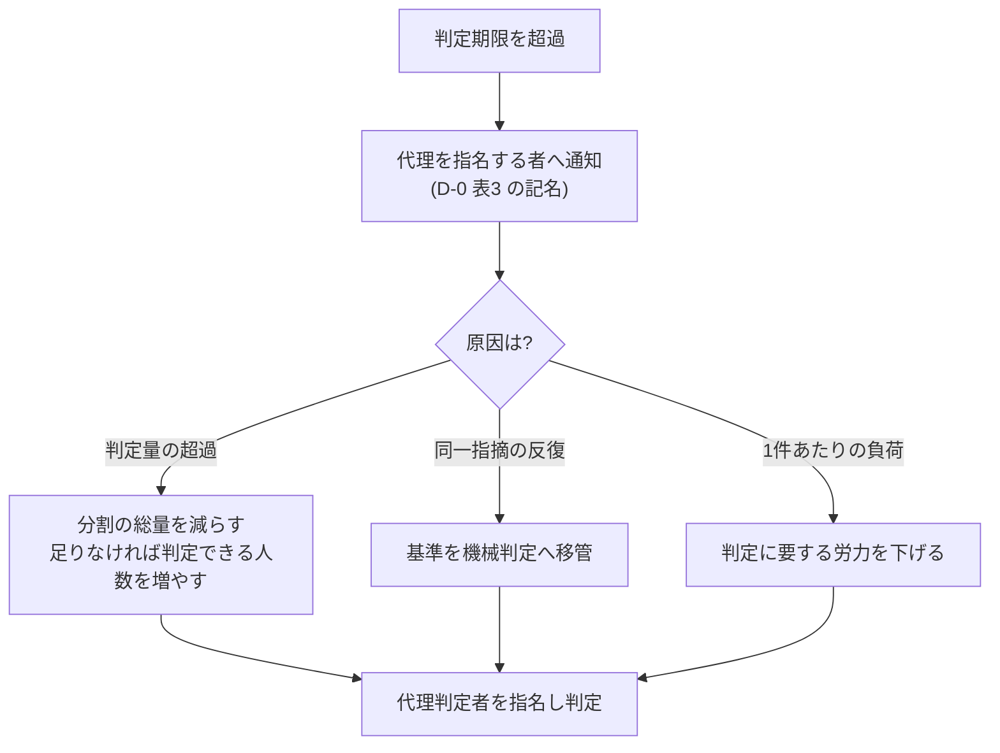

本章は、本標準の要求事項を満たせない事態が生じた場合の手続を規定します。例外を認めない標準は運用されずに迂回されます。したがって例外を禁止せず、統制の対象として扱います。

## 7.1 本章が達成すべき成果

本章の要求事項を満たしたとき、次の成果が得られます。

- 基準を満たせない状態が、隠されずに記録として表面化している
- 例外を認める権限者と、その代償として負う義務が明確である
- 判定の滞留および予算・期日の超過が、D-0 に記名した判定する者へ定められた基準で到達している

## 7.2 例外の前提

本標準は、次の現実を前提として例外手続を設けます。

- 期日は四半期決算・顧客契約・展示会・納品期限などの外部要因によって定まり、開発側の都合では変更できない場合がある
- 期日を守るために基準を暗黙に下げる運用が生じると、品質の劣化が記録されないまま蓄積する
- したがって基準の不充足を禁止せず、承認・記録・回収を伴う手続として扱う

## 7.3 例外承認の要求事項

ゲートの判定基準を満たさないまま次工程へ進める場合は、次のすべてを満たさなければなりません。

| # | 要求事項 |
| --- | --- |
| 1 | 例外承認の権限を持つ者が、記名により承認する |
| 2 | 満たさない基準の項目番号と、その理由を記録する |
| 3 | 想定される影響と、影響が顕在化した場合の対処を記録する |
| 4 | 回収の期限と回収責任者を定め、技術負債台帳へ登録する |
| 5 | 回収が完了するまで、当該項目を継続的な報告対象とする |

上記のうち1項目でも満たせない場合、例外を認めてはなりません。

**本節が、条件を付して先へ進める手続です**。上表の2が条件の内容、4が条件の解消期限と責任者、5が解消までの追跡にあたります。工程ゲートの判定へ「条件付き通過」という値を設けていないのは、これらの要求を伴わない通過の経路を作らないためです([第4章 工程ゲートの判定の語彙](/process-compass/phase4-process-design/gate-criteria/) / [ADR-0036](/process-compass/adr/0036-gate-closure-by-record/))。

<!-- impl IMPL-0011 target=gate-record-template state=delivered check=manual note="条件を付して先へ進める場合は例外承認の5要求事項を満たす。確かめる者: 当該ゲートの判定者(判定記録を書くとき)" -->

例外承認の記録は、技術負債台帳([第6章 テンプレ3](/process-compass/phase4-process-design/deliverable-templates/))へ区分「例外」として置きます。記録は、次の5つの事項を持ちます。要求事項を足すものではなく、上表の要求事項が記録のどの欄に現れるかを定めるものです。

| 記録が持つ事項 | 内容 | 対応する要求事項 |
| --- | --- | --- |
| 対象 | 例外を適用する変更または成果物。変更の場合は、PR の番号またはコミットの識別子で示す | 2 |
| 状態 | 有効か、有効でないか。有効は、未回収を指す(台帳の「未返却」)。回収済み、取り下げ、失効は、有効でない | 5、7.8 |
| 承認した者 | 例外承認の権限を持つ者の記名。記録した者とは別の欄に書く | 1 |
| 理由 | 満たさない基準の項目番号と、満たさない理由 | 2 |
| 期限 | 回収の期限と、回収責任者 | 4 |

- 5つの事項のいずれかが空欄の記録は、例外承認の成立を示さない。出荷判定(G-7)は、その記録を変更に対応づけない([第4章 G-7](/process-compass/phase4-process-design/gate-criteria/)の基準5)
- 対象は、記録ごとに明示する。他の記録の本文に番号が現れることを、対象の明示として扱わない
- 有効でない記録は、変更の例外承認として対応づけない。回収済みの記録を、別の変更の例外承認として使い回せない
- 承認した者の欄を記録した者の欄と分けるのは、台帳へ書き込んだ者と、承認の権限を持つ者が別でありうるためである
- 承認した者の記名は、名前の一致だけでは帰属を裏づけない。例外承認の記録は効力を持つ記録であり、効力を持つ前に、承認した者本人のアカウントの操作で帰属を裏づける。対象が PR の場合は、対象の PR の上の承認した者本人のレビューを裏づけにしてよい([第4章「判定記録を基底ブランチへ入れる操作」](/process-compass/phase4-process-design/gate-criteria/)、[ADR-0106](/process-compass/adr/0106-material-records-attributed-before-effect/))。台帳の行は、登録と追跡の記録として残す
- **規模の基準値の超過には、本節の例外承認を要さない**。超過は、PR の本文の「規模の確認」と区分の下限 R2 で扱う([第4章 タスクの分割基準](/process-compass/phase4-process-design/gate-criteria/) / [ADR-0058](/process-compass/adr/0058-size-over-is-confirmed-not-blocked/))。本節の例外承認は、R2 以上の規範を満たさない場合のために残る。基底ブランチの台帳に既にある、規模の超過を対象とした例外承認の行は、有効のまま受け付ける(過去の記録を壊さない)

<!-- impl IMPL-0038 target=debt-ledger-template state=delivered check=presence note="例外承認の記録が、対象・状態・承認した者・理由・期限を持つ。承認した者の欄を記録者の欄と分ける。テンプレート担当の実装後に主担当が改める(単位: 欄)" -->

判定基準を満たしている成果物について、次工程の材料が未完成であることを理由に本節を用いてはなりません。それは例外ではなく、判定の範囲の誤りです([第4章 判定の範囲](/process-compass/phase4-process-design/gate-criteria/))。

レビューの形骸化を検知した場合の承認権限の一時制限と、その解除条件は、7.9 によります。

### 7.3.1 経路の使い分け

**判定基準を満たさないまま進める場面には、3つの経路があります**。どれを用いるかを案件の裁量に委ねません。**案件は、どの事象をどの経路へ送るかの判断基準を、企画承認(G-1)の時点で記録します**。

| 事象 | 経路 |
| --- | --- |
| 当該ゲートの判定基準を満たさないまま進める | **7.3 例外承認** |
| 前提が劣化し、判断の土台が変わった | **7.10 前提の受容** |
| 判定基準には含まれないが、放置できない事項が残った | **7.3.2 未解決事項** |

**7.3 と 7.10 は、事後と事前で分かれます**。7.3 は成果物が存在する時点で基準の不充足を認める手続であり、7.10 は判断の土台にした前提が崩れたことを認める手続です。

判断基準を事前に記録させるのは、**経路の選択を事後の裁量にすると、最も軽い経路が選ばれるため**です。

### 7.3.2 未解決事項

**判定基準に含まれないが放置できない事項**は、例外承認でも前提の受容でもありません。**判定の外に置き、追跡します**。

| 要求事項 |
| --- |
| 事項の内容と、判定の外にある理由を記録する |
| 対処の期限と担当を定める |
| 期限までに解消しない場合、7.3 または 7.10 のいずれへ送るかを判定する |

**この経路には判定値を持たせません**。工程ゲートの判定は「通過」「差し戻し」の2値のままです([ADR-0036](/process-compass/adr/0036-gate-closure-by-record/)決定2)。**未解決事項が残っていることは、通過を妨げません**。

置き場は**技術負債台帳**とし、区分欄で 7.3 由来のものと区別します。**新しい台帳を作りません**。

**この経路が無い場合、判定基準に含まれない事項は判定へ持ち込まれます**。判定の範囲の規定([第4章](/process-compass/phase4-process-design/gate-criteria/))は「持ち込むな」と定めるにとどまり、**持ち込まなかった事項の行き先を定めていませんでした**。

<!-- impl IMPL-0018 target=debt-ledger-template state=delivered check=presence note="未解決事項を技術負債台帳の区分欄で 7.3 由来と区別する(単位: 欄)" -->

:::caution[暫定 EV-0030 / 見直し 2027-02]
**対象**: 7.3.2(判定の外に置き場を設ければ、判定へ持ち込まれなくなるという判断)。

**根拠の水準**: E1(間接)。

**根拠とした事例**: JAXA JMR-004D / 英国 Gateway レビュー / NASA の RID/RFA。

JAXA は指摘をアクションアイテムとして独立組織が追跡し、英国 Gateway は期限付き勧告を3区分で返します。**いずれも独立した追跡組織を持つ体制であり、少人数の案件で同じ効果が得られるという測定を持ちません**。

**差し替え条件**: 未解決事項として記録された件数と、そのうち期限までに解消した件数。**解消率の低いまま件数が積み上がる状態は、置き場を「判定を避ける先」として使っていることを示します**。
:::

## 7.4 ファストトラック(期日制約下の例外)

ファストトラックは、7.3 の例外承認の特殊形です。本節は、動かせない期日に対処するため、一部のゲートを後追いに回す手続を規定します。7.3 の5要求事項に、本節の制約が加わります。

### 適用できる期日

適用条件は「急いでいること」ではありません。**遅延した場合に組織の外部で不可逆な損失が生じる期日**に限ります。

| 適用できる期日 | 適用できない期日 |
| --- | --- |
| 顧客との納品契約 | 社内の目標日 |
| 展示会・発表会などの公開日 | 期初に置いた見込み |
| 規制対応の法定期限 | 上位者の期待 |
| サービス終了に伴う移行期限 | チームの意欲的な目標 |

この区別を設けない場合、すべての期日が「動かせない期日」として申告されます。

### 後回しにできる対象

短縮できる対象は次の限定列挙です。ここにないものを短縮してはなりません。

| ゲート | 後回しの可否 |
| --- | --- |
| G-6 独立レビュー | 許容(実施期限を定めた後追い) |
| G-3 の判断記録(ADR) | 許容(記録のみ後追い。判断そのものは実施する) |
| G-7 出荷判定の一部項目 | 許容(項目を特定した限定的な短縮) |
| G-4 機能仕様承認 | 禁止 |
| G-5 自動検証(CI) | 禁止 |
| 認証・認可・データ保全に関する検証 | 禁止 |

G-4 と G-5 を短縮できない理由は、この2つを外すと「何を作ったか」と「動作するか」の双方が不明なまま出荷することになるためです。これはリスクの引き受けではなく、リスクの把握の放棄です。

### 申請書の必須項目

申請書には次を記載しなければなりません。草案は、AI エージェントに生成させてよいものとします。

- 短縮するゲートと、検証されないまま残る範囲(ファイル・機能・受入基準の単位で特定する)
- 未解決欠陥の一覧と重大度
- 影響を受ける利用者の範囲
- 回収に要する見積工数

確率的な予測は求めません。**事実として何が検証されていないか**を特定することを求めます。

### 乱用を防ぐ制約

| # | 制約 |
| --- | --- |
| 1 | 未回収のファストトラック項目が残っている間、同一案件で新たなファストトラックを申請してはならない |
| 2 | 事業ステージあたりの適用回数の上限を、企画承認(G-1)の時点で合意し記録する |
| 3 | 適用後、定めた期限内に事後レビューを実施する。未実施の場合、当該案件のファストトラック権限を停止する |
| 4 | 承認者は記名し、承認理由を記録する。理由の記載がない承認は無効とする |
| 5 | 発生率・回収完了率・適用後の欠陥発生率を継続して測定し、会議体へ報告する |

制約1が最も強い抑止です。回収を伴わない限り次を使えないため、常態的な適用が成立しません。

制約3と制約4は、承認の形式化を防ぎます。緊急手続を持つ組織では、承認側が責任回避のための署名機関と化し、事後レビューを省略する事態が繰り返し報告されています。

## 7.5 判定の滞留に対する措置

ゲートの判定期限を超過した場合、自動承認としてはなりません。次の手順を適用します。

通知の宛先と、代理の判定者を指名する者は、次のとおりです。会議体の決定の期限の超過([第3章 3.9.3](/process-compass/phase4-process-design/roles-responsibilities/))も同じとします([ADR-0096](/process-compass/adr/0096-quality-escalation-by-seat-and-single-budget-request/))。

- D-0 表3 の行「ゲート判定・会議体の決定が期限を超過」の判定する者とする。様式は、この行に D-0 表1「体制と運用形態」の決定者を予め書く。席の任免の権限が、この決定者にあるためである(第3章 3.13)
- 期限を超えた者が、この行の判定する者と同じ人のときは、D-0 の「組織上の任命権者」とする
- 任命権者もいない体制(1名で、本人の上に任命の権限を持つ者がいない場合)では、D-0 表3 に「指名できる者なし」と書く。期限の超過は判定記録に書き、判定が出るまで未達として表示し続ける
- 決定者を決裁権限規程が定める会議体(B-1 など。第3章 3.7.4)の期限の超過では、代理は規程の代決の定めによる。規程に代決の定めが無い場合、または規程を持たない体制では、D-0 の「組織上の任命権者」が指名する。D-0 の席の任免の権限(第3章 3.13)は、規程が権限を与えた決定者の代理には及ばないためである
- 宛先の者の務めは、代理の判定者・決定者を指名することである。通知を受けて終わりにしない

判定の帯域の不足による滞留への対処は、[第4章](/process-compass/phase4-process-design/gate-criteria/)「帯域を理由に判定を省略しない」の手段と順によります。分割は帯域の配分を変える手段であり、帯域を増やす手段ではありません。判定基準の緩和による対処は、7.3 の例外承認手続を経た場合に限り認めます。

## 7.6 エスカレーションの基準

### 発火条件

次の条件に該当した時点で、報告します。判断を待ってから報告するのではありません。

閾値は組織が定める値です([第1章 1.7.7](/process-compass/phase4-process-design/overview/))。企画承認(G-1)の判定者(事業決裁者)が確定し、記名して記録しなければなりません。閾値の記録の無い案件は、G-1 の判定基準4(指標の閾値と予算区分)を満たしません([第4章 G-1](/process-compass/phase4-process-design/gate-criteria/))。次の表の値は参考の値であり、要求事項ではありません。

| 区分 | 段階1 | 段階2 | 段階3 |
| --- | --- | --- | --- |
| 予算 | 10% 超過の見込み | 20% 超過の見込み | 30% 超の見込み |
| スコープ | 確約範囲(SC-M)を動かす必要の見込み(量を問わない) | SC-M の 15% の変動の見込み | SC-M の 25% 超の変動の見込み |
| 日程 | 1週間の遅延の見込み | 2週間の遅延の見込み | 主要工程への影響の見込み |

段階ごとに、起票する者と判定する者を次のとおり定めます([ADR-0095](/process-compass/adr/0095-escalation-stages-by-seat-and-scm-without-tolerance/))。実際の宛先と応答期限は、D-0 表3 の記名によります。組織の部門長・PMO などは、D-0 表3 の写しの宛先として書いてよいものとします。判定する者にはしません。

| 区分 | 段階1 | 段階2 | 段階3 |
| --- | --- | --- | --- |
| 起票する者 | 価値責任者 | 価値責任者 | 価値責任者 |
| 予算・日程を判定する者 | 判定を要しない(価値責任者が SC-B・SC-P を削って吸収し、事業決裁者へ写しで報告) | 事業決裁者の記名の決定 | ステアリングコミッティ(B-2)の判定 |
| スコープ(SC-M)を判定する者 | 事業決裁者の記名の決定 | 事業決裁者の記名の決定 | ステアリングコミッティ(B-2)の判定 |

- 予算・日程の段階1 の吸収は、価値責任者の権限(SC-B・SC-P の調整)の内側で行い、期日・予算・SC-M を動かさない。吸収で足りないときは、段階2 として事業決裁者が判定する
- **起票した者は、自分の起票を判定してはならない**。応答期限を過ぎたら、[第3章 3.9.3](/process-compass/phase4-process-design/roles-responsibilities/)のとおり代理の判定者の指名を求める。期限の超過を承認とみなさない
- 材料の集計(残る作業単位の個数、実測スループット、残る期間、変動率)は、D-0 表1「フローの観測と見込みの報告」の行の実行の担い手に任せてよい([ADR-0094](/process-compass/adr/0094-flow-observation-without-new-seats/))
- SC-M の変動率は、直近の確定(ステージ移行ゲート。S0 の初回は G-1)からの追加と削除の累計で測る。確定の時に SC-M だった項目を SC-P・SC-B へ移すこと、分割して一部を外すことは、SC-M の減少として数える
- 段階2 の事業決裁者の決定は、非同期の持ち回りでよい。リスク区分 R1 の変更に係る決定には使わない
- SC-M の判定記録は、次のステージ移行ゲートの判定の入力にする
- B-2 を置かない体制(適用: 1〜2 名の体制。[第8章 軸A](/process-compass/phase4-process-design/tailoring-guide/))では、段階3 も事業決裁者が判定し、記録を残す
- 価値責任者と事業決裁者の席の責任者が同じ人の体制([第3章 3.5](/process-compass/phase4-process-design/roles-responsibilities/)の兼務の表で許容・非推奨)では、自己の判定を禁じない。D-0 表3 に同一人物である旨を書き、判定記録に「自己の判定」と書く。受託では、確約範囲の変更が契約変更の起点となり、相手方との合意が外の歯止めになる(第8章 軸D)

<!-- impl IMPL-0368 target=d0-template state=delivered check=presence note="D-0 の様式の節4 に、表2 の 3 層を 7.6 の段階1〜3 に写す注記と SC-M のチーム層の境界ゼロを置き、節6 に行『確約範囲(SC-M)を動かす必要の見込み(量を問わない)』と、判定する者・写しの宛先の列、起票した席だけを通知先に書かない注記、兼務の体制で同一人物である旨を書く注記を置く(#418 / ADR-0095)(単位: 行)" -->

:::caution[暫定 EV-0195 / 見直し 2027-05]
**対象**: 7.6 の発火条件の閾値と、D-0 表2 の 3 層を段階1〜3 に写し SC-M のチーム層の境界をゼロとする判断。
**根拠の水準**: E0(なし)。
**差し替え条件**: 2 期分の、段階ごとの発火の件数と、発火の後に判定する者が下した決定の記録。発火が多すぎて判定の記録が欠ける段階、発火せずに期日を越えた案件がある場合は、閾値と写し方を見直す。

対象の閾値は、予算 10%・20%・30%、SC-M 15%・25%、日程 1週間・2週間、着手決裁前の累計消費 30%・50%・70% です。閾値は #104 の原調査が引いた解説記事の設定例に由来します。英国 GovS 002・PRINCE2 は許容値を上位が設定する委任の境界とし、上申の起点を超過の予測に置きますが、値を一律に課す枠組みは見つかりませんでした。
:::

**スコープの発火条件は、確約範囲(SC-M)を動かす必要の見込みのみを対象とします**。計画範囲(SC-P)と調整枠(SC-B)の増減では発火しません。その調整は価値責任者が決めます([第2章 2.10.5](/process-compass/phase4-process-design/lifecycle/))。層を区別せずに変動率を測ると、通常の調整で発火が続き、報告が読まれなくなります。

#### 着手決裁の前に消費した分の扱い

**上表の「予算」は、配賦した予算に対する超過を測ります**。配賦の前に消費した分は測れません。

**企画承認(G-1)から機能仕様承認(G-4)までの区間は、長さと量のいずれについても上限を持ちません**。この区間の活動は、着手決裁が降りなければ全額が損失になります。

したがって、次を発火条件へ加えます。

| 区分 | 段階1 | 段階2 | 段階3 |
| --- | --- | --- | --- |
| 着手決裁前の累計消費 | 配賦予定額の 30% | 同 50% | 同 70% |

**閾値は組織が定める値です**。表の値は参考の値です。G-1 の判定者(事業決裁者)が確定し、記名して記録します。記録の無い案件の扱いは、上の段階の閾値と同じです。

**この発火は、新しい判定ではありません**。既存のエスカレーションの経路へ流れます。判断するのは「決裁をかけるか、中止するか」であり、**新しいゲートを設けません**。

**消費には AI 実行費を含めます**。7.7.1 が AI 実行予算を独立区分としたのは、費用が消費量に比例するためです。**着手決裁の前でも、消費は同じ速度で進みます**。

品質側にも発火条件を設けます。AI 協調開発では、予算・日程の超過より先に品質側の劣化が現れるためです。

| 事象 | 基準の所在 | 起票する者 | 判定する者(席・会議体) | 写しの宛先 |
| --- | --- | --- | --- | --- |
| ゲート判定の期限超過率が基準を超えた状態 | 既定値は 10%(第3章 3.9.4 の警戒サインと同じ値)。観測の窓は[第4章「閾値の設定と較正」](/process-compass/phase4-process-design/gate-criteria/)による | 価値責任者。材料の集計は D-0 表1「フローの観測と見込みの報告」の担い手に任せてよい | D-0 表1「体制と運用形態」の決定者 | 出荷判定者の席の責任者 |
| 独立レビューの差し戻し率が基準の範囲より高い状態 | 組織が G-1 で定めた範囲([第5章 5.4.5](/process-compass/phase4-process-design/human-ai-boundary/)の条件2) | 出荷判定者の席の責任者 | 技術判断者 | 価値責任者 |
| 独立レビューの差し戻し率が0%のまま推移した状態 | 第5章 5.4.6 の検知条件 | 起票を要しない(5.4.6 の引き下げが自動で発火する) | 判定を要しない | 出荷判定者の席の責任者、技術判断者 |
| 同一箇所の修正が収束しない状態 | [第3章 3.12.10](/process-compass/phase4-process-design/roles-responsibilities/)の停止条件 | 独立レビュアの席の責任者 | 技術判断者 | 価値責任者 |
| 事業ステージの基準を満たさない未解決欠陥 | 第4章 G-7 の欠陥トリアージ基準 | 出荷判定者の席の責任者 | 事業決裁者 | 層1 の項目5 の上申先(事業決裁者の段階を超える受容になる場合) |
| 事業性の前提が崩れた状態 | 企画書の中止条件(7.7.3) | 価値責任者 | ステアリングコミッティ(B-2)。B-2 を置かない体制では事業決裁者 | — |

- 品質側の起票にも、上の段階の表の箇条(起票した者は自分の起票を判定しない、応答期限の超過の扱い、兼務の体制での開示)を同じく適用する
- D-0 に「品質保証部門の通知先」を定めた組織では、品質側のすべての起票の写しを、その通知先へも送る。**本標準は部門の設置を要求しない**([附属書H](/process-compass/phase4-process-design/assurance-case/) H.12)
- 判定する者の決めることは、次のとおりとする。期限超過率では、7.5 の措置(分割の総量・判定できる人数・機械判定への移管)を変えるか。差し戻し率では、手前の工程を直すか。収束しない修正では、実装計画・設計へ差し戻すか。未解決欠陥では、出荷を止めるか、受容するか(受容は G-8 の記名と層1 の上申による)。事業性では、3.7.3 の4値のいずれか
- 品質側の行の実際の宛先と応答期限は、D-0 表3 の記名による

<!-- impl IMPL-0369 target=d0-template state=delivered check=presence note="D-0 の様式の節6 に、品質側の4行(ゲート判定の期限超過率・差し戻し率が範囲より高い・同一箇所の修正が収束しない・事業ステージの基準を満たさない未解決欠陥)を、判定する者を予め書いて置く。行『ゲート判定・会議体の決定が期限を超過』の判定する者に D-0 表1『体制と運用形態』の決定者を予め書き、同じ人のときの組織上の任命権者と『指名できる者なし』を注記する(#419 / ADR-0096)(単位: 行)" -->

:::caution[暫定 EV-0196 / 見直し 2027-05]
**対象**: ゲート判定の期限超過率の既定値 10% と、品質側の各行の起票する者・判定する者の割当。
**根拠の水準**: E0(なし)。
**差し替え条件**: 2 期分の、品質側の行ごとの起票の件数と、判定する者が下した決定の記録。起票の後に判定が出ないまま期限を越えた行の件数。起票せずに G-7 で初めて見つかった劣化の件数。

これらが観測されれば、値と割当を見直します。10% は、会議体の健全性指標(第3章 3.9.4)の警戒サインをゲートの期限超過率へ写した値です。ゲートについて値を測った資料は確認していません。
:::

差し戻し率の警戒方向は両側です。高すぎる場合は手前の工程の品質問題の兆候であり、ゼロが続く場合はレビューの形骸化の兆候です。

エージェントが関与する案件では、発火した段階に対応するラベル([第3章 3.5.5](/process-compass/phase4-process-design/roles-responsibilities/))を付与します。

| 段階 | 付与するラベル |
| --- | --- |
| 段階1(予算・日程) | `state:needs-po` |
| 段階1(スコープ。SC-M を動かす必要) | `state:needs-owner` |
| 段階2 | `state:needs-owner` |
| 段階3 | `state:needs-owner` |
| 取り消せない操作([第5章 5.5.1](/process-compass/phase4-process-design/human-ai-boundary/)) | `state:needs-owner` |

ラベルは次に動く席(判定する者)を指すだけであり、段階の階層を表しません。段階1〜3 の実際の宛先は、D-0 体制図のエスカレーションの経路によります。**ラベルの語彙を段階の数だけ増やしてはなりません**。増やすと、階層の定義が本章・D-0・ラベルの3か所に分かれるためです。**ラベルの付与だけで報告を済ませてはなりません**。報告の様式は次項によります。

<!-- impl IMPL-0005 target=next-role state=delivered check=manual note="エスカレーションの段階ごとの判定する者と、判定する席に対応するラベル(SC-M の段階1 は state:needs-owner)。準拠テンプレートの ESCALATION(next.mjs --role の出力)が、7.6 の席の語で写す(#418 で改めた)。確かめる者: 各ロールの席の責任者(/pit の出力を読むとき)" -->

### エスカレーションレポートの様式

報告は次の5項目で構成しなければなりません。経緯の記述を最小化し、選択肢と事業影響への換算を必須とします。現場は経緯を語り、決裁者は選択肢を求めるためです。

| 項目 | 内容 | 分量の上限 |
| --- | --- | --- |
| 1. 状態 | 何が基準を満たさないか。数値で示す | 3行 |
| 2. 原因 | 直接原因と、判明していれば背景要因 | 5行 |
| 3. 事業影響 | 期日・費用・利用者・契約への換算 | 表 |
| 4. リカバリ選択肢 | 3案。各案の到達点・費用・期日・残るリスク | 表 |
| 5. 推奨と決裁事項 | 起案者の推奨案と、決裁者に求める判断 | 3行 |

**選択肢は3案を必須とします**。1案は決裁ではなく承認の要求になり、2案は二者択一の圧力になります。3案を求めるのは、期日を守る案・品質を守る案・範囲を削る案という異なる価値の比較を成り立たせるためです。

項目1〜4の草案は、AI エージェントに生成させてよいものとします。項目5は人間が記入しなければなりません。推奨の提示は、結果責任(A)を負う者の行為であるためです。

### 決裁後のポートフォリオ調整

エスカレーションの決裁が要員または予算の移動を伴う場合、次を満たさなければなりません。

- 決裁結果に、影響を受ける他の案件の一覧を含める
- 移動元の案件の責任者へ通知する
- 移動により実施できなくなる事項を記録する

伝達の手段(様式・ツール)は、組織の既存の PMO 運用に合わせて[第8章](/process-compass/phase4-process-design/tailoring-guide/)で定めます。本標準が規定するのは伝達すべき内容です。

会議体の構成と決裁権限は、[第3章 3.7](/process-compass/phase4-process-design/roles-responsibilities/)によります。

## 7.7 予算統制と中止の判断

本節は、案件に配賦する予算の構成と、案件を中止(Kill)する判断の基準を規定します。開始の手続だけを整備し、終了の手続を持たない組織では、成果の出ない案件が資源を消費し続けます。

### 7.7.1 予算の構成

予算は4区分で構成し、区分ごとに配賦の単位を変えます。

| 区分 | 内容 | 配賦の単位 |
| --- | --- | --- |
| 期間予算 | 要員の稼働期間 | 事業ステージ |
| 要員予算 | 人数と役割の構成 | 事業ステージ |
| AI実行予算 | 推論およびエージェント実行に伴う従量費用 | 月次 |
| 基盤予算 | コンテキスト基盤・CI・可観測性の維持費用 | 年次 |

AI実行予算を独立した区分として扱う理由は、費用が固定費ではなく消費量に比例するためです。席数を単位とする年次予算の枠組みでは、実際の消費との差を検知する手段がありません。

AI実行予算は、課金の形態(従量・定額・定額の枠と超過の従量)を前提にしない、消費の統制の単位です。上限・到達時の扱い・消化の報告の構造は、定額の契約にもそのまま及びます([第3章 3.12.7](/process-compass/phase4-process-design/roles-responsibilities/))。定額の契約では、金額は消費に比例しません。この場合も、組織が自ら上限(利用量の単位)を G-1 で定め、消化率(7.7.2)はその組織の上限に対する消費の割合とします。提供者が課す利用上限を分母にしてはなりません(3.12.7)。提供者の上限への到達は、別に回数で報告します。組織の上限を定めない、または消費を測れない場合は、消化率を 0 でなく未測定と報告し、7.7.4 の自動の上程が働かないことを開示します。

予算は事業ステージ単位で配賦し、ステージ移行ゲート(SG)の判定と同時に次ステージ分を確定させます。案件の全期間分を一括で配賦してはなりません。

**事業仮説および価値仮説の検証に要する費用は、期間予算の内訳として明示します**。該当する費用の例は、顧客ヒアリング、市場調査、代替品の実地評価、外部への調査委託です。内訳に現れない検証活動は、実行されません。この内訳は、7.7.3 の必達基準1 が求める観測データを得るための費用の出どころにあたります。金額の水準は本標準では定めず、組織の既存の決裁権限規程によります。

### 7.7.2 測定する指標

次の指標を継続して測定し、判定と上程の入力とします。

| 指標 | 定義 |
| --- | --- |
| 予算消化率 | 消化した予算 ÷ 配賦した予算 |
| 進捗率 | 完了した受入基準の数 ÷ 計画した受入基準の数 |
| 消化進捗比 | 予算消化率 ÷ 進捗率。1を超えるほど計画より費用が先行している |
| AI実行費用の単位あたり値 | 期間内のAI実行費用 ÷ 期間内に統合した変更の件数 |
| AI実行予算の消化率 | 月次の実消費 ÷ 月次の配賦額 |

単位あたり値の分母は、受入基準を満たして統合された変更に限ります。取り消した変更や統合されなかった試行を分母に含めると、生成量の多さが効率の良さとして表れます。

指標の閾値は組織が定める値です([第1章 1.7.7](/process-compass/phase4-process-design/overview/))。企画承認(G-1)の判定者(事業決裁者)が確定し、記名して記録しなければなりません。7.7.4 の上程に用いる値も同じです。閾値の記録の無い案件は、G-1 の判定基準4(指標の閾値と予算区分)を満たしません。

### 7.7.3 中止の判断基準

中止の判断は、必達基準と評点基準の2層で行います。

**必達基準**は、1項目でも不合格であれば中止または保留の対象とします。判定は観測可能な事実に基づきます。

| # | 必達基準 | 不合格とする状態 |
| --- | --- | --- |
| 1 | 事業仮説を支持する観測データが存在する | 反証するデータのみが得られている、または測定が行われていない |
| 2 | 残る予算と期間でステージのゴール(当該ステージの確約範囲 SC-M の完了)に到達できる | 到達の見込み(下記)の区分が乙または丙に当たる |
| 3 | 単位あたりコストが合意した上限以内である | 上限の超過が3期連続している(「3期連続」の根拠水準は 7.7.4 の EV-0197) |
| 4 | 法規制・セキュリティ上の阻害要因が存在しない | 解消計画を持たない阻害要因が残っている |
| 5 | 結果責任者(A)が指名されている | 空席が合意した期間を超えて継続している |

必達基準1 の観測データは、実在の顧客・利用者の観測から得たものに限ります。AI が顧客を模して生成した出力は数えません([第6章 D-0](/process-compass/phase4-process-design/deliverable-templates/)「AI が生成した顧客の声を、観測に数えない」、ADR-0091)。

**評点基準**は、複数案件の優先順位付けに用います。1項目の低評価では中止としません。

| 観点 | 評価する内容 |
| --- | --- |
| 戦略整合 | 組織の戦略目標との対応の強さ |
| 価値の実証度 | 実利用者における効果の観測水準 |
| 再現性 | 他の領域・製品へ展開できる度合い |
| 負債の見込み | 受容した負債の返却可能性 |
| 波及 | 中止した場合に他の案件が受ける影響 |

判定は[第3章 3.7.3](/process-compass/phase4-process-design/roles-responsibilities/)の4値で行います。中止と継続の二者択一にしてはなりません。範囲を縮小して継続する選択肢と、条件付きで保留する選択肢を常に併置します。

**必達基準2 は、人の見積りではなく、記録された観測から算定する到達の見込みで判定します**([ADR-0099](/process-compass/adr/0099-reachability-forecast-three-bands/))。到達の見込みは、7.7.9 の見積り(G-1 の時点の案件全体の値)とは別のものです。必達基準2 は、ステージの途中の判定でだけ判定します。

- 判定の契機は、7.7.4 の上程、7.7.6 の棚卸し、7.7.5 の再判定と、ステージ移行ゲートの後に到達の見込みを初めて算定できた時点(新しいステージの観測の窓に単位期間が3つそろった時点)とする。判定する者は B-2(B-2 を置かない体制では事業決裁者)とし、7.7.4 で B-1 へ上がる場合は B-1 とする。7.7.6 の棚卸しでは、点検の実施者の結果を受けて B-2 が判定する。最初の算定の時点の判定の期限は、算定の記録から B-2 の判定期限(第3章 3.7.4)とする。この契機の外で会議体が案件の中止・継続を判断する場合は、直近の期の区分を材料として読み、その判断を必達基準2 の判定として 7.7.5 に数えない
- 比べる対象は、進行中のステージの未完了の SC-M とする。比べる残りは、直近のステージ移行ゲート、または必達基準2 の判定(会議体)で記名して確定した期日までの期間と、そのとき確定した期間予算・要員予算の配賦の残りとする。それ以外の増額と延長(7.6 の段階2 の決定を含む)で、比べる残りの基準を動かしてはならない。それらで延長・増額した場合も、次の必達基準2 の判定までは、元の基準と比べる。ステージ移行ゲートの保留の後は、保留で定めた再判定の期限までを残る期間とする。保留で作業を止めた単位期間は、観測の窓から除き、除いた期間を記録する
- **ステージ移行ゲートでは、必達基準2 を判定しない**。次ステージの計画の大きさは[第2章 2.10.1](/process-compass/phase4-process-design/lifecycle/)と 2.10.2 が、予算は 7.7.1 と 7.7.9 の要求事項11 が受け持つ。ステージ移行ゲートは、未解消の必達基準2 の不合格を消さない。不合格と 7.7.5 の回数を、判定記録に書いて次のステージへ引き継ぐ。ステージ移行ゲートの判定は 7.7.5 の回数に数えない。引き継いだ不合格の再判定の期限は、次のステージで到達の見込みを初めて算定できた時点とする
- 期間の見込みは、比べる対象の作業単位の個数 ÷ 実測スループットとする。スループットは全層の完了の個数で数えるため、この見込みは SC-M を先に完了させる前提の値である。集計の材料(作業単位の個数と実測スループット)は、2.10.6 の見込みと同じものを用いる
- 費用の見込みは、期間の見込み × 単位期間あたりの費用の実績 + 確定済みでまだ発生していない支出(委託・調達など)とする
- 比べる組は、期間・期間予算・要員予算の3つとする。AI 実行予算と基盤予算は、7.7.4 と必達基準3 による
- 幅の端は、直近の観測の窓([第4章「閾値の設定と較正」](/process-compass/phase4-process-design/gate-criteria/))の単位期間ごとの完了スループットの最小値と最大値から、遅い側(費用は高い側)と速い側を出す。単位期間の長さは、2.10.2 の要求事項4 の記録による。観測の窓はステージ移行ゲートで区切り、窓の長さの見直しは次のステージから効く。ステージの途中で作業単位を完了させる組織が変わった場合(委託先の交代を含む。第2章 2.10.2 の要求事項6)は、確定済みの SC-M を消さず、観測の窓をその時点から新しくする。新しい窓に単位期間が3つそろうまでは「算定できない」と記録する。完了が0の単位期間を窓から除いてはならない。最小値が0の場合、遅い側の端は残りを超えるものとする。第4章の最小標本数は用いない
- この端の取り方は既定値である([第1章 1.7.7](/process-compass/phase4-process-design/overview/))。置き換えは、企画承認(G-1)またはステージ移行ゲートで事業決裁者が記名し、中止条件の欄へ記録した場合に限る。置き換えは、次のステージの途中の判定から効く。置き換えても、遅い側の端を観測の中央値より速くしてはならない
- 区分の算定は、7.7.2 の期ごとに行い、2.10.6 の見込みの報告の Issue に置く。材料の集計と算定は、D-0 表1「フローの観測と見込みの報告」の行の実行の担い手に任せてよい。区分が乙・丙になった期の記録は、価値責任者へ届ける(2.10.6 の評価の材料にする)。7.7.4 は直近の記録の区分を読む。会議体(B-2 を置かない体制では事業決裁者)が必達基準を判定するときは、価値責任者が確かめて記名した記録を、判定記録の節「到達の見込み」([第6章 テンプレ4](/process-compass/phase4-process-design/deliverable-templates/))に書く
- 実測が存在しない間(S0 の初回を含む。第2章 2.10.2 の要求事項2)は SC-M を置かない。このとき必達基準2 は「対象外(SC-M なし)」と記録する。窓の中の単位期間が3つに満たない間は「算定できない」と記録する。どちらも合格とも不合格とも書かず、7.7.5 の回数に数えない
- ステージの途中の判定で到達の見込みの記録が無い場合は、必達基準2 を満たさない

区分は次のとおりとします。区分は見込みと残りの値から定まる状態であり、判定者は区分を書き換えません。区分の規則は本標準が定め、置き換えを認めません([第1章 1.7.7](/process-compass/phase4-process-design/overview/)の型の外)。

| 区分 | 状態 | 必達基準2 |
| --- | --- | --- |
| 甲 | 遅い側(費用は高い側)の端でも、残りに収まる | 合格 |
| 乙 | 遅い側の端は残りを超えるが、速い側の端は収まる | 不合格 |
| 丙 | 速い側の端でも、残りを超える | 不合格 |

- 組ごとに区分を出して記録し、最も悪い区分(丙、乙、甲の順)を案件の区分とする。算定できない組がある場合は、算定できた組に乙・丙があればその区分とし、無ければ「算定できない」とする
- 丙のまま継続と判定する場合は、SC-M・予算・期日のいずれかを同時に変える判定を要する。同じ範囲のままの継続を選んではならない
- 稟議で見積りの幅の上側を下回る額を示し、その差を受容していても(7.7.9 の要求事項11)、その受容を必達基準2 の判定の入力にしてはならない
- 幅の両端と残りを比べることは、7.7.9 の要求事項6(見積りの精度の目標を合否に使わない)の禁止の対象ではない
- 7.6 の発火は、到達の見込みによらない。7.6 は全層の計画からの逸脱を測り、必達基準2 は SC-M の到達を測る。2つの値が違うことは食い違いではない

<!-- impl IMPL-0378 target=gate-record-template state=delivered check=presence note="判定記録の様式に節『到達の見込み』(判定の契機、比べる対象、実測スループットの端、期間と費用の見込みの両端、比べる残り、組ごとの区分と案件の区分、端の取り方、7.7.5 の回数(通算の回数・変更の後の区分・延長と増額の累計)、確かめた者)を置き、区分を判定者が書き換えないこと、対象外・算定できない場合の記録、丙の継続の判定を書く(#415 / ADR-0099)(単位: 欄)" -->
<!-- impl IMPL-0379 target=project-brief-template state=delivered check=manual note="企画書の様式の中止条件に、必達基準5項目を案件の言葉へ具体化する注記と、到達の見込みの端の取り方を置き換える場合の記録と事業決裁者の記名、置き換えは次のステージの途中の判定から効くことを置く(本体と3つのプロファイル。#415)。注記は段落であり、必須欄の検査は確かめない。確かめる者: 企画承認(G-1)の判定者(事業決裁者。企画書を承認するとき)" -->
<!-- impl IMPL-0380 target=gate-skill state=delivered check=manual note="ステージ移行ゲートの補助ファイル gates/SG.md が、SG では必達基準2 を判定しないこと、未解消の必達基準2 の不合格と 7.7.5 の回数を次のステージへ引き継いで判定記録に書くこと、端の取り方の置き換えを企画書で確かめることを書く(#415 / ADR-0099)。確かめる者: B-2 の決定者(事業決裁者。SG の判定記録を書くとき)" -->
<!-- impl IMPL-0381 target=evidence-aggregation state=undelivered check=manual plan=scheduled issue=359 review=2027-04 note="ステージの途中の判定記録の節『到達の見込み』の欠落と、到達の見込みの記録の無い必達基準の判定の検出。準拠テンプレートの集約は、ステージ移行ゲートと棚卸しの判定記録の節(見積りと実績の差・AI の利用の評価)を読むが、ステージの途中の会議体の判定記録の節「到達の見込み」は読まない。確かめる者: 計画の Issue(issue= の番号)の担当者(降ろすときに確かめる。それまでは降りていない規定として台帳に出る)" -->
<!-- impl IMPL-0377 target=next-role state=undelivered check=manual plan=scheduled issue=359 review=2027-04 note="必達基準2 の到達の見込みの算定。進行中のステージの未完了の SC-M の作業単位の個数と、観測の窓の単位期間ごとの完了スループットの最小値・最大値から、組ごとの見込みの両端と区分(甲・乙・丙・算定できない・対象外)を、7.7.2 の期ごとに出し、見込みの報告の Issue に置く。準拠テンプレートに算定は無い(実測スループットの集計 IMPL-0374 に依る)。確かめる者: 計画の Issue(issue= の番号)の担当者(降ろすときに確かめる。それまでは降りていない規定として台帳に出る)" -->

:::caution[暫定 EV-0200 / 見直し 2027-05]
**対象**: 必達基準2 を、ステージの途中の判定で、見込みの幅の両端と残りを比べる3つの区分で判定する判断。乙を不合格とし、ステージ移行ゲートでは判定しないこと。
**根拠の水準**: E1(間接)。
**差し替え条件**: 2 期分の、区分ごとの判定の件数と、判定の後の到達の結果。乙で中止・保留とした案件のうち到達できたはずの件数(偽の不合格)、甲で継続して到達しなかった件数(見逃し)、7.7.5 の要求事項4 の上限に達した件数。ステージ移行ゲートで 60% 以内に確定した計画が、最初の算定で乙・丙になった件数。必達基準2 が乙・丙なのに 7.6 が発火しなかった期の件数。

区分の型は、英国 IPA の Cost Estimating Guidance 7.8 が、費用の幅の全体を負担できる額と比べる作法に倣いました。中止の判断の作法として測った資料ではありません。中止・継続の判定で単一の分位点と比べよと定めた一次資料は、見つかっていません(`research/415-deliberation/survey-415-2-external.md`)。
:::

:::caution[暫定 EV-0201 / 見直し 2027-05]
**対象**: 幅の端を観測の窓の単位期間ごとの完了スループットの最小値と最大値から出す既定の取り方、窓の中に単位期間を3つ以上求めること、完了が0の単位期間を除かないこと、置き換えても遅い側の端を中央値より速くしない定め。
**根拠の水準**: E0(なし)。
**差し替え条件**: 採用組織の案件の、見込みの遅い側の端と実際に要した期間の比。遅い側の端を超えて要した案件の割合。完了が0の単位期間を含む窓の件数と、算定できないと記録した判定の件数。

件数で予測する実務(Monte Carlo 予測、Vacanti)は分位点を使いますが、分布の推定を要します。最小値と最大値は記録だけで出せる代わりに、外れた期間に引かれます。第4章の最小標本数(既定 30 件)を当てると、1〜2 名の体制では必達基準2 がほぼ常に算定できなくなるため、用いません。
:::

**必達基準は、企画承認(G-1)の時点で当該の案件の言葉へ具体化し、企画書へ記載します**([第6章 テンプレ6](/process-compass/phase4-process-design/deliverable-templates/)の中止条件欄)。始めた後に止める条件を定めると、判断の時点で条件そのものが交渉の対象になります。

### 7.7.4 自動的な上程

中止の判断を人の申告に委ねてはなりません。閾値の超過を検知した時点で、機械的に上程が発生する構成とします。

閾値は 7.7.2 のとおり組織が定める値です。次の表の値は参考の値です。

| 検知する状態 | 参考の値 | 上程先 |
| --- | --- | --- |
| 消化進捗比の超過 | 1.3 超が2期連続 | B-2 |
| 期間予算の残存 | 残20%未満、かつ必達基準に不合格がある(必達基準2 は区分の乙・丙) | B-2 |
| AI実行予算の消化率 | 月次配賦額の150%超。定額の契約では、組織が定めた上限(7.7.1)を配賦額として読む | B-2 |
| 単位あたりコスト | 合意した上限の2倍超が3期連続 | B-2 |
| 上記のうち2つ以上が同時に成立 | — | B-1 |

<!-- impl IMPL-0370 target=budget-escalation state=undelivered check=manual plan=adopter decision=ADR-0096 note="7.7.4 の自動的な上程。7.7.2 の指標を期ごとに測り、記録した閾値の超過を検知した時点で、B-2(B-2 を置かない体制では事業決裁者)または B-1 への判定要求を機械的に起票する仕組み。予算の消化はリポジトリの外の記録に依るため、準拠テンプレートに無い。降りるまでは、D-0 表1『フローの観測と見込みの報告』の担い手が裁量なく起票する(#419)。確かめる者: 採用者(自らの実行層に実装したときに確かめる)" -->

:::caution[暫定 EV-0197 / 見直し 2027-05]
**対象**: 7.7.4 の参考の値(消化進捗比 1.3 超が2期連続、期間予算の残20%未満、AI実行予算の月次配賦額の150%超、単位あたりコストの上限の2倍超が3期連続)と、7.7.3 の必達基準3 の「3期連続」。
**根拠の水準**: E0(なし)。
**差し替え条件**: 2 期分の、上程の件数と、上程の後に会議体が下した判定の記録。判定の記録が欠けた上程の件数。上程が無いまま中止へ至った案件の件数。B-1 へ移した判定要求の期限超過の件数。

これらが観測されれば、値と併合の期限の扱いを見直します。値は、本標準の初版から置いた値です。出典を確かめられる外部の資料は見つかっていません。
:::

上程は報告ではなく判定の要求です。上程を受けた会議体は、[第3章 3.7.4](/process-compass/phase4-process-design/roles-responsibilities/)が定める判定期限内に4値のいずれかを出さなければなりません。

上程と、7.6 のエスカレーションとの関係は、次のとおりです([ADR-0096](/process-compass/adr/0096-quality-escalation-by-seat-and-single-budget-request/))。

- 上程は、検知の時点で判定要求として成立する。価値責任者のレポートを待たない。レポートが期限までに付かないことは、判定要求を取り下げる理由にならない
- 同じ案件で、予算に関する判定要求が判定待ちの間に別の発火(7.6 の予算・日程・スコープの段階2・3、本節の各行)が立った場合は、新しい判定要求を立てない。判定待ちの要求へ材料として綴じる。どちらが先に立っても同じとする
- 判定する者は、綴じた発火の判定する者(席・会議体)のうち最も上の者とする。B-1 が判定する者になった時点で、B-2 に係属中の要求を B-1 へ移す。移した要求について、B-2 は判定を出さず、意見(C)を添える。移送は、第3章 3.7.3 の判定の保留に当たらない。B-2 が既に判定していた場合は、その判定記録を B-1 の判定の入力にする
- 期限は、綴じた発火の期限のうち早いほうとし、最初の上程の受理日から起算する([第3章 3.9.1](/process-compass/phase4-process-design/roles-responsibilities/))
- 様式は、7.6 のエスカレーションレポートの5項目とする。検知の値は項目1 へ入れる。項目1〜4 の草案は機械が作ってよい。項目5 は価値責任者が書く
- B-2 を置かない体制(適用: 1〜2 名の体制。第8章 軸A)では、表の B-2 の行の上程先を事業決裁者とする。B-1 の行の上程先は、第3章 3.7.4 の B-1 の決定者(第8章で兼ねる者を含む)とする
- 機械の上程を構成するまでは、D-0 表1「フローの観測と見込みの報告」の行の実行の担い手が、閾値の超過を検知した時点で起票する。起票を見送る裁量を持たない。担い手は他の席の状態ラベルを遷移させないため(第6章 D-0 表1)、7.6 のラベルの付与とレポートの項目5 は価値責任者が行う
- 着手決裁の前(G-1〜G-4)は配賦した予算が無く、本節の上程は働かない。この区間は、7.6 の着手決裁前の累計消費が受け持つ

AI実行予算の超過時の扱い(実行の停止・通知のみ・上限の自動引き上げのいずれか)は、企画承認(G-1)の時点で合意し記録します。

### 7.7.5 継続と判定する場合の要求事項

次の2つの場合は、次の要求事項を満たさなければなりません。必達基準に不合格がある状態での継続の判定と、必達基準2 が乙・丙の状態での保留の判定です。

| # | 要求事項 |
| --- | --- |
| 1 | 決定者が記名し、継続の理由を記録する |
| 2 | 不合格の項目ごとに、解消の期限と責任者を定める |
| 3 | 必達基準を再判定する期限を定める。期限は最長で1つの事業ステージとする |
| 4 | 同一の必達基準の不合格に対して、3回を超えて継続または保留と判定してはならない。回数は案件の中で必達基準の番号ごとに通算し、数え直さない。必達基準2 は、区分が乙または丙のときの継続と保留を1回と数える。SC-M の縮小だけで甲に戻した継続は数えない。予算の追加か期日の延長を含めて甲に戻した継続は数える |

:::caution[暫定 EV-0202 / 見直し 2027-05]
**対象**: 要求事項4 の回数を案件の中で通算して数え直さないこと、必達基準2 の乙・丙のときの継続と保留を数え、SC-M の縮小だけで甲に戻した継続を数えず、予算の追加か期日の延長を含めて甲に戻した継続を数える定め。
**根拠の水準**: E0(なし)。
**差し替え条件**: 2 期分の、上限に達した案件の件数と、その後の判定(中止・保留・範囲の縮小)。SC-M の縮小だけで甲に戻した継続の件数と、その後の SC-M の変動(7.6)の件数。

資源を足して続けることが継続の偏りに当たるという判断は、隣接するサンクコストの実験の知見(Staw、Keil)からの推論です。回数の数え方そのものを測った資料は無いため、E0 とします(`research/415-deliberation/`)。
:::

要求事項4が最も強い歯止めです。継続の判断そのものを禁じるのではなく、同じ理由での継続に上限を設けます。投じた資源が大きいほど中止の判断は下されにくくなります。この傾向は意思決定の研究で繰り返し確認されています。

### 7.7.6 案件に関与していない者による棚卸し

案件の当事者は、自らが進める案件の中止を提起しにくい立場にあります。したがって、当事者以外による点検を制度として組み込みます。

- S1 以降の案件は、年1回以上、当該案件に関与していない者による点検を受けなければならない
- 点検の実施者は、内部監査部門・PMO・他案件の技術判断者のいずれかとする
- 点検の結果は、必達基準の項目ごとの合否として記録し、B-2 へ提出する

停滞した案件の方向転換は、当事者ではなく上位の管理者・内部監査・外部の評価者を起点として生じたことが、情報システム案件の実証研究で報告されています(Keil & Robey、1999年)。

### 7.7.7 中止と判定した場合の要求事項

| # | 要求事項 |
| --- | --- |
| 1 | 生成物・データ・外部契約の扱いを決定と同時に確定する |
| 2 | 要員の再配置先を決定と同時に確定する |
| 3 | 得られた知見を恒久層コンテキストへ登録する |
| 4 | 記録を、監査の求めに応じて提示できる期間にわたり保管する |

要求事項2を後日の検討に委ねてはなりません。再配置先が未定のまま中止を宣言すると、要員が案件に留まり続け、体制上は終了していない状態が残ります。

中止は失敗の記録ではなく、資源を回収する判断です。中止の実績が長期にわたって0件である会議体は、[第3章 3.9.4](/process-compass/phase4-process-design/roles-responsibilities/)の警戒サインに当たる状態です。

### 7.7.8 AI の利用の評価と総費用

本節は、案件または開発組織の単位で、AI の利用の効果を評価し、拡大・縮小・停止を判断する手続を規定します。案件の中止(7.7.3)とは別の判断です。AI の利用を縮小しても、案件は続けられます。

| # | 要求事項 |
| --- | --- |
| 1 | AI の利用の効果は、案件または開発組織の単位で評価する。評価の時期は、ステージ移行ゲート(SG)の判定時と、7.7.6 の案件に関与していない者による棚卸しの時とする |
| 2 | 評価の入力は、企画書([第6章 テンプレ6](/process-compass/phase4-process-design/deliverable-templates/))の「AI の利用で期待する成果」で選んだ下流の指標(欠陥の流出、手戻り、リードタイム、変更失敗率など)と、「AI を使わない場合との比較の基準値」とする |
| 3 | **自己申告(体感の速さ)と、AI の利用量(トークン、生成行数、PR 本数、AI が生成した文書の量、AI の指摘・レビューの件数)を、評価の入力にしてはならない** |
| 4 | 総費用には、AI の実行費用(7.7.2)に加え、検証(レビューと確認の時間)、修正(差し戻しと手戻り)、教育(第3章 3.4.1・3.4.3 の確認と能力維持)、管理(本標準の統制の運用)を含める。既存の記録から取れるものは記録から取る。取れないものは見積りであることを開示する。5区分の値は、企画書の「総費用の内訳」(5区分 × 値・実績 / 見積り・出所)に書き、評価の時点で実績へ更新する。同じ表の「G-1 の時点の見積り」の列は更新しない(7.7.9 要求事項3) |
| 10 | 評価の結果は、ステージ移行ゲートと 7.7.6 の棚卸しの判定記録の節「AI の利用の評価」([第6章 テンプレ4](/process-compass/phase4-process-design/deliverable-templates/))に残す。総費用の内訳を転記する。節の欠落と空欄は記載の欠落として扱う |
| 5 | 判定は[第3章 3.7.3](/process-compass/phase4-process-design/roles-responsibilities/)の4値で、B-2 の決定者が行う。縮小には、AI自律レベルの引き下げ([第5章 5.4.6](/process-compass/phase4-process-design/human-ai-boundary/))、運用形態の引き下げ(第5章 5.5.7)、対象範囲の縮小、利用の停止を含める |
| 6 | 拡大の判断点は、AI自律レベルの引き上げ(第5章 5.4.5)と、委任の範囲の登録(第5章 5.5.4)とする。判断点で、下流の指標を比較の基準値と比べる |
| 7 | 縮小は統制を厳しくする向きの変更である。席の責任者は、B-2 の判定を待たずに自席の縮小を即時に適用してよい(第3章 3.13.3) |
| 8 | 企画書に書いた縮小・停止の基準に当たる状態で、拡大または継続と判定する場合は、7.7.5 の要求事項を準用する |
| 9 | 組織全体として AI の利用を拡大・縮小・停止する決定は、品質保証の方針と受容の基準(第6章 テンプレ11)の項目4 の権限者が行う。入力は、案件ごとの本節の評価と、依存先の一覧(第3章 3.12.11)とする |
| 11 | AI の利用で行えるようになった品質の活動(上積み)は、本節の評価の中でだけ示す。示してよいのは、(a) 下流の指標と比較の基準値の組、(b) 評価の期間の開始より前に技術負債台帳(区分「負債」「未解決」)へ記録日つきで登録されていた行のうち、返却済みと記録され、返却の変更(PR の番号またはコミットの識別子)を示せる行の識別子の一覧、の2つとする。評価の期間の開始は、直前の評価(ステージ移行ゲートの判定、または 7.7.6 の棚卸し)の日とし、初回は G-1 の判定の日とする。(b) を件数・率にしない。記録の無かった活動の実施を、上積みに数えない |
| 12 | **人の確認を経ていない AI の生成物(文書、レビューの指摘)を、行った品質の活動、上積み、効果の証拠に数えてはならない**。比較の基準値が「基準値なし」の評価では、改善を主張しない |
| 13 | 行わないと決めた品質の活動(設計の細部の文書化、細かいレビューなど)のうち、影響を書ける不足は、決めた時点で技術負債台帳の区分「負債」へ載せる。余力が生じたら行う作業は SC-B 調整枠([第2章 2.10](/process-compass/phase4-process-design/lifecycle/))に置いてよい。SC-B に置いただけの作業は、要求事項11 (b) の一覧に数えない |
| 14 | 比較の基準値には、置き方を「導入前の実測 / 過去案件の実績 / 見積り / 基準値なし」のいずれかで書く。「見積り」と「基準値なし」の評価では、改善を主張しない。人だけで行う案の値を、比較の基準値にしない(7.7.9 要求事項9) |
| 15 | **利用者ごとの AI の利用量・費用の集計を、人の評価・順位・目標に使ってはならない**。案件単位・機能単位の集計(7.7.2 の AI 実行予算、総費用の 5 区分、トークン効率)は妨げない([ADR-0094](/process-compass/adr/0094-flow-observation-without-new-seats/)) |

要求事項3 の理由は、熟練の開発者が AI の利用で作業が 19% 遅くなりながら、20% 速くなったと信じていたという無作為化実験の結果です(2025 年。根拠の水準は E2)。同じ研究機関は、2026 年の追試で、課題単位の時間の計測から信頼できる信号を得られないと判断しています。作業量の増加は下流ほど縮むため、測る位置は個人の作業量ではなく、リリースと安定性の側に置きます。

AI の効果が出ないことは、案件を止める理由ではなく、AI の使い方を戻す理由です。7.7.3 の必達基準に「AI の効果」を足しません。足すと、AI の効果が出ない案件に、中止を避けるために効果を盛る動機が生じます。

要求事項11・12 は、AI が無ければ手が回らなかった品質の活動(設計の細部の文書化、細かいレビューなど)を、成果として示す場合の形を定めます([ADR-0092](/process-compass/adr/0092-quality-uplift-shown-within-ai-evaluation/))。量(文書の分量、指摘の件数)は AI が人の注力と無関係に増やせるため、上積みの証拠になりません。記録の無かった活動の「解消」は、比べる基準線がありません。そのため、行わないと決めた時点で台帳に記録日つきで載せた行だけを、事前の登録として数えます。SC-B は登録の日を持つ記録を持たず、期日が迫ると最初に削られる範囲であるため、上積みの一覧の出所にしません。稟議では、上積みを金額にしません([附属書G](/process-compass/phase4-process-design/executive-projection/))。

<!-- impl IMPL-0361 target=gate-record-template state=delivered check=presence note="テンプレ4「AI の利用の評価」に欄『上積みとして示した品質の活動』(評価の期間の開始より前に台帳へ登録されていた行の識別子と、返却の変更。示さない場合は「なし」)。出荷・SG の証跡の集約が、この欄の空欄を記載の欠落として出すを置き、『評価に用いなかった入力』に AI が生成した文書の量・指摘の件数と、人の確認を経ていない AI の生成物を足す(#408 / ADR-0092)(単位: 欄)" -->
<!-- impl IMPL-0362 target=debt-ledger-template state=delivered check=presence note="テンプレ3 の区分「負債」の由来に、行わないと決めた品質の活動(設計の細部の文書化、細かいレビューの見送り)を例として置く(#408 / ADR-0092)(単位: 行)" -->
<!-- impl IMPL-0363 target=evidence-aggregation state=delivered check=machine test=template/scripts/gate/test-uplift-evidence.mjs note="上積みとして示した行の突合(要求事項11 (b))。出荷・SG の証跡の集約が、ステージ移行ゲートと棚卸しの判定記録の欄『上積みとして示した品質の活動』の行の識別子ごとに、技術負債台帳の区分が「負債」「未解決」であること、状態が返却済みであること、台帳へ行を足したコミットの日が評価の期間の開始(直前の評価の判定日時、初回は G-1 の判定日時)より前であることを確かめ、返却の変更(PR の番号はコミットのメッセージから、コミットの識別子は履歴から)を引けない欄とともに記載の欠落にする。登録の日は台帳の記載でなく履歴から取る(書き換えられるため)。返却の変更が人のゲートを経たことは、変更ごとの独立した人の確認の集計による。示した行の件数・率は出さない(#412)" -->

:::caution[暫定 EV-0194 / 見直し 2027-05]
**対象**: 利用者ごとの AI の利用量・費用の集計を人の評価・順位・目標に使わせない禁止(要求事項15)と、作業単位の 2 通りの見積りの値と合計を効果・削減・基準値・人の評価に使わせない禁止(7.7.9 要求事項9)の範囲。
**根拠の水準**: E1(間接)。
**差し替え条件**: 利用量の順位・作業単位の見積りの合計を評価に使った組織と、使わなかった組織の、下流の指標(欠陥の流出、手戻り)と利用量の推移の比較。

根拠は、velocity をチーム間の比較・成功の尺度に使う弊害の報告(Scrum.org)、生産性のスコアを人の評価へ流す害の指摘(Beck と Orosz、2023)、社内の AI の利用量の順位を停止した事例の報道(二次、単一事例)、同じ課題でトークン量が大きくばらつくという観測です。「人だけ」と「AI 協働」を同じ課題で比べる反実仮想は、2026-02 の METR の追試でも実験の場で成立しませんでした。
:::

:::caution[暫定 EV-0192 / 見直し 2027-05]
**対象**: 比較の基準値の置き方を、導入前の実測 / 過去案件の実績 / 見積り / 基準値なし の閉じた語で書かせ、「見積り」と「基準値なし」の評価で改善を主張させない判断(要求事項14)。
**根拠の水準**: E0(なし)。
**差し替え条件**: 2 ステージ分の評価の記録で、語の区分が評価の判定に使われたか。判別できない区分の記録があれば、語を見直す。
:::

:::caution[暫定 EV-0188 / 見直し 2027-05]
**対象**: 品質の上積みを示してよい形を、下流の指標と比較の基準値の組、事前に登録した項目の識別子の一覧の2つに限り、量と記録の無かった活動を数えない判断(要求事項11・12)。
**根拠の水準**: E1(間接)。
**差し替え条件**: 2 ステージ分の評価の記録で、上積みの一覧に載った項目と下流の指標の推移の対応。一覧が下流の指標の改善と対応しない記録が過半を占める場合、示してよい形を見直す。

根拠は、測定は判断の材料として基準線と比べて行うという測定の規格(ISO/IEC/IEEE 15939:2017)と GQM の作法、文書・レビューの量が信頼性の手前の段にとどまるとする IPA の手引き(2017)です。AI の協働で上積みした品質の活動を、同じ予算の中で示した統制された研究はありません。
:::

:::caution[暫定 EV-0189 / 見直し 2027-05]
**対象**: 上積みに数える項目を、評価の期間の開始より前に台帳へ記録日つきで登録され、返却の変更を示せる行に限る判断(事前登録の要件)。
**根拠の水準**: E0(なし)。
**差し替え条件**: 棚卸しの記録で、事前登録の要件を満たさない上積みの主張がどれだけ検出されたか。2 期とも 0 件で、かつ登録の手間で負債の記録が減った兆候(負債残高の急減)があれば、要件を見直す。
:::

全社の AI 投資の配分は、本標準の範囲外です。本標準は、案件と開発組織の単位で答え、組織としての拡大・縮小・停止の権限者を層1 に書かせます。

:::caution[暫定 EV-0074 / 見直し 2027-04]
**対象**: 下流の指標と導入時の比較の基準値で、AI の利用の効果を案件または開発組織の単位で判定できるという判断。
**根拠の水準**: E1(間接)。
**差し替え条件**: ステージ移行ゲートでの評価の記録2ステージ分と、縮小・停止の判定と下流の指標の推移の対応。判定と指標の推移の対応しない記録が過半を占める場合、評価の入力を見直す。

導入前の実測との比較は、時期の違いによる交絡を除けません。検証・修正・教育・管理の工数の実績は、既存の記録からの代理でしか取れず、全量は測れません。
:::

### 7.7.9 見積りの記録と、予算の案の示し方

本節は、案件の見積りを記録し、複数の予算の案を示すときの要件を定めます。作業単位(タスク)の見積りの扱いも含みます([ADR-0093](/process-compass/adr/0093-estimate-records-and-budget-options/))。見積りの手法(参照クラス予測、分位点、モデル)、実績の台帳の様式、AI の削減率とその既定値は定めません。目標からの逆算は禁じず、逆算した旨を書かせます。見積り、目標(予算の上限・希望納期)、効果の主張は、性質が違うため分けて扱います。本節の見積りの記録は、スコープの規模の合意([第2章 2.10.2](/process-compass/phase4-process-design/lifecycle/)。計画容量に対する作業単位の個数で合意する)に代わりません。

| # | 要求事項 |
| --- | --- |
| 1 | 企画書([第6章 テンプレ6](/process-compass/phase4-process-design/deliverable-templates/))の「見積りの記録」に、前提、目標(予算の上限・希望納期)、見積り値(幅と、その根拠)、見積りの時点を、別の欄に書く。目標と見積り値を同じ欄に書かない。見積り値の出所を書く。受注側の提案を根拠にした場合は、提案の識別と版、確定の見積りか参考値かを書き、提案に幅が無ければ「提案に幅なし」、前提が無ければ「提案に前提なし」と書く。受注側の契約額・固定価格を、見積りの幅の上側として扱わない |
| 2 | 目標から逆算して見積り値を決めた場合は、その旨を書く |
| 3 | 当初の見積りを上書きしない。総費用の内訳の「G-1 の時点の見積り」の列は、G-1 の判定の後に書き換えない。G-1 とステージ移行ゲートの判定記録に、参照した企画書の版を書く |
| 4 | ステージ移行ゲートの判定記録の「見積りと実績の差」に、当初の見積り・実績・差と主な原因を書く。参照できる過去案件の実績は、この記録から取る |
| 5 | 参照できる過去案件が無い場合は「参照できる過去案件なし」と書き、見積りの幅を狭めない。組織の外のデータは、突き合わせの参照値に限る |
| 6 | **見積りの精度の目標(例: 誤差 ±10% 以内)を、合否の基準と、人・チーム・委託先の評価に使ってはならない** |
| 7 | 見積りの前提に、D-0 の版と、表7(担い手と運用形態)の縮退の3列の「人へ戻したときに処理できる量」([第3章 3.12.5](/process-compass/phase4-process-design/roles-responsibilities/)。実測か未確認か)を書く。[第3章 3.13.1](/process-compass/phase4-process-design/roles-responsibilities/) の変化点3・4(運用形態・委任の範囲の変更、AI の担い手の識別の変更。顧客の要請による AI の利用の禁止を含む)を記録したときは、見積りをやり直すかを判断し、その判断を見積りの記録に残す。AI が使えない期間(3.13.2)が、前提に書いた量を超えて続く場合も同じとする |
| 8 | 複数の予算の案を示す場合(適用: 案を示す場合)、案ごとに、含む範囲と含まない範囲(受入基準の識別子)、削る順序、前提、リスクを書く。S0 の初回は確約範囲(SC-M)を置かないため、範囲の案を SC-M と呼ばない([第2章 2.10.2](/process-compass/phase4-process-design/lifecycle/)) |
| 9 | 人だけで行う案は、実際に選べる案として示す場合に限り、見積り時の仮定と表示する。**案の間の差額を、AI の効果・削減の実績として示してはならない**。人だけで行う案の値を、7.7.8 の比較の基準値に書いてはならない。作業単位(タスク)ごとに人だけと AI 協働の 2 通りの見積りを書いた場合も、その値と合計を、AI の効果・削減の実績・比較の基準値・人の評価に使ってはならない([ADR-0094](/process-compass/adr/0094-flow-observation-without-new-seats/)) |
| 10 | 品質の基準と検証の費用を、案の軸にしない。どの案にも、市場・顧客仮説の検証の活動の費用([ADR-0031](/process-compass/adr/0031-market-hypothesis-by-structure-not-fields/) 決定3)と、総費用の内訳の「検証」(レビューと確認の時間)を残す。品質の上積みを案の差として金額で示さず、予算の削減の根拠にもしない([ADR-0092](/process-compass/adr/0092-quality-uplift-shown-within-ai-evaluation/)) |
| 11 | 費用は、見積りの幅の上側を示す。上側を下回る額を示す場合は、その差を事業リスクとして記名で受容する(テンプレ6「事業リスクと受容方針」)。この定めは提示の規定であり、7.7.3 の必達基準2 の判定の入力にしてはならない。この定めは発注側の提示に掛け、受注側の価格に掛けない |
| 12 | 7.7.8 要求事項3(自己申告と AI の利用量を入力にしない)は、案の提示にも掛かる |

費用を上側で示すのは、費用の超過がべき乗則に従い、一律の予備費では大きな超過を過小に見るためです。期待効果を下限値で示す規定([附属書G](/process-compass/phase4-process-design/executive-projection/)、ADR-0032 決定4)と同じく、楽観の端を出さない趣旨です。期待効果の下限値の規定を、費用へ当てはめてはなりません。当てはめると、最も楽観的な費用が稟議に載ります。

段の数と、人だけ・AI 協働・範囲の絞り込みを組み合わせた案の様式は定めません。複数の案を示すことも義務にしません。人だけの値は、誰も実行しない案の見積りであり、大きく見積もるほど削減が大きく見えます。案の間の差額を効果として示させない理由はこれです。

<!-- impl IMPL-0364 target=project-brief-template state=delivered check=presence note="テンプレ6 に節『見積りの記録』(前提、目標、見積り値と根拠、見積りの時点、逆算の有無、担い手の表の版、人だけで処理できる量)と節『予算の案(示す場合)』を置き、総費用の内訳に列『G-1 の時点の見積り』を足す(#407 / ADR-0093)(単位: 欄)" -->
<!-- impl IMPL-0365 target=gate-record-template state=delivered check=presence note="テンプレ4 に欄『参照した企画書の版』と節『見積りと実績の差』(当初の見積り、実績、差と主な原因)を置く(#407 / ADR-0093)(単位: 欄)" -->
<!-- impl IMPL-0366 target=g1-check state=delivered check=machine test=template/scripts/gate/test-brief-estimates.mjs note="要求事項3。準拠テンプレートの check-g1 が、総費用の内訳の『G-1 の時点の見積り』の列の欠落と空欄を検出し(G-1 の前は失敗、通過済みは欠落として出す)、G-1 の判定記録の『参照した企画書の版』の企画書と比べて列の書き換えを検出して失敗させる。版を読めない場合は確かめられないことを出す。値の妥当性は確かめない(#416 / ADR-0093)" -->
<!-- impl IMPL-0376 target=evidence-aggregation state=delivered check=manual note="要求事項4。出荷の証跡の集約が、ステージ移行ゲートの判定記録の『見積りと実績の差』の節の欠落と、3欄(当初の見積り・実績・差と主な原因)の空欄を記載の欠落として出す。判定の部品は test-brief-estimates.mjs が、集約を通した場面は回帰の試験 t288b が確かめる。差の原因の当否は確かめない(#416)。確かめる者: ステージ移行ゲートの判定者(B-2 の決定者。判定記録を書くとき)" -->

:::caution[暫定 EV-0190 / 見直し 2027-05]
**対象**: 見積りの記録として、前提・目標・見積り値と根拠・時点を分け、当初の見積りを保存し、見積りと実績の差を判定記録に残させる判断(要求事項1〜5)。
**根拠の水準**: E1(間接)。
**差し替え条件**: 2 案件以上の、見積りと実績の差の記録。差の原因の記録が参照クラスの見積りに使われなかった場合は、記録の欄を見直す。

根拠は、前提と目標と見積りを分け、予実の差を分析させる IPA SEC『定量的見積りの勧め』(2005)と、自組織の過去の予測誤差で楽観バイアスを補正させる英国 HM Treasury の Green Book(2026)です。IPA の分析データ集 2022 と ISBSG の公表値の大きな乖離は、どの時点の計画を「予」として固定するかで説明できる可能性があり、見積りの時点の記録はその前提になります。
:::

:::caution[暫定 EV-0191 / 見直し 2027-05]
**対象**: 費用を見積りの幅の上側で示し、下回る額を示すなら差を事業リスクとして受容させる判断(要求事項11)。
**根拠の水準**: E1(間接)。
**差し替え条件**: 上側で示した案件と、そうでない案件の、費用の超過の分布の比較。

根拠は、IT 案件の費用超過がべき乗則に従うとする研究(Flyvbjerg ほか、2022)と、費用と期間を増やす向きに楽観バイアスを補正させる Green Book です。上側の取り方(分位点)は定めません。
:::

## 7.8 記録の要求事項

例外承認およびエスカレーションの記録は、次の要件を満たさなければなりません。

- 出荷判定において、全件の状態を突合できる形式で保持する
- 回収済みの項目と未回収の項目を区別できる
- 案件の完了後も、監査の求めに応じて提示できる期間にわたり保管する

## 7.9 承認権限の一時制限

[第5章 5.6.2](/process-compass/phase4-process-design/human-ai-boundary/)の測定によって検出能力の低下が確認された場合の措置を、本節が規定します。

### 7.9.1 発動の条件

| # | 発動する状態 |
| --- | --- |
| 1 | 注入した欠陥を、連続2回、または直近3回のうち2回見逃した |
| 2 | [第5章 5.6.3](/process-compass/phase4-process-design/human-ai-boundary/)の区分が「意図的な違反」に該当した(この場合は1回で発動する) |

**単発の見逃しでは発動しません**。見逃しには偶然の変動が含まれるためです。単発で発動する運用は測定を懲罰と同一視させ、注入の事前察知と申し送りを招きます。その結果、測定そのものが無効化されます。

反復を条件とする構成は、外部から送付された既知の検体で検査の実施権限を制御する医療分野の制度(連続2回または3回中2回の不合格で当該項目の実施を停止する)と同型です。

:::caution[暫定 EV-0064 / 見直し 2027-03]
**対象**: 承認権限の一時制限を発動する閾値(連続2回、または直近3回のうち2回の見逃し)。
**根拠の水準**: E1(間接)。
**差し替え条件**: 発動した件数と、発動から回復(7.9.3)までに要した注入の回数。あわせて、単発の見逃しに留まった範囲から、同じ類型の欠陥がリリース後に見つかった件数。発動した範囲の過半が最短の2回で回復した場合、閾値は偶然の変動で発動していることになり、発動に要する見逃しの回数を増やす。単発の見逃しに留まった範囲から同じ類型の欠陥が1件でも見つかった場合、閾値は低下を見逃していることになり、発動に要する回数を減らす。どちらも生じない場合、現在の閾値を確定させる。

閾値は、医療分野の制度と同じ形を借りたものです。レビューの検出能力へ当てはめた場合の妥当性を測った資料は見つかっていません。
:::

### 7.9.2 制限の内容

| 対象 | 内容 |
| --- | --- |
| 単独での承認権限 | 該当する範囲について、独立レビュアを2名必須とする |
| 適用の範囲 | 見逃した欠陥の類型に対応する範囲に限定する |
| 期間 | 定めない。7.9.3 の条件を満たすまで継続する |

**制限するのは人ではなく権限の範囲です**。承認権限の全部を停止する措置を採りません。全権の停止は当人の業務を止めるだけで、検出能力を回復させないためです。

独立レビュアを2名とする目的は、検出能力の低下を検知された者の承認を、該当する範囲で、単独では数えないことです。行の題が「単独での承認権限」であるのは、このためです。本標準は、2名にすることを、検出能力を回復させる措置として置きません。回復は 7.9.3 によります。承認者の人数を増やしても、判断の対象を小さくする効果の代わりにはなりません([第3章 3.10.4](/process-compass/phase4-process-design/roles-responsibilities/))。この読みは、[ADR-0067](/process-compass/adr/0067-purpose-of-two-approvers/) 決定2 によります。

<!-- impl IMPL-0118 target=evidence-aggregation state=undelivered check=manual plan=scheduled issue=357 review=2026-11 note="検出能力の低下を検知された範囲の独立レビュアを2名必須とする制限(7.9.2)。制限の発動は変化点の通知(event: restriction)として記録されるだけで、構成は制限中の範囲を持たず、出荷の証跡の集約は該当する範囲の承認者の数を上げない。採用者は、制限中の範囲の変更に2名の承認があることを確かめる者と時点を、社内の手順で定める(#305)。確かめる者: 計画の Issue(issue= の番号)の担当者(降ろすときに確かめる。それまでは降りていない規定として台帳に出る)" -->

### 7.9.3 回復の条件

- 注入した欠陥を連続2回検出したとき、制限を解除する
- **期間の経過によって自動的に解除してはならない**
- 解除の判定と根拠を記録する

期間で戻す設計は「待てば戻る」という運用を生み、是正の動機を失わせます。実績で戻す設計にします。

### 7.9.4 制限された状態での例外決裁

制限された状態でも、期日の制約により2名の独立レビューを確保できない場合があります。この場合、7.4 のファストトラックと同一の手続を適用します。**別の手続を新設しません**。

7.4 の要求事項に加えて、次を満たさなければなりません。

| # | 追加の要求事項 |
| --- | --- |
| 1 | 7.4 の「適用できる期日」の要件を満たす |
| 2 | 例外の承認は、ステアリングコミッティ(B-2)の決定者が記名で行う |
| 3 | 検証されないまま残る範囲を特定して記録する |
| 4 | 回収の期限と回収責任者を定め、技術負債台帳へ登録する |
| 5 | 7.9.5 の枠から1件を消費する |

### 7.9.5 例外の枠

例外の乱用を防ぐ手段として、**比率の上限を規程に書く方式を採りません**。比率は事後にしか判明せず、超過が確認された時点で行使は既に済んでいるためです。代わりに、補充されない有限の枠を用います。

| # | 要求事項 |
| --- | --- |
| 1 | 事業ステージあたりの例外の枠を、企画承認(G-1)の時点で件数として定める |
| 2 | 枠を期の途中で補充しない |
| 3 | 枠を使い切った場合、それ以上の例外を認めない。基準を満たすか、範囲を削るか、期日を動かすかのいずれかを選ぶ |
| 4 | 行使のたびに事後レビューを実施する。未実施の場合、以降の行使を認めない |
| 5 | 行使した件数と残りの件数を、B-2 の定例で報告する |

**要求事項2が要です**。補充される枠は上限として機能しません。

同種の仕組みを運用する事例では、「これ以外の例外を作ることを推奨しない。信頼性を維持できない状態が受容される文化を生み、上位への相談によって結果を回避できるため、改善の動機が失われる」という警告が併記されています。例外を用意すること自体が統制を緩める方向に働くため、枠は最小限に保ちます。

### 7.9.6 記録と可視化

次を記録し、四半期ごとに確認します。

| 記録の対象 | 内容 |
| --- | --- |
| 発動と解除 | 日時、対象とした範囲、根拠となった測定結果 |
| 例外の行使 | 消費した枠、事後レビューの結果、回収の状況 |
| 推移 | 行使件数の推移を、検出率の推移とあわせて確認する |

発動と解除を記録する者は、次のとおり定めます。

| 項目 | 規定 |
| --- | --- |
| 記録する者 | 品質保証の機能。[第5章 5.6.3](/process-compass/phase4-process-design/human-ai-boundary/)の見逃しの区分を判別する者と同じである |
| 記録する契機 | 測定の結果(第5章 5.6.2)と区分の判別から、7.9.1 の発動の条件、または 7.9.3 の回復の条件に当たることを確かめた時点 |
| 機械による発動 | 行わない。発動の記録は人が行う。自動で権限を制限する仕組みを置くと、測定が隠蔽の対象になる([フェーズ5(欠陥注入の隔離設計)](/process-compass/phase5-implementation/seeded-error-safety/)) |
| 発動の通知 | 記録した者が、即時に通知する。通知先と通知日の記録は、[第3章 3.13.6](/process-compass/phase4-process-design/roles-responsibilities/)による |

品質保証の機能を担う者が出荷判定者の席の責任者と同一人物である場合、発動の通知は、通知する者と通知先が同一になります。この場合の扱いは、第3章 3.13.6 によります。

行使件数が増加している一方で検出率が改善していない場合、制限の設計そのものが機能していません。この場合、制限を強めるのではなく、レビューの単位・観点・自動検査の側を見直します。

## 7.10 前提の劣化と受容

本節は、本標準が成立するために置いている前提が崩れた場合の手続を規定します。前提の一覧は[理想モデルの前提一覧](/process-compass/phase2-aidlc/assumptions/)(A-T1〜A-K3)によります。

### 7.10.1 なぜ止めないか

**前提が崩れていることを理由に、判定を機械的に停止してはなりません**。可視化し、受容の決裁を求めます。7.3 の例外承認の特殊形として扱います。

理由は4点です。

- 安全に最も厳格な分野でも、要求を満たさないまま進むことを**承認つきで許す**制度が置かれている。禁止されているのは、承認なしに進むことである
- **崩れの申告が判定の停止に直結すると、申告そのものが止まる**。測れなくなることは、崩れたまま進むことより悪い
- A-O3(検証キャパシティ)・A-T3(AIの自己検証)・A-P3(検証能力)は、多くの組織において**既定で崩れている**。停止する設計は、運用の開始と同時に全件が例外になる
- 事業投資の実務では、前提の検証状況に応じて**資源の解放量を変える**方式が採られている。可否の二者択一ではない

:::danger
**例外**: 安全リスク区分 SR3 以上に該当する工程では、前提の劣化を受容してはなりません。これは本標準の判断で止めるのではなく、**適用規格の要求により受容の範囲を超える**ためです([附属書F](/process-compass/phase4-process-design/safety-verification/))。
:::

### 7.10.2 充足状態の3区分

**二値で表してはなりません**。前提の崩れは段階的に進みます。

| 記号 | 状態 |
| --- | --- |
| AS-0 | 充足。観測した事象が劣化の定義に該当しない |
| AS-1 | 劣化。劣化の定義に該当するが、前提が成立する範囲に留まる |
| AS-2 | 不成立。前提が成立していない |

AS-1 以上の前提については、受容の決裁を要します。

記号の AS は前提(assumption)の状態を表します。受入基準の識別子 AC-n([第6章 テンプレ1](/process-compass/phase4-process-design/deliverable-templates/))と区別するため、旧版の AC-0・AC-1・AC-2 を AS-0・AS-1・AS-2 へ改めました([ADR-0086](/process-compass/adr/0086-guide-pages-and-remaining-verbal-forms/))。旧版の記号で書いた台帳は、そのまま読み替えます。

### 7.10.3 劣化の定義

本節は、劣化を**観測された事象で定義します**。判断や自己申告で定義してはなりません([第4章の重大度](/process-compass/phase4-process-design/gate-criteria/)と同じ作法です)。

次の表は、機械的に観測できる前提について、劣化とみなす事象の例を示します。**閾値の数値は組織が定める値です**([第1章 1.7.7](/process-compass/phase4-process-design/overview/))。当該の前提に責任を負う者が定め、前提の台帳(第6章 テンプレ10)に記録します。

| 前提 | 観測の対象 | 劣化とみなす事象の例 |
| --- | --- | --- |
| A-T3 AIの自己検証 | CI の履歴、変更の差分 | AI が関与した変更で、テストの削除・カバレッジ閾値の引き下げ・検査条件の改変が検出された |
| A-T4 自動テストとCI基盤 | CI の設定と実行結果 | 対象に CI の定義が存在しない。既定のブランチのビルドが赤のまま継続している |
| A-O1 決定権限の所在 | D-0 体制図 | 決裁権限マトリクスに割当のない決裁事項が存在する。同一の決裁事項に複数名が割り当てられている |
| A-O2 説明責任の一意性 | D-0 体制図 | 結果責任者が1名に定まっていない工程が存在する |
| A-O3 検証キャパシティ | レビューの実績 | 応答または判定の期限の超過率が閾値を超えた。1人あたりの日次の割当が上限を超えた。**変更行数が上限を超える PR の比率が閾値を超えた** |
| A-K3 ガードレールの符号化 | 指示資産、コンテキスト基盤 | 強制層の規則が CI から参照されていない。陳腐化の検知が一定期間作動していない |

**上記以外の前提(A-P1・A-P2・A-P4・A-K1・A-K2)は、劣化の判定条件を定めません**。測る尺度が確立していないためです。**尺度がないまま判定条件を作ると、測れないものを測ったことにする運用が生まれます**。測定の手段が確立した時点で、本標準の改訂により追加する対象です。

:::note
A-O3 の「変更行数の上限」は、本標準が外部の実証から直接導けた数少ない値です。1回のレビューで扱う量には上限があり、それを超えると欠陥の検出率が下がるという研究があります。ただし当該の研究は2000年代の実務を対象としており、**現在の開発様式への外挿は検証されていません**。上限の既定値([第4章](/process-compass/phase4-process-design/gate-criteria/)「上限を自組織の実測で較正する」)は、自組織の実測へ置き換えます。
:::

### 7.10.4 受容の要求事項

AS-1 または AS-2 の前提を抱えたまま進む場合、7.3 の5項目に加えて次を満たします。

| # | 要求事項 |
| --- | --- |
| 1 | 受容の決裁者は、**当該の前提に責任を負う者**とする。職位の上下で決めない |
| 2 | 受容に**有効期限と再評価の契機**を付す |
| 3 | 受容の記録を台帳に残す。**記録の残らない受容は、承認なく進んだことと同じ**とする |

### 7.10.5 ゲートとの接続

**新しいゲートを設けません**。既存のゲート(G-1〜G-8)の通過条件に次の1項を加えます。

> 当該工程に関係する前提の充足状態が台帳に記録されており、AS-1 以上のものについて受容の決裁が取られていること

新しいゲートを設けないのは、ゲートを増やすと、その運用自体が A-O3(検証キャパシティ)を圧迫するためです。前提を監視する仕組みが、監視すべき前提を崩す構成にしてはなりません。

台帳の様式は[第6章 テンプレ10](/process-compass/phase4-process-design/deliverable-templates/)によります。

## 7.11 停止の申し立て

本節は、ゲートの間で、品質・安全・法令上の異常を認めた者が、対象を止める手続を規定します。現行の止める手段は、機械による停止(第3章 3.12.10)、品質保証の機能による権限の一時制限(7.9)、ゲートでの差し戻しです。本節は、そのいずれにも当たらない、**人が止める経路**を置きます。必要なのは、退けて進める決定を記名させ、一段上へ届けることです。

| # | 要求事項 |
| --- | --- |
| 1 | 誰でも、品質・安全・法令上の異常を認めたとき、対象の範囲(変更、リリース、自律実行)の停止を申し立ててよい。申し立てには記名を要する |
| 2 | 申し立てた時点で、対象の範囲のマージ・出荷・自律実行を保留する。統制を厳しくする向きの変更として、即時に適用する(第3章 3.13.3)。保留の強制の方法は、下表「保留の範囲と強制の方法」による |
| 3 | 保留の解除は、品質保証の方針と受容の基準([第6章 テンプレ11](/process-compass/phase4-process-design/deliverable-templates/))の項目4 で、対象の残存リスクを受容する権限を持つ者が、記名と理由で行う。AI の名義の記名を受け付けない |
| 4 | 申し立てた者の見解を退けて解除した場合は、層1 の項目5 の上申先へ必ず届ける。届けた先と日付を記録する |
| 5 | 申し立ては拒否権ではない。解除の権限を、申し立てた者へ移さない |
| 6 | 保証の開示に載った未達・未測定についての出荷判定者の見解は、[第4章 G-8](/process-compass/phase4-process-design/gate-criteria/)の異議で扱い、本節の申し立てに数えない |
| 7 | 停止の申し立て、差し戻し、異議、所見、権限の一時制限の発動の件数を、申し立てた者・受けた者・チームの評価の減点に用いてはならない。AI の利用量、PR の本数、リードタイムを、人の目標値にしてはならない(層1 の項目1) |
| 8 | 申し立てと解除の記録は、統制が作動した記録として、保証の開示の項目7 へ表示する |

#### 保留の範囲と強制の方法

| 対象 | 強制の方法 | 機械で止まるか |
| --- | --- | --- |
| マージ(変更) | 受信箱のラベルが、G-5 の必須チェックを失敗させる。解除は、既定ブランチの解除の記録、または対象の PR の上の解除の権限者本人のレビューで行う。どちらも、権限者本人のアカウントの操作で帰属を裏づけたものに限る([第4章「判定記録を基底ブランチへ入れる操作」](/process-compass/phase4-process-design/gate-criteria/)) | 止まる。ラベルを外しただけでは解けない。名前を書いただけの解除の記録では解けない |
| 出荷(リリース) | 出荷の範囲に未解除の申し立てがあれば、出荷の証跡の集約を失敗させる([第4章 G-7](/process-compass/phase4-process-design/gate-criteria/)「停止の申し立ての保留」) | 止まる。出荷判定者の署名と G-8 の受容では解けない |
| 自律実行 | 申し立てを受けた AI運用担当者が、対象の実行の単位を、実行の強制停止([第3章 3.12.10](/process-compass/phase4-process-design/roles-responsibilities/))の手段で止める。止めた日時を申し立ての記録へ書く | ラベルからは止まらない。人の操作で止める。止めるまでの間は、自律実行の成果物のマージと出荷が上の2つで止まる |

- 自律実行の保留を、ラベルから実行基盤へ自動で連動させることは求めない。実行基盤の種類が多く、連動の手段を本標準が1つに定められないためである。連動を組める組織は、組んでよい
- 自律実行の保留が人の操作に依る間は、申し立てから停止までの時間を記録する。この時間を、保留の範囲の限界として保証の開示の項目7 に出す
- 1名体制で AI運用担当者が申し立てた者と同一である場合は、本人が止める。止めた記録は省かない

- 要求事項5 の理由: 申し立てに拒否権を持たせると、止める権限が席の数だけ生まれ、層1 の受容の権限の段階が崩れる。本節が変えるのは、黙って進める経路を無くすことだけである。進めるには受容の権限者の記名が要り、退けた事実は一段上へ届く
- 要求事項7 の理由: 失敗に激しい叱責が向けられる組織では、通報の制度があっても使われず、問題は現場に抱え込まれた(品質不正の第三者委員会の報告、2023 年)。差し戻しや停止を悪い数字として扱った時点で、それらは出なくなる。形骸化していないことを示す手段([附属書H](/process-compass/phase4-process-design/assurance-case/) H.7)も失われる
- 申し立てを匿名で受け付けない。誰の見解を退けたかを追えなくなるためである。匿名の経路は、組織の内部通報の制度に委ねる
- 申し立ての件数に上限を置かない。同じ原因で申し立てが繰り返す場合は、プロセスの改善の入力にする
- 申し立てた者と解除の権限者が同一人物である体制(1名体制など)では、その旨を記録する。解除の記名は省かない

:::caution[暫定 EV-0075 / 見直し 2027-04]
**対象**: 誰でもできる停止の申し立てと、退けた解除の上申、件数を評価に用いない約束によって、リスクの抱え込みが減るという判断。
**根拠の水準**: E2(単一事例)。
**差し替え条件**: 申し立ての件数の推移と、ゲート以降に見つかった重大な欠陥の件数の対応。申し立てが見直しの時点まで1件も無く、重大な欠陥が下流で見つかっている場合、申し立ての経路が使われていないものとして、経路と周知の方法を見直す。

製造現場で作業者が工程を止める仕組みと、心理的安全性の現場研究、品質不正の第三者委員会の報告(2023 年)に依ります。上位への報告と評価の切り離しで隠蔽が減ることを測った研究は、今回は確認していません。
:::

<!-- impl IMPL-0059 target=pr-checks state=delivered check=machine test=template/scripts/gate/test-check-pr.mjs note="受信箱のラベル state:stop-requested が付いた PR(付けた履歴のある PR を含む)を、G-5(pr-rules)の失敗で保留する。解除は、基底ブランチに入れた解除の記録(テンプレ4 のゲート欄「停止の申し立ての解除」)、または対象の PR の上の権限者本人の解除のレビューで(帰属の照合は IMPL-0413)、層1 の項目4 の権限者(層1 が無ければ事業決裁者)の記名と理由を要し、AI の名義を受け付けない。見解を退けた解除は上申先と日付を要する。ラベルの履歴を渡せない場合、外したラベルの申し立ては検出できない" -->

<!-- impl IMPL-0074 target=claude-md-resident state=delivered check=presence note="自律実行の保留: 停止の申し立て(state:stop-requested)を受けたら、AI の担い手は対象の実行の単位を続けず停止し、AI運用担当者へ返す。申し立てから停止までの時刻を申し立ての記録へ残す。自ら解除しない(単位: 行)" -->

## 7.12 関連する章

- ゲートの判定基準および期限は[第4章](/process-compass/phase4-process-design/gate-criteria/)に規定する
- 技術負債台帳の様式は[第6章](/process-compass/phase4-process-design/deliverable-templates/)に規定する
- 負債の回収サイクルの例は、[フェーズ6(プロセス運用)](/process-compass/phase6-operation/debt-payback/)を参照
