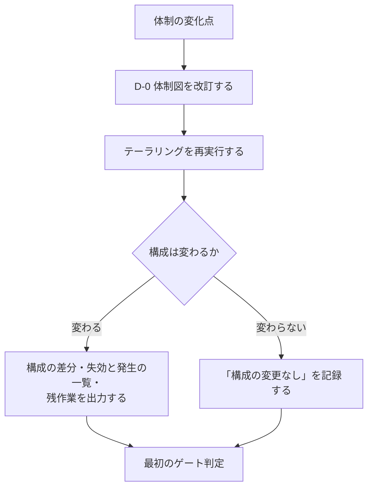
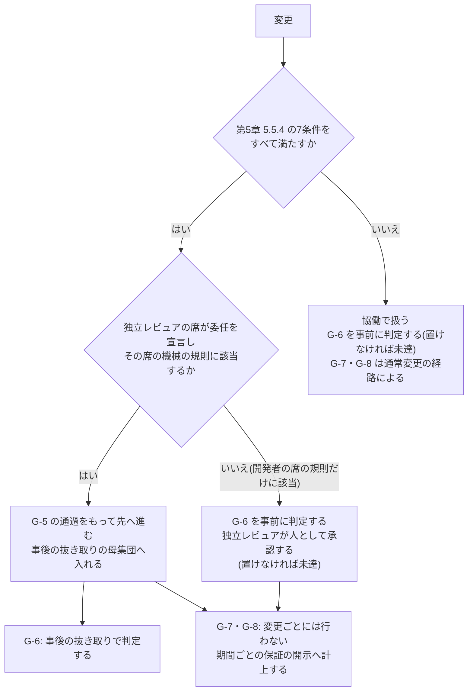

本標準は参照モデルであり、そのまま全組織に適用するものではありません。本章は、**組織の条件に応じて第1章から第7章の要求事項をどう調整するか(テーラリング)**を規定します。調整の対象となる構造の正本は、[ピットイン方式参照モデル](/process-compass/phase4-process-design/process-model/)です。

:::note
本章の調整規則は、[プロセス提案ツール](/process-compass/tool/simulator/)の知識ベースとして機械可読な形式でも保持しています。本章が正本であり、データはその符号化です。データ構造は[知識ベーススキーマ設計](/process-compass/tool/knowledge-base-schema/)にあります。
:::

## 調整は宣言を伴う

**テーラリングは適合の放棄ではありません**。プロセスの国際規格では、規定された手順に従って調整し、その内容を宣言したうえで、調整後の状態で目的の達成を実証できる場合に適合の主張が認められます。本標準も同じ構成を採ります。適用の開始と、適合を主張できる範囲は、[第1章 1.10](/process-compass/phase4-process-design/overview/)によります。

調整には次の4つを必ず伴わせます。いずれかを欠く省略は、本標準に基づく調整として扱いません。

| # | 要求事項 |
| --- | --- |
| 1 | 本章の調整軸に基づいて調整する(個別の判断で任意に省略しない) |
| 2 | **標準から外した項目、簡略化した項目を、理由とともに宣言する**(差分の一覧を残す) |
| 3 | 調整後の構成で、当該ゲートの目的が達成されることを示す |
| 4 | **従う本標準の版を宣言する**(第N版と発行日。発行した版が無い間は「作業中の版(未発行)」と書く。[第1章 1.10.3](/process-compass/phase4-process-design/overview/))。本章で加える規格(業種固有の規格など)は、発行年を付けて宣言する |

<!-- impl IMPL-0310 target=d0-template state=delivered check=presence note="従う本標準の版の欄を D-0 体制図の冒頭に置く。構成の standard.edition と一致させる旨を書く。欄の存在は check-template-fields が確かめる。採用者の D-0 で欄が無い・空欄であることは /pit が注記する(IMPL-0311)。欄の値と構成の standard.edition の一致と、宣言に加える規格の発行年は、機械で確かめない(#313)(単位: 欄)" -->

版を切り替えるときは、新しい版で要求事項1〜4 を満たし直します。版の切り替えは適用の開始を動かしません(第1章 1.10.1)。

要求事項2の宣言は、[附属書D](/process-compass/phase4-process-design/proposal-template/)の提案書に含めます。宣言のない省略には、後から妥当性を検証する手段がありません。

## 再テーラリングの契機

テーラリングは、案件の開始時に1回だけ行うものではありません。**体制の変化点が生じたときは、テーラリングを再実行しなければなりません**([ADR-0055](/process-compass/adr/0055-team-change-points/))。変化点の定義と手続の正本は[第3章 3.13](/process-compass/phase4-process-design/roles-responsibilities/)です。本節は、そのうち再テーラリングに関わる要求事項を規定します。



### 契機に数えるもの

D-0 体制図、テーラリングの入力(軸A〜E)、担い手の適合性確認の前提、のいずれかを変える変化を契機とします。

| # | 体制の変化点 | 変わる入力 |
| --- | --- | --- |
| 1 | 責任者の増減・交代・長期の不在、兼務の変更 | D-0 体制図、軸A。交代した席では、適合性確認の承認も失効する([第3章 3.4.2](/process-compass/phase4-process-design/roles-responsibilities/)) |
| 2 | 人数の境界の通過(3名未満と3名以上、10名) | 軸A |
| 3 | 担い手の運用形態の変更と、委任の範囲の変更 | D-0 体制図 |
| 4 | AI の担い手の識別の変更(モデルの版・提供者、指示資産の恒久層、ツールと権限、実行基盤) | 担い手の適合性確認の前提 |
| 5 | 軸B〜E の入力の変化(ステージ移行、規制への該当、委託への切替、安全重要度) | 軸B〜E |

変化点1 は、席の責任者の変化です。席の作業を複数の人が担う体制で、責任者でない担い手(人)が増減・交代した場合は、次のいずれかを満たすときだけ契機とします。

- 兼務禁止と独立の再判定に影響する
- 人数の境界を通過する

### 契機に数えないもの

次は契機に数えません。**「書かれていない」のではなく、数えないと決めたものです**。

| 数えないもの | 扱う規定 |
| --- | --- |
| 目的・範囲・納期・予算の変更のうち、上表の1〜5 へ波及しないもの | [第2章 2.10](/process-compass/phase4-process-design/lifecycle/)、[第7章 7.6](/process-compass/phase4-process-design/exception-escalation/)、ステージ移行ゲート |
| 短期の不在 | D-0 表5 の代理者が、定めた範囲で代行する。代理者の定めが無く判定期限を超過した場合は、[第3章 3.9.3](/process-compass/phase4-process-design/roles-responsibilities/)により、D-0 表3 の行「ゲート判定・会議体の決定が期限を超過」の判定する者が代理の決定者を指名する。いずれの場合も席の責任者は変わらない。準拠テンプレートの D-0 が「代行者」と呼ぶ欄は、表5 の代理者に当たる |
| 版を固定したままのセッションの再起動と、並列数の変更 | なし(体制の変化ではない) |
| 提供者の一時的な障害と切り替え | [第3章 3.12.5](/process-compass/phase4-process-design/roles-responsibilities/)。切り替えの間は担い手の識別が変わるため、委任を協働へ下げる |
| 提供者の障害・利用上限で AI が使えない期間 | 期間と、その間の扱い(人へ戻した / 止めた)を D-0 の改訂履歴へ記録する。保証の開示の項目7 へ出す |
| 個々の変更のリスク区分の判定 | 変更ごとの判定であり、体制の変化ではない |

**納期だけの変更は、契機に数えません**。起票された場合は「構成の変更なし」と記録します。

納期を理由に統制を外す要求は、納期の変更ではありません。**統制を緩める向きの変更**として、次項の判定に掛けます。

### 再実行の時点と向き

| 項目 | 要求事項 |
| --- | --- |
| 時点 | 変化点の後、最初のゲート判定より前に再実行する。期限を日数では定めない |
| 緩める向きの変更(人の確認を減らす、委任の範囲を広げる、ゲートを省略へ変える) | 記名と理由を要する。決定するのは、対象の席の責任者、または D-0 表1「体制と運用形態」の決定者である([第6章 テンプレ0](/process-compass/phase4-process-design/deliverable-templates/))。**AI の名義の記名を受け付けない**。委任の範囲を広げる手続は、[第5章 5.5.7](/process-compass/phase4-process-design/human-ai-boundary/)による |
| 厳しくする向きの変更(人の確認を増やす、委任の範囲を狭める、委任から協働へ下げる) | 即時に適用する。記名を待たない |
| 準拠テンプレートの取り込みで、現行の規則による再導出が厳しくなる差(未適用の厳格化。体制の変化点を伴わない) | 構成を変える経路は構成の変更の手続だけであるため、取り込みは構成の値を変えない。再導出で厳しくなる差を、取り込みの出力と、次の一手の注記と、保証の開示に、適用されるまで表示し続ける。適用は、記名を待たない再導出で行う。安全重要度 CL1 以上で G-6・G-7 が規則より緩いまま残る構成は、出荷の証跡の集約が欠落として数え、適用されるまで出荷しない。AI の担い手は、表示を理由に構成を書き換えない([ADR-0088](/process-compass/adr/0088-organizational-distance-steps-and-cl1-stage-relaxation/) 決定4) |
| 未達が解けることに伴う代償措置の終了(代償措置で引き上げた検査の値を、基準値へ戻すなど) | 緩める向きの変更として、未達を解く構成の変更の差分に、終了の行を示す。その変更の記名で決める。別の記名の手続を要しない。終了の行を示さずに戻してはならない。代償措置で引き上げた値は、基準値(導出値、または組織が較正した値)と分けて記録する。較正した基準値は、未達の解消で動かさない |
| 人の離脱で成立しなくなった統制 | 緩める向きの決定として扱わない。**未達の発生**として、記名を待たず即時に構成へ反映し、表示する。旧い構成のまま止めない。この扱いは、体制内の人が実際に減った場合と、席の責任者が体制から外れた場合に限る。人が減っていないのに人の確認を減らす変更は、緩める向きの変更として扱う |
| ステージを前へ戻す変更(軸B を PoC へ戻すなど) | 記名と理由だけでは足りない。ステージ移行ゲート(SG)の判定を要する |
| 安全重要度が上がり、委任を適用できなくなった場合 | 抜き取り待ちの委任の変更を、協働の手続で全件確認し直す |
| 宣言の更新 | 再実行のたびに、「調整は宣言を伴う」の4つの要求事項を満たし直す |
| 結果が「構成の変更なし」の場合 | その結果を記録する |
| 記録の置き場 | D-0 の改訂履歴([第6章 テンプレ0](/process-compass/phase4-process-design/deliverable-templates/)の表8)と、構成の変更記録 |

<!-- impl IMPL-0349 target=evidence-aggregation state=delivered check=machine test=template/scripts/gate/test-roster-rules.mjs note="未適用の厳格化。準拠テンプレートの pendingTightenings が、現行の規則による再導出と構成のゲートの状態・G-6 の範囲を比べる。取り込み(intake)の案内、/pit の注記、保証の開示に出し、CL1 以上の G-6・G-7 の差は出荷の証跡の集約の欠落に数える。構成は書き換えない" -->

緩める向きと厳しくする向きを非対称に扱うのは、[第5章 5.4.5・5.4.6](/process-compass/phase4-process-design/human-ai-boundary/)と同じ構成です。**再テーラリングのために、新しいゲート・会議体・台帳を設けません**。

体制の縮小を緩める向きの決定として扱わないのは、記名を待つ間、成立していない統制が成立しているものとして表示され続けるためです。人が抜けた時点で、統制は既に成立していません。未達のまま出荷するかどうかは、この手続ではなく既存の規定で決まります。

| 未達のまま出荷する対象 | 扱う規定 |
| --- | --- |
| R1 の変更 | [第7章 7.3](/process-compass/phase4-process-design/exception-escalation/)の例外承認を要する |
| CL1 以上の案件、および規制業の案件 | 出荷しない。軸E「人員が足りない場合」の選択肢による |
| 上記以外 | 未達を保証の開示へ表示し、リリース決裁(G-8)で受容を記名する |

期限を日数で定めないのは、値の根拠が無いためです。変化点の列挙と「最初のゲート判定より前」という時点は、製造と労働安全の変更管理からの類推です。開発体制へ転用した効果は測定されておらず、根拠の水準は ADR-0055 に開示しています。

### 準拠テンプレートが備える手段

準拠テンプレートは、変化点を構成へ反映する手段を備えなければなりません。全問を聞き直す初期化の再実行だけでは、何が失効し、何が新たに生じたかを特定できないためです。

| 区分 | 内容 |
| --- | --- |
| 入力 | 変化点の種別(「契機に数えるもの」の1〜5)、対象、変更後の値 |
| 出力1 | 構成の差分(席、ゲートの状態、未達、逸脱、列挙に無い離脱) |
| 出力2 | 失効と発生の一覧(失効する例外と適合性確認、解消する未達、新たに生じる未達・逸脱・列挙に無い離脱) |
| 出力3 | 残作業(やり直しを要する確認、再確認の期日、人が行う設定) |

<!-- impl IMPL-0028 target=process-change-skill state=delivered check=manual note="体制の変化点の種別を入力として構成の差分・失効と発生の一覧・残作業を出力する。確かめる者: 変化点の決定者(/process-change の出力を読むとき)" -->

出力は構成の再生成までとします。**緩める向きの変更を、手段の側で確定させてはなりません**。確定は、記名した者の決定によります。

## 入力: 5つの調整軸

| 軸 | 選択肢 | 何に効くか |
| --- | --- | --- |
| A. チーム規模 | 1〜2名 / 3〜9名 / 10名以上 | ロールの兼務許容、独立レビューの方式 |
| B. 事業ステージ | S0 探索 / S1 価値確立 / S2 スケール | ゲートの厳格さ、コア指定の範囲、負債の扱い |
| C. 期待品質・規制 | 標準 / 高(社会インフラ・金銭) / 規制業 | 出荷判定の厳格さ、記録の粒度、監査対応 |
| D. 開発形態 | 内製 / 受託(発注側) / 受託(受注側) | 契約上の確認行為との対応づけ、判定の置き先、価値責任者の所属 |
| E. 安全重要度 | CL0 / CL1 / CL2 / CL3 | 安全成果物の要否、AI自律レベルの上限、検証手法 |

:::note
軸の記号 A〜E は調整軸の識別子です。[AI実行形態](/process-compass/phase5-implementation/ai-environment/)の E1〜E3 とは関係ありません。
:::

### 軸B と事業ステージの対応

本章の軸Bは、[第2章 2.3](/process-compass/phase4-process-design/lifecycle/)の事業ステージに対応する軸です。提案ツールは運用上の呼称で4区分を用いるため、対応を次のとおり定めます。

| 事業ステージ | ツールの区分 |
| --- | --- |
| S0 探索(別称 DR0) | 検証中(PoC) |
| S1 価値確立(別称 DR1) | 最初の顧客向け(MVP) |
| S2 スケール(別称 DR2) | 拡大中(グロース)、安定運用 |

S2 を2区分に分けるのは、負債の扱いとゲートの厳格さが実務上異なるためです。**規定上はいずれも S2 です**。

## 軸A: チーム規模による調整

| 項目 | 1〜2名 | 3〜9名 | 10名以上 |
| --- | --- | --- | --- |
| 価値責任者×技術判断者の兼務 | 許容(1人が両方) | 非推奨(兼務する場合は、兼務の事実と理由を D-0 体制図へ記録する。[第3章 3.5](/process-compass/phase4-process-design/roles-responsibilities/)) | 禁止(根拠の水準は第3章 3.5 の EV-0156) |
| 事業決裁者×価値責任者の兼務 | 許容 | 非推奨(兼務する場合は、兼務の事実と理由を D-0 体制図へ記録する) | 非推奨(同左。どの規模でも禁止しない。第3章 3.5) |
| 独立レビュー | **作成を指示した本人以外の確認者**に置く。2名体制は相手、1名体制は外部(他チーム・コミュニティ・別部門)。置けない範囲は**未達として表示**する | チーム内の、作成を指示した者と別の人 | チーム内+コア機能は別チーム |
| 出荷判定 | 価値責任者が兼ねる(価値責任者が開発者または独立レビュアの席の責任者を兼ねる構成に限り、[3.5.2](/process-compass/phase4-process-design/roles-responsibilities/)の代償措置を満たすこと) | 兼務者を指名。開発者・独立レビュア・事業決裁者の席の責任者は指名しない([第3章 3.5](/process-compass/phase4-process-design/roles-responsibilities/)) | QA部門・専任 |
| 機能仕様承認の委譲 | 不要(全部自分) | 許容(機能責任者へ。[第3章 3.6](/process-compass/phase4-process-design/roles-responsibilities/)) | 推奨(機能責任者へ) |
| 市場・顧客仮説の検証(D-0 表1) | 価値責任者が兼ねる。兼ねられない場合は**未達として宣言**する | 兼務者を指名 | 実施の担い手を分けて指名 |
| 価値責任者の顧客接点 | 自ら顧客に接する、または検証の設計と発注ができる | いずれかを満たす者を任命 | 同左 |
| 検証活動の費用 | 期間予算の内訳として明示する | 同左 | 同左 |

人数は、D-0 体制図の表5 に記載した人のうち、表5-2 の区分が「体制の内」の人で数えます([第6章 テンプレ0](/process-compass/phase4-process-design/deliverable-templates/) 表5-2 の区分の規定)。AI の担い手、外部の確認者、組織上の任命権者は数えません。外部の確認者と組織上の任命権者は体制の外の人であり、AI の担い手は人ではないためです。受託の案件では、発注側と受注側の、区分が「体制の内」の人を合わせて数えます(軸D「委託の体制の人数と、軸A との組み合わせ」)。

<!-- impl IMPL-0300 target=gate-contract state=delivered check=machine test=template/scripts/gate/test-roster-rules.mjs note="設問の回答(q-team-size)と、席の責任者と人の名簿(外部の確認者を除く)から数えた人数の食い違いを、3名と10名の境界で検出し、構成の生成と契約検査が拒否する(config.mjs の headcountProblems)。test-roster-rules.mjs が固定する(#312)" -->
<!-- impl IMPL-0278 target=profile-generator state=undelivered check=manual plan=scheduled issue=351 review=2027-04 note="軸A の人数を、D-0 体制図の表5 の人(AI の担い手と外部の確認者を除く)で数えること。準拠テンプレートは規模の規則を設問の回答(q-team-size)から導き、名簿の人数から直接は導かない。回答と人数の食い違いの検出(IMPL-0300)は、3名以上の回答で名簿が空の場合を検出しない。数え方は向きで異なる(回答より多い向きは席の責任者と名簿の多い側、少ない向きは名簿だけで数える)。採用者は、名簿へ全員を記入したことを D-0 の改訂の時点で確かめる(#312 で注記を実装に合わせた)。確かめる者: 計画の Issue(issue= の番号)の担当者(降ろすときに確かめる。それまでは降りていない規定として台帳に出る)" -->

:::caution[暫定 EV-0148 / 見直し 2027-10]
**対象**: 10名の境界(10名以上の列の規則)。
**根拠の水準**: E0(なし)。
**差し替え条件**: 採用組織の人数と、10名以上の列の規則(コア機能の別チームのレビュー、QA 部門・専任の出荷判定)を適用した範囲・しなかった範囲での、レビューの所要時間・出荷後の欠陥の観測。

10名は、チームの大きさの慣行に合わせた値です。Scrum Guide(2020)は「通常10名以下」をチームの大きさとしており、本標準の「10名以上」の境界とは1名ずれます。人数と規則の効果の関係を測った測定は、見つかっていません。
:::

境界を採用組織が自ら定める形は、課しません。自己申告で規則を外せる形になるためです([ADR-0044](/process-compass/adr/0044-no-search-obligation-for-existing-parts/) 決定4 と同じ型)。10名の境界は、能力依存の定数の登録簿([運用メトリクス](/process-compass/phase6-operation/metrics/))にも載せません。組織の構造に由来する境界であり、担い手の能力に依らないためです。

10名以上の規則のうち、実行層が確かめるのは次の範囲です。コア機能(確約範囲・コア指定のパス。構成の `delegation.protectedPaths`。委任を適用しない案件にも宣言できる)に触れる変更の独立レビューに、作成を指示した者と別の所属(人の名簿の `team`)の人を含むかを、出荷判定の証跡の集約が保証の開示の項目1 に件数で出します。出荷判定者の席の責任者の所属が開発者の席の責任者と別かは、同じ項目へ出します。所属の欄が無い名簿、コア指定のパスの未宣言は「判定できない」と出ます。いずれも記載の欠落にはしません。機能責任者への仕様承認の委譲は、席と記録のどちらも無く、機械では確かめません。実装の台帳に「降りていない」と開示し、採用者が手で代える手順を置きます(#288 第6巡)。次の一手(`/pit`)は、直近の出荷の集約の出力が手元にあれば、同じ件数を同じ文で注記に添えます。集約の後に既定ブランチが進んでいれば、その旨も出ます(#288 第7巡)。

<!-- impl IMPL-0084 target=evidence-aggregation state=delivered check=manual note="10名以上の規則「コア機能は別チームがレビューする」(構成 review.mode: internal-plus-core-external)。コア機能のパス(delegation.protectedPaths)に触れ独立した人の確認に数えた変更ごとに、数えた承認者に作成を指示した者と別の所属(名簿の team)の人を含むかを保証の開示の項目1 に件数で出す。パス未宣言・所属の欄なしは「判定できない」。欠落にはしない(#288 第6巡)。確かめる者: 出荷判定者(G-7 の判定で、集約の出力と保証の開示を読むとき)" -->

<!-- impl IMPL-0085 target=claude-md state=delivered check=presence note="10名以上の規則「出荷判定は QA 部門・専任」(構成 gates.g7.params.approverMode: dedicated-qa)。CLAUDE.md の構成依存部分と next.mjs に規則を常駐させ、出荷の集約が出荷判定者の席の責任者の所属(名簿の team)が開発者の席の責任者と別かを項目1 に出す。所属の欄が無ければ「確かめられない」(#288 第6巡)(単位: 行)" -->

<!-- impl IMPL-0090 target=next-role state=delivered check=manual note="10名以上の規則の項目1 の件数(コア機能の変更の承認者の所属、出荷判定者の所属)を、next.mjs が直近の出荷の集約の出力(evidence/evidence.json)から、集約と同じ文(org-assurance.mjs の coreReviewText・qaAffiliationText)で注記に添える。同じ所属の承認者だけの変更があれば件数を強調し、出荷判定者が判定記録の人が判断する項目に扱いを書くよう案内する。集約の出力が無ければ件数を出さず、読む所在だけを出す。集約の後のコミット数を添える(#288 第7巡 U)。確かめる者: 各ロールの席の責任者(/pit の出力を読むとき)" -->

<!-- impl IMPL-0086 target=config-roles state=undelivered check=manual plan=adopter decision=ADR-0084 note="10名以上の規則「機能責任者へ仕様承認を委譲することを推奨する」。機能責任者の席も委譲の記録も構成に無く、G-4 の判定者は価値責任者の席のまま。機械では確かめない。採用者は委譲の有無と判定者を社内の手順で定め、附属書I I.10 の様式に手で代える手順を書く(#288 第6巡)。確かめる者: 採用者(自らの実行層に実装したときに確かめる)" -->

最小体制(3名)未満では、作成指示者・レビュア・判定者の兼務禁止が成立しません。最小体制が3名である根拠は、[第3章 3.5](/process-compass/phase4-process-design/roles-responsibilities/)によります。1〜2名の場合も、**独立レビューだけは、作成を指示した本人以外の人に求めます**。独立は人の単位で定義するため、確認者を誰に置くかは人数で変わります([第3章 3.5.4](/process-compass/phase4-process-design/roles-responsibilities/)、[ADR-0054](/process-compass/adr/0054-seat-accountable-performer/) 決定7)。

| 体制 | 独立レビュー(G-6)の確認者 | 出荷判定(G-7) |
| --- | --- | --- |
| 2名 | 作成を指示していない側の人。**この相互の確認で G-6 は成立する**。相手も作成の指示に関与した変更は、外部へ依頼する。置けなければ未達 | 兼務。代償措置つきの逸脱([第3章 3.5.2](/process-compass/phase4-process-design/roles-responsibilities/)) |
| 1名 | 外部(他チーム・別部門・社外コミュニティ)へ依頼する。置けなければ未達 | 同上 |

[ADR-0028](/process-compass/adr/0028-unmet-gate-distinct-from-omitted/) 決定1 の「外部のレビュア」は、「作成を指示した者以外の確認者」と読みます。2名体制で成立するのは G-6 だけです。出荷判定者の兼務は、3名未満では逸脱のままです([ADR-0029](/process-compass/adr/0029-shipping-approver-merge-exception/))。

確認者を置けるかどうかの判定は、[第4章 G-6](/process-compass/phase4-process-design/gate-criteria/)によります。判定の根拠は、D-0 体制図の表5(人の名簿と席)の記載です。テーラリングの設問への回答は、初期化の時点の見込みであり、判定の根拠にしません。回答だけでは、確認者を置いたことになりません([ADR-0065](/process-compass/adr/0065-s0-omission-premises-and-roster-derived-confirmer/) 決定5)。

外部の確認者の置き方は2つあり、効果が異なります。人の名簿に載せる置き方と、独立レビュアの席の責任者に置く置き方です。規定は[第3章 3.5](/process-compass/phase4-process-design/roles-responsibilities/)によります。

外部の確認者を得る経路を、本標準は限定しません。例には、ほかの開発者と互いの変更を確認し合う取り決めを結ぶ経路と、対価を払って確認を依頼する経路があります。**どの経路でも、承認を数える条件は自動では満たされません**。承認を独立した人の確認に数えるのは、[第4章 G-6](/process-compass/phase4-process-design/gate-criteria/)の4条件(D-0 体制図の表5 に記載した人への対応づけ、作成を指示した者でないこと、未達の体制では外部の確認者であること、承認した者自身の書いた挙動要約)をすべて満たす場合に限ります。

外部の確認者との守秘の合意、対価、利害の扱いを、本標準は定めません。本標準の範囲外であり、組織の規程と契約によります。外部の確認者の力量の確認は、本標準が定めます([第3章 3.4.1](/process-compass/phase4-process-design/roles-responsibilities/))。外部の確認者を独立レビュアの席の責任者に置く場合の書面の合意(第3章 3.5)は、席の規定に従うことの合意です。守秘・対価・利害の中身を定めるものではありません。

:::caution[暫定 EV-0094 / 見直し 2027-04]
**対象**: 相互に確認し合う取り決めと、対価を払う確認を、外部の確認者を得る経路の例に挙げる記述。
**根拠の水準**: E0(なし)。
**差し替え条件**: これらの経路で得た承認のうち、G-6 の4条件を満たした件数と満たさなかった件数、および満たさなかった条件の内訳。

これらの経路で得た確認が、独立した人の確認として働くことを測った資料は確認できていません。
:::

軸E は、3つの活動(独立した安全性の評価、第5章 5.8.4 の段階「最強」の検証の担当者、安全重要度の判定の確認)に、組織上の距離の段([第1章 1.4](/process-compass/phase4-process-design/overview/))を求めます。内部で届く段は、体制の人数で違います。届かない段は、外部の評価者から調達します。

| 体制 | 内部で届く段 | 外部から調達する段 |
| --- | --- | --- |
| 1名 | なし | 段1〜4 |
| 2名 | 段1(作成を指示していない側の人) | 段2〜4。2名の組織は指揮系統・予算・リリースの権限が1つであり、段2・段3 は内部で成立しない |
| 3〜9名 | 段1。直属の上長が異なり、対象のリリースの権限を持たない人がいれば段2 | 段3・段4。作成の部門と別の部門を持たない組織では、段3 も外部から調達する |
| 10名以上 | 段1〜3(部門の構成による) | 段4 |

- 内部で届かない段は、外部の評価者を人の名簿へ登録して満たす。登録の無い間は未達である(軸E)。理由を書いて低い段で代える経路は無い
- 1〜2名の行は、段の届き方を示すための行である。評価者に段を求める CL2 以上では、1〜2名の構成そのものを認めない(軸E「人員が足りない場合」)
- 安全重要度の判定の確認は、1〜2名の体制でも免除しない。2名の体制の相手は、求める段が段1 の場合に限って確認者に数える。届かない確認の扱いは、軸E「判定の記録と確認」による

確認者を置けない場合、独立レビュー(G-6)は**未達**です。CI(機械検証)の基準の引き上げと AI による確認は、代償措置として記録し、未達のまま表示します。**代償措置を、未達の解消や独立レビューの代替として扱いません**([ADR-0028](/process-compass/adr/0028-unmet-gate-distinct-from-omitted/) 決定6)。

担い手の運用形態の上限(人確定・協働・委任)は、チーム規模では変わりません。上限は変更ごとのリスク区分で決まります([第5章 5.5](/process-compass/phase4-process-design/human-ai-boundary/))。**1名の体制であることを理由に、協働や委任の範囲を広げてはなりません**。

### 外部の確認者を高リスクの変更へ集中させる(適用: チーム規模 1〜2名)

1〜2名の体制でも、型は変えません。G-6 は作成を指示した本人以外の確認者に置き、置けなければ未達として表示します。G-7 は代償措置つきの逸脱(1.10.2 の D-1)として表示します([第3章 3.5.2](/process-compass/phase4-process-design/roles-responsibilities/))。

本節が扱うのは、外部の確認者を要する変更です。1名体制の変更と、2名体制で相手も作成の指示に関与した変更が当たります。外部の確認者を独立レビュアの席の責任者に置いた体制は、独立レビュー(G-6)を適用する体制です。その体制では、本節の R2 の件数による表示を用いません。確認を経ていない変更は、記録の欠落として扱います([第3章 3.5](/process-compass/phase4-process-design/roles-responsibilities/))。2名体制で相手が確認できる変更は、相互の確認で成立するため、本節の配分の対象になりません。外部の確認者の帯域は、変更ごとのリスク区分に応じて配分してよいものとします([ADR-0054](/process-compass/adr/0054-seat-accountable-performer/) 決定8)。

| 変更のリスク区分 | 独立レビュー(G-6)の扱い | 表示 |
| --- | --- | --- |
| R1 | 外部の確認者を**集中させる**。G-6 未達のまま出荷する場合は、[第7章 7.3](/process-compass/phase4-process-design/exception-escalation/)の例外承認を要する | 例外承認の記録(記名、回収の期限) |
| R2 | 外部に置く。置けなければ未達 | 未達の変更の**件数をリリースごとに**表示する |
| R3 | [第5章 5.5.4](/process-compass/phase4-process-design/human-ai-boundary/)の委任の条件をすべて満たし、独立レビュアの席が委任を宣言していて、その席の機械の規則に該当する変更に限り、判定の時点を事後の抜き取りへ移せる。開発者の席の規則にだけ該当する変更と、条件を満たさない変更は R2 の行による | 事後へ移した変更を、人の事前確認を経ていない変更として、変更単位で識別する |

- R1 に例外承認を課すのは、R1 が事後の取り消しを前提にできないためである([第3章 3.8.1](/process-compass/phase4-process-design/roles-responsibilities/))。検出してから取り消すという代償が成立しない
- R2 の未達を案件単位の1行ではなくリリースごとの件数で示すのは、変わらない表示は読まれなくなるためである([第5章 5.7.5](/process-compass/phase4-process-design/human-ai-boundary/))
- 抜き取りを行う者が作成を指示した者と同一人物である場合、独立は成立しないままである。その旨を保証の開示([附属書H](/process-compass/phase4-process-design/assurance-case/))へ表示する
- 本節の配分を適用できるのは、1〜2名の構成が認められる案件までである。安全重要度 CL1 以上および規制業では、1〜2名の構成そのものを認めない(ADR-0028)

**この配分は独立を作りません**。整えるのは開示であり、人の確認を高リスクの変更へ寄せることだけです。外部の確認者を置けない1名の体制では、R2 の変更は、別の人が出荷前に見ることなく出荷されます。残るのは、壊れたことを後から検出して取り消せる状態だけです。

:::caution[暫定 EV-0054 / 見直し 2027-03]
**対象**: 1〜2名の体制で外部の確認者を R1 の変更へ集中させ、R2 の未達をリリースごとの件数で表示する配分。
**根拠の水準**: E1(間接)。
**差し替え条件**: R2 の未達のまま出荷した変更のうちリリース後に欠陥が判明した割合と、外部の確認を経た変更での同じ割合。前者が後者を上回る場合は、R1 への集中をやめ、R2 の変更にも外部の確認者を割り当てる。差が無いか下回る場合は、配分を維持する。

人の確認は回数が増えるほど阻止率が下がるという測定はありますが、許可プロンプトの承認を対象としたベンダーの自己報告です(2026-09 時点。`research/282-survey-2026-09/`)。成果物の独立レビューへの外挿であり、この配分で見逃しが減るかは測定していません。
:::

### 市場・顧客仮説の検証が成立しない場合

[ADR-0031](/process-compass/adr/0031-market-hypothesis-by-structure-not-fields/)は、市場・顧客仮説の検証を、企画書の欄ではなく体制と予算の側で担保すると定めました。担保の箇所は、D-0 表1 の決定の種類、価値責任者の任命基準、期間予算の内訳の3つです。1〜2名の体制では、この3点は兼務で成立するか、成立しないかのいずれかになります。

**「省略してよい」とは規定しません**。仮説を誰も検証しない構成は、当該の目的が達成されることを示せていない状態です。[ADR-0028](/process-compass/adr/0028-unmet-gate-distinct-from-omitted/)の区別では、これは省略ではなく未達に当たります。

| 状態 | 条件 | 宣言の仕方 |
| --- | --- | --- |
| 兼務で成立する | 価値責任者が自ら顧客に接する。または検証の設計と発注ができる | **兼務を宣言して適用する**。D-0 に兼務を明記し、費用を期間予算の内訳へ書く |
| 成立しない | 顧客接点を持たず、調査を発注する予算もない | **未達(`unmet`)として宣言する** |

未達の宣言には、独立レビュー(G-6)の未達と同じ3点を書きます。

| # | 書く内容 |
| --- | --- |
| 1 | 未達の理由(顧客接点の不在、予算の不在のいずれか、または両方) |
| 2 | 代償措置。記録しても**未達の解消として扱わない** |
| 3 | 調達先。**未記入は未記入として表示する** |

<!-- impl IMPL-0006 target=config-unmet state=delivered check=presence note="目的を達成する構成を示せないゲートを未達として宣言する(単位: キー)" -->

調達先には、案件に関与していない人から反応を得る経路を書きます。例は次のとおりです。

- 公開して、コミュニティの反応と利用の実績を観測する
- 他の個人開発者と相互に仮説を評価する
- 業務上の接点を持つ既存の顧客・同僚へ聞き取る
- 外部の助言者へ、検証の設計だけを依頼する(実施は自分で行う)

代償措置として置けるのは、未検証であることの記録と、見直しの期日の設定に限られます。**仮説の当否は、これらでは分かりません**。

### 極小規模での事後監査への切替

軸Aの表は、1〜2名の体制でも、独立レビュー(G-6)だけは作成を指示した本人以外の人に求めると定めています。ただし相手や外部への依頼は待ち時間を伴います。ライブラリのパッチ適用や文言修正のような定常変更へ一律に適用すると、変更のたびに滞留が生じます。本節は、**判定の時点をリリース前からリリース後の抜き取りへ移す**調整を規定します。

**判定の省略ではありません**。判定はなくならず、時点と対象範囲が変わります。

本節は、[第5章 5.5.4](/process-compass/phase4-process-design/human-ai-boundary/)の委任を、1〜2名の体制へ適用したものです。**切替の条件を、本節で独自に定めません**。本節は以前、3条件での切替を定めていました。これを 5.5.4 の7条件へ改めています([ADR-0054](/process-compass/adr/0054-seat-accountable-performer/))。3条件と7条件が併存すると、緩いほうだけが使われるためです。

7条件は、登録した変更種別に当たる個別の変更へ当てる条件です。**種別を登録できるかどうかは、7条件より前に決まります**。登録した種別には AI自律レベル L3 を適用するため、第5章 5.4.6 の検知条件を計測できない範囲では、種別を登録しません(第5章 5.5.4)。計測の基盤を持たない体制は、人数にかかわらず、本節の切替を使えません。

#### 委任・標準変更・L3 は同じ変更種別を指す

切替の対象は、事前に登録した変更種別です。本標準には、登録した変更種別を指す語が3つあります。**3つは同じものです**。

| 語 | 規定 | 登録した変更種別について定めること |
| --- | --- | --- |
| 委任の範囲 | 第5章 5.5.4 | 変更ごとの検証を担い手へ委ねる。独立レビュアの席の規則にも該当する変更に限り、人の事前確認なしに先へ進め、独立レビュアの席の責任者が事後に抜き取りで確かめる |
| 標準変更 | [第3章 3.7.4](/process-compass/phase4-process-design/roles-responsibilities/)の標準変更カタログ | 事前承認済みとして扱い、G-5 の通過をもって実施する |
| AI自律レベル L3 | 第5章 5.4.2 | 機械が常時監視し、人が事後に確認する |

登録には、次を要求します。

| 項目 | 要求事項 |
| --- | --- |
| 登録する者 | リリース判定会(B-4)。B-4 を置かない体制では、D-0 表1「体制と運用形態」の決定者(人)。AI の名義の登録を受け付けない |
| 席の責任者が定めるもの | 登録された変更種別の内側で、自席の委任の範囲を宣言する。登録そのものは行わない |
| 登録の根拠 | 7条件の条件3・4。既存のテストで検出できることと、取り消しを実行した実績である。連続運用の期間を根拠にしない |
| 登録の前提 | 当該の種別に掛かる第5章 5.4.6 の検知条件を計測できること。継続的な集計を要する条件(差し戻し率、手戻り率)を含む。**計測できない種別は登録しない** |
| AI自律レベルとの関係 | 登録の判定が、当該の種別についての引き上げ(第5章 5.4.5)の判定を兼ねる。別の判定を重ねない |
| 登録の確定 | 人が確定する。範囲の拡大も同じである(第5章 5.5.5) |
| 該当を判定する機械の規則 | 規則の追加と範囲の拡大の手続は、第5章 5.5.7 による |
| 登録からの削除と範囲の縮小 | 厳しくする向きの変更である。検知した時点で適用する |

1〜2名の体制は B-4 を設置しません(後掲「会議体と体制図の調整」)。したがって登録するのは、D-0 表1「体制と運用形態」の決定者です。既定は事業決裁者です([第6章 テンプレ0](/process-compass/phase4-process-design/deliverable-templates/))。

登録の前提にいう計測は、判定の履歴を期間で集計する仕組みのことです。保証の開示の項目6 が示す検出能力の測定(欠陥注入による検出率。第5章 5.6.2)とは別の量です。登録の前提が求めるのは、5.4.6 の検知条件の計測です。検出能力が「未測定」の体制でも、検知条件を計測できていれば、登録の前提を満たす体制です。逆は成り立ちません。

#### 切替が成立する条件

代替の根拠は「機械が代わりに読むこと」ではなく、**壊れたことを検出でき、壊れたら取り消せること**に置きます。



条件の正本は第5章 5.5.4 です。下表は、各条件が 1〜2名の体制で何を意味するかを示します。

| # | 条件(要旨) | 1〜2名の体制での意味 |
| --- | --- | --- |
| 1 | 案件の安全重要度が CL0 で、規制業に該当しない | 1〜2名の構成が認められる範囲と同じである(軸E「人員が足りない場合」) |
| 2 | 変更がリスク区分 R3 で、登録した変更種別に当たる。該当は機械の規則で判定する | 行為する AI 自身に、該当を判定させない。規則で分類できない変更は協働へ落とす。種別の定め方は「対象にできる変更の境界」による |
| 3 | 機械検査(G-5)の全項目を通過し、変更箇所の挙動を既存のテストで検出できる | 事後の抜き取りは不具合の検出手段ではない。検出は機械が担う |
| 4 | 単独で取り消せ、取り消しを実行した実績がある | 抜き取りまでの間、誤りが残り続けることを許容するための条件である |
| 5 | 確約範囲(SC-M)とコア指定の機能に触れない | 取り消しても損害が残る変更を、委任の対象にしないため |
| 6 | 独立レビュアの席の責任者が、事後に抜き取りで確かめる。委任の条件に反する変更を検知したら協働へ引き下げる | 抜き取りは G-6 の判定であり、「事後監査の手続」により行う。委任した席の責任者が行うのは、範囲と条件を定めることと、委任の条件に反する変更を検知したときの引き下げである。別の人を抜き取りの実施者に置けないときは、その旨を開示する |
| 7 | 委任で先へ進めた変更として、変更単位で識別できる。G-6 の判定を事後へ移した変更は、人の事前確認を経ていない変更として識別できる | 件数を保証の開示の項目1・3 へ載せる。G-6 の判定を事後へ移した変更を、G-6 を通過した変更として記録しない。開発者の席の規則にだけ該当し、独立レビュアが事前に承認した変更は、独立した人の確認を経た変更に数える |

条件4の「実績がある」が指すのは、宣言ではなく実行の記録です。**一度も取り消したことのない経路を、取り消せる経路として数えません**。

#### 登録した種別の変更が通るゲート

7条件をすべて満たす個別の変更は、次のとおり扱います。

| ゲート | 個別の変更での扱い |
| --- | --- |
| G-5 自動検証 | 全項目の通過をもって先へ進む(第3章 3.7.4 の標準変更) |
| G-6 独立レビュー | 事後の抜き取りで判定する。判定者は独立レビュアの席の責任者のままである。事後へ移すのは、独立レビュアの席が委任を宣言し、変更がその席の機械の規則に該当する場合に限る。開発者の席の規則にだけ該当する変更は、G-6 を事前に判定する |
| G-7 出荷判定、G-8 リリース決裁 | 個別の変更ごとには行わない。登録時の事前承認と、期間ごとの保証の開示への計上で扱う |

- 期間は、事後の抜き取りと同じ周期で区切る。月次が既定である(「事後監査の手続」)
- 期間ごとの保証の開示は、出荷判定者が突合して記名する。出荷判定者は、開示された未達・未測定への異議の有無を記載する。開示された未達の受容は、事業決裁者が記名する([第4章 G-8](/process-compass/phase4-process-design/gate-criteria/)、[附属書H](/process-compass/phase4-process-design/assurance-case/) H.5)
- 本番環境への反映の承認(第5章 5.4.3)には、登録時の記名による事前承認が当たる
- **出荷判定者の席とリリース決裁の席は委任しない**。変更ごとに判定しないことは、席を AI へ渡すことではない
- 条件を1つでも欠く変更は、協働で扱う。G-6 は事前に判定し、G-7・G-8 は通常変更の経路による

#### 対象にできる変更の境界

本節は、低リスクを主観で判定させないため、委任の範囲を満たすべき属性で定義します。

| 属性 | 境界 |
| --- | --- |
| 変更の種別 | 依存パッケージのパッチ更新、表示文言、スタイル、既定値の範囲内での設定変更 |
| 導入するもの | 新たな外部呼び出し・データ構造・権限のいずれも導入しない |
| 規模 | [第4章](/process-compass/phase4-process-design/gate-criteria/)の L0 の既定値を超えない。**委任の規模条件は、規模の基準値(構成 `task`)の値を読むが、超過の扱いが別である**。基準値の超過は規模の確認と区分の下限 R2 で扱うが、委任は自動マージのため、超えた変更は委任の対象外(協働)になる。基準値を `null`(基準なし)にしても、委任の規模条件は既定値で縛る |

**切替は上限の緩和を伴いません**。時点を動かす調整と、1件あたりの規模を広げる調整は別物です。

種別の列挙は組織が拡張してよいものとします。ただし拡張は、事後監査の記録を根拠として行います。拡張は登録に当たり、前掲の登録の要求事項によります。委任の範囲を広げる変更であり、緩める向きの変更です。手続は第5章 5.5.7 によります。

#### 事後監査の手続(適用: 委任を適用した R3 の変更。体制の規模によらない)

この手続は、委任([第5章 5.5.4](/process-compass/phase4-process-design/human-ai-boundary/))の条件6 の手続です。1〜2名の体制に限らず、委任を適用するすべての体制で用います。

| 項目 | 規定 |
| --- | --- |
| 実施者 | 独立レビュアの席の責任者。作成を指示した者と別の自然人とする。2名体制では、作成を指示していない側の人が当たる。別の人を置けないときは、責任者本人が抜き取り、その旨を保証の開示([附属書H](/process-compass/phase4-process-design/assurance-case/) H.6)へ表示する。**本人による抜き取りを、独立した確認として数えない** |
| 頻度 | 月次を既定とする |
| 対象 | 当月の切替対象リリースから抜き取る。**全件ではない** |
| 抜き取り数 | 組織で定める。定めがない場合、当月の全件と5件のいずれか少ないほう。数えるのは**変更の件数**である(プロセス内部監査の1段目が数える案件の件数とは別) |
| 確認すること | 抜き取った変更について、G-6 の基準1〜6([第4章 G-6](/process-compass/phase4-process-design/gate-criteria/))。挙動要約を含む。あわせて、切替条件の充足、取り消し可能性の実在、登録した種別の条件に反する変更の有無 |
| 記録 | ゲート判定記録(テンプレ4)と同じ書式で残す |

委任で移るのは判定の時点であり、判定基準は変わりません。抜き取った変更には、事前に判定する場合と同じ基準を当てます。抜き取られなかった変更は、G-6 の基準で確かめられていないままです。

[附属書H](/process-compass/phase4-process-design/assurance-case/) H.3 の抽出の規則を本項の事後監査へ当てはめ、抽出する対象を、当事者(切替を適用した変更の作成を指示した者)に選ばせてはなりません。本項では、H.3 の当事者(監査の対象となる案件へ関与した者)の範囲を、切替を適用した変更の作成を指示した者に置き換えます。作成を指示していない実施者は、同じ案件へ関与していても、抽出する対象を選べます。見つかった所見は、是正の完了まで追跡します。実施者は上表によります。本項の事後監査は、プロセス内部監査の手続を極小規模の切替へ適用したものです。**別の監査を新設したものではありません**。抽出と追跡の手続の例は、[フェーズ6(プロセス内部監査)](/process-compass/phase6-operation/process-audit/)を参照。

委任の条件に反する変更を見つけた場合、当該の変更を差し戻すのではなく、**切替の適用範囲を狭めます**。稼働中の変更を事後に差し戻す手続は、取り消し可能性の担保とは別の問題です。

委任の条件に反する変更が2期連続で出た場合、切替を停止してリリース前の判定へ戻します。

適用範囲を狭めることは、該当する変更種別を協働へ引き下げることに当たります。厳しくする向きの変更であり、検知した時点で適用します。

:::caution[暫定 EV-0004 / 見直し 2027-08]
**対象**: 抜き取り数(当月の全件と5件のいずれか少ないほう)と、切替を停止する条件(委任の条件に反する変更が2期連続)。
**根拠の水準**: E0(なし)。
**差し替え条件**: 自組織における、抜き取り数別の、委任の条件に反する変更の検出率。

抜き取り監査の標本設計に関する一般的な手法はありますが、この用途で必要な抜き取り数を測った資料を確認できていません。
:::

#### AI の確認を独立した人の確認に数えません

AI による確認を、独立した人の確認に数えません。自動レビューエージェントの判定も、文脈を分けた別の AI による再レビューも同じです。**G-6 の未達は、AI の確認では解けません**。理由は次のとおりです。

| # | 理由 | 根拠 |
| --- | --- | --- |
| 1 | 独立は責任者(人)の単位で定義する。責任者が同一人物なら、AI を何体に分けても独立は成立しない。AI を担い手に置いて得られるのは、文脈と入力の分離までである | [第3章 3.5.4](/process-compass/phase4-process-design/roles-responsibilities/)、[ADR-0054](/process-compass/adr/0054-seat-accountable-performer/) 決定7 |
| 2 | AI の推定による判定は、判定に数えない。検出の層としてのみ数える | [附属書H](/process-compass/phase4-process-design/assurance-case/) H.4、[ADR-0056](/process-compass/adr/0056-assurance-argument/) 決定4 |
| 3 | 生成側の文脈を切り離した AI の再レビューでも、注入した欠陥の約 73% を見逃した測定がある | 2026-09 時点の外部の測定。切り離しで検出が上がる向きは複数の測定で一致するが、見逃しの値は1件の測定による。出典は `research/282-survey-2026-09/` |
| 4 | 生成物の確認を生成器へ委ねる構成は、**自動化バイアス**によって見落としを増やす方向に働く | [ADR-0028](/process-compass/adr/0028-unmet-gate-distinct-from-omitted/) |
| 5 | レビュー負荷の削減効果を測った一次資料を確認できていない | [第4章](/process-compass/phase4-process-design/gate-criteria/) |

モデルの系統を変えても、この扱いは変わりません。系統の違いは、独立と分離のどちらの条件にも数えません。

AI の確認の出力は、検出の層として、また監査の**入力**として使えます。判定そのものには使いません。

- 通過を理由に人の確認を減らさない。合否条件にも入れない
- 記録には「AI レビュー通過」ではなく、指摘の内容と採否を残す
- 代償措置として記録しても、未達の解消に数えない

R3 の変更のうち[第5章 5.5.4](/process-compass/phase4-process-design/human-ai-boundary/)の条件をすべて満たすものは、人の事前確認なしに先へ進められます(委任)。**これは、AI の確認を人の確認に数えた結果ではありません**。判定者は席の責任者のままで、移るのは判定の時点です。保証の根拠は、AI が代わりに読んだことではなく、壊れたことを検出でき、取り消せることに置きます。

#### 指示資産の監査証跡

AI を補助として使う場合、指示資産(プロンプト・恒久層コンテキスト)は成果物と同じ扱いにします。

- リポジトリへコミットし、変更履歴で追跡する
- リリースの記録に、そのとき有効だった指示資産の版を残す
- 版を特定できない実行の出力は、監査の入力に用いない

管理の責任は AI維持管理者が持ちます([第3章](/process-compass/phase4-process-design/roles-responsibilities/))。

#### 適用できない場合

| 条件 | 扱い |
| --- | --- |
| CL1 以上 | 認めない。回復可能であっても、監査までの期間に個人の権利へ影響が及ぶ |
| 規制業(軸C) | 認めない。判定の時点そのものが監査要件になる |
| 切替の適用中に、安全重要度が CL1 以上へ上がった。または規制業に該当した | 切替を即時に止める。抜き取り待ちの委任の変更は、協働の手続で全件を確認し直す |
| 緊急のセキュリティ修正 | 本節の対象外。[第7章 7.4](/process-compass/phase4-process-design/exception-escalation/)のファストトラックによる |

**緊急性は低リスクの根拠になりません**。急ぐ変更を本節で処理すると、事後監査の母集団が壊れます。

## 軸B: 事業ステージによる調整

| 項目 | S0(PoC) | S1(MVP) | S2(グロース) | S2(安定運用) |
| --- | --- | --- | --- | --- |
| 企画承認(G-1) | 簡略(1枚企画書) | 適用 | 適用 | 適用 |
| 要件合意(G-2) | 統合(G-4 へ) | 適用 | 適用 | 適用 |
| 技術設計判断(G-3) | 適用 | 適用 | 適用 | 適用 |
| 機能仕様承認(G-4) | 適用 | 適用 | 適用 | 適用 |
| 自動検証(G-5) | 適用 | 適用 | 適用 | 適用 |
| 独立レビュー(G-6) | 省略(確認者を置けない体制は未達。CL1 以上・品質「高」以上は全変更に適用) | 適用(コア機能。CL1 以上は全変更) | 適用 | 適用 |
| 出荷判定(G-7) | 省略(CL1 以上・品質「高」以上は適用) | 適用 | 適用 | 適用(変更影響の確認を強化) |
| リリース決裁(G-8) | 適用 | 適用 | 適用 | 適用 |
| コア指定の範囲 | なし(全部使い捨て前提) | 最小限 | 拡大していく | 確定済みを維持 |
| 負債台帳 | 記録のみ(返却しない) | 記録+返却目安 | 計画返却の開始 | 定常の返却サイクル |

**軸の間の優先**: 軸C(品質要求)と軸E(安全重要度)の強化は、本軸の緩和(省略・簡略・統合・範囲の限定)に優先します。緩める升の括弧には、他の軸が緩和を取り消す条件を書きます(例: 「CL1 以上・品質『高』以上は適用」)。「品質『高』以上」は、軸C の「高」と「規制業」を指します。各軸の調整を重ねた最終の状態は、導出(テーラリングエンジン)の出力を正とします。升と導出の出力の一致は、機械で確かめます([ADR-0112](/process-compass/adr/0112-s1-ship-gate-applied-and-simplified-defined/) 決定2)。

<!-- impl IMPL-0447 target=config-gates state=delivered check=machine test=scripts/check-stage-table.mjs note="軸B の表の升の状態の語と括弧の上書きの条件を、テーラリングエンジンの出力と突き合わせる。升の語は標準品質・CL0・3〜9名・内製の出力と比べ、緩める升と範囲を限る升は CL1〜CL3・品質「高」・規制業の各値で、出力が適用(または全変更)へ戻る条件を括弧が書いているかを確かめる。出力が範囲をコア機能に限るのに升の括弧に限定「コア機能」が無い升も止める。中身の無い「簡略」(括弧に上書きの条件しか無いもの)も止める。体制(軸A)の条件と、ゲート以外の行は確かめない(#374)" -->

PoC の本質は「捨てる前提で速く学ぶ」ことなので、ゲートを大胆に省略します。ただし **PoC がそのまま本番化する事故**が最頻の失敗パターンです。PoC→MVP の切り替え時に「省略したゲートを適用へ戻し、コア指定をやり直す」ことを、企画承認(G-1)の条件に含めます。

表の升は、テーラリングの規則が定める結果です。組織が選ぶ余地を示しません(第1章 1.7.3)。行の無いゲートを作らないよう、全ゲートの行を置いています。S0 でも、技術設計判断(G-3)とリリース決裁(G-8)を適用します。出荷判定(G-7)を省略する S0 で、残存リスクの受容を記名する場所は G-8 に残ります。

S0 の「簡略(1枚企画書)」は記述の分量を減らす調整であり、前節の宣言を外すものではありません。誰が市場・顧客仮説の検証を担い、費用をどこから出すかは、様式の大小によらず D-0 と期間予算へ記述します。**このために新しい様式を設けません**。

S1 の出荷判定(G-7)は適用します。S1 の軽さは、ゲートの状態ではなく、判定基準と範囲の中にあります([ADR-0112](/process-compass/adr/0112-s1-ship-gate-applied-and-simplified-defined/) 決定1)。

- 未解決の欠陥: [第4章「事業ステージ別のトリアージマトリクス」](/process-compass/phase4-process-design/gate-criteria/)の S1 の行で判定する(G-7 基準2)
- 受容した負債: 上表「負債台帳」の S1 の運用(記録+返却目安)による。G-7 基準3 が問うのは台帳の記録の漏れだけである
- 独立レビュー(G-6)の範囲: コア機能(上表。CL1 以上は全変更)
<!-- impl IMPL-0469 target=evidence-aggregation state=delivered check=machine test=template/scripts/gate/test-tailoring-declaration.mjs note="S1 の G-6 の範囲(コア機能)。構成の gates.g6.params.scope が core-only のとき、出荷の証跡の集約は、変更の親のコミットの構成が S1・core-only の PR のうち、コア機能のパス(corePathsOf: delegation.protectedPaths と riskFloor.rules[].paths の和。名前の変更の元のパスを含めて判定する)に当たらない変更を、独立した人の確認の欠落に数えない(R1 は例外承認を要する。写しの欠落にも数えない)。コア機能の PR は当たったファイルを添えて欠落に数える。歯止め(パスが親の版か HEAD の版で未宣言なら全変更を数えて理由を出す、親の版と HEAD の版のパスの和で判定する、範囲の限定の数え方へ移った後の最初の出荷は全変更(S0 → S1・S2 → S1・範囲 all → core-only のいずれも)、PR を経ないコミットは範囲を限らない)と、S0 の期間の変更(前提3)、安全重要度 CL1 以上の回答の構成(古い core-only でも限らない)は IMPL-0470 の試験が固定する。ブランチ保護の必須の承認数は全 PR に掛かり、その差は項目2 に開示する(IMPL-0471)(#435)" -->
- G-7 の判定は、どの事業ステージでも、記録と基準の突合に限る([第4章 G-7](/process-compass/phase4-process-design/gate-criteria/))

これ以外に、S1 であることを理由に G-7 の判定基準を外しません。S1 の G-7 を簡略にしないことは、決めた事項です。S1 で緩めている G-6 の範囲の限定は、保証の開示の項目2 に載せます([第4章 G-7「保証の開示」](/process-compass/phase4-process-design/gate-criteria/))。

:::caution[暫定 EV-0230 / 見直し 2027-05]
**対象**: S1 の緩和は判定基準の中(G-7 基準2・基準3 の S1 の扱い)と G-6 の範囲(コア機能)で足り、G-7 を適用しても S1 の小さいチームの負担が過大にならないとする判断。
**根拠の水準**: E1(間接)。
**差し替え条件**: S1 の出荷ごとの、G-7 の判定に要した日数(判定の期限 3営業日の超過の件数)、G-7 が差し戻した件数とその基準の内訳(とくに基準1・基準4)、差し戻しが出荷後の障害の回避につながった件数。

G-7 の作業量が記録と基準の突合に限られるという本文の構造からの推論です(2026-11-05 時点。`research/374-deliberation/`)。S1 の採用者が G-7 を適用して運用した測定は、確認できていません。ISO 9001 8.6 は規模によらずリリースの許可者と受入基準への適合の証拠の記録を求めますが、本標準の根拠としては英露対訳版(正本ではない)で確かめた水準です。
:::

### S0 の省略が成立する前提(適用: 事業ステージ S0 で、標準品質かつ CL0 の構成)

S0 で独立レビュー(G-6)と出荷判定(G-7)を省略するのは、標準品質かつ CL0 の構成です。この省略が成立する前提は、次の3つです。前提は本標準の各所に既にあり、本節はそれを1つの決定として束ねます([ADR-0065](/process-compass/adr/0065-s0-omission-premises-and-roster-derived-confirmer/) 決定1)。

| # | 前提(適用: S0・標準品質・CL0 で G-6・G-7 を省略する構成) | 所在 |
| --- | --- | --- |
| 1 | コア機能の指定が無い | 上表「コア指定の範囲」 |
| 2 | 露出する利用者が、社内と実験参加者に限られる | [第4章「事業ステージ別のトリアージマトリクス」](/process-compass/phase4-process-design/gate-criteria/) |
| 3 | S1 へ移ると G-6 は適用に戻る。S0 の期間に独立した人の確認を経なかった変更は、S1 以降の出荷の範囲に入ると、記録の欠落として扱う | [第4章 G-6](/process-compass/phase4-process-design/gate-criteria/) |

- 露出が前提2 を超える前に、S1 へ移す(適用: S0 で G-6・G-7 を省略する構成)
- 省略した構成の出荷は、保証の主張の成立条件3・4 を満たさない。出荷の証跡の集約は、独立した人の確認を経ていない変更の件数を、ゲートの状態によらず出力する(第4章 G-7)
- 前提1・2 が成立しているかを、機械では確かめない。機械が確かめるのは、前提3 の扱いまでである
- 安全重要度 CL1 以上の構成では、S0 でも G-6 と G-7 を適用する(軸E)。G-6 の記録の欠落を読んで差し戻す席は G-7 であり、G-6 だけを適用しても、独立した人の確認を経ていない変更の出荷を止められないためである。品質要求が「高」以上の構成では、軸C の調整が本軸の省略に優先し、G-6 と G-7 を適用する

<!-- impl IMPL-0108 target=process-profile state=delivered check=manual note="S0・標準品質・CL0 の G-6・G-7 の省略の前提(コア機能の指定が無い、露出が社内と実験参加者に限られる、S1 で適用に戻る)。規則 r-b-poc の注記として PROCESS-PROFILE.md に出る。露出が前提を超えていないかを、機械は確かめない。採用者は、確かめる者と時点を社内の手順で定める(S0 の成果物を外へ出す決裁は G-8)(#302)。確かめる者: 価値責任者(事業ステージと露出の範囲を確かめるとき)" -->
<!-- impl IMPL-0109 target=config-gates state=delivered check=machine test=scripts/test-tailoring-engine.mjs note="安全重要度 CL1 以上は、S0 でも独立レビュー(G-6)を適用する。規則 r-e-cl1 の設定(優先度 50)が、事業ステージの省略(優先度 10)を取り消す。エンジンの試験(S0 × CL0〜CL3)と、テンプレートの test-roster-rules.mjs が固定する(#302)。G-7 と S1 への広がりは IMPL-0345(#318)" -->
<!-- impl IMPL-0345 target=config-gates state=delivered check=machine test=scripts/test-tailoring-engine.mjs note="安全重要度 CL1 以上は、軸B による G-6・G-7 の緩和(S0 の省略、S1 の G-6 のコア機能への限定)を、どの事業ステージでも適用しない。規則 r-e-cl1 の restore(G-7)と set scope: all(G-6)が取り消す。CL2・CL3 の S0 の G-7 の復帰も、この決定による。品質「高」・規制業の S0 の G-7 は r-c-high・r-c-regulated の restore が取り消し、判定者の方式を戻す(#374)。厳格化は下げない。エンジンの試験が S0・S1・S2(グロース・安定運用)× CL0〜CL3 × 品質(標準・高・規制業)の全升で G-6 の状態と範囲・G-7 の状態と判定者の方式を固定し、テンプレートの test-roster-rules.mjs が構成の g7 を確かめる(#318・#374)。S1 の G-7 は CL に依らず適用(ADR-0112 決定1)" -->

:::caution[暫定 EV-0101 / 見直し 2027-04]
**対象**: S0・標準品質・CL0 の構成で独立レビュー(G-6)と出荷判定(G-7)を省略し、3つの前提のもとで成立するとする判断。
**根拠の水準**: E1(間接)。
**差し替え条件**: S0 から S1 へ移った案件ごとの、S0 の期間の変更のうち記録の欠落になった件数と、その扱いの内訳(確認を経た・例外承認にした・作り直した)、および S1 以降に見つかった S0 由来の欠陥の件数。

探索用のソフトウェアから確認の要求を外す規範は、使われ方に条件を付け、条件が破れたときの扱いを定めます(2026-10-12 時点。`research/302-310-deliberation/survey-302.md`)。本標準の前提は同じ型からの類推です。省略した体制と省略しなかった体制を比べた測定は、確認できていません。
:::

### 本軸が動かすもの、動かさないもの

**本軸が動かすのは、ゲートの有効・省略と、記録の厳格さです**。上表のとおり、ステージが上がるほど有効なゲートが増え、記録が厳しくなります。

**本軸は、未達の表示を動かしません**。未達は、体制が独立レビューの目的を達成する構成を示せていないことの表示であり、事業ステージによって変わりません([ADR-0028](/process-compass/adr/0028-unmet-gate-distinct-from-omitted/) 決定1、[ADR-0065](/process-compass/adr/0065-s0-omission-premises-and-roster-derived-confirmer/) 決定2)。作成を指示した本人以外の確認者を置けない体制では、S0 でも G-6 を未達として表示します。確認者を置ける体制の S0 は、省略です。省略と未達を、1つの型へ統一しません。S0 は設問への回答だけで決まり、期限と判定がありません。統一すると、確認者を置けない体制が、ステージの回答だけで未達の表示と代償措置を消せるためです。

**本軸は、強制層に置くと決めた規則そのものを動かしません**。強制層は「**違反を許容できない規則**」の置き場です([第3章 3.11.3](/process-compass/phase4-process-design/roles-responsibilities/))。ステージによって強制の可否が変わる規則は、**そもそも強制層に置くべきではありません**。

<!-- impl IMPL-0144 target=profile-generator state=delivered check=presence note="初期化は、フックの保護(guard.enabled)と権限設定の遮断(ワークフロー・検査のスクリプト・アダプタ・権限設定の編集、強制のマージ)を、事業ステージ(S0 の PoC を含む)に依らず有効にする。外すのは構成の guard の上書き(期限と理由)だけ。test-init-g5.mjs が S0 と S1 で確かめる(#314: 試験の対が無いため machine から下げた。単位: キー)" -->

**この扱いは意図的な決定です**。「書かれていない」ではありません。

立ち上げ期の統制が過剰に感じられる場合、原因は次のいずれかです。

- **強制層に置く規則の選び方が誤っている** — 許容できる違反を強制層へ置いている。**規則を強制層から外す**([第3章 3.11.4](/process-compass/phase4-process-design/roles-responsibilities/) 要求事項3 により、AI維持管理者が承認する。記録は[第4章 G-5](/process-compass/phase4-process-design/gate-criteria/)「検査を外す変更の記録」による)
- **遮断の範囲が誤っている** — 規則は正しいが、遮断の対象が広すぎる。**範囲を絞る**
- **本軸が省略と定めたゲートを省略していない** — 上表を適用していない

**いずれもステージの問題ではありません**。強制層の設計の問題です。規定は[ADR-0050](/process-compass/adr/0050-enforcement-layer-is-not-staged/)によります。

### 実装スタックが未確定でも構成を初期化してよい

S0 では、**実装スタックが未確定のままプロセス構成の初期化を実行してよい**ものとします。実装スタックは S0 の出力であり、探索の前に決められる事柄ではありません([第2章 2.3](/process-compass/phase4-process-design/lifecycle/)、[ADR-0034](/process-compass/adr/0034-stack-is-output-of-exploration/))。

- 構成の初期化に、実装スタックの確定を前提条件として課さない
- 未確定は正規の状態であり、前節の未達(`unmet`)とは別物である
- 未確定を未達として宣言しない。未達の宣言は、目的を達成する構成を示せていない場合に限る
- SG-0 を通過した後も未確定が残る場合、そこで初めて未達として扱う

構成の側に未確定を表現する手段の無い場合、探索の結果を待たずにスタックの確定へ進むことがあります。**確定を急がせる構成は、S0 の実測より前の選択を既成事実にすることがあります**。

## 軸C: 期待品質・規制による調整

| 項目 | 標準 | 高(社会インフラ・金銭) | 規制業(医療・金融等) |
| --- | --- | --- | --- |
| CI基準(G-5) | 参照モデルどおり | カバレッジ基準を引き上げ | +規制要件の自動チェック |
| 独立レビュー(G-6) | 1名 | コア機能は2名 | 2名+記録の監査対応書式 |
| 出荷判定(G-7) | 記録突合 | +限定的な抜き取り確認 | +規制当局向けエビデンス、AI関与範囲の明記 |
| AI利用の制約 | 制約なし | コア機能の設計判断はAI単独不可 | AI生成箇所のトレーサビリティ必須 |

規制業では「どこをAIが生成し、誰が承認したか」の追跡が監査要件になります。ゲート判定記録(テンプレ4)を、最初から監査書式で運用します。監査対応書式では、承認レビューは機械が出す欄(判定者・判定日時・対象)の出所になります。判断の中身の監査対応書式と変更ごとの記録が無ければ、記録になりません。変更ごとに G-6 の判定記録を残し、テンプレ4 の「監査対応書式」の表(2人目の承認者と、その人自身の挙動要約)を埋めます。出荷判定の証跡の集約は、記録の無い変更と、表の空欄を記録の欠落として扱います。

:::caution[暫定 EV-0114 / 見直し 2027-04]
**対象**: 規制業(軸C)・CL2 以上(軸E)で、変更ごとの G-6 の判定記録と監査対応書式を維持し、承認レビューだけを記録と認めない判断。
**根拠の水準**: E1(間接)。
**差し替え条件**: 査察・監査で、承認レビューの写しが判定記録として受理または却下された事例。受理の事例が複数出れば、変更ごとの記録の軽量化を再検討する。

ISO 13485 7.3.9 と IEC 62304 8.2.1 の読みに基づきます。査察で承認レビューの写しが受理または却下された一次事例を持ちません。
:::

本軸が独立レビューの承認者を2名とする目的は、[第4章 G-6](/process-compass/phase4-process-design/gate-criteria/)によります。1名の承認者の確認だけでは変更を取り込めない状態を作り、その記録を残すためです。本標準は、2名にすることによる欠陥の検出率の向上を主張しません。

<!-- impl IMPL-0079 target=gate-record-template state=delivered check=presence note="規制業の監査対応書式(構成 review.recordFormat: audit)。テンプレ4 に「監査対応書式」の表(2人目の承認者・2人目の挙動要約。旧称は 2人目の判定者)を置き、出荷の証跡の集約が、変更ごとの G-6 の判定記録の有無と表の記入を確かめる。PR の承認だけでは記録にしない(#288 第5巡)(単位: 欄)" -->

「高」の「コア機能は2名」は、構成の `gates.g6.params.coreReviewerCount`(値 2)として降ります。コア機能の変更かどうかは、構成に既にある2つの宣言だけで機械が判定します。確約範囲・コア指定のパス(`delegation.protectedPaths`。委任を適用しない案件でも宣言できる)と、区分の下限の規則のパス(`riskFloor.rules[].paths`)です。新しい欄は設けません。どちらも未宣言の構成では、G-5 と出荷の証跡の集約が「コア機能のパスが未宣言のため確かめられない」と出し、黙って全変更の数で通しません。コア機能の変更に要する承認者の数は、`review.reviewerCount`(規制業の2名)と `coreReviewerCount` の大きいほうです。要求に満たない変更は、G-5(`pr-rules`)が「承認者 N 名 / 要求 M 名(コア機能)」と警告し、出荷判定の証跡の集約が独立した人の確認を経ていない変更に数えます。

<!-- impl IMPL-0091 target=evidence-aggregation state=delivered check=manual note="軸C「高」のコア機能の独立レビュー2名(構成 gates.g6.params.coreReviewerCount)。コア機能の変更(delegation.protectedPaths と riskFloor.rules[].paths に当たる変更)の独立した人の承認者の数を、reviewerCount と coreReviewerCount の大きいほうで数え、満たない変更を「G-6 の承認者 N 名 / 要求 M 名(コア機能)」として独立した人の確認を経ていない変更に数える。パスが未宣言なら項目1 に「確かめられない」と出す。CLAUDE.md の構成依存部分と next.mjs にも常駐させる(#288 第8巡 Z7)。確かめる者: 出荷判定者(G-7 の判定で、集約の出力と保証の開示を読むとき)" -->
<!-- impl IMPL-0092 target=pr-checks state=delivered check=manual note="G-5 の PR 単位の検査で、変更したファイルがコア機能のパスに当たる PR の承認者の数を coreReviewerCount で数え、満たなければ「承認者 N 名 / 要求 M 名(コア機能)」と警告する(合否にしない)。パスが未宣言なら、その旨を出す(#288 第8巡 Z7)。確かめる者: G-6 の判定者(PR の警告を読むとき)" -->

## 軸D: 開発形態による調整

| 項目 | 内製 | 受託(発注側) | 受託(受注側) |
| --- | --- | --- | --- |
| 価値責任者の所属 | 自社 | **発注側に置く**(必須) | 受注側はなれない(機能責任者まで) |
| 契約上の確認行為との対応づけ | なし | G-2(要件合意)と G-8(リリース)を契約上の確認行為に対応づけるかどうかと、対応づける先を、**締結時に決めて記録する**(テンプレ8 第9項)。対応づけない場合は、対応づけないと記録する | 同左 |
| AI生成物の適否の確認(適用: 契約が、成果物の適否を確認する行為を定める場合) | 不要 | **確認の基準を受入基準への適合に限定**(生成手段を問わない)と契約に明記 | 同左 |
| コア理解の維持 | 自社開発者 | 発注側にも理解保持者を置く(丸投げ禁止) | 引き継ぎ文書の粒度を契約で規定 |
| 確約範囲(SC-M)の変更 | 事業決裁者が判定し、段階3 は B-2 が判定する(第7章 7.6。価値責任者は起票し、判定しない) | **契約変更の起点として扱う**(追加費用・納期の再合意) | 同左。受注側は単独で確約範囲を動かせない |
| 知財潔白性の検査 | 自社で実施し記録する | **納品時の提出物として契約に明記**(テンプレ8 第7項) | 同左。実施と記録が納品要件 |
| 知財潔白性の結果責任 | 自社 | 受注側に負わせる場合、**検査の範囲と手段を契約で特定する**(「潔白であること」だけを書かない) | 同左 |
| 計画範囲・調整枠の調整 | 価値責任者の単独判定 | 契約で固定した範囲(下記)に触れない調整は、価値責任者の単独判定。触れる調整は、層によらず契約変更の起点とし、第2章 2.10.8 の「契約に影響」の経路で B-2(B-2 を置かない体制では事業決裁者)へ送る(テンプレ8 第14項) | 同左 |
| 顧客へ示した見積り(適用: 受注側が見積り・提案を示す場合) | — | 受注側の提案を見積り値の根拠にした場合は、その出所を企画書に書く(第7章 7.7.9 の要求事項1)。受注側の契約額・固定価格を、見積りの幅の上側として扱わない | **示した見積りを版ごとに残し、書き換えない**。変更の見積りは、示した版との差として示す。価格・見積書の様式・受注の決裁は本標準の外 |
| 納品ごとの保証の開示 | 出荷ごとに作成する(G-7 基準9) | **納品ごとに受領する**。受領する記録として契約に明記する(テンプレ8 第8項) | 納品ごとに提出する。項目6 は対外の示し方による([附属書H](/process-compass/phase4-process-design/assurance-case/) H.6) |
| 委任の適用の合意 | 変更種別の登録は、リリース判定会(B-4)が行う。B-4 を置かない体制では、D-0 表1「体制と運用形態」の決定者が行う。席の責任者は、登録された種別の内側で、自席の範囲を宣言する([第5章 5.5.4](/process-compass/phase4-process-design/human-ai-boundary/)) | **適用するかどうかを契約で合意する**。適用する場合は、対象の変更種別を特定する(テンプレ8 第8項) | 合意した変更種別に限って適用する。合意が無い場合は適用せず、協働で扱う |

<!-- impl IMPL-0462 target=config-seats state=undelivered check=manual plan=scheduled issue=359 review=2027-04 note="受託の構成で、価値責任者の席の責任者を発注側の人とし、受注側の人を置かないこと(上表「価値責任者の所属」)。準拠テンプレートは席と名簿に組織の所属を持たせない(ADR-0069 決定2)ため、受注側の人が価値責任者に座る構成を検出しない(#370)。確かめる者: 計画の Issue(issue= の番号)の担当者(降ろすときに確かめる。それまでは降りていない規定として台帳に出る)" -->

確約範囲(SC-M)を契約変更の起点に対応づける理由は、受託において範囲外の変更が追加費用と納期へ直結するためです。層を区別せずにすべての変更を契約変更として扱うと、通常の調整のたびに契約の手続が起動し、内側の反復が止まります。層の定義は[第2章 2.10](/process-compass/phase4-process-design/lifecycle/)によります。

契約で固定した範囲に触れる調整を層によらず契約変更とするのは、契約が固定した項目だけです。契約で固定しない SC-P・SC-B の調整は、従来どおり契約変更にしません。範囲を固定しない契約では、上の理由がそのまま当てはまります。

受託では、AI生成コードの契約不適合責任が未整備の論点です(フェーズ2で確認)。契約が、成果物の適否を確認する行為を定める場合、現時点の推奨は「**確認の基準を受入基準(spec)への適合に限定し、生成手段(人・AIの別)を契約上問わない**」構成です。これにより既存の確認の実務に載せられます。

検収は、契約上の確認行為([第1章 1.4](/process-compass/phase4-process-design/overview/))の1つです。G-2 と G-8 を契約上の確認行為に対応づけるかどうかと、対応づける先は、当事者が締結時に決めて記録します。

<!-- impl IMPL-0122 target=ai-sla-template state=delivered check=presence note="G-2・G-8 を契約上の確認行為に対応づけるかどうかと対応づける先を、締結時に決めて記録する欄を AI-SLA 合意確認書の様式に置く。必須欄の検査が欄の存在を確かめる。記入の有無と中身は確かめない(#309)(単位: 欄)" -->

**契約上の確認行為が無い契約でも、独立レビュー(G-6)と出荷判定(G-7)は成立します**。契約上の確認行為が成果物の適否を対象としない契約でも、同じです。本標準のゲートの判定は、契約上の確認行為の有無と種類に依りません。受入基準への適合は、G-6 と G-7 の判定で確かめます。G-6 と G-7 の判定は、契約上の確認行為ではありません。

**契約で固定した範囲**は、契約が成果物として固定した項目です。スコープの層(SC-M・SC-P・SC-B)とは別の属性であり、新しい層ではありません。締結時に受入基準の識別子で記録します(テンプレ8 第14項)。範囲を固定しない契約を推奨します。実測が存在しない間(S0 の初回を含む。第2章 2.10.2 の要求事項2)は SC-M を置かないため、その間に範囲を固定する場合は、企画書に「実測の裏づけなし」と書き、発注側の事業決裁者が事業リスクとして記名で受容しなければなりません([ADR-0100](/process-compass/adr/0100-vendor-estimates-and-contract-fixed-scope/))。多段階の契約(要件の段と実装の段を分ける契約、反復ごとの個別契約)は、範囲を固定しないための手段の例です(IPA の情報システム・モデル取引・契約書〈第二版〉とアジャイル開発版)。本標準はこれを課しません。準委任の契約での指揮命令の注意は、本節の「外部の制約」の注記によります。

<!-- impl IMPL-0382 target=ai-sla-template state=delivered check=presence note="AI-SLA 合意確認書の様式に第14項『範囲と契約変更』(契約の基礎とした見積りの版、契約で固定した範囲の受入基準の識別子、固定した範囲と SC-M の対応、契約変更を伴わずに調整できる範囲)を置き、合意を第15項へ繰り下げる(#414 / ADR-0100)(単位: 欄)" -->
<!-- impl IMPL-0383 target=vendor-estimate-records state=undelivered check=manual plan=adopter decision=ADR-0100 note="受注側が顧客へ示した見積りを版ごとに残し書き換えないこと、変更の見積りを示した版との差として示すこと。受注側の社内の記録であり、準拠テンプレートに置き場が無い。確かめる者: 採用者(受注側。自らの記録の置き場に実装したときに確かめる)" -->

:::caution[暫定 EV-0204 / 見直し 2027-05]
**対象**: 契約で固定した範囲を層と別の属性とし、それに触れる調整を層によらず契約変更の起点として B-2 へ送る判断と、実測が存在しない間の固定を事業リスクとして記名で受容させる定め。
**根拠の水準**: E0(なし)。
**差し替え条件**: 2 期分の受託の案件の、契約で固定した範囲に触れる調整の件数と、そのうち B-2 で判定した件数。実測の裏づけなしで固定した案件の、範囲の変更の件数と契約変更の件数。

IPA のモデル契約は、構想〜要件定義の見積りを参考値とし、変更の費用を従来の見積と比べて判断します。範囲を固定する契約でこの層の扱いが働くかを測った資料は、見つかっていません(`research/414-deliberation/`)。
:::

本標準が定めないことは、次のとおりです。意図的な決定です([ADR-0069](/process-compass/adr/0069-handing-over-judgements-and-contractual-confirmation/))。

- 対応づける先の契約上の確認行為を、本標準は固定しない
- 契約上の確認行為が何を対象とし、どの効果を持つかを、本標準は定めない
- 契約の類型ごとの読み替えの表を、本標準は置かない。類型は契約の実態で決まり、本標準はその認定を扱わない
- 受注側の価格、見積書の様式、見積りの段の名前、保存期間、受注の決裁を、本標準は定めない([ADR-0100](/process-compass/adr/0100-vendor-estimates-and-contract-fixed-scope/))
- 本標準は、多段階の契約を必須にしない。確約する範囲の比率の上限を契約に課さない
- 契約の類型(請負・準委任など)ごとの責任の配分を、本標準は扱わない([附属書H H.9](/process-compass/phase4-process-design/assurance-case/) 問16)
- 計算資源の費用の負担について、法令上の当てはめ(労働者派遣事業と請負の区分、中小受託取引の適正化、特定受託事業者に係る取引の適正化)を、本標準は評価しない(「計算資源の負担を決める」の「外部の制約」の注記。[ADR-0114](/process-compass/adr/0114-compute-cost-record-by-environment-and-external-constraints/)・[ADR-0119](/process-compass/adr/0119-freelance-act-in-compute-cost-external-constraints/))
- 発注側の設備を受注側が使う場合に、請負契約とは別個の双務契約が要るかを、本標準は判断しない([ADR-0114](/process-compass/adr/0114-compute-cost-record-by-environment-and-external-constraints/))

**確認の基準を受入基準への適合に限定する構成は、知財潔白性の要求と矛盾しません**。成果物の適否の確認は仕様適合の判定であり、知財潔白性は成果物の属性です。両者は、併存する別の軸です。**知財潔白性の要求を、AI を利用する場合に限って課してはなりません**。人が書いたコードにも他者の著作物は混入するためです([第4章 G-5](/process-compass/phase4-process-design/gate-criteria/))。

**「知財潔白であること」だけを契約に書いてはなりません**。検知に完全さを期待できない以上、この文言は達成できない義務になります。契約に書くのは、実施する検査の範囲と手段、提出する記録、指摘が出た場合の措置です。

### 判定をどちらの組織へ置くか

上表が定めるのは所属です。**判定そのものをどちらの組織へ置くか**は、これとは別に決めます。次の表は、8つの工程ゲートのすべてについて置く先を定めます。決めないまま開始すると、独立レビューと出荷判定の位置が案件ごとに動き、責任の所在が契約の解釈に委ねられます。

| 判定 | 置く先 | 理由 |
| --- | --- | --- |
| 企画承認(G-1) | **発注側**(固定) | 判定者はリリース決裁(G-8)と同じ事業決裁者の席であり、G-8 は発注側に置く。投資の継続と中止は、投資する組織が決める |
| 要件合意(G-2) | **発注側**(固定) | 判定者の価値責任者は発注側に置く(上表「価値責任者の所属」)。受注側の確認は、上表「契約上の確認行為との対応づけ」で扱う |
| 技術設計(G-3) | 発注側・受注側のどちらに置いてもよい(開始の前に決める) | 置いた側の技術判断者が A を負う |
| 仕様承認(G-4) | **発注側**(固定) | 価値責任者の A を移せない |
| 自動検査(G-5) | 置き先を持たない。強制層を所有する組織の CI で判定する(下記「強制層をどちらが所有するか」) | 人の判定者を持たない機械のゲートである。判定の内容は、必須の検査と閾値を決めて変えられる組織が持つ |
| 独立レビュー(G-6) | 発注側・受注側のどちらに置いてもよい(開始の前に決める) | 置いた側が読解の帯域を負う |
| 出荷判定(G-7) | **発注側**(固定) | 市場へ出す主体が判定する |
| リリース決裁(G-8) | **発注側**(固定) | 残存リスクを受容して市場へ出すのは、発注側の事業決裁者である。決裁の権限は、決裁権限規程を持つ組織では規程により、持たない体制では D-0 体制図の記名による |

- 受注側が受注の可否を決める社内の決裁は、本標準のゲートではない。企画承認(G-1)に数えない
- 要件合意(G-2)の判定者は1名(価値責任者)とする。受注側の者の確認は、契約上の確認行為との対応づけ(テンプレ8 第9項)だけで扱う。受注側の者に、G-2 を拒む権限を持たせない。G-2 の決定者を2名にしない([第3章 3.8.3](/process-compass/phase4-process-design/roles-responsibilities/))
- 発注側が価値責任者を置かない委託は、上表「価値責任者の所属」を満たさない。受注側の判定で要件合意(G-2)を代えない。置けない判定は未達として表示する([ADR-0028](/process-compass/adr/0028-unmet-gate-distinct-from-omitted/))

G-6 を発注側へ置くと完成責任が移るという懸念があります。**レビューの実施は、成果物の完成の承認ではありません**。この区別を契約へ明記しない場合、実施そのものが承認と読まれます。

置き先による違いは次のとおりです。

| 置き先 | 発注側が確かめられること | 発注側が負うもの |
| --- | --- | --- |
| 発注側 | 実装が受入基準と一致すること | 読解の帯域 |
| 受注側 | 兼務禁止の記録が提出されたこと(独立レビュー〈G-6〉を受注側に置く場合)。技術設計(G-3)を受注側に置く場合は、当たる記録が無い(下記) | 記録の受領と、その扱いの規定 |

成果物の適否の確認の基準を受入基準への適合へ限定する構成は、どちらを選んでも変わりません。

**技術設計(G-3)を受注側に置くと、発注側の受け取る記録がありません**。本標準の欠けとして開示します。G-3 には兼務禁止の規定がありません(技術判断者と開発者の兼務は許容。[第3章 3.5](/process-compass/phase4-process-design/roles-responsibilities/))。このため、上表の受注側の行の「兼務禁止の記録」は、G-3 について空になります。判定を置いた組織と判定の対象を作成した組織が同じになるため、後の節「判定の結果を受け取る者を決める」の定めも掛かりません。それでも、受注側に置いた G-3 を未達にはしません。G-3 の判定基準は、判定者と判断記録の起案者の別を求めないためです([第4章 G-3](/process-compass/phase4-process-design/gate-criteria/))。

### 委託の体制の人数と、軸A との組み合わせ(適用: 開発形態が受託)

受託の案件では、軸A の体制の人数を、**発注側と受注側の、D-0 表5-2 の区分が「体制の内」の人を合わせて数えます**。軸A の人数の数え方、上表「価値責任者の所属」、[第6章 テンプレ0](/process-compass/phase4-process-design/deliverable-templates/) 表5-2 の区分の規定を組み合わせると、この読みになります。既存の定めの読みを明文にしたもので、新しい義務を課しません。

- 価値責任者は発注側に置く席の責任者である。外部の確認者が責任者になれる席は独立レビュアの席だけであり([第3章 3.5](/process-compass/phase4-process-design/roles-responsibilities/) の外部の確認者の置き方の(イ))、組織上の任命権者は席の責任者と別の、体制の外の人である。このため、価値責任者の区分は「体制の内」になる
- 受注側の人が1名でも、案件の体制は2名以上になる。受注側の1名を「1名の体制」として読まない

次の表は、受注側の人が1名の委託で、既存の定めから導いた扱いです。受注側の人を甲、発注側の価値責任者を丙とします。

| 構成(適用: 受注側の人が1名の受託で、標準品質かつ CL0) | 体制の人数 | 技術設計(G-3。受注側に置く) | 独立レビュー(G-6) | 出荷判定(G-7。発注側に固定) |
| --- | --- | --- | --- | --- |
| A1: G-6 を受注側に置き、確認者を置かない | 2名 | 甲が判定する。未達にならない | **未達**。受注側に、作成を指示した本人以外の人がいない | 丙が判定する。丙が開発者・独立レビュアの席を兼ねないため、3.5.2 の代償措置を要しない(軸A の表「出荷判定」の限定) |
| A2: G-6 を受注側に置き、受注側が第三者を外部の確認者として置く | 2名(外部の確認者は数えない) | 同上 | 適用。外部の確認者が第4章 G-6 の4条件を満たせば成立する | A1 と同じ |
| A3: G-6 を発注側に置き、丙が確認する | 2名 | 同上 | 適用。2名の相互の確認で成立する(丙が作成の指示に関与していない変更に限る) | 丙が独立レビュアと出荷判定者を兼ねる。[第3章 3.5.2](/process-compass/phase4-process-design/roles-responsibilities/) の代償措置を満たす逸脱(D-1) |
| A4: A3 の構成で、発注側の別の人(丁)を事業決裁者に置く | 3名 | 同上 | 適用。3名以上の規則による(チーム内の、作成を指示した者と別の人) | 丙が独立レビュアと出荷判定者を兼ねる構成は、禁止の兼務になる(3.5.2 の例外は3名未満に限る)。この3名で組むなら、独立レビュアの席を丁へ移す(独立レビュア × 事業決裁者は禁止の組に無い)。甲は開発者のため、独立レビュアにも出荷判定者にも置かない。丁は事業決裁者のため、出荷判定者に置かない |
| A5: 丙が変更の作成を直接指示する(Issue を AI に実装させる場合など) | 2名 | 同上 | 2名とも作成の指示に関与した変更は、相互の確認で成立しない。外部の確認者が要る。置けなければ未達 | 丙が判定する。丙は開発者の席の責任者ではないため、席の上では A1 と同じになる。ただし、丙が作成を指示した変更を丙が出荷判定することを、開発ライン × 出荷判定者に数えるかは、既存の規定が決めていない(本節でも決めない) |

- 丙が出荷判定者と事業決裁者を兼ねる構成は、3名未満では列挙に無い離脱として記録する([第3章 3.5](/process-compass/phase4-process-design/roles-responsibilities/))。委託に固有の扱いではない
- G-6 を受注側・発注側のどちらに置くかと、確認者の表5-2 の区分との対応は、[第6章 テンプレ8](/process-compass/phase4-process-design/deliverable-templates/) 第9項による

:::note[人数の境界の扱いは未決(#351)]
人数を合わせて数えると、受注側の判断と関係の無い発注側の体制の変化で、軸A の升が移ります。本標準は、境界での扱いをまだ決めていません。人数の数え方の問題として、[#351](https://github.com/Takenori-Kusaka/process-compass/issues/351)で決めます。本節は新しい義務を置きません。

- 3名の境界: 発注側の人が増えて合計が3名に達すると、独立レビューの升が「チーム内の、作成を指示した者と別の人」へ移る。この升は未達の経路を持たない。受注側1名が G-6 を受注側に置き、確認者を置かない構成(A1)は、未達の表示から、構成できない状態へ変わる。3.5.2 の例外も当たらなくなる(A4)
- 10名の境界: 受注側9名と発注側の価値責任者1名で、合計が10名になる。出荷判定の升は「QA部門・専任」へ移る。G-7 は発注側に固定のため、発注側が1名の組織では、出荷判定者の席を満たせない
:::

本節の読みと表の根拠は、審議の記録(`research/370-deliberation/`)にあります。

### 判定の結果を受け取る者を決める(適用: 判定を置いた組織と、判定の対象を作成した組織が異なる場合)

判定を置いた組織と、判定の対象を作成した組織が異なる場合の定めです。この場合は、**判定の結果を受け取る者**を、組織ごとに、締結時に決めて記録します。記録は[第6章 テンプレ8](/process-compass/phase4-process-design/deliverable-templates/)の第9項によります。結果の渡し先を決めないまま開始すると、差し戻しを受け取る者と応答する者が、案件ごとに動きます。

- 判定の結果は、通過または差し戻しと、その理由である。差し戻しの示し方は、組織をまたぐ場合も、[第4章](/process-compass/phase4-process-design/gate-criteria/)「ゲート運用の共通ルール」による
- 判定の結果を受け取る者が、当該の成果物の作成を担う本人と同じ場合は、その旨を記録する
- 判定の記録には、結果を渡した先と渡した日時を書く([第6章 テンプレ4](/process-compass/phase4-process-design/deliverable-templates/)「結果の受け渡し」)

<!-- impl IMPL-0336 target=gate-record-template state=delivered check=presence note="判定を置いた組織と判定の対象を作成した組織が異なる場合の、結果を渡した先と渡した日時の欄を、ゲート判定記録の様式に置く。必須欄の検査が欄の存在を確かめる。記入の有無と中身は確かめない(#317)(単位: 欄)" -->
<!-- impl IMPL-0337 target=next-role state=delivered check=machine test=template/scripts/gate/test-edition-end.mjs note="委託の構成(開発形態が発注側・受注側)で、AI-SLA 合意確認書が無いか、判定の結果を受け取る者の欄が空欄・雛形のままなら、/pit が注記を出す。合否と段階には使わない(#317)" -->
<!-- impl IMPL-0338 target=claude-md state=delivered check=presence note="委託の構成でだけ、CLAUDE.md の構成依存部分に、判定の結果を受け取る者の所在(AI-SLA 合意確認書の「判定の置き先と結果の受け渡し」の節。節の番号に依らない)の1行と、相手の組織への引き渡しの経路は AI-SLA 合意確認書で合意した経路による旨を出す。state ラベルを組織をまたぐ経路として課さない。構成書(PROCESS-PROFILE.md)にも同じ所在を出す。受け取る者の値は写さない(#317)(単位: 行)" -->
<!-- impl IMPL-0121 target=ai-sla-template state=delivered check=presence note="判定を別の組織へ置く場合の、判定の結果を受け取る者(組織ごと)を締結時に決めて記録する欄を AI-SLA 合意確認書の様式に置く。必須欄の検査が欄の存在を確かめる。記入の有無と中身は確かめない(#309)(単位: 欄)" -->

本標準が課さないことは、次のとおりです。意図的な決定です([ADR-0069](/process-compass/adr/0069-handing-over-judgements-and-contractual-confirmation/))。

- 判定の結果を渡す経路の中身を、本標準は定めない。受け取る者から作成の担い手へどう伝えるか、判定の結果のほかの連絡をどこまで受け取る者へ集めるかは、当事者が決める
- 判定の結果の宛先を、本標準は特定の席または役職に固定しない。受け取る者を誰にするかは、当事者が決める
- 判定の置き先を、本標準は上の表より狭めない。技術設計(G-3)と独立レビュー(G-6)は、発注側・受注側のどちらに置いてもよい
- 席と受信箱に、組織の所属を表す属性を、本標準は持たせない。準拠テンプレートの受信箱のラベルは、席の間の受け渡しを表し、組織の境界を表さない
- 判定の結果を受け取ったことの応答や受領の記名を、本標準は求めない。渡した日時を、差し戻しから応答までの時間の起点とする。応答を要件にすると、応答しないことで起点を遅らせる経路ができるためである

:::note[外部の制約(2026-11-05 時点)]
発注者と、受注者が雇用する労働者との間に、指揮命令関係がある場合の扱いです。この場合は、契約の形式(請負・準委任など)によらず、実態に即して、労働者派遣事業に当たるかが判断されるとされています。判断の基準は、「労働者派遣事業と請負により行われる事業との区分に関する基準」(昭和61年労働省告示第37号)です。発注者が受注者である事業主に対して、発注に関わる要求や注文をすることは、受注者の労働者への直接の指揮命令に当たらないとされています。出典は、同基準と、同基準に関する厚生労働省の疑義応答集(第1集・第3集)です。

同疑義応答集の第3集の考え方は、2026-05-25 の更新で足された問により、アジャイル型開発以外のシステム開発を請負業務とする場合にも当てはまるとされています(第3集 Q8)。発注者が作業の内容・順序・方法を文書等で詳細に示し、受注者がそのとおりに作業する場合は、発注者による指示に当たりうるとされています(第1集 問7)。発注者側と受注者側の役割・権限と業務の進め方を、予め明確にして合意しておくことが望ましいとされています(第3集 A2)。第1集 問7 と第3集 A2 の要約は、出典の PDF と文言を照合していない抜粋に依ります(出典カード SRC-0635・SRC-0636 の照合は部分)。会議・打ち合わせやチャットツール・プロジェクト管理ツール等の利用に、双方の関係者が全員参加している場合の扱いもあります。実態として対等な関係の下で情報の共有や助言・提案が行われ、受注者側の開発担当者が自律的に開発業務を進めているのであれば、偽装請負と判断されるものではないとされています。それらの場面で、発注者側から受注者側の開発担当者へ直接の指揮命令(業務の遂行方法や労働時間等に関する指示など)が行われていると認められる場合は、偽装請負と判断されるとされています(第3集 Q6)。Q6 の考え方も、Q8 により、アジャイル型開発以外のシステム開発に当てはまるとされています。第3集 Q6 と Q8 は、2026-11-05 に出典の PDF のテキストと文言を照合しました。発注側の設備を受注側が使う場合の、設備の負担と中小受託取引の適正化に関する外部の制約は、「計算資源の負担を決める」の注記によります。

判定の置き先の定め、判定の結果を受け取る者の定め、強制層と指示資産の所有の定めは、この区分についての評価を含みません。本標準に従って運用していることは、この区分の判断の根拠になりません。差し戻しの示し方は、満たさない判定基準の項目番号と理由による([第4章](/process-compass/phase4-process-design/gate-criteria/)「ゲート運用の共通ルール」3)。プルリクエスト上の指摘と差し戻し、発注側が所有する強制層による遮断、発注側の書いた指示資産について、この区分での扱いを示す公的な整理は、確認した範囲にありません。当たるかどうかの判断を、本標準は扱いません([附属書H H.9](/process-compass/phase4-process-design/assurance-case/) 問16 と同じ扱い)。
:::

:::caution[暫定 EV-0108 / 見直し 2027-04]
**対象**: 判定を別の組織へ置く場合に、判定の結果を受け取る者を締結時に決めて記録する定め。および、G-2・G-8 を契約上の確認行為に対応づけるかどうかと対応づける先を、締結時に決めて記録する定め。
**根拠の水準**: E1(間接)。
**差し替え条件**: 受け取る者を記録した受託の案件と記録しなかった案件の、差し戻しから応答までの時間と、宛先の不明による滞留の件数。対応づけを記録した案件の、ゲートの判定と契約上の確認行為の時点のずれの件数。

公的なモデル契約は、連絡の窓口を条文で定め、工程ごとに確認行為の名称を使い分けています(IPA「情報システム・モデル取引・契約書」第二版、同〈アジャイル開発版〉。原典で確かめました)。受け取る者と対応づけを記録することが、差し戻しの滞留や手戻りを減らすことを測った資料は、見つかっていません。
:::

### 強制層をどちらが所有するか

作成指示者と独立レビュアの兼務禁止は、[第3章 3.11.3](/process-compass/phase4-process-design/roles-responsibilities/)の強制層によって成り立つ禁止です。誘導層に書いた規則の遵守は保証されません。委託では、**この強制層をどちらの組織が所有するか**が兼務禁止の成否を決めます。

| 所有の形 | 兼務禁止の成立 | 発注側が確認できるもの |
| --- | --- | --- |
| 発注側がリポジトリと CI を所有し、受注側が作業する | 発注側の強制層で止める。ブランチ保護と出荷の証跡の集約の2つの層による([第3章 3.5](/process-compass/phase4-process-design/roles-responsibilities/)) | 判定の記録そのもの |
| 受注側が所有し、成果物を納品する | 受注側の運用に依存する | 提出された記録のみ |

2行目を選んだ場合、**発注側には兼務禁止を確認する手段がありません**。確認できるのは、受注側が提出した記録だけです。この差を締結時に決めず、後から監視で埋めようとしても埋まりません。委託が多層になるほど、監視の対象そのものが見えなくなります。

**監視によって兼務禁止を担保する構成を採りません**。所有を決めるか、確認できない状態を受け入れるかのいずれかです。受け入れる場合、その事実を契約の記録へ残します。

#### 所有を決める対象と、記録する事項

[第3章 3.11.3](/process-compass/phase4-process-design/roles-responsibilities/)の強制層を、委託で所有を決める単位に分けると、次のとおりです。

- ルールセットとブランチ保護
- 必須チェック
- CI のワークフロー
- ゲートの判定基準を実装する検査のスクリプト
- 検査の閾値と除外設定
- エージェントの権限設定
- 実行前フック

指示資産のうち、作業の方法を導く誘導層と再利用層(エージェント指示ファイルと手順の定義)は、強制層と分けて扱います。締結時に、次の4つを[第6章 テンプレ8](/process-compass/phase4-process-design/deliverable-templates/)の第9項へ記録します。[附属書H H.9](/process-compass/phase4-process-design/assurance-case/) 問15 が契約で定める事項に挙げる「強制層の所有者」は、この記録で書きます。

- 強制層を所有する組織(リポジトリと CI の管理権限を持つ側)
- AI維持管理者の席の責任者と、その者の属する組織
- 誘導層と再利用層を保守する組織
- 強制層を緩める変更への、所有する組織の同意の形(下記)

<!-- impl IMPL-0339 target=ai-sla-template state=delivered check=presence note="強制層を所有する組織、AI維持管理者の席の責任者とその所属、誘導層と再利用層を保守する組織、強制層を緩める変更への同意の形の4欄を、AI-SLA 合意確認書の様式(第9節)に置く。必須欄の検査が欄の存在を確かめる。記入の有無と中身は確かめない(#317)(単位: 欄)" -->

#### 強制層の変更の承認と、所有する組織の同意

- 強制層の変更は、委託でも AI維持管理者が承認する([第3章 3.11.2](/process-compass/phase4-process-design/roles-responsibilities/)、[ADR-0074](/process-compass/adr/0074-no-cap-on-inspection-apparatus/) 決定3)
- 強制層を緩める向きの変更(遮断の解除・閾値の緩和・強制層の縮小)には、AI維持管理者の承認に加えて、強制層を所有する組織が指名した者の同意の記録を要する(適用: AI維持管理者の席の責任者が、強制層を所有する組織に属さない場合)
- 同意の形は、「事前の同意」と「事後の提出」のどちらかを締結時に選び、テンプレ8 第9項へ記録する。空欄を認めない(適用: AI維持管理者の席の責任者が、強制層を所有する組織に属さない場合)
- 「事後の提出」を選べるのは、提出の期限、変更ごとの同意の記録の置き場、所有する組織が変更を元に戻せることの3つをテンプレ8 第9項へ書いた場合に限る。期限までに提出の無い変更は、記録の欠落として扱う(適用: AI維持管理者の席の責任者が、強制層を所有する組織に属さない場合)
- 「事前の同意」は、強制層を所有する組織が、強制層を変える変更に自らが指名した者の承認のレビューを要するホスティングの規則を置き、指名した者が本人のアカウントでその変更を承認したことで行う。テンプレ8 第9項に、規則の所在と指名した者を記録する(適用: AI維持管理者の席の責任者が、強制層を所有する組織に属さない場合)
- ホスティングの規則は向きを判定しないため、事前の同意の規則は強める向きの変更にも掛かる。本標準が同意を求めるのは緩める向きだけであり、所有する組織がそれより広く課すことを妨げない。同意の要否と指名した者は、構成へ写さない(テンプレ8 第9項が正本)
- 前々項の形で確かめられない事前の同意(規則を置けないプラン、指名した者のレビューで確かめられない合意)は、未達として扱う。同意を確かめたことにしない
- 誘導層と再利用層を保守する組織は、記録するだけとする。どちらの組織に置くかを、本標準は固定しない
- 発注側が受注側の成果物に課す要求は、受入基準・出荷できない状態・強制層の検査として書く。誘導層だけに書いた要求は、要求として扱わない([第3章 3.11.3](/process-compass/phase4-process-design/roles-responsibilities/))

<!-- impl IMPL-0340 target=pr-checks state=undelivered check=manual plan=scheduled issue=361 review=2027-04 note="AI維持管理者の席の責任者が強制層を所有する組織に属さない委託で、強制層を緩める変更(統制の設定の陰性の確認の対象)に、所有する組織が指名した者の同意の記録(事前の同意、または事後の提出。事後の提出は期限・記録の置き場・元に戻せることを合意した場合に限る。期限までに提出の無い変更は記録の欠落)を求める。準拠テンプレートの gate-g5-base は AI維持管理者が本人のアカウントで出す承認のレビューを照合する(IMPL-0456)が、所有する組織の同意の照合は無い。事前の同意の形は、所有する組織が置くホスティングの規則(指名した者の承認のレビューを要する規則)と指名した者のレビューで行うと定めた(ADR-0115)。指名した者を構成へ写さないため、準拠テンプレートの機械は同意を確かめない。個人所有のリポジトリではパス単位の必須のレビュアーを置けず(2026-11-05 の実機の確認 E-8)、コード所有者の承認が基底の側で評価されるかは確かめていない(E-7 の本題)。適用の有無と規則の所在は AI-SLA 合意確認書の記録から人が読む。確かめる者: 計画の Issue(issue= の番号)の担当者(降ろすときに確かめる。それまでは降りていない規定として台帳に出る)" -->

所有と承認が別の組織にあると、どちらの向きにも統制が成り立ちません。所有しない側の承認は、適用する操作を持ちません。承認しない側の所有は、相手の承認で縮小されます。一致を必須にはしません。発注側がリポジトリを持ち、受注側が作業する形で、受注側から AI維持管理者の席の責任者を出すことを禁じる理由が、本標準の内側に無いためです。代わりに、緩める向きの変更にだけ、所有する組織の同意を求めます。「事後の提出」は、所有する組織が変更を知った後に拒む手段を持つ場合に限って、同意の形として成り立ちます。拒む手段は、変更を元に戻せることです。提出の期限と記録の置き場が無いと、提出の欠けを欠落として数えられません。

発注側の要求を受入基準と強制層の検査で書かせる理由は、誘導層の性質です。誘導層に書いた規則の遵守は保証されません(3.11.3)。法令の区分は理由にしていません。

本標準が課さないことは、次のとおりです。意図的な決定です([ADR-0087](/process-compass/adr/0087-outsourcing-gate-placement-enforcement-ownership-and-authority-sources/))。

- AI維持管理者の席の責任者と、強制層を所有する組織の一致を、本標準は求めない
- 誘導層と再利用層を、発注側・受注側のどちらかの所有に、本標準は固定しない。作業の方法の資産を受注側に置くことは、法令の区分についての評価を規範へ持ち込むことになる
- 強制層の所有を、席の属性として、本標準は持たせない。席と組織は、テンプレ8 第9項の記名で結ぶ(上記「判定の結果を受け取る者を決める」)

:::caution[暫定 EV-0177 / 見直し 2027-04]
**対象**: AI維持管理者の席の責任者が強制層を所有する組織に属さない委託で、強制層を緩める変更に、所有する組織が指名した者の同意の記録(事前の同意、または期限・記録の置き場・元に戻せることを合意した事後の提出)を求める定め。
**根拠の水準**: E0(なし)。
**差し替え条件**: 委託の案件のうち、所有と承認の組織が異なった構成の件数と、その構成での強制層を緩める変更の件数と、同意の記録の欠落の件数。

所有と承認の不一致で統制が外れた事例も、同意の要件がそれを防いだ事例も、集めていません。公的な CI/CD の技術レポートは、パイプラインの定義の更新者を限ることを求めますが、組織をまたぐ場合の同意は扱っていません(`research/317-deliberation/survey-317-2-external.md` 3.3)。
:::

### 受領する記録が保証するもの

発注側が受け取るレビューパッケージは、**判定の手がかりであって品質の保証ではありません**([ADR-0023](/process-compass/adr/0023-review-package-cues-not-conclusions/))。知財潔白性の記録も同じ構造です。検査を実施した事実を示すものであり、潔白の証明ではありません([ADR-0021](/process-compass/adr/0021-ip-clearance-evidence-not-guarantee/))。

契約では次の3点を区別して書きます([第6章 テンプレ8](/process-compass/phase4-process-design/deliverable-templates/) 第10項)。

- 提出を求める記録の一覧と、その様式
- 記録が欠落した場合の措置
- 記録の内容と実態の不一致が判明した場合の措置

3点目が抜けやすい箇所です。**提出だけを義務にすると、提出の形式を満たす動機だけが働きます**。

### 保証の開示を納品ごとに受け渡す

受託では、納品ごとに保証の開示([附属書H](/process-compass/phase4-process-design/assurance-case/) H.6)を受け渡します。発注側の出荷判定(G-7)とリリース決裁(G-8)は、受注側の工程で成立しなかった統制を、この開示で知ります。

- 保証の開示は、受領する記録の1つである。判定の手がかりであり、品質の保証ではない
- 組織の外へ渡す文書である。項目6(検出能力)は検出率の値ではなく、測定している事実・測定時点・推移の向きで示す(附属書H H.6)
- 委任([第5章 5.5.4](/process-compass/phase4-process-design/human-ai-boundary/))を適用するかどうかは、契約で合意する。合意の無い委任の変更を、納品へ含めてはならない
- 委任で先へ進めた変更は、開示の項目3 へ件数で現れる。そのうち G-6 の判定を事後へ移した変更は、人の事前確認を経ていない変更として数える
- 合意の内容は、[第6章 テンプレ8](/process-compass/phase4-process-design/deliverable-templates/)の第8項へ記載する

委任の適用を契約で合意するのは、発注側が受け取る変更のうち、人が事前に見ていないものの範囲を、締結時に知っておくためです。納品の後に開示で初めて知る構成では、受け入れる側に選択の余地が残りません。

### 受け入れの速度を契約で合意する

受注側の検証が不十分な場合、その分は発注側の判定帯域へ移ります。帯域は増えません。[第4章 G-6](/process-compass/phase4-process-design/gate-criteria/)の同時保有数の上限は、委託でも同じように働きます。

- 上限に達した場合、受け入れを止める。**判定を省略して受け入れない**
- 期間あたりに受け入れる変更単位の数を、契約または個別の合意で定める(テンプレ8 第11項)
- 上限へ繰り返し到達する場合、原因は受注側の検証の水準にある。受け入れ速度ではなく、そちらを是正の対象とする

### 計算資源の負担を決める

エージェントの実行に伴う計算資源の費用は、変更の量ではなく試行の回数で増えます。自己修復のループが収束しない場合、費用が成果物を伴わずに増加することがあります。**この費用の帰属を契約で定めない場合、増加が判明した時点で交渉になります**。

締結時に決めて記録する項目は次の3点です(テンプレ8 第12項)。

| # | 記録する内容 |
| --- | --- |
| 1 | 実行環境の種類(CI の実行環境、AI のサービスの利用権、エージェントの実行環境)ごとの、利用の契約の当事者、費用の負担者、上限の設定と強制停止の操作を持つ者 |
| 2 | 期間あたりの上限額と、上限へ到達した場合の措置 |
| 3 | 上限を超える実行を許可する手続と、その承認者 |

上限へ到達した場合の措置は、[第3章 3.12.10](/process-compass/phase4-process-design/roles-responsibilities/)の実行の強制停止によります(実装の例は[計算資源とコスト戦略](/process-compass/phase5-implementation/compute-strategy/)を参照)。**超過を検知して報告する構成を採りません**。報告は費用が発生し終えたあとに届きます。

1 を種類ごとに記録するのは、発注側の設備を受注側が使う形では、利用の契約の当事者と費用の負担者と操作を持つ者が、種類ごとに分かれることがあるためです。費用の負担者と、上限の設定と強制停止の操作を持つ者を一致させることを、本標準は求めません。確認した範囲の法令と実証のどちらにも、一致させる理由が無いためです([ADR-0114](/process-compass/adr/0114-compute-cost-record-by-environment-and-external-constraints/))。

:::caution[暫定 EV-0232 / 見直し 2027-05]
**対象**: 実行環境の種類(CI の実行環境、AI のサービスの利用権、エージェントの実行環境)ごとに、利用の契約の当事者、費用の負担者、上限の設定と強制停止の操作を持つ者を、締結時に記録する定め(テンプレ8 第12項)。
**根拠の水準**: E0(なし)。
**差し替え条件**: 2 期分の受託の案件の、締結の後に費用の負担または操作を持つ者が決まっていなかったと判明した種類の件数。上限への到達の件数と、到達時に負担者と操作を持つ者が異なった件数と、超過の費用で交渉になった件数。

種類ごとの3つの欄で、負担の取り決めの抜けを防げるという判断です。これを測った資料はありません。この定めが置き換えた以前の定め(費用の負担者を実行環境の所有者と一致させる。#168)も、ADR と根拠水準を持っていませんでした(`research/372-deliberation/`)。
:::

:::note[外部の制約(37号告示と中小受託取引適正化法は 2026-11-05、フリーランス法は 2026-11-11 時点)]
受注側が発注側の設備を使う場合の扱いです。「労働者派遣事業と請負により行われる事業との区分に関する基準」(昭和61年労働省告示第37号)は、請け負った業務を独立して処理することの要件の1つを、次の**いずれか**に該当することとしているとされています(第二条第二号ハ)。

- (1) 自己の責任と負担で準備し、調達する機械、設備若しくは器材または材料若しくは資材により、業務を処理すること
- (2) 自ら行う企画または自己の有する専門的な技術若しくは経験に基づいて、業務を処理すること

同基準に関する厚生労働省の疑義応答集(第1集)は、(1) の場合の扱いを示しているとされています。業務の処理自体に直接必要とされる機械、資材等を発注者から借り入れたり購入したりする場合は、請負契約とは別個の双務契約が必要とされています。間接的に必要とされるもの(作業場所の賃貸料、光熱費など)と、業務の処理に伴い発注者から提供されるもの(更衣室、ロッカーなど)は、利用を認めること等を請負契約中に包括的に規定していれば足りるとされています(第1集 問13)。双務契約が必要な範囲は、第1集 問14 が扱っています。問13・問14 と同基準 第二条第二号ハは、2026-11-05 に出典の PDF のテキストと文言を照合しました。

「製造委託等に係る中小受託事業者に対する代金の支払の遅延等の防止に関する法律」(中小受託取引適正化法)の運用基準は、購入・利用強制(法第5条第1項第6号)を次のように定めているとされています。正当な理由がある場合を除き、自己の指定する物を強制して購入させ、または役務を強制して利用させることにより、中小受託事業者に**その対価を負担させること**です(運用基準 第4 の 6(1))。引用は令和7年10月1日に全部改正された版から取り、令和8年10月1日に改正された版の掲載ページで文言が同じことを確かめました(要約モデル経由。出典カード SRC-0724 の照合は部分)。

受注側が特定受託事業者である場合は、「特定受託事業者に係る取引の適正化等に関する法律」(令和5年法律第25号。以下、フリーランス法)が掛かります。特定受託事業者は、業務委託の相手方である事業者のうち、従業員を使用しない個人と、一の代表者以外に他の役員がなく、かつ従業員を使用しない法人です(次の解釈ガイドライン 第1部 1)。同法の解釈ガイドライン(「特定受託事業者に係る取引の適正化等に関する法律の考え方」)は、次のとおりとしています。

- 給付の内容・報酬の額などの明示(法第3条)は、特定受託事業者に業務委託をする全ての事業者に適用される。次の禁止行為が掛かる事業者に限らない(第2部 第1 1)
- 禁止行為(法第5条)は、委託する側が従業員を使用する個人、または二以上の役員があるか従業員を使用する法人である場合に、1か月以上の期間行う業務委託に掛かる。契約の更新により1か月以上継続するものを含む(第1部 4、第2部 第2 2)
- 委託する事業者が、業務の遂行に特定受託事業者が要する費用等(例えば材料費・交通費・通信費等で、名目を問わない)を自ら負担する場合は、その金額を含めた総額が把握できるように報酬の額を明示する必要がある。ただし、明示の時点で費用等の発生の有無またはその金額が確定せず、具体的な金額を明示できない場合の報酬の額の明示の方法として、算定方法の明示(同 (3)キ(ア))と未定事項の扱い(同 (3)ケ)を挙げる。費用等の精算の有無等について特段の明示が無い場合は、3条通知(法第3条の明示)に記載した報酬の額のみを支払う旨を明示したものであることに、特定受託事業者は留意が必要である(第2部 第1 1(3)キ(ウ))
- 購入・利用強制(法第5条第1項第5号)は、正当な理由がある場合を除き自己の指定する物を強制して購入させ、または役務を強制して利用させることにより、特定受託事業者に**その対価を負担させること**である(第2部 第2 2(2)オ)

フリーランス法と中小受託取引適正化法のいずれにも違反する行為については、原則としてフリーランス法を優先して適用し、同法に基づく勧告の対象となった行為について重ねて中小受託取引適正化法に基づき勧告することはないとされています。ただし、例外があるとされています。対象は、両法のいずれにも違反する行為をしている事業者が、中小受託取引適正化法のみに違反する行為もしている場合です。この場合に、行為の全体について同法を適用することが適当であると公取委が考えるときは、両法のいずれにも違反する行為についても同法に基づき勧告することがあるとされています(「特定受託事業者に係る取引の適正化等に関する法律と独占禁止法及び取適法との適用関係等の考え方」3)。両法の適用を受ける取引では、委託する事業者は両法が定める記載事項を併せて一括で示すことができるとされています(「フリーランスとして安心して働ける環境を整備するためのガイドライン」第3 の 1)。

フリーランス法についての引用は、解釈ガイドライン(令和8年10月1日に改正された版)、適用関係の考え方(令和8年1月1日に改正された版)、フリーランスのガイドライン(令和8年1月1日に改定された版)の PDF のテキストから取りました。法律の名称と条番号は、2026-11-11 に e-Gov 法令検索の条文と照合しました。

SaaS の利用権(チャットツール・プロジェクト管理ツールなど)、CI の実行環境、AI のサービスの利用権、エージェントの実行環境を、これらの法令の区分・明示・禁止に当てはめた公的な整理は、確認した範囲にありません。フリーランス法の解釈ガイドライン(全48頁)にも、確認した範囲では、発注側の設備・ソフトウェアの利用権・計算資源の提供や費用の負担を直接扱った記述はありません(語の検索による確認です)。計算資源の費用が同ガイドラインの「費用等」に当たるかを示した公的な整理も、確認した範囲にありません。

テンプレ8 第12項への記入は、これらの法令が求める書面や契約に代わりません。フリーランス法の3条通知にも代わりません。第12項に記録する利用の契約の当事者と費用の負担者は、これらの区分・明示・禁止についての評価を含みません。本標準に従って記録したことは、その判断の根拠になりません。当てはめの評価を、本標準は扱いません([附属書H H.9](/process-compass/phase4-process-design/assurance-case/) 問16 と同じ扱い)。
:::

### 発注側に読解の帯域がない場合

発注側が AI 生成コードを読み解けない状態で、受注側の検証の正しさを確かめる方法はありません。本標準はこの状態に対する代替手段を規定しません。**読めないまま統治する構成が存在しないためです**。

選択肢は3つです。

- 発注側へ読解の担い手を置く。人数は独立レビューの対象範囲によって決める
- 読解を、発注側と受注側のどちらでもない組織へ委託する。委託先は当該案件の開発に関与していない者とする
- 対象を、読解しなくても受け入れられる範囲へ限定する

3つ目は機能を落とす選択です。選んだ選択肢は、テンプレ8 第13項へ記録します。**いずれも選ばない状態を認めません**。選ばない場合、成立しているのは契約上の確認行為の外形だけになります。

## 軸E: 安全重要度による調整

安全重要度は、**想定できる最悪の故障が起きたときの帰結**で判定します。技術的な難しさやチームの規模では判定しません。軸Cが可用性と監査対応を扱うのに対し、軸Eは**危害の深刻度**を扱います。

| 記号 | 名称 | 判定基準(最悪の場合の帰結) | 典型例 |
| --- | --- | --- | --- |
| CL0 | 一般 | 経済的な損失や業務の中断にとどまる | 社内ツール、コンテンツ配信 |
| CL1 | 準規制 | 個人の権利・利益に実質的な影響が及ぶ(回復可能) | 決済、与信、人事評価の支援 |
| CL2 | 規制 | 適合性評価または第三者認証の対象。危害は重篤ではない | 医療機器ソフトウェアの一部、高リスクに分類される用途 |
| CL3 | 生命重要 | 死亡または重篤な傷害が起こりうる | 車載制御、生命維持に関わる機器 |

判定の規則は3つです。

- **上位は下位を包含する**。CL2 は CL1 の要求をすべて含む。上位で別のことをするのではなく、追加で行う
- **構成要素ごとに判定し、最も高い区分がシステム全体の区分になる**
- **設計によって最悪の帰結そのものを下げた場合に限り、区分を下げてよい**。低減後の区分を根拠とともに記録する。手順は下記「設計によって区分を下げる」による

### 判定の記録と確認

安全重要度の判定は、ほかの調整の要否を決める判定です。CL0 の判定は、委任・1〜2名の構成・事業ステージによる G-6・G-7 の緩和・独立した安全性の評価をまとめて外します。判定を作成側だけで決め、記名と根拠を残さない形では、低く判定することで確認を逃れる循環が残ります。そこで、**すべての区分で判定を記録し、判定者と別の自然人が確かめます**。確認の段は、判定の結果から導かない入力で決めます([ADR-0113](/process-compass/adr/0113-criticality-judgment-record-and-confirmation/))。

判定の記録は、D-0 の表10「安全重要度の判定の記録」([第6章 テンプレ0](/process-compass/phase4-process-design/deliverable-templates/))に置きます。CL0 を含むすべての区分で必須です。記録に書くものは次のとおりです。

| 欄 | 規定 |
| --- | --- |
| 判定者の記名 | 記録を作る時点の D-0 表1「体制と運用形態」の決定者。区分を変える変化点の決定者(本章「再実行の時点と向き」)と同じ者である。決定者の交代の前に正しく作られた記録は、交代の後も効力を保つ。AI の名義を書いてはならない |
| 対策を入れる前の最悪の帰結 | 構成要素ごとに、想定できる最悪の故障の帰結を、リスク低減の対策を入れる前の状態で書く |
| 1つ上の区分に当たらない理由 | 1つ上の区分の判定基準(上の表)に当たらない理由。CL3 と判定した場合は、外れる区分が無いことを書く |
| 附属書F F.2 の回答 | Q1(対象に人身への危害が生じうる制御があるか)の答えと理由。「はい」の場合は、安全関連部の切り分けの結果と根拠([附属書F F.2](/process-compass/phase4-process-design/safety-verification/)) |
| 確認者の記名・段・段の根拠・確認日 | 下記の確認の結果 |
| 区分の引き下げの根拠(適用: 設計によって区分を下げた案件) | 低減の前後の区分と、根拠となる設計(下記「設計によって区分を下げる」の要求事項1) |

判定の確認は、次のとおり行います。

- 確認者は、判定者と別の自然人とする。AI の担い手による確認と、判定の理由の記述を、確認者の代わりにしない
- 確認者に求める組織上の距離の段([第1章 1.4](/process-compass/phase4-process-design/overview/))の下限は、判定で外れる1つ上の区分が評価者に求める段とする。CL0 の判定は段1、CL1 の判定は段2、CL2 の判定は段3 である。CL3 の判定は、外れる区分が無いため段1 とする。低く判定しても、確認が下限より軽くなることはない
- 判定の結果に依らない次の入力で、段を引き上げる
  - 附属書F F.2 の Q1 が「はい」の案件は、判定の結果に依らず段3 とする
  - 規制業の候補に当たる案件(軸C の品質要求を規制業とする案件を含む)は、少なくとも段2 とする
- 段は、確認者と判定者との関係で判定する。第1章 1.4 の段の表の「実装の責任者・作成を指示した者」を、判定の確認では判定者と読む
- 確認者は、チームの外の自然人でよい。チームの外の確認者は、人の名簿(D-0 表5-2)へ外部の確認者として登録する
- 2名の体制で、相手の1名を確認者に数えてよいのは、求める段が段1 の場合に限る
- 確認を、体制の人数を理由に免除しない

届かないものの扱いは、欠けたものが誰の手で解けるかで分けます。

| 欠けたもの | 扱い |
| --- | --- |
| 判定の記録、判定者の記名 | 判定者本人が書ける。そろうまで、企画承認(G-1)の審議を開始しない([第2章 2.8](/process-compass/phase4-process-design/lifecycle/))。G-1 の後に欠けた場合は、出荷判定(G-7)の記載の欠落に当たる。判定の記録を求める前に G-1 を通過した案件のうち、CL0 で規制業でなく附属書F F.2 の Q1 が「いいえ」のものに限り、未達として表示する |
| 確認者、または求める段の確認者 | 他の人の手が要る。判定の確認を未達として表示し続ける。未達のまま出荷するかは、本章「再実行の時点と向き」の表による。CL0 で規制業に該当しない案件は、保証の開示への表示とリリース決裁(G-8)の受容で出荷してよい |
| 附属書F F.2 の Q1 が「はい」の案件の、段3 の確認 | G-8 で受容しても出荷しない。安全関連部を持つ案件の判定は、外れる守りが最も重いためである |

準拠テンプレートの初期化の回答(安全重要度の質問)は、**仮の判定**です。判定の記録と判定者の記名がそろうまで、G-1 の審議を開始しません。仮の判定から最初の判定の記録へ移るときは、引き下げの根拠を求めません。最初の記録は「1つ上の区分に当たらない理由」を持つためです。判定の記録が成立した後に区分を下げる操作では、引き下げの根拠の記録が実在することを機械で確かめます。

記録の時点(判定者を照らす時点、判定の記録を求める前に G-1 を通過したかの境界)は、自己申告の日付ではなく、記録を入れた変更の履歴から導きます([ADR-0109](/process-compass/adr/0109-records-detect-not-prevent/) の検出の原則)。

<!-- impl IMPL-0449 target=d0-template state=delivered check=machine test=template/scripts/gate/test-cl-judgment.mjs note="D-0 の節16「安全重要度の判定の記録」(標準の表10)の欄(判定した区分・対策を入れる前の最悪の帰結・1つ上の区分に当たらない理由・附属書F F.2 の回答・判定者・判定日)の空欄と様式の説明のまま、判定日の YYYY-MM-DD でない書き方、判定者の AI の名義・人の名簿に無い記名、記録の時点の D-0 表1「体制と運用形態」の決定者でない判定者の記名、記録の時点で決定者の席が空の記名、確認者の AI の名義・判定者本人の記名、構成の回答(仮の判定)が記録の区分より低い食い違いを、D-0 の検査(check-d0.mjs)が失敗させ、G-1 の審議を開始させない。記録の時点は、節16 の判定者・判定日の行を入れたコミット(git blame)で決める。照らす構成は、基底ブランチ(HEAD)の第1親の連鎖のうち、その記録を取り込んだコミットから、変化点の記録(changeLog)が同じままの最後のコミットの構成(process.config.json)に限る(途中のコミットで構成を書き換えて戻す経路を塞ぐ)。同じ日の交代はコミットの順で決まる。判定日がそのコミットの日付より後なら不備。浅い取得(shallow clone)で照らせないときは不備にする(gate-entry の d0-check は fetch-depth: 0)。リポジトリが無いときだけ注意。構成の回答が記録の区分より高い食い違いは注意にとどめる。/pit(next.mjs)は人の判断待ちとして出す。判定の記録を求める前に G-1 を通過した旧い構成(G-1 の判定日時と、その判定記録を入れたコミットの時刻の両方が ADR-0113 の採用日 2026-11-05 より前)のうち、CL0 で規制業でなく F.2 の Q1 が「いいえ」の案件に限り、遡って失敗させず注意にし、出荷の証跡の集約が判定の確認を未達として表示する。それ以外の判定の記録と判定者の記名の不備は、出荷の証跡の集約が記載の欠落に数える(G-1 の後に記録を消す・書き換える経路を塞ぐ)。記述の内容の妥当性は確かめない(#373)" -->

<!-- impl IMPL-0450 target=evidence-aggregation state=delivered check=machine test=template/scripts/gate/test-cl-judgment.mjs note="判定の確認者の記名を確かめる。記名が無い、判定者と同じ人、AI の名義、人の名簿に無い記名を、確認として数えない。確認者の段の下限(CL0 は段1、CL1 は段2、CL2 は段3、CL3 は段1。附属書F F.2 の Q1 が「はい」なら段3、品質要求が規制業なら段2 以上)と、記録に書いた段を比べる。2名の体制で体制の内の確認者は段1 として数える。届かない確認は、出荷の証跡の集約が未達として保証の開示の項目1 に出す。CL1 以上・規制業の案件と、F.2 の Q1 が「はい」で段3 の確認が欠ける案件は、記載の欠落に数え、G-8 の受容で出荷させない。確認日が YYYY-MM-DD でない、または判定日より前の確認は、確認に数えない。段2 以上の距離そのものは確かめない(IMPL-0452)。規制業の候補のうち、品質要求を規制業としない案件(規制の対象かを確かめている途中の案件など)の段2 への引き上げは、機械では読まない。確かめる者: 判定の確認者(確認の時点で、記録の段を書くとき)(#373)" -->

<!-- impl IMPL-0452 target=config-seats state=undelivered check=manual plan=scheduled issue=357 review=2027-05 note="安全重要度の判定の確認者に求める段2 以上(CL1 の判定は段2、CL2 の判定は段3、附属書F F.2 の Q1 が「はい」なら段3、規制業の候補は段2 以上)の、確認者と判定者の組織上の距離の照合。構成の人の名簿は、直属の上長・所属の法人・部門・リリースの権限を持たない。機械が確かめるのは、確認者が判定者と別の名簿の人で AI の名義でないこと(段1)と、記録に書いた段の値までである(IMPL-0450)。確かめる者: 計画の Issue(issue= の番号)の担当者(降ろすときに確かめる。それまでは降りていない規定として台帳に出る)" -->

:::caution[暫定 EV-0231 / 見直し 2027-05]
**対象**: 安全重要度の判定の確認者に求める段の割り当て。下限を判定で外れる1つ上の区分の評価者の段とする導き方(CL0 は段1、CL1 は段2、CL2 は段3、CL3 は段1)と、判定の結果に依らない引き上げの入力(附属書F F.2 の Q1 が「はい」なら段3、規制業の候補なら段2 以上)。
**根拠の水準**: E1(間接)。
**差し替え条件**: ISO 26262-2:2018 表1 の ISO の原文と IEC 61508-1 表4 の対象の段階の照合。採用組織での、判定の確認の前後で区分が変わった件数と、出荷の後に区分の誤りが判明した件数の観測。

割り当ては、外部の規格の構造からの類推であり、本標準での実証はありません。ISO 26262-2:2018 表1 は、安全要求の無い判定(QM)を含むハザード分析とリスク評価の確認レビューを最も遠い独立で求めます。この表は修正採用の国家規格の意見募集草案(GB/T 34590.2)で読み、原文は読んでいません(EV-0180 と同じ制約)。FDA のガイダンス(2023-06)は、最も低い区分にも区分の記述と理由を求め、判定はリスクコントロールの対策を入れる前のリスクで行います(一次)。EASA AMC 20-115D は、ソフトウェアのレベルをソフトウェア開発の外のシステム安全評価で割り当てます(一次)。安全の範囲に入るかどうかの判定にまで最も遠い独立を課す規格は、読めた範囲にありませんでした(2026-11-05 時点。`research/373-deliberation/survey-373-2-external.md`)。本標準の CL と、ASIL・SIL の対応は定義されていません。
:::

### 区分ごとの調整

| 項目 | CL0 | CL1 | CL2 | CL3 |
| --- | --- | --- | --- | --- |
| AI生成箇所の追跡 | 不要 | 必須 | 必須 | 必須 |
| 安全リスクアセスメント(テンプレ9) | 第6章の適用条件による(該当すれば G-1 の前提条件) | 第6章の適用条件による(該当すれば G-1 の前提条件) | 第6章の適用条件による(該当すれば G-1 の前提条件) | 第6章の適用条件による(該当すれば G-1 の前提条件) |
| 安全適合性の検証記録(附属書F) | 不要 | 不要 | **必須**(G-7 の判定基準) | 必須 |
| 独立した安全性の評価 | 不要 | 不要 | 必須(G-6 に重ねる。評価者は段2 以上) | 必須(評価者は段3 以上) |
| AI自律レベルの上限 | 本軸による制限なし。L3 は、[第5章 5.5.4](/process-compass/phase4-process-design/human-ai-boundary/)で登録した変更種別に限る | 本軸による制限なし。ただし委任を適用しないため、L3 の対象となる登録が無い。実質の上限は L2 | L2 | **L1(固定)** |
| 独立レビューの人数 | 1名 | 1名 | 1名 | 2名 |
| CI の必須チェック | 参照モデルどおり | 同左 | 同左 | +故障挿入試験、ミューテーション試験 |
| テスト生成の分離の段階([第5章 5.8.4](/process-compass/phase4-process-design/human-ai-boundary/)) | 弱〜中 | 中 | 最強(段2 以上) | **最強(段3 以上)** |

**本節は、差を列挙できる形で定義します**。「上位ではより厳格に検証する」のような抽象的な表現を用いません。次の表は、何を追加するかを成果物名とゲート名で示します。

「独立レビューの人数」の行と、G-6・G-7 の適用は、次のとおり読みます。

- CL1 以上の構成では、軸B による独立レビュー(G-6)と出荷判定(G-7)の緩和(省略・簡略・範囲の限定)を、どの事業ステージでも適用しない。G-6 は全変更に適用し、G-7 は適用する。危害の深刻度は、体制の都合でも事業ステージの都合でも下がらない([ADR-0065](/process-compass/adr/0065-s0-omission-premises-and-roster-derived-confirmer/) 決定3、[ADR-0088](/process-compass/adr/0088-organizational-distance-steps-and-cl1-stage-relaxation/) 決定4)
- CL2 の承認者は1名である。CL2 が CL1 に足すのは独立した安全性の評価であり、承認者の数ではない。ブランチ保護が強制する承認の数は、この表の人数を下回らせない。上回る承認は、保証の主張に数えない。独立した人の確認として数えるのは、第4章 G-6 の4条件を満たす承認者で、この表の人数までである([ADR-0067](/process-compass/adr/0067-purpose-of-two-approvers/) 決定5、ADR-0088 決定6)
- 強制する承認の数がこの表の人数を上回る構成(採用者が上乗せした構成、承認2 のルールセットのままの旧い CL2 の構成など)は、不適合ではない。上回ることを、契約検査の注記と保証の開示に出す。外から見える承認の数と、記録が保証する人数の食い違いを隠さないためである
- CL3 を2名とする目的は、[第4章 G-6](/process-compass/phase4-process-design/gate-criteria/)による。1名の承認者の確認だけでは変更を取り込めない状態を作り、その記録を残すためである。本標準は、機能安全の規格が確認者の人数を求めるとは主張しない

「独立した安全性の評価」と「テスト生成の分離の段階」の行の段は、[第1章 1.4](/process-compass/phase4-process-design/overview/)「組織上の距離」の段です。次のとおり読みます。

- 独立した安全性の評価者と、段階「最強」の検証の担当者は、実装の責任者・作成を指示した者・当該の判定者から、表の段以上の者とする(適用: CL2 以上の構成)
- 独立レビュー(G-6)の変更ごとの承認に、段を求めない。G-6 の承認は段1 で数える(第4章 G-6 の4条件)。段は、評価・確認の活動に掛ける
- 安全重要度の判定の確認の段は、本節「判定の記録と確認」による
- **リスク区分(R)の判定に、段を課さない**。課さないと決めた事項である。R は変更ごとに判定し([ADR-0039](/process-compass/adr/0039-scope-in-heading-and-unit-of-judgement/))、その確認は G-5 の区分の下限の検査と G-6 の承認が担う。案件ごとに一度の安全重要度の判定と単位が違うため、判定の確認の段を R の判定へ及ぼさない([ADR-0113](/process-compass/adr/0113-criticality-judgment-record-and-confirmation/))
- 表の段に内部で届かない構成は、外部の評価者を人の名簿へ登録して満たす。登録の無い間は、独立した安全性の評価を未達として表示する。CL1 以上の案件は、未達のまま出荷しない(本章「再実行の時点と向き」の表)
- 理由を記録して、表より低い段を選ぶ経路を置かない。基準を満たさないまま進める経路は、例外承認・前提の受容・未解決事項の3つに限る([第7章](/process-compass/phase4-process-design/exception-escalation/))。例外承認の経路は、従来どおり使える
- AI の担い手による確認を、どの段にも数えない。道具の適格性を示して段に数える経路も設けない
- 承認者の人数(CL3 の2名)と段は、別の要求である。2名の承認は段を上げない。段の高い1名の評価は、承認者の数を満たさない
- 評価者と、段階「最強」の検証の担当者の段と、段の根拠(指揮系統・資源・リリースの権限。段4 は所属の法人と利害の有無)を、判定記録([第6章 テンプレ4](/process-compass/phase4-process-design/deliverable-templates/))と附属書F F.7 の記録に書く。段は記録から確かめられる属性として残す
- 準拠テンプレートが機械で確かめるのは、段1(人の名簿の人で、実装の責任者・作成を指示した者・判定者と別人)までである。段2 以上を確かめる名簿の欄と検査、外部の評価者の登録は、まだ降りていない(IMPL-0344)

<!-- impl IMPL-0344 target=config-seats state=undelivered check=manual plan=scheduled issue=357 review=2026-11 note="独立した安全性の評価者と、段階「最強」の検証の担当者に求める組織上の距離の段(CL2 は段2 以上、CL3 は段3 以上。第1章 1.4)。構成の人の名簿は、直属の上長・所属の法人・部門・リリースの権限を持たず、外部の評価者を登録する欄も無い。段2 以上を確かめず、届かない段を未達として表示する仕組みも無い。それまで機械が確かめるのは段1(名簿の人で、実装の責任者・作成を指示した者・判定者と別人。IMPL-0080)だけである。確かめる者: 計画の Issue(issue= の番号)の担当者(降ろすときに確かめる。それまでは降りていない規定として台帳に出る)" -->

:::caution[暫定 EV-0180 / 見直し 2027-10]
**対象**: 組織上の距離の段の定義(指揮系統・資源・リリースの権限の3つの軸と、段1〜4)と、独立した安全性の評価者と段階「最強」の検証の担当者に求める段(CL2 は段2 以上、CL3 は段3 以上)。
**根拠の水準**: E1(間接)。
**差し替え条件**: ISO 26262-2:2018 表1 の ISO の原文、IEC 61508-1:2010(JIS C 0508-1)の機能安全アセスメントの独立の条項と表、EN 50716:2023 第5章の本文との照合。採用組織での、評価者の段ごとの評価の指摘の件数の観測。

段の構造は、外部の規格の段の形からの類推です。ISO 26262-2:2018 表1 の I0〜I3 は、中国の修正採用の国家規格の意見募集草案(GB/T 34590.2)で読みました。ISO の原文と発行版は読んでいません。IEC 61508・EN 50128/50716・IEEE 1012 は二次資料で、DO-178C は RTCA の文書が引く用語集の抜粋で読みました(2026-10-24 時点。`research/318-deliberation/survey-318-2-external.md`)。読めた範囲の規格は、独立の強さを作成者からの距離で上げ、確認者の人数で上げる規定を持ちませんでした。距離の段は評価・確認の活動に掛かり、作業としての検証には掛かりません。本標準の CL と、ASIL・SIL の対応は定義されていません。CL2 を段2、CL3 を段3 とする割り当ては類推であり、測定に基づきません。
:::

<!-- impl IMPL-0110 target=config-gates state=delivered check=machine test=template/scripts/gate/test-roster-rules.mjs note="ブランチ保護が強制する承認の数を、構成の承認者の数(review.reviewerCount)から導く。CL2 は 1名(ルールセット safety)、CL3 と規制業は 2名(regulated)。test-roster-rules.mjs が、ルールセットのファイルの承認の数と構成の一致を固定する(#305)。ルールセット safety を足したことは ADR-0088 決定6 に決定として記録した(team へ落とすとコードオーナー・署名・d0-check・最後の push の後の承認が外れるため)。強制する承認の数が構成の数を上回る構成は、失敗にせず注記を出す(IMPL-0347。#318)" -->

<!-- impl IMPL-0347 target=gate-contract state=delivered check=machine test=template/scripts/gate/test-roster-rules.mjs note="適用するルールセットが強制する承認の数が、構成の承認者の数(review.reviewerCount)を上回る構成を、契約検査が失敗にせず注記に出す。出荷の証跡の集約が、保証の開示の項目1 に、強制する承認の数と記録が保証する人数を並べて出す。下回る構成は従来どおり失敗させる。test-roster-rules.mjs が固定する(#318)" -->

:::caution[暫定 EV-0102 / 見直し 2027-04]
**対象**: CL3 の独立レビューの承認者を2名とする値(軸C の規制業・「高」のコア機能の2名を含む)。
**根拠の水準**: E0(なし)。
**差し替え条件**: 承認者が1名の変更と2名の変更での、同じ規模における欠陥の件数の比較。および、DO-178C の本文と ISO 26262-2:2018 表1 の ISO の原文が、確認者の人数を求めているかの確認。表1 は修正採用の国家規格の意見募集草案で読み、DO-178C は用語集の抜粋で読んだ。どちらにも人数の規定は無かった。

2名という値を決めた当時の理由の記録は、確認できていません(2026-10-12 時点。`research/302-310-deliberation/survey-305.md`)。単独の者による取り込みを抑止する統制が2人目を求める例はありますが、作成を指示した者と別に2名を求める線引きを支える測定はありません。人数を組織上の距離へ置き換える案は採りませんでした。2名の目的(単独の承認者による取り込みの抑止)は、距離では満たせないためです。距離は、人数とは別の軸として、評価・確認の活動に掛けます(EV-0180、[ADR-0088](/process-compass/adr/0088-organizational-distance-steps-and-cl1-stage-relaxation/) 決定1)。
:::

独立した安全性の評価(CL2 以上)は、G-6 の判定記録の「監査対応書式」の表に、評価者の記名と評価の記録の所在を残します。評価者は、実装の責任者・作成を指示した者・当該の判定者から、上表の段以上の者です(CL2 は段2 以上、CL3 は段3 以上。[第4章 G-6](/process-compass/phase4-process-design/gate-criteria/)、[附属書F](/process-compass/phase4-process-design/safety-verification/))。安全関連でない変更は「該当なし(理由)」と書きます。機械が確かめるのは記名の有無と段1(別人)までであり、段2 以上と、評価の実施と内容は確かめません。

<!-- impl IMPL-0080 target=gate-record-template state=delivered check=presence note="CL2 以上の独立した安全性の評価(構成 independentSafetyAssessment: true)。テンプレ4 の「監査対応書式」の表に「安全性の評価者」「安全性の評価の記録の所在」を置き、出荷の証跡の集約が、G-6 の判定記録ごとに記名の有無と段1(名簿の人で、開発者の席の責任者・作成を指示した者・判定者と別人)、または「該当なし(理由)」を確かめる。段2 以上(CL2 は段2 以上、CL3 は段3 以上)は確かめない(IMPL-0344。#357)。評価の実施と内容は確かめない(#288 第5巡)(単位: 欄)" -->

上表の2つの行は、名称の近い別の規定と区別して読みます。

| 行 | 区別する規定 | 違い |
| --- | --- | --- |
| AI生成箇所の追跡 | [第5章 5.8.2](/process-compass/phase4-process-design/human-ai-boundary/)の利用記録 | 本行は、成果物のどの箇所を AI が生成し、誰が承認したかを箇所の単位で辿れる状態を指す。5.8.2 は、モデルの識別・指示資産の版・検証の記録を変更ごとに残す要求である。**5.8.2 は CL0 を含む全案件で必須であり、本行の「不要」は 5.8.2 へ及ばない** |
| テスト生成の分離の段階 | 第5章 5.8.4 のリスク区分ごとの段階 | 本行は案件ごとの値、5.8.4 は変更ごとの値である。案件の安全重要度から、変更ごとの段階の適用外を導かない(テーラリングの禁止事項7) |

### 適用してはならない組み合わせ

危害の深刻度と AI自律レベルの組み合わせには、**厳格化では埋められない領域**があります。

| 組み合わせ | 扱い |
| --- | --- |
| CL3 の安全関連部 × L2 以上 | **許容しない**。適用範囲を安全関連部の外へ限定する |
| 第6章の適用条件に当たる案件 × 安全リスクアセスメントの省略 | **許容しない**。要否は安全重要度に依らず、第6章の4条件で決まる |

段階を増やして「さらに厳しくすれば実施してよい」とはしません。**上限を段階の延長として表現すると、厳格化によって到達できるという誤読を招きます**。

### 設計によって区分を下げる

区分を下げる正当な経路は、**プロダクトを変えて最悪の帰結を実際に下げること**です。回答を書き換えることではありません。

該当する設計は2種類です。いずれも[第6章 RRS1(本質的安全設計方策)](/process-compass/phase4-process-design/deliverable-templates/)に属する方策です。

| 種類 | 内容 | 例 |
| --- | --- | --- |
| 危害を実行不能にする | 危険な操作を実行できない構成にする | 本番のデータへ書き込む経路を持たせない |
| 帰結の深刻度を下げる | 実行は可能だが、結果が回復可能・限定的になる | 物理削除を取り消し可能な方式へ変える、送信を保留してから確定する |

引き下げには4つの要求事項をすべて満たします。

| # | 要求事項 |
| --- | --- |
| 1 | 低減の前後の区分と、根拠となる設計を、安全重要度の判定の記録(D-0 の表10。本節「判定の記録と確認」)へ記録する。区分に依らず同じ置き場とする。テンプレ9 は開発に使う AI エージェントの危害の評価であり、製品の危害を書く欄を持たない |
| 2 | 設計上の制約を、**該当機能の受入基準に必須制約として書き込む** |
| 3 | 引き下げの判断を [ADR](/process-compass/adr/) として記録する。**採らなかった選択肢(体制の確保・機能の非実施)とその理由を含める** |
| 4 | 当該の制約を外す変更を、区分の再判定の対象にする |

引き下げた後の区分の判定にも、本節「判定の記録と確認」の記録と確認が掛かります。

<!-- impl IMPL-0451 target=process-change-skill state=delivered check=machine test=template/scripts/gate/test-cl-judgment.mjs note="判定の記録が成立した後(基底ブランチの D-0 に、下げる前の区分の判定の記録と判定者の記名がある)に区分を下げる操作(/process-change の種別 axis で安全重要度の回答を下げる変化点)を、D-0 の安全重要度の判定の記録に、下げた後の区分と、区分の引き下げの根拠(低減の前後の区分と根拠となる設計)の記入があり、根拠の欄が引く判断記録(context/decisions/ の ADR)と機能仕様(specs/ の F-NNN)が実在する場合に限って受け付ける。無ければ反映を拒否する。仮の判定(初期化の回答)を最初の判定の記録の区分へ揃える変化点には、引き下げの根拠を求めず、記録の区分との一致だけを確かめる。設計が実際に帰結を下げたか、判断記録が採らなかった選択肢を含むか、受入基準の必須制約が設計を表すかは確かめない(人が読む)(#373)" -->

要求事項2を欠くと、**低減の根拠は次の反復で失われます**。「取り消し可能にした」という設計判断は、機能の追加や書き直しの過程で容易に消えます。受入基準に必須制約として残っていれば、消えたことが G-5 で検出されます。

### 設計で下げられない危害

次のいずれかに当たる危害は、**設計による引き下げの対象外**です。実行後に取り消せる構成を作れないためです。

- 人体への危害(不可逆)
- 外部へ出た情報(公開、第三者への送信、漏えい)
- 外部との間で確定した取引(送金、発注、契約の成立)
- 第三者の資産・環境への物理的な影響

これらは「取り消し操作を用意した」ことをもって区分を下げられません。取り消しの可否ではなく、**取り消せない時間帯が存在すること**で判定します。

### 人員が足りない場合

安全重要度による要求は、**人員や期日の制約によって外れません**。安全重要度 CL1 以上および規制業では、1〜2名の構成そのものを認めません([ADR-0028](/process-compass/adr/0028-unmet-gate-distinct-from-omitted/))。軸Aの未達の表示と代償措置(CI 基準の厳格化)で運用できるのは、CL0 で規制業に該当しない案件だけです。1〜2名の構成を認めないという要求の現れ方は、時点で違います。

| 時点 | 扱い |
| --- | --- |
| 構成の初期化 | CL1 以上または規制業で 1〜2名の構成を、拒否する(ADR-0028 の「拒否」は、この時点を指す) |
| 運用中に、人の離脱で 3名以上の体制が 1〜2名になった | 拒否しない。拒否すると、成立していない旧い構成が残るためである。変化点を構成へ反映したうえで、**出荷できない状態**として表示する([ADR-0055](/process-compass/adr/0055-team-change-points/))。3名以上へ戻るまで出荷しない |
| 運用中に、1〜2名のまま安全重要度が CL1 以上になった、または規制業に該当した | 拒否しない。理由は上の行と同じである。変化点を構成へ反映したうえで、**出荷できない状態**として表示する。3名以上の体制を確保するか、安全重要度が CL0 へ戻るまで出荷しない。抜き取り待ちの委任の変更は、協働の手続で全件確認し直す([第3章 3.13.3](/process-compass/phase4-process-design/roles-responsibilities/)) |

どの時点でも、選択肢は次の3つです。

1. **設計を変えて危害の帰結を下げる**(上記の手順による。区分が実際に下がる)
2. 体制を確保する(外部の評価者を含む)
3. 当該の機能を実施しない

順序に意味があります。選択肢1は**プロダクトの側を変えて危害を減らす**もので、他の2つより先に検討する価値があります。ただし成立するのは、「設計で下げられない危害」へ当たらない場合だけです。

**危害の深刻度は、体制の都合では下がりません**。下がるのは設計を変えたときだけです。区分を下げた回答は、設計の変更と記録を伴っていない限り、回答の書き換えにすぎません。

## 組み合わせ例(3つの典型)

### 会議体と体制図の調整

[第3章の会議体](/process-compass/phase4-process-design/roles-responsibilities/)は、組織の規模によって**設置ではなく対応づけ**で扱います。

| 項目 | 1〜2名 | 3〜9名 | 10名以上 |
| --- | --- | --- | --- |
| B-1 IT投資委員会 | 既存の決裁者1名が兼ねる。決裁権限規程を持たない体制では、D-0 表1「投資の継続・中止」の決定者が兼ねる | 既存の決裁制度へ対応づける。決裁の制度を持たない体制では、D-0 表1「投資の継続・中止」の決定者の記名による | 対応づけまたは設置 |
| B-2 ステアリングコミッティ | 設置しない(記録のみ残す) | 月次の定例へ対応づける | 設置 |
| B-3 設計審査会 | 設置しない(G-3 の単独判定で足りる) | 必要時のみ招集 | 設置 |
| B-4 リリース判定会 | 設置しない(G-7 の判定記録で代替)。標準変更カタログへの登録は、D-0 表1「体制と運用形態」の決定者(人)が行う | 既存のリリース会議へ対応づける | 設置 |
| D-0 体制図 | **必須**(1枚。兼務を明記する) | 必須 | 必須 |

**D-0 は規模によらず必須です**。人数が少ないほど兼務が増え、誰が決めるかが曖昧になるためです。会議体は減らせますが、**決定の権限と境界の記述は減らせません**。

### 社会実装の段階の調整

[社会実装計画](/process-compass/phase5-implementation/enablement/)の移行段階も調整の対象です。

| 項目 | 1〜2名 | 3〜9名 | 10名以上 |
| --- | --- | --- | --- |
| T-1 限定試行 | 実施する(対象そのものが試行になる) | 実施する | 実施する |
| T-2 増分展開 | 該当しない | 該当しない | 実施する |
| EN-1 移行支援担当 | 外部の助言者で代替 | 兼務可 | 専任を置く |
| EN-3 標準所管 | 兼務可 | 兼務可 | **監査と分離して設置** |

3〜9名までは EN-1 と EN-3 の兼務を認めます。10名以上では、支援を求めることが評価上の不利益にならないよう報告線を分離します。

既存規程との併存の措置とサンドボックスは、既存の品質マネジメント規程または決裁権限規程を持つ組織に限って適用します。規程を持たない体制には、求めません。サンドボックスは、既存規程の条項の手続を、期限を定めて免除するものです。**サンドボックスは、本標準の要求事項を免除しません**。[附属書H](/process-compass/phase4-process-design/assurance-case/) H.3 の内部監査も、免除されません。免除の期限は、試行前チェックリストに記録します。**期限は自動では延びません**。延長は、新しい期限を記録した決定とします。期限の到来で自動的に延びる免除では、附属書H H.3 の観点5 が「期限内か」を判定できないためです。申請の様式、承認者、期限と延長を決める手続は、採用組織が既存規程に基づいて決めます。本標準は定めません([ADR-0116](/process-compass/adr/0116-sandbox-deadline-and-audit-sampling-in-normative-text/))。手続の例は、[社会実装計画](/process-compass/phase5-implementation/enablement/)「サンドボックス(一時的な適用免除)」を参照。
<!-- impl IMPL-0465 target=trial-checklist state=undelivered check=manual plan=scheduled issue=359 review=2027-04 note="サンドボックスによる免除の期限を試行前チェックリストに記録し、期限は自動では延びず、延長は新しい期限を記録した決定とすること。サンドボックスが本標準の要求事項(附属書H H.3 の内部監査を含む)を免除しないこと。準拠テンプレートに試行前チェックリストの置き場が無く、免除の期限を記録する欄が無い(ADR-0116 決定6)。申請の様式・承認者は採用組織が決める事項で、降ろさない。確かめる者: 計画の Issue(issue= の番号)の担当者(降ろすときに確かめる。それまでは降りていない規定として台帳に出る)" -->

T-1 の限定試行は、次の試行前チェックリストの全項目を確認してから始めます。**未充足の項目がある状態で、試行を始めてはなりません**。とくに、撤退の条件を定めない試行を始めてはなりません。中止できない試行は、成果の有無にかかわらず継続され、判断の材料にならないためです。体制に該当しない項目は、空欄にせず、「該当なし」と理由を書きます。理由の無い「該当なし」を、確認済みとして扱いません。
<!-- impl IMPL-0466 target=trial-checklist state=undelivered check=manual plan=scheduled issue=359 review=2027-04 note="T-1 の限定試行を、試行前チェックリストの全項目を確認してから始めること(未充足の項目・撤退の条件の無いまま始めない。該当しない項目は理由を書き、理由の無い「該当なし」を確認済みとしない)。準拠テンプレートに試行前チェックリストの置き場が無い(ADR-0116 決定6)。確かめる者: 計画の Issue(issue= の番号)の担当者(降ろすときに確かめる。それまでは降りていない規定として台帳に出る)" -->

```markdown
## 試行前チェックリスト(T-1 開始条件)

<!-- 体制に該当しない項目は、チェックを付けず、行末に「該当なし: <理由>」と書く。空欄のまま開始しない -->

### 体制
- [ ] 試行の責任者が1名特定されている(役割として。個人名は D-0 の表5 に隔離する)
- [ ] 参加者の稼働時間が公式に確保されている(見込み工数と確保時間を数値で記載)
- [ ] 支援担当(EN-1)が割り当てられ、関与の期間が定められている
- [ ] 支援担当は、適合性を判定する組織に属していない

### 前提条件
- [ ] T-0 の7項目を評価し、未充足項目の是正が完了または計画済みである
- [ ] 対象範囲(対象・環境・変更種別・リスク区分)が文書で確定している
- [ ] リスク区分 R1 を含む場合、AI自律レベルが L1 に固定されている
- [ ] 適用条件に該当する場合、安全リスクアセスメントが承認されている
- [ ] 既存規程の免除を要する場合、サンドボックス申請が承認され、免除の期限が記録されている

### 測定
- [ ] 開始前の実測値を取得済みである(下記の指標を対で取得)
- [ ] 測定の期間と母数の下限が定められている
- [ ] 自己申告による生産性の変化を、成果指標として用いない旨が合意されている

### 差し引き
- [ ] 廃止または置換する既存の承認・様式が特定されている
- [ ] 導入後の判定件数が、置換前を上回らないことを確認した

### 撤退
- [ ] 中止の条件が事前に定められている
- [ ] 中止した場合に元の手順へ戻す方法が定められている
```

移行段階の計画の例は、[社会実装計画](/process-compass/phase5-implementation/enablement/)を参照。

移行段階は、組織が適用を広げる計画の区切りです。案件に本標準を適用していると言える時点は、段階によらず、[第1章 1.10](/process-compass/phase4-process-design/overview/)の適用の開始によります。

### 例1: スタートアップの PoC(2名・S0・標準品質・内製・CL0)

- G-4(仕様承認)と G-5(CI)は省略しない([第2章 2.5](/process-compass/phase4-process-design/lifecycle/))。G-1 は簡略化し、G-2 は G-4 へ統合。G-3 と G-8 は適用
- 独立レビュー(G-6)と出荷判定(G-7)は、軸B により省略として宣言
- 作成を指示した本人以外の確認者を置けない体制では、G-6 を省略ではなく**未達として表示**(ADR-0028 決定1)。この場合に限り、CI 基準の厳格化(カバレッジ+静的解析)を代償措置として記録。未達の解消にも、独立レビューの代替にも数えない
- 負債は記録のみ。MVP移行時にゲート復活を条件化。復活後の G-6 は、作成を指示していない側の人が確認(相互の確認。軸A)
- 人数またはステージが変わった時点で、テーラリングを再実行(「再テーラリングの契機」)

### 例2: 事業会社のグロース期プロダクト(8名・S2・高品質・内製・CL1)

- 参照モデルをほぼそのまま適用
- 価値責任者・技術判断者は兼務させない。コア機能の独立レビューは2名
- 負債の計画返却を開始。文脈オーナーを専任化
- CL1 のため AI生成箇所の追跡を必須化。安全成果物は不要

### 例3: SIer の受託開発(15名・S2・規制業・受託受注側・CL2)

- 価値責任者は発注側に置くことを契約時に合意(最大の交渉点)
- G-2 / G-8 を、多段階契約の各段階の契約上の確認行為に対応づけると締結時に決めて記録。成果物の適否の確認の基準は受入基準への適合に限定
- ゲート判定記録を監査書式で運用。AI生成箇所のトレーサビリティを維持
- CL2 のため、安全適合性の検証記録を G-7 の判定基準に加える。AI自律レベルの上限は L2。安全リスクアセスメントは、第6章の適用条件(L2 のエージェントを使うなど)に当たるため G-1 の前提条件になる

## テーラリングの禁止事項

どの組み合わせでも、次の9つは調整で外してはなりません(外すと参照モデルの成立条件が崩れます)。

1. **A(結果責任)を2人以上にする** — どの規模でも責任は1人
2. **AIをA(結果責任)にする** — AIはどこまでもR(実行)
3. **差し戻し基準のないゲートを作る** — チェックリストのないゲートは滞留と素通しの温床
4. **CL3 の安全関連部で AI自律レベルを L1 より上げる** — 生成物を後段の検証で捕捉しきる構成が成立しなくなる
5. **第6章の適用条件に当たる案件で安全リスクアセスメントを省略する、または CL2 以上で検証記録を省略する** — 制約は危害の深刻度を下げない
6. **標準から外した項目を宣言せずに運用する** — 宣言のない省略は追跡する手段がない
7. **リスク区分に依存する条項を、案件単位で適用外にする** — リスク区分は変更ごとに判定する。安全重要度から導けない
8. **運用形態の上限を案件単位で引き上げる** — 上限は変更ごとのリスク区分で決まる。席ごとの宣言は上限であり、R1 を協働や委任へ、R2 を委任へ引き上げる経路はない
9. **適合性確認が失効した担い手の確認を検出の層に数える** — 担い手の識別が変わった時点で確認は失効する。測り直すまで、その担い手の確認を検出能力の根拠にしない。席の責任者が交代した時点で、承認も失効する(第3章 3.4.2)

テーラリングの禁止事項7 は、テーラリングの出力が扱える範囲の限界でもあります。**案件の構成で確定できるのは、軸A〜E に依存する条項の適用だけです**。リスク区分に依存する条項について構成が示せるのは「変更ごとに判定を要する」までであり、適用の有無ではありません([適用範囲の台帳](/process-compass/community/scope-ledger/))。

<!-- impl IMPL-0017 target=claude-md-resident state=delivered check=presence note="リスク区分に依存する条項を案件単位で適用外にしない(単位: 行)" -->

テーラリングの禁止事項8・9 は、[ADR-0054](/process-compass/adr/0054-seat-accountable-performer/)と[ADR-0056](/process-compass/adr/0056-assurance-argument/)によります。席ごとの宣言から「人の確認は要らない」を導かないこと、担い手の識別が変わったら検出能力を測り直すことを、テーラリングで外せない条件として置きます。

<!-- impl IMPL-0030 target=claude-md-resident state=delivered check=presence note="運用形態の上限を案件単位で引き上げず、適合性確認が失効した担い手の確認を検出の層に数えない(単位: 行)" -->

:::caution
このガイドは v0 です。実組織への適用フィードバックで調整表を更新していきます。「うちの条件だとどうなるか」という質問・事例を [GitHub Issues](https://github.com/Takenori-Kusaka/process-compass/issues) で受け付けています。そのやり取り自体が提案ツールの知識ベースを鍛えます。
:::
