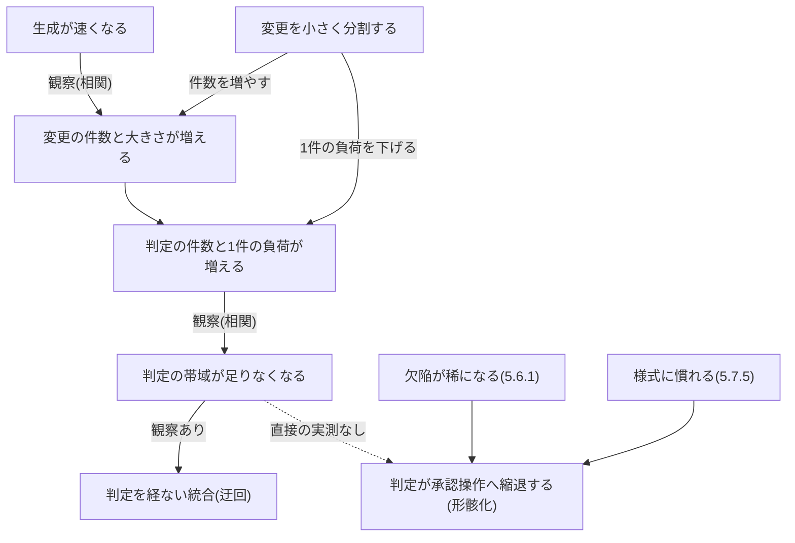

# Issue #300 会議体 意見書 01 — 起草者

- 作成日: 2026-10-12
- 立場: 起草者(標準の本文を書いてきた側)
- 材料: `survey-A` 〜 `survey-E` の 5 本を全文読んだ。判定の決め手にした箇所は、標準本文を開いて逐語で確かめた(行番号は 2026-10-12 の作業ツリー)
- 編集したファイル: 本ファイルだけ。標準本文・テンプレート・ほかの research は触っていない

## 1. 立場と、全体の見立て

読み手が標準だけで判断できる状態を目指します。本の内容でも、読み手の判断を助け、既存の条項と矛盾しない形に直せるなら入れます。直せないもの、根拠を示せないものは、自分で落とします。

- 本の 12 項目(M・D)のうち、**本の文のまま置けるものは 1 つもありません**。どれも標準より粗いか、強いか、古い。調査B・C・D の所見と同じ見立てです
- それでも 7 項目(M3〜M9)は、標準の現行の条項から起こし直せば、読み手の入口・索引として置けます。規範は足しません。索引と導線を足します
- M1・M2・D1・D2・D3 は採りません。直すと本の内容が残らないか、標準の決定と正面からぶつかります
- 標準側の揺れ(U・T・N)は、19 項目のうち 13 項目に「訂正」を含めました。決定の所在を示せるものです。残りは条項の新設・改廃に当たり、送ります
- 起草者として認める落ち度が 3 つあります。附属書E E.5 の直し忘れ(U1)、第8章 例1 の書きすぎ(U3)、未定義語を別の語の定義の土台にしたこと(T2)です
- 調査の見落としを 3 件見つけました(5 章)。うち 1 件(`sep-self-approval`)は N10 の判定を左右します

## 2. 判定の一覧表

| # | 判定 | 一言の理由 |
| --- | --- | --- |
| M1 | 採らない | 順序に根拠が無く、G-4・層1・ブランチ保護の 3 点で現行の規定と合わない。直すと別物になる。入口の欠落は N5 で扱う |
| M2 | 採らない | 3 行は要求事項の弱い言い直し、1 行は意味が定まらない。残る 1 行は N5 の段落から既存条項を指せば足りる |
| M3 | 採る(直して) | 索引として附属書A へ。行は本からではなく現行条項から起こす。「形骸化の一覧」とは名づけない |
| M4 | 採る(導線) | 読む前の人が疑問から引ける入口が、正本に無い。`index.mdx` にリンクだけの表を置く |
| M5 | 一部採る | 問1 を直して附属書B へ。問2・問3 は G-2 基準3・4 への参照に置き換える |
| M6 | 一部採る | 「1名体制で成立しないもの」の一覧だけを第8章 軸A へ。実態表と「4つは満たせる」は採らない |
| M7 | 一部採る | 相互・有償を、G-6 の 4 条件の不足つきで例に置く。「公開して待つ」「3名で再設定」は採らない |
| M8 | 一部採る | 4 つ目の文の前半を直して A.6 へ。後半と結びの文は採らない。N11 と一体 |
| M9 | 一部採る | 分岐と戻り辺を持つ図に直して A.4 へ。「止める方法は 2 つ」は採らない |
| D1 | 採らない | 主語が組織で、契約上の責任と読まれる。標準は「答えを持たない」と決めている。明記は N13 で行う |
| D2 | 採らない | 無条件の断定で、2 名を課す 4 条項と矛盾し、実験の結果とも合わない |
| D3 | 採らない | 「能力ではなく」は測定と合わない。受け皿は N2 の E.3 の訂正 |
| U1 | 訂正 | 正は E.6 と `agent-trace-control.md`(#158、ADR-0053 決定5)。E.5 が直し忘れ |
| U2 | 訂正 | 正は 4 点(ADR-0056 帰結、ADR-0057 決定3・9)。4 箇所を直し、数え方を ADR-0057 の補足へ残す |
| U3 | 訂正+送る | 例1 を軸B に合わせる(訂正)。S0 の省略の是非と「逆転」は ADR が無く、送る |
| U4 | 訂正+採る | `feedback-workflow.md` の 1 行を直す。入口は M4 で正本の中へ移す。`zenn/` は範囲外 |
| T1 | 訂正+送る | 根拠水準マークと実装マークを今付ける(ADR-0026、#222)。定義の選択は送る |
| T2 | 訂正+送る | 独立レビュアを含むことは本文で決まっている。1.4 へ定義を置く。価値責任者・技術判断者は送る |
| N1 | 送る | 2 名の目的を決めた記録が無い。目隠しの要求は条項の新設で、根拠の全文も未読 |
| N2 | 訂正 | ADR-0026 に合わせる。E.3 は言い方を弱め、3 箇所にマークか出典を付ける |
| N3 | 訂正 | 第4章の 2 文が食い違う(08-05 の文が 08-07 の文に追随していない)。A.4 は第4章へ送る 1 文を足す |
| N4 | 訂正 | FND-0155 が定義の誤りを記録済み。3 つの値と、そこから引いた推論の 1 文を直す |
| N5 | 一部採る+送る | 途中の案件の扱いと既存条項への参照を 1 段落で置く。テンプレートの持ち込み手順は実装の確認が要り、送る |
| N6 | 訂正 | 席の全体は 3.4・5.5.6 の 9 席。図と RACI に、何を示す表かの 1 文を足す |
| N7 | 訂正 | 正は「未達」(ADR-0028)。「空席」を直す |
| N8 | 訂正+採る+送る | 列挙を 1 か所へ寄せる(訂正)。守秘・権限・対価を定めないと明記する(採る)。責任者か担い手か、力量は送る |
| N9 | 訂正 | 禁止語リストの正本は第4章 G-2。附属書B と E.3 は参照に変え、附属書B が既に曖昧語と呼ぶ 2 語をリストへ入れる |
| N10 | 送る | 調査C の見落としあり。`sep-self-approval` がデータにあり、表・ADR-0054 との関係を決める材料が足りない |
| N11 | 採る | A.6 を限界の入口へ書き改める(M8 と一体) |
| N12 | 訂正 | 「瑕疵担保責任」を「契約不適合責任」へ。標準の中で既に後者を使っている |
| N13 | 採る+送る | 「触れないと決めた」ことと、未検討の点を軸D に明記する。検収の無い契約と指示の経路は送る |

## 3. 項目ごとの判定

### A. 本にあった内容

#### M1 既存プロジェクトへ後から入れる 5 段階 — 採らない

5 段階の並びには根拠がありません。本は「おすすめの順番」と書くだけで、調査A も順序を測った資料を見つけていません。外部の手引き(ISO/IEC TR 33014、IDEAL)は、何から入れるかを現状の評価から組織が決めるものとしています。加えて、現行の規定と 3 点で合いません。G-4 を G-6 の後に置くこと、層1 の記名を最後に置くこと、`require_last_push_approval` で G-6 が強制されると読めることです。3 点を直すと第3〜第5段階の中身が入れ替わり、本の順序は残りません。起草者として直せないので、入れません。

- 決め手: `phase4-process-design/lifecycle.md` 2.5(136 行)「G-4 と G-5 はどのステージでも省略できません。」
- 決め手: `phase5-implementation/overview.md`「設定作業の順序」(85 行)「**この順序は移行の順序ではありません**。」
- 「課さない」の明記: 要る。N5 の段落に「本標準は、ゲートをどの順で有効にするかの固定の順序を定めません」と書く
- 調査A の補正: 調査A は「標準自身の設定作業の順序が本と逆順」を最大の食い違いに挙げる。標準は移行の順序ではないと断っているので、矛盾ではない。読み手に 2 つのリストが並ぶ問題は、M1 を採らなければ生じない

#### M2 最初にやらないほうがよいこと — 採らない

表としては置きません。行 2(L2 以上から始める)・行 3(会議体の新設)・行 5(測定を評価に使う)は、標準では要求事項です。「やらないほうがよい」と並べると、守らなくてもよい助言に読めます。行 3 は 10 名以上では標準と逆です。行 1 は「軸B のとおりに省略を宣言する」なら既にあり、「有効と導いたゲートを初期には止める」なら第8章 禁止事項6 と衝突します。行 4 は「初期値は暫定」として既にあり、足すと動かせない基準まで緩めてよいと読まれます。

- 決め手: `phase4-process-design/human-ai-boundary.md` 5.4.2(65 行)「**2026-08-05 時点のベースラインは L1 です**。」
- 決め手: `phase5-implementation/enablement.md`(30 行)「**既存の手順に本標準のゲートを上乗せしてはなりません**。」
- 「課さない」の明記: 不要。5 行それぞれに対応する条項がある。行 1・4 に当たる条項への参照は、N5 の段落に含めた

#### M3 形骸化のパターン・条件・手段の横断表 — 採る(直して。種別: 索引。規範を含まない)

条件と構造を対応づける一覧は、標準に無い第 3 の軸です(検知の一覧と残るリスクの一覧は既にあります)。読み手が「どの条件を、どの条項が塞いでいるか」を 1 か所で引けることは、条項の読み落としを減らします。ただし本の表は置きません。5.6 の形骸化の定義に入るのは本の 1 行目だけで、標準が主因に挙げる出現率の低下と慣れを欠き、6 行目は 2 名承認と衝突するためです。行は現行の条項から起こし、名前に「形骸化」を使いません。

- 決め手: `human-ai-boundary.md` 5.6(473 行)「人間の判断が承認操作のみに縮退した状態(以下、形骸化)は、本標準が防止すべき主要なリスクです。」
- 置き場所: `phase4-process-design/integrated-process.md` に新節 A.7(A.6 の後)。`npm run lint:refs` の検査対象に含める
- 根拠水準マーク: 不要(各行は条項の所在を指すだけで、効果を主張しない)。「条件を塞げば起きない」とは書かない
- 文の案:

> ## A.7 統制が働かなくなる条件と、塞ぐ構造の索引
>
> 本節は索引であり、規定を含みません。第5章 5.6 が定義する形骸化(判断が承認操作のみに縮退した状態)より広く、統制が働かなくなる条件を並べます。この一覧は網羅ではありません(ADR-0041)。塞いだ後に残るリスクは、附属書H H.11 に示します。
>
> | 統制が働かなくなる条件 | 塞ぐ構造 | 規定の所在 |
> | --- | --- | --- |
> | 確認の範囲が有界でない | 確認を数え上げられる順序に限る。検出を遮断と機械判定へ割り当てる | 附属書E E.5・E.6、フェーズ5(エージェントの操作の統制) |
> | 欠陥が稀になり、判定の基準が移動する | 欠陥注入で検出能力を測り、低下した範囲の権限を一時制限する | 第5章 5.6.1・5.6.2、第7章 7.9 |
> | 承認の様式に慣れる | 摩擦をリスク区分に応じて配分し、総量を管理する | 第5章 5.7.5 |
> | 判定の件数が帯域を超える | 流入を絞る。帯域を理由に判定を省略しない | 第4章「流入を絞る」「帯域を理由に判定を省略しない」 |
> | 守らなくても止まらない規則がある | 遵守が必須の規則を強制層へ降ろす | 第3章 3.11.3 |
> | 権限の引き下げに契機が無い | 引き上げは判定を要し、引き下げは自動で行う | 第5章 5.4.6 |
> | 検証を緩める変更が、機能の変更と同じ経路を通る | 基準値の変更を分離する。検証の弱体化にラベルを付ける。自己修正ループの書き込み範囲からテストを外す | 附属書E E.6・E.7、フェーズ5 |
> | 測定の結果が個人の評価へ転用される | 集計をチームと工程の単位に限り、人事評価に用いない | 第5章 5.6.2 |
> | 統制のためのゲート・会議体・台帳が増える | 新設せず、既存の判定へ載せる | 第7章 7.10.5、第8章「再テーラリングの契機」 |

- 直してから置く点: 各行の所在は、調査B 1.2 の逐語を基にした。起草時に 1 行ずつ本文で再確認する。本の「承認者を増やさない」は行に入れない(N1 が決まるまで書けない)

#### M4 悩み別の読み先表 — 採る(種別: 導線。規範を含まない)

読む前の人が、自分の疑問から読む場所を引ける入口は、正本のサイトにありません。トップページの要点の入口は外部(Zenn)の 1 本のリンクです。本で 1 度起きたとおり、外部の媒体が消えれば入口は 404 になります。「引ける状態にあって初めて働く」という考え方は、フェーズ6 の逆引き表で標準が既に採っています。表は回答を書かず、リンクだけを持たせます。回答を書くと、ADR-0056 決定9 が避けた「問答が条項に追随しない」問題を持ち込むためです。

- 決め手: `index.mdx`(57 行)「全体像を一枚の図と表でまとめた概要を、Zenn に公開しています。正本はこのサイトの標準本文です。」
- 置き場所: `src/content/docs/index.mdx` の「まず要点だけ知りたい方へ」を「知りたいことから読む」に改め、Zenn の概要記事は表の下へ派生物として添える。第1章には置かない(1.7「本文は要求事項のみを記述する」)
- 直してから置く点: 列の名を「何を感じているか」から「知りたいこと」へ。「理想論」のような標準に無い語を使わない。主な送り先は規範層にする。調査層(フェーズ1〜3)へ送る行は 1 行にまとめ、作成時点の前提に依ることを行の中に書く。本に無かった読み手(採用を判断する者、提案する者、既存のリポジトリへ入れたい者)を足す
- 文の案:

> ### 知りたいことから読む
>
> | 知りたいこと | 読む場所 |
> | --- | --- |
> | 開発者の作業が、何から何へ変わるか | 附属書E E.1・E.2 |
> | 既存の稟議・出荷判定の、何を変えて何を変えないか | 附属書A A.5、附属書D |
> | 判定基準と様式の実物 | 第4章、第6章 |
> | ルールが形だけになることを、どの条項が塞いでいるか | 第5章 5.6、附属書A A.7 |
> | 1〜2名の体制でも使えるか | 第8章 軸A、準拠テンプレート「達成できないゲートの扱い」 |
> | 既にコードがあるリポジトリへ入れたい | フェーズ5 概要「設定作業の順序」 |
> | 採用してよいかを判断したい | 附属書I |
> | 品質保証部門へ提案したい | 附属書D |
> | 何を保証し、何を保証しないか | 第1章 1.9、附属書A A.6 |
> | 運用中に困っている | フェーズ6「困ったときの逆引き」 |
> | 規定の前提が、どの調査から来たか | フェーズ2・フェーズ3(調査の記録。作成時点の前提による。規定の正本は第1章以降) |
>
> 全体像を一枚の図と表でまとめた概要を、Zenn にも公開しています。概要は派生物であり、食い違う場合はこのサイトの標準本文が正です。

#### M5 受入基準の草案を受け取ったときの 3 つの自問 — 一部採る(種別: 手引き)

採るのは問1 です。G-2 は受入基準の内容を判定しないと明記しており、内容を確かめる機会は確定の時点にしかありません。その時点で何を確かめるかが、標準本文のどこにも無い。一方で準拠テンプレートの `spec-write` には 3 問が逐語であります。「正本はこちら側」という決まりに照らすと、標準に無い手引きがテンプレートにだけある状態は向きが逆です。問2・問3 は G-2 基準3・4 として既に要求事項なので、自問のまま足しません。参照に置き換え、登録と記入まで書きます。

- 決め手: `phase4-process-design/gate-criteria.md` G-2(166 行)「**受入基準の内容そのものは判定しません**。対応の有無だけを見ます。」
- 決め手: `developer-guide.md` E.3(47 行)「基準の確定は価値判断であり、[第5章 5.5]の価値判断に該当します。」
- 置き場所: `phase4-process-design/ears-guide.md`(附属書B)「書き方の手順」の後。E.3 の末尾からは 1 文で送る。附属書E の読み手は開発者で、確定する席は価値責任者のため、E.3 には本体を置かない
- 根拠水準マーク: 要る(効果を測った資料は見つかっていない。E0)
- 文の案(附属書B):

> ### 草案を確定する前に確かめること(確定する席: 価値責任者)
>
> AI が起案した受入基準は、形式が整っていても、作りたいものを表しているとは限りません。要件合意(G-2)は受入基準の内容そのものを判定しないため、内容を確かめる機会は確定の時点だけです。
>
> - 基準をすべて満たしても、企画書 観点3 に書いた価値が実現しない場合を、具体例で 1 つ挙げてみる。挙がったら、基準を足すか、未確定事項へ書く
> - 草案が断らずに置いた前提を探す。見つけたら「前提・依存」の欄へ書き、案件層コンテキストへ登録する(G-2 基準3)
> - 草案に入っているが今回は作らないものを探す。見つけたら「スコープ外」の欄へ移す(G-2 基準4)
>
> この 3 点は観点の例であり、これで尽きません(ADR-0041)。
>
> :::caution[暫定 EV-NNNN / 見直し 2027-04]
> この 3 点が受入基準の欠落を減らすことを測った資料は、見つかっていません(E0)。草案を見ながら点検すると判断が草案へ引き寄せられるという報告があります(第4章 G-4「範囲内外の判定を機械が行わない理由」)。
> :::

- 文の案(E.3 の末尾へ 1 文): 「確定の前に確かめる観点は、附属書B『草案を確定する前に確かめること』によります。」
- 採らない部分: 問2・問3 を自問の形で置くこと。不要な基準・基準どうしの矛盾・実現可能性の観点を今回足すこと(効果の測定が無く、29148 の本文も未読)
- 併せて直す点: テンプレートの `spec-write` は、標準の文に合わせる(AI が問うて人が「無い」と答える形を、具体例を 1 つ挙げる形へ)

#### M6 1 人 + AI の実態表と「4 つは 1 人で満たせる」 — 一部採る(種別: 手引き。条項の写し)

実態表は採りません。9 行のうち現行と合うのは 4 行で、「開発者(実装)」という席は標準に無く、AI運用担当者の行が無く、「責任は 8 つ」は本の表とも ADR-0054 とも数が合いません。「4 つは 1 人で満たせる」の表も採りません。G-6 は基準ごとの部分充足という状態を持たず、作成側の記載は挙動要約に数えないと決めています。採るのは、調査C が 5 つの節から集めた「1 名体制で成立しないもの」の一覧です。1 名体制の読み手が、自分に掛かる未達と逸脱の全部を 1 か所で読める場所が本文にありません。本は「埋まらないのは 1 項目だけ」と書きましたが、現行の標準は 7 つを表示させます。

- 決め手: `gate-criteria.md` G-6 条件4(418 行)「作成側が書く検証の記載は、挙動要約に数えない」
- 決め手: `phase4-process-design/tailoring-guide.md` 軸A(175 行)「**代償措置を、未達の解消や独立レビューの代替として扱いません**」
- 置き場所: `tailoring-guide.md` 軸A、体制別の表(168〜171 行)の後。見出しに適用範囲を併記する
- 根拠水準マーク: 不要(既存条項の写し)
- 文の案:

> #### 1名体制で成立しないものの一覧(適用: チーム規模 1名)
>
> | 成立しないもの | 扱い | 正本 |
> | --- | --- | --- |
> | 作成指示者 × 独立レビュア(G-6) | 外部の確認者を置けなければ、未達として表示し続ける | 第3章 3.5、ADR-0028 |
> | 開発ライン × 出荷判定者(G-7) | 代償措置つきの逸脱として記録し、表示し続ける | 第3章 3.5.2 |
> | 出荷判定者 × 事業決裁者 | 逸脱として D-0 へ記録し、保証の開示の項目1 へ表示する | 第3章 3.5 |
> | AI維持管理者 × AI運用担当者 | 成立しない場合は、逸脱として D-0 へ記録する | 第3章 3.5 |
> | 欠陥注入の時期と箇所の秘匿 | 同上 | 第3章 3.5、第5章 5.6.2 |
> | 市場・顧客仮説の検証 | 兼務で成立するか、未達として宣言する | 本章「市場・顧客仮説の検証が成立しない場合」 |
> | 保証の主張の成立条件3・4 | 外部の確認者を置かない限り、組織として品質を保証するとは主張できない | 第1章 1.9、附属書H |
>
> 本表は各条項の写しです。食い違う場合は、正本の欄の条項によります。
>
> 未達の体制で本人が行う挙動の検証は、開発者の席の検証です。G-6 の基準の一部を満たしたものとして数えません(第4章 G-6 の条件3・4)。G-6 の状態は未達の 1 値であり、基準ごとの部分充足という状態はありません(ADR-0028)。

- 採らない部分の明記: 上の最後の段落が、「4 つは満たせる」を採らないことの明記に当たる
- 直してから置く点: 「G-4 と G-5 は 1 人でも完全に成立する」は入れない(N10 が決まるまで書けない)

#### M7 外部の確認者の調達方法 — 一部採る(種別: 手引き)

附属書H は、1 名体制の保証の主張の成否を外部の確認者に掛けています。それほど重い手段について、標準は「外部へ依頼する。置けなければ未達」としか書いていません。同じ章の市場・顧客仮説の未達には調達先の例があり、G-6 の未達には無い。ここは埋めます。ただし本の 4 行は置きません。「公開してコミュニティのレビューを受ける」は、名簿に載った人が当該の変更を挙動要約つきで承認する形を作らず、公開だけではレビューが得にくいことを示す間接の資料があります。「独立性は確保できる」の断定には根拠がありません。「3名以上で再設定」は調達ではなく体制の変化点です。採るのは、調達先の例と、例ごとに G-6 の 4 条件のどれが自動では満たされないかの対応です。

- 決め手: `gate-criteria.md` G-6(411 行)「承認を**独立した人の確認**に数えるのは、次の条件をすべて満たす場合に限ります。承認の操作があったことだけでは数えません。」
- 決め手: `tailoring-guide.md`(227 行)「調達先には、開発ラインの外にいる人から反応を得る経路を書きます。例は次のとおりです。」(市場・顧客仮説の側にだけ例がある)
- 外部の根拠: OpenSSF Scorecard の検査仕様(Code-Review)<https://github.com/ossf/scorecard/blob/main/docs/checks.md>(調査C が 2026-10-12 に確認)「Requiring reviews for all changes is infeasible for some projects, such as those with only one active participant.」
- 置き場所: `tailoring-guide.md` 軸A「外部の確認者を高リスクの変更へ集中させる」の前
- 根拠水準マーク: 要る(E0)
- 文の案:

> #### 外部の確認者をどこから得るか(適用: 独立レビュー(G-6)が未達になりうる体制)
>
> 本標準は、外部の確認者を得る手段を限定しません。定めるのは、その人の承認を独立した人の確認に数える条件です(第4章 G-6 の4条件)。調達先の例と、条件のうち自動では満たされないものを示します。
>
> | 調達先の例 | 自動では満たされない条件 |
> | --- | --- |
> | 社内の他チーム・別部門の人へ依頼する | 条件1(D-0 表5 への記載) |
> | ほかの開発者と、互いの変更を確認する取り決めを結ぶ | 条件2。相手が相談に乗った変更は、相手も作成の指示に関与した変更に当たりうる |
> | 対価を払って確認を依頼する | 条件1(記名の自然人が名簿へ対応づくこと)と基準1(受入基準の項目ごとの確認。観点を絞った確認は当たらない) |
>
> リポジトリを公開しただけでは、調達先を得たことになりません。公開は依頼ではなく、名簿に載った人が当該の変更を挙動要約つきで承認する形を作らないためです。
>
> 本標準は、外部の確認者との守秘の合意、リポジトリへの権限の付与と剥奪、対価と利害の扱いを定めません。組織が契約と規程で定めます。受託(軸D)では、発注者との契約が第三者への開示を認めているかを先に確かめます。
>
> :::caution[暫定 EV-NNNN / 見直し 2027-04]
> 上の例が独立した確認として働くことを測った資料は、見つかっていません(E0)。公開だけでは全変更のレビューを得にくいことを示す間接の資料があります(OpenSSF Scorecard の検査仕様。1 人のプロジェクトでは全変更のレビューは実行できないとする)。
> :::

#### M8 標準の限界の明言 — 一部採る(種別: 背景。N11 と一体)

本の 5 つの文のうち、4 つは標準に既にあります。結びの後半(示せるのは記録が残っているかまで)は ADR-0057 より前の立場で、置けば 1.9 と矛盾します。文言として無いのは 4 つ目だけです。その後半「防げるのは、条件が特定できた範囲だけ」は採りません。「条件」が保証の主張の成立条件と同じ語になり、検証もできないためです。前半は直して採ります。標準は限界をリスクごとに細かく書いていますが、総論の入口がありません。題が「前提と限界」である A.6 に、限界の所在の表と、束ねる文を置きます。1.9 の近くには置きません。成立条件を満たした範囲の主張まで弱める読みを招くためです。

- 決め手: `integrated-process.md` A.6(62〜68 行)。題は「前提と限界」だが、挙げるのは前提条件と「v0(参照モデル)」の注記だけで、1.9・H.2・H.11 への参照が無い
- 置き場所と文の案: N11 に示す
- 「課さない」の明記: 不要(要求事項ではない)

#### M9 帯域飽和の連鎖図と「止める方法は 2 つ」 — 一部採る(種別: 背景の図)

本の図は置きません。「1 回の判定対象を小さくする」は件数を増やし、連鎖の 2 段目へ戻ります。標準の第4章はこの循環を明記しており、本の図はそれを落としています。「2 つしかありません」も、標準のどの数え方とも合いません。採るのは、戻り辺と分岐を描き、辺ごとに根拠の強さを書いた図です。標準は両端(律速点、縮退)を既に本文で述べています。中間を図にして辺の根拠を開示するほうが、端だけを断定している現状より正確です。図に手段を対応づければ、N3(帯域への対処の数え方が揃っていない)も同じ場所で解けます。

- 決め手: `gate-criteria.md`「流入を絞る」(1108 行)「変更を小さくすると、1件あたりの負荷は下がりますが**件数は増えます**。総負荷は下がりません。分割は帯域の配分を変える手段であり、帯域を増やす手段ではありません。」
- 置き場所: `integrated-process.md` A.4 の冒頭
- 根拠水準マーク: 要る。「帯域が足りなくなる → 承認操作へ縮退する」の辺は、直接の実測が見つかっていない(調査B 2.4)
- 文の案(図):

> 帯域が足りていても、形骸化は起こります。欠陥の出現率の低下(第5章 5.6.1)と様式への慣れ(5.7.5)は、帯域と独立の経路です。
>
> | 手段 | 効く場所 | 所在 |
> | --- | --- | --- |
> | 機械化できる検査を CI へ載せる | 人へ届く判定の件数 | 本節の1、第4章 G-5 |
> | 流入を絞る | 変更の件数 | 第4章「流入を絞る」 |
> | 分割する | 1件の負荷。件数は増えるため、総負荷は下がらない | 第4章「流入を絞る」 |
> | 判定に要る材料をまとめて提示する | 1件の労力 | フェーズ5(レビューパッケージ) |
> | 判断を種類で分ける | 1人への集中 | 本節の2 |
> | 判定できる人を増やす | 帯域そのもの | 第4章「帯域を理由に判定を省略しない」 |
> | 判定の時点を事後へ移す(委任) | 事前の判定の件数 | 第5章 5.5.4 |
> | 帯域を理由に判定を省略しない | 迂回の枝 | 第4章 |
>
> :::caution[暫定 EV-NNNN / 見直し 2027-04]
> 図の「帯域が足りなくなる → 承認操作へ縮退する」の辺は、負荷を操作して測った研究が見つかっていません(E0)。観測されているのは、判定を経ない統合の増加と、経験・回数に連動する承認の通りやすさです。ほかの辺の観察は相関であり、ベンダーのテレメトリが中心です。
> :::

- 採らない部分: 「この連鎖を止める方法は 2 つしかありません」と、括弧書きの「承認者を増やしても質は上がらない」
- 直してから置く点: 図の根拠に `phase2-aidlc/agentic-development.md` の値を使う前に、N4 の訂正を済ませる

#### D1 「契約の類型で責任を決めません。判定を置いた側が結果責任を持ちます」 — 採らない

本の文は主語が「側」(組織)で、文脈は組織間の責任の分界です。標準の「結果責任」は記名の自然人の A であり、組織を主語にしません。置けば、契約上の責任の配分を標準が宣言したと読まれます。標準は「契約上の責任の帰結」を主張しないことに入れ、問16 で「答えを持たない」と書いています。本の文は G-6 にも「責任」を足していますが、標準は G-6 について「置いた側が読解の帯域を負う」とだけ書き、レビューの実施は完成の承認ではないと打ち消しています。直すと残るのは「置いた側の技術判断者が A を負う」で、これは軸D に既にあります。

- 決め手: `tailoring-guide.md` 軸D(497〜498 行)「技術設計(G-3) | どちらでもよい | 置いた側の技術判断者が A を負う」「独立レビュー(G-6) | どちらでもよい | 置いた側が読解の帯域を負う」
- 外部の根拠: ISO/IEC Directives Part 2 箇条4 <https://www.iso.org/sites/directives/current/part2/index.xhtml>(調査D が 2026-10-12 に抜粋で確認)「A document shall not include contractual requirements (e.g. concerning claims, guarantees, covering of expenses), or legal or statutory requirements.」
- 「課さない」の明記: 要る。N13 の文の案で行う(「契約の類型ごとの責任の違いを扱わないと決めている」「A は席の責任者の結果責任で、契約上の責任の配分ではない」)

#### D2 「承認者を 2 人にすれば…」 — 採らない

無条件の断定で、根拠の示す範囲より強い文です。調査B が引く逐次の二重確認の実験では、2 人目の努力が下がるのは 1 人目の結果が見える場合に限られ、その場合でも 1 人より検出は高い。標準は 2 名を 4 か所で要求しており、7.9.2 は形骸化を検知したときの措置として 2 名を課します。置けば、標準が自分の要求を「質は上がらない」と評することになります。標準は E.10 と 3.10.4 で、根拠の範囲に収まる弱い言い方を既に採っています。

- 決め手: `phase4-process-design/exception-escalation.md` 7.9.2(445 行)「単独での承認権限 | 該当する範囲について、独立レビュアを2名必須とする」
- 決め手: `developer-guide.md` E.10(165 行)「承認者の人数を増やしても、この効果は代替できません。」
- 「課さない」の明記: 不要(要求事項ではない)。本の文が指していた空白(2 人目の独立の作り方)は N1 で扱う

#### D3 「実務のタスクが『何が正解か』を含んでいない」 — 採らない

本の文は 3 つの主張を束ねています。「差は縮まっていない」は弱い知見が 1 件、「理由は能力ではない」は測定と合いません(保守者の却下理由に中核機能の失敗が含まれる)。支持があるのは「正解の定義を含まないタスクが多い」という弱めた形だけで、それは E.1・E.3・A-P2・H.11 に既にあります。フェーズ2 は差を実測値で示して理由づけをしない方針で書かれており、理由を 1 つに絞る文を足すと、同じフェーズの「評価不能」と並びます。

- 決め手: `developer-guide.md` E.3(45 行)「エージェントが停滞する原因の多くは、能力の不足ではなく完了条件の不在です。」(同じ形の主張が、出典の無いまま標準にある。D3 を退ける基準は、この文にも掛かる)
- 「課さない」の明記: 不要。ただし E.3 のこの文を N2 で直す

### B. 標準側の揺れと、定義の無い語

#### U1 附属書E E.5 の順 4 と E.6 — 訂正

正は E.6 と `agent-trace-control.md` です。目視の確認は 2026-08-07 の `ab45a25`(#158)で撤回し、ADR-0053 決定5 がそれを既決として引いています。撤回のコミットが E.5 を直していません。起草側の直し忘れです。E.6 は 2 項目、`agent-trace-control.md` は 3 項目と数も食い違います。E.6 自身が「割り当ての設計はフェーズ5に規定します」と送っているので、3 項目へ揃えます。

- 決め手: `developer-guide.md` E.6(99 行)「**検出を目視の作業として行いません**。」
- 決め手: `phase5-implementation/agent-trace-control.md`「人が見るもの」(86 行)「以上により、開発者が確認するのは次の3つだけになります。」
- 文の案:
  - E.5 の表の順 4(80 行): 「| 4 | 実行トレース | 遮断が働いた記録、機械判定が付けたラベル、実装計画の対象パスと実際に変更されたパスの差(E.6) |」
  - E.5(87 行): 「受入基準の数、外部インタフェースの変更数、遮断の記録とラベルの件数はすべて数え上げられます。」
  - E.6(99 行): 「開発者が確認するのは、遮断が働いた記録、機械判定が付けたラベル、実装計画の対象パスと実際に変更されたパスの差の 3 つに限られます。」
  - E.6(111 行): 「最後の2項目は必ず確認します。テストを通すためにテストを書き換える変更は、実装の完了ではなく検証の放棄です。この操作は差分の見た目では正常な変更と区別が付きにくいため、機械判定がラベルを付け、独立レビューの必須確認事項にします。」
  - E.6 へ足す 1 文: 「遮断とラベルが 0 件であっても、想定外の操作がなかったことにはなりません(フェーズ5『この設計の限界』)。」
  - `agent-trace-control.md` 冒頭(8 行): 「附属書E E.5 は、検証の順序の4番目に実行トレースを置いています。」
- 併せて直す点: テンプレート(`human-verify`、`review-checklist.md`)の順 4 は 2 項目なので、3 項目へ揃える。順 4 の名前「実行トレース」は変えない(テンプレートの 3 箇所が使う。名前を変える理由は信頼性の側に無い)

#### U2 「既存制度への変更」の数 — 訂正

正は 4 点です。3 点目は ADR-0056 帰結、4 点目の実体は ADR-0057 決定3・9 にあり、附属書A A.5 と附属書D の本文は 4 点で揃っています。3 点と書く 4 箇所は、`f3b7033` が触らなかった箇所です。4 点目を「既存制度への変更」に数えると明記した ADR の文が無い点は、調査E の指摘どおりです。ADR-0057 には補足の先例(2026-10-03、2026-10-07)があるので、補足で残します。

- 決め手: `integrated-process.md` A.5(51 行)「既存制度への変更は4点です。変更を小さく見せません。」
- 決め手: `proposal-template.md`(58 行)「## 4. 既存制度への変更点(3点)」(同じファイルの 18・23・43・111 行は 4 点)
- 文の案:
  - 附属書D §4 の見出し: 「## 4. 既存制度への変更点(4点)」
  - `src/data/processes/integrated.yaml`(657 行): 「変えるのは4点。(1)技術判断を決裁階層から分離して単独判定者に委ねる、(2)ゲート判定を合議でなく『単独判定+事前の非同期コメント』にする、(3)出荷判定者の署名の意味を定め、残存リスクの受容を事業決裁者の記名へ置く、(4)品質保証の方針と受容の基準を、トップマネジメントが記名して定める。3点目は出荷判定の規程の改定を、4点目はトップマネジメントの記名を要する。この4点が既存文化との最大の交渉点になる」
  - `src/data/tailoring/rules-supplementary.yaml`(33 行): 「…既存制度への変更は、技術判断の分離・単独判定・出荷判定者の署名の意味・品質保証の方針と受容の基準の4点である(附属書A A.5)」。「に限る」は外す(「変更を小さく見せません」と向きが逆)。直した後に `npm run template:kb`
  - ADR-0057 の補足: 「層1 の記名を、既存制度への変更点の 4 点目に数える。既存の品質方針の文書へ 5 項目を加える形を取りうるため、新設ではなく変更として扱う。」
- 数を書く箇所を絞る案(調査E の案B)と検査を足す案(案C)は、訂正の後に別に決めてよい。今回の判定には含めない

#### U3 S0 の G-6 と第8章 例1 — 訂正(例1)+送る(S0 の省略の是非)

例1 は起草側の書きすぎです。2026-10-01 の改訂の目的は、ADR-0054 決定7(独立は人の単位)を例へ反映することでした。例1 が根拠に引く ADR-0028 決定1 は、確認者が不在の場合の規定で、確認者がいる 2 名の S0 を省略にしない根拠になりません。生きている規則は軸B の表で、ADR-0050 が軸B の役割を再確認しています。例は条項の適用例ですから、条項に合わせます。例1 は G-6 以外でも実行結果と合いません(G-3 と G-8 は適用、確認者ありでは CI の厳格化は実行されない)。

- 決め手: `tailoring-guide.md` 軸B(413 行)「| 独立レビュー(G-6) | 省略可 | コア機能のみ | 標準 | 標準 |」
- 決め手: 同 例1(725 行)「省略として扱わない(ADR-0028 決定1)」
- 文の案(例1 の 1〜3 行目):
  - 「構成が導く状態は、G-1 簡略、G-2 は G-4 へ統合、G-3・G-4・G-5・G-8 は適用、G-6・G-7 は軸B による省略である。省略は宣言する」
  - 「独立レビュー(G-6)は、軸B により省略として宣言する。確認者を置けない体制では、省略ではなく未達として表示する(ADR-0028 決定1)。S1 へ移る時点で、作成を指示していない側の人による確認(相互の確認)を有効にする」
  - 「確認者を置けない体制では、CI 基準の厳格化(カバレッジ+静的解析)を代償措置として記録する。未達の解消にも、独立レビューの代替にも数えない」
- 送る部分: 「S0 で、確認者を置ける体制が G-6 を省略してよいか」。現行は、確認者がいない体制が未達(常時表示、CI 厳格化)、いる体制が省略(表示なし)で、置ける体制のほうが軽い。ADR-0028 決定1 がステージを見ずに未達とすることと、軸B の省略が重なって生じています。どちらを動かしても条項の改廃で、ADR が要ります
  - 調べること: #284 の会議体の記録の全文(S0 の省略を論じた箇所の有無)。S0 の省略が第8章の要求3(24 行「調整後の構成で、当該ゲートの目的が達成されることを示す」)をどう満たすかの説明。`scripts/test-tailoring-engine.mjs` ペルソナ1 と #288 の回帰スイートの期待値。第2章 2.5 が G-8 を「省略可」と書くのに実行結果が適用である点
  - 決めること: S0 の G-6 を(ア)適用へ改める、(イ)省略のまま逆転を解く、(ウ)宣言つきの選択にする、のどれか
  - 起草者の勧め: (ウ)。軸B は「省略可」と書くのに、実行層では省略の一択になっている。本文の語に実装を合わせる向きである

#### U4 Zenn 記事へのリンクと、本を前提にした記述 — 訂正+採る

誤りは `community/feedback-workflow.md` の 1 行です。本は廃止済みで、Zenn のコメントは概要記事に付きます。トップページのリンクは誤りではありませんが、要点の入口を外部の媒体に置く構成は M4 で改めます。`zenn/` サブモジュールの版の遅れは、標準の記述ではなくリポジトリの状態の問題で、#300 の範囲の外です。

- 決め手: `community/feedback-workflow.md`(18 行)「| Zenn のコメント | 本の読者からの反応 |」
- 文の案: 「| Zenn のコメント | 概要記事の読者からの反応 |」
- 採る部分: M4 の表を入口にし、Zenn の記事は派生物として下に添える。「食い違う場合は標準本文が正」の 1 文を `index.mdx` に置く(M4 の文の案に含めた)
- 範囲外: `zenn/` サブモジュールの扱い(版を進めるか、外すか)は別件で決める

#### T1 「自動承認の比率」 — 訂正(マーク)+送る(定義)

この語は、引き下げの発火条件と、L2 以上を適用する前提の両方に使われています。定義が無いので、採用組織は何を集計すれば L2 へ上がれるのかを判定できず、「計測している」と申告すれば前提を満たせます。5.4.6 自身が「発火しない引き下げを、備えているものとして扱ってはなりません」と書いており、定義の無い条件は発火しません。今すぐできる訂正が 2 つあります。初期値「前月比2倍」に根拠水準マークを付けること(ADR-0026)と、降りていない規定として実装マークで表示すること(#222)です。定義そのものは送ります。語の出所(許可の確認を省く実行、セッション単位)と、後から付いた説明(判定の履歴の集計)が合わず、L2 の「人間が統合点を確認する」監督を何の記録で測るかを、今回の材料では決められないためです。

- 決め手: `human-ai-boundary.md` 5.4.6(145 行)「| 自動承認の比率が急上昇した | 前月比2倍 | 該当範囲を1段階引き下げる |」
- 決め手: 同(164 行)「第2区分の計測ができない範囲へ、**L2 以上を適用しません**。」
- 文の案(訂正。5.4.6 の表の後):

> :::caution[暫定 EV-NNNN / 見直し 2027-01]
> 「自動承認の比率」は、分子と分母を本標準がまだ定めていません。初期値「前月比2倍」に実測の根拠はありません(E0)。語の出所の報告は、この比率の上昇を監督の劣化として扱っていません。定義が定まるまで、この条件は発火しない条件です。
> :::

- 実装マーク: `<!-- impl IMPL-NNNN target=... state=undelivered note="自動承認の比率は定義が無く、計測の実装も無い" -->`(降ろし先は `src/data/impl-targets.yaml` の登録から選ぶ)
- 送る部分で調べること: #109 の Issue 本文(筆者の意図)。出所の報告の原文の再読。L2 で残る判定の記録の種類。`phase6-operation/metrics.md` の「レビュー所要時間の分布」が同じ対象を既に測っているか
- 決めること: 調査E の案 a〜f のどれか
- 起草者の勧め: 案 e(行を外す)を基本にする。根拠を示せない発火条件は入れるべきでない。人が確認を省き始める兆候は、`metrics.md` の既存の警戒サインから 5.4.6 へ「入力になります」と送る形(3.11.7 と同じ形)で拾えるかを先に確かめる。語を残す場合は改名が要る。5.5.4 は、委任で進めた変更を「承認」と呼ぶことを禁じている

#### T2 「開発ライン」 — 訂正(定義の一部と語の分離)+送る(残りの範囲)

未定義語を「第三者レビュー」の定義の土台にしたのは、起草側の落ち度です。ただし、記録から決まる範囲があります。独立レビュアの席は開発ラインに含まれます。附属書A A.5 と附属書D が G-6 を「同じ開発ラインの別の人による確認」と書き、3.5 は最小体制 3 名を「作成指示者・独立レビュア・出荷判定者の兼務禁止を満たす下限」と書くためです。実装(`sep-dev-shipping` は開発者の席だけ)は、本文より狭い。独立レビュアが出荷判定者を兼ねる構成が検査を通るのは、実装の未達です。「案件または開発ラインの単位」(意味 O)は、同一案件の中の話と同じ語であってはならず、語を分けます。価値責任者・技術判断者を含むかは、記録から決まらないので送ります。

- 決め手: `integrated-process.md` A.5(53 行)「G-6 は同じ開発ラインの別の人による確認であり、第三者レビューとは呼ばない。」
- 決め手: `roles-responsibilities.md` 3.5(292 行)「**最小体制は3名**です(作成指示者・独立レビュア・出荷判定者の兼務禁止を満たす下限)。」
- 決め手: 同 3.11.1(971 行)「| AI維持管理者 | … | 開発ラインの内側 |」
- 置き場所: 第1章 1.4「用語の定義」の表(`overview.md`)。「第三者レビュー」も同じ表へ置く
- 文の案(1.4 の表の行):
  - 「| 開発ライン | 同一の案件で、変更の作成を指示する席(開発者)、その変更を確認する席(独立レビュア)、AI維持管理者の席の集合。出荷判定者・事業決裁者・AI運用担当者の席は含まない |」
  - 「| 第三者レビュー | 開発ラインの外の組織による検証。同じ開発ラインの別の人による確認(G-6)には使わない |」
- 文の案(意味 O の箇所。第7章 7.7.8、テンプレ4・6・11、附属書I): 「案件、または複数の案件を束ねる開発組織の単位」
- 実装: `sep-dev-shipping` の `roles` へ `independent-reviewer` を足す。足す前に、#288 の回帰スイートとエンジンのテストの期待値を突合する。足すまでは、実装マークで `state=undelivered` として表示する
- 表記の揺れ: 附属書H(664 行)「同一ライン」を「同じ開発ライン」へ
- 送る部分で調べること: `4c64709`(初出、#44・#45)の意図。IEC 61508・ISO 26262 の独立性の段階(別の人/別の部門/別の組織)と「外の組織」の対応。3〜9 名で第8章 軸A が出荷判定を「兼務者を指名」とすること(150 行)との関係
- 決めること: 価値責任者・技術判断者・文脈オーナーを開発ラインに含めるか。「開発ラインの外の組織」が、技術・管理・財務の 3 面の独立を要するか

### C. 調査で新たに見つかった論点

#### N1 2 名承認の目的と、2 人目の独立 — 送る

2 名を課す 4 箇所(軸C、軸E、G-6、7.9.2)のどこにも、2 名にする目的が書かれておらず、決めた ADR も見つかっていません。目的が検出の向上なら、2 人目が 1 人目の判定を見てから確認する形は効果を下げうるので、条件が要ります。目的が証跡と理解の分散なら、話は変わります。目的を決めずに「目隠し」の条項を足すことはできません。根拠にする実験も、調査B は抜粋で読んだだけです。

- 決め手: `gate-criteria.md` G-6(426 行)「2人目は、2件目の承認(自分の挙動要約つき)、…で記録する。1人目が2人目の欄を埋めてはならない」(確保しているのは記名・自分の産出物・代筆の禁止まで)
- 調べること: Cymek・Manzey(2022)の全文(参加者数、効果量、課題の種類)。航空の交差確認の研究。承認の時刻とコメントの順序で、2 人目が先に自分の要約を書いたことを機械で確かめられるか
- 決めること: 2 名の目的(検出/理解の分散/証跡)を軸C・軸E・7.9.2 のそれぞれについて。目的が検出を含むなら、2 人目の独立の条件(1 人目の挙動要約を読む前に自分の要約を書く)を課すか。第4章「単独判定」と「承認者 2 名」の関係を 1 文で書くか

#### N2 「実証結果」「代替できない」に出典が無い — 訂正(ADR-0026 に合わせる)

実証に基づかない記述には根拠水準マークを付けると、ADR-0026 で決めています。該当の 3 文はマークも出典もありません。E.3 の文は「能力の不足ではなく」と排他的に書いており、D3 を退けたのと同じ理由で、言い方を弱めます。

- 決め手: `roles-responsibilities.md` 3.10.4(816 行)「判断の対象が大きいほどレビューの質が下がるという実証結果があるためです。」
- 決め手: `developer-guide.md` E.3(45 行)、E.10(165 行)
- 文の案:
  - E.3: 「エージェントが停滞する原因には、能力の不足のほかに、完了条件が書かれていないことがあります。」
  - E.10: 「判断の質を保つ手段として本標準が第一に置くのは、1回の判断対象を小さくすることです。承認者の人数を増やしても、この効果は代替できません。」
  - 3.10.4: 「論点を小さく分割することを要求するのは、判断の対象が大きいほどレビューの質が下がるという報告があるためです。」
  - 3 文それぞれに `:::caution[暫定 EV-NNNN / 見直し 2027-04]`。3.10.4 と E.10 の出典の候補は `research/phase4-standard/review-burden-01-evidence.md` と `118-119-stack-pr.md` §3(2006 年の産業データ。同メモは、2020 年の追試がレビュー指標は事後欠陥をほとんど説明しないとすること、独立した再検証が見つからないことを記録している)。E.3 の出典の候補は調査B 4.3(OpenAI 2024-08-13、METR 2026-03-10)。調査B は抜粋で読んだだけなので、出典台帳へ登録して全文を読んでから水準を決める。それまでは E0 で付ける

#### N3 帯域への対処の数え方 — 訂正

調査B は「数え方が揃っていない」としますが、第4章の中に食い違いがあります。1271 行は分割を帯域の確保の手段に数え、1108 行は「分割は…帯域を増やす手段ではありません」と書きます。履歴を確かめました。1271 行の文は 2026-08-05 の `951578c`(#97)、1108 行の文は 2026-08-07 の `ab45a25` です。新しいのは「流入を絞る」の側で、1271 行が追随していません。A.4 の 3 つは参照モデルの設計上の手段、第4章は帯域が不足したときの手段で、数えているものが違います。A.4 から第4章へ送る 1 文を足せば、読み手は 2 つを混同しません。

- 決め手: `gate-criteria.md`(1271 行)「判定の帯域が不足した場合、委譲・機械化・分割のいずれかによる帯域の確保を優先します。」
- 決め手: 同(1135〜1139 行)「帯域の不足に対する手段は次の順です。」
- 文の案:
  - 1271 行: 「判定の帯域が不足した場合は、『帯域を理由に判定を省略しない』の手段(分割の総量を減らす、判定に要する労力を下げる、判定できる人数を増やす)と、第5章 5.5.4 の委任を優先します。」
  - A.4(3 項目の後): 「この3つは、参照モデルが設計として持つ手段です。運用で帯域が不足したときの手段は、第4章『帯域を理由に判定を省略しない』によります。」
- M9 を採る場合は、図の下の表がこの対応を兼ねる

#### N4 `agentic-development.md` の 2 値 — 訂正

外部調査が定義の誤りを記録しています。`research/282-survey-2026-09/findings.yaml`(2469 行、FND-0155)を開いて確かめました。「CircleCI 2026 の +59% はフィーチャーブランチではなく全プロジェクトの平均スループット(日次ワークフロー実行数)の前年比で、中央値チームは feature +15.2%・main −6.8%。LinearB 2026 の AI 32.7% 対 人 84.4% は無修正マージ率ではなく、30 日以内にマージされた PR の割合(受入率)である。」調査B が挙げていない点が 2 つあります。標準は人の値を 84.5% と書いており(台帳は 84.4%)、136 行はこの値から「生成物の大半は人手の修正を要する」と推論しています。定義が変われば、この推論は成り立ちません。

- 決め手: `phase2-aidlc/agentic-development.md`(116 行)「無修正マージ率は **32.7%**(人間の PR は 84.5%)」、(136 行)「無修正マージ率 32.7% が示すとおり、生成物の大半は人手の修正を要する。」
- 文の案:
  - 116 行と図(111 行): 「30日以内にマージされた PR の割合は、AI 生成 PR で 32.7%、人の PR で 84.4%」
  - 117 行: 「全プロジェクトの平均スループット(日次ワークフロー実行数)は前年比 +59%。中央値のチームでは、フィーチャーブランチが +15.2%、main ブランチが −6.8%」
  - 136 行: 「AI 生成 PR が30日以内にマージされる割合は、人の PR の半分に届かない。マージされなかった理由(修正の要否、放置)は、この値からは分からない。機械検査ゲートと人間の文脈判断の二段構えが必須」
  - ページの基準日を、訂正した日へ更新する(エージェント型開発の記述は時点の明記が必須)
- 確認できなかったこと: 同じ行の「レビュー着手待ちが約5倍」「約2.5倍」の原典での定義(調査B 2.8 も未確認)。訂正の際に SRC-0043 で確かめる

#### N5 導入の途中にある案件と、既存リポジトリへの入り方 — 一部採る(種別: 手引き・導線)+送る

M1 と M2 を採らない代わりに、ここで入口を作ります。標準は、順序を決める手段(T-0 の評価、試行前チェックリスト、設定作業の順序、文脈の段階導入、導入前の検証)を既に持っています。足りないのは、それらを 1 つのリポジトリの視点で辿る案内です。途中の案件の扱いは、`enablement.md` の「案件単位でいずれか一方」から読めますが、明文がありません。読み手が標準だけで判断できるよう、既存の条項への参照で 1 段落にまとめます。準拠テンプレートを既存のリポジトリへ持ち込む手順は、実装の挙動を確かめないと書けないので送ります。

- 決め手: `enablement.md`(211 行)「| T-1・T-2 | 案件単位でいずれか一方。サンドボックスの承認を得た案件だけが本標準を適用する |」
- 決め手: `overview.md`(フェーズ5、88 行)「[CI ゲート]へ既存のテスト・静的解析を gate-g5 として束ねる」(設定作業の順序は、既にテストを持つリポジトリを想定している)
- 置き場所: `phase5-implementation/overview.md`「設定作業の順序」の後
- 根拠水準マーク: 不要(各行は既存条項への参照)
- 文の案:

> ### 既にコードと履歴があるリポジトリの場合
>
> 上の順序は、既にテストと履歴を持つリポジトリにも当てはまります。次の点は、順序によらず定まっています。
>
> - 適用の単位は案件である。設定作業が終わるまで、その案件を本標準を適用している案件として扱わない。既存の規程がある組織では、その間は既存の規程に従う(組織への展開「案件の内側で混在させない」)
> - 層1(品質保証の方針と受容の基準)がまだ無い場合は、層1 を先に記名する(附属書I I.11)
> - 構成が有効と導いたゲートを、導入の初期であることを理由に止めない。外す項目は調整として宣言する(第8章「テーラリングの禁止事項」6)。G-4 と G-5 はどのステージでも省略できない(第2章 2.5)
> - AI自律レベルは L1 から始める(第5章 5.4.2)。文脈の登録が済んでいない範囲を L2 以上へ上げない(組織への展開「移行期の初期コスト」)
> - 文脈は全件を移し替えない。最初の案件でエージェントが誤った前提を用いた箇所から書く(コンテキスト基盤「既存の資産からの移行」)
> - 閾値の初期値は暫定とし、実測で置き換える(第4章「閾値の設定と較正」)。ただし G-5 の基準1(全テストの成功)と基準7(秘匿情報の検出 0 件)は、最初から動かせない
> - ブランチ保護の `require_last_push_approval` は、作成者が AI・bot の変更では、作成を指示した者の承認を止めない。止めるのは出荷の証跡の集約である(CI ゲート)
> - 構成の初期化の記録より前のコミットの扱いは、準拠テンプレート「使い方」による
>
> 本標準は、ゲートをどの順で有効にするかの固定の順序を定めません。順序は、T-0 の前提条件の評価から組織が決めます。

- 送る部分で調べること: 既にコードがあるリポジトリで `/process-init` を実行したときの挙動(既存の CI・ルールセットとの共存、上書きの有無)。通しの検証を 1 回行う
- 決めること: 既存のリポジトリへ準拠テンプレートのファイルを持ち込む手順を `template-repository.md` に書くか。途中の案件に、未達・省略とは別の表示を要するか(起草者の見立ては不要。上の 1 行目で、途中の案件は適用の外に立つ)

#### N6 席の数え方が 3 通り — 訂正

席の全体を列挙しているのは、3.4 の任命基準と 5.5.6 の席ごとの上限で、9 席です。3.1 の図は、ゲートの判定に就く席と開発者の席を描いたもので、文脈オーナー・AI維持管理者・AI運用担当者を描いていません。RACI は成果物に関与する席の表です。3 つは別のものを示していますが、どれも何を示す表かを書いていないので、読み手は席の数が揺れていると読みます。

- 決め手: `roles-responsibilities.md` 3.1 の図の代替テキスト(19 行)「…出荷判定者(G-7)、開発者の6つの席を記名の人の札として並べ…」
- 文の案:
  - 3.1 の図の下: 「図は、ゲートの判定に就く5つの席と、開発者の席を示します。席の全体は、3.4 の任命基準の表の9席です(文脈オーナー、AI維持管理者、AI運用担当者を含みます)。」
  - 3.3 RACI の表の下: 「本表の列は、成果物に関与する席に限ります。AI維持管理者と AI運用担当者の責任は、3.11 に定めます。」
- ADR-0054 コンテキストの「7つのロール」は、採用済み ADR の本文なので書き換えない

#### N7 `template-repository.md` の「空席」 — 訂正

標準の語は「未達」で、ゲートの状態を指します(ADR-0028)。1 名体制でも独立レビュアの席の責任者は本人で、欠けるのは独立です。「空席」は、標準の他の箇所では結果責任者が指名されていない状態を指しており(第2章、第7章)、同じ語で別のことを言っています。「だけが」も正確ではありません。市場・顧客仮説の検証も未達になりえます。

- 決め手: `phase5-implementation/template-repository.md`(587 行)「独立レビュー(G-6)だけが原理的に空席になります。」
- 文の案: 「1人の開発者が AI エージェントへ実行を委ねる構成では、作成を指示した者と別の人がいないため、独立レビュー(G-6)は成立しません。」(以下は現行のまま)

#### N8 外部の確認者 — 訂正(列挙)+採る(定めないことの明記)+送る(席との関係、力量)

列挙の揺れは訂正します。承認を数える条件は G-6 の 4 条件で定まり、所属の列挙は例です。3.5 が「他チーム・他部門」に限ると読めるのは、第8章 軸A(コミュニティを含む)とも、テンプレートの名簿(`external: true`)とも合いません。例は 1 か所(M7 の節)に置き、3.5 はそこへ送ります。守秘・権限・対価は、標準が定めないと決めて、その旨を書きます(M7 の文の案に含めた)。組織と契約で決まる事項で、標準が列挙しても網羅できません。1 名体制で外部の確認者が席の責任者になるのか担い手にとどまるのか、任命基準(3.4)の確認が掛かるのかは、結果責任の所在に関わり、今回の材料では決められません。

- 決め手: `roles-responsibilities.md` 3.5(320 行)「| 1名体制 | 外部の確認者(他チーム・他部門)。置けなければ未達 |」
- 決め手: `tailoring-guide.md` 軸A(171 行)「| 1名 | 外部(他チーム・別部門・社外コミュニティ)へ依頼する。置けなければ未達 |」
- 文の案(3.5 の表の 2 行): 「外部の確認者(当該の体制の外にいる人。例は第8章 軸A)。置けなければ未達」
- 送る部分で調べること: `ci-gates.md`「承認した者が独立レビュアの席の責任者であるかは、条件にしない」と、G-6「独立レビュアの席の責任者本人が抜き取り」の関係。テンプレートの `process-change` が、1 名体制の独立レビュアの席へ本人を書く場合をどう扱うか
- 決めること: 外部の確認者は担い手か、席の責任者か。3.4.1 の任命基準の確認(差し戻しの記録)を外部の確認者に要するか

#### N9 曖昧語の一覧 — 訂正

禁止語リストの正本は、第4章 G-2 です(判定基準の確認方法が「禁止語リストとの突合」)。E.3 は同じ 6 語を写しており、附属書B のチェックリストは「なるべく」「高速に」を挙げます。附属書B が曖昧語と呼ぶ語が G-2 のリストに無いので、読み手は禁止かどうかを判定できません。リストを 1 か所にし、ほかは参照にします。標準が既に曖昧語として扱っている 2 語は、G-2 のリストへ入れます。

- 決め手: `gate-criteria.md` G-2(170 行)「**曖昧語の禁止リスト(初期値)**: 「適切に」「柔軟に」「可能な限り」「〜など」「必要に応じて」「基本的に」。」
- 決め手: `ears-guide.md`(50 行)「- [ ] 「適切に」「柔軟に」「なるべく」「高速に」等の曖昧語がゼロ」
- 文の案:
  - G-2: 「**曖昧語の禁止リスト(初期値)**: 「適切に」「柔軟に」「可能な限り」「〜など」「必要に応じて」「基本的に」「なるべく」「高速に」。」
  - 附属書B のチェックリスト: 「- [ ] 第4章 G-2 の禁止語リストの語がゼロ」
  - E.3: 「- 曖昧語(第4章 G-2 の禁止語リスト)を使用しない」
- テンプレートの `spec-write` にだけある 3 語(「原則として」「速やかに」「十分に」)は、G-2 へ足すか、テンプレートの側で「組織が足した語の例」と書くかを、訂正の際に決める。起草者の勧めは G-2 へ足す。「初期値」が 2 か所で違う状態を残さないため

#### N10 「同一ゲートで: 起案者 × 判定者」 — 送る

調査C は、この原則が図にあって表に無いと報告しました。確かめたところ、データには在ります。`src/data/processes/integrated.yaml`(69〜72 行)に `sep-self-approval` があり、`roles: null`、`scope: same-work-product`、理由は「起案した主体が判定すれば、判定は自己申告になる。役割の組み合わせによらず成立しない」です。一方、3.5 の表は「技術判断者 × 開発者 | ○」と書き、ADR-0054 決定2 は人確定の技術判断者に「判断し、理由を自分で書く」ことを求めます。協働では AI が起案し、人が確定します。「起案者」が誰を指すかで、この原則は ADR-0054 と両立したり衝突したりします。図の原則は 2026-07-15 の初版(`4c64709`)からあり、ADR-0054(2026-10-01)より前です。どちらが正かを、今回の材料では決められません。

- 決め手: `roles-responsibilities.md` 3.5 の図(273 行)「X3["同一ゲートで:起案者 × 判定者"]」と、同じ節の表(この組の行が無い)
- 調べること: `sep-self-approval` をエンジンと準拠テンプレートがどう検査しているか(`roles: null` の規則が実行層で何を止めるか)。`4c64709` の時点の意図。G-2・G-4 で、判定資料を起案する人と判定者が同じになる体制の数
- 決めること: 「起案者」の定義(起案を指示した人か、起案した主体か)。原則を残すなら、3.5 の表に行と 3 名未満の扱いを書く。残さないなら、図とデータから外す
- この決定まで、M6 の「G-4 と G-5 は 1 人でも完全に成立する」は書かない

#### N11 A.6 の注記と、限界の入口 — 採る(種別: 背景・導線。M8 と一体)

限界は、1.3、1.9、H.2、H.7、H.11、5.6.1、根拠水準の規約、フェーズ6 の各ページに分かれています。それぞれは正しい場所にありますが、「この標準の限界を知りたい」読み手の入口がありません。題が「前提と限界」である A.6 を入口にします。A.6 の注記は「v0」「プロセス提案ツール」を述べており、限界ではなく計画の話です。

- 決め手: `integrated-process.md` A.6(67 行)「このモデルは v0(参照モデル)です。…その調整ロジック自体が最終ゴールのプロセス提案ツールの中身になります。」
- 根拠水準マーク: 不要(所在の表と、既存の記述の要約)
- 文の案(A.6。前提条件の段落は現行のまま残す):

> 本標準の限界は、性質ごとに次の箇所へ書いています。
>
> | 知りたいこと | 所在 |
> | --- | --- |
> | 組織の保証の主張が含まないこと | 第1章 1.9、附属書H H.2 |
> | 既存規格への適合を主張しないこと | 第1章 1.3 |
> | 統制を置いても残るリスクと、歯止めが尽きる点 | 附属書H H.11 |
> | 形骸化していないことを示せる範囲 | 附属書H H.7 |
> | 実証に基づかない記述の一覧 | 根拠水準の台帳 |
> | 運用の手続ごとの限界 | フェーズ6 の各ページの「限界」の節 |
>
> 本標準の統制は、形骸化を無くしません。AI の生成品質が上がるほど、人の確認は形骸化しやすくなります(第5章 5.6.1)。統制が行うのは、形骸化を遅らせ、検知し、検知した範囲の権限を絞ることです。歯止めが尽きる点は、附属書H H.11 にリスクごとに示します。
>
> この限界は、成立条件を満たした範囲での組織の保証の主張(第1章 1.9)を取り消すものではありません。

- 注記の扱い: 「v0」と「プロセス提案ツール」の文は A.6 から外し、`vision/` のロードマップへ送る。版の表記を残すかどうかを決めた記録は確認できなかった。フィードバックの宛先(GitHub Issues)の 1 文は残す

#### N12 「瑕疵担保責任」 — 訂正

2020-04 施行の改正民法で、瑕疵担保責任は契約不適合責任へ改められました。標準の中でも、テンプレ8 は「契約上の不適合責任」、H.9 問16 は「契約不適合」と書いています。軸D の 1 か所だけが古い語です。`phase3-gap-analysis/insourcing-bcp.md` にも 1 か所あります。調査層のページですが、作成時点(2026 年)で既に誤りの語なので、併せて直します。

- 決め手: `tailoring-guide.md` 軸D(484 行)「受託では、AI生成コードの瑕疵担保責任が未整備の論点です(フェーズ2で確認)。」
- 文の案: 「受託では、AI生成コードの契約不適合責任が未整備の論点です(フェーズ2で確認)。」
- 文の案(`insourcing-bcp.md` 72 行): 「検収・契約不適合責任の対象が不明確になる」

#### N13 契約の類型に触れないことと、37 号告示 — 採る(明記と開示)+送る

標準の規範の文に「請負」「準委任」は現れません。「契約上の責任の帰結」を主張しないと決めているためですが(1.9、H.2、H.9 問16)、読み手は「書かれていない」のか「触れないと決めた」のかを区別できません。軸D に明記します。あわせて、標準が検討していない点を 2 つ開示します。軸D が検収のある契約を前提にしていることと、発注側に置いた判定の結果を受注側へ伝える経路が労働者派遣と請負の区分に関わりうることです。後者は法令の解釈で、起草者は疑義応答集の本文を読んでいません。規定は書かず、検討していないことだけを書きます。未検討を黙っているより、信頼できます。

- 決め手: `tailoring-guide.md` 軸D(490 行)「決めないまま開始すると、独立レビューと出荷判定の位置が案件ごとに動き、責任の所在が契約の解釈に委ねられます。」
- 外部の根拠: IPA「情報システム・モデル取引・契約書(アジャイル開発版)」の解説 <https://www.ipa.go.jp/digital/model/ug65p90000001ldr-att/000081484.pdf>(調査D が 2026-10-12 に確認。要旨)偽装請負に当たるかの判断は所管官庁と裁判所が行い、契約が準委任であることは、この問題が存在しないことを意味しない
- 置き場所: `tailoring-guide.md` 軸D「判定をどちらの組織へ置くか」の、置き先の表(506〜509 行)の後
- 文の案:

> 本標準は、契約の類型(請負・準委任)ごとの責任の違いを扱いません。扱わないと決めています(第1章 1.9「契約上の責任の帰結」、附属書H H.9 問16)。上表の「置いた側の技術判断者が A を負う」は、席の責任者(記名の自然人)の結果責任を指します。組織の間の契約上の責任の配分を定めるものではありません。
>
> 本節の「検収」は、検収のある契約を前提にした記述です。検収の無い契約で、契約ゲートを何に対応づけるかは、本標準は定めていません。
>
> 発注側に置いた判定の結果を、受注側の誰へ、どの経路で伝えるかは、労働者派遣と請負の区分(昭和61年労働省告示第37号)に関わりえます。本標準は、この点を検討していません。各組織の法務部門が確認します。

- 送る部分で調べること: 厚生労働省の疑義応答集(第3集)の本文。情報システム・モデル取引・契約書(第二版)の、工程ごとの類型の表。履行割合型の準委任での受け入れの実務
- 決めること: 検収の無い契約での契約ゲートの対応づけを定めるか。発注側の判定の差し戻しを、受注側の席の責任者を経由させる規定を置くか。「判定をどちらの組織へ置くか」の表に G-1・G-2・G-5 の行を足すか(本は G-1 を発注側固定とするが、標準の表に行が無い)

## 4. 争点と反論

### 争点1: M3 を「新規の起草だから #300 の外」として退ける意見に対して

「標準の語彙へ直すと本の表は原形をとどめない。取り込みではなく起草だから、別の Issue でやり直すべきだ」という意見が出るはずです。これは手続の理由で、信頼性の理由ではありません。採否の軸は、読み手が条項を読み落とさなくなるかどうかです。条件から条項を引ける一覧は標準に無く、行はすべて調査B が逐語で所在を確かめた既存の条項です。材料は足りています。起草であることは認めます。だから行を本から取らず、条項から起こしました。「一覧が 4 つ目になり、改訂のたびに突合が増える」という懸念には、`lint:refs` の検査対象に含めることで応えます。所在が切れれば検出できます。

### 争点2: M9 を「実測の無い因果を図が固定する」として退ける意見に対して

図にしなくても、標準は既に両端を断定しています。A.4 は「AI協調の最大の律速は人間の検証帯域です」と書き、E.5 は「実質的な承認操作へ縮退します」と書きます。中間を書かずに端だけを断定している現状のほうが、根拠の開示は少ない。直した図は、辺ごとに「観察(相関)」「直接の実測なし」を書き、帯域と独立の経路(5.6.1、5.7.5)を別の入り口として描きます。根拠水準マークも付けます。本の図を退ける理由(循環を落としている、手段を 2 つに絞る)は、直した図には当たりません。

### 争点3: U3 で「例1 が新しいのだから例1 を正とし、規則と実装を直せ」という意見に対して

日付は例1 が新しいのですが、例1 を書いた改訂は S0 の省略を廃すると決めていません。改訂仕様に指示が無く、例1 が引く ADR-0028 決定1 は確認者が不在の場合の規定です。書いた側として、書きすぎを認めます。決めていないことを例から条項へ逆流させると、「例に書けば規則が変わる」経路ができます。ただし、現行の規則が正しいとも言いません。確認者を置ける体制のほうが扱いが軽いという逆転は実在します。だから訂正と送るを分けました。例1 は今の規則に合わせ、規則そのものは ADR を立てて決めます。

逆向きの意見(「例1 を直すだけでよい。S0 の省略は軸B で決まっている」)にも反論します。S0 の省略を決めた ADR は無く、要求3(目的が達成されることを示す)をどう満たすかも書かれていません。ADR-0028 は同じ要求3 を根拠に 1 名体制の省略を未達へ改めました。同じ基準を S0 に当てない理由を、標準は説明できていません。

### 争点4: T2 で「実装が現状の決定だ。本文の『最小体制は3名』の説明を直せ」という意見に対して

本文は 3 か所で同じことを言っています。3.5 の「作成指示者・独立レビュア・出荷判定者の兼務禁止を満たす下限」、A.6 の「3者の兼務禁止が成立する体制規模」、A.5 の「G-6 は同じ開発ラインの別の人による確認」です。第1章 1.9 の保証の主張も、出荷判定者を「開発ラインの外の記名の自然人」と書きます(`overview.md` 200 行)。差分を承認した人が、同じ差分の出荷判定で記録の完備を突合する構成を「開発ラインの外」と呼ぶなら、保証の主張の「独立の突合」は、同じ人の 2 回目の確認になります。本文が古く実装が新しいという記録もありません。実装は初版から開発者の席だけを見ており、本文に追随しなかった側です。

### 争点5: M7 で「調達は標準の範囲外。条件は G-6 にある。何も足すな」という意見に対して

条件が G-6 にあることは、そのとおりです。しかし標準は、1 名体制の保証の主張の成否を外部の確認者に掛けています。主張の成立を左右する手段について手がかりを 1 行も書かないのは、決めるべきことの漏れです。同じ章は、市場・顧客仮説の未達には調達先の例を 4 つ挙げています。片方にだけ例がある理由を、標準は説明できません。何も書かない場合、読み手は本と同じ結論(公開すれば埋まる)へ自分で辿り着きます。「公開しただけでは調達先を得たことにならない」と書くことが、今回の追加のうち最も効く 1 文です。守秘・権限・対価は「定めない」と明記するので、標準が契約の中身へ踏み込むことにはなりません。

### 争点6: M5 で「テンプレートに既にあるのだから、標準へ足す必要は無い」という意見に対して

向きが逆です。標準が正本で、テンプレートはその部分集合という決まりです。標準に無い手引きがテンプレートにだけある状態は、テンプレートの文が標準の改訂に追随しない経路を作ります。実際に、テンプレートの 3 問は AI が問うて人が答える形になっており、「問題ありませんか」に「ありません」が返る型です。標準に正本を置き、具体例を 1 つ挙げる形へ直して、テンプレートをそれに合わせるのが筋です。

「問1 は検査できない。置いても決めるべきことが漏れない状態にはならない」という意見には、半分同意します。だから要求事項にせず、附属書B の手引きに置き、E0 のマークを付けます。それでも、G-2 が内容を判定しないと明記している以上、内容を確かめる機会が確定の時点にしか無いことは、どこかに書く必要があります。

### 争点7: T1 で「定義を今ここで 1 つ選べ。送るのは先送りだ」という意見に対して

選べる材料が足りません。出所の報告は比率の上昇を劣化と見ておらず、後から付いた説明(判定の履歴の集計)とは単位が違い、L2 の監督を何の記録で測るかは 5.4 の本文から決まりません。ここで 1 つ選ぶと、根拠の無い定義で発火条件を固定します。送るあいだの害は、今すぐの訂正で止めます。マークで「定義が無く、発火しない条件である」と開示すれば、採用組織は「計測している」と申告できなくなります。開示を伴う未決は、根拠の無い既決より信頼できます。

### 争点8: D1・N13 で「規格は契約に触れない。軸D に何も足すな」という意見に対して

契約上の要求事項を書かないことと、書かないと決めたことを書くことは別です。ISO 自身が、規格は契約上・法令上の要求事項を含まないという文を、すべての規格のまえがきからリンクしています。N13 の文の案は、責任の配分を 1 つも定めません。定めないこと、A が人の結果責任であること、検討していない点が 2 つあることを書くだけです。軸D は「検収」「契約上の不適合責任」を既に使っており、契約に触れていないとは言えない状態です。前提を黙って置くより、前提を書くほうが、採用組織の法務部門は判断しやすくなります。

## 5. 議題に無い論点

### 5.1 調査の見落とし・補正(3 件)

| # | 調査 | 内容 |
| --- | --- | --- |
| 1 | 調査C 2.2・2.6 | 「同一ゲートで: 起案者 × 判定者」は表に行が無く確かめられなかった、とする。`src/data/processes/integrated.yaml` 69〜72 行に `sep-self-approval`(`roles: null`、`scope: same-work-product`)がある。原則はデータとして生きている。N10 の判定を「図から外す訂正」ではなく「送る」にした理由である |
| 2 | 調査E T2 | 用例の表に、第1章 1.9 の保証の主張の文(`overview.md` 200 行「出荷ごとに開発ラインの外の記名の自然人が基準の充足と記録の完備を突合し」)が挙がっていない。未定義語は、標準の中心の主張の中にある。T2 は周辺の語の問題ではない |
| 3 | 調査B 5 章・N3、N4 | N3 は「数え方が揃っていない」ではなく、第4章の 1271 行と 1108 行の食い違いである(履歴で前後を確かめた)。N4 は 2 値に加え、人の値(標準 84.5%、台帳 84.4%)と、136 行の推論の文も訂正の対象になる |

### 5.2 テンプレートにだけある手引きを検出する手段が無い

M5(3 つの自問)と N9(曖昧語 10 語)は、どちらも「標準に無い内容がテンプレートのスキルにある」形でした。`npm run check` が確かめるのは様式の必須欄(`template-fields.yaml`)と規則データの複製で、スキルの手順の文は対象外です。テンプレートが標準を追い越す向きの乖離は、今回のように人が偶然見つけるまで残ります。スキルの手順のうち、標準に対応する節が無いものを一覧にする検査を置くかどうかを、別の Issue で決める価値があります。

### 5.3 概要記事(Zenn)の中身が、現在の標準と合っているかを誰も確かめていない

トップページは概要記事へ送り、「正本は標準本文です」と書きます。本は 11 箇所が古くなっていました。記事にも同じ古さ(変更点の数、例1 の G-6、3 条件の切替)があれば、正本を名乗るページが古い内容へ読み手を送ります。調査E は記事の突合を行っていません。M4 を採って入口を正本の中へ移しても、記事へのリンクは残るので、記事の突合は要ります(publishing-hub の側の作業)。

### 5.4 第2章 2.5 の G-8「省略可」と、実行結果の「適用」

調査E の実行結果では、2 名・PoC の G-8 は `required` です。第2章 2.5 は S0 の G-8 を「省略可」と書きます(調査E U3 の注記)。G-6 の「省略可」が実行層で省略の一択になるのと逆向きに、G-8 の「省略可」は適用の一択になっています。「省略可」「任意」という語が、実行層で何に落ちるかを本文が書いていません。U3 を送る Issue に、G-6 だけでなく「省略可」の語の全箇所を含めることを勧めます。

### 5.5 「訂正」に付く実装の変更は、回帰スイートとの突合を先に行う

U1(テンプレートの順 4)、U2(`tailoring-kb.json` の複製)、T2(`sep-dev-shipping`)、N9(テンプレートの曖昧語)は、本文の訂正がテンプレートかエンジンの変更を伴います。エンジンのテストと #288 の回帰スイートは、過去の決定を期待値として固定しています。T2 の変更は、3〜9 名の既存の構成に新しい拒否を出しうるので、規則を変える前に期待値を突合します。突合が済むまでは、実装マークの `state=undelivered` で表示します。
