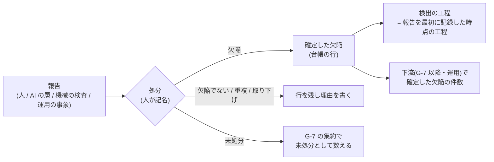

# #413 会議体 委員意見: 品質監査

- 立場: 品質監査。記録で確かめられるか、監査で何が見えて何が見えなくなるか、指標の水増し・汚染を防げるかを見る
- 入力: `council-00-agenda.md`、`survey-413-1-internal.md`、`survey-413-2-external.md`。本文は a0d0607 時点で `metrics.md:45-90,175-185`、`assurance-case.md:210-240,762-790,858-868`、`gate-criteria.md:590-600,1863-1910`、`incident-response.md:10-45`、`template/.github/ISSUE_TEMPLATE/bug.yml`、`template/templates/defect-ledger.md`、`template/scripts/gate/autonomy.mjs:10,165,220-226` を読んで確かめた
- 判断軸は信頼性。変更量の少なさを採否の理由にしない
- 〔確〕本文で確かめた事実、〔推〕本意見の読み取り

## 0. 監査の立場から見た全体像

監査の目で最も重いのは「AI の起票で値が水増しされる」ことではありません。**算出元が無いのに、観測していると見える状態**です〔確〕。附属書H の C4・C9 の観測、H.7 の4つの1つ、H.9 問5 の答え、EV-0062 の差し替え条件は、どれも「欠陥の検出工程」を引きます。しかし起票テンプレートに「検出ゲート」欄は無く、集計の実装も無く、台帳は「出荷前 / 運用」の2値です。崩れが起きても、誰の目にも値が現れません。H.7 の表は「内部監査で見るもの」を「監査の観点には無い。運用メトリクスで見る」としています(`assurance-case.md:769`)。運用メトリクスの側に値が無いので、**この行は誰も見ていない**ことになります。

そのうえで、#413 の本来の論点(水増し)は、指標の**形**で大部分が決まります〔推〕。現行の警戒サインは「下流(G-7 以降)での検出の**比率**」です。比率の分母には上流の検出が入ります。そのため、上流で起票すればするほど比率が下がり、良く見えます。AI の大量起票は、この分母を直接膨らませます。母集団の定義(R-2)だけで塞ぐより、**分母を上流の起票量に依らせない**形(R-1)にするほうが、汚染の経路が根元で減ります。R-1 と R-2 は、この順で決めるべきです。

---

## R-1 算出元

### 結論

1. **算出元の正本を欠陥の台帳(`docs/defect-ledger.md`)に置く**。Issue の欄やラベルを正本にしない。`bug.yml` は報告の受け口とし、台帳へ転記する経路の1つにとどめる
2. 台帳の「検出の時点」を、2値(出荷前 / 運用)から**検出の工程**(G-5・G-6・G-7・G-8 から出荷まで・運用。適用するゲートの集合は構成による)へ広げる。委任の停止が「運用」だけを数える規則(`autonomy.mjs:220-221`、`defect-ledger.md:21`)は変えない
3. **警戒サインを比率から外し、下流で確定した欠陥の件数とその推移にする**。対象は、G-7 以降と運用で検出の工程が記録された確定した欠陥。上流の件数は分母に使わない。上流の分布は診断用に残す(何を見て判断するかには使わない)
4. 「重大欠陥の流出」は、Sev ラベルの Issue 起票数ではなく、台帳の「検出の工程 = 運用」かつ確定した重大度が Sev1・Sev2 の行で数える。委任の停止と是正の起動(`gate-criteria.md:596`)と、同じ行を数える
5. 実装までの間、`metrics.md:182` の「起票テンプレートで必須化」という**事実と異なる記述を直ちに改める**。附属書H の C4・C9 の観測、H.7、H.9 問5 には「未実装(IMPL-NNNN)。未測定」と併記する。観測から外すのではなく、未測定と開示する
6. EV-0062 の差し替え条件を、観測できる量へ書き直す(「G-7 以降で確定した欠陥の件数の推移」)。今のままでは差し替え条件を誰も観測できず、暫定のマークが解けない

### 理由

- **Issue の欄は申告であり、記載の欠落を判定できない**。欄が空の Issue は数えられず、空欄を数えない集計は欠落を見えなくする。台帳は G-7 基準2 の入力であり、出荷の集約がすでに読む(`aggregate-evidence.mjs`、IMPL-0041)。台帳が無い出荷は「記載の欠落」になる規則も既にある(`defect-ledger.md:5`)。欠落を検出できる場所に正本を置く〔確〕
- **G-6 で見つかり PR の中で直された欠陥は、Issue にならない**(内部調査 H7)。Issue を正本にすると、上流の人の検出は数え漏れ、AI が起票する経路だけが上流の件数を足す。この非対称は記録の義務化では解けない。記録を義務化しても、記録率の差がそのまま値に出る。NTT データの指摘(アジャイルで記録を義務化するとアジリティを損なう)とも合う〔推〕
- **比率は、分母の記録の多さで動く**。上流の起票を増やせば下流比率は下がる。これは #413 が恐れる水増しの経路そのものである。下流の件数は、上流で何件起票したかに依らない。H.7 の理由「下流での検出が増えれば、上流の確認が働いていない」は、件数の推移で読める。DORA の不安定性の指標も、事後の事象で数え、報告の件数では数えない(外部 §4)〔確・推〕
- 下流の件数は変更量で動く。そのため、同じ期間のマージした変更の件数を並べて読む(新しい指標にはしない。機械で数えられる既存の量を添えるだけ)
- 手続3「実装前の指標を暫定として運用しない」(`metrics.md:52`)のもとでは、この指標は候補であり、附属書H が観測に名指ししていること自体が手続3 と緊張する。ただし H.7 は「未測定は正当な値」とし、トークン効率は「算出元が無い場合は 0 でなく未測定」とする先例がある(`metrics.md:192`)。外すより、未測定と開示して未達の表示を続けるほうが、「観測していない」ことが読み手に残る

### 監査で確かめられること

- 台帳の各行に検出の工程が書かれているか(空欄は欠落として機械で数えられる)
- 下流の件数の推移と、同じ期間の変更の件数(機械で出る)
- 運用の Sev1・Sev2 の台帳の行と、ポストモーテム・是正の記録の対応(行があるのに是正の記録が無い、またはその逆)
- 実装されるまで、C4・C9・H.7・H.9 問5 に「未測定」が表示され続けているか

### 見えなくなること(開示すべき限界)

- 上流でどれだけ見つけたかは、警戒サインの判断に使わなくなる。上流の分布は、記録の慣行に依存するため、比較の材料にならない
- 出荷前に見つかり、台帳へ書かれずに直された欠陥は、どの集計にも現れない。これは本標準が課さない範囲として明記する(書かれていないのではなく、課さないと決めた)

### 採らない案

| 案 | 採らない理由 |
| --- | --- |
| `bug.yml` に「検出ゲート」欄を必須で足し、Issue を集計の正本にする | 申告の欄で、PR の中で直した欠陥を拾えない。上流の数え漏れと AI の起票の非対称が残る |
| 比率(G-7 以降 ÷ 全体)を警戒サインに残し、分母を確定した欠陥に限る | 確定に限っても、上流で確定の記録をどれだけ残すかで分母が動く。記録の慣行が値を決める |
| 指標を附属書H の観測から外す | C4 の「その他の時点」の観測が無くなり、H.7 は3つになる。外せば「観測できない」ことが本文から消える。未測定の開示のほうが読み手に残る |
| 実装まで現行の記述を維持する | 「起票テンプレートで必須化」は事実と異なる。規格が事実と異なる記述を残すことは、信頼性の点で許容できない |

### 反論されうる点

- 「下流の件数だけでは、上流の確認が効いているかを直接示せない」 → 示せないことは H.7 の他の3つ(検出能力の実測、統制の作動、監査の所見)が補う。上流の効きを件数で示す量は、記録の慣行で動くため、根拠にならない
- 「台帳への転記は二重管理になる」 → 台帳は G-7 の入力として既に必須である。新たに転記を課すのは「検出の工程」の1列だけである
- 「件数は小規模の体制ではほぼ 0 で、何も分からない」 → H.7 のとおり、件数が足りない体制では「未測定」と開示する。何件から値を載せるかは組織が定める(本標準は件数を定めない)。この扱いを同じく当てる

---

## R-2 数える母集団

### 結論

1. **集計に数える単位は確定した欠陥とする**。確定とは、報告された事象を、修復または文書化した回避策つきの受容を要する不備と判断したことをいう(24765 を引く SWEBOK の defect に揃える)
2. 確定の操作的な定義は、**台帳の行の「処分」欄と「処分した者」欄**で与える
   - 処分: 未処分 / 欠陥 / 欠陥でない / 重複 / 取り下げ
   - 処分した者: 人の氏名。AI の名義を書かない(`defect-ledger.md:34` の型をそのまま当てる)
   - 欠陥でない・重複・取り下げは、行を消さず理由を書く。重複は重複先の ID を書く
   - 確定の根拠(観測した事象・再現の手順、または修正の変更)の所在を書く。**適用・受理したことだけを確定の根拠にしない**
3. **報告の出所**(人 / AI の層 / 機械の検査 / 利用者・運用の事象)を別の欄で記録する。確定と出所は別の属性であり、同時に付けない(ODC の opener / closer に対応する)
4. **未処分の報告を、確定に限った集計から消さない**。出荷の集約は、G-7 基準2 の件数を「確定した欠陥の未解決」と「未処分」に分けて出す。未処分を解決済みにも欠陥でないにも数えない。滞留は G-7 で見え、新しい指標を足さずに済む
5. 確定者に、作成を指示した者を**含めてよい**(上流の確定)。ただし次の処分は作成を指示した者を確定者にしない
   - 検出の工程が「運用」の報告を「欠陥でない」「取り下げ」とする処分
   - 確定した重大度を当初の重大度より下げる処分(R-4)
6. 「人確定」の語を使わない。語は「欠陥と確定する」「処分」「処分した者」とする(本文に「処分」の使用例は無いことを確かめた。衝突しない)
7. AI の指摘から起票すること自体は禁じない。AI の層が見つけ人が欠陥と確定したものは、確定した欠陥として数える。**AI の出所だからといって除外しない**

### 理由

- 規格の語彙は、報告(anomaly)と確定した欠陥(defect)を既に別の概念として持つ(外部 §1.1・§1.2)。区別は新しい概念の発明ではなく、どの段で数えるかの問題である
- **受理を確定と同一視すると、好みや価値の低い指摘で件数が増える**(AutoCommenter の「正しいが価値の低いコメント」、森崎の形骸化の型、外部 §3.2・§3.5)。そのため、確定の根拠は「観測できる不適合または修正の要否」に置き、適用の事実を根拠にしない
- 記名だけの確定は、AI が大量に起票し人が確定欄へ名前だけを入れる形で形骸化する(#408 起案 `council-01-drafter.md:165`)。それでも記名を要件にするのは、**誰が処分したかを辿れなければ、監査が抽出して確かめる対象を選べない**からである。記名は形骸化を防がないが、形骸化を見つける手がかりになる
- 作成を指示した者を上流の確定から外すと、確定の記録が負担になり、記録しない方向へ流れる。R-1 で上流の件数を警戒サインの判断から外したので、上流を水増しする誘因は弱い。**残る誘因は逆向き、すなわち下流で「欠陥ではない」と処分して件数を減らすこと**である。委任の停止(`autonomy.mjs`)と是正の起動が運用の Sev1・Sev2 に掛かるため、この誘因は実在する。独立を要件にするのは、この方向の処分だけでよい
- 「区別して両方の値を出す」案は、確定に代えるものではなく、確定と組み合わせて採る。出所だけで確定を置かないと、AI の偽陽性がそのまま値になる(curl の 2025 年の例: 約 20% が slop、確認は約 5%)
- 出所を確定と同時に付けないのは、確定した者が出所を書き換えて数え方を動かす経路を残さないためである。出所は報告の時点の事実である

### 監査で確かめられること

- 処分の欄の空欄・未処分の件数と経過日数(機械で出る)
- 処分した者が人の名簿の人か(既存の名簿との突合。AI・bot のアカウントを数えない `assurance-case.md:646` と同型)
- 運用の報告の「欠陥でない」「取り下げ」の処分者が、原因の変更の作成を指示した者でないか(PR の記録との突合で機械で確かめられる)
- 抽出した行について、確定の根拠の所在が実在し、適用の事実だけで確定していないか(人が読む)

### 見えなくなること

- 処分した者が中身を読んだかは、記録から分からない。記名は読んだ証拠ではない。この限界を本文で開示する
- **出所の「AI の層」は申告である**。AI エージェントが人のトークンで起票すると、アカウントから区別できない。出所は機械で完全には確かめられない。そのため、出所の内訳を比較・目標・評価に使わない(診断用に限る)
- PR の中の AI の指摘の採否(H.4 条件5)と台帳の処分は、結ばれない。PR の指摘を台帳へ起こすことは課さない。PR の中で採って直した指摘は、PR の採否の記録で辿る

### 採らない案

| 案 | 採らない理由 |
| --- | --- |
| 出所だけを記録し、人 / AI の両方の値を出す(確定を置かない) | AI の偽陽性が値に入る。比べても、どちらが本物の欠陥かを判断できない |
| AI の出所の報告を一律に数えない | 人が確定した本物の欠陥を数え漏らす。AI の層の効きを過小に見せ、下流の流出を減らした寄与も消える |
| 受理・適用(Copilot の applied、CodeRabbit の受理)を確定とみなす | 価値の低い指摘で件数が増える。製品ごとに定義が違い、比較できない |
| すべての確定に作成を指示した者以外の者を要する | 確定の記録が重くなり、記録しない方向へ流れる。守りたい誘因(下流の処分による件数の削減)に照準が合わない |
| 確定の欄を AI が埋めてよい(人は承認だけ) | H.4・7.7.8 要求事項12 の型に反する。AI の要約だけを入力にした承認は人の判定に数えない(3.10.12) |
| 未処分の滞留を新しい正式指標の候補に足す | 指標の追加は手続1〜4 と上限に掛かる。G-7 の集約で未処分が見えれば足り、眺めるだけの指標を増やさない |
| 「人確定」の語を流用する | 自律レベルの語(`human-ai-boundary.md:385`)と衝突し、変更の区分と欠陥の処分が混ざる |

### 反論されうる点

- 「確定の記名を求めても形骸化する」 → そのとおりであり、記名は読んだ証拠ではない。記名は監査の抽出の手がかりとして置く。読んだかの確認は、抽出した行で確定の根拠の所在を確かめる監査に委ねる
- 「出所は申告で信用できない」 → 信用しない前提で、比較・目標・評価に使わないと決める。それでも出所を残すのは、未処分の報告がどの経路から来て積み上がっているかを、診断で読めるようにするためである
- 「作成を指示した者が確定してよいなら、甘く確定しない(欠陥でないとする)」 → 上流でそうしても、警戒サインの判断(下流の件数)は動かない。下流の処分にだけ独立を課すのはそのためである

---

## R-3 工程の帰属

### 結論

1. **検出の工程は、報告を最初に記録した時点で、変更が位置していた工程とする**。AI の層が G-6 の PR で指摘し、後日に人が確定した欠陥は G-6 に数える。確定した人のゲートには数えない
2. 「AI の層の工程」を別の工程として立てない。AI の層は、ゲートの中の検出の層である(H.4)。どの層が見つけたかは R-2 の出所で持つ
3. 下流の欠陥には、**検出の工程と別に「原因のゲート」**を書く。原因のゲートは、本来捕まえるべきだったゲートを事後検証で判断したもので、事実ではなく判断である。C9 の崩れ「原因ゲートの特定が無い」はこの欄で確かめる
4. 出荷の後(G-7 以降)に、定期の AI の走査が main で見つけた報告は、その時点の工程(運用、または次の出荷前)に数える。走査の対象の変更が G-6 を通過した後なら、G-6 に遡らせない

### 理由

- **確定した時点に帰属させると、確定を遅らせる・早めることで工程を動かせる**。例えば、運用で見つかった報告を、次の版の G-6 で確定したことにすれば上流に見える。報告の時点に固定すれば、帰属は記録の時刻で機械が決められ、確定者が動かせない
- ODC は、検出側の属性(activity・trigger)を検出時に、確定側の属性(defect type)を修正時に付ける(外部 §1.3)。検出の工程は検出側、原因のゲートは確定側の属性であり、同じ欄に混ぜない
- 検出の工程と原因のゲートを1つの欄にすると、事後の判断(「本当は G-4 で捕まえるべきだった」)が検出の事実を書き換える。下流の件数(R-1)は検出の事実で数え、原因のゲートは是正に使う

### 監査で確かめられること

- 検出の工程と、報告の最初の記録の時刻、ゲート判定記録の時刻の整合(機械で突合できる)
- 運用の Sev1・Sev2 の行に原因のゲートがあるか(C9)
- 原因のゲートの判断に、事後検証の記録の所在があるか

### 見えなくなること

- 報告から確定までの遅れの長さは、帰属からは見えない。未処分の経過日数(R-2)で見る
- 報告の最初の記録が PR のコメントで、台帳の行が後から作られた場合、最初の記録の時刻の特定は台帳だけでは足りない。台帳に報告の所在(PR・Issue・ログ)を書かせ、時刻はそこから辿る

### 採らない案

| 案 | 採らない理由 |
| --- | --- |
| 確定した人のゲートに数える | 確定の時期で帰属を動かせる。確定者が工程を選べる |
| 「AI の層」を独立の工程として数える | AI の層はゲートの中の検出の層であり、ゲートではない(H.4)。工程の比較が層の比較に化ける |
| 原因のゲートだけを書き、検出の工程を書かない | 事後の判断が事実を置き換える。下流の件数を事実で数えられなくなる |

### 反論されうる点

- 「AI が PR で指摘したが人が採らず、後で運用で同じ欠陥が出たら、どこに数えるのか」 → 報告の最初の記録は G-6 だが、処分が「欠陥でない」なら確定した欠陥の G-6 には入らない。運用の事象として新しい行が立ち、検出の工程は運用、原因のゲートは G-6 とする。この組み合わせは、AI の層が指摘し人が捨てた欠陥として読め、H.4 の採否の監査の材料になる。同一の欠陥として行を結ぶかは「重複」の処分で表す

---

## R-4 重大度の2つの定義

### 結論

1. **本件で揃える**。流出・委任の停止・是正の起動の母集団が重大度で決まるため、定義が2つあるままでは R-1〜R-3 で決めた計上の値が揃わない
2. どちらか一方の定義の内容が誤りなのではない。**誤りは、目的の違う2つの尺度に同じ名(Sev1〜Sev3)を当てていること**と、台帳が「運用で発生した Sev1・Sev2(ポストモーテムを書く障害)」と書いて2つの尺度を混ぜていることである(`defect-ledger.md:16`)
   - トリアージ基準(`gate-criteria.md:1882-1888`): 利用者から見た帰結。欠陥の重大度
   - インシデント対応(`incident-response.md:26-31`): 初動期限とエスカレーションを決める、障害の緊急度。迷ったら高いほうに倒す
3. **計上に使う重大度の正本はトリアージ基準とする**。台帳の重大度はこの定義で書く。インシデント対応の段階は、別の名(例: 障害の等級)に改め、トリアージ基準の重大度との対応を書く
   - 例えば、主要機能の停止で回避策が無い事象は、インシデント対応では Sev2、トリアージ基準では Sev1 になる〔確〕。同じ事象が尺度で1段ずれる
4. 判定者の食い違いは、次で揃える。**AI は重大度の判定に参加してよいが、台帳に記録する重大度は人が記名で書く**。`gate-criteria.md:1876` の「参加させてよい」は材料の提示であり、記録する値を AI が決めることを含まないと明記する(H.4 と同型)
5. **重大度を下げるときは、当初の重大度を消さない**。台帳に「当初の重大度」と「確定した重大度」を並べ、下げた処分は R-2 の5 のとおり作成を指示した者以外が行う

### 理由

- 台帳の重大度は G-7 基準2(出荷の可否の入力)、委任の停止、是正の起動の3つに効く。**判定の入力であり、AI の推定を判定に数えない原則(H.4)の範囲に入る**。参加を許す規定のまま記録の値の主体を書かないと、AI が付けた値がそのまま停止を解く経路が残る
- インシデント対応の尺度は「迷ったら高く」倒す。初動の安全側の判断としては正しいが、計上の値としては高めに偏る。逆にトリアージの尺度で事後に下げると、下げた事実が消えれば流出の件数が減って見える。**下げる誘因は、台帳自身が認めている**(`defect-ledger.md:21`「重大度を低く書く誘因」)。当初の値を残すのは、この誘因を監査で見えるようにするためである
- 本件で揃えないと、R-1 の「運用の Sev1・Sev2」の母集団が、ポストモーテムの要否(インシデントの尺度)と台帳(トリアージの尺度)で違うまま残る。後継の Issue へ送れば、その間の計上の値は意味を持たない

### 監査で確かめられること

- 運用の行で、当初の重大度より確定した重大度が低い行の一覧と、処分した者(機械で出る)
- 台帳の重大度の記名が人の名簿の人か
- インシデントの等級とトリアージの重大度の対応表に反する行(機械で突合できる)

### 見えなくなること

- 当初の重大度は、インシデントの当番が即断した値である。即断の妥当性は記録からは分からない。これは当番の判断の性質であり、監査で問わない

### 採らない案

| 案 | 採らない理由 |
| --- | --- |
| 本件では揃えず別 Issue へ送る | 計上の母集団が2つのまま R-1〜R-3 を決めても値が揃わない |
| インシデント対応の4段階に統一する | 初動の緊急度の尺度であり、迷ったら高く倒す。計上の値に使うと偏る。Sev4(影響のない異常)は欠陥の重大度ではない |
| トリアージ基準の3段階をインシデント対応にも使い、初動期限を重大度で決める | 初動の時点では回避策の有無が分からないことが多く、即断の尺度に向かない(この点は運用の現場の委員の確認を要する) |
| 重大度の判定を人に限り、AI の参加を禁じる | 材料の提示まで禁じる理由は無い。問題は記録の値の主体であり、参加ではない |

### 反論されうる点

- 「インシデント対応の段階名を変えると、既存の運用の記録や外部の慣行(Sev1〜)とずれる」 → ずれるのは名であり、対応表で辿れる。同じ名で意味が違う状態のほうが、記録を読む者を誤らせる
- 「重大度を下げるたびに別の人を要するのは重い」 → 下げる処分は運用の行に限る。出荷前の行は委任の停止に数えないため、誘因が弱く、課さない

---

## R-5 記録と降ろし先

### 結論

1. **新しい ADR を1本起こす**(番号は起案が採る。現時点の最終は ADR-0101)。決定は R-1〜R-4 の結論。採らない案は各論点の表をすべて載せる。ADR-0092 決定7 と選択肢(`adr/0092-...md:78,104`)が #413 へ送った点の着地として、ADR-0092 を書き換えずに参照する
2. **規定の改め先**
   - `metrics.md:181-182`: 算出元を台帳へ、警戒サインを下流の件数へ。事実と異なる「起票テンプレートで必須化」を除く。品質の指標の行に実装マークを付ける
   - `metrics.md` の「採用しない指標」: 「上流の検出の件数・比率を、警戒サインの判断に用いること」を、理由(記録の慣行と起票量で動く)とともに足す。AI の指摘の件数の行(`:85`)とは別の行にする
   - 附属書H: C4・C9 の観測、H.7 の表、H.9 問5、EV-0062 の差し替え条件。H.7 の「内部監査で見るもの」は、運用の行の処分と重大度の引き下げの確認を、既存の観点(観点23 の第1区分の検知、または C9 に紐づく観点)の確かめることへ含めるかを起案が判断する。**新しい観点を足さない**(「論証のために新しいゲート・検査・様式を足さない」との整合)
   - 欠陥トリアージ基準(`gate-criteria.md:1871-1888`): 欠陥・確定・処分の定義、記録する重大度の記名、引き下げの扱い
   - インシデント対応(`incident-response.md:26-31`): 等級の名の変更と、トリアージ基準との対応表
3. **準拠テンプレートへの降ろし先**(すべて IMPL のマークを付け、実装まで `state=undelivered` で表示し続ける)
   - `template/templates/defect-ledger.md`: 列の追加(検出の工程、出所、処分、処分した者、確定の根拠の所在、当初の重大度、原因のゲート)
   - `template/.github/ISSUE_TEMPLATE/bug.yml`: 検出の工程・出所のドロップダウン。重大度は Sev ラベルにしない(正本は台帳)
   - 出荷の集約(`aggregate-evidence.mjs`): G-7 基準2 を「確定した欠陥の未解決」と「未処分」に分けて数える。下流の件数を出す
   - 委任の判定(`autonomy.mjs`): 運用の行の「欠陥でない」「取り下げ」の処分が、作成を指示した者によるときは停止を解かない
   - `template/CLAUDE.md`・AI の担い手への指示: AI が報告を起票するときは出所を AI の層とし、処分の欄を空(未処分)で始める。処分の欄・処分した者の欄を書かない
   - `src/data/template-fields.yaml`: 台帳の新しい欄を必須欄として登録する
4. **EV のマーク**(識別子は起案が採る。現時点の最終は EV-0206)
   - 下流の処分と重大度の引き下げにだけ独立を課す線引き(E0)
   - 検出の工程を報告の最初の記録の時点に固定する規則が、帰属の操作を防ぐという前提(E0)
   - 下流の件数で上流の確認の効きを読むという判断(EV-0062 と同じく E1)
5. 降ろす前に、tpl2 の回帰スイートの fixture と委任の停止の規則の突合を行う(fixture は過去の決定を固定している)

### 理由

- 台帳の列・集約・委任の判定は、実行主体の挙動を制約する規定であり、実装マークの対象である。降ろさずに本文だけを書けば、本件の発端(算出元の無い指標)と同じ状態を新たに作る
- 未達を消さずに表示し続けることで、実装までの間も「観測していない」ことが読み手に残る

### 監査で確かめられること

- IMPL の状態が delivered になるまで、附属書H の観測の欄に「未測定」が出ているか
- 台帳の必須欄の存在(テンプレートの様式の検査で両方向に確かめられる)

### 採らない案

| 案 | 採らない理由 |
| --- | --- |
| ADR-0092 を改訂して本件を収める | 採用済みの ADR の本文は書き換えない。決定は新しい ADR で記録する |
| 本文の改訂だけを行い、降ろしは後継の Issue にする | 算出元の無い規定を再び作る。降ろさないなら undelivered で表示し続ける |
| 内部監査に新しい観点を足す | 附属書H の「新しいゲート・検査・様式を足さない」と衝突する。既存の観点の確かめることへ含める |
| AI の指摘を台帳へ起こすことを義務化する | PR の採否の記録(H.4 条件5)と二重になり、AI の起票量で台帳が膨らむ。台帳へ起こすかは処分の対象にするかの判断であり、義務にしない |

### 反論されうる点

- 「台帳の列が13列から20列近くになり、書かれなくなる」 → 列の多くは運用の Sev1・Sev2 の行でだけ書く(既存の発生日・AI 起因と同じ扱い)。出荷前の行で必須にするのは検出の工程・出所・処分・処分した者だけにし、どの列がどの行で必須かを様式に書く。空欄の扱い(何として数えるか)を列ごとに決め、空欄で有利にならないようにする(既存の「空欄は特定できないと同じく扱う」の型)

---

## 論点ごとの結論(要約)

| 論点 | 結論 |
| --- | --- |
| R-1 | 算出元の正本を欠陥の台帳に置き、検出の時点を工程単位へ広げる。警戒サインを比率から下流で確定した欠陥の件数へ変え、上流の起票量に依らせない。実装までは「未測定」と開示し、事実と異なる記述を直ちに改める。EV-0062 の差し替え条件を観測できる量へ書き直す |
| R-2 | 確定した欠陥だけを数え、台帳の処分と処分した者(人の記名)で操作的に定義する。出所は別の欄で記録し、比較に使わない。未処分は G-7 の集約に別に出して消さない。作成を指示した者の確定は許し、運用の報告の「欠陥でない」処分にだけ独立を課す。「人確定」の語は使わない |
| R-3 | 報告を最初に記録した時点の工程に数える。確定した人のゲートにも「AI の層」にも数えない。原因のゲートは別の欄にする |
| R-4 | 本件で揃える。誤りは同じ名を2つの尺度に当てたことである。計上の正本はトリアージ基準とし、インシデントの等級は別の名と対応表にする。記録する重大度は人が記名し、引き下げは当初の値を残す |
| R-5 | 新しい ADR を起こし、metrics・附属書H・トリアージ基準・インシデント対応を改める。台帳・bug.yml・集約・委任の判定・AI への指示へ IMPL のマークで降ろし、undelivered で表示を続ける。EV は3つ。新しい監査の観点・新しい指標は足さない |
