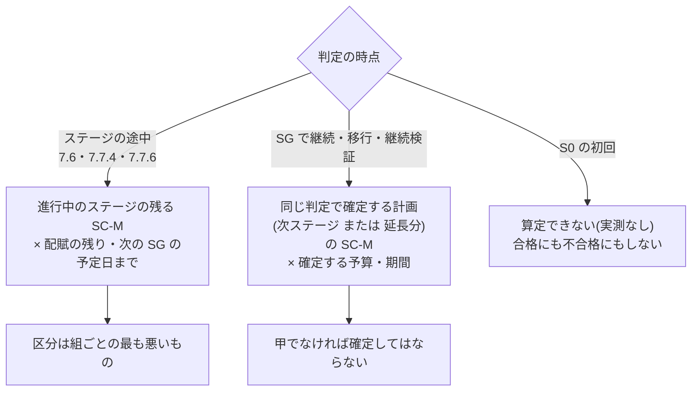

# #415 会議体 第2巡 起案(drafter)

- 作成: 2026-11-04(起案の委員)
- 入力: `decision.md`(裁定)、`crosscheck.md`(突合。H-1〜H-4・M-1〜M-3)、実装済みの 7.7.3〜7.7.5(`src/content/docs/phase4-process-design/exception-escalation.md:373,392-411,485`。以下 `EE`)
- 第1巡の起案(`council-01-drafter.md`)のうち、R-1 要求事項8(SG では次ステージを見込む)と要求事項9(S0 の初回の到達の量)は裁定に入らなかった。突合の H-1・H-3 はその欠落を指している。本巡ではそれを詰め直し、第1巡の案の誤りも直す(S0 の初回の到達の量を「計画範囲の全体」とした案は、計画容量が「実測なし」の間は SC-P に上限が無い(`lifecycle.md:543`)ため、常に丙になる。撤回する)
- 判断軸は信頼性。番号は仮

## 0. 全体像



---

## (1) H-1 判定の時点ごとの「当該ステージ」と「残り」

### 結論

- 判定の時点を **ステージの途中** と **SG の確定** の2つに分け、比べる対象と残りを別に定義する
- **ステージの途中**(7.6 の段階2・3、7.7.4 の上程、7.7.6 の棚卸し、7.7.5 要求事項3 の再判定): 対象は進行中のステージの**残る SC-M**。残りは、そのステージの**配賦の残り**(期間予算・要員予算)と、**次の SG の予定日までの期間**(3.7.3 の継続で確定した次回判定日)
- **SG の確定**(継続・移行、または保留・継続検証による延長): 対象は**同じ判定で確定しようとする計画の SC-M**(次ステージ、または延長するステージの残り)。残りは、**同じ判定で確定しようとする予算と期間**。見込みの材料は、終わろうとするステージの観測の窓のスループット
- **SG の確定では、区分が甲でない計画を確定してはならない**。確定する者は SC-M・予算・期間を自ら決める立場にあり、確定の時点で遅い側の端に届かない確約を置く理由が無い。乙・丙のまま確定することを 7.7.5 の「継続」として扱わない(回数で許す経路を作らない)
- **終わろうとするステージの SC-M の完了**は、SG の判定基準(第2章 2.4)が問う。必達基準2 で比べない(残る期間がほぼ 0 で、比べる意味が無いため)
- 中止の判定では次の計画を算定しない
- 記録の作り直し(突合 H-2 と同じ根): 担い手は**単位期間ごと**に到達の見込みの記録を作り直す。7.6・7.7.4 はその直近の記録を読む

### 案(本文へ入れる形)

7.7.3 の「必達基準2 は、人の見積りではなく…」の箇条の前へ入れる。

```markdown
到達の見込みの対象と残りは、判定の時点によって次のとおりとします。

| 判定の時点 | 比べる対象(到達の量) | 比べる残り |
| --- | --- | --- |
| ステージの途中(7.6 の段階2・3、7.7.4 の上程、7.7.6 の棚卸し、7.7.5 要求事項3 の再判定) | 進行中のステージの、残る SC-M の作業単位 | そのステージの期間予算・要員予算の残りと、次のステージ移行ゲートの予定日(第3章 3.7.3 の次回判定日)までの期間 |
| ステージ移行ゲート(SG)で、継続・移行、または保留(継続検証)により計画を確定するとき | 同じ判定で確定する計画の SC-M(次ステージの SC-M、または延長するステージの残る SC-M) | 同じ判定で確定する予算と期間 |
| ステージ移行ゲート(SG)で中止と判定するとき | 算定しない | — |

- SG で確定する計画の見込みは、終わろうとするステージの観測の窓の完了スループットから算定する
- SG では、区分が甲でない計画を確定してはならない。乙または丙であれば、SC-M・予算・期間のいずれかを変えて甲にしてから確定する。確定の時点の乙・丙を、7.7.5 の継続として扱ってはならない
- 終わろうとするステージの SC-M を完了したかは、ステージ移行ゲートの判定基準([第2章 2.4](/process-compass/phase4-process-design/lifecycle/))で判定する。必達基準2 では比べない
- 材料の集計の担い手は、単位期間ごとに到達の見込みの記録を作り直す。7.6 の予算・日程の発火と 7.7.4 の検知は、直近の記録の区分を読む
```

あわせて、テンプレ4 の節「到達の見込み」の見出しの適用を「ステージ移行ゲート、7.7.6 の棚卸し、7.7.4 の上程、7.6 の段階2・3 の判定で必須」に広げ、欄「判定の時点」(上表の行)を足す(突合 H-2 の直し方と同じ)。

### 理由

1. **SG はステージの境界にある**(突合 H-1)。終わるステージの残りで比べると、期間がほぼ 0 で自明の甲か丙になる。必達基準2 が意味を持つのは、ステージの途中と、次の確約を置く時点の2つである
2. **SG の確定は自明に甲にならない**。突合は「2.10.1 の SC-M ≤ 計画容量の 60% と同じ材料から出るため、ほぼ常に甲」と見るが、60% は計画容量(中心の側の値)に対する割合で、遅い側の端(窓の最小スループット)では届かないことがある。ばらつきが大きいチームほど乙になる。確定の時点の検査は、2.10.2 の「確約の量を支えるのは実測された完了の速さ」(`lifecycle.md:496`)を遅い側で確かめる、唯一の事前の検査である。Simonson と Staw(1992)の「フィードバックの前に数値で決める」にも、確定の時点の検査が最も合う
3. **SG で乙・丙を確定させない**。乙・丙を許して 7.7.5 の継続で数えると、確定した直後から不合格の計画を、判定者が自分で作ったことになる。確定する者は SC-M・予算・期間を同じ判定で決める権限を持つ(3.7.3)ので、甲になるまで変えればよい。乙のまま確定したいなら、SC-M を減らして SC-P へ置けばよい。SC-P は確約ではない
4. **次の SG の予定日を期間の残りにする**。ステージの期間は 3.7.3 の継続で「次回判定日」として確定する。他に「ステージの残る期間」を測る基準日が本標準に無い
5. **記録を単位期間ごとに作り直す**。突合 H-2 のとおり、記録が SG にしか無いと 7.6 と 7.7.4 が読む区分がステージの途中に存在しない。単位期間はスループットを測る単位(第1章 1.4、2.10.2 要求事項4)で、それより細かく作り直しても材料が変わらない

### 採らない案

| 案 | 採らない理由 |
| --- | --- |
| SG では「終わろうとするステージの SC-M」を対象にする | 残る期間がほぼ 0 で、自明の甲か丙になる。完了したかは SG の判定基準が問う |
| SG では必達基準2 を判定しない(ステージの途中だけにする) | 確約を置く時点の検査が無くなり、遅い側で届かない確約を置いた後、最初の単位期間で乙になる。不合格を事後に数えるより、確定の時点で塞ぐほうが信頼できる |
| SG の確定で乙を許し、7.7.5 の継続として数える | 理由3。判定者が自分で作った不合格を、継続の記名と回数で許すことになる |
| 記録を 7.7.2 の「期」ごとに作り直す | 期がスループットの単位期間より長い組織では、7.6 の発火が期の境界まで遅れる |
| 7.6・7.7.4 の検知の時点ごとに担い手が記録を作り直す(突合の直し方) | 作り直しの時点が発火に依存し、発火の判断に使う区分が発火の後に作られる。単位期間ごとに作り、検知はそれを読む順にする |

---

## (2) H-3 S0 の初回

### 結論

- 突合 H-3 の指摘は正しい。S0 の初回は SC-M を置かない(2.10.2 要求事項2)ため、現行の文では残る SC-M が 0 個になり**無条件の甲**になる。裁定 R-1 の「実測が無ければ不合格にすると常に不合格になる」の推論は、この点を見落としていた
- 代わりに使う「7.7.9 の見積りの幅」は案件全体の値で、ステージの残りと単位が合わない。**この代替を削る**
- S0 の初回(と、ステージの途中で観測の窓の単位期間が 3 に満たない間)は、区分を「**算定できない**」と記録する。**合格にも不合格にもしない**。7.7.5 の回数に数えない
- 「算定できない」は甲ではない。**S0 の初回の間は、SG-0 で S1 の計画を確定するとき((1) の表)まで、必達基準2 の合格を主張できない**。到達の側の歯止めは、S0 の初回は次の3つで持つ
  1. G-1 で S0 の初回の期間と予算(配賦)を確定する(既存。7.7.1)
  2. 7.6 の予算・日程は、算定できない間は**見込みではなく実績**(配賦に対する消費、SG-0 の予定日までの経過)で測る
  3. 7.7.4 の消化進捗比(実績どうしの比。見込みを使わない)はそのまま働く
- S0 の初回に、SC-M に代わる「到達の量」(SG-0 の材料に当たる作業単位など)を新しく置くことは**採らない**

### 案(本文へ入れる形)

7.7.3 の「実測が無い間(S0 の初回など)は、7.7.9 の見積りの幅で代え、『実測なし』と記録する」を次で置き換える。

```markdown
- 次の間は、区分を「算定できない」と記録する。「算定できない」は甲・乙・丙のいずれでもなく、必達基準2 の合格にも不合格にも数えない。7.7.5 要求事項4 の回数に数えない
  - S0 の初回(SC-M を置かないため。[第2章 2.10.2](/process-compass/phase4-process-design/lifecycle/) 要求事項2)
  - 観測の窓の中の単位期間が3に満たない間
- 「算定できない」の間に、7.7.9 の見積りを到達の見込みに代えて用いてはならない。7.7.9 の見積りは案件全体の値であり、ステージの残りと比べられない
- 「算定できない」の間は、7.6 の予算・日程の発火を、見込みではなく実績で測る。予算は配賦した予算に対する消費、日程は次のステージ移行ゲートの予定日に対する経過とする
```

7.6 の箇条「予算の超過と日程の遅延の見込みは、7.7.3 の到達の見込みの記録から…」(`EE:221`)の末尾に「区分が『算定できない』の間は、7.7.3 のとおり実績で測る」と足す。

根拠水準: 「算定できない」の扱いは EV-0201 の対象へ加え、差し替え条件に「算定できない区分のまま SG-0 へ至った案件の、S0 の初回の予算と期間の実績(配賦に対する比)」を足す。

### 理由

1. **無条件の甲を消す**。必達基準は足切りで、S0 は中止が最も多く起きるべきステージである。条件の欠落で合格になる規定は、足切りを持たないより悪い。合格の記録が残り、後の判定で「必達基準2 は合格だった」と引かれるためである
2. **不合格にもしない**。実測の無いことを理由に不合格にすると、7.7.5 の3回の上限を実測の欠如で消費させる(裁定 R-1 の理由のこの部分は正しい)。「合格でも不合格でもない」を区分の外の状態として置けば、両方の誤りを避けられる
3. **7.7.9 の見積りで代えない**。突合 H-3 のとおり単位が合わない。加えて、7.7.3 は「人の見積りではなく、記録された観測から算定する」(`EE:392`)と定めた。代替で見積りへ戻すと、S0 の初回だけ判定の入力が人の見積りになり、裁定の主旨と矛盾する
4. **実績で歯止めを持つ**。S0 の初回は G-1 で期間と予算が確定しており、超過の実績は観測できる。見込みが作れない間に見込みの発火を待つと、7.6 が S0 の初回の全期間で働かない(突合 H-2)。実績は遅れて立つが、立たないよりよい
5. **SC-M の代わりを置かない**。S0 の初回に「到達の量」を指名させると、確約の量を実測なしに置く形になり、2.10.2 要求事項2 が禁じたことを別の名で行う。7.7.9 要求事項8(S0 の初回の範囲の案を SC-M と呼ばない)の趣旨とも当たる。指名した範囲を削れば甲になり、削る記録の規定が新たに要る。S0 の探索が長引く危険は、必達基準1(仮説の観測データ)と保留の再判定期限(3.7.3)が受け持つ

### 採らない案

| 案 | 採らない理由 |
| --- | --- |
| 現行のまま(7.7.9 の見積りの幅で代える) | 単位が合わず、残る SC-M が 0 のため結局は無条件の甲になる。入力が人の見積りに戻る |
| S0 の初回は不合格とする(品質監査・現場の第1巡) | 7.7.5 の回数を実測の欠如で消費させる。SG-0 が常に不合格の継続になる |
| S0 の初回は計画範囲の全体を到達の量とする(起案の第1巡) | 計画容量が「実測なし」の間は SC-P に上限が無く、常に丙になる。撤回する |
| SG-0 の判定基準の材料に当たる作業単位を G-1 で指名し、到達の量とする(突合の例示) | 理由5。実測なしの確約を別名で置く。削れば甲になる |
| 「算定できない」を甲として扱い、記録だけ残す | 理由1。合格の記録が残る |

---

## (3) H-4 7.7.5 要求事項4 の数え直し

### 結論

- **数え直しを置かない**。回数は案件の中で、必達基準の番号ごとに通算する
- その代わりに、**何を1回と数えるか**を判定の後の状態で定める。継続と判定し、**同じ判定で確定した変更を当てた後の区分が乙または丙のまま**であるとき、1回と数える。変更の後の区分が甲になる継続は、そもそも「不合格がある状態での継続」ではないので数えない
- これで、丙の継続に要する変更(`EE:410`)は回数を 0 に戻す理由にならない。変更して甲に届けば数えず、届かなければ数える。SC-M を1件動かすだけの判定を添えても、乙のままなら数える
- 必達基準1・3〜5 は、変更の判定と無関係に通算する(現行の文で括弧の外に出た数え直しの条件を取り除く)
- 変更の後の見込みを判定記録に書かせる(テンプレ4 の欄「変更の後の見込み」。第1巡の起案 R-3 (f))

### 案(本文へ入れる形)

7.7.5 要求事項4(`EE:485`)を次で置き換える。

```markdown
| 4 | 同一の必達基準の不合格に対して、3回を超えて継続と判定してはならない。回数は案件の中で必達基準の番号ごとに通算し、数え直さない。必達基準2 は、継続の判定で確定した SC-M・予算・期日の変更を当てた後の到達の見込みの区分が乙または丙であるときに、1回と数える。変更の後の区分が甲であれば数えない |
```

表の後の段落の末尾に足す。

```markdown
数え直しを置かないのは、変更の判定を添えるたびに回数が戻ると、範囲を少しずつ動かして継続を重ねることで上限が働かなくなるためです。変更によって到達できる計画に戻した継続は、不合格のままの継続ではないため、数えません。
```

テンプレ4 の節「到達の見込み」に欄を足す。

```markdown
| 変更の後の見込み | <継続の判定で SC-M・予算・期日を変えた場合に、変更の内容と、変更を当てた後の両端と区分。変えていない場合は「変更なし」> |
| 継続の回数 | <この案件で、必達基準2 について数えた継続の回数(今回を含む。第7章 7.7.5 要求事項4)> |
```

ADR-0099 の決定の「SC-M・予算・期日を変える判定が記録されたときに限り数え直す」(突合の指す ADR99:60)を、上の文に改める。ADR-0099 は未採用(未追跡のファイル)のため、本文の修正で足りる。

### 理由

1. **突合 H-4 の3つの経路をすべて塞ぐ**。(i) 必達基準1・3〜5 への誤った掛かり: 数え直しの条件そのものを無くす。(ii) 丙の継続が必ず数え直す: 丙の継続に要る変更は、数えるかの判断の材料になるだけで、回数を戻さない。(iii) 乙に SC-M を1件動かす判定を添えて数え直す: 変更の後も乙なら数える
2. **数え直しが無くても、正当な継続は締め出されない**。変更で甲に戻せる案件は数えられない。3回に届くのは、到達できない計画のまま3回続けた案件だけで、7.7.5 の「最も強い歯止め」(`EE:487`)が狙うのはその案件である
3. **ステージで数え直さない**。第1巡の起案は「ステージの中で数える」と出したが、裁定が採らなかった理由(ステージの切り替えで数え直す経路が残る)は正しい。(1) の結論で SG の確定に甲を求めたため、ステージを越えて乙・丙が持ち越されることは無い。通算にしても、ステージの境界で不当に積み上がらない
4. **判定の後の状態で数える**のは、Simonson と Staw(1992)の処方(結果ではなく、事前に決めた最低目標に照らして方針を変えたか)に合う。変えて届くなら方針を変えたことであり、届かないなら変えていない

### 採らない案

| 案 | 採らない理由 |
| --- | --- |
| 現行のまま(変更の判定が記録されたら数え直す) | 突合 H-4。上限が働かない |
| 数え直しの条件を必達基準2 に限り、「変更の後の区分が甲になったとき」に数え直す(突合の直し方) | 甲に戻った時点で不合格は解消しており、「数え直す」までもなく次の不合格は新しい不合格になる。その後の乙で再び0から数えられ、甲と乙を往復する計画で上限に届かない。通算のほうが単純で、抜け道が無い |
| ステージごとに数え直す(起案の第1巡) | 理由3。ステージの切り替えが数え直しの経路になる |
| 区分にかかわらず、継続の判定をすべて数える | 変更で甲に戻した継続を数えると、正当な範囲の縮小にまで上限を消費させ、縮小を避けて中止か無理な継続の二択へ追い込む。7.7.3 の「範囲を縮小して継続する選択肢を常に併置する」(`EE:389`)と当たる |

---

## (4) M-1〜M-3

### M-1 比べる組ごとの区分の組み合わせ

**結論**: 組は「期間の見込みと残る期間」「費用の見込みのうち期間予算の分と期間予算の残り」「要員予算の分と要員予算の残り」の3つとする。**案件の区分は、組のうち最も悪い区分**(丙 > 乙 > 甲)とする。組ごとの区分も判定記録に書く。期間予算と要員予算を分けて配賦していない組織は、合計を1組として比べ、その旨を書く。

```markdown
- 比べる組は、期間の見込みと残る期間、費用の見込みのうち期間予算の分と期間予算の残り、要員予算の分と要員予算の残りの3つとする。期間予算と要員予算を分けて配賦していない場合は、合計を1組として比べ、その旨を記録する
- 組ごとに区分を定め、組のうち最も悪い区分(丙、乙、甲の順に悪い)を案件の区分とする。組ごとの区分を判定記録に書く
- 「算定できない」の組がある場合は、他の組の区分にかかわらず案件の区分を「算定できない」とする。ただし、他の組に丙がある場合は丙とする
```

**理由**: 必達基準2 の不合格の状態は「残る予算**または**期間を上回る」で、どれか1つが届かなければ到達できない。最も悪い組で決めるのは、この「または」をそのまま区分へ写したもの。組ごとに書かせるのは、どの組が悪いかで取るべき手(期日を動かすか、予算を足すか)が変わり、エスカレーションレポートの3案の材料になるため。予算を2組に分けるのは、7.7.1 が期間予算と要員予算を別に配賦するため(片方の余りで他方の超過を相殺した形を、配賦の承認なしに作らない)。丙を「算定できない」に優先させるのは、届かないことが既に分かっている組を、別の組の欠落で隠さないため。

**採らない案**: 組ごとの区分の多数決・平均(「または」に反する)。期間の組だけで区分を決め、費用は 7.6 に任せる(必達基準2 は「予算または期間」を問う)。予算を4区分すべてで比べる(AI 実行予算・基盤予算は裁定 R-1 で外した)。

### M-2 スループットの最小値が 0 のとき、最小標本数との整合

**結論**:
- 完了 0 の単位期間を、窓から**除いてはならない**。最小値が 0 のとき遅い側の端は「届かない」(無限大)とし、区分は乙(最大値が正のとき)または丙(最大値も 0 のとき)になる
- 0 が頻繁に出るのは、単位期間がチームの完了の速さに対して短すぎるという情報である。直す手は**単位期間の長さ**(2.10.2 要求事項4 で記録する。G-1・SG で定める)であり、0 の除外ではない
- 第4章「閾値の設定と較正」の要求事項3(窓の中の件数が最小標本数に満たない値を判断に用いない)は、**到達の見込みに適用しない**。代わりに、窓の中の単位期間の数が3以上であることを求め((2) の「算定できない」の条件)、これを 7.7.3 に書く。窓の長さは第4章の観測の窓を用いる

```markdown
- 観測の窓の中に、完了が0の単位期間がある場合も、その期間を除いてはならない。最小値が0のときは、遅い側の端を「残りを超える」とする
- 到達の見込みには、[第4章「閾値の設定と較正」](/process-compass/phase4-process-design/gate-criteria/)の要求事項3(最小標本数)を適用しない。窓の中の単位期間が3に満たない間は「算定できない」とする
```

EV-0201 の差し替え条件に「窓の中の完了 0 の単位期間の件数と、そのときの区分。単位期間の長さを変えた件数」を足す。

**理由**:
1. **0 を除くと楽観へ倒れる**。0 の期間は休暇・障害・割り込みで現に起きた完了の速さで、遅い側の端はそれを見せるために最小値で取っている。除けば、遅い側の端が実際より速くなる
2. **最小標本数を適用しない**。第4章の要求事項3 は比率の不安定を防ぐ規定である(`gate-criteria.md` の要求事項3 の後の段落: 「比率は母数が小さいほど不安定」)。到達の見込みは比率ではなく、最小値・最大値で幅を取る算定で、標本が少ないほど幅が広がり保守の側へ倒れる。最小標本数(既定 30 件)を当てると、1〜2 名の体制では四半期の窓で届かず、常に「算定できない」になって必達基準2 が働かない。小さな体制ほど判定が消えるのは、信頼性の向きとして逆である
3. **単位期間の長さで直す**。単位期間は G-1・SG で記録する値で、フィードバックの前に決まる。0 が出た後に除外を決めるのは、判定の後に取り方を選び直すことに当たる(裁定 R-2 が「案件ごとに自由に選ばせる」を採らなかった理由と同じ)

**採らない案**: 0 の単位期間を除く(理由1)。最小標本数に満たなければ「算定できない」とする(理由2)。0 の期間を 1 として扱う(根拠の無い補正で、遅い側の端を作る)。連続する2単位期間の合計で最小値を取る既定にする(単位期間の長さを倍にすることと同じで、それなら単位期間を直接変えれば足りる。既定を二重にしない)。

### M-3 2.10.6 との整合

**結論**:
- 2.10.6 の「期日に間に合わない見込み」は、**到達の見込みの期間の組が乙または丙になったときに立った**とする。価値責任者はこれを否定できない。2.10.4 の2指標(進捗率・滞留)で、それより**早く**見込みを立てることは妨げない
- 到達の見込みは「SC-P・SC-B より SC-M を先に完了させる」前提の値である(残る SC-M を、すべての作業単位の完了スループットで割るため)。このことを 7.7.3 に書く。したがって、期間の組が乙・丙になった時点で、2.10.6 の手順1(SC-B → SC-P を削る)は**既に見込みに織り込まれている**。手順1 の実行は残すが、見込みを甲に戻す手段にならないため、7.6 の段階の起票を手順1 の結果まで待たせない
- 「同じ材料」の言明は、2.10.4 の進捗率(受入基準で数える)とは一致しないため、「2.10.6 の材料の集計(残る作業単位の個数、実測スループット、残る期間)と同じ」と書き換える

2.10.6 の冒頭(`lifecycle.md:550`)の後に足す。

```markdown
第7章 7.7.3 の到達の見込みの期間の組が乙または丙になったときは、見込みが立ったものとします。価値責任者は、2.10.4 の2指標によって、それより早く見込みを立ててかまいません。到達の見込みは、SC-B・SC-P より SC-M を先に完了させる前提の値です。このため、期間の組が乙または丙のときは、手順1 だけでは見込みを甲に戻せません。手順1 の結果を待たずに、第7章 7.6 の段階に従って起票します。
```

7.7.3 の期間の見込みの箇条(`EE:394`)を次に改める。

```markdown
- 期間の見込みは、残る SC-M の作業単位の個数 ÷ 実測スループットとする。実測スループットは、層を問わず完了した作業単位の個数で数える。このため期間の見込みは、SC-B・SC-P より SC-M を先に完了させる前提の値である。材料は、[第2章 2.10.6](/process-compass/phase4-process-design/lifecycle/)の材料の集計(残る作業単位の個数、実測スループット、残る期間)と同じものを使う
```

**理由**:
1. **2.10.6 と 7.6 の食い違いを閉じる**(突合 M-3)。7.6 は遅い側の端で測るのに、その起点となる 2.10.6 の見込みが価値責任者の評価のままだと、7.6 は発火しているのに 2.10.6 の手続が始まっていない、という状態が起きる。機械的に定まる区分を起点にすると、2つが同じ時点で動く
2. **早く立てることは妨げない**。2.10.4 の滞留は先行の指標で、スループットの窓より早く停滞を示す。遅い側にだけ合わせると、先行の指標が持つ早さを捨てる
3. **前提を書く**。第1巡で起案は見落としていたが、残る SC-M を全層の完了スループットで割る算定は、チームが今後は SC-M だけを進める前提を置いている。前提を書かないと、SC-P・SC-B を並行して進めているチームで見込みが楽観に倒れることが読み手に見えない。前提を書けば、乙・丙は「SC-B・SC-P を止めても届かない」を意味し、手順1 を待つ理由が無いことが導ける
4. **SC-M だけのスループットで割る案は採らない**。標本が層で分かれて小さくなり、作業の割り振り(SC-M に人を寄せるか)で値が動く。前提を開示するほうが、測り方を2つ持つより信頼できる

**採らない案**: 2.10.6 は対象外と ADR-0099 に書く(突合の代案。食い違いを残したまま開示するだけで、閉じない)。2.10.6 の評価を到達の見込みだけに置き換え、2.10.4 の2指標を外す(理由2)。SC-M の作業単位の完了だけでスループットを数える(理由4)。乙・丙でも手順1 の結果を待ってから起票する(前提により、手順1 は見込みを甲に戻さない。起票が遅れるだけ)。
