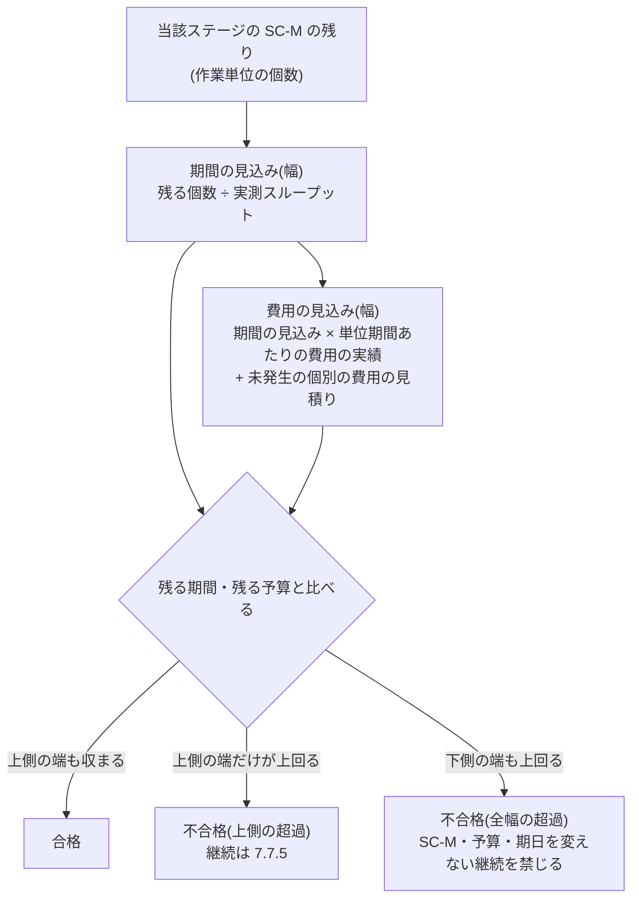

# #415 会議体 起案(drafter)

- 作成: 2026-11-04(起案の委員)
- 入力: `council-00-agenda.md`、`survey-415-1-internal.md`(以下「内部」)、`survey-415-2-external.md`(以下「外部」)
- 立場: 本文へそのまま入れられる形で案を出す。判断軸は信頼性。変更量の少なさを理由にしない
- 行番号はコミット 352f4ad 時点。EV・IMPL・ADR の番号は仮番(清書時に台帳で採番する。並行の会議体と衝突しうる)

## 0. 起案の骨子(先に全体像)



- 「到達に要する見積」を、7.7.9 の見積りではなく**実測から作る見込み**に置き換える(R-1)
- 比べる値は**上側の端**。IPA UK 7.8 の三分の構造は、不合格の中の2区分として残す(R-2)
- 7.6 の「超過・遅延の見込み」も同じ材料・同じ端で測る。7.7.4 の担い手の起票は区分で機械的に定まる(R-3)
- 新しい ADR を起こす。ADR-0093 決定7 を受け、決定4 を変えない(R-4)

---

## R-1 判定の入力(残りの見積り)

### 結論

- 「到達に要する見積」を「**到達に要する見込み**」へ改め、7.7.9 の見積り(G-1 時点の案件全体の値)と語で分ける
- 「ステージのゴール」は**当該ステージの確約範囲(SC-M)の完了**と明記する。SC-P・SC-B は到達の量に数えない
- **期間**は第2章 2.10.6 と同じ材料(残る SC-M の作業単位の個数 ÷ 実測スループット)で見込む。**費用**は期間の見込みに単位期間あたりの費用の実績を掛け、未発生の個別の費用(委託・調達)の見積りの幅を足す。費用と期間を分けて作るが、費用は期間から導く
- 残る予算は、当該ステージに配賦した**期間予算と要員予算の残り**。AI実行予算・基盤予算は数えない(7.7.4 の AI実行予算の行と必達基準3 が受け持つ)
- 作る者: 材料の集計は D-0 表1「フローの観測と見込みの報告」の担い手(AI でよい)。見込みの評価は価値責任者(2.10.6 と同じ)。判定は SG・上程先の判定者
- いつ: 単位期間ごとに更新。判定記録へ書くのは SG・7.7.6 の棚卸し・7.7.4 の上程の判定・7.6 の段階2・3 の判定の時点
- どこに: テンプレ4 に新しい節「必達基準2 の見込み」を置く
- 例外: 実測が 3 単位期間に満たない間(S0 の初回を含む)は、企画書の見積り値の幅で代え「実測なし」と書く。着手決裁の前(G-1〜G-4)は判定しない(7.6 の着手決裁前の累計消費が受け持つ)

### 案(本文へ入れる形)

#### (a) 第7章 7.7.3 必達基準の表の行2 の差し替え

```markdown
| 2 | 残る予算と期間で、当該ステージの確約範囲(SC-M)を完了できる | 到達に要する見込みの上側の端が、残る予算または残る期間を上回る(区分は下の「必達基準2 の見込み」による) |
```

#### (b) 第7章 7.7.3 の、評点基準の表の前へ入れる小節

```markdown
#### 必達基準2 の見込み

必達基準2 のゴールは、当該ステージの確約範囲(SC-M。[第2章 2.10.1](/process-compass/phase4-process-design/lifecycle/))の完了とします。計画範囲(SC-P)と調整枠(SC-B)は、到達の量に数えません。SC-P・SC-B は、間に合わない見込みのときに先に削る緩衝です([第2章 2.10.6](/process-compass/phase4-process-design/lifecycle/))。到達の量に入れると、見込みの上側の端と緩衝が二重に保守の側へ働き、削れば到達できる案件を不合格にします。

到達に要する見込みは、7.7.9 の見積りの記録と別のものです。7.7.9 の見積りは企画承認(G-1)の時点の案件全体の値であり、上書きしません。必達基準2 の見込みは、判定の時点の実測から作ります。

| # | 要求事項 |
| --- | --- |
| 1 | 到達に要する見込みは、期間と費用に分けて、幅(下側の端と上側の端)で書く。単一の値で書かない |
| 2 | 期間の見込みは、残る SC-M の作業単位の個数を、実測スループット(第2章 2.10.2 要求事項4。完了の条件を満たした作業単位の、単位期間ごとの個数)で割って求める。上側の端は、使う単位期間のうちスループットが最も小さい期間の値で割った値とし、下側の端は最も大きい期間の値で割った値とする |
| 3 | 使う単位期間は既定値とし、既定値は直近の 6 単位期間とする。6 に満たない場合は、ある分を使い、その数を書く。実測の無い単位期間を、他の期間の値や見積りで補ってはならない |
| 4 | 費用の見込みは、期間の見込みの両端に、同じ単位期間の費用の実績(期間予算・要員予算の区分。7.7.1)を掛けた額に、まだ発生していない個別の費用(外部への委託・調達など)の見積りの幅を加えて求める。上側の端には、単位期間の費用の実績のうち最も大きい額と、個別の費用の見積りの幅の上側を使う |
| 5 | 残る予算は、当該ステージに配賦した期間予算と要員予算の残りとする。AI実行予算と基盤予算は数えない |
| 6 | 材料の集計は、D-0 表1「フローの観測と見込みの報告」の行の実行の担い手に任せてよい。AI の担い手でもよい。担い手は、実測の値を見積もって埋めてはならない |
| 7 | 見込みは単位期間ごとに更新する。ステージ移行ゲート(SG)、7.7.6 の棚卸し、7.7.4 の上程の判定、7.6 の段階2・3 の判定では、その時点の見込みを判定記録([第6章 テンプレ4](/process-compass/phase4-process-design/deliverable-templates/)「必達基準2 の見込み」)へ書く |
| 8 | ステージ移行ゲート(SG)では、判定と同時に確定する次ステージの SC-M・予算・期間を、当該ステージの実測で見込む |
| 9 | 実測が 3 単位期間に満たない間(適用: S0 の初回と、実測を測り始めて 3 単位期間未満の期間)は、期間の見込みに企画書の「見積りの記録」の見積り値の幅を使い、判定記録に「実測なし」と書く。S0 の初回は SC-M を置かないため(第2章 2.10.2 要求事項2)、到達の量を計画範囲の全体とする |
| 10 | 着手決裁の前(G-1〜G-4)は、配賦した予算が無いため必達基準2 を判定しない。この区間は 7.6 の着手決裁前の累計消費が受け持つ |
```

- (補足)要求事項9 の「3」は、要求事項3 の既定値の中の最小数として扱う(置き換えを認めない値にはしない)。下の EV-B で開示する

#### (c) 根拠水準のマーク(既定値)

```markdown
:::caution[暫定 EV-0201 / 見直し 2027-05]
**対象**: 必達基準2 の見込みに使う単位期間の既定値(直近の 6 単位期間)、上側の端を最も小さいスループットの期間で取る既定、3 単位期間に満たない間を「実測なし」として見積り値の幅で代える定め。
**根拠の水準**: E0(なし)。
**差し替え条件**: 2 期分の、上側の端で見込んだ期間と、実際に SC-M を完了するまでに要した期間の比較。実際の期間が上側の端を超えた件数が、判定の件数の1割を超える場合は、取り方を見直す。上側の端が実際の期間の 2 倍を超える判定が続く場合も見直す。

The Kanban Guide(2025.5)は履歴のサイクルタイムで予測させますが、使う期間の数を定めていません。6 と 3 は本会議体が置いた値です。
:::
```

### 理由

1. **入力が無いまま値を選んでも判定できない**(内部 H-1・H-2)。上側か中央かを選ぶ前に、比べる見込みの作り方を条文に置く必要がある
2. **期間は 2.10 の体系に乗せる**。2.10.2 は「確約の量を支えるのは見積りの巧拙ではなく、実測された完了の速さ」(`lifecycle.md:496`)と定め、ADR-0098 が件数のスループットを確定した。必達基準2 だけが見積りで期間を判定すると、同じステージの到達可能性を2つの物差しで測り、2.10.6(価値責任者の見込み)と 7.7.3(判定)が食い違う。7.7.3 の「判定は観測可能な事実に基づきます」(`exception-escalation.md:367`)にも、実測のほうが合う
3. **費用を期間から導く**。ソフトウェアの案件の費用の大半は期間に比例する人と基盤の費用である。費用だけを別に再見積りさせると、判定のたびに楽観の側へ寄る再見積りの機会を作る(外部 §1.1 の楽観バイアス、§1.13 の継続の偏り)。比例しない費用(委託・調達)だけを見積りで足す
4. **SC-M に限る**ことで、内部 H-5 の「緩衝の二重計上」は起きない。上側の端を当てるのは緩衝を除いた量だけになる。SC-M ≤ 計画容量の 60%(`lifecycle.md:460`)という置き方は、上側の端で見込んでも到達できるように作られている
5. **AI実行・基盤を数えない**。AI実行予算は月次、基盤予算は年次の配賦で(`exception-escalation.md:332-343`)、ステージの残りと単位が合わない。超過は 7.7.4 の AI実行予算の行と必達基準3 が既に受け持つ。同じ超過を2つの必達基準で数えると、7.7.5 要求事項4 の回数の数え方が崩れる
6. **集計者を D-0 表1 の担い手に置く**のは、7.6(`:217`)と 2.10.6(`lifecycle.md:554`)と同じ主語にして、7.7.4 の「裁量なく起票」(`:427`)を成り立たせるため。担い手が値を見積もって埋めることを禁じるのは SG.md の材料7(実測スループットを AI が見積もって埋めない)と揃える
7. **SG での見込み(要求事項8)**: SG は次ステージの予算と SC-M を同時に確定する(`exception-escalation.md:332-343`、`lifecycle.md:500`)。そこで上側の端で到達できない計画を確定すると、次ステージの最初の単位期間から不合格になる。確定の時点で検査するほうが信頼できる

### 採らない案

| 案 | 採らない理由 |
| --- | --- |
| 判定の時点ごとに 7.7.9 の見積りをやり直させ、その幅で比べる | 2.10.2 要求事項3・`lifecycle.md:496` と当たる。やり直しの見積りは、継続を望む者が作るため楽観の側へ寄る(外部 §1.13)。実測があるのに見積りへ戻る理由が無い |
| 期間は見込み、費用は 7.7.9 の G-1 の見積りの残額(見積り − 実績)で比べる | G-1 の見積りの誤りがそのまま残る。G-1 の見積りが過大なら永久に合格する |
| ゴールを SC-M・SC-P・SC-B の全範囲にする | 緩衝の二重計上。2.10.6 の手順1(SC-B → SC-P を削る)で到達できる案件を不合格にし、価値責任者の権限の内側で吸収できる事態を B-2 へ上げる |
| 残る予算に AI実行予算・基盤予算を含める | 配賦の単位が違う。同じ超過を必達基準2 と必達基準3・7.7.4 の AI実行の行で二重に数える |
| 必達基準2 の入力を組織が自由に定める(作り方を本標準で書かない) | 担い手の機械的な起票(7.7.4)が成り立たない。作り方の自由は、判定の時点で作り方そのものを交渉の対象にする(7.7.3 `:391` の理由と同じ) |
| 実測が無い期間に、他の案件・組織の外のスループットで補う | 7.7.9 要求事項5(組織の外のデータは突き合わせの参照値に限る)と同じ理由。体制・作業単位の定義が違う値は比べられない |

### 反論されうる点

- **「作業単位の大きさのばらつきで、件数の見込みは外れる」**(現場)— 2.10.2 要求事項4 と ADR-0098 が件数を選んだ時点で受け入れた弱点であり、必達基準2 だけ別の量にすると2つの物差しが並ぶ。ばらつきは上側の端(最小スループットの期間)に一部が反映される。EV-0201 の差し替え条件で外れを数える
- **「費用を期間に比例させるのは、外部委託が主の案件では成り立たない」**(規格・現場)— 要求事項4 は個別の費用を見積りの幅で足す。委託が主の案件では見込みの大半が見積りになる。この場合の信頼性は 7.7.9 の見積りの質に依る。受注側・委託の扱いは #414 の範囲と重なるため、清書時に突合が要る
- **「AI実行予算を外すと、AI の利用が主の費用になる案件で到達の判定が甘くなる」**(品質監査)— 起案は重複計上を避けることを優先した。ただし、AI実行予算の月次の超過は 7.7.4 で B-2 へ上がる。反対が強い場合の代案: 残る期間 × 月次配賦額を残る予算へ足し、同じ期間の AI実行の実績を費用の見込みへ足す(両辺に同じ区分を入れる)。この代案なら二重計上は起きない
- **「6 単位期間・3 単位期間は根拠が無い」** — そのとおり。E0 で開示した。既定値であり置き換えられる(R-2 の要求事項)
- **「S0 の初回に見積りへ戻るのは、R-1 の理由2 と矛盾する」** — 実測が無い間は比べる実測が無い。見積りで代えることを「実測なし」と開示させ、3 単位期間で実測へ切り替える。代えないと S0 の初回は必達基準2 を判定できず、S0 で最も多い中止の機会を失う

---

## R-2 幅のどの値と比べるか

### 結論

- 不合格の線は**見込みの上側の端**とする
- IPA UK 7.8 の三分の構造は、合否の中に残す: **合格**(上側の端も収まる)/ **不合格(上側の超過)**(上側だけが上回る)/ **不合格(全幅の超過)**(下側の端も上回る)
- 不合格(上側の超過)で継続するには 7.7.5 による。不合格(全幅の超過)では、**SC-M・予算・期日のいずれも変えずに継続と判定してはならない**
- 区分は見込みと残りの値から機械的に定まる。判定者は区分を書き換えない。判定者が決めるのは 4値(3.7.3)
- 上側の端の取り方は**既定値**(1.7.7)。置き換えは G-1(または SG で次ステージ分から)に事業決裁者が記録する。置き換えた取り方で、実測の分布の**中央以下の値を上側の端にしてはならない**
- 様式に「中央」の欄を足さない。判定記録には幅の両端を書かせる
- 見込みの上側の端を閾値と比べることは、7.7.9 要求事項6(精度の目標を合否に使わない)に当たらない旨を明記する
- 根拠水準: 判断は E1(間接)、既定値は E0(R-1 の EV-0201)

### 案(本文へ入れる形)

#### (a) 7.7.3「必達基準2 の見込み」の小節の続き

```markdown
必達基準2 の合否は、見込みと残りの値から、次の3区分のいずれかに定まります。判定者は区分を書き換えません。判定者が決めるのは、[第3章 3.7.3](/process-compass/phase4-process-design/roles-responsibilities/)の4値です。

| 区分 | 状態 | 判定の制約 |
| --- | --- | --- |
| 合格 | 期間と費用の見込みの上側の端が、ともに残る期間と残る予算に収まる | なし |
| 不合格(上側の超過) | 上側の端が残る期間または残る予算を上回り、下側の端はともに収まる | 継続と判定する場合は 7.7.5 による |
| 不合格(全幅の超過) | 下側の端も、残る期間または残る予算を上回る | SC-M・予算・期日のいずれも変えずに継続と判定してはならない。継続と判定する場合は、SC-M の縮小(7.6 の判定による)、予算の追加、期日の変更の少なくとも1つを同じ判定で確定し、変更の後の見込みを判定記録に書く。7.7.5 も満たす |

| # | 要求事項 |
| --- | --- |
| 11 | 上側の端の取り方(要求事項2〜4)は既定値とする。置き換える場合は、企画承認(G-1)の時点で事業決裁者が記名し、企画書の中止条件欄に、取り方と理由(資金を他の案件と融通できるかを含む)を書く。始めた後の置き換えは、ステージ移行ゲート(SG)の判定で次ステージの分から行う |
| 12 | 置き換えた取り方で、実測の分布の中央(50 パーセンタイル)以下の値を、上側の端として用いてはならない |
| 13 | 判定記録に、見込みの中央の値だけを書いてはならない。両端を書く |

上側の端で比べるのは、費用と期間の超過が上の側へ外れやすく(楽観の偏り)、投じた資源が大きいほど継続の側へ判断が傾くためです(7.7.5)。中央の値で比べると、およそ半分の確率で届かない状態を「到達できる」と判定し、2つの偏りが重なります。全幅の超過の区分を分けるのは、楽観の端でも届かない計画のまま継続することが、到達を目的としない継続になるためです。

**見込みの上側の端を残りの値と比べることは、7.7.9 要求事項6 の「見積りの精度の目標を合否の基準に使う」ことに当たりません**。比べるのは見込みと残りの値であり、見込みの当たり外れではありません。見込みと実績の差を、人・チーム・委託先の評価に使ってはなりません。
```

#### (b) 根拠水準のマーク(判断)

```markdown
:::caution[暫定 EV-0200 / 見直し 2027-05]
**対象**: 必達基準2 のゴールを当該ステージの SC-M の完了に限り、実測から作る見込みの上側の端で合否を定め、全幅の超過で SC-M・予算・期日を変えない継続を禁じる判断。置き換えで中央以下を上側の端にしない定め。
**根拠の水準**: E1(間接)。
**差し替え条件**: 2 期分の、区分ごとの判定の件数と、その後に SC-M を完了したか・中止したかの記録。不合格(上側の超過)で継続した案件の大半が SC-M を完了し、かつ判定の記録が欠ける・期限を越える上程が続く場合は、不合格の線を見直す。合格の区分から SC-M を完了しなかった案件が出た場合も見直す。

根拠は、ステージゲートで楽観〜悲観の幅の全体を負担可能額の閾値と比べさせる英国 IPA の Cost Estimating Guidance(2021、7.8)、追加の資金を融通できない単独の事業には 80〜90 パーセンタイルを使うとする Flyvbjerg(2006)、楽観の偏りを費用と期間を増やす向きに補正させる Green Book(2022、6.78)、達しなければ方針を変える最低目標をフィードバックの前に数値で決めることが継続の偏りを抑えたとする Simonson と Staw(1992、実験)です。中止の判定に使う分位点を一つに定めた一次資料は見つかっていません。
:::
```

### 理由

1. **上側の端**: 7.7.3 の必達基準は「1項目でも不合格なら中止または保留の対象」とする足切りである。足切りの線を中央に置くと、半分の確率で届かない計画が足切りを通る。外部 §1.6(Flyvbjerg)は、P50 が許されるのは超過を他の事業の余りで相殺できるポートフォリオに限るとする。本標準の必達基準は案件ごとに判定し、相殺の仕組みを持たない。楽観の偏りは上へ外れる非対称(外部 §1.1・§1.2)で、継続の偏りは実験で確かめられている(外部 §1.13)。どちらも中央の判定を甘くする向きに働く
2. **7.7.9 要求事項11 と向きを揃える**。提示は上側、判定は中央という二重の基準は、稟議で上側を示し、判定で中央を使って継続する運用を許す。読み手が同じ案件の費用を2つの値で理解することになる
3. **三分を不合格の中に置く**。IPA UK 7.8 の純粋な形では、閾値が幅の中に落ちると「決定者が措置を決める」(合否未定)。これを本標準に入れると、(i) 7.7.4 の「必達基準に不合格がある」が中間帯で成立せず、担い手の起票に裁量が残る(内部 H-8)、(ii) 中間帯の継続が 7.7.5 要求事項4 の3回の上限の外に出る。中間帯を「不合格(上側の超過)」とし、継続は 7.7.5 の記名・期限・回数で縛るほうが、IPA UK の「決定者が決める」を本標準の歯止めの中に入れられる
4. **全幅の超過に制約を置く**。楽観の端でも届かないのに、範囲も予算も期日も変えずに継続することは、Simonson と Staw の言う「最低目標を下回ったのに方針を変えない」状態そのもの。7.7.5 の継続の要件(理由・期限・回数)だけでは、同じ計画のまま3回まで継続できてしまう
5. **区分を機械的に定め、判定者に書き換えさせない**。判定者が区分を書けると、判定の時点で区分そのものが交渉の対象になる(7.7.3 `:391` の「始めた後に止める条件を定めると…」と同じ理由)
6. **既定値にする**(1.7.7)。「検知・発火・停止を起動する値のうち、置き換えずに用いても統制を弱めない値は、既定値としてよい」(`overview.md` 1.7.7 の箇条2)。最小スループットの期間で取る既定は保守の側であり、置き換えずに用いても統制を弱めない。組織が定める値にすると、記録の無い案件は基準を満たさず(1.7.7 の表)、小さな組織で G-1 の記録の作文を生む
7. **置き換えの下限(中央以下を上側としない)**。既定値は置き換えられるため、置き換えで中央へ下げる道が開く。1.7.7 は置き換えを認めるが、「上側の端」の語の意味まで置き換えさせる理由は無い。分位点を課すのではなく(ADR-0093 の却下を維持)、**上側と呼べる値の範囲を限る**だけである。G-1 で決めさせるのは、フィードバックの前に数値で決める処方(外部 §1.13)に従うため
8. **中央の欄を足さない**。#407 の現場の委員自身が「中央の値だけが残ると交渉の場で確約の値に化ける」と述べた(`research/407-deliberation/council-02-field.md:66,87`)。判定に使わない値を様式に置くと、その値が判定に流れ込む。判定記録に書かせるのは両端
9. **要求事項6 の境界を明記する**(内部 H-11)。書かないと、「幅の値で合否を決めるのは精度の目標を合否に使うことだ」という読みで必達基準2 の判定そのものを回避する余地が残る

### 採らない案

| 案 | 採らない理由 |
| --- | --- |
| 中央(P50)と比べる | 理由1・2。半分の確率で届かない状態を合格にし、楽観と継続の偏りが重なる。提示と判定で値が二重になる |
| 固定の分位点(P80・P85・P90)を既定にする | 数件・数期間の実測では分位点を計算できず、作文を生む(`research/407-deliberation/council-01-drafter.md:107-111`)。最小スループットの期間で取る既定は、少ない実測でも計算できる。分位点は置き換えとして認める(要求事項11・12) |
| 下側の端(楽観の端)を不合格の線にし、幅の中は判定者が決める(IPA UK 7.8 そのまま) | 理由3。中間帯が 7.7.4 の起票と 7.7.5 の上限の外に出る |
| 案件ごとに G-1 で決めさせ、既定を置かない(組織が定める値) | 理由6。記録の無い案件が基準を満たさず、比べる値が案件ごとにばらつき、7.7.6 の棚卸しで案件を並べられない。決める者が推進の側にいる。既定値+G-1 の置き換え+下限、で事前に決める利点は残る |
| ベースラインからの超過率(NASA の 15%・30%)で必達基準2 を置き換える | 超過率は 7.6 の段階(予算 10%・20%・30% の見込み)が既に受け持つ。超過率は到達を問わない: 当初の見積りが過大なら届かなくても発火せず、過小ならすぐ発火する。必達基準2 は到達可能性の足切りで、役割が違う |
| 企画書(テンプレ6)に「中央の値」と「上側の裾の値」の両方を書かせる(#407 の現場・品質監査) | 理由8。判定に使わない中央を様式に置かない。7.7.9 の見積り値はいまの「幅」のまま |
| 7.7.9 要求事項11 を判定へ広げる(「上側を下回る額で判定するなら差を記名で受容」) | 11 の受容の形を判定へ持ち込むと、記名の受容で不合格を消せる。必達基準の足切りを、受容の記名で迂回させない。継続の記名は 7.7.5 が受け持つ |
| 不合格(上側の超過)を「保留」に固定する | 3.7.3 は4値を判定者に委ね、7.7.3 は二者択一を禁じる(`:389`)。区分で判定の値を決め打ちしない。制約は全幅の超過の継続にだけ置く |

### 反論されうる点

- **「上側の端で判定すると不合格が多発し、判定疲れと 7.7.5 の3回の上限への早期到達を招く」**(現場・弁護)— SC-M を計画容量の 60% 以下に置く 2.10.1 は、上側で見ても届くように作った量である。それでも多発するなら、SC-M の置き方か実測の取り方が実態に合っていないという情報であり、隠すべきでない。EV-0200 の差し替え条件で多発を数え、線を見直す道を残した
- **「最小スループットの期間は、休暇などの一時的な落ち込みで極端に悲観する」**(現場)— 6 単位期間の窓で、落ち込みは窓から外れる。一時的な落ち込みが分かっているなら、置き換え(分位点)を G-1 で選べる。ただし実測の無い期間を補うことは禁じたまま
- **「中央以下を上側としない下限は、ADR-0093 の『分位点を定めない』に反する」**(規格)— ADR-0093 が却下したのは見積りの手法として分位点を課すこと。本案は既定を分位点にせず、置き換えた値が「上側」と呼べる範囲を限るだけ。手法の中立は保たれる。ただし ADR-0093 本文と並べて読むと紛れるため、新 ADR に区別を書く(R-4)
- **「全幅の超過で変更なしの継続を禁じるのは、判定者の権限を狭めすぎる」**(弁護)— 保留(解除条件つき)と、変更を伴う継続と、中止は残る。禁じるのは、楽観の端でも届かない計画を同じ形で続けることだけ。これを許すと必達基準の「1項目でも不合格なら中止または保留の対象」が空文になる
- **「見込みが楽観の側へ作られる余地は残る」**(品質監査)— 見込みの材料は実測の件数で、担い手が見積もって埋めることを禁じた。作業単位の完了の条件を緩めて件数を水増しする余地は、2.10.2 要求事項5(閉じたが完了に当たらない個数)と ADR-0098 決定2 が受け持つ

---

## R-3 連動する規定と様式

### 結論

- **7.6**: 発火条件の「超過の見込み」「遅延の見込み」を、必達基準2 と**同じ材料・同じ上側の端**で測ると明記する(内部 H-7 を閉じる)
- **7.7.4**: 行「期間予算の残存」の「必達基準に不合格がある」は、7.7.3 の区分で定まる状態と明記する。担い手は区分が不合格になった時点で起票する(内部 H-8 を閉じる)
- **7.7.5**: 要求事項4 の回数は**同一の事業ステージの中で**数える。範囲の縮小・予算の追加で合格へ戻しても数え直さないと明記する。不合格(全幅の超過)の継続も1回と数える(内部 H-9)
- **7.7.9**: 要求事項11 は提示の規定のまま。判定の規定は 7.7.3 に置き、7.7.9 の冒頭に「必達基準2 の見込みは本節の見積りの記録と別」と一文を足す(内部 H-10)
- **エスカレーションレポート**: 項目1「状態」に、予算・日程の発火では必達基準2 の区分と両端を書く
- **テンプレ4**: 新しい節「必達基準2 の見込み」(R-1 の要求事項7)。**テンプレ6**: 中止条件欄の注記に、必達基準2 の既定と置き換えの書き方を足す
- **準拠テンプレート**: 企画書(共通とプロファイル3種)の中止条件に「7.7.3 の必達基準5項目を具体化する」注記を足す(内部 H-13)。判定記録に節を足す。SG.md に材料8 を足す。`template-fields.yaml` に必須欄を足す
- **実装マーク**: 様式・補助ファイルは delivered にできる。見込みの計算(スループットの集計)は IMPL-0374 に依存するため、undelivered で表示し続ける
- 表記: 7.7.3「見積」を「見込み」へ改める(内部 H-14 は語の変更で消える)

### 案(本文へ入れる形)

#### (a) 第7章 7.6 の発火条件の表の直後へ入れる段落

```markdown
上表の「見込み」は、7.7.3 の「必達基準2 の見込み」と同じ材料から作り、その上側の端で測ります。予算の超過の見込みは費用の見込みの上側の端と配賦した予算の差、日程の遅延の見込みは期間の見込みの上側の端と残る期間の差です。同じ案件の同じ時点で、7.6 と必達基準2 に別の値を使ってはなりません。
```

- 位置: `exception-escalation.md:205` の表の後、段階ごとの起票者の表の前

#### (b) 第7章 7.7.4 の箇条への追加(`exception-escalation.md:427` の箇条の直後)

```markdown
- 行「期間予算の残存」の「必達基準に不合格がある」は、判定ではなく状態とする。必達基準2 は、7.7.3 の区分が不合格(上側の超過・全幅の超過のいずれか)になった時点で成立する。担い手は判定を待たずに起票する
```

#### (c) 第7章 7.7.5 の表の後への追加

```markdown
要求事項4 の回数は、同一の事業ステージの中で数えます。範囲の縮小・予算の追加・期日の変更で必達基準を合格へ戻した後に、同じ必達基準が再び不合格になった場合も、数え直しません。必達基準2 の不合格(全幅の超過)で、変更を伴って継続と判定した場合も1回と数えます。数え直しを認めると、範囲を少しずつ削って継続を重ねることで、上限が働かなくなるためです。
```

#### (d) 第7章 7.7.9 の冒頭段落の末尾への追加

```markdown
7.7.3 の必達基準2 の見込みは、本節の見積りの記録と別のものです。本節の要求事項11 は示す額の規定であり、必達基準2 の判定には掛かりません。必達基準2 の判定は 7.7.3 によります。
```

#### (e) 第7章 7.6 エスカレーションレポートの項目1 の差し替え(`exception-escalation.md:302`)

```markdown
| 1. 状態 | 何が基準を満たさないか。数値で示す。予算・日程の発火では、必達基準2 の区分と、期間と費用の見込みの両端を書く(7.7.3) | 3行 |
```

#### (f) 第6章 テンプレ4(判定記録)へ足す節(「見積りと実績の差」の直後)

```markdown
## 必達基準2 の見込み(ステージ移行ゲート、7.7.6 の棚卸し、7.7.4 の上程の判定、7.6 の段階2・3 の判定で必須。第7章 7.7.3)
| 欄 | 記載 |
| --- | --- |
| 到達の量 | <残る SC-M の作業単位の個数と、数えた日。S0 の初回は計画範囲の個数と「SC-M なし」> |
| 実測スループット | <使った単位期間と、期間ごとの完了の個数。使った単位期間の数。3 に満たない場合は「実測なし」と書き、企画書の見積り値の幅と版を書く> |
| 上側の端の取り方 | <既定値 / 置き換えた取り方(企画書の中止条件欄の版)> |
| 期間の見込み | <下側の端〜上側の端>。残る期間: <値> |
| 費用の見込み | <下側の端〜上側の端。内訳: 単位期間あたりの費用の実績、未発生の個別の費用の見積りの幅>。残る予算(期間予算・要員予算の残り): <値> |
| 区分 | 合格 / 不合格(上側の超過) / 不合格(全幅の超過) |
| 変更の後の見込み | <不合格(全幅の超過)で継続とした場合に、確定した SC-M・予算・期日の変更と、変更の後の両端。それ以外は「該当なし」> |
| 継続の回数 | <同じステージで、必達基準2 に不合格がある状態で継続と判定した回数(今回を含む。第7章 7.7.5 要求事項4)> |
<!-- 区分は見込みと残りの値から定まる。判定者は区分を書き換えない。中央の値だけを書かない(第7章 7.7.3) -->
<!-- 実測スループットを見積もって埋めない。見込みと実績の差を人・チーム・委託先の評価に使わない(第7章 7.7.9 要求事項6) -->
```

#### (g) 第6章 テンプレ6 の中止条件欄の注記(既存の注記 `deliverable-templates.md:1018` の後へ)

```markdown
<!-- 必達基準2 は、当該ステージの SC-M の完了を到達の量とし、見込みの上側の端で判定する(第7章 7.7.3)。上側の端の取り方を既定値から置き換える場合は、この表に取り方と理由(資金を他の案件と融通できるか)を書き、事業決裁者が記名する。中央(50 パーセンタイル)以下の値を上側の端にしない -->
```

#### (h) 準拠テンプレート

- `template/templates/06-project-brief.md:134-141` とプロファイル別3種(`template/profiles/{internal,oss,revenue}/templates/06-project-brief.md`)の中止条件: 本文に「第7章 7.7.3 の必達基準5項目を、この案件の言葉へ具体化します」の一文と、(g) の内容を足す
- `template/templates/04-gate-record.md`: (f) の節を「見積りと実績の差」(`:195-203`)の後へ足す
- `template/.claude/skills/gate/gates/SG.md` の「材料の集め方」に足す項目

```markdown
8. 必達基準(標準 第7章 7.7.3)ごとの合否の材料。必達基準2 は、判定記録の「必達基準2 の見込み」を、D-0 表1「フローの観測と見込みの報告」の担い手の集計から書く。次ステージの SC-M・予算・期間も、当該ステージの実測で見込む。区分を AI が書き換えない。実測スループットの値を AI が見積もって埋めない
```

- `src/data/template-fields.yaml`: テンプレ4 の節「必達基準2 の見込み」と8欄を必須欄に足す。omit は置かない

#### (i) 実装マーク(番号は仮)

```markdown
<!-- impl IMPL-0377 target=gate-record-template state=delivered check=presence note="テンプレ4 に節『必達基準2 の見込み』(到達の量、実測スループット、上側の端の取り方、期間の見込み、費用の見込み、区分、変更の後の見込み、継続の回数)を置く(#415)(単位: 欄)" -->
<!-- impl IMPL-0378 target=project-brief-template state=delivered check=presence note="企画書の中止条件に、7.7.3 の必達基準5項目を具体化する一文と、必達基準2 の上側の端の取り方を置き換える場合の書き方を置く(共通とプロファイル別)(#415)(単位: 欄)" -->
<!-- impl IMPL-0379 target=gate-skill state=delivered check=manual note="gates/SG.md が、必達基準ごとの合否の材料と、必達基準2 の見込みを担い手の集計から判定記録へ書く手順、区分を AI が書き換えないことを書く(#415)。確かめる者: B-2 の決定者(SG の判定記録を書くとき)" -->
<!-- impl IMPL-0380 target=next-role state=undelivered check=manual plan=scheduled issue=359 review=2027-04 note="必達基準2 の見込みの計算(残る SC-M の個数、直近 6 単位期間の完了スループットの最小・最大、両端の期間と費用、区分)。完了スループットの集計(IMPL-0374)に依る。降りるまでは担い手が手で集計する。確かめる者: 計画の Issue の担当者" -->
```

- 降ろし先(`gate-record-template`・`project-brief-template`・`gate-skill`・`next-role`)は `src/data/impl-targets.yaml` に登録済み(`:93,99,120,167`)
- IMPL-0370(7.7.4 の機械の上程)の note に「必達基準2 の区分」を足すかは、採番済みのマークの意味を変えるため清書の担当が判断する。起案は新マーク(IMPL-0380)で足りると見る

### 理由

1. **7.6 と同じ値**: 7.6 段階3(30% 超の見込み)で B-2 の判定中に、必達基準2 が別の値で合格する状態は、同じ案件を判定者に2つの値で見せる。ADR-0096 は同じ案件の予算の判定要求を1つへ綴じた。綴じた材料の中に値が2つあれば、綴じた意味が失われる
2. **7.7.4 の「状態」**: 7.7.4 `:427` は担い手に「起票を見送る裁量を持たない」と求める。不合格が判定者の判定でしか成立しないなら、担い手は判定を待つしかなく、裁量の無い起票が成り立たない。区分(機械的に定まる状態)と判定(4値)を分けることで両立する
3. **7.7.5 の数え方**: 現行の「同一の必達基準の不合格に対して」は、合格へ戻した後の再不合格を同じ不合格と数えるかが読めない。数え直しを認めると、SC-M を少しずつ削る継続(サラミの継続)で上限が働かない。7.7.5 は「最も強い歯止め」(`:443`)であり、抜け道を残さない。事業ステージの単位で数えるのは、7.7.5 要求事項3 の再判定の期限(最長1ステージ)と単位を揃えるため
4. **7.7.9 要求事項11 を判定へ広げない**(R-2 の採らない案)。11 の受容の形で必達基準を迂回させないため、掛からないことを明記する
5. **様式へ降ろす**: 規定だけでは、SG の判定者が必達基準2 の材料を集めない(内部 H-13: SG.md に必達基準ごとの手順が無い)。#222 の方針どおり、実行層へ届かない規定は降ろすか、未達として表示する
6. **準拠テンプレートの中止条件の注記**: 標準側に「必達基準5項目を具体化する」があるのに準拠テンプレートに無いのは欠落である。必達基準2 の置き換えの記録先がこの欄なので、欠落のままでは R-2 の要求事項11 が実行層に届かない

### 採らない案

| 案 | 採らない理由 |
| --- | --- |
| 7.6 の見込みは別の値(例: 中央)のままにする | 理由1。中央は上側より発火が遅く、早く報告させる 7.6 の目的にも合わない |
| 7.7.5 の回数を、合格へ戻したら数え直す | 理由3。サラミの継続 |
| エスカレーションレポートに新しい項目(項目6)を足す | 5項目の構成(`:298`)と分量の上限の設計を崩す。項目1 の数値の中に入る |
| 企画書(テンプレ6)に「必達基準2 の見込み」の節を置く | 企画書は G-1 の記録で、当初の値を上書きしない(7.7.9 要求事項3)。判定時点の見込みは判定記録に置く |
| 見込みの計算を delivered と称する(担い手が手で計算できるから) | 計算の降ろし先が無い。IMPL-0374 が未達の間は、未達として表示し続ける(#222 の方針) |

### 反論されうる点

- **「7.6 を上側にすると段階1 の発火が増える」**(現場)— 段階1 は判定を要せず、価値責任者が SC-B・SC-P で吸収する(`:211`)。増えるのは写しの報告で、判定の負担ではない。発火の件数は EV-0195 の差し替え条件で既に数える
- **「7.7.5 のステージ内の数え方は 7.7.5 の改正であり、#415 の範囲を超える」**(規格)— 現行の文言の読みを定める明確化で、ステージを越えた数え方は変えない。ただし規定の効果は変わる(数え直しの禁止)。会議体が範囲内と認めない場合は別 Issue へ分け、それまで「本件では決めない」と明記する
- **「AI が区分を出し、人は書き換えられないのは、判定の人確定に反する」**(弁護)— 区分は状態であり判定ではない。判定(4値)は人が確定する。SG.md の「判定の内容を機械は判定しない」(`:38`)と両立する

---

## R-4 記録

### 結論

- **新しい ADR を起こす**(仮番 ADR-0099)。題: 「必達基準2 は、当該ステージの確約範囲の残りを、実測の見込みの上側の端で判定する」
- ADR-0093 は書き換えない。ADR-0093 決定7(#415 へ渡す)を受けて閉じる関係。決定4(費用は上側で示す)と「分位点を手法として課さない」の却下は維持する
- ADR-0095(7.6 の見込み)、ADR-0096(7.7.4 の上程)、ADR-0097(値の型)、ADR-0098(件数のスループット)を補う。いずれも書き換えない
- 採らない案は、R-1〜R-3 の表を ADR の「検討した選択肢」へ写す

### 案(ADR の骨子)

```markdown
---
title: "ADR-0099: 必達基準2 は、当該ステージの確約範囲の残りを、実測の見込みの上側の端で判定する"
description: "第7章 7.7.3 必達基準2 の入力を、確約範囲(SC-M)の残りと実測スループットから作る見込みに定め、上側の端で合否を定める。全幅の超過では範囲・予算・期日を変えない継続を禁じる"
---

## ステータス
採用(2026-11-XX)。#415。ADR-0093 決定7 を受ける

## コンテキスト
- 必達基準2 の「到達に要する見積」を、誰が・いつ作り・どこに記録するかの規定が無かった。7.7.9 の見積りは G-1 時点の案件全体の値である
- 様式は幅の両端だけを書かせ、中央の値は存在しない。7.7.9 要求事項11(上側)は提示の規定で、費用だけを対象とする
- 期間の到達可能性は、第2章 2.10 が実測スループットの見込みで評価する体系を持つ(ADR-0019・0098)
- 外部: 計画は P50、外部への約束・資金枠は P70〜P90 の二層が確立している。中止の判定で単一の分位点と比べよと定めた一次資料は無い。IPA UK 7.8 は楽観〜悲観の幅の全体を閾値と比べる

## 決定
1. ゴールは当該ステージの SC-M の完了とし、SC-P・SC-B を数えない
2. 「到達に要する見積」を「到達に要する見込み」へ改める。期間は残る SC-M の作業単位の個数 ÷ 実測スループット、費用は期間の見込み × 単位期間の費用の実績 + 未発生の個別の費用の見積り、で幅として作る。残る予算は期間予算・要員予算の残り
3. 上側の端で合否を定め、合格 / 不合格(上側の超過) / 不合格(全幅の超過)の3区分とする。区分は状態であり、判定者は書き換えない。全幅の超過では SC-M・予算・期日を変えない継続を禁じる
4. 上側の端の取り方は既定値(直近 6 単位期間の最小スループット)とし、G-1(または SG で次ステージ分から)に置き換えられる。中央以下を上側の端にしない
5. 7.6 の見込みを同じ材料・同じ端で測る。7.7.4 の「必達基準に不合格がある」は区分で成立する状態とする。7.7.5 要求事項4 の回数はステージの中で数え直さない
6. 7.7.9 要求事項11 は判定に掛からない。見込みの上側の端と比べることは要求事項6 に当たらない
7. 実装と根拠水準: IMPL-0377〜0379(delivered)、IMPL-0380(undelivered。IMPL-0374 に依る)。判断は EV-0200(E1)、既定値は EV-0201(E0)

## ADR-0093 との関係
- ADR-0093 が却下した「分位点を見積りの手法として課す」は維持する。本 ADR の既定値は分位点ではなく実測の最小値であり、見積りの手法を課さない。決定4 の下限(中央以下を上側としない)は「上側」と呼べる値の範囲を限るもので、手法を課すものではない
- ADR-0093 決定4(費用は上側で示す)は提示の規定のまま。本 ADR は判定の規定であり、両者の向きを揃える

## 検討した選択肢
(R-1〜R-3 の「採らない案」の表を写す)

## 本件で決めないこと
- 受注側・外部委託が主の案件の、個別の費用の見積りの置き場(#414 と突合)
- 必達基準1・3〜5 の判定の材料の様式(SG.md の材料8 は必達基準ごとに並べさせるが、様式の欄は必達基準2 だけを足す)
- 第6章「決裁制度への提示」の規定の行順(4・6・5)の並べ替え(内部 H-15。別件)

## 影響
- 第7章: 7.6(見込みの取り方、レポートの項目1)、7.7.3(行2、小節「必達基準2 の見込み」、EV-0200・0201)、7.7.4(箇条)、7.7.5(数え方)、7.7.9(冒頭の一文)
- 第6章: テンプレ4 の節、テンプレ6 の中止条件の注記
- 準拠テンプレート: 企画書(4種)の中止条件、判定記録、SG.md、`template-fields.yaml`
```

### 理由

1. あとから変えにくい決定(判定の線、区分、7.7.5 の数え方)であり、ADR の基準に当たる
2. ADR-0093 は採用済みで本文を書き換えられない。決定7 で #415 へ渡すと書いているので、新 ADR が受けて閉じる形が筋
3. ADR-0093 の「分位点を課さない」と、本案の下限(中央以下を上側としない)を並べて読むと矛盾に見える。区別を新 ADR に書かないと、後の読み手がどちらが誤りかを決められない(コアポリシーの突合)

### 採らない案

| 案 | 採らない理由 |
| --- | --- |
| ADR を起こさず、ADR-0093 の追補として扱う | 採用済み ADR の本文は書き換えない規則。追補は書き換えと同じ |
| 7.6 の見込み・7.7.5 の数え方を別々の ADR に分ける | 3つは同じ見込みの値を共有し、分けると突合が ADR を跨ぐ。1つの判断(同じ見込みを同じ端で使う)として記録する |
| 決めないことを書かない | 「書かれていない」と「課さないと決めた」を区別できなくなる |

### 反論されうる点

- **「1つの ADR に決定が多すぎる」**(規格)— 決定はすべて「必達基準2 の見込みをどう作り、どこへ効かせるか」に従属している。7.7.5 の数え方を範囲外とする裁定が出た場合は、決定5 から外し「本件で決めないこと」へ移す
- **「突合が未了」** — ADR-0019(規模の合意)・ADR-0080(方法中立)・#414 の決定との突合は、清書の前に品質監査の委員と行う必要がある。起案は、既定値は計算の規則であり開発の方法を指定しないため ADR-0080 に反しないと見るが、ADR-0080 の本文は確認していない〔未確認〕
