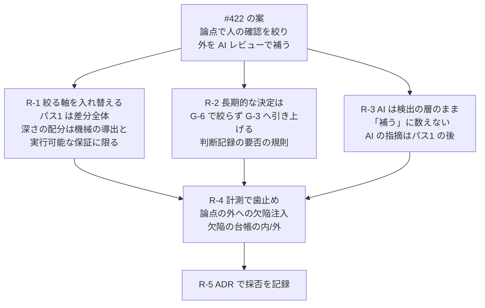

# #422 会議体 第1巡: 起案(drafter)

- 日付: 2026-11-04
- 立場: 条項・様式の具体の案を、本文へそのまま入れられる形で出す
- 入力: `council-00-agenda.md`、`survey-422-1-internal.md`(以下「内部」)、`survey-422-2-external.md`(以下「外部」)、本文の該当箇所(path:line は 2026-11-04 の main `b270dc8` 時点)
- 判断軸: 信頼性(形骸化した承認が減るか、決めるべきことが漏れないか)。変更量の少なさは採否の理由にしない
- 所有者の提起(#422)は第三者の意見として扱う。前提「Anthropic で行われている」は外部 §1.5 のとおり半分だけ確かめられた

## 起案の全体像

所有者の案は「論点で絞る + 外を AI で補う」です。起案は、これを次の3つに組み替えます。



---

## R-1 人の確認の範囲を絞るか、何で絞るか

### 結論

- **「PR ごとの論点に G-6 の承認範囲を絞る」運用は採らない**。論点の生成元(作成者・AI)のどちらを選んでも、作成側の主張か AI の推定が人の確認の範囲の上限になるため
- 代わりに、既に分散している「絞り方」の規定を G-6 の1節へ集め、**絞ってよいもの(深さ)と絞ってはならないもの(仕様との突合の範囲)を分けて**定める
  1. パス1(差分が受入基準の範囲内か)は、**差分の全体へ必ず掛ける**
  2. パス2・パス3 で逐行に読む箇所の配分は、機械的な導出(影響範囲・区分の下限の規則・G-5 の出力・既存テストの変更の一覧)と実行可能な保証(担保水準 L1 の根拠)に**だけ**依って変えてよい
  3. 作成者の「レビュー観点の指定」と AI の指摘は、**注意を狭める情報**として扱う。確認の範囲の上限にしない
- リスクの層で絞る案(Anthropic・Meta の確かめられた運用)は、本標準では既に 5.5.4 の委任(R3・CL0・標本検査)と担保水準 L2 が受けている。**人の承認を経ずに取り込む2つ目の経路は新設しない**(#172 の棄却と同じ理由)。この対応づけを本文へ明記する

### 案(本文へ入れる形)

**挿入先**: `src/content/docs/phase4-process-design/gate-criteria.md` の G-6 の判定基準の表と基準2 の注記の後(`:893` の後、`:895` の IMPL-0335 の前)

```markdown
#### 確認の範囲と深さ

G-6 の承認は、差分の全行を読んだことを意味しません([附属書H](/process-compass/phase4-process-design/assurance-case/) H.5)。ただし、読む深さを変えてよいことと、確認の範囲を狭めてよいことは別です。本標準は、前者を条件つきで認め、後者を認めません。

| # | 要求事項 |
| --- | --- |
| 1 | 差分が受入基準の範囲内かの確認(附属書C のパス1)は、差分の全体に対して行う。作成者の指定・AI の指摘・レビューパッケージの注意喚起部によって、対象から外してはならない |
| 2 | 逐行に読む箇所を差分の一部に限ってよいのは、限る根拠が機械的な導出(影響範囲の提示、区分の下限の規則の該当、G-5 の出力、既存のテストの変更の一覧)または実行可能な保証(担保水準 L1 の根拠に当たるテスト・契約・型)である場合に限る |
| 3 | 作成者が書く「レビュー観点の指定」と、AI のレビューの指摘は、注意を狭める情報として扱う。確認の範囲の上限にしてはならない。パス1 を終える前に読まないことを勧める(附属書C「入力の分離」) |
| 4 | AI が出力した、確かめた範囲・確かめていない範囲の申告を、人が読む範囲を狭める根拠にしてはならない(附属書H H.4) |

- 本節は、判定の時点を事後へ移す経路を新しく設けない。人の事前の承認を経ずに変更を取り込めるのは、後掲「委任の変更は判定の時点を事後へ移す」だけである(前掲「帯域を理由に判定を省略しない」)
- 変更のリスクで人の確認を配分する運用(低リスクの変更を自動で取り込み、人が標本を確かめる形)は、本標準では第5章 5.5.4 の7条件と第8章「事後監査の手続」が受ける。リスクの採点で審査の深さを変える運用は、担保水準 L2 が受ける。いずれも、AI が読んだことを根拠にしない
- 本節は、PR ごとに「人が確かめるべき論点」を作成側に申告させること、AI に抽出させることを課さない。課さないと決めた理由は [ADR-01xx](/process-compass/adr/01xx-.../) による
```

**挿入先**: `src/content/docs/phase4-process-design/review-guide.md` のパス1 の箇条(`:41-44`)へ1行足す

```markdown
- パス1 は差分の全体に掛ける。「レビュー観点の指定」・AI の指摘・注意喚起部が挙げていない箇所も対象である([第4章 G-6](/process-compass/phase4-process-design/gate-criteria/)「確認の範囲と深さ」)。逐行に読む深さを配分するのはパス2・パス3 である
```

**実装マーク**(案。採番は反映時)

```markdown
<!-- impl IMPL-03xx target=gate-skill-g6 state=undelivered check=manual note="G-6「確認の範囲と深さ」要求事項1〜3。gates/G-6.md の手順に、パス1 を差分の全体へ掛けること、逐行に読む箇所を限る根拠を機械の導出と L1 の根拠に限ること、レビュー観点の指定と AI の指摘をパス1 の後に読むことを置く。機械は確かめない。確かめる者: G-6 の判定者(判定記録を書くとき)" -->
<!-- impl IMPL-03xx target=human-verify-skill state=undelivered check=manual note="/human-verify の順5(疑義が生じた箇所に限定して読む)の前に、差分の全体を受入基準と突き合わせる段(パス1)があることを明示する。順5 の『限定』の根拠に、作成者の指定と AI の指摘を数えない" -->
```

(`human-verify-skill` が `src/data/impl-targets.yaml` に無ければ、反映時に登録するか、既存の `gate-skill-g6` へ寄せる)

根拠水準のマーク(案。G-6「確認の範囲と深さ」の表の後に置く)

:::caution[暫定 EV-02xx / 見直し 2027-11]
**対象**: パス1 を差分の全体に掛け、深さの配分の根拠を機械的な導出と実行可能な保証に限る判断。作成者の指定と AI の指摘を注意を狭める情報として扱う判断。
**根拠の水準**: E1(間接)。
**差し替え条件**: 自組織で、欠陥をレビュー観点の指定・AI の指摘の外に注入した場合と内に注入した場合の、人の層の検出率の差(第5章 5.6.2)。差が無い場合は、要求事項3 の扱いを見直す。
AI のレビューを起点にした人のレビュアが AI の示した箇所へ注意を寄せ、高重大度の指摘が増えなかった対照実験(29 名、1件)に依ります。出典の所在は `research/422-deliberation/survey-422-2-external.md` です。
:::

### 理由

1. **パス1 は論点に絞れない性質を持つ**。パス1 の目的は「基準にない変更の混入」の検出です(`review-guide.md:41-44`。AI 生成で最頻の混入物)。混入物は、作成者が論点として挙げない箇所にこそあります。論点の内側だけを見る運用は、パス1 を定義上無効にします。G-6 基準1(`gate-criteria.md:880`)と 5.8.5 禁止事項4「差分を確認せずに承認する」(`human-ai-boundary.md:1013`)とも両立しません
2. **作成側の論点は作成側の主張である**。入力の分離(`roles-responsibilities.md:585-596`)と ADR-0023 決定2(「レビュアが自分で確認しなくてよいと読める記述は結論」)・決定3(注意を狭める情報はパス1 の後)に照らすと、論点の欄は注意喚起部と同じ扱いになります。範囲の上限に据えれば結論です
3. **AI が抽出した論点は、外部の実証が示す失敗様式を制度化する**。Tufano ほか(外部 §3.2)で、AI のレビューを起点にした人は AI の示した箇所に注意を寄せ、高重大度の指摘は増えませんでした。3.10.12(`roles-responsibilities.md:1268-1279`)・ADR-0023 決定7・8 とも衝突します
4. **既にある絞り方は、すべて機械的な導出か実行可能な保証に根拠を置いている**(内部 §0 要点2)。L1(`gate-criteria.md:1503`)、規模の確認の保証の所在(`:1587`)、/human-verify の順5。新しい絞り方を作らず、これらの共通の条件を1か所へ書き出すほうが、利用者が条件の緩い読み方へ流れる余地が小さくなります
5. **リスク層別で人の承認を外す形は、既に 5.5.4 が受けている**。Anthropic の運用(外部 §1.2: 低リスク層の自動承認 + リスク加重の標本 + 重要層の厳格な承認)と Meta RADAR(除外条件つき)は、5.5.4 の7条件(R3・CL0・取り消しの実績・事後の抜き取り)と構造が同じです。2つ目の経路を作ると「条件の緩いほうだけが使われる」(`gate-criteria.md:1823`)。所有者が聞いた話の実体はこちらに近いと外部 §1.5 は判定しており、本標準は既に受け皿を持つと明記するほうが、利用者が「本標準は層別を認めない」と誤読して独自の経路を作る危険を減らします

### 採らない案

| 案 | 採らない理由 |
| --- | --- |
| A. 作成者が PR ごとに「人が確かめるべき論点」を必須で書き、人はそこを確かめる | 作成側の主張が範囲の上限になる(理由2)。必須にすると、書いたことが「ここ以外は見なくてよい」の合図として働く。#271 で却下した様式の増加とも同形 |
| B. AI が差分から論点を抽出して人に提示し、人はそこを確かめる | 3.10.12・ADR-0023 決定7・8 と衝突。アンカリングの実証(Tufano)がある。#162 で却下した「3行要約の自動提示」と同形 |
| C. 論点の外の差分を R1・R2 でも事後の抜き取りに回す | 判定の時点を移す2つ目の経路(`gate-criteria.md:1823`)。#172 で棄却済みの「濃淡・サンプリング」と同形 |
| D. リスク層別の自動承認を、5.5.4 と別の規定として新設する | 同上。5.5.4 が R3・CL0・取り消しの実績を条件にしており、層別の受け皿は既にある |
| E. 何も書かない(現行で足りる) | 「承認は全行を読んだことを意味しない」(H.5)だけが目に入り、深さの配分と範囲の縮小を区別する規定が無い。所有者の提起そのものが、この区別の不在から生じている。書かないと、利用者が A・B を自前で導入しても本標準に反すると読めない |

### 反論されうる点

- **現場**: 「パス1 を差分の全体に掛けるなら、絞った意味がない。所有者の動機は承認の形骸化であり、全体を見よと言い続けることが形骸化の原因だ」。応答: パス1 は「基準にない変更が混ざっていないか」の照合であり、全行の逐読ではありません。逐読の深さの配分は要求事項2 で認めます。形骸化の主因は深さの配分ではなく範囲の上限の外部化(作成側・AI が決める)だというのが起案の立場です。ただし、パス1 の所要時間を測った資料は無く(附属書C の 10 分は EV-0085 の目安)、この点は弱い
- **規格**: 「要求事項3 の『読まないことを勧める』は推奨であり、表の中に要求と推奨が混ざる」。応答: 人への入力の分離は EV-0176 で推奨に下げた経緯があり、要求事項へ上げる測定は無い。表から外して箇条へ移す書き方でもよい
- **品質監査**: 「要求事項2 の『機械的な導出に限る』を、監査で確かめる手段が無い」。応答: そのとおりで、機械では確かめません。確かめられるのは R-4 の計測(論点の外への欠陥注入)による結果の側です
- **弁護(所有者の案)**: 「Anthropic・Microsoft・Graphite は人を高価値の判断へ集中させている」。応答: 集中先を決める主体が問題です。Anthropic の一次資料にあるのは論点の抽出ではなくリスク層別でした(外部 §1.5)

---

## R-2 長期的な決定の切り出し

### 結論

- **採る**。長期的な決定は、G-6 で「人のレビューの論点」として絞り込むのではなく、**判断記録と G-3 の経路へ機械的に引き上げる**
- プロセス構成に**判断記録の要否の規則**(変更の対象のパスと変更種別から、判断記録を要する変更を導く規則)を置く。PR の差分が規則に当たれば、判断記録の識別か、**人の記名による「設計上の選択を含まない」の記載**のどちらかを G-5 で要する
- 依存の追加・更新は、G-5 基準8 の出力(dependency-diff)が既に機械で検出している。規則は、これに当たる変更を自動で含める
- 判断記録を伴う変更は、G-3 の判定記録(判断記録の番号と判定した版のコミット)を、取り込む前に要する
- 規則の網羅は主張しない(ADR-0041)。規則に当たらない設計上の選択の残余は開示する

### 案(本文へ入れる形)

**挿入先**: `src/content/docs/phase4-process-design/lifecycle.md` の 2.6「判断記録の範囲」の末尾(`:172` の後)

```markdown
#### 判断記録の要否の規則

設計上の選択は、PR の中に埋もれます。作成者の自己確認だけでは、判断記録を書かないまま取り込んだ選択を検出できません。そこで、変更の対象から機械で導ける**判断記録の要否**を構成に置き、PR と照合します。

| # | 要求事項 |
| --- | --- |
| 1 | 判断記録の要否の規則を、プロセス構成に置く。規則は、変更の対象のパス(例: 公開インタフェースの定義、永続化のスキーマ、データの移行、依存のマニフェスト、構成単位の境界の定義)と変更種別から、判断記録を要する変更を導く形で書く。G-5 基準8 が依存の追加・更新を検出した変更は、規則に書かなくても当たる |
| 2 | 規則に当たる変更は、PR に判断記録の識別(トレーラ `ADR`)か、「設計上の選択を含まない」旨の記載を要する。どちらも無い変更は、G-5 で失敗させる |
| 3 | 「設計上の選択を含まない」の記載は、人が記名する。AI の名義の記名は記載に数えない。記載には、規則に当たったパスと、選択を含まないと考えた理由を書く |
| 4 | 判断記録の識別を持つ変更は、その判断記録の G-3 の判定記録(判定した版のコミットを含む)を、取り込む前に要する。判定した版より後に判断記録を変えた変更は、確定していない版を取り込んだ変更として扱う(第4章 G-3) |
| 5 | 規則の起案は技術判断者が行い、AI維持管理者が承認する。規則を削る変更と、当たる範囲を狭める変更は、統制を緩める向きの変更として扱う(第3章 3.13.3) |
| 6 | 規則のファイルを変える変更の区分の下限は、R2 とする。規則と製品のコードを同じ変更で変えてはならない。規則は基底ブランチから読む |

- 規則が判定するのは、判断記録の要否の照会を漏らさないことだけである。選択が適切か、判断記録の内容が十分かは判定しない。それは G-3 の判定者が行う
- 規則の網羅は主張しない([ADR-0041](/process-compass/adr/0041-scope-is-not-exhaustive/))。規則に当たらない設計上の選択は、作成者の判断記録の追加と、G-6 のパス1 の確認に残る。「設計上の選択を含まない」と記載した件数を、保証の開示に表示する
- 選択が可逆であることを、「設計上の選択を含まない」の理由にしてはならない(前掲。[ADR-0071](/process-compass/adr/0071-structure-of-principles-decisions-and-gate-records/))
- 区分の下限の規則([第3章 3.8.1](/process-compass/phase4-process-design/roles-responsibilities/))と同じファイルに置いてよい。区分の下限と判断記録の要否は、別の値として書く。区分が R3 であることを、判断記録を要しない理由にしない
```

**挿入先**: `gate-criteria.md` G-6 判定基準3(`:882`)の確認方法を次へ改める(採用済み ADR の本文ではないため改めてよい)

```markdown
| 3 | (コア機能、または判断記録の要否の規則に当たる変更)設計意図の記録が完備 | 判断記録の識別と G-3 の判定記録の添付、または人の記名による「設計上の選択を含まない」の記載([第2章 2.6](/process-compass/phase4-process-design/lifecycle/)「判断記録の要否の規則」)。記載に同意できない場合は差し戻す |
```

**PR テンプレート**(`template/.github/PULL_REQUEST_TEMPLATE.md`、規模の確認の節の後に足す)

```markdown
## 設計上の選択の確認

<!--
  人が書く。判断記録の要否の規則に当たる変更だけが書く(G-5 が当たったパスを示します)。
  当たらない変更は、この節を消してよい。
  判断記録を書いた場合は、トレーラ ADR: に番号を書き、この節は消してよい。
  「選択が可逆だから」は理由になりません(標準 第2章 2.6)
-->

当たったパス: <G-5 の出力を写す>
設計上の選択を含まない理由: <...>
記名: <人の氏名>
```

**実装マーク**(案)

```markdown
<!-- impl IMPL-03xx target=pr-checks state=undelivered check=machine note="判断記録の要否の規則(構成に置く。基底ブランチから読む)と G-5 基準8 の依存の差分から、判断記録を要する変更を導き、トレーラ ADR か人の記名による『設計上の選択を含まない』の節が無い PR を失敗させる。記名が AI の名義なら数えない。規則のファイルの変更の下限を R2 にし、規則と製品のコードの同時変更を失敗させる。理由の中身は確かめない" -->
<!-- impl IMPL-03xx target=evidence-aggregation state=undelivered check=manual note="『設計上の選択を含まない』と記載した件数と、トレーラ ADR を持つ変更のうち G-3 の判定記録の版がマージ時の判断記録と一致しない件数を保証の開示に出す。確かめる者: 出荷判定者" -->
```

:::caution[暫定 EV-02xx / 見直し 2027-11]
**対象**: 判断記録の要否をパスと変更種別の規則で導き、判断記録か人の記名による否定の記載を G-5 で要する判断。
**根拠の水準**: E2(単一事例)。
**差し替え条件**: 採用組織の、規則に当たった変更のうち「設計上の選択を含まない」と記載した比率と、そのうち後に判断記録を起こした(または G-3 で差し戻された)件数。規則に当たらずに取り込まれ、後から設計上の選択と判明した変更の件数(事後の判断記録・ポストモーテム)。
依拠する外部の先例は、パス・型から API の変更を検出し専任の承認者へ回す OSS の運用1件です。規格化された作法は見つかっていません。
:::

### 理由

1. **長期的な決定の判定は G-3 の役割で、G-6 で絞る対象ではない**。第2章 2.6(`lifecycle.md:151-172`)は設計上の選択を判断記録と G-3 へ分けています。G-6 が見るのはコア機能の判断記録の添付だけ(`gate-criteria.md:882`)です。「長期的な決定に人のレビューを集中させる」という所有者の目的は、G-6 の範囲を狭めることではなく、G-3 へ確実に届けることで達成されます
2. **今の検出手段は自己チェックだけである**(`template/.github/PULL_REQUEST_TEMPLATE.md:110`、折りたたみ)。決めるべきことが漏れる経路として最も大きい穴です
3. **同じ構造の機構が既にあり、効いている**。区分の下限の規則(`roles-responsibilities.md:932-947`)は、パスと変更種別から下限を導き、自己記載で統制を外す経路を塞いでいます。例示のパス(公開インタフェース・データの移行)も重なります。同じ形にすれば、利用者が覚える仕組みが増えず、規則の改ざん耐性(基底ブランチから読む・同時変更の禁止)もそのまま効きます
4. **否定の記載を人の記名にする**のは、判断記録を書かない選択も判断だからです。pr-workflow の「判断を含む欄を自動生成させない」(`pr-workflow.md:124`)と一致します
5. **外部の先例**: Kubernetes の API レビュー(外部 §2.5)は、パス・型から機械的に検出して別の承認経路へ回します。Anthropic の `REVIEW.md` も migration を Important に上げる例を置きます(外部 §1.1)

### 採らない案

| 案 | 採らない理由 |
| --- | --- |
| A. AI が差分から長期的な決定を検出し、それを判断記録の要否の条件にする | AI の推定を合否条件に入れる(H.4 条件4、`gate-criteria.md:1829`)。偽陰性が「検出されなかった」記録として残る。AI の検出を注意の材料として提示することは妨げない(検出の層) |
| B. Kubernetes 型の専任の API 承認者の席を新設する | 長期的な決定の判定者は既に技術判断者(G-3)。席を増やす根拠となる測定が無い。CODEOWNERS で G-3 の判定者を必須の承認者にする構成は、組織の選択として妨げない |
| C. 規則に当たる変更をすべて判断記録の必須にする(否定の記載を認めない) | 規則はパスで当たるため、既存の型への注記の追加なども当たる。否定の経路が無いと、空の判断記録が量産され、判断記録の形骸化を招く。否定は人の記名と件数の開示で扱う |
| D. 可逆な選択を規則の対象から外す | 2.6(`lifecycle.md:172`)と ADR-0071 に反する |
| E. PR テンプレートの自己チェックのまま据え置く | 理由2。決めるべきことが漏れる経路が残る |

### 反論されうる点

- **現場**: 「規則のパスが粗いと、否定の記載が毎回の定型になる」。応答: そのとおりで、否定の比率は差し替え条件の観測値に入れました。定型化の兆候(比率が高止まり、後から判断記録が起きる件数が増える)で規則を見直します
- **品質監査**: 「否定の理由の中身を確かめない記載は、#271 で却下した書類と同じ」。応答: #271 は承認ごとの全件の署名様式でした。こちらは規則に当たった変更だけで、件数を開示し、G-6 の判定者が同意できなければ差し戻す(基準3)点で、検出に結び付いています。ただし弱点として残ります
- **規格**: 「G-6 基準3 の範囲を広げると、コア機能でない変更の G-6 が重くなる」。応答: 基準3 で見るのは記録の有無と否定の記載への同意だけで、判断記録の中身の判定は G-3 に残ります
- **弁護**: 「所有者は G-6 の承認を軽くしたかったのに、増えている」。応答: 所有者の動機は形骸化の是正で、帯域ではありません(議題)。長期的な決定を確実に人へ届けることが、所有者の目的の後半にそのまま当たります

---

## R-3 AI レビューの位置づけ

### 結論

- **論点の外を AI レビューで「補う」ことを、検出の層の外に数える余地は無い**。H.4 条件4「通過を理由に人の確認を減らさない」(`assurance-case.md:322`)を維持する。本標準の規範の文に「AI で補う」の語を使わない
- AI レビューを承認とみなさないことは既定(`gate-criteria.md:913`、構成 `aiReview.canApprove: false`)。新しい規定は足さず、G-6「確認の範囲と深さ」の箇条から引く
- **新しく足すのは1点**: AI のレビューの指摘(PR へのコメント)を、人のレビュアが**パス1 を終える前に読まないことを勧める**。AI の指摘は注意を狭める情報だから。附属書C「AI をレビューに使う場合」へ置く
- 条件4 の差し替え条件を別に置く。EV-0059 の差し替え条件(「ある条件を欠いても検出率に差が無い場合は外す」)は AI の層の検出率で書かれており、条件4(人の層の確認の量)を外す根拠にならないことを明記する
- AI レビューの指示を PR 自身の変更から読まないことは、H.4 条件3 と第5章の要求事項7(IMPL-0333、`human-ai-boundary.md:1075`)が既に定める。**新しい条項は足さない**。外部の製品の設計が分かれる(Anthropic は基底ブランチ、GitHub Copilot は head ブランチから読む。外部 §2.4)ことを、附属書C の注記で示す

### 案(本文へ入れる形)

**挿入先**: `src/content/docs/phase4-process-design/review-guide.md` の「AI をレビューに使う場合」(`:127-152`)の末尾

```markdown
### AI の指摘を読む時点

AI のレビューの指摘は、PR のコメントとして人のレビュアの目に先に入ります。指摘は、レビューパッケージの注意喚起部と同じく**注意を狭める情報**です。本ガイドは、AI の指摘をパス1 を終えてから読むことを勧めます。

- AI のレビューを起点にした人は、AI の示した箇所へ注意を寄せ、それ以外を探さなくなる傾向が、対照実験で報告されている(2024 年、29 名、1件)。同じ実験で、低重大度の指摘は増えたが、高重大度の指摘は増えなかった
- AI の指摘が無いことは、欠陥が無いことを示さない。指摘の無い変更でも、パス1〜3 は変わらない
- AI の指摘のすべてを直すことを、承認の条件にしない。採否はレビュアと作成者が決め、採否を記録に残す([附属書H](/process-compass/phase4-process-design/assurance-case/) H.4 条件5)
- AI のレビューの指示をどこから読むかは、道具によって異なる。レビューの対象の PR から指示を読む道具は、H.4 条件3 を満たさない。基底ブランチまたは保護された場所から読む構成にする([第5章](/process-compass/phase4-process-design/human-ai-boundary/)の要求事項7)
```

**挿入先**: `assurance-case.md` H.4 の EV-0059 の暫定マークの後(`:368` の後)

```markdown
条件4 は、AI の層の検出率の測定では外しません。EV-0059 の差し替え条件が観測するのは AI の層の働きであり、AI の層が見た範囲を人が見なくてよいかは、人の層の見逃しで決まるためです。条件4 を見直す材料は、AI の指摘の外に注入した欠陥を、人の層がどれだけ見逃したかの測定です(第5章 5.6.2)。

:::caution[暫定 EV-02xx / 見直し 2027-11]
**対象**: H.4 条件4(通過を理由に人の確認を減らさない)を、AI の層の検出率の測定では外さないという判断。
**根拠の水準**: E1(間接)。
**差し替え条件**: 自組織で、AI の層が指摘しなかった箇所に注入した欠陥について、人の層の確認の範囲を AI の指摘の外へ限った構成と限らない構成の検出率の差。差が無く、かつ AI の層の検出率が開示されている場合に、条件4 の範囲を見直す。

AI のレビューの検出性能は F1 でおおむね 45〜51% と報告されていますが、測定はいずれもベンダが関与しています(2026 年)。人の確認の範囲を AI の層の外へ限った構成の測定は見つかっていません。
:::
```

**実装マーク**(案)

```markdown
<!-- impl IMPL-03xx target=gate-skill-g6 state=undelivered check=manual note="附属書C『AI の指摘を読む時点』。gates/G-6.md の材料の集め方に、AI のレビューのコメントをパス1 の後に読むことを推奨として置く。読んだ時点は機械で確かめない(推奨)" -->
```

### 理由

1. **「補う」を人の確認の縮小の根拠に数えると、5つの既存規定の否定になる**。H.4 条件4、検出の層の定義(`assurance-case.md:313`)、緩和根拠の表の「AI による差分要約・自動レビューコメント = 認めない」(`gate-criteria.md:1640`)、3.10.12、第4章「AI による事前審査を合否条件として挿入しない」(`:1829`)。これらを覆すに足る測定は外部調査で見つかりませんでした(外部 §2.7: F1 約 50%、ベンダ関与のみ)
2. **人のレビューの価値と AI レビューの既定の観点の重なりは小さい**。人のレビューで見つかるものの多くは保守性と理解の共有(Mäntylä & Lassenius、Bacchelli & Bird。外部 §3.1)、Anthropic の Code Review の既定は正しさ(外部 §1.1)。AI が正しさを見ても、人の確認の主な価値(挙動要約による理解の分散。附属書C の目的2)は残ります。「AI が見たから人は見なくてよい」は、見ている物が違うため成り立ちません
3. **AI の指摘を読む時点は、現行で穴になっている**。ADR-0023 決定4 は AI の指摘一覧をパッケージに含めないと決めましたが、ai-review.yml は PR へコメントを付けるため、レビュアは先に目にします。注意喚起部をパス1 の後に開く規定(`review-guide.md:35-39`)と同じ理由を、AI のコメントにも当てるのが一貫します。推奨にとどめるのは、人への入力の分離を推奨へ下げた EV-0176 の経緯と揃えるためです
4. **EV-0059 の差し替え条件の読み違いを塞ぐ**。条件ごとの外し方が書かれているため、「AI の検出率が高ければ条件4 も外せる」と読まれる余地があります。条件4 だけは観測する量が違うことを書いておかないと、測定の後で議論が逆戻りします

### 採らない案

| 案 | 採らない理由 |
| --- | --- |
| A. AI レビューを、条件つきで承認の1件に数える(GitHub Copilot の設定で可能な形) | G-6 の4条件(`gate-criteria.md:899-913`)、3.5.4 の帰結(AI で得られるのは分離まで)。承認は人の判定。外部でも Anthropic の製品は承認しない |
| B. AI の検出率を前提に、人の確認の範囲を配分する(「AI が機能欠陥の X% を捕まえるので人は見なくてよい」) | 根拠の水準が弱い(外部 S8)。独立した測定が無い。条件4 の否定 |
| C. AI の指摘をパス1 の後に読むことを要求事項にする | 人が読んだ時点を記録で確かめる手段が無く(ADR-0067 決定3 と同じ構造)、課す根拠となる測定も1件にとどまる。推奨にとどめる |
| D. AI のコメントを PR に付けさせず、レビュアが自分で開く場所へ置く(Meta の MetaMateCR が作者にだけ見せた形) | 有力だが、作成者が指摘を見て直す流れも止まり、効果の測定が無い。組織の選択として妨げない。附属書C に選択肢として書く余地は第2巡で議論したい |
| E. AI の指示を PR から読まない規定を新設する | 既に H.4 条件3 と要求事項7(IMPL-0333)がある。重複させると正本が2つになる |

### 反論されうる点

- **弁護**: 「Anthropic は全 PR に AI レビューを掛け、人の負担を減らしている。本標準が AI を検出の層に閉じ込めるのは時代遅れ」。応答: Anthropic の製品は承認も阻止もせず(外部 §1.1)、人の承認を外しているのはリスク層別の自動承認(5.5.4 が受ける)です。AI の確認を人の確認の縮小に数えた一次資料はありません
- **現場**: 「AI のコメントをパス1 の後に読めというのは、画面に出ている物を見るなというのと同じで守られない」。応答: そのため推奨にとどめ、効果は欠陥注入で測ります。D 案(置き場を変える)のほうが効くかもしれない点は認めます
- **品質監査**: 「条件4 の差し替え条件を別に置くと、EV が2つ並び、どちらで見直すかが曖昧になる」。応答: 対象を分けて書きます(EV-0059 = 5条件の組、新 EV = 条件4 の範囲)

---

## R-4 記録・計測・テンプレート

### 結論

- **G-6 の判定記録に「確認した範囲 / 確認していない範囲」の必須欄は課さない**(#271 の却下を維持)。中身を確かめられない欄を全件に課すと、定型文が書かれて形骸化の記録が1つ増えるだけになるため
- 代わりに、**絞り込みが外れたことを結果の側で測る**
  1. 欠陥注入(5.6.2)の注入箇所の一部を、「レビュー観点の指定」・AI の指摘・レビューパッケージの注意喚起部の**外**に置く。内と外の検出率を分けて記録する
  2. 欠陥の台帳(ポストモーテム)に、欠陥の所在が**レビューで提示された箇所の内か外か**の欄を足す
- **PR テンプレートの「レビュー観点の指定」は任意のまま**にする。注記を改め、書き手(人)・読む時点(パス1 の後)・結論を含めない旨・指定の有無で確認の範囲が変わらない旨を書く。AI に書かせない
- `/review` スキルは新設しない。レビュー側の入口は /human-verify と /gate G-6 に寄せる

### 案(本文へ入れる形)

**挿入先 1**: `src/content/docs/phase5-implementation/pr-workflow.md` の様式(`:92-95`)の注記を改める

```markdown
## レビュー観点の指定(任意)

<!-- 人が書く。とくに見てほしい箇所・自信のない判断。レビュアはパス1 の後に読む。指定の有無で、レビューの対象は変わらない(差分の全体)。「ここは見なくてよい」とは書かない -->
```

**挿入先 2**: 同ファイルの箇条(`:116` の表の後、`:124` の付近)に足す

```markdown
- 「レビュー観点の指定」は、作成側が書く**注意を狭める情報**である([第4章 G-6](/process-compass/phase4-process-design/gate-criteria/)「確認の範囲と深さ」)。指定は確認の範囲を狭めない。レビュアはパス1 を終えてから読む([附属書C](/process-compass/phase4-process-design/review-guide/)「入力の分離」)
- 「レビュー観点の指定」を AI に生成させない。判断を含む欄である(下記「自動で埋める欄と、人が書く欄」)。AI の指摘を写す場合は、AI の指摘である旨を書く
- 「ここは見なくてよい」「この部分は確認済み」と読める記載は、レビューパッケージの結論と同じ扱いとする([ADR-0023](/process-compass/adr/0023-review-package-cues-not-conclusions/) 決定2)。レビュアは、その記載を確認の範囲を狭める根拠にしない
```

**挿入先 3**: `template/.github/PULL_REQUEST_TEMPLATE.md:98-100` を次へ改める

```markdown
## レビュー観点の指定(任意)

<!--
  人が書く(AI に書かせない)。とくに見てほしい箇所・自信のない判断を書けます。
  指定してもしなくても、レビューの対象は差分の全体です。レビュアはパス1(仕様との突合)の後に読みます。
  「ここは見なくてよい」「確認済み」とは書きません(標準 第4章 G-6「確認の範囲と深さ」)
-->
```

**挿入先 4**: `src/content/docs/phase4-process-design/human-ai-boundary.md` 5.6.2(`:628-787`)の注入の方法に足す

```markdown
- 注入する欠陥の一部を、レビュー観点の指定・AI のレビューの指摘・レビューパッケージの注意喚起部の**いずれも挙げていない箇所**に置く。検出率は、挙げた箇所の内と外に分けて記録する。外の検出率が内より低い状態が続く場合は、提示が人の注意を狭めているものとして、提示の仕方を見直す([ADR-0023](/process-compass/adr/0023-review-package-cues-not-conclusions/) 決定10)
```

**挿入先 5**: 欠陥の台帳(ポストモーテム)の様式に欄を足す(所在は反映時に `src/data/template-fields.yaml` と第6章で確かめる)

```markdown
| レビューで提示された箇所との関係 | 欠陥の所在が、取り込んだ PR のレビュー観点の指定・AI の指摘・注意喚起部の内か外か。PR を特定できない場合は「特定できない」 |
```

**実装マーク**(案)

```markdown
<!-- impl IMPL-03xx target=pr-template state=undelivered check=presence note="レビュー観点の指定の注記に、書き手が人であること、指定の有無で対象が変わらないこと、パス1 の後に読むこと、見なくてよいと書かないことを置く。記入の中身は確かめない(単位: 欄の注記)" -->
<!-- impl IMPL-03xx target=adoption-trial state=undelivered check=manual note="5.6.2 の注入箇所を、レビュー観点の指定・AI の指摘・注意喚起部の内と外に分け、tally が内外の検出率を分けて出す。確かめる者: 導入前の検証の記入者" -->
```

根拠水準のマーク(案。5.6.2 の追記の後)

```markdown
:::caution[暫定 EV-02xx / 見直し 2027-11]
**対象**: 欠陥注入の検出率を、提示した箇所の内と外に分けて記録し、外が内より低い状態の継続を提示の見直しの起点にする判断。
**根拠の水準**: E0(なし)。
**差し替え条件**: 採用組織の、内と外の検出率の記録が2期分そろった時点の差と、見直しを起こした件数。小規模の組織で注入の件数が内外の差を読むのに足りない場合は、欠陥の台帳の内/外の件数を主に用いる。
:::
```

### 理由

1. **形骸化への手当ては、書類ではなく結果の測定で行う**。#271 の却下理由(検出能力を示さない書類が増える。内部 §2)は今回も当てはまります。「確認していない範囲」を全件に書かせても、機械はその中身を確かめられず(5.7.4)、「なし」の禁止(5.7.2)も G-6 の件数では定型化します。欠陥注入の内外の差は、絞り込みの失敗をそのまま観測します
2. **ADR-0023 決定10 の測定を具体にする**。決定10 は提示の仕組みの検出率が下がれば撤去すると決めていますが、何と比べるかが無い。内と外の比較で決定10 が実行できるようになります
3. **欠陥の台帳の内/外の欄は、本番で漏れた欠陥から同じ量を取る**。欠陥注入は人工の欠陥で、台帳は実際の欠陥です。両方を持つと、注入の作り方の偏りを補えます
4. **「レビュー観点の指定」を必須にしない**。必須にすると、作成側の主張を毎回レビュアへ渡すことになり、入力の分離と逆向きに働きます。任意で残すのは、作成者が気付いている危険(自信のない判断)を伝える価値があるためです
5. **現行の注記「省略した場合は差分全体が対象」は、裏返して読める**(内部 §4.1 の穴)。指定した場合も全体が対象と書き換えます。pr-workflow の注記(`:95`「自信のない判断」)とテンプレートの注記(`:100`)のずれも、同時に解消します
6. **`/review` を新設しない**。入口が増えると、/human-verify の検証の順序(結論を生成しない)と別の手順が生まれ、どちらが正本か分からなくなります。/gate G-6 と /human-verify の補助ファイルへ規則を降ろせば足ります

### 採らない案

| 案 | 採らない理由 |
| --- | --- |
| A. G-6 の承認コメントに「確認した範囲 / 確認していない範囲」を必須にする | #271 の却下と同じ。中身を確かめられず定型化する。5.7.2 の欄は G-8・SG・例外承認の件数だから働く |
| B. 逐行の深さを限った承認だけに「確認していない範囲」を課す | 限ったかどうかを機械で判別できず、書かない選択が常に取れる。深さを限る根拠は、規模の超過では既に「保証の所在」(`gate-criteria.md:1587`)が記録している |
| C. 「レビュー観点の指定」を必須欄にする(所有者の決めること1) | 理由4。作成側の主張の必須化 |
| D. check-pr が「レビュー観点の指定」の中身を検査し、結論らしい語(「確認不要」など)を落とす | 語の列挙で意味を判定する検査は言い換えで抜ける。記述の質を機械で判定しない(5.7.4 要求事項1) |
| E. 論点の外で見つかった欠陥を、承認者の評価(7.9 の承認権限の制限)に直結させる | 見逃しの区分(5.6.3)を経ずに個人へ帰すことになる。台帳の欄は仕組みの見直しに使う |
| F. `/review` スキルを新設し、論点の提示と AI レビューの起動をまとめる | 理由6。論点の提示を AI に生成させる入口になりやすい |

### 反論されうる点

- **品質監査**: 「欠陥注入の内外の比較は、小規模の組織では件数が足りず差を読めない」。応答: そのとおりです。差し替え条件で台帳の件数を主に用いる道を書きました。統計的な検定は要件にしていません
- **現場**: 「欠陥の台帳の欄は、PR を特定できない欠陥が多く、空欄が増える」。応答: 「特定できない」を値として置きました。その件数自体も開示に値します
- **弁護**: 「所有者は欄を必須にしたかった」。応答: 必須にしない理由は帯域ではなく、作成側の主張を必須の入力にすることの害です
- **規格**: 「G-6 だけ『確認していない事項』を持たないのは 5.7.2 と非対称」。応答: 非対称は意図的です。5.7.2 は決断の記録(件数の少ない、事業上の受容を伴う判定)の様式で、G-6 は変更ごとの判定です。非対称の理由を ADR の「課さないと決めたこと」に書きます

---

## R-5 記録

### 結論

- **新しい ADR を1本起こす**(番号は反映時に採番。#401 の会議体と衝突しないよう確かめる)。題: 「人の確認の深さは機械の導出で配分し、論点の申告と AI の確認で範囲を狭めない」
- ADR-0023・0056・0059 の本文は書き換えない。新 ADR から「適用先を広げる・測定を具体にする」関係で引く
- 所有者の前提(Anthropic の運用)の確認結果を ADR の「背景」に残す

### 案(ADR の骨子)

```markdown
---
title: "ADR-01xx: 人の確認の深さは機械の導出で配分し、論点の申告と AI の確認で範囲を狭めない"
description: "G-6 のパス1 を差分の全体に掛け、逐行の深さの配分の根拠を機械的な導出と実行可能な保証に限る。長期的な決定は判断記録の要否の規則で G-3 へ引き上げる。AI のレビューは検出の層のままとする"
---

## 状態

採用(2026-11-xx)。Issue #422。

## 背景

- 所有者は、人の承認とマージの形骸化を避けるため、PR の本質的な論点と長期的な決定へ人のレビューを絞り、残りを AI のレビューで補う運用を提起した。この運用が Anthropic で行われているという前提が付いていた
- 公開の一次資料で確かめられたのは次までである(2026-11-04 時点)。ほぼ全 PR に AI のレビューを掛ける。AI のレビューは承認も阻止もしない。コードベースをリスクで層別し、規制対象・重要なコードに人の厳格な承認を残し、低リスク層は自動承認としてリスク加重の標本を人が確かめる。「本質的な論点へ人のレビューを絞る」は確かめられなかった
- 本標準は、承認が全行を読んだことを意味しないと既に定めている(附属書H H.5)。一方で、読む深さの配分と確認の範囲の縮小を区別する規定が無かった。PR に埋もれた設計上の選択を検出する手段は、PR テンプレートの自己チェックだけだった

## 決定

1. G-6 のパス1(差分が受入基準の範囲内か)は差分の全体に掛ける。作成者の指定・AI の指摘・注意喚起部で対象から外さない
2. 逐行に読む箇所の配分の根拠を、機械的な導出と実行可能な保証(担保水準 L1 の根拠)に限る
3. 作成者の「レビュー観点の指定」と AI のレビューの指摘を、注意を狭める情報として扱う。確認の範囲の上限にしない。パス1 の後に読むことを推奨する
4. リスクの層で人の事前の承認を外す運用は、第5章 5.5.4 の委任と第8章の事後監査の手続が受ける。2つ目の経路を設けない
5. 判断記録の要否の規則を構成に置き、当たる変更に判断記録の識別か、人の記名による「設計上の選択を含まない」の記載を G-5 で求める。判断記録を伴う変更は G-3 の判定記録を取り込む前に要する。G-6 基準3 を規則に当たる変更へ広げる
6. H.4 条件4 を維持する。条件4 は AI の層の検出率では外さない
7. 欠陥注入の注入箇所を、提示した箇所の内と外に分けて検出率を記録する。欠陥の台帳に内/外の欄を置く
8. PR テンプレートの「レビュー観点の指定」は任意のまま、注記を改める

## 課さないと決めたこと

- PR ごとに「人が確かめるべき論点」を作成側に書かせること、AI に抽出させること(ADR-0023 決定2・7・8、第3章 3.10.12)
- AI のレビューを承認の1件に数えること、AI の検出率を前提に人の確認の範囲を配分すること
- G-6 の承認に「確認した範囲・確認していない範囲」の欄を課すこと(#271 の却下を維持。5.7.2 との非対称は意図的)
- 「レビュー観点の指定」を必須にすること、その中身を機械で検査すること
- 長期的な決定の検出を AI の推定に依ること。専任の API 承認者の席の新設
- AI の指摘をパス1 の後に読むことを要求事項にすること(確かめる手段が無い)
- `/review` スキルの新設

## 既存の決定との関係

- ADR-0023: 決定2・3・7・8 を PR の「レビュー観点の指定」と AI の指摘へ当てはめる。決定10 の測定を内外の比較で具体にする
- ADR-0056 決定4・EV-0059: 条件4 を維持し、外す材料を別に定める
- ADR-0059: 承認の比率を検知条件に置かない決定を変えない。形骸化の検知に、内外の検出率を足す
- #162・#172: AI の事前審査の合否条件化、3行要約の自動提示、濃淡・抜き取りの新経路の却下を維持する。本 ADR の動機は帯域でなく形骸化だが、却下の理由はそのまま当てはまる
- #271: 承認ごとの署名様式の却下を維持する
- ADR-0071・ADR-0041: 判断記録の要否の規則は可逆性で外さず、網羅を主張しない
- 第3章 3.8.1(区分の下限の規則): 同じ構造(パスと変更種別、基底ブランチから読む、規則と製品の同時変更の禁止)を判断記録の要否へ用いる

## 採らなかった選択肢

(R-1〜R-4 の採らない案の表を集約する)
```

### 理由

1. 決定5(判断記録の要否の規則)は構成・G-5・G-6 基準3 を変える、あとから変えにくい決定です
2. 課さないと決めたことが多く、「書かれていない」と「課さないと決めた」を読み手が区別できる必要があります(コアポリシー)
3. 所有者の前提が半分しか確かめられなかったこと自体が、後に同じ提起が来たときの判断材料になります

### 採らない案

| 案 | 採らない理由 |
| --- | --- |
| A. ADR を起こさず、Issue のコメントで却下を記録する | 決定5 は統制を足す決定で、ADR の対象。却下の記録が Issue に散ると利用者から見えない(#162・#172 がそうだった) |
| B. ADR-0023 を置き換える新 ADR にする | ADR-0023 の決定は維持したまま適用先を広げるだけで、置き換えではない |
| C. R-2(判断記録の要否)を別の ADR に分ける | 「長期的な決定を人へ届ける」は #422 の問いの片方で、絞り方の決定と対で読まれるべき。分けると、絞る話だけが先に読まれる |

### 反論されうる点

- **規格**: 「8 つの決定は1 ADR として多い」。応答: R-2 を分ける案(C)は第2巡で再検討してよい
- **弁護**: 「所有者の案がほぼ全面的に却下に見える」。応答: 所有者の目的(形骸化の是正、長期的な決定に人の判断を集める)は、決定1〜3・5・7 で受けています。却下したのは手段(論点の申告・AI で補う)です

---

## 論点ごとの結論(要約)

| 論点 | 結論 |
| --- | --- |
| R-1 | 論点で範囲を絞る運用は採らない。パス1 は差分全体に掛け、逐読の深さの配分だけを機械の導出と L1 の保証で許す。作成者の指定・AI の指摘は注意を狭める情報。リスク層別は 5.5.4・L2 が受け、新経路を作らない |
| R-2 | 採る。判断記録の要否の規則(パス・変更種別・依存の差分)を構成に置き、判断記録の識別か人の記名による否定を G-5 で要し、G-3 の判定記録へつなぐ。G-6 基準3 を規則に当たる変更へ広げる |
| R-3 | 「補う」は検出の層の外に数えない。H.4 条件4 を維持し、外す材料は人の層の内外の検出率として別 EV で定める。AI の指摘はパス1 の後に読むことを推奨。指示を PR から読まない規定は既存(条件3・IMPL-0333)で新設しない |
| R-4 | G-6 に「確認していない範囲」の必須欄は課さない(#271 維持)。欠陥注入の内外の検出率と欠陥の台帳の内/外の欄で測る。「レビュー観点の指定」は任意のまま注記を改める。/review は新設しない |
| R-5 | 新 ADR を1本起こす。ADR-0023・0056・0059 を補う関係とし、#162・#172・#271 の却下を維持、課さないと決めたことを列挙。Anthropic の前提の確認結果を背景に残す |
