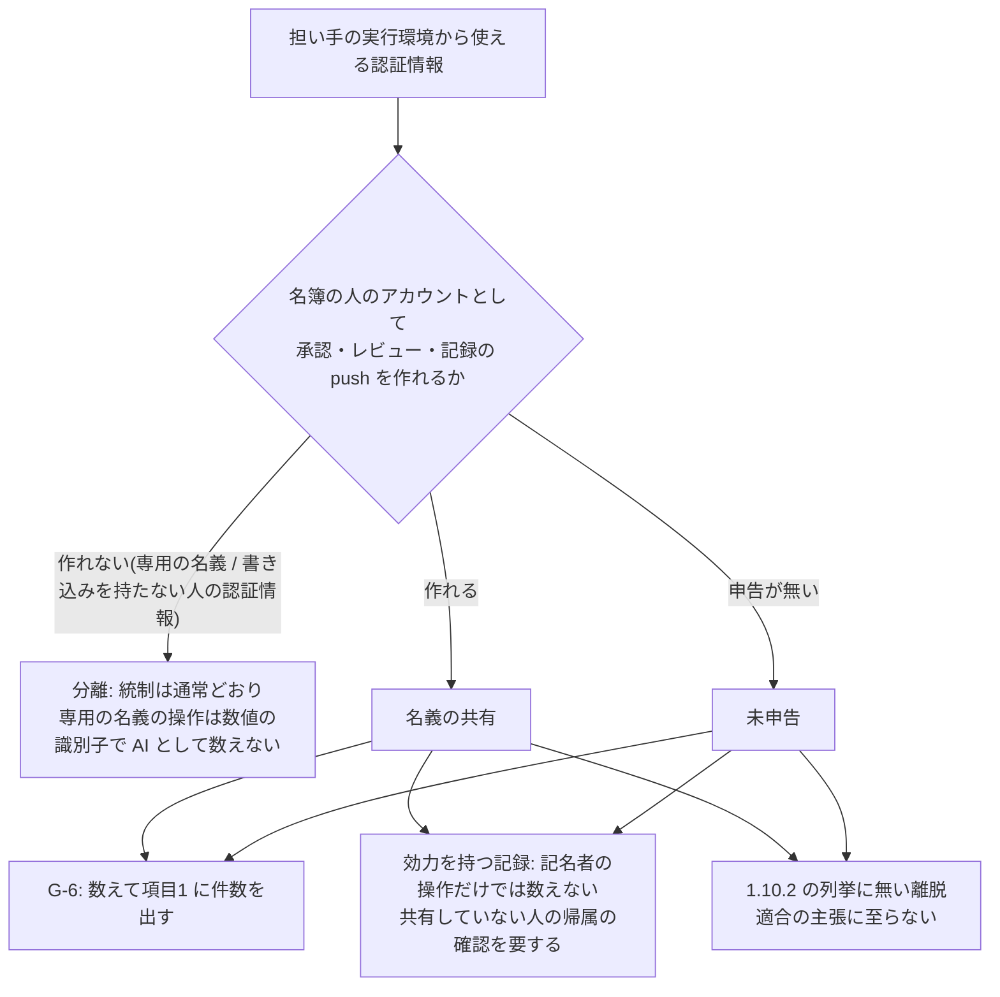

# #429 会議体 — 起案の委員の意見

- 作成日: 2026-11-05
- 立場: 起案。R-1〜R-5 について、本文とテンプレートへ入れる形の案を起こす。判断軸は信頼性で、変更量の少なさを採否の理由にしない
- 入力: `council-00-agenda.md`、`survey-429-1-internal.md`(以下「内部」)、`survey-429-2-external.md`(以下「外部」)、`research/380-deliberation/`、ADR-0106、本文、準拠テンプレートの作業ツリー
- 番号は仮置き: ADR-0107・ADR-0108、EV-0221〜EV-0223、IMPL-0418〜IMPL-0430。行番号は 2026-11-05 時点

## 0. 結論の要旨

| 論点 | 起案の結論(1行) |
| --- | --- |
| R-1 | 禁止しない。黙らない。**名義を構成の入力**(専用 / 共有 / 未申告)にし、名義の共有と未申告を第1章 1.10.2 の列挙に無い離脱へ足す。専用の名義は課さないと明記する |
| R-2 | 崩れる統制を統制ごとに扱う。G-6 の承認は**数えて開示**する。効力を持つ記録は、名義を共有する記名者の操作だけでは**数えず**、共有していない人の帰属の確認を要する(いなければ自己申告)。専用の名義は数値の識別子で**数えない側**へ確実に落とす |
| R-3 | 担い手の識別(3.4.2)には**含めない**。別の欄(構成 `seats[].performerAccount`、D-0 表7 の列)に置き、変化点4 に数える。適合性確認は失効させない |
| R-4 | 数値の識別子の要求は**維持し、照合の全経路へ広げる**。「リポジトリの外側」は**性質の要求へ改める**(名簿の変更を効力を持つ記録に数える)。移行は M1+M4(写しから引く形へ改めた M4′)+M6。ログイン名だけの照合を数える移行期間は置かない |
| R-5 | 権限設定の deny を書き込みの形の `gh api`・トークンの読み出しまで広げ、Bash のフックを足す。どちらも**事故を防ぐ手段であって分離ではない**と明記する。ADR 2件・EV 3件・IMPL 13件 |

全体の構図は次のとおりです。



---

## R-1 共有の構成への要求の向き

### 結論

1. **禁止しない**。人の認証情報を AI の担い手と共有する構成を、要求事項として禁じない。専用の名義(AI 専用のアカウント・アプリ)も課さない。**課さないと決めたこと**として本文に書く
2. **黙らない**。担い手ごとの**名義**(ホスティングが担い手の操作を誰の操作として記録するか)を、構成の入力として申告させる。値は「専用」「共有(名簿の誰か)」「未申告」の3つ
3. 名義の判定は**能力で行う**。担い手の実行環境から使える認証情報で、名簿の人のアカウントとして承認・レビュー・記録の push を作れる構成を「共有」とする。実行環境の設定で拒否していても「共有」のままにする。人の認証情報でも、ホスティングの権限で書き込みを持たないもの(読み取りだけのトークン)で、その人の完全な認証情報が実行環境から届かない構成は「共有」に当たらない
4. 1.10.2: 既存の行「実行主体の文脈の認証情報を、席ごとに分けられない構成」へは読み込まない(主語が担い手どうしで、人と担い手ではない)。**別の行**「AI の担い手の名義の共有、または名義の未申告」を足す。厳しくする向きの変更である。許可(逸脱)に当たるかは、1.10.2 の注記がいう別の Issue の審議の範囲へ含める
5. 1〜2名の採用者への影響: 1名の体制は、もとから適合の主張に至らない(1.10.2 の注記)。足すのは表示だけで、ゲートの合否は変えない(R-2 の G-6 は数える)。2名の体制は、適合の主張に至るために、各人が担い手に専用の名義か書き込みの無い認証情報を与える必要が出る

### 案

#### (1) 第3章 3.5.3 へ新しい小節を足す

挿入先: `src/content/docs/phase4-process-design/roles-responsibilities.md:581` の段落(「1 だけを満たした構成は、よくある誤りです。…」)の直後、`:583`「生成側の文脈や実装を切り離すと…」の前。

```markdown
#### 人と AI の担い手の名義(適用: AI の担い手がホスティングを操作する構成)

担い手の**名義**とは、AI の担い手の操作を、ホスティングがどのアカウントの操作として記録するかです。上の表の条件3 は、担い手どうしの認証情報を分けることを求めます。席の責任者(人)とその席の担い手が1つの認証情報を使う構成は、条件3 の対象ではありません。この構成では、担い手の操作が、ホスティングの記録の上でその人の操作と区別できなくなります。署名とコミットのトレーラ(Co-Authored-By など)は、この区別の証拠になりません。署名は鍵を示すだけで、トレーラは誰でも書けるためです。

| # | 要求事項 |
| --- | --- |
| 1 | 担い手ごとに、名義を構成で申告する。値は「専用」「共有」のいずれかとする。申告の無い担い手は「未申告」として扱う |
| 2 | 「共有」は、担い手の実行環境から使える認証情報で、名簿の人のアカウントとして、変更の承認・レビュー・記録用ブランチへの push のいずれかを作れる構成とする。誰のアカウントかを、人の名簿の識別子で書く。実行環境の設定で拒否していても、「共有」として申告する |
| 3 | 「専用」は、2 に当たらない構成とする。担い手が操作に使うアカウントがある場合は、ホスティングが与える変わらない識別子(数値の識別子)とログイン名で書く。担い手のアカウントを、人の名簿(D-0 表5-2)に書いてはならない |
| 4 | 「共有」の担い手には、その認証情報による次の操作を、実行時に拒否する。変更の承認とレビュー(状態を問わない)、変更のマージ、記録用ブランチへの push、ブランチ保護の変更。拒否は実行環境の設定(強制層)に置く([第5章 5.8.6](/process-compass/phase4-process-design/human-ai-boundary/) の要求事項2)。**この拒否を、名義の分離として扱ってはならない**。担い手が書いたプログラムから認証情報を使う経路を、設定は塞がないためである |
| 5 | 申告は、機械が確かめられる範囲で確かめる。担い手の実行環境で、ホスティングが認証したアカウントを引き、名簿の人のアカウントと照合する。確かめた日時と結果を残す。照合で名簿の人に当たった担い手を、「専用」として扱ってはならない |
| 6 | 「共有」と「未申告」の構成で崩れる統制の扱いは、[第4章 G-6](/process-compass/phase4-process-design/gate-criteria/)と「判定記録を基底ブランチへ入れる操作」による。この構成は、列挙に無い離脱として記録する([第1章 1.10.2](/process-compass/phase4-process-design/overview/)) |

**本標準は、専用の名義を課しません**。課さないと決めた理由は3つです。人の認証情報を担い手と共有することを禁じる明文の規範が、調べた範囲に無いこと(2026-11 時点)。禁じても機械で確かめる手段が申告と実行環境での照合に限られ、禁止が申告の義務に縮むこと。崩れる統制を統制ごとに特定でき、数え方と開示で扱えることです。判断の根拠は [ADR-0107](/process-compass/adr/0107-performer-account-declared-and-shared-account-controls/) によります。
```

マーク(本文の同じ位置に置く):

```markdown
<!-- impl IMPL-0418 target=config-seats state=delivered check=machine test=template/scripts/gate/test-roster-rules.mjs note="要求事項1〜3。構成の seats[].performerAccount に名義(kind: dedicated / shared / 無記入=未申告)を書く。dedicated は account{login,id} を持ち、id は正の整数。shared は person に名簿の識別子を書き、名簿に実在することを契約検査が確かめる。dedicated のアカウントが people[].accounts の login または id と重なれば契約検査が落とす(#429)" -->
<!-- impl IMPL-0422 target=agent-settings state=delivered check=presence note="要求事項4。権限設定が、gh pr review、gh pr merge、書き込みの形の gh api(-X / --method / -f / -F / --input、REST のレビュー・マージ・参照の端点、GraphQL のレビュー・マージの mutation)、gh auth token を、ステージと guard.enabled に依らず拒否する。担い手が書いたプログラムから API を呼ぶ経路は止めない(分離ではない)(#429)(単位: ファイル)" -->
<!-- impl IMPL-0423 target=guard-bash-hook state=delivered check=machine test=template/scripts/gate/test-guard-bash.mjs note="要求事項4 の第二の層。PreToolUse のフックが、Bash の命令文からホスティングへの書き込みの操作(gh api の書き込みの形、GraphQL の mutation 名、curl などによる API の宛先への GET 以外の要求)を検出して拒否し、.claude/denied.log に残す。命令の組み立て(変数の展開・スクリプトの生成)による回避は止めない(#429)" -->
<!-- impl IMPL-0426 target=adoption-trial state=delivered check=machine test=template/scripts/gate/test-adoption-trial.mjs note="要求事項5。env-check が、担い手の実行環境の gh が認証したアカウント(gh api user の login と id)を引き、名簿の people[].accounts と seats[].performerAccount に照合する。名簿の人に当たり、申告が dedicated または無記入のとき所見に出す。確かめた日時と結果を evidence に残す(#429)" -->
```

注: `guard-bash-hook` は登録簿に無い。`src/data/impl-targets.yaml` に `kind: template-file`(実装の前は `planned`)で足す。

#### (2) 第1章 1.10.2 の表と注記

挿入先 1: `src/content/docs/phase4-process-design/overview.md:627` の行の直後へ1行足す。

```markdown
| AI の担い手の名義を、名簿の人と共有する構成、または名義を申告していない構成 | 第3章 3.5.3「人と AI の担い手の名義」 |
```

挿入先 2: `overview.md:636` を次のように改める。

```markdown
- コア機能の理解の保持者が1名以下の機能を持つ案件。席ごとに認証情報を分けていない構成。AI の担い手の名義を共有する構成と、申告していない構成(いずれも規模を問わない)
```

挿入先 3: `overview.md:645` を次のように改める。

```markdown
- 席ごとに認証情報を分けている。AI の担い手の名義を名簿の人と共有せず、申告と実行環境での照合で確かめている
```

挿入先 4: `overview.md:650` の注記の「認証情報の分離(第3章 3.5.3、ADR-0035)が、条件と代償措置を定めた許可(逸脱)に当たるかは、別の Issue で審議します」に、「名義の共有(第3章 3.5.3、ADR-0107)を含めて」を足す。

### 理由

- **禁止しない理由**: (a) 外部調査で、人の認証情報の共有を禁じる明文の条文は見つかっていない。NIST SP 800-53 の AC-2(9) は共有アカウントを「説明責任の欠け」とするが、書きぶりは人どうしの共有である(外部 2.1)。GitHub の利用規約が禁じるのも「複数の人」による1つのログインの共有である(外部 1.6)。(b) ローカルの Claude Code・Codex CLI は利用者の認証情報で動くのが既定で(外部 1.7)、禁止は採用者のほぼ全員を違反にする。それ自体は採否の理由にしないが、違反を機械で確かめる手段が無いため、禁止は**守られているかを誰も確かめられない条項**になる。信頼性の軸で、確かめられない禁止は、確かめられる申告と開示に劣る。(c) 崩れる統制は特定できる(R-2)。崩れる所で数え方を変えるほうが、構成の全体を禁じるより、決めるべきことが漏れない
- **黙らない理由**: 黙ると、G-6 の「AI の名義の承認は数えない」が、名義で AI を見分けられる前提のまま残る(内部 1.3)。読み手は「共有を想定した上で許した」のか「想定していない」のかを区別できない。コアポリシーの「書かれていない」と「課さないと決めた」の区別に反する
- **能力で判定する理由**: 「誰のアカウントで動くか」だけで判定すると、読み取りだけのトークンを与えた構成を共有に数え、実害の無い構成を離脱にする。逆に、設定で拒否した構成を分離に数えると、担い手がスクリプトを書いて API を呼ぶ経路が残る(R-5)。崩れるのは「その人のアカウントとして承認・レビュー・push を作れること」であり、判定の単位をそこに合わせる。外部の指針(OWASP ASI03 の「attribution gap」、CISA ほかの「distinct principal」、NCCoE の「agent と human の識別の区別」、SLSA の trusted person と trusted robot の区別)は、いずれもこの能力の区別を指す(外部 2.3・2.6・2.7・2.8)
- **1.10.2 の別の行にする理由**: 既存の行は担い手どうしの文脈の分離で、主語が違う(内部 5.1)。同じ行へ読み込むと、2名の体制が満たす条件「席ごとに認証情報を分けている」を、共有の構成のまま字面で満たせる(内部 0.1)。行を分けて初めて、適合の主張の条件が名義の分離を含むことを読み手が確かめられる
- **離脱にする理由**: 適合の主張は、承認・記名がその人のものであることを記録から示せる、という主張を含む。名義の共有では、それを示す手段が記録の上に無い(外部 4.1・4.2)。申告と開示で合否を変えずに運用でき、主張だけを止めるのが、統制と主張の両方に正直な形である

### 採らない案

| 案 | 採らない理由 |
| --- | --- |
| 共有の構成を禁じる | 上の (a)(b)。確かめられない禁止になる |
| 専用の名義を「推奨」と書くだけにする | 推奨は数え方を変えない。G-6・効力を持つ記録の前提の穴が残り、読み手は推奨に従ったかを記録から確かめられない |
| 黙る(#380 の EV-0220・観点28 のまま) | 上の「黙らない理由」 |
| 1.10.2 の既存の行(席ごとの認証情報)へ読み込む | 主語が違う。2名の体制の主張の条件を字面で満たせてしまう |
| 1〜2名の体制だけ名義の申告を免除する | 名義の共有で崩れる統制は人数に依らない。免除すると、名義の共有が最も起きやすい体制(ローカルの担い手が既定で人の認証情報を使う)で、開示が消える |
| 設定で拒否した共有を「専用」に数える | R-5。担い手が書いたプログラムから認証情報を使う経路を、設定は塞がない |

### 反論されうる点

- **2名の体制の適合の主張を、事実上閉ざすのではないか**: 閉ざさない。GitHub の利用規約は、人ごとに無料の machine account を1つまで認める(外部 1.6)。読み取りだけの fine-grained トークンを担い手に与え、本人の認証情報を実行環境から外す形もある。ただし、後者は第5章 5.8.6 の要求事項4(秘匿情報を実行環境から参照できない位置へ置く。IMPL-0200 は undelivered)と同じ作業を要し、準拠テンプレートはまだ手段を持たない。負担は残る
- **申告は自己申告ではないか**: そのとおり。だから要求事項5 で、担い手の実行環境で認証したアカウントを機械が照合する。照合は env-check を実行した時点と環境に限られ、別の端末・別のセッションの共有は検出できない。この限界は EV-0221 で開示する
- **「未申告」を離脱にすると、既存の採用者が一斉に離脱を持つ**: 持つ。適合の主張の条件は確かめられることであり、確かめていない構成を主張に数えない。ゲートの合否は変えない

---

## R-2 共有の構成で崩れる統制の扱い

### 結論

崩れる統制を、統制ごとに次のとおり扱います。

| 統制 | 共有で何が崩れるか | 扱い |
| --- | --- | --- |
| G-6 の独立した人の確認(条件1〜4、「AI と bot の名義の承認は数えない」) | 名義を共有する人(作成を指示していない人)のアカウントの承認を、担い手が作れる。人の承認として数えられる | **数えて開示する**。件数を保証の開示の項目1 に「名義を共有するアカウントの承認」として出す。前回の値を併記する(既存の要求) |
| G-6 の「AI と bot の名義の承認は数えない」(専用の名義の側) | 現状は語の一致と bot の型でしか AI を見分けない。語に当たらない machine account の承認は人の承認として数えられる | **数えない**。構成で「専用」と申告したアカウントを、数値の識別子で照合して数えない |
| G-6 条件2・作成を指示した者の既定値 | 担い手が人の名義で PR を開くと、作成者はその人になる。既定値の指示者は「作成者 + 開発者の席の責任者」で、作成者が指示した本人なら正しい。他の人が担い手を動かした場合は外れる | 既定値は維持する。:933 の「作成者が AI または bot である場合」の記述に、人の名義の場合を書き足す。ブランチ保護は作成者の自己承認を止める側へ倒れる(外部 1.7 の Cursor の理由と同じ) |
| 効力を持つ記録の (A)(B)(例外承認・停止の解除・層1・D-0・前倒しの SG) | 記名者本人のレビュー・作成・承認・署名コミットを、担い手が作れる | **記名者の操作だけでは数えない**。名義を共有していない、記名者以外の人の帰属の確認を要する。名簿にその人がいない体制では、自己申告として受け付け、効力を持った記録ごとに項目1 へ出す(ADR-0106 の後退経路を、共有の構成にも掛ける) |
| 判定記録の帰属(記名者本人の push・署名コミット・記名者のレビュー) | 担い手が記名者の名義で push できる | 既存のとおり、裏づけの無い記録として項目1 に「記名が自己申告」と出す(recording.md:88 が既に定める)。名義の共有を理由として足す |
| 承認レビューを判定記録とする(G-2・G-3・G-4・G-6) | 判定者のレビューを担い手が書ける | 判定記録としては受け付け、名義を共有する判定者のレビューである旨を、機械が出す欄「判定者」に併記する。人が書く欄を AI に生成させない規定(附属書C)は、名義を問わず掛かる |
| PR の作成者の別(出荷の PR は人が開く) | 担い手が人の名義で開ける | 統制にしない(出荷の PR の承認は転記の確認で、開く者は統制ではない。ADR-0106 決定6)。変えない |
| ルールセットの迂回者 | 迂回者が名義を共有する人なら、担い手が迂回できる | 準拠テンプレートは迂回者を置かない(IMPL-0416)。env-check の所見(IMPL-0356)に、迂回者が名義を共有する人であることを足す |

保証の開示: 項目1「体制と独立性の成立状況」に、**担い手の名義の状態(専用 / 共有する人の識別子 / 未申告)と、名義の共有に依って数えた承認・帰属の件数**を出します。項目7 には、名義の変更を変化点として出します(R-3)。

### 案

#### (1) 第4章 G-6 基準4 の段落

挿入先: `src/content/docs/phase4-process-design/gate-criteria.md:933` の段落の末尾へ足す。

```markdown
AI の担い手が人の名義で変更を作成した場合([第3章 3.5.3](/process-compass/phase4-process-design/roles-responsibilities/)「人と AI の担い手の名義」)、リポジトリの上の作成者はその人です。ブランチ保護はその人の承認を止めます。作成を指示した者がその人と別の人である場合、指示した者の承認は止まりません。この承認も、条件2 で数えません。
```

#### (2) 第4章 G-6 の数え方の箇条

挿入先: `gate-criteria.md:949`「AI と bot の名義による承認は数えない(第3章 3.5.4)」の直後へ2つ足す。

```markdown
- 構成で名義を「専用」と申告した AI の担い手のアカウントの承認は、AI を示す語の有無に依らず数えない。照合は、アカウントの数値の識別子で行う
- 名義を共有する人(第3章 3.5.3)のアカウントの承認は、担い手の操作でないことを機械で確かめられない。条件1〜4 を満たせば数え、件数を保証の開示の項目1 に「名義を共有するアカウントの承認」として出す。名義を申告していない担い手がいる構成では、「担い手の名義が未申告」と出す。この承認を、適合の主張の根拠に数えない(第1章 1.10.2)
```

マーク:

```markdown
<!-- impl IMPL-0420 target=pr-checks state=delivered check=machine test=template/scripts/gate/test-check-pr.mjs note="PR の時点の検査(検査8 と material-attribution)が、承認・レビューの書き手を数値の識別子で名簿と照合し、seats[].performerAccount の dedicated のアカウントの承認を数えず、shared の人のアカウントの承認に印を付けて数える。gate-g5 は PR の作成者の数値の識別子(github.event.pull_request.user.id)も渡す(#429)" -->
<!-- impl IMPL-0421 target=evidence-aggregation state=delivered check=machine test=template/scripts/gate/test-material-attribution.mjs note="出荷の証跡の集約が、担い手の名義の状態(専用 / 共有する人 / 未申告)、名義を共有するアカウントの承認の件数、名義の共有に依る帰属の件数を、保証の開示の項目1 に前回の値と並べて出す。dedicated のアカウントの承認を数値の識別子で数えない(#429)" -->
```

#### (3) 第4章「判定記録を基底ブランチへ入れる操作」

挿入先: `gate-criteria.md:121`(帰属の確認者を置けない体制の箇条)の直前へ1つ足し、`:121` を改める。

```markdown
- 記名者のアカウントを AI の担い手と共有する構成(第3章 3.5.3)では、記名者のアカウントの操作(対象の PR の上のレビュー、記録を入れた変更の作成と承認、署名コミット)を、それだけでは帰属の裏づけに数えない。記名者以外の人で、名義を共有していない人の承認(帰属の確認)を要する。担い手の操作でないことを、記名者のアカウントの記録から確かめられないためである
- 帰属の確認者を置けない体制(名簿に、記名者以外で名義を共有していない人がいない体制)では、記名者本人のアカウントの操作を受け付け、記名が自己申告であることを、効力を持った記録ごとに保証の開示へ出す。名義の共有を理由とする受け付けは、その旨を区別して出す
```

マーク: IMPL-0413・IMPL-0414 の note に「名義を共有する記名者の操作だけでは数えない(#429)」を足す(state は delivered のまま、実装と同時)。実装が遅れる場合は IMPL-0431 を undelivered(plan=scheduled)で立てる。

#### (4) 保証の開示の項目1

挿入先: `gate-criteria.md:1232` を改める。

```markdown
| 1 | 体制と独立性の成立状況(G-6・G-7 それぞれ、成立 / 外部依頼 / 事後の抜き取り / 未達 / 兼務と代償措置)。AI の担い手の名義(専用 / 共有する人 / 未申告)と、名義の共有に依って数えた承認・帰属の件数 | D-0 体制図、構成、承認の記録 |
```

#### (5) EV-0220 の改め

挿入先: `gate-criteria.md:152-156`。差し替え条件の「AI の担い手が記名者の認証情報で動く構成の比率(#429)」を「担い手の名義の申告(第3章 3.5.3)の集計による、名義を共有する構成の比率」に改める。本文の最後の文「ホスティングの API を直接使う経路は止めていません」を、「書き込みの形の `gh api` とトークンの読み出しも拒否しますが(IMPL-0422・0423)、担い手が書いたプログラムから API を呼ぶ経路は止めていません。名義を共有する構成で記名者の操作だけを帰属に数えないのは、このためです(ADR-0107)」に改める。

#### (6) 新しい根拠水準のマーク

挿入先: `gate-criteria.md` の G-6 の数え方の箇条の後(IMPL-0094 の後、`:975` 付近)。

```markdown
:::caution[暫定 EV-0221 / 見直し 2027-05]
**対象**: AI の担い手の名義を名簿の人と共有する構成で、その人のアカウントの G-6 の承認を数えて開示し、効力を持つ記録の帰属には数えないとする決定。共有と未申告を列挙に無い離脱とする決定。
**根拠の水準**: E0(なし)。
**差し替え条件**: 採用組織の構成での名義の申告の内訳(専用・共有・未申告)と、env-check の照合で申告と食い違った件数。プロセス内部監査(観点6・28)の聞き取りで、名義を共有するアカウントの承認・レビューを担い手が作っていた事象の件数。1件でもあれば、名義を共有するアカウントの G-6 の承認を数えない側へ改める。

外部の指針(OWASP Top 10 for Agentic Applications 2026 の ASI03、CISA ほか6機関の 2026-05 の指針、NIST NCCoE の 2026-02 の概念文書)は、エージェントに人と区別できる識別を持たせる方向を向きます。人の認証情報を担い手と共有することを禁じた明文の規範は、調べた範囲にありません(2026-11-05 時点)。名義を共有するアカウントの承認を担い手が作った頻度も、専用の名義の運用の負担も、測っていません。
:::
```

#### (7) 附属書H の観点28 と、内部監査の観点6

- `src/content/docs/phase4-process-design/assurance-case.md:279` の観点28 の「認証情報を共有する体制では…」を「担い手の名義を共有する体制(第3章 3.5.3)では…」と改め、確かめる対象に「名義を共有する記名者の操作だけで帰属を数えた記録」を足す
- `src/content/docs/phase6-operation/process-audit.md:153` の観点6
  - 機械で検出できるもの: 「担い手の名義の申告と、担い手の実行環境で認証したアカウントの照合の食い違い。名簿の数値の識別子とホスティングの数値の識別子の食い違い」を足す
  - 機械で検出できないもの: 「1つのアカウントを人と AI の担い手が使っていないか(照合した環境の外の共有)」を足す

#### (8) 第5章 5.8.6 の明確化

挿入先: `src/content/docs/phase4-process-design/human-ai-boundary.md` の 5.8.6 の要求事項の表の直後(`:1079` 付近、「人がエージェントの操作について確かめるのは…」の前)。

```markdown
担い手に操作のために与えた認証情報は、担い手の認証情報です([第1章 1.4](/process-compass/phase4-process-design/overview/)「配備の資格情報」)。人の認証情報を担い手に与えた構成では、その使用は要求事項1 の「接触」に当たりません。名義の共有として[第3章 3.5.3](/process-compass/phase4-process-design/roles-responsibilities/)が掛かります。与えた認証情報そのものの読み出し(トークンを表示する操作を含む)は、要求事項1 の接触に当たります。
```

### 理由

- **G-6 を数えて開示する理由**: (a) 名義を共有するアカウントの承認には、人が実際に確かめた承認が含まれる。数えないと、本物の確認を捨て、2名の体制で G-6 を適用する限り記録の欠落として差し戻し続ける。(b) G-6 の承認は出荷判定(G-7)の前に集約で読まれ、開示を見た出荷判定者が出荷を止められる。効力を持つ記録と違い、開示の時点で害を止める機会が残る。(c) 本標準は、機械で確かめられない帰属を「数えて自己申告として開示する」型を既に持つ(G-6 の1名の名簿の氏名の確認、効力を持つ記録の後退経路)。型を揃える
- **効力を持つ記録を数えない理由**: ADR-0106 の決定の核は「事後の開示では、既にマージされた変更を取り消せない」である。名義の共有で記名者の操作だけを数えると、担い手が例外承認のレビューを記名者の名義で出し、その場で自分の変更を通す経路が開く。#380 が塞ごうとした経路そのものである。帰属の確認という確立した後退経路が既にあり(recording.md:121-130)、確認者がいない体制だけを自己申告に落とせば、統制を壊さずに済む
- **専用の名義を数値で数えない側へ落とす理由**: 現状は語の一致に頼る(内部 2.1)。語を含まない machine account(`yamada-ci` など)の承認は人の承認として数えられる。申告と数値の識別子で照合すれば、語の衝突の確認(accountsConfirmed)に頼らずに AI の承認を確実に落とせる。名義の申告は、共有の穴を開示するだけでなく、専用の名義の構成の統制を強くする
- **5.8.6 を明確にする理由**: 内部 1.3 の指摘(`human-ai-boundary.md:1069`)。「接触」に当たると読めば、名義の共有の構成は全部 5.8.6 違反になる。当たらないと読めば、トークンの読み出しまで許すことになる。境界を「使用」と「読み出し」で引く

### 採らない案

| 案 | 採らない理由 |
| --- | --- |
| 名義を共有するアカウントの G-6 の承認を数えない | 上の (a)。本物の確認を捨てる。EV-0221 の差し替え条件で、担い手が作った事象が1件でもあれば、この案へ移る |
| 名義を共有する人の承認に、もう1人の承認を課す | 2名の体制では3人目がいない。もう1人も名義を共有していれば、同じ問題が残る |
| Co-Authored-By・署名を区別の証拠に数える | 外部 4.1・4.2。署名は鍵、トレーラは自由記述で、人の名義のコミットを人の操作と区別しない |
| ホスティングの監査ログの `actor_is_agent` を条件にする | 外部 4.4。公式の対象は Copilot だけで、第三者のエージェントは未確認。監査ログは企業・組織のプランに限られ、180 日で消える。プラットフォームの機能名で書く条項になる |
| 内部監査の聞き取り(観点28)を統制にする | 監査は事後で抜き取り。効力を持つ記録の効力の前に働かない |
| 効力を持つ記録も G-6 と同じく数えて開示する | 上の「効力を持つ記録を数えない理由」。ADR-0106 の決定と矛盾する |

### 反論されうる点

- **G-6 と効力を持つ記録で扱いが割れるのは一貫しない**: 割れる理由は、害を止める機会の有無(開示が効く前か後か)と、後退経路の有無である。同じ割れ方は ADR-0106 の判定記録と効力を持つ記録の区分にある。審議では、この区分が保てるかを突き合わせてほしい
- **数えて開示する承認が「いつも出ている値」になり、読まれなくなる**: 項目1 には前回の値を併記する(既存の要求)。値の多寡に評価を付けない規定のため、悪化を読む手がかりは差だけになる。EV-0221 の差し替え条件で見直す
- **作成を指示した者の既定値が外れる場合(他人が担い手を動かす)を放置している**: 放置ではなく、既存の扱い(PR 本文に指示者を書けば既定値を使わない)で受ける。人どうしで1つの認証情報を使う構成は、名簿の契約検査が拒否する(1つのアカウントは1人に対応づける。`config.mjs:567`)

---

## R-3 担い手の識別にアカウントを含めるか

### 結論

- 3.4.2 の担い手の識別(モデルの版・指示資産の版・権限の組)に、名義を**含めない**。名義が変わっても、席の判断を再現する力は変わらないためである
- 名義は**別の欄**に置く。構成 `seats[].performerAccount`、D-0 表7 の列「担い手の名義」。人の名簿(表5-2)には書かない(既定の「AI の担い手を載せない」を維持)
- 名義の変更は、3.13.1 の**変化点4 に数える**。適合性確認を**失効させない**。変化点の後は、名義の照合(3.5.3 要求事項5)をやり直す
- 「権限の組」は実行環境の設定(ツールと許可範囲)を指し、ホスティング上の権限は名義の側で扱う、と明記する
- `/process-init` に9問目を足す。全規模で聞く。`/process-change` は種別 performer で名義を変える

### 案

#### (1) 第3章 3.4.2

挿入先: `src/content/docs/phase4-process-design/roles-responsibilities.md:190` の段落(「失効の契機は、期間ではなく…」)の直後。

```markdown
担い手の名義(3.5.3「人と AI の担い手の名義」)は、担い手の識別に含めません。名義は、担い手の操作を誰の操作として記録するかを決めるもので、席の判断を再現する力を変えないためです。要求事項1 の「権限の組」は、担い手の実行環境の設定(使える道具と許可範囲)を指します。ホスティング上の権限は、名義の側で扱います。名義の変更は変化点4 に数えますが(3.13.1)、確認の記録も承認も失効させません。
```

#### (2) 第3章 3.13.1 の変化点4

挿入先: `roles-responsibilities.md:1904` を改める。

```markdown
| 4 | AI の担い手の識別の変更(モデルの版・提供者、指示資産の恒久層、ツールと権限、実行基盤)と、担い手の名義の変更(専用と共有の切り替え、共有する人の変更、専用のアカウントの交代) | 3.4.2、3.5.3、3.11.5、3.11.6、3.12.3、3.12.6 |
```

`src/content/docs/phase4-process-design/deliverable-templates.md:494` も同じ文に改める。

#### (3) D-0 表5-2 と表7

- `deliverable-templates.md:150` の欄の表へ1行足す(R-4 と共通)

```markdown
| アカウントの数値の識別子 | ホスティングがアカウントに与える、変更できない識別子。ログイン名と対にして書く。機械が引いた値は、引いた日時と、確かめた人を残す |
```

- `deliverable-templates.md:417` の表5-2 の見出し行へ列「アカウントの数値の識別子」を足す
- `deliverable-templates.md:443` の表7 の見出し行へ列「担い手の名義(専用のアカウントと数値の識別子 / 共有する人の名簿の識別子 / 未申告)」を足し、`:446` の注記の後に次の注記を足す

```markdown
<!-- 担い手の名義は、担い手の実行環境から名簿の人のアカウントとして承認・レビュー・記録の push を作れるなら「共有」と書く。実行環境の設定で拒否していても同じ(第3章 3.5.3)。照合した日時と結果を併記する -->
```

マーク:

```markdown
<!-- impl IMPL-0427 target=d0-template state=delivered check=presence note="D-0 の様式の表5-2 に列「アカウントの数値の識別子」、表7 に列「担い手の名義」を置き、生成区間(IMPL-0301)が構成の people[].accounts の id と seats[].performerAccount から埋める(#429)(単位: 欄)" -->
```

`src/data/template-fields.yaml` に、表5-2 と表7 の新しい列を必須欄として足す(ADR-0040)。

#### (4) 準拠テンプレート

| 所在 | 変更 |
| --- | --- |
| `template/scripts/gate/config.mjs:282-284`(`performerKey`) | 変えない。`performerAccount` を鍵に入れない(識別に含めない決定をコードで固定する試験を足す) |
| `template/scripts/gate/config.mjs`(契約検査) | `seats[].performerAccount` を検査する(IMPL-0418)。`kind` が `dedicated` / `shared` 以外、`dedicated` の `account.id` が正の整数でない、`shared` の `person` が名簿に無い、`dedicated` のアカウントが名簿の人の login・id と重なる、を落とす |
| `template/.claude/skills/process-init/SKILL.md:38-53` | 9問目 `q-ai-account` を足す(全規模)。「AI に GitHub を操作させるとき、どのアカウントで動かすか(AI 専用のアカウント・アプリ / 自分たちのアカウント / まだ決めていない)」。「自分たち」は `shared`(誰のものかは名簿の記入の後に `/process-change` で書く)、「まだ」は無記入(未申告) |
| `template/scripts/init/generate-profile.mjs` | 回答から `performerAccount` を生成し、PROCESS-PROFILE.md に名義と、共有・未申告なら列挙に無い離脱を出す(IMPL-0425・IMPL-0429) |
| `template/.claude/skills/process-change/kinds/performer.md` | 節「名義の変更」を足す。キー `seats[].performerAccount`。変化点4 に数え、適合性確認は失効しない。共有へ切り替える変更は緩める向きの変更で、AI の担い手が決めない(CLAUDE.md の既存の規則)。`:39` の「認証情報: 交代した担い手のトークンを失効させ、新しい担い手へ別のトークンを発行する」を「認証情報: 名義が専用の担い手を交代するときは、旧い担い手のトークンを失効させ、新しい担い手へ別のトークンを発行する。名義が共有の担い手では、人の認証情報を失効させる操作は求めない(名義の照合をやり直す)」に改める |
| `template/.claude/skills/gate/reference/recording.md:88・121・125・130` | 「認証情報を共有する体制」を「担い手の名義を共有する体制(`seats[].performerAccount` が `shared`)」に改め、後退経路の4 に「確認者は、名義を共有していない人に限る」を足す。performer.md との前提の食い違い(内部 2.2 の5)を解く |

マーク:

```markdown
<!-- impl IMPL-0425 target=profile-generator state=delivered check=machine test=template/scripts/init/test-generate-profile.mjs note="/process-init の9問目 q-ai-account の回答から seats[].performerAccount を生成する(専用 / 共有 / 無記入)。全規模で聞く(#429)" -->
<!-- impl IMPL-0428 target=process-change-skill state=delivered check=presence note="/process-change の種別 performer に名義の変更の節を置き、変化点4 に数え、適合性確認を失効させない。共有への切り替えを緩める向きの変更として席の責任者の記名を要する。種別 accountable で名簿のアカウントを login と数値の識別子の対で書く(#429)(単位: ファイル)" -->
<!-- impl IMPL-0429 target=gate-contract state=delivered check=machine test=template/scripts/gate/test-roster-rules.mjs note="seats[].performerAccount が shared または無記入の構成を、第1章 1.10.2 の列挙に無い離脱「AI の担い手の名義の共有・未申告」として、契約検査の出力と PROCESS-PROFILE.md に出す(#429)" -->
```

### 理由

- **識別に含めない理由**: 3.4.2 の確認は、席で人が確定した判定の再現と欠陥注入の検出で行う(要求事項2)。名義はどちらの結果も変えない。含めると、専用のアカウントの交代やトークンの切り替えのたびに確認が失効し、確認の記録の意味(この担い手はこの判断を担える)と関係の無い失効が起きる。失効が実体と離れると、失効の表示を読み手が信じなくなる
- **変化点4 に数える理由**: 名義の変更は、G-6 と効力を持つ記録の数え方を変える(R-2)。変化点にしないと、共有へ切り替えた後も、構成は専用のまま読まれる。変化点4 は既に「実行基盤」のように識別の外のものを含む(`:1904`)ため、名義を足しても変化点の性質は変わらない
- **9問目を全規模で聞く理由**: 名義の共有は人数に依らず起きる。初期化で聞かないと、構成は既定で未申告になり、離脱の表示が「聞かれていないから」になる。聞いた上での未申告と区別できない

### 採らない案

| 案 | 採らない理由 |
| --- | --- |
| 担い手の識別(`performerKey`)へ名義を入れる | 上の「識別に含めない理由」。失効が実体と離れる |
| 名義を人の名簿(表5-2)に書く | 名簿は記名の自然人だけを載せる(表5-2 の規定、`config.mjs` の `rosterProblems`)。AI のアカウントを名簿に入れると、承認の照合が人へ対応づける |
| 名義を変化点に数えない | 上の「変化点4 に数える理由」 |
| 新しい変化点(#6)を立てる | 変化点の番号は第3章・第6章・テンプレートの種別に通っている。変化点4 の「担い手の構成の変化」に収まり、別にすると変化点4 と同時に起きる変更(実行基盤の移行と名義の変更)を二重に記録する |

### 反論されうる点

- **「権限の組」を実行環境の設定に限る明確化は、既存の確認記録の意味を変えないか**: 既存の確認記録で、ホスティング上の権限を権限の組に含めて書いた採用者がいれば、意味が変わる。内部調査は、テンプレートの例(`performer.md` の `permissions: "<権限の組>"`)にホスティングの権限を含める指示が無いことまでしか確かめていない。突合で確かめてほしい
- **変化点4 に足すと、変化点4 の即時通知(検出率の測定値の失効)まで名義の変更に掛かる**: 掛けない。即時通知は識別の変更に限ると `performer.md` に書く

---

## R-4 名簿の数値の識別子による照合

### 結論

1. 第4章 `:84` の**数値の識別子の要求は維持**し、承認レビューを判定記録とする場合に限らず、**ホスティングの記録を名簿の人へ対応づけるすべての照合**(G-6 条件1、効力を持つ記録の (A)(B)、判定者、時点の名簿の対応、作成を指示した者・委任の実施者・区分の確定者)へ広げる
2. **「リポジトリの外側で保守する」は改める**。性質の要求「名簿(D-0 表5-2)の変更を、効力を持つ記録として扱う(効力の前に帰属を裏づける)」に置き換える。組織の ID 台帳を正本とする組織は、内部監査の観点6 で突合する
3. 照合の規則: 名簿の行に数値の識別子があれば数値で照合する。ログイン名が一致しても数値が異なれば対応づけない(改名・他人の取得の疑いとして所見に出す)。**名簿の行に数値の識別子が無ければ、対応づけない**(ログイン名だけでは同定できたものとして扱わない、を全照合に掛ける)
4. 移行: **M1(要素の型の混在)+ M4′(数値を写しから引く)+ M6(食い違いの所見)**。M5(ログイン名だけの照合を移行期間に数えて開示する)は採らない。ログイン名だけの照合を数える移行期間を条項に書くと、`:84` の文言と食い違ううえ、移行を機械で一度に済ませられるため期間を置く理由が無い
5. PR 本文の `@アカウント`: PR の検査の時点にホスティングで数値の識別子へ解決し、名簿の数値と照合する。解決した数値と時点を検査の結果に残す。解決できない・名簿の数値と異なる指示者は、名簿と対応づかない指示者として扱う(既存の `instructor-not-in-roster` の側へ落ちる)
6. 過去の名簿(時点の名簿の対応、IMPL-0094)は数値を持たない。**写しの数値**(承認の時点にホスティングが返した `user.id`)を正とし、現在の名簿の数値と照合する。過去の名簿のログイン名は、写しの数値で当時の人へ引く補助に使う

### 案

#### (1) 第4章 `:84`

挿入先: `src/content/docs/phase4-process-design/gate-criteria.md:84` を改める。

```markdown
- アカウントと人の対応表: 人の名簿(D-0 表5-2)に、ログイン名に加えて、ホスティングがアカウントに与える変更できない識別子(数値の識別子)を持つ。名簿の変更は、効力を持つ記録(D-0 の決定の記名)として、効力の前に帰属を裏づける(後掲「判定記録を基底ブランチへ入れる操作」)。ログイン名だけで対応づけた承認者・判定者を、同定できたものとして扱わない。ログイン名が一致し数値の識別子が異なるアカウントを、名簿の人へ対応づけない
```

挿入先: `gate-criteria.md:112` の効力を持つ記録の列挙「D-0 の決定の記名」を「D-0 の決定の記名(表5 の人の名簿の変更を含む)」に改める(厳しくする向き。IMPL-0415(#428)の範囲に入る)。

挿入先: `gate-criteria.md:968` の直後に足す。

```markdown
- 条件1 の対応づけは、アカウントの数値の識別子で行う(前掲「アカウントと人の対応表」)。承認の時点の名簿が数値の識別子を持たない場合は、承認の写しが持つ数値の識別子を、現在の名簿の数値の識別子と照合する。作成を指示した者を `@アカウント` で書いた場合は、PR の検査の時点にホスティングで数値の識別子へ解決し、解決した値と時点を検査の結果に残す
```

#### (2) 第5章の2か所

- `src/content/docs/phase5-implementation/ci-gates.md:243` を「アカウントと実在する人物の対応表は、人の名簿(D-0 表5-2)に数値の識別子とともに持ち、その変更を効力を持つ記録として扱います([第4章](/process-compass/phase4-process-design/gate-criteria/)「アカウントと人の対応表」)。この対応表がない場合、承認者の同定は成立しません。」に改める
- `src/content/docs/phase5-implementation/qms-document-control.md:45・55` の「リポジトリの外側で保守する」を同じ趣旨に改める。`:55` の理由(退会の匿名化、ログイン名の他人の取得)は残し、「改名すると旧いログイン名は直ちに他人が取得でき、削除の後は 90 日で取得できる(GitHub、2026-11-05 時点)」を足す
- `ci-gates.md:680` の後に、`@アカウント` の解決の規定(上の (1) の最後の文と同じ)を足す

#### (3) マーク

```markdown
<!-- impl IMPL-0419 target=gate-contract state=delivered check=machine test=template/scripts/gate/test-roster-rules.mjs note="名簿の people[].accounts の要素に文字列(ログイン名)と {login, id} の両方を受け、id が正の整数であること、名簿の中で id が重ならないこと、同じ login に別の id を書かないことを契約検査が確かめる。accountsConfirmed と changeLog の accountConfirmations は login で書き、名簿の要素へ解決する(#429)" -->
<!-- impl IMPL-0424 target=evidence-aggregation state=delivered check=machine test=template/scripts/gate/test-roster-rules.mjs note="findPersonByAccount が {login, id} を受け、名簿の要素に id があれば id で照合し、login が一致して id が異なる要素は対応づけず所見(改名・他人の取得の疑い)に出す。id の無い名簿の要素へは対応づけない(承認者・判定者・帰属の照合、検査8、material-attribution、集約、next)。写しの user.id、REST の user.id・author.id・committer.id、noreply のメールの id を捨てずに渡す。PR 本文の @アカウントは PR の検査が gh api users/<login> で id へ解決する(#429)" -->
<!-- impl IMPL-0426 の note に「名簿の login の数値の識別子を、記録用ブランチの写しの user.id から引いて提案し、写しが無い人だけ gh api users/<login> で引く。写しの値と現在の値が異なれば提案せず所見に出す。名簿へ書くのは人(/process-change accountable)」を足す -->
```

IMPL-0125 の note の「判定者の数値の識別子と席」は、席への対応を数値で引く形に実装が改まるため、そのまま delivered で正しくなる。note に「(席への対応も数値の識別子で引く。#429)」を足す。

#### (4) 準拠テンプレートの移行(M1+M4′+M6)

| 段 | 内容 |
| --- | --- |
| M1 | `people[].accounts` は `"yamada"` と `{"login": "yamada", "id": 1234567}` を両方受ける。`rosterProblems`(`config.mjs:548-570`)の文字列以外の拒否を改める。`accountKey` は文字列と `{login}` の両方から鍵を作る |
| M4′ | `/process-change`(種別 accountable)と env-check が、名簿の login ごとの数値の識別子を**記録用ブランチの写しの `user.id`** から提案する。写しに現れない人は `gh api users/<login>` で引く。写しの値と現在の値が異なる login は提案しない。提案を名簿へ入れるのは人で、変化点の記録に引いた日時と出所(写し / ホスティングの照会)を残す |
| M6 | PR の検査・集約・`next.mjs` が、ホスティングの (login, id) と名簿の (login, id) の食い違いを所見に出す |
| 切り替え | 上の3つと同じ版で、id の無い名簿の要素へ対応づけない照合に切り替える。既存の採用者は、次のゲートの前に `/pit` が M4′ の提案を「次の一手」として出す |

`process-change/kinds/accountable.md:18・39・43` の様式を `{login, id}` に改める。

### 理由

- **数値の識別子を全照合へ広げる理由**: ログイン名は改名で直ちに、削除で 90 日後に他人が取れる(外部 3.1)。NIST SP 800-53 IA-4 d. は識別子の再利用の防止を求める(外部 2.1)。この危険は、承認レビューを判定記録とする場合に限らない。G-6 の承認者・効力を持つ記録の帰属・判定者のどれも、ログイン名で照合すれば、時間をおいた照合で別人に当たる
- **数値が既に取れている**: 写し・PR の検査の入力・ホスティングの照会の全経路で数値は取れていて、捨てているだけである(内部 3.3)。照合に使えば、要求と実装の差が消える
- **「リポジトリの外側」を改める理由**: (a) 調べた範囲で、「外側」の理由を述べた記述が無い(`qms-document-control.md:55` の理由は数値の識別子についてのもの)。#321 の経緯(`research/phase4-standard/321-decision.md`)にも理由の記述は見当たらない。(b) 外側の表は CI と `/pit` が読めず、準拠テンプレートが降ろせない規定として永久に残る。(c) 外側に置く目的は、判定される側が対応表を変えられないことだと読める。その目的は、名簿の変更を効力を持つ記録に数え、記名者本人の操作で効力の前に帰属を裏づけることで、記録から確かめられる形で満たせる。外側の表は、誰がいつ変えたかを記録から確かめる手段を本標準の側に持たない
- **M5 を採らない理由**: 移行期間にログイン名だけの照合を数えると、`:84` の「同定できたものとして扱わない」と食い違う。ADR-0028 の型(未達と省略の区別)で表示する道もあるが、移行は写しから機械が提案でき、採用者の作業は提案を確かめて記名する1回で済む。期間を置く必要が無い
- **M4 を M4′ に改めた理由**: 現在のホスティングでログイン名を解決すると、改名や他人の取得の後では別人の数値を固定する(内部 3.4 の M4 の短所)。写しは承認の時点の (login, id) を持つため、当時の本人の数値を引ける
- **PR 本文の `@アカウント` を検査の時点で解決する理由**: 本文は文字列で、数値にできない(内部 3.4)。検査の時点に解決して値を残せば、その後の改名に左右されない。指示者の欄はもとより作成側の自己申告であり、解決できない場合を「対応づかない」側へ落とすのは、数えない向き(安全側)である

### 採らない案

| 案 | 採らない理由 |
| --- | --- |
| M2 並行の欄(`accountIds`) | ログイン名と数値の対がずれる。照合の鍵が2つになる |
| M3 名簿を外へ出す | 上の (b)(c)。CI が読めず、変更の帰属を記録から確かめられない |
| M5 移行期間にログイン名だけの照合を数えて開示する | 上の「M5 を採らない理由」 |
| node_id を照合の鍵にする | 外部 3.2。新旧の形式が混在する。REST の `id` と GraphQL の `databaseId` が同じ値で、比較の前提を置きやすい |
| 「リポジトリの外側」を維持し、undelivered と表示し続ける | 降ろせない規定を、降ろすべき規定として表示し続けることになる(ADR-0106 の採らない案と同じ理由) |
| `:84` を承認レビューを判定記録とする場合に限ったまま実装する | 同じ再利用の危険が G-6・効力を持つ記録に残る |

### 反論されうる点

- **「外側」を外すのは緩める向きではないか**: 外す代わりに、名簿の変更を効力を持つ記録に足す(厳しくする向き)。効力を持つ記録の帰属の照合は、層1・D-0 の分がまだ降りていない(IMPL-0415、#428)。降りるまでは、名簿の変更の帰属は機械で確かめられず、改めた条項も一部が降りていない状態で残る。これは undelivered で表示される
- **即時の切り替えは、既存の採用者の出荷を止める**: 止める。名簿へ数値を入れるまで、G-6 の承認者を名簿へ対応づけられないためである。M4′ の提案は写しから機械が出すため、作業は確かめて記名する1回になる。ADR-0055(体制の変化点)の即時反映の扱いとの突合が要る
- **写しが無い採用者(初期化の直後)は、現在のホスティングの値を引くしかない**: そのとおり。初期化の直後のアカウントは改名・再取得の履歴を持ちにくいが、確かめてはいない。引いた日時と出所を記録し、M6 の所見で後から食い違いを見る

---

## R-5 テンプレートの手段と記録

### 結論

- 権限設定の deny を、`gh pr review` に加えて、**書き込みの形の `gh api`、GraphQL のレビュー・マージの mutation、`gh auth token`** へ広げる。ステージと `guard.enabled` に依らず残す(`standardReview` と同じ扱い)
- Bash の **PreToolUse のフック**を足し、命令文からホスティングへの書き込み(`curl` などによる API への GET 以外の要求を含む)を検出して拒否し、記録に残す
- 常駐の規則(`template/CLAUDE.md:106`)を、宣言行のレビューに限らず「人のアカウントで承認・レビュー・マージ・記録用ブランチへの push を作らない」へ広げる
- 権限設定とフックは**事故を防ぐ手段であって、名義の分離ではない**。本文(3.5.3 要求事項4)と EV-0222 で明記し、R-2 の数え方を設定の有無で変えない
- 新しい ADR は2件(名義 / 名簿の照合)。EV 3件、IMPL 13件

### 案

#### (1) 権限設定(`template/scripts/init/generate-profile.mjs:5520-5528`)

`standardReview` を次の集合へ広げる。パターンの書式は、既存の `Bash(gh api repos/*/rulesets:*)`(`:5550`)と同じ前提に立つ。

```js
  // 人のアカウントで、承認・レビュー・マージ・記録の push を作らない(標準 第3章 3.5.3「人と AI の担い手の名義」要求事項4、
  // ADR-0107。process-compass #429 / IMPL-0422)。名義の分離ではない(担い手が書いたプログラムから API を呼ぶ経路は残る)。
  // ステージと guard.enabled に依らず残す。読み取りの gh api は止めない。書き込みの形だけを拒否し、フック(guard-bash)が残りを受ける
  const standardReview = [
    "Bash(gh pr review:*)",
    "Bash(gh api -X *)", "Bash(gh api * -X *)",
    "Bash(gh api --method *)", "Bash(gh api * --method *)",
    "Bash(gh api * -f *)", "Bash(gh api * -F *)",
    "Bash(gh api * --field *)", "Bash(gh api * --raw-field *)",
    "Bash(gh api * --input *)",
    "Bash(gh api repos/*/pulls/*/reviews*)", "Bash(gh api repos/*/pulls/*/merge*)",
    "Bash(gh auth token*)", "Bash(gh auth status --show-token*)"
  ];
```

- `gh api` は `-f`・`-F`・`--input` を付けると既定で POST になるため、方法の指定だけでなく欄の指定も拒否する
- 人が適用する手順(ルールセットの `gh api ... --input`)は、担い手が実行しない操作として既に案内している(`:1377`・`:5457`)。拒否と衝突しない
- 準拠テンプレートのスクリプト(`node scripts/gate/...`)が内部で呼ぶ `gh` は、権限設定の照合の対象外である。スクリプトの動作は変わらない

#### (2) Bash のフック(新しいファイル)

- `template/.claude/hooks/guard-bash.mjs`(PreToolUse、matcher `Bash`)。次を検出して拒否し、`.claude/denied.log` に残す
  - `gh api` の書き込みの形(上と同じ。命令の連結 `&&`・`;`・`|` の後ろも見る)
  - GraphQL の mutation 名 `addPullRequestReview`・`submitPullRequestReview`・`mergePullRequest`・`enablePullRequestAutoMerge`・`updateRef`・`createCommitOnBranch`
  - `curl`・`wget`・`Invoke-RestMethod`・`Invoke-WebRequest` による、ホスティングの API の宛先への GET 以外の要求
- 試験 `template/scripts/gate/test-guard-bash.mjs` が、拒否する形と拒否しない形(読み取りの `gh api`、`gh pr view`、`gh pr create`)の両方を固定する
- 登録簿: `src/data/impl-targets.yaml` に `guard-bash-hook`(`kind: template-file`、`path: .claude/hooks/guard-bash.mjs`、`checker: test-guard-bash`)を足す。逆向きの追跡(ADR-0084 決定6)のため、登録の無いフックは `check-impl` が落とす

#### (3) 常駐の規則

挿入先: `template/CLAUDE.md:106` を次の2行に改める。

```markdown
- **人のアカウントで、変更の承認・レビュー(状態を問わない)・マージ・記録用ブランチへの push を作らない**。`gh api` などで直接作る形も含む。ホスティングの記録の上で、人の操作と区別できなくなるため(標準 第3章 3.5.3「人と AI の担い手の名義」)。認証情報(`gh auth token` など)を表示・複製しない `[機械]` 権限設定と Bash のフック(`guard-bash`)。拒否されない形でも作らない(設定は分離ではない)
- **例外承認・停止の解除の宣言行のレビュー(`例外承認: <行の ID>` / `停止の解除: 解除`)を出さない**。台帳の行や解除の記録を、名前を書いただけで成立したとして扱わない `[機械]` 権限設定(`gh pr review` を拒否)と G-5(`pr-rules`)。詳細: `.claude/skills/gate/reference/recording.md`「効力を持つ記録の届け方」
```

マーク:

```markdown
<!-- impl IMPL-0430 target=claude-md-resident state=delivered check=presence note="AI の担い手が、人のアカウントで承認・レビュー・マージ・記録用ブランチへの push を作らず、gh api などで直接作らず、認証情報を表示・複製しないことを、常駐の規則(CLAUDE.md)に置く。書いた規則を守ったかは機械で確かめない(#429)(単位: 行)" -->
```

IMPL-0417 の note の「gh api で直接レビューを作る経路は権限設定で止めない(読み取りと区別できない)」を「書き込みの形の gh api は IMPL-0422 で拒否する」に改める。

#### (4) 根拠水準のマーク

挿入先: `roles-responsibilities.md` の新しい小節「人と AI の担い手の名義」の末尾。

```markdown
:::caution[暫定 EV-0222 / 見直し 2027-02]
**対象**: 名義を共有する担い手に、承認・レビュー・マージ・記録の push を実行時に拒否させる手段(権限設定の拒否と Bash のフック)の網羅。準拠テンプレートの拒否の形が、主要な作り方を塞ぐという前提。
**根拠の水準**: E0(なし)。
**差し替え条件**: 承認・レビューを作る命令の形(gh pr review、gh api の REST と GraphQL、curl、生成したスクリプト)を並べた試験の集合で、拒否できた割合。採用組織の拒否の記録(.claude/denied.log)と内部監査の聞き取りで、拒否されずに作られた事象の件数。権限設定のパターンの照合の挙動を、実行基盤の版ごとに確かめた結果。

担い手が書いたプログラムから認証情報を使う経路は、どちらの手段も塞ぎません。名義の共有を分離として扱わないのは、このためです。
:::
```

挿入先: `gate-criteria.md:84` の直後。

```markdown
:::caution[暫定 EV-0223 / 見直し 2027-05]
**対象**: 名簿の照合をアカウントの数値の識別子だけで行い、ログイン名だけの照合を数える移行期間を置かない決定。数値の識別子を承認の写しから引いて名簿へ入れる移行の手段。
**根拠の水準**: E0(なし)。
**差し替え条件**: 切り替えの後に、名簿に数値の識別子が無いために対応づけられなかった承認の件数と、解消までの日数。写しの数値の識別子と現在のホスティングの値が食い違った件数。食い違いが1件でもあれば、移行の提案の出所(写し / 照会)の扱いを見直す。

ログイン名の再利用(改名で即時、削除で 90 日後)は GitHub の文書で確かめています(2026-11-05)。採用組織で再利用が承認の照合に当たった事象と、移行の負担は、測っていません。
:::
```

#### (5) ADR

- **ADR-0107**「AI の担い手の名義を構成で申告し、名義の共有で崩れる統制を統制ごとに扱う」
  - 決定: 3.5.3 の小節(禁止しない・申告・能力による判定・実行時の拒否・照合)、G-6 は数えて開示、専用は数値で数えない、効力を持つ記録は共有の記名者の操作だけでは数えない、1.10.2 の行、3.4.2 の識別に含めない、変化点4、5.8.6 の明確化
  - 課さないと決めたこと: 専用の名義。名義を共有するアカウントの G-6 の承認を数えないこと(EV-0221 の差し替え条件で移る)
  - ADR-0106 との関係: ADR-0106 の決定を置き換えない。効力を持つ記録の後退経路の条件(帰属の確認者)を「名義を共有していない人」に狭める補いとして記録する(採用済みの本文は書き換えない)
  - ADR-0035・ADR-0083 との関係: 文脈の分離(担い手どうし)と名義(人と担い手)は別の軸である。1.10.2 の行を分ける
- **ADR-0108**「名簿はアカウントの数値の識別子で照合し、名簿の変更を効力を持つ記録に数える」
  - 決定: `:84` の要求を全照合へ広げる、「リポジトリの外側」を性質の要求に改める、M1+M4′+M6、移行期間を置かない、`@アカウント` を検査の時点で解決する
  - ADR-0070 との関係: 写しの最小の組(数値の識別子とログイン名)は変えない。写しを照合の正に使う

### 理由

- **deny を書き込みの形まで広げる理由**: 現状は `gh pr review` の前置きだけで、`gh api` の直接の作成は止まらない(内部 2.2 の3)。#380 の裁定は「読み取りと区別できない」を理由に止めなかったが、`gh api` は書き込みの形を引数(`-X`・`-f`・`-F`・`--input`)で区別できる。読み取りを止めずに書き込みだけを止められる
- **フックを足す理由**: 権限設定のパターンは前置きと `*` の照合で、命令の連結、`curl`、GraphQL の本文の中身を見られない。フックは命令文を解析できる。それでも、生成したスクリプトの中身は見られない。二層にしても分離にならないことを明記する
- **常駐の規則を広げる理由**: 現状は宣言行のレビューに限り(内部 2.2 の3)、G-6 の承認(宣言行の無い承認)を担い手が人の名義で出すことを禁じていない。G-6 の承認こそ、名義の共有で最も数に効く操作である
- **設定の有無で数え方を変えない理由**: 設定は担い手自身の操作で外せない(5.8.6 の要求事項6)としても、担い手が書いたプログラムの経路が残る。設定の有無で数え方を変えると、「設定がある」ことを分離の代わりに数えることになり、R-1 の能力の判定と矛盾する

### 採らない案

| 案 | 採らない理由 |
| --- | --- |
| `gh api` をすべて拒否する | 担い手の読み取り(PR のコメント・状態の確認)を止める。書き込みの形は引数で区別できる |
| `gh api` をすべて確認つき(ask)にする | 読み取りのたびに人へ確認を求め、確認が形骸化する。書き込みの確認を読み取りの確認に紛れさせる |
| 常駐の規則だけで受ける(権限設定を広げない) | 5.8.6 の要求事項2。指示ファイルにだけ書いた範囲は拒否できたものとして扱わない |
| 権限設定とフックを、名義の分離として数える | 上の「設定の有無で数え方を変えない理由」 |
| 実行環境のコンテナ・別の OS 利用者を必須にする | 第5章 5.8.6 の要求事項4(秘匿情報を実行環境から参照できない位置へ置く)の降ろし方であり、IMPL-0200(undelivered、#358)で扱う。名義の判定は R-1 の能力の基準で足りる |
| 担い手のアカウントを準拠テンプレートが作る(machine account・アプリの雛形) | アカウントの作成はホスティングの利用規約とプランに依り、テンプレートが代行できない。手順の案内は `/process-change` の残作業に出す |

### 反論されうる点

- **権限設定のパターン `*` の照合の挙動を確かめていない**: 既存の `Bash(gh api repos/*/rulesets:*)` も同じ前提に立つ。実行基盤の版ごとの照合の挙動は EV-0222 の差し替え条件に入れ、試験で固定できる範囲(フック)は試験で固定する
- **拒否の範囲を広げると、正当な自動化(担い手が Issue にコメントする等)も止まる**: `gh api` の書き込みの形を拒否すると、Issue のコメントの作成(`gh api repos/.../issues/N/comments -f body=...`)も止まる。`gh issue comment` は止めないため、担い手はそちらを使う。止めたくない書き込みがあれば、採用者がカスタムの規則で許す(`customDenyRules` の扱いは既存のとおり)
- **IMPL が多い**: 降ろし先ごとに1つずつ立てた。統合すると、降ろし先の実在の検査(#222)が粗くなる

---

## 番号の一覧(仮置き)

| 番号 | 内容 | 降ろし先 / 置き場 | 状態 |
| --- | --- | --- | --- |
| ADR-0107 | AI の担い手の名義の申告と、名義の共有で崩れる統制の扱い | `src/content/docs/adr/0107-performer-account-declared-and-shared-account-controls.md` | — |
| ADR-0108 | 名簿の数値の識別子による照合と、名簿の変更を効力を持つ記録に数えること | `src/content/docs/adr/0108-roster-matched-by-durable-account-id.md` | — |
| EV-0221 | G-6 は数えて開示・効力を持つ記録は数えない・1.10.2 の離脱(E0) | gate-criteria.md | — |
| EV-0222 | 実行時の拒否の網羅(E0) | roles-responsibilities.md 3.5.3 | — |
| EV-0223 | 数値の識別子だけの照合と移行期間を置かない決定(E0) | gate-criteria.md :84 の後 | — |
| EV-0220 | 差し替え条件と本文を改める(番号は変えない) | gate-criteria.md:152-156 | 改め |
| IMPL-0418 | `seats[].performerAccount` の入力と契約検査 | config-seats | delivered machine |
| IMPL-0419 | 名簿の `{login, id}` と契約検査 | gate-contract | delivered machine |
| IMPL-0420 | PR の時点の検査の数値の照合・専用を数えない・共有に印 | pr-checks | delivered machine |
| IMPL-0421 | 集約の項目1(名義の状態と件数)・専用を数えない | evidence-aggregation | delivered machine |
| IMPL-0422 | 権限設定の拒否の拡張 | agent-settings | delivered presence |
| IMPL-0423 | Bash のフック | guard-bash-hook(新規登録) | delivered machine |
| IMPL-0424 | `findPersonByAccount` の数値の照合・`@アカウント` の解決・数値を捨てない | evidence-aggregation | delivered machine |
| IMPL-0425 | `/process-init` の9問目 | profile-generator | delivered machine |
| IMPL-0426 | env-check の名義の照合と数値の提案(写しから) | adoption-trial | delivered machine |
| IMPL-0427 | D-0 表5-2・表7 の列 | d0-template | delivered presence |
| IMPL-0428 | `/process-change` の performer・accountable | process-change-skill | delivered presence |
| IMPL-0429 | 1.10.2 の離脱の導出と表示 | gate-contract | delivered machine |
| IMPL-0430 | 常駐の規則 | claude-md-resident | delivered presence |
| (IMPL-0431) | 実装が遅れた場合の undelivered(効力を持つ記録の共有の扱い、または切り替え) | — | 予備 |
| 既存の改め | IMPL-0125・0413・0414・0417 の note | — | note の改め |

state は実装を同じ変更で済ませた場合のもの。実装しないまま本文を入れる場合は、それぞれ `undelivered plan=scheduled` で入れる。

## 突合で確かめてほしい点(会議体への申し送り)

1. **ADR-0106 との関係**: 効力を持つ記録の帰属の確認者を「名義を共有していない人」に狭めるのは、ADR-0106 の決定の補いか、置き換えか。起案は補い(ADR-0106 の本文は書き換えない)と読む
2. **ADR-0035・ADR-0083**: 「代償措置つきの逸脱」を代償措置の定めと読まない(ADR-0083)。名義の共有の行も、許可(逸脱)の定めを持たない列挙に無い離脱として入れる。1.10.2 の注記の「別の Issue」の範囲に含めてよいか
3. **ADR-0065・ADR-0054**: 名簿から確認者を導く決定と、席と担い手の決定が、名義を名簿の外に置く形と矛盾しないか
4. **ADR-0040(テンプレートの様式)**: 表5-2・表7 の新しい列を必須欄として `template-fields.yaml` に足すこと
5. **ADR-0055(体制の変化点)**: 名義の変更を変化点4 に足すことと、数値の識別子の照合への即時の切り替えが、変化点の即時反映の扱いと整合するか
6. **suite の fixture**: 試験の fixture が「ログイン名の文字列の名簿」と「語の一致による AI の判定」を固定している(内部 2.1 の `aiNames` を含む)。規則を変える前に、どの fixture がどの決定を固定しているかを突き合わせる
7. **内部 1.3 の `ci-gates.md:681`**: 共有の構成で作成者のアカウントは常に人になる。既定値の指示者を変えない判断(R-2)で足りるか
8. **「リポジトリの外側」の由来**: 起案は理由の記述を見つけていない。監査の委員に、#321 より前の経緯(`ci-gates.md:243` の初出)を確かめてほしい
