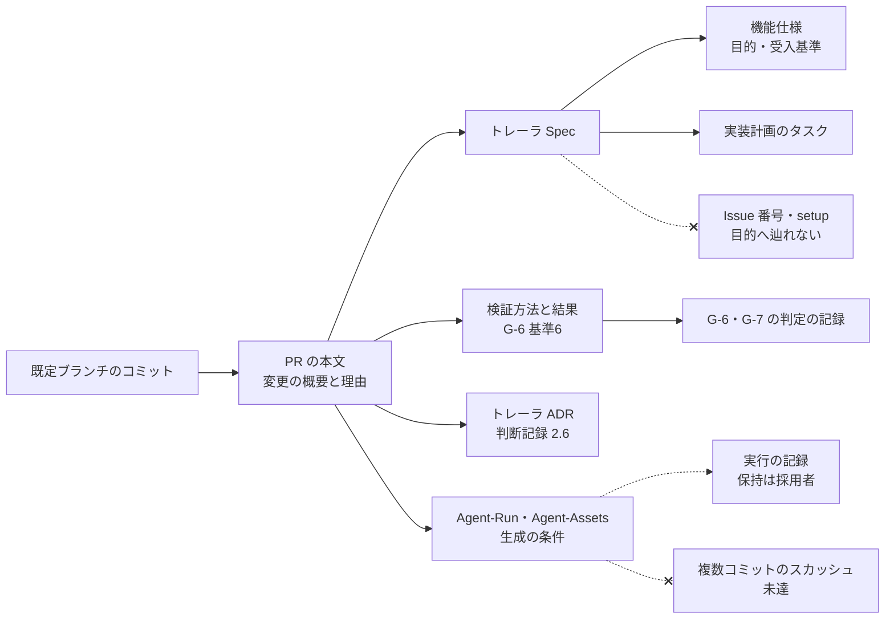

# #457 再審議(重): 議長の裁定の案(2026-11-27)

入力: `r2-intake.md`・`r2-options.md`・`r2-external.md`・`r2-council-{drafter,field,audit,standards,defender}.md`・前回の `ruling.md`、ADR-0267・0012・0266・0028。本文の行は作業ツリー `d3`(main c743b3fc。`assurance-case.md` は #465 の担当が編集中で、未コミットの変更を含む)で読み直した。`assurance-case.md` の行番号は、#465 の編集で受付の時点から 6 行ずれている(H.3 の2行は L304・L305、H.5 問11 は L1017)。template は `E:/Github/process-compass/template`(@ af15a3b)を読んだだけ。本書は本文・template を書き換えていない。実行での確認はしていない。

## 0. 議長の方向と食い違う点(先に書く)

### 0.1 「スカッシュの実例が無い」は誤り。観測の記録がある

議長の方向は「K7・K8 の『落ちる』は実行では観測していない。スカッシュの実例が無い」とする。このリポジトリ群の実在の PR がマージコミットで取り込まれている点は正しい。ただし、**#361 の試行(2026-11-26。private の合成の一時リポ `pit-in-trial-python-tmp`。削除済み)で、スカッシュの2つの設定を観測した記録がある**。

| 所在 | 観測したこと |
| --- | --- |
| `research/361-deliberation/trial/python/results.md` L19(C-27) | 設定A(コミットの箇条)で2コミットの PR #4 を取り込むと、メッセージは題名とコミットの箇条だけで、PR の本文のトレーラは入らない。設定B(`PR_TITLE`+`PR_BODY`)で PR #5 を取り込むと、PR の本文は入るが、その後に GitHub が `---------` と `Co-authored-by: …` の段落を足し、末尾の段落が `Co-authored-by` になる |
| `research/361-deliberation/10-ruling-draft.md` L54・L84(D-8)・L178(R-6) | 設定B で `specTrailersOf` が空になる欠陥 D-8。読み方の変更は、保護と組み合わせた public の観測の後に決めると保留した |
| template `README.md` L809 | 上の2設定の観測を書いている。**同じ README の L813 は「GitHub の実際のメッセージで数えられるかは確かめていません(#361)」と書き、L809 と食い違う**(範囲外の発見 §6 の F2) |

裁定への効き:

- **K7 は形として観測済み(E2、単一事例)**。設定B のメッセージは、PR の題名と本文と GitHub が足す段落だけで、途中のコミットのメッセージを含まない
- **K8 は観測していない**。試行のコミットは `Agent-Run`・`Agent-Assets` を持たず、記録も `Spec` だけを見た。AI の `Co-Authored-By` が設定B で残るかも記録に無い。GitHub が足す `Co-authored-by` は、コミットの作者とマージする者が違うときに付いた。付く条件は切り分けていない(規格委員の「残る場合がある」という記憶と矛盾しない)。したがって K8 は「`Agent-Run`・`Agent-Assets` は残らないと読める(GitHub の設定の定義と C-27 の形から)。`Co-Authored-By` は不明」と書く
- **D-8 は K8 の直し方(a)を損なう**。PR の本文の末尾の段落へトレーラを写しても、設定B では GitHub が後ろに段落を足すため、末尾の段落にならない。束 D1 の設計の前提に入れる(§4)

### 0.2 そのほかの食い違い

- 議長の方向は IMPL-1033 の扱いを問う。読み直すと、K8 の欠けを担うのは IMPL-1033(警告)ではなく、**IMPL-0207・IMPL-1019 が記録したものが既定ブランチへ運ばれないこと**である。直す対象は新しいマーク1つで足りる(§1.4)
- **手引きの側にも K8 の欠けがある**。`pr-workflow.md` L203 は「squash 後のコミットメッセージにもトレーラを残す。残すのは `Spec`・`Co-Authored-By` と、該当する場合の `Delegated`・`Risk`・`Verification`」と書き、`Agent-Run`・`Agent-Assets` を挙げていない。本文だけで直せるので、本束で直す(§3.2)
- H.5 問11 の並べ替え(3-A の2)は `assurance-case.md` の中にある。議長の方向は、同ファイルの変更を2行と手引きに限る。問11 は本束から外し、#465 の push の後に直列で行う(§3.6)

## 1. 裁定

### 1.1 論点1: 一続きの追跡

**採る: 1-B'(条項・様式・欄を足さない。PR の本文を追跡の面にする)**。5 委員とも同じ方向で、割れていない。

1. 後から1つの変更を辿る起点を、**既定ブランチのコミットから引ける PR の本文**とする(PR を経ないコミットは、コミットのメッセージ)。辿る順序と辿れない箇所を、フェーズ5 PR ワークフローの手引きに置く
2. 附属書H H.3 の「ブラックボックス化」の2行は2行のまま保ち、列を書き換える。1行に寄せない。「何をしたか」は機械の記録、「なぜ」は人の記録で、止め方の区分が違う。1つの升に混ぜると、最も弱い止め方の導出(ADR-0266 決定5)が粗くなる(起案・現場・品質監査・規格・弁護の全員)
3. 「何をしたか」の行の答えの中心を、モデルの版から追跡へ移す。追跡は、目的 → ゴール → (調査のうち判断に効いたもの)→ ステップ → インプット → 結果の順に辿る。モデルの版は、この行に残すが、構成管理の記録と明記する(論点3)
4. K1(`Spec` が Issue の番号か `setup` の変更)は、道筋の限界として開示する。欠陥として直さない(#286 の意図した経路)
5. K3(検証の記録が受入基準を識別子で引かない)は、条文にしない。準拠テンプレートの様式の例を `AC-N` の識別子で書く(束 D1。IMPL-1051 の範囲を広げる)。識別子の有無は決定可能だが、整合は決定できない(SRC-0554 の注記の趣旨)。差し戻しが形式に寄る(FND-0020)
6. 辿れることは機械で確かめない(manual)。暫定 E0 で開示する(EV-NEW-1)

理由: 所有者の言う「チケット」の欄(目的・検証・インプット・理由)は、PR の様式が既に持つ(起案 §2.1 [確]、弁護 §論点1)。足りなかったのは新しい様式ではなく、(i) どの記録を起点に読むかの記述と、(ii) 起点の記録が既定の運用で残ること(K7・K8)である。外部の調査は、追跡の規範を成果物の鎖(要求・試験・結果)とする(SRC-0525 §5.7.4。台帳あり)。「調査」「入力」を1本に含めることを求める規格は、読めた範囲に見つからなかった。

### 1.2 K7(理由の記録先)

**採る: 本束で本文と IMPL-1052 の note を直す**。理由の記録先の勧めを「マージの方式に依らず、既定ブランチか PR から辿れる所」とし、既定を **PR の本文**とする。PR を経ないコミットは、コミットのメッセージへ書く。「選択の時点で書く」の狙い(後付けの作文を避ける)は、Draft の段階から PR の本文へ選択のたびに書き足す形で保つ。

**直し方は、スカッシュの観測の結果に依らず成り立つ**。マージの方式ごとに、記録が既定ブランチか PR から辿れるかを並べる。

| マージの方式 | 途中のコミットのメッセージ | PR の本文 |
| --- | --- | --- |
| スカッシュ・設定B(PR の題名と本文。準拠テンプレートの勧め。template README L116-119) | **残らない**(C-27 の形。E2) | 既定ブランチのコミットの本文に入る |
| スカッシュ・設定A(コミットの箇条。GitHub の既定) | 箇条として本文に入る(トレーラとしては読まれない) | 入らない。PR の画面から辿れる |
| マージコミット・リベース(このリポジトリ群の実際) | 残る | 入らない。PR の画面から辿れる |

3つの方式のすべてで辿れるのは PR の本文だけである。途中のコミットのメッセージは、準拠テンプレートが勧める方式で失われる。したがって、観測が設定B の形を覆しても、記録先を PR の本文にする直しは誤りにならない。

限界(開示する): 設定A とマージコミットでは、PR の本文はホスティングの画面にしか無い。ホスティングの保持は保管ではない(`gate-criteria.md`「判定が指す記録の保管」と同じ考え)。ただし理由は判定の根拠に数えない(ADR-0267 決定3)ので、判定の記録の保管と同じ重さは課さない(前回の `ruling.md` §1.4 の「写しの必須化を採らない」と同じ線)。

ADR との突合: ADR-0267 の決定1〜7 は置き場を問わない。「書く時点の義務化」を採らず、時点は手引きで勧めると決めている。K7 は ADR-0267 の決定の欠陥ではなく、手引き(`pr-workflow.md` L123)と IMPL-1052 の note の欠陥である。ADR-0267 を置き換えない。

### 1.3 K8(途中のコミットのトレーラ)

**採る: 本束では表示だけを直し、直す処理は束 D1 へ回す**。

- 5.8.2(`human-ai-boundary.md` L1158-1167)は、生成の条件を「変更単位ごとに」「導出元から自動で」記録し、その目的を「同じ条件で生成された他の成果物の一覧」とする。一覧は既定ブランチの変更から引けなければ作れない。したがって、既定ブランチへ取り込んだ後に引けない生成の条件は、5.8.2 の目的を達していない
- 準拠テンプレートは、途中のコミットに `Agent-Run`・`Agent-Assets` を自動で付ける(IMPL-0207・IMPL-1019。delivered)。取り込みの後に運ぶ仕組みを持たない。PR の様式は `Co-Authored-By` を人か AI が末尾へ足すと書くが、`Agent-Run` は挙げていない(起案 §1 [確])。集約は既定ブランチの第1親の履歴を読む(`aggregate-evidence.mjs` L1066)
- 新しい実装マーク IMPL-NEW-1(`state=undelivered`)を 5.8.2 に足し、H.3「何をしたか」の行に `未達` で出す

#### 表示は `未達`。`開示` にしない(規格委員の案を採らない)

| 根拠 | 内容 |
| --- | --- |
| H.3 の区分の定義(`assurance-case.md` L293・L295) | `未達` は「本標準が統制を定めているが、準拠テンプレートへ降りていない」。`開示` は「本標準が統制を置かず、主張しないこと(H.2)か残るリスク(H.11)」。5.8.2 は統制を定めている。`開示` と書くと「本標準は統制を置かない」と表示することになり、**逆向きの、表示と実態の食い違い**になる |
| ADR-0028 の決定と影響 | `unmet` は「目的を達成する構成を示せていない」。代わりの措置を記録しても未達の解消に数えない。準拠テンプレートの既定の構成(設定B)では、5.8.2 の目的(一覧)が達せられない。これは目的を達する構成を示せていない状態に当たる |
| 規格委員の懸念「降りた統制の欠けに `未達` を広げると、未達と省略の区別が崩れる」 | 懸念は当たらない。IMPL-0207・1019 が主張する範囲(コミットへの付与)は降りており、delivered のまま保つ。降りていない部分(取り込みの後も引けること)だけを IMPL-NEW-1 として切り出す。`未達` は undelivered のマークだけに掛かる。`check-failure-projection.mjs` の (d) とも合う(`未達` の部分は undelivered の IMPL を1つ以上持つ) |
| 観測していないこと | `Agent-Run`・`Agent-Assets` が残らないことは観測していない(§0.1)。誤りの向きを比べる。`未達` と出して実は残っていた場合、表示が実態より弱い。観測の後に delivered へ移せば戻る。`機械が示し人が止める` のままで実は落ちていた場合、表示が実態より強い。決裁者が止まると誤って受け取る(ADR-0266 の影響「区分を実装より強く書くと…」)。強く見せる誤りを避ける側を採る。観測の状態は EV-NEW-2 で開示する |

#### IMPL-1033 は `delivered` のままでよい

- IMPL-1033 の主張は「`Agent-Run` を持つコミットのうち、モデルの識別の欠けを警告する」で、試験(`test-aggregate-drift.mjs`)つきで降りている。スカッシュで落ちることは、その note が限界として書いている
- 欠けの本体は IMPL-1033 ではなく、運ぶ仕組みが無いことである。IMPL-1033 を undelivered にすると、降りている警告まで降りていないと表示する。それは逆の誤表示になる
- 直すのは note だけ。「複数コミットのスカッシュではトレーラが落ちて数えない」の後に「(運ぶ処理は IMPL-NEW-1。観測は EV-NEW-2)」を足す。IMPL-0177 の note にも、同じ指し先を足す
- 独立の突合で、品質監査委員の観点(i)として確かめる(§7)

### 1.4 論点2: 調査の範囲

**採る: 2-A(広げない)+ 2-C(既存の器へ寄せる道筋を手引きに書く)+ 2-E(調査そのものが作業なら、成果物として扱う)**。

- ADR-0267 決定1(理由の範囲)と決定6(会話の保存を課さない)を保つ
- **理由づけを改める(弁護委員の指摘を採る)**。受付の「効かなかった調査を残しても、読む者の要る情報は増えない」は推測で、実測が無い(r2-external 問2 [未])。広げない理由は次の3つにする
  1. 全件の調査の記録は、書くのが作成側(AI か作成者)で、作成側の主張にとどまる。判定に数えられない(FND-0147、SRC-0394)。AI が書く「何を調べたか」は捏造しうる(FND-0228)
  2. 変更の単位で調査の記録を求める規格は、読めた範囲に見つからなかった(調査の限界つき。「無い」ではない)。理由を求める規範は、システムの単位の主要な設計判断に掛かる(SRC-0772。本標準では 2.6)
  3. 後から書くと事後の作文になる。AI の自己説明は実際に使った手掛かりを反映しない(SRC-0769。要旨のみ。転用)。現場委員の分類では、作文にならずに残せるのは実行の事実(機械の記録)と判断に効いた資料の所在だけで、後者は 5.5.1 が既に求める(`human-ai-boundary.md` L448)
- 2-C の寄せ先(手引きに3行で書く): 設計上の選択を決めた調査は判断記録の「コンテキスト」と「比較した代替案」(2.6)。確かめていない言明を残した調査は機能仕様の前提・前提の台帳。作業上の選択を決めた調査は 5.5.1 の所在
- **2-E を採る**。理由: 新しい義務を足さない。人が「X を調べて」と依頼した作業では、調査の結果は作業の成果物(調査のメモ、判断記録の代替案)である。追跡の記録ではない。置き場と確認は、その成果物の種類の既存の規定による。所有者の言う「何を調査したか」のうち、残る価値の高いものの多くはこの形で既にある(現場委員の推測。実測は無い)。手引きに1文で書く。「成果物として扱う」は、新しい確認の手続を足す意味ではないと同じ文に書く
- H.3「なぜそう作ったか」の行の最も弱い止め方に「AI が読まずに書いた場合を記録から見分けられない」を足す(起案・品質監査・規格・弁護)

**所有者の意見のうち実現しない部分を、採らないと決めた旨と理由つきで明記する**: 「何を調査したか」の全件の記録(読んだ資料・調べた事項・効かなかった調査の全件)は残させない。理由は上の3つ。判断に効いた調査は所在として残る。AI が実際に何を読んだかは、実行の記録を保持した組織でだけ示せる(IMPL-0512。採用者)。

### 1.5 論点3: モデルの版

**採る: 3-A(記録は保ち、位置づけを直す)+ 3-D の表示側(K8 の未達の表示と IMPL-1034 の未達の表示を保つ)**。

- モデルの版の記録は、**説明・再現・正しさの証跡ではない**。構成管理の記録として位置づける。役は、影響範囲の特定・変化点・供給者の管理・検出率の測定の有効性・宣言と実態のずれの検出の5つ(r2-intake §3。30 か所のうち 25 か所がこの役)
- 本文は既にそう書いている(5.8.2 L1158「記録の目的は、生成の再現ではありません」、L1165「成果物が正しいことの根拠は、生成の条件ではなく検証の記録」、L1175)。食い違うのは H.3 の行の置き方(L304)、提案書の型 L96、H.5 問11(L1017)、ADR-0012 決定3 の理由文の4か所だけである(規格委員 §4 [確])
- **足す1点(品質監査委員の案を採る)**: 影響範囲の特定とずれの検出に使えるのは、記録が実際に動いたモデルを表す範囲に限る。IMPL-1034 が降りるまで、モデルの識別は担い手が書く `Co-Authored-By`(IMPL-0176。manual)による自己申告である。版の別名と非決定性のため、同じ版でも同じ挙動とは限らない。影響範囲は「同じ条件の変更の一覧」であり、問題の再現の保証ではない(規格委員 §4)。この限界を ADR-0270 の影響に書く
- **3-B を退ける**。safety-verification 要求2(`safety-verification.md` L121。安全関連部のモデルの版と指示を構成管理下に置く)が根拠を失う。**安全に当たる**。ほかに、3.13.5 のずれの機械の検出、incident-response 手順1・2 の影響範囲、内部監査の観点17、保証の開示 項目7 が穴になる。記録の費用は自動でほぼ無く、やめて減る負担が小さい
- **3-C を退ける**。宣言と実態がずれたとき(FND-0059)、期間の記録は実態を表さない。並行の実行・下位の担当で複数のモデルが動く構成では、期間で一意に決まらない
- 5.8.2 の本文へ「証跡ではない」を足す案(弁護委員)は採らない。L1158・L1165・L1175 が既に書いており、二重に書くと将来の食い違いの源になる
- E0 の開示: 新しい EV は足さない。版の記録で影響範囲を絞れた実績が無いことは、H.5 問11・問22 が既に開示している。ADR-0270 はそれを引く

### 1.6 規格の根拠の選別

規格委員の選別に従う。裁定の根拠に使うのは、出典台帳に抜き書きがあるもの(SRC-0525 §5.7.4、SRC-0554、SRC-0415、SRC-0394、SRC-0366、SRC-0772、SRC-0769(転用))と、「求める規格が読めた範囲に見つからなかった」という限界つきの記述だけ。IEC 62304 8.1.2、ISO 26262-8、FDA PCCP、SR 11-7、AI Act 附属書XI、CycloneDX ML-BOM・SPDX AI は台帳に無いため使わない。ADR にも引かない。論点3 の「版は構成管理の識別子」は、本標準の本文(5.8.2・3.13.5・incident-response・safety-verification)だけで支える。

### 1.7 所有者の意見の対照表

| 所有者の意見の部分 | 扱い | 理由 |
| --- | --- | --- |
| ブラックボックス化への対応は、全記録ではない | **採る** | ADR-0267 決定6 を保つ。実行の記録の保持の義務(2-D)も採らない |
| チケットのように、目的・ゴールを追える | **採る**(形を変える) | PR の本文を起点に、`Spec` → 機能仕様の目的・受入基準 → タスクへ辿る。新しいチケットの様式は作らない(1-D は採らない)。辿れることは機械で確かめず、manual と E0 で開示する |
| 何を調査したか | **一部を採る** | 判断に効いた調査は、所在・判断記録・前提として残る(2-C)。調査そのものを依頼した作業の結果は成果物として残る(2-E)。**全件の調査の記録は採らないと決めた**(§1.4 の3つの理由) |
| どのステップを踏んだか | **一部を採る** | 検証の手順と結果は G-6 基準6 の記録で辿れる。エージェントの実際の手順は、実行の記録を採用者が保持したときだけ辿れる(IMPL-0512)。AI に操作の要約を書かせる案は 5.8.6 要求事項8 と衝突するため採らない |
| どのインプットに基づいたか | **一部を採る** | 仕様(`Spec`)・指示資産の版(`Agent-Assets`)・実行の識別子(`Agent-Run`)は残る。ただし複数コミットのスカッシュの後に引けるのは、束 D1 で降りてから(IMPL-NEW-1。それまで未達)。作業ごとの人の指示と読んだ資料は記録の対象の外(5.8.2 L1165・L1172) |
| 達成(結果) | **採る** | 変更そのもの、G-6・G-7 の判定の記録。既存 |
| モデルの版を証跡にする価値は無い | **説明・再現・正しさの証跡としては採る** | ADR-0270 決定2。H.3 の行の置き方と ADR-0012 決定3 の理由文を直す |
| (同上を、記録そのものの廃止と読む場合) | **採らない** | 構成管理の識別子としての価値(25 か所)と、安全に当たる要求(safety-verification 要求2)が失われる。所有者がこの読みを意図するなら、安全の議題として別に問う(§5) |

## 2. 採らない案と理由

| 案 | 出所 | 理由 |
| --- | --- | --- |
| 1-A 現状を保つ | 受付 | K7・K8 が残る。辿れることを主張しないので、辿れない箇所を欠陥と判定できない |
| 1-C 追跡を要求事項にする(G-6 基準6 に識別子を足す) | 受付 | 採用者への新しい義務。識別子の存在は整合を意味しない(SRC-0554)。形式だけの記入へ寄る(FND-0020)。K1 に例外の規則が要る。ADR-0267 が G-6 基準2・3 の範囲を守った線に触れる。K3 の違反が実行で多いと分かったら再検討する(弁護) |
| 1-D チケットの様式を新設する | 所有者の字句 | 既存の記録と内容が重なり、片方だけ直って食い違う。ステップの欄は 5.8.6 要求事項8 と衝突する。AI が書く欄は捏造しうる(FND-0228) |
| H.3 の2行を1行に寄せる | 受付 1-B の前段 | 機械の記録と人の記録の区分が1つの升に混ざり、最も弱い止め方の導出が粗くなる(ADR-0266 決定3・5) |
| 5.8.2 に「既定ブランチに残るコミットが生成の条件を持つこと」の一文を足す | 規格委員 §2 の7、起案の注記 | 5.8.2 の目的(L1160-1161)から読める。条文へ足すと細かい定義が増える。読みは ADR-0269 に書く。「変更単位」の語に定義が無い点は、独立の突合へ渡す(§7) |
| K8 の表示を `開示` にする | 規格委員 | §1.3 の表のとおり。統制を置かないと表示することになり、H.3 の区分の定義と食い違う |
| IMPL-1033 を `undelivered` にする | 品質監査委員の問い | 降りている警告まで降りていないと表示する。欠けは運ぶ処理の側にある |
| K8 を、スカッシュの設定をコミットのメッセージを含む形に変えて直す(K8-(b)) | 受付・品質監査 | 途中のトレーラが本文の中の段落に入り、末尾の段落だけを読む規範(`git-strategy.md` L125、ADR-0172 決定3)と衝突する。`Spec`・`Risk`・`Delegated` の読み方へ波及する。設定A の形(C-27)でも、PR の本文のトレーラが入らない |
| K8 を、マージの方式を採用者に委ねる開示だけで受ける | 起案 (iii) | 既定の運用で標準の要求が満たせないことを、採用者の選択へ押し付ける。束 D1 で降りるまでの間の説明としてだけ使う |
| 2-B 全変更で調査・読んだ資料を残す | 受付 | §1.4 の3つの理由。ADR-0267 が退けた「全選択に理由」と同じ欠点(読む量・定型文・ADR-0072) |
| 2-D 実行の記録の保持を標準の義務にする | 受付 | 会話に秘密・個人情報を含みうる(ADR-0267 決定6)。ADR-0126 決定5・IMPL-0512 の線を変える。採用者への新しい義務を支える実測が無い。所有者の「全記録ではなく」とも衝突する(弁護)。**所有者の「どのインプットに基づいたか」に、申告でなく事実で答えうる唯一の案である**ことは記録する。再検討の契機: インシデント・監査で、実行の記録が無いために影響範囲か原因を特定できなかった事例が出たとき |
| 実行の記録の所在の宣言(どこに何日保つか)を D-0 に足す | 弁護(推さない中間案) | 新しい欄を足す。宣言の欄が形骸化しない保証が無い |
| 3-B 変更ごとの版の記録をやめる | 所有者の字句の一読み | 安全(safety-verification 要求2)。ほか §1.5 |
| 3-C 期間の記録で代える | 受付 | §1.5。補助として宣言の改訂履歴の日付を手引きに併記する案(現場)も、欄を増やさないが読む場所を増やすため採らない |
| 3-D 単独(表示を直さない) | 受付 | 説明の証跡と読まれ続ける |
| 5.8.2 へ「証跡ではない」を足す | 弁護 | 既に L1158・L1165・L1175 にある。二重に書かない |
| 台帳に無い外部の規格を根拠に引く | r2-external | §1.6 |
| 第7章の例外承認で受ける | — | 7.3 は満たさない判定基準を進める逸脱の手続。本件は義務の有無の問題で、書かれていない義務を例外で埋められない(弁護)。常態に掛かる欠けを受けると台帳が例外で埋まる(ADR-0267 と同じ線) |

## 3. 実装の範囲(本束 D3。本文だけ。template は触らない)

番号は仮に IMPL-NEW-n・EV-NEW-n と書く。push の前に付け直す(現時点の最大は IMPL-1060・EV-0364。ADR は 0268 が #465 で使われている)。台帳は `npm run impl:write`・`npm run evidence:write` で再生成する。docs 配下は textlint を通す。

### 3.1 `src/content/docs/phase4-process-design/assurance-case.md` H.3 の2行だけ(L304・L305)

#465 の担当が前書き・末尾の行・表の直後を変えている。本束はこの2行の升だけを変え、行の数・順・困りごとの列の文を変えない(行の出所の番号「3・4」を保つ)。

**行「AI の作業がブラックボックスになる(何をしたか)」**(L304)

| 列 | 文案 |
| --- | --- |
| 困りごと | 変えない |
| 止める場所 | PR の本文を起点に辿る記録(変更の概要 → トレーラ `Spec` が指す機能仕様の目的・受入基準と実装計画のタスク → 検証方法と結果(G-6 基準6)→ 拒否の記録・計画と実際のパスの差 → 実行の識別子)。辿る順序は[フェーズ5 PR ワークフロー](/process-compass/phase5-implementation/pr-workflow/)「後から1つの変更を辿る」。生成の条件(モデル・指示資産の版)は、何をしたかの説明ではなく、影響範囲の特定と宣言とのずれの検出の記録として残す(5.8.2) |
| 区分 | 機械が示し人が止める(IMPL-0207・IMPL-1019 の生成の条件の記録。IMPL-0198 の拒否の記録・IMPL-0205)/ 人(G-6 基準6 の検証の記録)/ 未達(IMPL-NEW-1。複数コミットを1つにまとめるマージで、途中のコミットの生成の条件が既定ブランチに残らない。IMPL-0512。実行の記録そのものの保持。採用者)/ 開示 |
| 最も弱い止め方 | 開示: 1本に辿れることは手引きの順序で、機械は確かめない。`Spec` が Issue の番号か `setup` の変更は、目的・受入基準へ辿れない。調査(読んだ資料)と作業ごとの人の指示は、記録の対象の外(5.5.1、5.8.2。ADR-0269)。モデルの版は、説明・再現・正しさの証跡ではない(ADR-0270)。未達: 複数コミットのスカッシュでは、途中のコミットの `Agent-Run`・`Agent-Assets` が既定ブランチに残らない(IMPL-NEW-1。観測していない。EV-NEW-2)。実行の記録の保持の期間と置き場を、準拠テンプレートは定めない(IMPL-0512) |
| 証拠 | PR の本文(変更の概要・検証方法と結果・トレーラ)、拒否の記録、パスの差の一覧、項目7(宣言した担い手と、コミットに記録された共著者の不一致。宣言と実態のずれの検出であり、何をしたかの説明ではない) |
| 引く条項 | 5.8.2、5.8.6 要求事項5・8・10、G-6 基準6 |
| 審議中の表示 | — |

検査との突合: 区分の値は 機械が示し人が止める > 人 > 未達 > 開示 で、最も弱いのは `開示`。最も弱い止め方の列の先頭を `開示:` にする((f))。IMPL-NEW-1・IMPL-0512 は undelivered で `未達` の部分にある((d))。項目7 を証拠から外さない(品質監査委員の観点(iii): 証拠の列を空にしない。変化点を扱う別の行は H.3 に無く、行を足すと細かい定義が増える)。

**行「AI の作業がブラックボックスになる(なぜそう作ったか)」**(L305)

| 列 | 文案 |
| --- | --- |
| 止める場所 | 現行の文の後に「記録先の既定は PR の本文(マージの方式に依らず辿れる所。PR を経ないコミットはコミットのメッセージ)」を足す |
| 区分 | 変えない(IMPL-1050〜1052 の未達の説明の「/implement は、理由の記録を求めていない」は保つ) |
| 最も弱い止め方 | 現行の `開示:` の文の「退けた案の過少申告は防げない」の後に「AI が読まずに書いた場合を、記録から見分けられない」を足す。「全件の調査の記録は課さない(ADR-0269)」を足す |
| 証拠 | 「変更の記録(コミットのメッセージ、PR の本文)の理由」を「変更の記録(PR の本文。PR を経ないコミットはコミットのメッセージ)の理由」に改める |
| 引く条項 | 変えない |

### 3.2 `src/content/docs/phase5-implementation/pr-workflow.md`

1. **L123(K7)** を次へ改める。
   > - 作業上の選択の理由([第5章 5.5.1](...))は、PR の本文の「変更の概要」へ、Draft の段階から選択のたびに書き足すことを勧める。PR を経ないコミットは、コミットのメッセージへ書く。途中のコミットのメッセージだけに書かない。準拠テンプレートが勧めるスカッシュの設定(PR の題名と本文)では、途中のコミットのメッセージは既定ブランチに残らないため。Ready の直前にまとめて書くと、後付けの作文になる
2. **L203(K8 の手引きの側)**: 残すトレーラの列挙に `Agent-Run`・`Agent-Assets` を足す。続けて「準拠テンプレートは、複数コミットの PR の途中のコミットの `Agent-Run`・`Agent-Assets` を、スカッシュの後のコミットへ運ばない(降りていない。[第5章 5.8.2](...) の実装台帳)」を足す。`Co-Authored-By` が残るかは観測していない旨も書く
3. **新しい節「## 後から1つの変更を辿る」**を、「### 記録の書き戻しを毎回求めない」の後、「## 誰が PR を作るか(実行形態別)」(L160)の前に置く。新しい欄・様式・義務を足さない。本文はですます調、箇条書きはである調。骨子:
   - 前書き(2文): 読む者は保守・インシデント対応・内部監査。起点は既定ブランチのコミットから引ける PR の本文。PR を経ないコミットはコミットのメッセージ
   - 図(Mermaid。下の案。`/mermaid-diagram` の作図規約に合わせる)
   - 表「順・読むもの・所在・答える問い」(起案 §2.3(b) の7行を使う。7行目の実行の記録は「保持は採用者が定める。本標準は課さない」と書く)
   - 表「辿れない箇所・理由・扱い」(K1、K3、調査、作業ごとの人の指示とエージェントの実際の手順(K5・K6)、スカッシュで落ちる生成の条件(K8。未達))。「リンクがあることは、整合を意味しない」を1文で書く
   - 箇条「調査の結果の寄せ先」(2-C の3行と 2-E の1文)。続けて「全件の調査の記録(読んだ資料・調べた事項)は課さないと決めた。理由は ADR-0269」
   - 箇条「モデルの版の読み方」(1文): 説明・再現・正しさの証跡ではなく、影響範囲の特定と宣言とのずれの検出の入口として読む(ADR-0270)
   - EV-NEW-1・EV-NEW-2 のマーク(下)



根拠水準マーク(案):

```
:::caution[暫定 EV-NEW-1 / 見直し 2027-11]
**対象**: PR の本文を起点に、本節の順序で1つの変更を辿れることが、後からの説明を支えること。
**根拠の水準**: E0(なし)。
**差し替え条件**: 採用組織の抜き取りの監査で、既定ブランチの1コミットから PR の本文・Spec・検証の記録・生成の条件へ到達できた件数と、到達できなかった箇所の内訳。後から同じ調査をやり直した件数。辿れなかった箇所が本節の表に無いものなら、表を改める。採用者へ測定の義務は課さない。
:::

:::caution[暫定 EV-NEW-2 / 見直し 2027-05]
**対象**: スカッシュのマージで、途中のコミットのメッセージとトレーラが既定ブランチに残らないこと。
**根拠の水準**: E2(単一事例)。メッセージの形だけ。#361 の試行(2026-11-26、private の合成の一時リポ、2コミットの PR)で、設定「PR の題名と本文」のメッセージは PR の題名と本文と GitHub が足す段落だけだった。Agent-Run・Agent-Assets・AI の Co-Authored-By の残り方は観測していない(E0)。
**差し替え条件**: #361 の GitHub 上の試行で、Agent-Run を持つ複数コミットの PR を、スカッシュの2設定とマージコミットで取り込み、既定ブランチに残ったトレーラを記録したもの。残ると分かれば IMPL-NEW-1 を改める。
:::
```

EV-NEW-2 の水準を「E2(形)/ E0(トレーラ)」と1つのマークに書く形が `community/evidence-marking.md` の書式に合うかは、実装の担当が確かめる。合わなければ2つに分ける。

### 3.3 `src/content/docs/phase4-process-design/human-ai-boundary.md`

- **L466 IMPL-1052 の note**: 「選択の時点のコミットのメッセージへ書くことを置く」を「PR の本文へ、Draft の段階から選択のたびに書き足すことを置く(PR を経ないコミットはコミットのメッセージ)。途中のコミットのメッセージだけに書かせない(スカッシュで既定ブランチに残らないため。ADR-0269)」へ改める
- **L465 IMPL-1051 の note**: 末尾へ「記録先の既定は PR の本文であると注記に書く。検証方法と結果の例を、受入基準の識別子(AC-N)で引く形にする(機械で検査しない)。ADR-0269」を足す
- **L464 IMPL-1050 の note**: 末尾へ「記録先の既定は PR の本文(ADR-0269)」を足す
- **L1178 IMPL-0177・L1179 IMPL-1033 の note**: 「複数コミットのスカッシュでは…」の箇所へ「(運ぶ処理は IMPL-NEW-1。観測は EV-NEW-2)」を足す。state は変えない
- **L1180(IMPL-1034)の後に IMPL-NEW-1 を足す**:

```
<!-- impl IMPL-NEW-1 target=evidence-aggregation state=undelivered check=manual plan=scheduled issue=457 review=2027-01 note="生成の条件(Agent-Run・Agent-Assets と、モデルの識別の Co-Authored-By)を、複数コミットの PR を既定ブランチへ取り込んだ後も、変更から引けるようにする(5.8.2 の目的: 同じ条件で生成された成果物の一覧)。準拠テンプレートは途中のコミットに付ける(IMPL-0207・IMPL-1019)が、スカッシュの後のコミットへ運ばず、集約は既定ブランチの第1親の履歴を読む。運ぶ手段は束 D1 で決める。候補は、PR の本文へ PR のコミットの値を機械で写し、値の一致を機械で確かめる形と、集約が PR のコミットをホスティングから読む形。前者は、GitHub が本文の後に段落を足す(#361 の D-8)ため、末尾の段落の読み方と併せて決める。後者はホスティングの保持に依る。人の転記に頼る形は採らない(5.8.2)。スカッシュの設定をコミットのメッセージを含む形に変える案は採らない(ADR-0269)。観測は EV-NEW-2。確かめる者: 束 D1 の担当(降ろすとき)。#457 / ADR-0269" -->
```

target は、運ぶ手段が決まるまで `evidence-aggregation`(消費する側)とする。束 D1 で PR の本文へ写す形を採るなら `pr-template` へ付け替える。議長が決める(§8)。

- 5.8.2 の本文(L1150-1175)は変えない

### 3.4 `src/content/docs/phase4-process-design/proposal-template.md` L96

「監査対応: 全ゲートの判定記録と、変更ごとの生成の条件(モデルの版・指示資産の版)」の後に「を残す。生成の条件は、問題が判明したときの影響範囲の特定と、宣言と実態のずれの検出のための記録である。生成の再現・何をしたかの説明・正しさの証跡ではない(ADR-0270)」を足す(行の現状の語尾に合わせて整える)。

### 3.5 ADR

**ADR-0269: 1つの変更を後から辿る起点を PR の本文とし、調査の記録の範囲を広げない**

- ステータス: 採用。審議は重(記録は `research/457-deliberation/r2-*`)。**ADR-0267 を置き換えない(補う)**。ADR-0267 の決定1〜7 は保つ。補うのは、ADR-0267 の影響の節が前提にした手引きの記録先(K7)と、H.3 の投影の列。関係の表: ADR-0267(補う)、ADR-0266(従う。投影の編集)、ADR-0028(従う。未達の表示)、ADR-0126(従う。決定5 の保持は採用者)、ADR-0072(従う。欄を足さない)、ADR-0101(従う。2.6 と 5.5.1 の境)、ADR-0172(従う。末尾の段落の読み方)
- コンテキスト: #457 への所有者の意見(2026-11-27。決定ではなく審議の入力)。内部の調査の切れ目 K1〜K8。#361 の C-27 の観測。外部の調査(追跡の規範は成果物の鎖。調査と入力を含める規格は読めた範囲に無い)
- 決定:
  1. 条項・様式・欄を足さない。後から1つの変更を辿る起点を、既定ブランチのコミットから引ける PR の本文とする(PR を経ないコミットはコミットのメッセージ)。順序と辿れない箇所を、フェーズ5 PR ワークフローに置く。H.3 のブラックボックス化の2行は2行のまま、列を書き換える
  2. 作業上の選択の理由の記録先の勧めを、マージの方式に依らず既定ブランチか PR から辿れる所とし、PR の本文を既定にする。Draft の段階から書き足す。5.5.1 の条文は変えない
  3. 5.8.2 の「変更単位ごと」の記録は、その目的から、既定ブランチへ取り込んだ後も変更から引けることを含むと読む。条文は変えない。取り込みの後に引けない部分を IMPL-NEW-1 として未達で表示する。IMPL-0207・IMPL-1019・IMPL-1033 は、主張する範囲が降りているため delivered のまま保つ
  4. 調査の範囲を ADR-0267 決定1・6 のまま広げない。寄せ先を手引きで示す。調査そのものを依頼した作業の結果は、作業の成果物であり、追跡の記録ではない
  5. 辿れることは機械で確かめない(manual。EV-NEW-1)。検証の記録の受入基準の識別子は、様式の例で勧め、機械で検査しない
- 採らないと決めたこと: §2 の表のうち論点1・2・K7・K8 の行。**所有者の意見のうち「何を調査したか」の全件の記録は採らない**(作成側の主張にとどまる・変更の単位で求める規格が読めた範囲に無い・事後の作文になる)。書かれていないことは、課さないと決めたことである
- 影響: 束 D1 で IMPL-1050〜1052・IMPL-NEW-1 を降ろす。#457 は D1 で降りるまで閉じない。限界: 辿れることを機械は保証しない。PR の本文は作成側の主張で、起点にすることは判定の根拠に数えることではない(FND-0147)。設定A とマージコミットでは、PR の本文はホスティングにしか無い
- 根拠水準: EV-NEW-1(E0)、EV-NEW-2(E2/E0)
- 出典: SRC-0525、SRC-0554、SRC-0394、SRC-0769、SRC-0772。FND-0020・0147・0228

**ADR-0270: モデルの版の記録を構成管理の記録と位置づけ、説明・再現・正しさの証跡に数えない**

- ステータス: 採用。審議は重。**ADR-0012 の決定3 を一部置き換える**(`adr/index.md` 規則3・5)。ADR-0270 のステータスの表に「ADR-0012 決定3 を置き換える(要求は保ち、理由を改める)」と書く。同じ変更で、ADR-0012 のステータスの節に「一部置き換え(→ ADR-0270 の決定1)」を足す。ADR-0012 の本文は書き換えない(規則4。書き換えてよいのはステータスの節だけ)。ADR-0012 決定1・2・4〜10 には従う。ADR-0126 決定5 は変えない
- コンテキスト: 所有者の意見「モデルの版そのものを証跡にする価値は無い」。ADR-0012 決定3 の理由文「版を記録しない生成は再現できず」は、5.8.2 L1158「記録の目的は、生成の再現ではありません」と食い違う(r2-intake X2)。本文で版が説明の証跡として表示されているのは H.3 の1か所だけ(r2-intake §3)
- 決定:
  1. (ADR-0012 決定3 を置き換える)記録として、モデルの版・生成に用いた指示資産の版・検証の記録を求める(要求は変えない)。版の記録の目的は構成管理である: 影響範囲の特定、変化点、供給者の管理、検出率の測定の有効性、宣言と実態のずれの検出。版を記録しない生成は、ある条件の問題が判明したとき、影響範囲へ含まれるかを判定できない(5.8.2)
  2. 版の記録を、何をしたかの説明・生成の再現・成果物の正しさの証跡に数えない。ブラックボックス化への答えは、ADR-0269 の追跡と検証の記録である。正しさの根拠は検証の記録である
  3. 変更ごとの版の記録をやめない
  4. 表示を揃える: H.3「何をしたか」の行、提案書の型の「監査対応」、H.5 問11
- 採らないと決めたこと: 3-B(安全関連部の構成管理を含む5つの穴。安全に当たる)、3-C、3-D 単独、5.8.2 への「証跡ではない」の追記、台帳に無い外部の規格を根拠にすること、所有者の意見を記録の廃止まで読むこと
- 影響: 安全関連部の要求2 は変えない。限界: IMPL-1034 が降りるまで、モデルの識別は担い手の自己申告で、影響範囲の特定とずれの検出は申告が正しい範囲に限る。同じ版でも同じ挙動とは限らず、影響範囲は同じ条件の変更の一覧であって再現の保証ではない
- 根拠水準: 新しい EV は足さない。版の記録で影響範囲を絞れた実績が無いことは、H.5 問11・問22 の既存の開示による
- 再検討の契機: #467 の点検で、版の記録が監査・インシデントで読まれた実績が出ないとき。インシデントで、版によって影響範囲を絞れた、または絞れなかった記録が出たとき

### 3.6 本束で行わないもの(#457 の中で後に行う)

- **H.5 問11(`assurance-case.md` L1017)の並べ替え**: 答えの冒頭を「何を目的にどう確かめたかは、PR の本文と検証の記録で辿る。モデルの版・指示資産の版は、問題が判明したときの影響範囲の特定のために残す」へ改める。#465 の push の後に、同じファイルを直列で触る。ADR-0270 決定4 の未了として、#457 を閉じる前に済ませる

## 4. 残る template の変更(束 D1 へ回す)

| マーク | 降ろし先 | 内容 | 前提・注意 |
| --- | --- | --- | --- |
| IMPL-1050 | claude-md-resident | 理由の記録の常駐の行(ADR-0267)。記録先の既定は PR の本文 | 変更なし(note の追記だけ) |
| IMPL-1051 | pr-template | 「変更の概要」の注記(範囲・形・扱い)。記録先の既定は PR の本文。「検証方法と結果」の例を `AC-N` の識別子で書く(K3。検査は足さない) | — |
| IMPL-1052 | implement-skill | /implement の手順3。理由を PR の本文へ Draft の段階から書き足す。途中のコミットのメッセージだけに書かせない | **K7 の直しの後の文で降ろす**。旧い note のまま降ろさない |
| IMPL-NEW-1 | evidence-aggregation(仮) | 複数コミットの PR の生成の条件を、取り込みの後も引けるようにする | (1) #361 の GitHub 上の観測を先に行う(EV-NEW-2)。外部の操作なので所有者の許しを先に得る。(2) D-8(GitHub が本文の後に段落を足す)と、末尾の段落の読み方(ADR-0172 決定3。#361 の R-6 で保留)を併せて決める。(3) 写す形は値の一致を決定可能な検査にする。写した値が実際の実行を指すかは閉じない(manual)。(4) ホスティングから読む形は、`aggregate-evidence.mjs` が既に `pulls/<n>/commits` を作成者の識別に使っている(L2666)。保持はホスティングに依る |
| (候補)/process-init の確認 | — | スカッシュの設定(`squash_merge_commit_message=PR_BODY`)が当たっているかの確認 | 起案の案。D1 で要否を決める |

template の変更は、本文の push と対で行う(template を先に push すると並行の束の検査が落ちる)。準拠テンプレートを触る束は直列。

## 5. 所有者の3つの問いへの答え

| 問い | 答え |
| --- | --- |
| 細かい定義を増やさないか | 増やさない。条文・様式・欄・新しい語を足さない。足すのは、手引きの1節(辿る順序と辿れない箇所)、H.3 の2行の升の書き換え、実装マーク1つ、根拠水準マーク2つ、ADR 2つ。増えるのは定義の数ではなく、辿る順序の記述と、未達の表示である。「変更単位」に定義を足す案も採らない |
| 条文は結果と証跡までか。例外承認で受けられないか | 条文は変えない。辿る順序・記録先・寄せ先は手順なので手引きに置く。例外承認(第7章)では受けない。本件は義務を足すかの問題で、書かれていない義務を例外で埋められない。K8 は全変更に常態で掛かる欠けで、例外で受けると台帳が例外で埋まる |
| 破られたとき誰が何を失うか | K7(理由を途中のコミットにだけ書く): 後から説明する者(保守・インシデント対応・内部監査)が、書いたはずの理由を失う。書いた者は書いたつもりのまま気づかない。K8(生成の条件が落ちる): インシデント対応者が同じ条件の変更を一覧にできず、点検の範囲が出荷済みの全変更へ広がる(incident-response 手順1)。追跡の手引きが守られない: 後から説明する者が、辿れない箇所を欠陥として見分ける手段を失う。版の位置づけを誤る: 監査人が版を再現・正しさの証拠と受け取る。版の記録をやめる(3-B): 安全担当と出荷判定者が、安全関連部の構成管理と影響範囲の絞り込みを失う |

所有者にしか決められない点: 「モデルの版を証跡にする価値は無い」が記録そのものの廃止を意図する場合。本案は説明の証跡としてだけ採る。廃止を意図するなら、安全に当たる議題として別に問う。

## 6. 範囲外の発見と寄せる先(新規起票はしない)

| # | 発見 | 分類 | 寄せ先 |
| --- | --- | --- | --- |
| F1 | Agent-Run・Agent-Assets・AI の Co-Authored-By が、スカッシュの2設定とマージコミットで既定ブランチに残るかは観測していない(C-27 は Spec だけを見た) | 観測の欠け | #361 |
| F2 | template `README.md` L809 は 2026-11-26 の観測の2設定を書き、L813 は「GitHub の実際のメッセージで数えられるかは確かめていません」と書く。食い違う | ed(template) | #361(束 D1 で直す) |
| F3 | 本文 `pr-workflow.md` L203 は「squash 後のコミットメッセージにもトレーラを残す」とする。D-8 のとおり設定B では GitHub が後ろに段落を足し、`Spec` は末尾の段落にならない。本文の手引きも D-8 の影響を受ける | 軽 | #361(R-6 の保留と併せて) |
| F4 | 標準のテンプレ7(`deliverable-templates.md` L1309)の表に「変更の対象パス」の列が無い。5.8.6 要求事項3・10 と IMPL-0205・IMPL-0200 はこの列に依る。template `templates/07-implementation-plan.md` L9 は列を持つ | 軽(ed の可能性) | #452 |
| F5 | 版の記録は平時は読まれない記録で、読む者は監査・インシデントに限る。費用は自動でほぼ無い。#467 の点検の対象に入る | 情報 | #467 |
| F6 | 3.13.5 の「実際に動いたモデル」の入力は、準拠テンプレートでは担い手が書く `Co-Authored-By`(IMPL-0176・0177)で、観測した値ではない(IMPL-1034 は未達で表示済み)。3.13.5 の表の語と実装が食い違っていないか | 独立の突合で確かめる | §7(突合で「高」なら #361 か #457 へ) |

### コメントの文案(投稿は議長)

**#361 へ(F1・F2・F3)**

> #457 の再審議(`research/457-deliberation/r2-ruling-draft.md` §0.1・§6)で、本 Issue の試行の C-27・D-8 を読み直しました。次の3点を、GitHub 上での検証の項目に足してください。
>
> 1. C-27 はトレーラ `Spec` の残り方だけを記録しています。途中のコミットに付く `Agent-Run`・`Agent-Assets`(IMPL-0207・IMPL-1019)と、AI の `Co-Authored-By` が、スカッシュの2設定(コミットの箇条 / PR の題名と本文)とマージコミットで、既定ブランチのコミットに残るかは観測していません。#457 は、残らないと読んで IMPL-NEW-1(番号は push の前に付け直す)を未達で表示します。観測の結果で表示を改めます(EV-NEW-2)
> 2. template の README は、L809 で 2026-11-26 の2設定の観測を書き、L813 で「GitHub の実際のメッセージで数えられるかは確かめていません」と書いています。食い違います(ed)
> 3. 本文の `pr-workflow.md`(マージの節)は「squash 後のコミットメッセージにもトレーラを残す」と書きます。D-8 のとおり、設定「PR の題名と本文」では GitHub が後ろに段落を足すため、PR の本文の末尾のトレーラは末尾の段落になりません。R-6(読み方の変更の保留)の決定に、本文の手引きも含めてください
>
> 受け入れ条件の案:
> - [ ] Agent-Run を持つ複数コミットの PR を、スカッシュの2設定とマージコミットで取り込み、既定ブランチに残ったトレーラ(Agent-Run・Agent-Assets・Co-Authored-By・Spec)を記録する
> - [ ] README の L809 と L813 の食い違いを直す
>
> 第三者の意見として扱い、審議の重さは受付で決めてください(案: 軽。観測だけ)。GitHub 上のリポジトリの作成は外部の操作なので、所有者の許しを先に得てください。

**#452 へ(F4)**

> #457 の審議(`research/457-deliberation/r2-intake.md` X1)で見つけた欠けを、IMPL-0200 の計画の読み方を扱う本 Issue へ寄せます。標準の第6章 テンプレ7(実装計画。`deliverable-templates.md` のタスクの表)は、列「Task・内容・対応する受入基準・依存・並列可否・見積・状態」を持ち、「変更の対象パス」の列がありません。5.8.6 要求事項3(書き込みの既定の拒否)・要求事項10(計画と実際のパスの差)と IMPL-0205・IMPL-0200 は、計画の対象のパスを入力にします。準拠テンプレートの `templates/07-implementation-plan.md` は列を持ちます。標準が、自らの要求の入力を様式に持たない状態です。
>
> 受け入れ条件の案:
> - [ ] 標準のテンプレ7 に「変更の対象パス」の列を置くか、置かない理由を書く。`src/data/template-fields.yaml` の必須欄の扱いを合わせる
>
> 第三者の意見として扱い、審議の重さは受付で決めてください(案: 軽。様式の欄の欠けで、要求は既にある)。

**#467 へ(F5)**

> #457 の再審議(ADR-0270 の予定)で、生成の条件のうちモデルの版の記録(5.8.2)を、説明・再現・正しさの証跡ではなく、構成管理の記録(影響範囲の特定・変化点・供給者の管理・測定の有効性・宣言と実態のずれの検出)と位置づけ直します。記録はやめません(安全関連部の要求2 が依るため)。この記録は平時は読まれず、読む者は監査・インシデントに限られます。書く費用はほぼ自動です(IMPL-0207・1019。モデルの識別は担い手の `Co-Authored-By`)。本 Issue の点検の対象に含め、「読まれた実績」を数える候補にしてください。ADR-0270 は、読まれた実績が出ないことを再検討の契機に置きます。

## 7. 独立の突合に渡す観点

実装を見ていない別の文脈で、1巡目は全体、2巡目は直した差分だけを見る。

1. (品質監査 i)IMPL-1033 を delivered のまま保つ判定が、表示と実態の食い違い「高」に当たらないか。IMPL-NEW-1 の切り出しで欠けが表示されているか
2. (品質監査 ii)3.13.5 の「実際に動いたモデル」の機械の入力が、観測した値か、担い手の申告(`Co-Authored-By`)か。申告なら、3.13.5 の表の語と H.3 の表示が実態より強く読めないか(F6)
3. (品質監査 iii)H.3「何をしたか」の行の書き換えで、証拠の列が空にならないか。項目7 を「ずれの検出」と書いて残した形が、ADR-0270 決定2 と矛盾しないか
4. K8 の表示を `未達` とした判定が、ADR-0028 と H.3 の区分の定義(L293・L295)に合うか。`開示` を退けた理由が成り立つか
5. `npm run lint:refs`(`check-failure-projection.mjs` の (d)(f))が、H.3 の2行で通るか。最も弱い止め方の先頭が `開示:` か
6. ADR-0012 の一部置き換えが、`adr/index.md` 規則3〜5 を満たすか(両側が互いを指す。本文を書き換えていない)
7. §0.1 の前提の訂正(#361 C-27 の観測)と、K7 の直しが観測の結果に依らず成り立つという §1.2 の論証
8. 5.8.2 の「変更単位」に定義が無いまま、ADR-0269 決定3 の読みで足りるか
9. 手引きの道筋の各段の所在(節・行)が実在するか。`pr-workflow.md` L203 の直しと新しい節が、`git-strategy.md`・`ci-gates.md` の末尾の段落の規範と食い違わないか
10. EV-NEW-2 の水準の書き方が `evidence-marking.md` の書式に合うか
11. 採らない案の記録(§2)に、委員が出した案の漏れが無いか

## 8. 議長が最終に決める点

1. §0.1 の前提の訂正を受けるか(K7 は観測済みの形 E2、K8 は未観測)。受けるなら EV-NEW-2 の書き方
2. IMPL-NEW-1 の target(`evidence-aggregation` か `pr-template`)と `issue=`(457 のまま D1 で閉じるか、#361 の観測に結ぶか)
3. H.5 問11 の並べ替えを #465 の push の後に直列で行う段取り(本束の外、#457 を閉じる前)
4. ADR-0269 決定3(5.8.2 の読み)を ADR だけに置き、条文を変えない判断
5. `pr-workflow.md` L203(残すトレーラの列挙)の直しを本束に含めること
