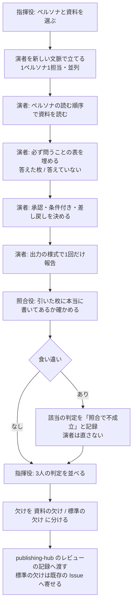

# 品質保証部長のシミュレーションの手順と出力の様式(#461 やること4)

- 日付: 2026-11-27
- 対象: 提案の資料(例: publishing-hub `slides/pit-in-process-v2`)を、決裁者(品質保証部長)のペルソナとして AI に読ませ、決裁の判断と理由を返させる手順
- ペルソナ: `personas.md`(P-A 医療機器、P-B 金融、P-C Web サービス)
- 位置づけ: 手引き。標準の条項ではない。判定は**実在の品質保証部長の判断と同じものとして扱わない**(Issue #461 の「採らないこと」)

## 1. 何を確かめるための手順か

この手順で確かめるのは、次の2つです。

- 資料が、決裁者の必ず問うことに、決裁者の読む順序のなかで答えているか
- 答えていない問いが、資料の欠けか、標準の欠けか

確かめないことも決めておきます。

- 実在の部長が承認するか(ペルソナは調査から組み立てた人物像で、実在の人ではない)
- 標準のコマンド・検査が動くか(それは附属書I の導入前の検証で行う。`adoption-guide.md` の「採用判断シートでの N 回目の判定」と役割を分ける)
- 条項として正しいか(それは会議体で行う。`research/phase4-standard/288/council-02-qa.md` と役割を分ける)

## 2. 役割と文脈の分離

| 役割 | 立て方 | してはならないこと |
| --- | --- | --- |
| 指揮役(議長) | 本スレッド | 演者へ資料の作り手の意図・レビューの所見を渡す |
| 演者(ペルソナ) | **資料の作り手・レビューの担当と別の文脈**で新しく立てる。1ペルソナにつき1担当。模型は既定(Opus) | 資料以外(標準の本文・リポジトリ)を読んで資料の欠けを補う |
| 照合役 | 演者と別の文脈。演者の出力と資料を突き合わせる | 判定を書き換える |

- 演者は、作り手の文脈(資料を作ったセッション、レビューのレポート、grilling の記録)を一切持たない。持つと、資料に書いていないことを「分かっている」前提で読み、欠けを見落とすため
- 3人のペルソナは互いの出力を見ない。並列で立てる
- 同じペルソナを2回演じるときは、2回目も新しい文脈で立てる。前の判定を渡さない(判定のぶれを見るため)

## 3. 演者へ渡すもの

渡すのは次の4つだけです。

1. ペルソナの節(`personas.md` の該当の1人分。根拠水準の注記を含む)
2. 資料(スライドの PNG の所在、または抽出テキスト)。**枚の番号が分かる形**で渡す
3. 決裁の場の設定: 誰が説明に来たか(例: 開発リーダーと品質保証部の若手)、何の承認を求められているか(資料に書いてある範囲だけ)、持ち時間
4. 本書の出力の様式(§5)

渡さないもの: 標準の本文、レビューのレポート、作り手のメモ、他のペルソナの出力、過去の判定。

## 4. 手順



1. **読む**: 演者は、ペルソナの「読む順序」のとおりに資料を読む。順序の途中で判断がついたら(例: 最初の3枚で費用が無いと分かった)、その時点の判断も記録する。決裁の場では、部長は全部を読まないことがあるため
2. **問う**: ペルソナの「決裁で必ず問うこと」の各問いについて、答えた枚の番号と、答えの要旨を書く。答えが無ければ「無し」と書く。答えが複数の枚に散っていれば、散っていることを書く
3. **決める**: ペルソナの「承認の条件」「拒否する条件」に照らして、判定を1つ選ぶ
4. **根拠を引く**: 判定の理由ごとに、資料の枚の番号を引く。資料に書いていないことを理由にするときは「資料に無い」と書く(推測で補わない)
5. **足りない材料を挙げる**: 判定を1段上げる(差し戻し → 条件付き、条件付き → 承認)ために、何が要るかを挙げる
6. **照合**: 照合役は、演者が引いた枚に、その記述が本当にあるかを確かめる。無ければ、その理由は「照合で不成立」とする。演者の判定は書き換えない
7. **分ける**: 指揮役は、足りない材料を「資料の欠け(資料を直せば埋まる)」と「標準の欠け(標準に答えが無い)」に分ける。標準の欠けは、新しく起票せず既存の open の Issue へコメントで寄せる。実行で確かめた欠陥だけ新しく起票する

## 5. 出力の様式

演者は次の様式で、最後に1回だけ報告します。

```markdown
# 判定: <ペルソナの記号と名前> / <資料の名前と版(コミットまたは日付)>

## 1. 判定
- 判定: 承認 / 条件付き承認 / 差し戻し(1つ)
- 一文の理由:
- 判断がついた時点: <読んだ枚の範囲>(読む順序の何番目で決まったか)

## 2. 必ず問うことへの答え
| # | 問い(ペルソナの表から) | 答えた枚 | 答えの要旨 | 足りるか(足りる / 散っている / 無し) |
| --- | --- | --- | --- | --- |

## 3. 判定の理由
| # | 理由 | 根拠の枚 | 承認の条件・拒否の条件のどれに当たるか |
| --- | --- | --- | --- |

## 4. 条件付きの条件(条件付き承認のとき)
| # | 条件 | 確かめる時点 | 確かめる材料 |
| --- | --- | --- | --- |

## 5. 足りない材料
| # | 材料 | 判定を何段上げるか | 資料に無い / 資料にあるが読めない |
| --- | --- | --- | --- |

## 6. 部長としての発言(決裁の場で口にする言葉、3〜5文)

## 7. 演者の限界
- ペルソナの設定のうち、根拠水準 E0・E1 の設定に依った判断:
- 資料の外の知識で補ってしまったおそれのある箇所:
```

照合役は、次の様式で返します。

```markdown
# 照合: <判定の名前>
| 判定の節と # | 引いた枚 | 枚に書いてあるか(ある / 無い / 一部) | 注記 |
| --- | --- | --- | --- |
- 不成立の理由の数:
```

- 様式に**承認者の氏名・記名・押印・日付の欄を置かない**(所有者の方針 2026-11-27)。判定はペルソナの判定で、決裁の証跡ではない
- 判定の「承認」は「この資料なら、このペルソナは承認する」の意味に限る。実在の部長の承認の見込みとして示さない

## 6. 結果の扱いと限界の開示

- 結果を資料のレビューの記録へ渡すときは、次の文を頭に置く: 「本判定は、調査から組み立てたペルソナを AI が演じたもので、実在の品質保証部長の判断ではありません。資料が決裁者の問いに答えているかを確かめる手段として使います」
- 判定が3人で割れたときは、割れたことを結果とする。多数決で1つにしない。業種で問いが違うことを示す材料になるため
- 根拠水準 E0・E1 の設定に依った判定は、その旨を結果に残す
- 同じ資料・同じペルソナで判定がぶれる(2回で違う判定になる)ときは、ぶれを記録する。ぶれた問いは、資料の答えが曖昧な候補として扱う

## 7. 既存の検証との役割の分け方

| | 本手順 | 附属書I の採用判断者の検証(`adoption-guide.md`) | 会議体の委員(`council-02-qa.md` など) |
| --- | --- | --- | --- |
| 読むもの | 提案の資料(スライド) | 採用判断シートと採用者のリポジトリ | 標準の条項の案 |
| すること | 決裁の判定を返す | 導入前の検証のコマンドを実行して判定する | 条項の採否を論じる |
| 人物の作り方 | 調査から組み立てたペルソナ(`personas.md`) | 短い設定文 | 立場の名前と短い前提 |
| 見つけるもの | 資料の欠け・決裁者に届かない説明 | 標準と実装の穴 | 条項の矛盾・抜け |
