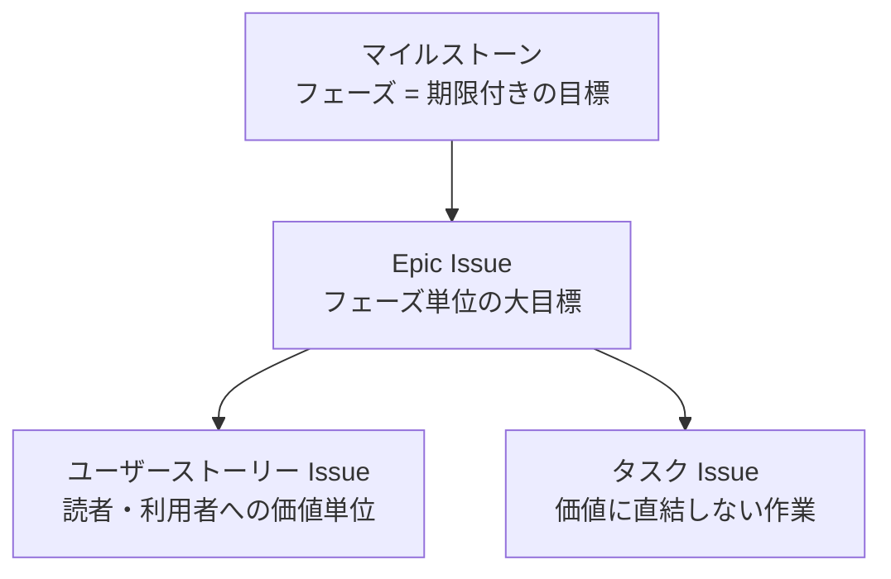
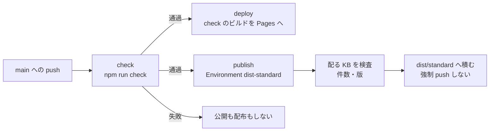

本プロジェクトは、すべての作業を GitHub Issue として起票し、計画的に進めます。
「計画のないプロダクトは存在しない」——このページはスプリントプランニングゼロの成果物です。

進捗の全体像は [Process Compass Roadmap ボード](https://github.com/users/Takenori-Kusaka/projects/1) で公開しています。

## バックログの構造

| 階層 | ラベル | 説明 |
| --- | --- | --- |
| Epic | `epic` | フェーズ単位の大目標。本文の子 Issue リストで進捗を追跡 |
| ユーザーストーリー | `user-story` | 「(誰)として(何)がほしい。それは(理由)のためだ」形式。受け入れ条件付き |
| タスク | `task` | 環境整備など、価値に直結しない作業 |

補助ラベル: `phase-0`〜`phase-6`(フェーズ)、`tool`(提案ツール)、`outreach`(発信)。

## マイルストーン(期限は目安)

| マイルストーン | 期限 | 対応 Epic |
| --- | --- | --- |
| M0: リポジトリ基盤 | 2026-07-31 | [#6](https://github.com/Takenori-Kusaka/process-compass/issues/6) |
| M1: フェーズ1 現状調査 | 2026-10-31 | [#7](https://github.com/Takenori-Kusaka/process-compass/issues/7) |
| M2: フェーズ2 AIDLC調査 | 2026-10-31(M1と並行) | [#8](https://github.com/Takenori-Kusaka/process-compass/issues/8) |
| M3: フェーズ3 ギャップ分析 | 2026-12-31 | [#9](https://github.com/Takenori-Kusaka/process-compass/issues/9) |
| M4: フェーズ4 詳細策定 | 2027-02-28 | [#10](https://github.com/Takenori-Kusaka/process-compass/issues/10) |
| M5: フェーズ5 プロセス実装 | 2027-04-30 | [#11](https://github.com/Takenori-Kusaka/process-compass/issues/11) |
| M6: フェーズ6 プロセス運用 | 2027-06-30 | [#12](https://github.com/Takenori-Kusaka/process-compass/issues/12) |
| M7: プロセス提案ツール | 2027-09-30 | [#13](https://github.com/Takenori-Kusaka/process-compass/issues/13) |

発信・コミュニティ運営([#14](https://github.com/Takenori-Kusaka/process-compass/issues/14))は全期間の継続活動のため、マイルストーンに紐付けません。

## 進め方のルール

1. **Issue にない作業はしない** — 思いついた作業もまず Issue 化してから着手する
2. **着手順序** — 「期限が近いマイルストーン → Epic 本文の子 Issue リストの上から」を基本とし、例外は Issue コメントに理由を残す
3. **週次レビュー** — 週1回、進行中 Issue の棚卸しとバックログの見直しを行う(ソロ + AI 体制のためスプリントは固定しない)
4. **完了の定義(DoD)** — 各 Issue の受け入れ条件をすべて満たし、`npm run check` が通り、成果がサイトに公開されていること
5. **フィードバックの取り込み** — Issue / Discussion で受けた意見は、トリアージのうえ既存 Issue への反映または新規起票を行う

## 完了の定義(コンテンツ共通)

- 受け入れ条件のチェックボックスがすべて埋まっている
- 図解(Mermaid 等)を中心に説明している
- `npm run check` が通る(検査の一覧の正本は `package.json` の `check`)
- サイトの該当ディレクトリ配下に公開されている

## PR フロー移行チェックリスト(コントリビューター参加時)

現在はソロ期のため `main` へ直接 push しています。継続的なコントリビューターが現れたら、次の手順で PR フローへ移行します。

1. GitHub の**ルールセット**で `main` への直接 push を禁止し、PR 必須にする(ルールセットは read 権限者にも公開されるため、貢献者がルールを事前に把握できる)
2. ルールセットで **Require review from Code Owners** を有効化する(`.github/CODEOWNERS` は設定済み。オーナーのうち1名の承認でマージ可能)
3. CI の `check` ジョブ(`.github/workflows/ci.yml`)を必須ステータスチェックにし、基底ブランチへの追随を求める(strict)
4. Environment `dist-standard` に必須レビュアを置くかを見直す(ソロ期は置いていない。後掲「公開と配布の経路」)
5. 本ページと CLAUDE.md の Git 戦略の記述を更新する

## 本リポジトリの運用

本リポジトリは、標準の本文を書くリポジトリです。本標準に従うソフトウェア開発の案件ではありません。準拠テンプレートの構成(契約検査、トレーラ `Risk`・`Verification`)は持ちません。[Git 戦略](/process-compass/phase5-implementation/git-strategy/)の段階導入の表の 1名の行を、本リポジトリが満たしているわけではありません。

- ソロ期は `main` へ直接 push する。ルールセットは `main` に置いていない
- push ごとに CI(`ci.yml` のジョブ `check`)が `npm run check` を実行する。push そのものは止めない
- サイトの公開(ジョブ `deploy`)と `dist/standard` への配布(ジョブ `publish`)は、`check` の通過の後にだけ走る。公開するのは `check` が作ったビルドそのもの
- 検査の一覧の正本は `package.json` の `check`。本ページ・README・CONTRIBUTING・PR テンプレート・CLAUDE.md は列挙しない
- 検査器の入力(`template/` のサブモジュール)が無ければ、手元でも CI でも `npm run check` は失敗する。取得は `git submodule update --init --recursive`
- 結線(契機・`npm run check` の手順・サブモジュールの取得・`needs: check`・最上位の権限・配布の `environment:`)は `scripts/check-ci-wiring.mjs` が確かめる。決定の記録は [ADR-0077](/process-compass/adr/0077-repository-ci-wiring-and-distribution/)

### 公開と配布の経路

| 防ぎたいこと | 止めているもの |
| --- | --- |
| 検査に落ちた版の公開・配布 | `needs: check`。結線は `check-ci-wiring.mjs` が確かめる(公開・配布のジョブの `if` に `always()` などの状態の関数と `\|\|` を置かない) |
| 決定を固定する試験を流さずに公開・配布する | `npm run check` が、回帰の試験(`scripts/regress/`。sweep を含む)とテンプレートの試験(`gate-g5.yml` のジョブ `contract` と一覧を共有)を流す。`check-ci-wiring.mjs` が、`check` への結線、失敗を握りつぶす形の不在、ジョブ `check` の `timeout-minutes`、回帰の試験の作業の場所が作業ツリーの外であることを確かめる(#319 / [ADR-0089](/process-compass/adr/0089-regression-suite-under-version-control/)) |
| 検査したものと別の生成物の公開 | `check` が作った `dist/` をそのまま配る。2回目のビルドをしない |
| `main` 以外からの配布 | Environment `dist-standard` の配備のブランチの限定(`main` だけ。所有者の設定の後。後掲「リモートの実状」)。ジョブ `publish` を `main` 以外で走らせない。ジョブ先頭の起動元の確認(事故の歯止め)。**別のブランチに置いたワークフローは止めない**(後掲「止まらない経路」) |
| 配布の資格情報の漏えい・使い回し | 長期の鍵を作らない。書き込みは、ジョブ `publish` にだけ `contents: write` を付けた `GITHUB_TOKEN` で行い、トークンはジョブの終了で失効する。`ci.yml` の他のジョブと最上位は読み取りだけ(`check-ci-wiring.mjs` が確かめる)。**この形は第4章 G-8 の資格情報の規定を満たさない**(後掲「標準の規定との関係」) |
| `dist/standard` の強制 push・削除 | `dist/standard` のルールセット(削除の禁止・強制 push の禁止。所有者の設定の後)。早送りの push は止めない |
| 配る知識ベースの誤り | push の前に `check-gate-criteria.mjs --kb` が、判定基準の件数と生成元の版(40桁の16進で、起動したコミットと一致)を確かめる |
| 古い版での上書き | 配布は、配布済みの版がこの実行のコミットの子孫なら配らない。公開は、`main` がサイトに入るファイルの変更で先へ進んでいれば配らない(新しいコミットの実行が成功することに依る。後掲「止まらない経路」) |

配布は前回の `dist/standard` の上へコミットを積みます。配るかどうかは、配布済みの版(`dist/standard` の知識ベースの生成元の版)と今回の生成物の中身(`VERSION.md` と知識ベースの生成元の版を除く)を比べて決めます。差が無ければ配りません。前の配布が失敗していても、次の main への push で取り戻します。案件が submodule で固定した旧版は、このブランチの履歴から取り直せます。配る中身は、本文・知識ベース・`VERSION.md`・`LICENSE` だけです。`VERSION.md` には、起動の契機・ref・コミット・実行の番号を書きます。

`dist-standard` に必須レビュアは置きません。ソロ期の自己承認は独立した確認ではなく、記録が承認として誤読されるためです。承認の代わりに残すのは、配布の実行の記録(ref・コミット・実行の番号)と、後掲の所有者の設定の事実です。Issue #293 の受入条件3 の「Environments の承認」は「Environment の配備のブランチの限定」と読み替えました。

### 止まらない経路

- 管理者は、Environment の保護とルールセットを設定画面で外せる。外した場合、残るのはワークフローの中の確認だけで、起動元のブランチでファイルを書き換えれば外れる
- 保護の規則(配備のブランチの限定)だけを外した場合、ワークフローは検出しない。配布は失敗せずに続く
- 所有者の設定(後掲の手順)が済むまでの間は、保護の無い Environment `dist-standard` が自動で作られ、配布はそのまま成功する(止まる側には倒れない)
- **書き込みの権限を持つ者は、`dist/standard` へ早送りの push ができる**。直接の push でも、自分のブランチへ置いたワークフローに `contents: write` を付けて `GITHUB_TOKEN` で push する形でもできる。Environment の限定は、そのワークフローが `dist-standard` を参照しなければ掛からない。ルールセットで更新を制限すれば止まるが、2026-10-23 時点の GitHub Docs は、バイパスの主体としてロール・チーム・GitHub App・Dependabot を挙げ、`GITHUB_TOKEN`(GitHub Actions)を挙げていない。更新を制限すると配布のジョブの push も止まるため、置いていない。この経路を限るのは次の3つだけである。履歴は積み上がるだけで、削除と強制 push はルールセットが止める(所有者の設定の後)。配布のコミットの `VERSION.md` は ref・コミット・実行の番号を持ち、Actions の実行の記録と突き合わせられる(`VERSION.md` は書き込んだ者が自由に書けるため、突き合わせが要る)。ソロ期に書き込みの権限を持つのは保守者1名である
- `graphify-update.yml` のジョブは `contents: write` を持つ。結線の検査は、そのジョブの定義に `dist/standard` が現れないことを確かめるが、変数で隠した push は拾わない
- `main` へ push できる者は、`ci.yml` を書き換えて検査を外したうえで公開できる。結線の検査も、同じ push の中で書き換えられる。ソロ期に `main` へ push できるのは保守者1名である
- 結線の検査は、ワークフローの構造と文字列を読むだけである。変数や別の手順で隠した `dist/standard` への push、`npm run check` の中身を手順の中で書き換える形は拾わない。ルールセットが止めるのは、`dist/standard` の削除と強制 push だけである
- `graphify-update.yml` の `[skip ci]` のコミットは、CI・公開・配布を起動しない。対象(`graphify-out/`)はサイトと配布物に入らない
- 古い版での上書きの防止は、新しいコミットの実行が成功することに依る。後のコミットの検査が落ちる、または人が `[skip ci]` を付けて push すると、その前に通過した版も公開されず、サイトは最後に公開した版のまま残る。公開し直すには、検査を通る版を push する
- 検査が通るまで公開と配布は遅れる。textlint の違反1件でサイトの更新が止まる。完了の定義の「サイトに公開されている」の遅れは、信頼性の代償として受け入れた
- 強制 push で配った過去の 14 回分の `dist/standard` は、どの参照からも辿れない。取り戻さない
- 公開と配布のジョブは、2026-10-23 時点で実際の GitHub 上で実行して確かめていない。構文は actionlint で確かめた

### 標準の規定との関係

本リポジトリの配布は、[第4章 G-8](/process-compass/phase4-process-design/gate-criteria/)「配備の統制と資格情報の置き場」を満たしません。書き込みの権限は、`ci.yml` のジョブ `publish` の `permissions` から生じる `GITHUB_TOKEN` で、ワークフローのファイルの権限の宣言だけから生じるトークンは、短命であっても規定の2つの形のどちらにも当たらないためです。本リポジトリは本標準に従う開発の案件ではありませんが、`dist/standard` は採用者が submodule で取り込む配布物であるため、未達として開示します([ADR-0090](/process-compass/adr/0090-job-token-and-deploy-credential-binding/))。

- 区分: 手段はあるが、使わないと決めた。リポジトリは公開で、Environment の秘密情報と配備の参照の限定を使える。「手段が無い」には当たらない
- 決定者: 保守者(所有者)。保守者の決定(2026-10-23)の中身は、鍵(deploy key・秘密情報に置く長期のトークン)を設定しないこと、配布の書き込みをジョブの権限で行うこと、`dist/standard` のルールセットで更新を制限しないことの3つ
- 開いている経路: 書き込みの権限を持つ者が、自分のブランチへ `contents: write` を宣言したワークフローを置き、`GITHUB_TOKEN` で `dist/standard` へ push する経路。`environment:` を参照しなければ、配備の参照の限定は掛からない
- 経路を持つ主体と直接の書き込み: 書き込みの権限を持つのは、ソロ期の保守者1名と、保守者の資格情報で push する AI のセッションである。どちらも `dist/standard` へ直接 push できる(ルールセットに更新の制限が無い)。トークンは新しい能力を足さないが、配布先は保護されていない
- 経路を狭める措置と止めないもの: 後掲の所有者の設定の1〜6。どれも、`permissions` を宣言したブランチ上のワークフローの書き込みを止めない。止めるもの・止めないものの対応は [フェーズ5「統制と資格情報の置き場」](/process-compass/phase5-implementation/ci-gates/)の表による

鍵を使わずに規定を満たす道は、配布の経路を変えることだけです(Pages を使う形、受け手が出どころを確かめる形)。採用者が頼る `dist/standard` の取り込みの形を変えるため、所有者が決める事項として後継の Issue の候補にしています。

### リモートの実状(2026-10-27)

上の経路の表と「止まらない経路」は、本リポジトリの #293 以降の変更がリモートの `main` へ入った後の形を書いています。2026-10-27 時点のリモートの実状は、それより悪い状態です。

- #293 以降の変更は、リモートの `main` に入っていない。リモートの `main` では、旧い `publish-standard.yml` が動いている
- 旧い `publish-standard.yml` は、最上位で `contents: write` を持ち、Environment を使わず、`dist/standard` へ強制 push で配る。`workflow_dispatch` で任意のブランチから起動できる。起動したブランチのファイルで動くため、書き込みの権限を持つ者はどのブランチからでも `dist/standard` を書き換えられ、履歴も消せる
- ルールセットは空で、`main` と `dist/standard` は保護されていない
- Environment の一覧と Actions の既定の権限は、読む権限が無く確かめていない
- `dist/standard` の先頭は、旧いワークフローの強制 push の出力である。新しいジョブ `publish` は一度も動いていない

### 所有者が行う設定(順序つき)

ワークフローの外にある設定です。所有者(保守者)が設定画面で行います。AI のセッションは設定しません。**2026-10-27 時点で、どれも設定済みとは確かめていません**。

deploy key・SSH 鍵・秘密情報は作りません。配布の書き込みは、`ci.yml` がジョブ `publish` に付けた `contents: write` の権限で行います。手順の中でトークンを扱いません(保守者の決定、2026-10-23。[ADR-0077](/process-compass/adr/0077-repository-ci-wiring-and-distribution/) 決定6)。

| # | 設定 | 監査で読む値 |
| --- | --- | --- |
| 1 | **2 より前に**、Environment `dist-standard` を作る(Settings → Environments)。配備のブランチは「Selected branches」で `main` だけに限る。管理者の迂回を外す。必須レビュアと秘密情報は置かない。`github-pages` も同じく `main` に限る | `environments/dist-standard` と `environments/github-pages` の `deployment_branch_policy`、`deployment-branch-policies` の一覧、管理者の迂回の設定 |
| 2 | #293 以降の変更をリモートの `main` へ入れ、旧い `publish-standard.yml` と `deploy.yml` が消えたことを確かめる | リモートの `main` の `.github/workflows/` の一覧 |
| 3 | `dist/standard` にルールセットを置く(Settings → Rules → Rulesets)。削除の禁止(Restrict deletions)と強制 push の禁止(Block force pushes)を有効にする。更新の制限(Restrict updates)は有効にしない(配布のジョブの `GITHUB_TOKEN` をバイパスに入れられず、配布も止まるため)。バイパスの一覧は空にする | `rules/branches/dist%2Fstandard` と、そのルールセットの `bypass_actors` |
| 4 | Settings → Actions → Workflow permissions を read にする。「Allow GitHub Actions to create and approve pull requests」を無効にする | `actions/permissions/workflow` の `default_workflow_permissions` と `can_approve_pull_request_reviews` |
| 5 | AI のセッションに渡す資格情報から、管理者の権限と `workflow` の範囲(fine-grained のトークン・GitHub App では Workflows の権限)を外す | 渡した資格情報の種類・範囲・権限の記録 |
| 6 | ワークフロー実行の保護で、`push` と `workflow_dispatch` を起動できる主体を限れるかを評価する(個人所有の公開のリポジトリで使えるかは確かめていない)。限れる場合でも、規定を満たす手段には数えない | ルールセットの API(評価の記録を含む) |
| 7 | 1〜6 の設定と、`main` 以外からの起動が拒まれた記録を Issue #346 に残す。記録は対で残す。(a) Environment `dist-standard` を参照するジョブが `main` 以外から拒まれた記録。(b) `environment:` を外して `contents: write` を宣言したワークフローが、使い捨ての参照へ書き込めたかの記録(`dist/standard` そのものでは試さない)。(a) だけを統制が成り立つ証拠に数えない([フェーズ5](/process-compass/phase5-implementation/ci-gates/)の EV-0137) | Issue #346 のコメント |

1 を 2 より前に置く理由は、Environment の無いままジョブ `publish` が走ると、保護の無い Environment が自動で作られ、配布がそのまま成功するためです。5 は、本リポジトリで最も効く措置です。管理者の権限を持つ主体には、ブランチ上のワークフローを経る必要がなく、`dist/standard` へ直接 push でき、Environment とルールセットも変えられます。

