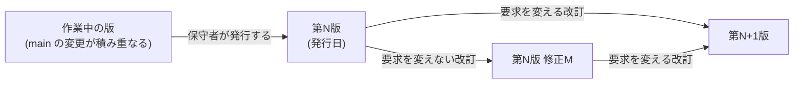

本ページは、本標準の保守者が版を発行する手続を定めます。本標準を適用する者への要求(表明と主張に版を書く、追従していない版を主張しない)は、[第1章 1.10.3](/process-compass/phase4-process-design/overview/)にあります。判断の根拠は [ADR-0083](/process-compass/adr/0083-standard-edition-end-of-application-and-deviation/)の決定1 と決定4 によります。

## 版の状態

| 状態 | 示し方 | 表明と主張に名指せるか |
| --- | --- | --- |
| 発行した版 | 「第N版」と発行日。要求事項を変えない改訂は「第N版 修正M」と発行日 | 名指せる |
| 作業中の版 | 「作業中の版(未発行)」。公開のサイトと配布物の、最新の発行の後に変わった内容 | 名指せない |

2026-10-24 の時点で、本標準は版を発行していません。公開のサイトと配布物の内容は、すべて作業中の版です。このため、どの採用者も適合の主張と逸脱を伴う適合の主張をできません(第1章 1.10.2)。第1版の発行は、取り消せない外部への発行であり、本リポジトリの所有者が判断します。

## 付番の規則

- 版の番号 N を上げる改訂は、次のいずれかを変える改訂とする。要求事項、禁止、適用範囲、判定基準、テーラリングの規則データ(`src/data/tailoring/`)、準拠テンプレートの必須欄(`src/data/template-fields.yaml`)
- 逸脱の閉じた列挙(第1章 1.10.2)への追加と削除は、要求事項の変更として N を上げる
- 上のどれにも当たらない改訂(誤記の訂正、説明の追記、図の差し替え、参考の附属書の改訂など)は、修正 M とする。M は、同じ N の中で 1 から数える
- N と M のどちらに当たるか迷う改訂は、N を上げる
- 版の番号を飛ばさない。発行した版を取り消さない。誤りは、次の版または修正で正す

区分の境の根拠の水準は、第1章 1.10.3 の EV-0158 によります。

## 発行の手続

1. 発行する内容のコミットを決める。`npm run check` が通っていることを確かめる
2. 前の版からの改訂を読み、付番の規則で N と M のどちらに当たるかを決める
3. 引用規格を棚卸しし(下記)、記録を残す
4. `src/data/edition.yaml` の `edition` と `issuedAt` を書き、`history` の先頭に1行を足す。行は、版・発行日・コミット・区分(N または M)・要約・引用の棚卸しの記録の所在を持つ。過去の行を書き換えない
5. `npm run template:kb` で知識ベースを再生成する。知識ベースの `source.edition` と `source.editionIssuedAt` が、`edition.yaml` と一致する
6. 準拠テンプレートの複製を更新し、配布する。配布の `VERSION.md` に、版とコミットが併記される
7. 発行を公開する(リリースの記録、変更の要約)

発行は人が行います。AI は、手順1〜3 の材料(改訂の一覧、区分の案、棚卸しの表)を起案できます。区分の決定と発行の記名は、保守者が行います。

## 配布物への版の記録

| 配布物 | 記録する値 | 生成元 |
| --- | --- | --- |
| `dist/standard/VERSION.md` | 版(発行していなければ「作業中の版(未発行)」)と、コミット | CI(`ci.yml`)が `scripts/lib/edition.mjs --label` から書く |
| 知識ベース(`template/scripts/vendor/tailoring-kb.json`) | `source.edition`(発行していなければ `null`)、`source.editionIssuedAt`、`source.commit` | `scripts/build-template-kb.mjs` |

- コミットは機械の識別であり、版の代わりにしない。2つを併記する
- 知識ベースの乖離の検査(`npm run check` の中の `check-template-drift`)は、コミットを除いて比べる。版は比べる
- `check-gate-criteria` は、`edition.yaml` の書式と、知識ベースの版が `edition.yaml` と一致することを確かめる

## 引用規格の棚卸し

版を発行するたびに、修正 M を含めて、本標準が引く規格と文書の改訂の有無を確かめます。

| # | 確かめること | 記録 |
| --- | --- | --- |
| 1 | 第1章 1.3 の各行の文書に、引用した版の後の改訂・追補・廃止があるか | 文書ごとに、確かめた日付と結果 |
| 2 | 改訂があった文書について、新しい版へ追従するか | 文書ごとの決定と理由。追従しない場合もその旨 |
| 3 | 1.3 の外の本文の引用に、版の無いものがないか | 見つけた所在と、付けた版。読んだ版が分からなければ、その旨 |
| 4 | 引用した版に、出典台帳(`research/sources/`)のカードがあるか | `npm run lint:citations` の結果 |

- 追従するかは、文書ごとに決める。改訂があったことだけを理由に、自動で追従しない
- 追従して本標準の要求事項が変わる場合は、N を上げる
- 棚卸しの記録の所在を、`edition.yaml` の `history` の行の `citationReview` に書く

`npm run lint:citations` が機械で確かめるのは、1.3 の範囲(版の有無と台帳のカードの対応)だけです。1.3 の外の本文の引用は、手順3 で人が確かめます。機械は、引用がどの版を指すつもりかを判定できないためです。

## 定めないこと

- **移行の期間と旧い版の失効を定めない**。旧い版に従う案件は、旧い版への主張を期限なく続けてよい(第1章 1.10.3、EV-0159)
- 版の発行の周期を定めない。改訂の内容で発行を決める
- 版ごとの英語の名称を定めない。英語の版を設けるときに決める
