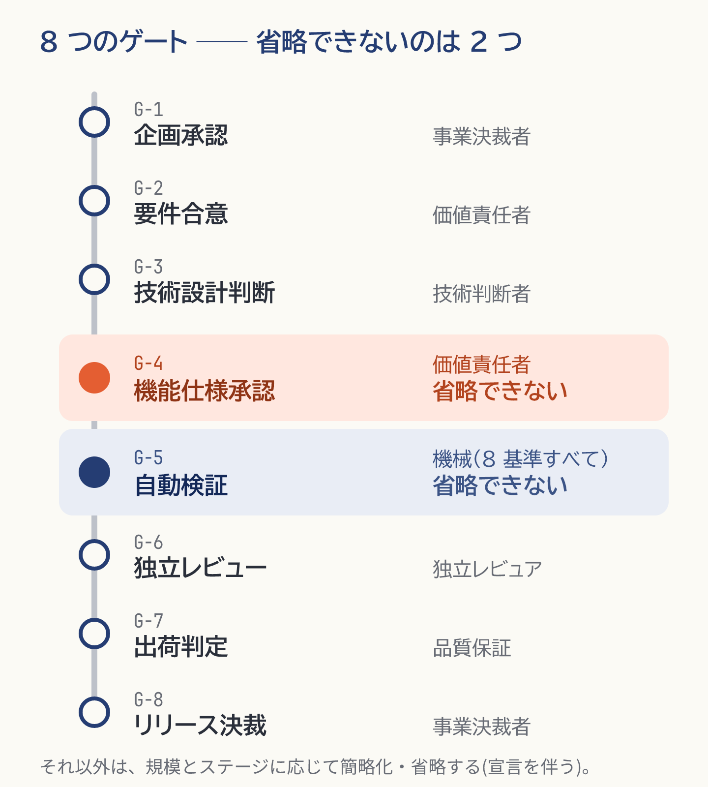
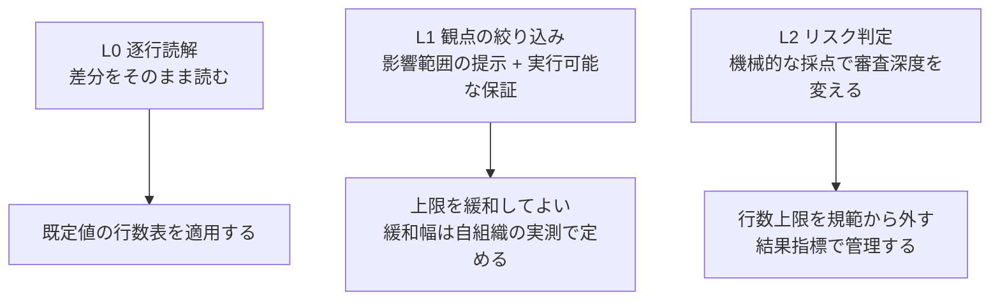

本章は、本標準が置く8つの工程ゲートについて、運用に載せられる粒度まで判定基準を規定します。各ゲートの判定は、このページのチェックリストとの突合で行います。

ゲートの識別子・順序・成果物との関係の正本は、[ピットイン方式参照モデル](/process-compass/phase4-process-design/process-model/)(本標準の構造の機械可読表現)です。本章はその判定基準の正本です([ADR-0010](/process-compass/adr/0010-data-doc-interface/))。

## ゲートの2系統

本標準のゲートは2系統に分かれます。本章が規定するのは工程ゲート(G-1〜G-8)です。

| 系統 | 記号 | 判断の対象 | 規定する章 |
| --- | --- | --- | --- |
| ステージ移行ゲート | SG-0〜SG-2 | 投資を継続するか、次ステージへ進むか | [第2章](/process-compass/phase4-process-design/lifecycle/) |
| 工程ゲート | G-1〜G-8 | この成果物を次工程へ進めてよいか | 本章 |

各事業ステージでの工程ゲートの状態は、[第8章 軸B](/process-compass/phase4-process-design/tailoring-guide/)によります。

## 前提条件と判定基準の区別

ゲートは2種類の条件を持ちます。両者を混同してはなりません。

| 区分 | 定義 | 満たさない場合 |
| --- | --- | --- |
| 前提条件 | 判定を開始するために整っていなければならない状態 | 判定を開始せず、提出者へ差し戻す |
| 判定基準 | 判定において合否を評価する基準 | 判定の結果として差し戻す |

前提条件を判定基準に含めると、他の基準の評価と相殺されて通過することがあります。前提条件は機械的に検査し、人の判断を介在させません。

## 全ゲートに共通する通過条件

各ゲートの判定基準に加えて、次を全ゲートの通過条件とします。**新しいゲートは設けません**。

> 当該の工程に関係する前提の充足状態が台帳に記録されており、AS-1 以上のものについて受容の決裁が取られていること

前提の一覧は[理想モデルの前提一覧](/process-compass/phase2-aidlc/assumptions/)、手続は[第7章 7.10](/process-compass/phase4-process-design/exception-escalation/)、様式は[第6章 テンプレ10](/process-compass/phase4-process-design/deliverable-templates/)によります。

**前提が崩れていることを理由に判定を停止しません**。可視化し、受容の決裁を求めます。停止する設計は、申告そのものを止め、測定を無効にすることがあります。

## ゲート運用の共通ルール

すべてのゲートに共通する運用原則です(設計原則の実装)。

1. **単独判定**: 判定者は1人。関係者の意見は判定前の**非同期コメント期間**(公開された期限まで)に集め、判定会議は開かない。「判定者は1人」は、1件の判定を合議で決めないという意味である。承認者を2名とする独立レビュー(G-6)でも、判定会議は開かない。2件の承認は、2件の確認として数える(後掲 G-6)
2. **期限付き**: 各ゲートに判定期限を設ける。期限超過は「自動承認」にはせず、**エスカレーション**(判定者の上位への通知と代理判定者の指名)とする
3. **差し戻しは理由付き**: 差し戻す場合、どの基準を満たさないかをチェックリストの項目番号で示す。「なんとなく不安」での差し戻しを認めない
4. **記録をもって成立する**: 判定結果・判定者・日時・差し戻し理由を判定記録へ書く。**記録の作成が判定の成立要件である**(次節)

## 判定の成立

工程ゲートの判定は、**判定記録の作成をもって成立します**。判定記録とは、本節の定める欄を埋めた記録です。様式の正本は[第6章 テンプレ4](/process-compass/phase4-process-design/deliverable-templates/)です。**欄を運ぶ媒体を、本標準は様式のファイルに限定しません**。記録の無い状態は、判定基準がすべて充足していても**未判定**です。

<!-- impl IMPL-0008 target=gate-record-template state=delivered check=manual note="判定記録の作成をもって判定が成立する。確かめる者: 当該ゲートの判定者(判定記録を書くとき)" -->

判定の成立要件と、成立に伴う事務を混同してはなりません。

| 区分 | 該当するもの |
| --- | --- |
| 判定の成立要件 | 判定記録の作成。判定者・判定日時・結果・確認した項目・差し戻し理由が埋まっていること |
| 記録の媒体 | 欄を運ぶレビュー(承認レビューの本文に欄を置いたもの)は判定記録である。欄を運ばない操作は、判定記録ではない。媒体ごとの条件は、後掲 G-2 と G-6「承認レビューを判定記録とする条件」による |
| 成立に伴う事務 | Issue のクローズ、PR のマージ、状態ラベルの遷移([第3章 3.5.5](/process-compass/phase4-process-design/roles-responsibilities/))、関係者への通知、承認の操作そのもの |

記録を判定の成立要件に置く理由は、**記録がなければ判定の存在そのものが自己申告になる**ためです。判定材料が揃い、レビューが済み、課題が閉じられた状態は、判定が行われた証拠になりません。判定の有無を後から確かめられる痕跡は記録だけです([ADR-0036](/process-compass/adr/0036-gate-closure-by-record/))。

:::caution[暫定 EV-0109 / 見直し 2027-04]
**対象**: 判定記録の作成をもって判定が成立するという決定(ADR-0036 決定1)。記録を成立要件に置けば、記録の欠落を後から検出できるという判断。
**根拠の水準**: E2(単一事例)。
**差し替え条件**: 出荷判定(G-7)基準5 の完備確認で検出した判定記録の欠落件数を、媒体別(様式の判定記録 / 承認レビューの本文)に数えた値。様式の欠落が承認レビューの欠落を上回る案件が複数あれば、様式の重さが記録を消している。逆なら、承認レビューは記録として弱い。

ADR-0036 の決定は、準拠テンプレートの初回の採用判断の1件に支えられています。媒体を2つにした後の欠落の分布は、測定していません。
:::

事務を成立要件に置かない理由は、案件の課題管理ツールに依存するためです。ツールを変えると判定の成立要件が変わる構成にしてはなりません。

承認レビューは、欄を運ぶ記録であり、クローズ・マージ・ラベルの遷移とは異なります。欄を運ばない承認の操作は、事務です。承認レビューを判定記録とする条件(欄の充足、書き手が判定者本人、対象の固定、承認の後の変更による失効、承認者ごとの最後の状態)を満たさないホスティングでは、様式へ戻ります。これにより、ツールを変えても判定の成立要件は変わりません。承認レビューを判定記録とする場合は、保全の条件(アカウントと人の対応表、承認の意味の事前の定義、写しの取り出しと保持)を満たさなければなりません。各条件の内容の手引きは、[第5章 QMS 文書管理](/process-compass/phase5-implementation/qms-document-control/)を参照。

### 機械が出す欄と人が書く欄

判定記録の欄は、出所によって2つに分かれます。第6章の欄は1つも減りません。欄の出所の指定であり、[ADR-0040](/process-compass/adr/0040-template-forms-as-subset-of-standard/)の省略の登録でも、標準と逆の指示でもありません。

| 出所 | 欄 | 要求 |
| --- | --- | --- |
| 機械が出す欄 | 判定者(アカウントの数値の識別子と名簿の席)、提出日時、判定日時、対象(PR 番号・コミットの識別子・承認レビューの識別子)、結果(宣言行から読む)、参照した D-0 の版、承認の数、作成を指示した者との別 | 強制層の記録(承認レビュー、PR の記録、基底ブランチの構成)からの、推定を含まない写しに限る。出所を併記する |
| 人が書く欄 | 挙動要約、確認した項目、確認していない事項、差し戻し理由(満たさない基準の項目番号と再提出の期限)、決断の記録、比較した選択肢の採否の理由、リスク区分の確定者の記名 | 判定者本人が、自分の言葉で書く。AI に生成させない([附属書C](/process-compass/phase4-process-design/review-guide/)) |

- 人が書く欄の受け皿は、2つに限る。対象が PR として存在する判定(G-6。仕様・設計判断が PR として存在する G-2・G-3・G-4)では、判定者本人のレビューの本文。それ以外(G-1・G-7・G-8・SG、例外承認、停止の解除、対象が PR でない場合、ホスティングが条件を満たさない場合)では、判定記録(様式)
- PR 本文は作成側の欄であり、受け皿にしない(後掲 G-6 の条件4)。Issue のコメントは、対象のコミットに固定されず、削除できるため、受け皿にしない
- 機械が出す欄の写しは、要約と評価を含まない。[附属書G](/process-compass/phase4-process-design/deliverable-templates/)の投影と区別する

<!-- impl IMPL-0125 target=evidence-aggregation state=delivered check=presence note="機械が出す欄(判定者の数値の識別子と席、提出日時、判定日時、対象の PR 番号・コミットの識別子・承認レビューの識別子、結果、D-0 の版、承認の数、作成を指示した者との別)を、承認レビュー・PR の記録・基底ブランチの構成から推定を含まない写しとして出し、欄ごとに出所を併記する。人が書く欄(挙動要約・確認した項目・確認していない事項・差し戻し理由・決断の記録)は出さない(#321)(単位: 欄)" -->

### 判定記録を基底ブランチへ入れる操作

- 判定記録だけのコミットを基底ブランチへ入れる操作に、**記名者以外の承認を課さない**。記名者本人の操作(署名コミット、または記名者の承認レビュー)を、記名の帰属の裏づけとする。裏づけの無い記録は、記名が自己申告であることを保証の開示へ出す(後掲 G-7「保証の開示」)。残る記録の PR に記名者以外の承認が付く場合、それは取り込みの事務であり、判定記録の欄ではない
- 承認レビューを媒体とした記録の写しは、**承認と同じ時期に機械が取り出し**、記名者と判定される側が書き換えられない場所へ置く。出荷判定(G-7)の時点で初めて作らない。ホスティングの監査の記録は、保持の期限で消えるためである
- 判定記録と写しを基底ブランチへ入れるのは、**遅くとも出荷判定(G-7)** である。停止の解除と例外承認の台帳は、現行どおり基底ブランチへ先に入れる([フェーズ5](/process-compass/phase5-implementation/ci-gates/))
- 既定ブランチの強制層を、写しのために縮小しない。置き場の形(既定ブランチの外のブランチ、CI の成果物)は、準拠テンプレートが定める

:::caution[暫定 EV-0111 / 見直し 2027-04]
**対象**: 判定記録だけのコミットを基底ブランチへ入れる操作に、記名者以外の承認を課さないという決定。
**根拠の水準**: E2(単一事例)。
**差し替え条件**: 記録だけのコミットで、記名者以外の者が記録を書き換えた事象の件数(git の履歴で検出)。1件でもあれば、記名者本人の操作に限る条件を強める。

先例(ADR-0057 の層1 の改版に PR を課さない決定)は決定であり、実証ではありません。支えているのは、記録の PR に判定者以外の承認者を課した構成で、承認者が中身を見ずに承認するしかなかった1件の訴えです。
:::

<!-- impl IMPL-0124 target=rulesets state=undelivered check=manual plan=scheduled issue=360 review=2026-11 note="判定記録だけのコミットを基底ブランチへ入れる操作に、記名者以外の承認を課さない。GitHub のルールセットはパス単位の免除を持たないため、記録だけの PR にも承認 1 件が残る。承認者を記名者本人に限る手順は /gate と CODEOWNERS(誘導層。遮断に数えない)で降ろす。降りていない事実は rulesets/README に表示し、内部監査が確かめる(#321)。確かめる者: 計画の Issue(issue= の番号)の担当者(降ろすときに確かめる。それまでは降りていない規定として台帳に出る)" -->
<!-- impl IMPL-0128 target=evidence-aggregation state=delivered check=presence note="記録だけの PR の承認者と、判定記録の記名者の照合。記名者本人の署名コミット、または記名者の承認レビューが無い記録を、記名が自己申告の記録として保証の開示の項目1 に件数で出す。欠落には数えない。記名者以外の承認が付いた記録の PR は、取り込みの事務として開示する(#321)(単位: 行)" -->

**記録を書かないまま次工程へ進んだ場合は、判定の時点を事後へ移した委任の変更を除き、未判定のまま進んだものとして扱います**。[第7章 7.3](/process-compass/phase4-process-design/exception-escalation/)の例外承認を経ていないため、記録の欠落にあたります。出荷判定(G-7)における判定記録の完備確認で検出します。

独立レビュー(G-6)の判定を事後へ移した委任の変更は、人の事前確認を経ていない変更として、変更単位で識別された記録を持ちます([第5章 5.5.4](/process-compass/phase4-process-design/human-ai-boundary/)の条件7)。この記録を持つ変更は、判定の時点が事後へ移った変更であり、記録の欠落として扱いません。識別の記録を持たない変更は、委任の範囲に当たる変更であっても記録の欠落です。開発者の席だけが委任で、G-6 を事前に判定した変更は、G-6 の判定記録を持ちます。

### 判定が指す記録の保管

判定記録と、出荷の証跡(G-7 の集約の出力)が指す記録は、組織が定める保管期間のあいだ、到達できなければなりません。指す先に到達できない判定は、何に基づいて判定したかを後から確かめられず、自己申告と区別できなくなります。

**CI 基盤の既定の保持を、保管とみなしてはなりません**。CI の成果物、ワークフローの実行の記録、チェックの履歴は、基盤の保持期間の設定に従って消えます。保管期間の値は、本標準は定めません。組織の文書管理規程によります([QMS 文書管理との対応](/process-compass/phase5-implementation/qms-document-control/))。

<!-- impl IMPL-0243 target=ship-evidence-workflow state=undelivered check=manual plan=scheduled issue=333 review=2027-04 note="出荷の証跡を、組織が定める保管期間のあいだ到達できる置き場に残す。準拠テンプレートの ship-evidence.yml は証跡を CI の成果物(upload-artifact)にだけ置き、retention-days を指定しない(既定の保持に依る)。保管の設計は別 Issue。内部監査で、判定記録と証跡の指す先に到達できるかを抜き取る。確かめる者: 計画の Issue(issue= の番号)の担当者(降ろすときに確かめる。それまでは降りていない規定として台帳に出る)" -->

<!-- impl IMPL-0244 target=evidence-aggregation state=undelivered check=manual plan=scheduled issue=333 review=2027-04 note="出荷の証跡の集約は、CI 基盤の保持期間を過ぎて結果を読めない PR の G-5 を、gate-g5 の結果の記録が無い(必須チェックを経ずにマージされた可能性)として出す。保持切れと、必須チェックを経ていないことを区別しない。保管の設計は別 Issue。確かめる者: 計画の Issue(issue= の番号)の担当者(降ろすときに確かめる。それまでは降りていない規定として台帳に出る)" -->

本標準は、記録の置き場と様式を課しません。PR の「検証方法と結果」(human-verify)へ画面の写しなどを添付すること、添付の所在を書くことも求めません。所在が実在することは、確かめたことを示さないためです(G-2「前提の欄(基準3)」と同じ理由。[ADR-0078](/process-compass/adr/0078-rejudge-on-change-and-irreversible-operation/))。

## 工程ゲートの判定の語彙

工程ゲートの判定は、次の2値のいずれかです。

<!-- impl IMPL-0009 target=gate-record-template state=delivered check=presence note="工程ゲートの判定の語彙を通過と差し戻しの2値に限る(単位: 欄)" -->

| 判定 | 意味 | 判定と同時に確定させる事項 |
| --- | --- | --- |
| 通過 | この成果物を次工程へ進めてよい | なし。次工程の資源配分は工程ゲートの判断対象ではない |
| 差し戻し | この成果物を次工程へ進めない | 満たさない判定基準の項目番号、再提出の期限 |

**中止と保留を用いません**。工程ゲートの問いは「この成果物を次工程へ進めてよいか」だけです。投資を継続するかどうかはステージ移行ゲート(SG)が判断します([第2章 2.4](/process-compass/phase4-process-design/lifecycle/))。

:::note
[第3章 3.7.3](/process-compass/phase4-process-design/roles-responsibilities/)の4値(継続 / 中止 / 保留 / 差し戻し)は**会議体の語彙であり、工程ゲートへ適用しません**。工程ゲートは会議体ではなく、判定者1人による単独判定だからです。同章 3.7.4 の B-2 ステアリングコミッティも、決定しない事項として工程ゲートの判定を挙げています。
:::

**「条件付き通過」を設けません**。条件を付して先へ進める手続は[第7章 7.3](/process-compass/phase4-process-design/exception-escalation/)の例外承認です。回収の期限と回収責任者を伴わない通過の経路を作らないためです(ADR-0036 決定3)。

## 判定の範囲

判定者が評価するのは、**当該ゲートの判定基準と、全ゲート共通の通過条件だけです**。

<!-- impl IMPL-0010 target=gate-skill state=delivered check=manual note="判定は当該ゲートの判定基準のみで行い次工程の材料の未完成を理由にしない。確かめる者: 当該ゲートの判定者(判定記録を書くとき)" -->

次のものを判定へ持ち込んではなりません。

| 持ち込んではならないもの | 扱う場所 |
| --- | --- |
| 次工程で作る成果物の未完成 | 次工程のゲート |
| 当該ゲートの判定基準に無い懸念 | 判定前の非同期コメント期間。基準に加えるなら本章の改訂 |
| 投資を続けるかどうか | ステージ移行ゲート([第2章 2.4](/process-compass/phase4-process-design/lifecycle/)) |
| 判定者の所属組織の内規 | テーラリング([第8章](/process-compass/phase4-process-design/tailoring-guide/)) |

基準を満たしているにもかかわらず、次工程の材料が揃っていないことを理由に判定を保留すると、**工程は止まり、その停止はどの記録にも残りません**。判定基準を満たさないまま進める必要がある場合に限り、7.3 の例外承認を用います。

## 確定した版を変える場合

工程ゲートを通過した成果物を変える場合は、変更後の成果物で、次の表の工程ゲートの判定を受けなければなりません。

| 変える成果物 | 判定を受けるゲート |
| --- | --- |
| 機能仕様の受入基準・前提・スコープ外 | G-4(機能仕様承認)。範囲の内か外かと、範囲外の場合の経路は[第2章 2.10.8](/process-compass/phase4-process-design/lifecycle/)による。G-2 の合意(外殻)を変えるかは、2.10.8 の経路が決める(確約範囲・契約・外部インタフェースに及ぶ変更では、外殻の変更管理と B-2 の裁定)。G-2 を G-4 へ統合する事業ステージでも G-4 |
| 判断記録の決定 | G-3。採用した判断記録は書き換えない。決定を改める場合は、置き換える判断記録([第6章 テンプレ2](/process-compass/phase4-process-design/deliverable-templates/)「置き換えと廃止」)を起こし、新しい判断記録を G-3 で判定する。G-3 の判定の後、採用の前に判断記録を改めた場合は、変更後の版で G-3 の判定を受け直す |

**変更の契機(技術検証の結果、顧客の要望、障害など)によって、判定を受けるゲートを変えてはなりません**。戻り幅は、変わった成果物と、G-4 の判定者が 2.10.8 で判定する影響の範囲で決まります。提出者と担い手は、戻り幅を選びません。戻り幅を案件が選べる形にすると、最小の戻り幅が選ばれます。

- 受け直しは、元の判定を取り消す手続ではない。元の判定記録は残し、新しい判定記録が変更後の版を対象にとる([ADR-0036](/process-compass/adr/0036-gate-closure-by-record/))
- G-2 の通過の後に改めた機能仕様は、G-4 の前提条件1(未確定事項が残っていない)の対象になる(G-2「未確定事項(前提条件1)」)
- 判定を受けたゲートより後の工程ゲートは、それぞれの判定基準で変更後の成果物を判定する
- 本節は新しいゲートを設けない。戻る先は既存の工程ゲートである。G-3「事業決裁者が受容を拒否した場合」の3つの差し戻し先は、受容を拒否した場面の経路であり、本節と重ならない
- 判定を受け直すために、内側のループ全体を止めない(2.10.8)。判定を待つ項目は調整枠(SC-B)へ置き、着手しない。未判定の版のまま次の工程ゲートへ進むことだけを、判定を経ない進行として扱う(前掲「判定の成立」)

<!-- impl IMPL-0240 target=gate-skill state=delivered check=manual note="/gate の補助ファイル gates/G-2.md・G-3.md・G-4.md に、通過した版から受入基準・前提・スコープ外を変えた機能仕様は G-4 で判定を受けること(範囲の内外と経路は第2章 2.10.8)、判断記録の決定を改めるときは置き換える判断記録を起こして G-3 で判定すること、変更の契機で判定を受けるゲートを変えないこと、元の判定記録を残すことを置く。受け直すべき変更を見落としていないかは機械では確かめない(#314: 機械が確かめるのは降ろし先のファイルの実在までで、規則を運ぶ単位より粗い。単位: ファイルより粗い確認として、presence から manual へ下げた)。確かめる者: 当該ゲートの判定者(判定記録を書くとき)" -->

<!-- impl IMPL-0241 target=evidence-aggregation state=undelivered check=manual plan=scheduled issue=355 review=2026-11 note="G-2 または G-4 で判定した版から受入基準・前提・スコープ外が変わったのに、変更後の版を対象とする G-4 の判定記録が無い機能と、G-3 で判定した版から書き換えられた判断記録、G-3 の判定記録が無い置き換えの判断記録を、出荷の証跡の集約で検出する。準拠テンプレートに実装は無い(IMPL-0107 が確定の後の受入基準の変更を確かめないと開示している残り)。出荷判定者が判定記録の版と現行の版を突合する。確かめる者: 計画の Issue(issue= の番号)の担当者(降ろすときに確かめる。それまでは降りていない規定として台帳に出る)" -->

**本標準は、「技術検証」を作業の種別として設けません**。様式・置き場・事業ステージのいずれも課しません。技術検証は、実装計画の通常のタスクとして扱います。本標準の経路は成果物が変わったことで起動し、変更の契機では起動しないためです。種別を設けると、検証と名付けなかった変更が経路の外に出ます。前提の欄の行に検証のタスクを書かせ、着手の前提条件にする形も採りません。責任者と期限を付けた持ち越しに当たるためです(ADR-0036 決定3。判断の記録は [ADR-0078](/process-compass/adr/0078-rejudge-on-change-and-irreversible-operation/))。

## 各ゲートの判定チェックリスト

### G-1 企画承認(事業決裁者・既存規程または D-0 の記名による)

**前提条件**(満たさない場合、審議を開始しない):

| # | 前提条件 | 確認方法 |
| --- | --- | --- |
| 1 | 意思決定・エスカレーション体制図(D-0)が承認済みである | 承認者と承認日時の記録([第2章 2.8](/process-compass/phase4-process-design/lifecycle/)) |

判定基準:

| # | 判定基準 | 確認方法 |
| --- | --- | --- |
| 1 | 投資対効果が事業基準を満たす | 企画書の効果試算と社内基準の突合。算定根拠・参照した過去案件・効果が出ない条件の3欄が埋まっていること。AI の利用で期待する成果(下流の指標)・AI を使わない場合との比較の基準値・拡大と停止の基準の3行が埋まっていること([第7章 7.7.8](/process-compass/phase4-process-design/exception-escalation/)) |
| 2 | リスクと受容方針が明示されている | 企画書のリスク欄。区分・顕在化しうる時期・方針・判断者が埋まっていること。AI 利用に伴うリスクを1行以上含むこと。品質の約束と保証範囲の欄(下記)が埋まっていること |
| 3 | コンテキスト基盤の初期整備コストが予算に含まれる | 予算内訳(明文化コストの予算化) |
| 4 | 指標の閾値と予算区分が合意され記録されている | 安定性指標、エスカレーション閾値([第7章 7.6](/process-compass/phase4-process-design/exception-escalation/))、予算の4区分([第7章 7.7](/process-compass/phase4-process-design/exception-escalation/)) |

**戦略整合と自社が勝てる理由の欄が空である企画書は、基準1の判定へ進みません**。案件を始める理由を書かないまま、費用と効果の数字だけで判定する経路を作らないためです。欄の空白は機械的に検査します(記述の内容は機械が判定しません。[第5章 5.7.4](/process-compass/phase4-process-design/human-ai-boundary/))。

企画で評価する6観点と様式は、[第6章 テンプレ6](/process-compass/phase4-process-design/deliverable-templates/)によります。

#### 品質の約束と保証範囲(層2)

組織が品質を保証すると主張するための層2 は、このゲートで承認します。事業決裁者は、企画書の「品質の約束と保証範囲」の欄を、層1(品質保証の方針と受容の基準。第6章 テンプレ11)に照らして承認します。

| # | 欄 | 確かめること |
| --- | --- | --- |
| 1 | 想定する利用者・目的・利用状況・制約 | 欄が埋まっている |
| 2 | 壊してはならない品質条件 | 業務規則、権限、データ、安全、法令、性能のうち該当するものを、観測可能な事象で書いている。条件ごとに識別子(QC-NN)を振っている。識別子は案件の中で再利用しない |
| 3 | 保証範囲と範囲外 | 層1 の項目1 の方針に照らして、この案件で組織が保証する範囲と、しない範囲を書いている |
| 4 | この案件に掛かる外枠 | 層1 の項目3 のうち、この案件に適用される法令・契約・規格を書いている |

- 欄の空白は機械で検査する。記述の内容は機械が判定しない(第5章 5.7.4)
- 案件ごとの論証は書かせない。書かせるのは約束の4欄だけである。論証は附属書H の標準の論証を使う
- 壊してはならない品質条件は、G-2 の受入基準と G-5 の検査へ降ろす。受入基準とテストは、確かめる条件を識別子で参照する。参照の無い条件は、降ろせなかった条件として、残存リスクとして保証の開示の項目5 に出る(G-7「壊してはならない品質条件の突合」)
- 保証範囲の欄に「組織として保証しない」と書くことを妨げない。書いた案件も進めてよい。その案件の変更は保証の主張の成立条件2 を満たさず、出荷は品質保証の対象外として扱われる(G-7「保証の主張の成立判定」)
- 層1 の記名が無い組織でも、G-1 は判定できる。保証範囲の欄には「層1 なし」と書く。その組織の変更は成立条件1 を満たさない

期限: 既存の稟議運用どおり(このゲートは低頻度のため既存の速度を許容する)。稟議の運用を持たない体制の期限は、D-0 体制図の表1-2 に書いた値とする。

### G-2 要件合意(価値責任者・48時間)

**前提条件**(満たさない場合、判定を開始しない):

| # | 前提条件 | 確認方法 |
| --- | --- | --- |
| 1 | 機能仕様に未確定事項が残っていない | 機能仕様の未確定事項の印(`[NEEDS CLARIFICATION]`)を機械が数える。1 件でも残る場合、判定を開始せず、提出者へ差し戻す(下記「未確定事項(前提条件1)」) |

判定基準:

| # | 判定基準 | 確認方法 |
| --- | --- | --- |
| 1 | 受入基準が検証可能な形式で書かれている | 「条件+期待動作」形式([EARS 記法ガイド](/process-compass/phase4-process-design/ears-guide/))への準拠 |
| 2 | 曖昧語が残っていない | 判定者による類の確認と、検出語の表との突合(下記「曖昧語(基準2)」) |
| 3 | 暗黙の前提が案件層コンテキストに登録済み | コンテキスト基盤の案件層の差分確認。機能仕様の前提の各行に、案件層の ID があること(対応の有無だけを見る。前提の内容が正しいかは本基準で判定しない)。前提の欄の外に、確かめていない推測を事実として書いたものは、登録されていない暗黙の前提に当たる。判定者が前提として引き受けない行が残る場合も、本基準で差し戻す(下記「前提の欄(基準3)」) |
| 4 | スコープ外事項が明記されている | 仕様書の「やらないこと」欄 |
| 5 | 合意した範囲がスコープ3層へ割り当てられている | SC-M・SC-P・SC-B の別が記入されていること([第2章 2.10.1](/process-compass/phase4-process-design/lifecycle/)) |

<!-- impl IMPL-0258 target=gate-skill state=delivered check=manual note="G-2 の判定基準1〜5。/gate の補助ファイル gates/G-2.md が、基準ごとに判定の材料を並べさせる(基準1 は受入基準の形式と企画書の価値との対応の有無、基準2 は spec-lint の結果、基準3 は案件層の ID の対応と引き受けない前提の差し戻し、基準4 はやらないことの欄、基準5 はスコープ3層への割り当て)。判定は判定者(人)が行う。材料の手順があることまでを確かめる(#314: 機械が確かめるのは降ろし先のファイルの実在までで、規則を運ぶ単位より粗い。単位: ファイルより粗い確認として、presence から manual へ下げた)。確かめる者: 当該ゲートの判定者(判定記録を書くとき)" -->

基準5で合意した範囲が、G-4 における範囲内外の判定の基準になります。**G-2 で層を割り当てていない案件では、G-4 の判定が成立しません**。

基準1の確認では、**企画書 観点3(受益者と価値)に書いた価値のうち、受入基準へ対応するものが1件も無い項目が残っていないか**を併せて確認します。**受入基準の内容そのものは判定しません**。対応の有無だけを見ます。

受入基準の内容の良否(作るべきものを言い当てているか、十分か)に、本標準は判定基準を課しません。この扱いは意図的な決定です。「書かれていない」ではありません([ADR-0051](/process-compass/adr/0051-usability-out-of-scope/)の決定2)。

受入基準の確定は、人が、確定する版を特定して、判定記録へ記名する行為とします。確定するのは価値責任者の席の責任者であり、G-2 と G-4 の判定がこれに当たります。AI の担い手の名義で確定しません([第5章 5.5.6](/process-compass/phase4-process-design/human-ai-boundary/))。G-2 と G-4 の判定記録の「対象」には、機能の ID に加えて、確定した版を特定できる識別子(コミットの識別子)を書きます([第6章 テンプレ4](/process-compass/phase4-process-design/deliverable-templates/))。

対象の成果物(機能仕様)が PR として存在する場合、**判定者本人のレビューの本文を、判定記録の媒体にできます**(前掲「判定の成立」)。確定は独立した確認ではないため、PR の作成者である判定者も、本人のレビューで記録できます。

- レビューの状態(承認・変更要求・コメント)を問わない。本文の1行目に宣言行(`G-2: 通過`、または `G-2: 差し戻し / 基準 N / 期限 YYYY-MM-DD`)を書き、続けて確認した項目を見出し語で書く
- **宣言行の無い承認は、取り込みの事務であり、G-2 に数えない**
- 対象は、人が「機能の ID + PR 番号」を書く。確定した版は、レビューの `commit_id` である。マージ後のコミットの識別子は、機械が出す欄として、出荷の証跡の集約で併記する。集約は、`commit_id` がマージ時の head と一致することを検査し、ずれた変更を「確定していない版を取り込んだ」として欠落に数える
- この承認を、**独立した人の確認(G-6)に数えない**。確定は、別の人による確認ではない([ADR-0060](/process-compass/adr/0060-drafting-context-and-two-layer-independence/))
- 対象が PR として存在しない場合と、ホスティングが後掲 G-6「承認レビューを判定記録とする条件」を満たさない場合は、判定記録(様式)に書く

確定に当たって何を確かめるかを、本標準は要求事項として定めません。確かめ方の推奨は、[附属書B](/process-compass/phase4-process-design/ears-guide/)「草案を受け取ったときに確かめること」によります。受入基準の誤りに歯止めが無いことは、[附属書H H.11](/process-compass/phase4-process-design/assurance-case/)に開示しています。

<!-- impl IMPL-0107 target=gate-record-template state=delivered check=manual note="G-2・G-4 の判定記録の「対象」に、機能の ID と、確定した受入基準の版のコミットの識別子を書く。様式の注記と /gate の補助ファイルに降りている。機械は、対象に機能の ID があることまでを読み、版の識別子の有無と、確定の後の受入基準の変更を確かめない。内部監査で確かめる。確かめる者: 当該ゲートの判定者(判定記録を書くとき)" -->
<!-- impl IMPL-0129 target=evidence-aggregation state=delivered check=machine test=template/scripts/gate/test-records.mjs note="G-2・G-4 を判定者本人のレビューで記録した変更で、対象の「機能の ID + PR 番号」にマージ後のコミットの識別子を併記し、レビューの commit_id がマージ時の head と一致することを検査する。ずれた変更を「確定していない版を取り込んだ」として欠落に数える。宣言行の無いレビューは G-2・G-4 に数えない。IMPL-0107(様式の対象の欄)は変えず、機械の検査を補う(#321)" -->

**本標準は、成果物の使いやすさ・学びやすさを判定基準としません**。理由と限界は[ADR-0051](/process-compass/adr/0051-usability-out-of-scope/)によります。

#### 曖昧語(基準2)

受入基準に、合否を一意に判定できない表現を使ってはなりません。該当する表現の類は、次の3つです。

| 類 | 内容 |
| --- | --- |
| 逃げ道になる句 | 満たさなくてよい余地を残す句 |
| 程度を定めない副詞・形容詞 | 量や水準を示さずに、程度だけを述べる語 |
| 末尾を開いた列挙 | 対象が閉じていない列挙 |

類に当たるかどうかは、G-2 の判定者が判定します。類に当たる表現が残る受入基準は、下表に無い語であっても、基準2 を満たしません。

機械は、次の検出語を、機能仕様の受入基準の節から検出します(G-5 基準4)。**検出語は、機械が落とす最低限の語です**。類の一部であり、類の全部ではありません。本表が検出語の正本です。準拠テンプレートの検査は、本表から抜き出した語を読みます。

| 検出語 | 類 |
| --- | --- |
| 可能な限り | 逃げ道になる句 |
| 必要に応じて | 逃げ道になる句 |
| なるべく | 逃げ道になる句 |
| 基本的に | 逃げ道になる句 |
| 原則として | 逃げ道になる句 |
| 適切に | 程度を定めない副詞・形容詞 |
| 柔軟に | 程度を定めない副詞・形容詞 |
| 十分に | 程度を定めない副詞・形容詞 |
| 速やかに | 程度を定めない副詞・形容詞 |
| 高速に | 程度を定めない副詞・形容詞 |
| など | 末尾を開いた列挙 |

- 機械は、語の部分一致で検出する。言い換え、表記の違い(ひらがな書きなど)、文脈を判定しない
- 検査の範囲は、機能仕様の受入基準の節に限る。スコープ外の節と実装計画を検査しない
- 組織は、検出語を足してよい。本表の語を減らしてはならない

検出語が、合否を一意に判定できる文の一部として現れる行(例: 「不適切な入力を拒否する」)は、行末の除外の印で検出から外してよいものとします。除外の印には、理由を書きます。理由の無い印は無効とし、機械は検出します。機械は、除外した行の件数と所在を G-5 の結果に表示します。G-2 と G-4 の判定者は、除外した行が類に当たらないことを確かめます。

:::caution[暫定 EV-0099 / 見直し 2027-04]
**対象**: 検出語11語の選定と類への割り当て、および語の部分一致による検出を G-5 の合否に使うこと。
**根拠の水準**: E1(間接)。
**差し替え条件**: 採用組織の機能仕様での、機械の検出の件数、理由を書いた除外の件数、判定者が類を理由に差し戻した件数。

類を規範にし、語を例示にとどめる形は、要求工学の規格の作法に倣っています。語と類の対応は、本標準が定めたものです。辞書による曖昧さの検出を測った外部の報告は英語の仕様書を対象とし、適合率は6割ほどです。日本語の要求仕様での測定は見つかっていません。除外の件数が検出の件数に対して多い場合は、合否に使うことを見直します。
:::

<!-- impl IMPL-0106 target=spec-lint state=delivered check=machine test=template/scripts/gate/test-init-g5.mjs note="G-2 基準2・G-5 基準4。検出語の表を知識ベースへ複製し、spec-lint が機能仕様の受入基準の節から語の部分一致で検出する。1件でも検出すれば G-5 を失敗させる。理由の無い除外の印は無効。除外した行の件数と所在を出す。類に当たるかの判定(表に無い語)は機械では確かめない" -->

#### 前提の欄(基準3)

機能仕様の前提の欄は、前提・案件層の ID・崩れたときの影響の表で書きます([第6章 テンプレ1](/process-compass/phase4-process-design/deliverable-templates/))。基準3 で確かめるのは、前提の各行に案件層の ID があることまでです。前提の内容が正しいか、前提が成り立っているかは、本基準で判定しません。

**前提の欄に書かれたものは、すべて確かめていないものとして読みます**。確かめた事実は、前提の欄に書かず、仕様の本文に書きます。前提の欄の外に、確かめていない推測を事実として書いたものは、登録されていない暗黙の前提に当たります。判定者は、これを基準3 で差し戻します。

判定者は、前提として引き受けない行を示して、提出者へ差し戻すことができます。引き受けないのは、崩れたときの影響を負えないという判断です。前提が成り立つかの判定ではありません(基準3 は前提の内容を判定しません)。**引き受けない前提が残る場合は、判定の結果として基準3 で差し戻します**。差し戻しの項目番号は基準3 を示し(共通ルール3)、記録には引き受けない前提の案件層の ID を書きます。提出者は、その事項を決めて(または確かめて)仕様の本文に書くか、引き受けられる形の前提に改めて、再び提出します。

引き受けるかどうかは判定者の判断であり、前提条件1 では扱いません。前提条件は機械で検査し、人の判断を介在させないためです(前掲「前提条件と判定基準の区別」)。G-2 を G-4 へ統合する事業ステージでは、G-4 の判定者が同じ判断で差し戻します。

<!-- impl IMPL-0242 target=gate-skill state=delivered check=manual note="/gate の補助ファイル gates/G-2.md・G-4.md に、判定者が前提を引き受けない場合は判定の結果として基準3 で差し戻し、その前提の案件層の ID を差し戻しの記録に書く手順を置く。前提条件1 では扱わない。引き受けるかどうかは判定者が決め、機械では確かめない(#314: 機械が確かめるのは降ろし先のファイルの実在までで、規則を運ぶ単位より粗い。単位: ファイルより粗い確認として、presence から manual へ下げた)。確かめる者: 当該ゲートの判定者(判定記録を書くとき)" -->

**本標準は、前提の欄で「観測で確かめた」と「想定」を区別することを課しません**。区別の列、標識、確かめた事実を書く欄のいずれも置きません。次の3つが理由です。

- 区別の欄は「確かめた」の別名になり、記録の所在を書けば確かめたことになる経路を開く。機械が見られるのは所在の実在までで、所在がその言明を支えるかは見られない
- 区別を書き手が申告する点で、人の記述と AI の推論を標識で区別しない設計([コンテキスト基盤](/process-compass/phase5-implementation/context-base/))が挙げた破れ方(標識の付与が自動になる)をそのまま持つ
- 外部の規範(GSN 第3版、PMBOK)は前提を立証しない言明と定義し、検証の状態の欄を持たない

既定を「確かめていない」に固定すれば、ラベルで抜ける経路は初めから無くなります。案件の前提に、前提の台帳(テンプレ10)の監視の欄(崩れたことを知る事象、最終観測日)も課しません。テンプレ10 は本標準が置いた前提を観測で監視する台帳であり、評価の軸が違うためです([ADR-0018](/process-compass/adr/0018-assumption-ledger/))。判断の根拠は[ADR-0075](/process-compass/adr/0075-acceptance-criteria-coverage-premises-and-ai-findings/)の決定3 によります。

:::caution[暫定 EV-0130 / 見直し 2027-10]
**対象**: 機能仕様の前提の欄で、観測で確かめたか否かを区別しないこと。前提の欄に書かれたものを、すべて確かめていないものとして読むこと。
**根拠の水準**: E1(間接)。
**差し替え条件**: G-2 を通過した後に崩れた前提のうち、書き手が確かめたと信じていたもの(前提の欄の外に事実として書かれていたもの)の件数。

外部の規範は前提を立証しない言明と定義し、検証の状態の欄の先例は見つかっていません。区別の欄を置いた場合と置かない場合の効果は、測られていません。
:::

#### 未確定事項(前提条件1)

未確定事項は、次の3つのいずれかで閉じます。

- 決めて、仕様の本文(受入基準、スコープ外など)に書く
- 確かめて、仕様の本文に書く
- 確かめないまま前提として引き受け、前提の欄へ移す(案件層の ID と、崩れたときの影響を書く)

ここでいう未確定事項は、機能仕様に未確定事項の印を付けた事項のことです。

**責任者と期限を付けて、未確定事項を残したまま通過させてはなりません**。条件付きの通過に当たるためです([ADR-0036](/process-compass/adr/0036-gate-closure-by-record/) 決定3)。残したまま先へ進める場合は、[第7章 7.3](/process-compass/phase4-process-design/exception-escalation/)の例外承認によります。

前提として引き受ける閉じ方で、引き受けるのは G-2 の判定者です。G-2 を G-4 へ統合する事業ステージ(S0)では、G-4 の判定者です。判定者は、前提の欄の各行を見て通過を判定し、引き受けた前提の案件層の ID を判定記録に残します([第6章 テンプレ4](/process-compass/phase4-process-design/deliverable-templates/))。前提が成り立っているかは判定しません。引き受けた者を記録に残すのは、前提が崩れたときに、誰が引き受けたかを辿れるようにするためです。

通過までに閉じることは、以前は様式(テンプレ1)の注記にしか書かれていませんでした。印が1件でも残る状態は、判定を開始するために整っていなければならない状態に当たります。そのため、判定基準の表ではなく前提条件の表に置き、機械で検査します(前掲「前提条件と判定基準の区別」)。G-4 にも同じ前提条件を置きます。事業ステージ S0 では G-2 が G-4 へ統合されること、G-2 の後にも仕様が変わることのためです。G-2 の通過の後に改めた機能仕様は、G-4 で判定を受けます(後掲「確定した版を変える場合」)。

機械が数えるのは印の件数までです。閉じ方が3つのどれに当たるか、閉じた内容が正しいかは判定しません。

:::caution[暫定 EV-0131 / 見直し 2027-10]
**対象**: 未確定事項が残っていないことを G-2・G-4 の前提条件にし、閉じ方を3つに限ること。責任者と期限を付けた持ち越しを置かないこと。
**根拠の水準**: E1(間接)。
**差し替え条件**: 未確定事項を前提の欄へ移して通過した件数と、そのうち崩れた件数。

未確定の事項をベースライン化の前に確認する型は、宇宙機の開発のシステムズエンジニアリングの手引きにあります。一方で、仕様駆動の開発のツールには、推測を前提の欄へ書かせる型もあります。判定基準に置いた効果は、測られていません。
:::

<!-- impl IMPL-0148 target=spec-lint state=delivered check=machine test=template/scripts/gate/test-plan-trace.mjs note="G-2・G-4 の前提条件1。spec-lint --gate G-2|G-4 が機能仕様の未確定事項の印([NEEDS CLARIFICATION]。コードブロック・HTML コメント・インラインコードの中を除く)を数え、1件でも残れば失敗する(判定を開始しない)。next.mjs は印が残る機能を G-2・G-4 の判定待ちへ進めず、閉じる一手を出す。test-plan-trace.mjs が試験する。閉じ方が3つのどれに当たるかは判定しない" -->

<!-- impl IMPL-0149 target=gate-skill state=delivered check=manual note="G-2 基準3・前提条件1、G-4 前提条件1。/gate の補助ファイル gates/G-2.md・G-4.md に、前提の各行の案件層の ID の確認(内容は判定しない)、前提の欄の外に事実として書かれた推測を基準3 で扱うこと、spec-lint --gate による未確定事項の件数の確認、引き受けた前提の案件層の ID を判定記録に残す手順を置く。判定は判定者が行う(#314: 機械が確かめるのは降ろし先のファイルの実在までで、規則を運ぶ単位より粗い。単位: ファイルより粗い確認として、presence から manual へ下げた)。確かめる者: 当該ゲートの判定者(判定記録を書くとき)" -->

<!-- impl IMPL-0150 target=feature-spec-template state=delivered check=presence note="テンプレ1 の前提の欄を「前提 / 案件層の ID / 崩れたときの影響」の表にし、前提の欄に書いたものを確かめていないものとして読む注記、受入基準の識別子の注記、未確定事項の3つの閉じ方を置く。欄の存在は test:fields(template-fields.yaml の t1)が確かめる。記入の中身は確かめない(単位: 欄)" -->

### G-3 技術設計判断(技術判断者・48時間)

G-3 の判定の対象は、技術上の選択です。判断記録([第6章 テンプレ2](/process-compass/phase4-process-design/deliverable-templates/))は判定の材料であり、判定の証跡は判定記録(テンプレ4)です([第1章 1.4](/process-compass/phase4-process-design/overview/))。判断記録の書式が整っていても、選択が誤っていれば差し戻します。G-3 に掛ける選択の範囲は、[第2章 2.6](/process-compass/phase4-process-design/lifecycle/)「判断記録の範囲」によります。

G-3 の判定記録には、判定した判断記録の識別(番号と、判定した版のコミット)を書かなければなりません。版を固定しないと、判定の後に判断記録が書き換えられても検出できないためです。判定記録は、判断記録の内容を再掲せず、識別で引きます。

<!-- impl IMPL-0133 target=gate-record-template state=delivered check=presence note="G-3 の判定記録に、判定した判断記録の番号と、判定した版のコミットを書く欄を置く。判定記録は判断記録の内容を再掲しない(単位: 欄)" -->

| # | 判定基準 | 確認方法 |
| --- | --- | --- |
| 1 | 非機能要件の充足見込みが示されている | 判断記録の「非機能への影響」欄(性能・可用性・セキュリティ) |
| 2 | 既存資産・コンテキスト基盤と整合している | 恒久層(用語集・設計標準・プロダクトの原則)のうち存在するものと、判断記録の置き場に残る判断記録(状態が採用または一部置き換え)との突合。いずれも無い場合は、突合先が無いことを判定記録へ書く |
| 3 | 選択の可逆性が評価されている | 判断記録の「可逆性」欄の記載 |
| 4 | 代替案が最低1つ比較されている | ADR の比較表 |
| 5 | 事業影響が観測可能な事象で記述されている | ADR の事業影響欄5項目([第6章 テンプレ2](/process-compass/phase4-process-design/deliverable-templates/))に空欄がないこと |

#### 事業影響を金額で定量化しない

**事業影響の記載に、金額での定量化を義務づけません**。復旧の費用や賠償の見積りは、置いた前提によって桁が変わります。義務づければ、**精度を装った数字が決裁を通ります**。金額を書くことは禁じませんが、書く場合は算定根拠・参照した過去案件・その額にならない条件の3点を併記します([第6章 テンプレ6](/process-compass/phase4-process-design/deliverable-templates/)と同じ作法)。

**発生確率と影響度の格付けを掛け合わせた順位づけを、判定の根拠にしてはなりません**。リスクマトリクスの数学的性質を分析した研究(2008年)は、**量的に小さいリスクへ高い定性評価を与えうること**、発生頻度と深刻度が負に相関する場合には無作為な判断より悪くなりうること、無作為に選んだ危険源の対のうち正しく明確に比較できるのは1割に満たないことを報告しています。

:::note
リスク区分 R1〜R3([第3章 3.8.1](/process-compass/phase4-process-design/roles-responsibilities/))は、格付けの掛け合わせではなく**該当条件による判定**であるため、上記の批判の対象になりません。
:::

事業影響の記述でも、取り消しの可否は R の軸を流用します。

記述は[第4章の重大度](#欠陥トリアージ基準)と同じ作法をとります。**観測可能な事象で書き、主観的な深刻さの表現を用いません**。

#### 記載の検査

記述の質を機械判定して承認可否を決めてはなりません([第5章 5.7.4](/process-compass/phase4-process-design/human-ai-boundary/))。機械が検査してよいのは形式的な欠落です。

| 検査の対象 | 機械 | 人間 |
| --- | --- | --- |
| 欄が空である | 検査する | — |
| 「回復に要する時間」が幅ではなく単一の値である | 検査する | — |
| 「顕在化が分かる兆候」が「なし」と記載されている | 検査する | — |
| 前の判断記録と記述が一致している | 検査する | — |
| 置き換える判断記録の「置き換える決定」欄と、置き換えられた判断記録の状態の行が、互いを指している。全部を置き換えた判断記録と廃止した判断記録が、保管領域にある | 検査する | — |
| 記述の内容が妥当である | しない | 判定する |

<!-- impl IMPL-0131 target=decisions-check state=delivered check=machine test=template/scripts/gate/test-decisions.mjs note="判断記録の置き換えの両側の参照(置き換える側の「置き換える決定」欄と、置き換えられた側の状態の行)の一致と、状態が置き換え・廃止の判断記録が保管領域(context/_archive/decisions/)にあること、状態が採用・一部置き換えの判断記録が保管領域に無いことを検査し、不一致で失敗させる" -->

<!-- impl IMPL-0132 target=decisions-check state=undelivered check=manual plan=scheduled issue=289 review=2027-04 note="判断記録の欄が空であること、「回復に要する時間」が単一の値であること、「顕在化が分かる兆候」が「なし」であること、前の判断記録と記述が一致していることの機械の検査。準拠テンプレートに実装が無い。判定者が判定のときに読んで確かめる。確かめる者: 計画の Issue(issue= の番号)の担当者(降ろすときに確かめる。それまでは降りていない規定として台帳に出る)" -->

「顕在化が分かる兆候」に「なし」を認めない作法は、決断の記録における「確認していない事項」と同じものです。

#### 事業決裁者が受容を拒否した場合

差し戻し先を3つに分けます。**新しい経路を設けません**。

| 拒否の理由 | 差し戻し先 |
| --- | --- |
| 別の技術的選択で回避しうる | **G-3 へ差し戻す**(代替案の再検討。基準4) |
| どの技術的選択も受容の水準に達しない | **G-2 へ差し戻す**。要件そのものが実現不能である |
| 案件の前提が崩れている | **中止の判断へ上程する**([第7章 7.7.3](/process-compass/phase4-process-design/exception-escalation/)) |

**「受容できないが進める」を通常の経路として認めません**。認める場合は[第7章 7.3](/process-compass/phase4-process-design/exception-escalation/)の例外承認によります。

### G-4 機能仕様承認(価値責任者または委譲先・24時間)

**前提条件**(満たさない場合、判定を開始しない):

| # | 前提条件 | 確認方法 |
| --- | --- | --- |
| 1 | 機能仕様に未確定事項が残っていない | G-2 の前提条件1 と同じ。G-2 の通過の後に機能仕様を改めた場合を含む(上記「未確定事項(前提条件1)」) |

判定基準:

| # | 判定基準 | 確認方法 |
| --- | --- | --- |
| 1 | 機能仕様に検証可能な受入基準が含まれる | G-2 と同じ形式チェック |
| 2 | タスク分解の粒度が1タスク=1レビュー単位 | 実装計画のタスク一覧(1タスクのPRが独立レビュー可能なサイズ) |
| 3 | 対象機能のコア/非コア指定が明示されている | 機能一覧のコア指定欄 |
| 4 | 各タスクの規模が分割基準の範囲内である。範囲を超える見込みのタスクは、関心事が1つであること(行数に合わせて細切れにしていないこと)を確かめる | 下記「タスクの分割基準」との突合 |
| 5 | 合意した範囲の内か外かの判定が記入されている | 判定欄に SC-M / SC-P / SC-B / 範囲外 のいずれかが記入されていること。**空欄の場合、判定を開始しない** |
| 6 | 各受入基準が、実装計画のいずれかのタスクの「対応する受入基準」に現れる | 機械が、どのタスクにも現れない受入基準の一覧を出す。判定者は一覧を見て判定する。対応の有無だけを見て、対応の内容とタスクの束ね方は本基準で判定しない(下記「受入基準とタスクの対応(基準6)」) |

#### 受入基準とタスクの対応(基準6)

G-4 で受入基準の側から対応を見る理由は、2つです。基準2 は粒度の基準で、タスクの無い受入基準を理由に差し戻す項目が表に無かったこと。事業ステージ S0 では G-7 を省略するため([第8章](/process-compass/phase4-process-design/tailoring-guide/) 軸B)、受入基準の側から対応を数える箇所が、どの段にも無くなることです。G-4 はどの事業ステージでも省略しません。

基準6 に、除外の印と理由の欄を置きません。正当にタスクを持たない受入基準が無いためです。各受入基準には、違反すると失敗するテストが1つ以上要ります([第6章 テンプレ1](/process-compass/phase4-process-design/deliverable-templates/))。テストを書く作業も、既存のテストを当てる作業も、タスクに属する作業です。既存の実装と既存のテストで満たす受入基準も、その既存のテストを参照するタスクに現れます。理由を書けば外せる欄を置くと、自己申告で要求を外す経路が開きます([ADR-0044](/process-compass/adr/0044-no-search-obligation-for-existing-parts/) 決定4 と同じ論法)。

- 基準6 が確かめるのは、対応が書かれていることだけである。数え上げは、受入基準とタスクの整合を保証しない
- すべての受入基準を1つのタスクへ並べた計画も、基準6 を満たす。束ね方は基準2 と基準4 で判定する
- タスクが対応する受入基準を実装するかは、G-6 と G-7 で確かめる
- 機械は合否を出さず、一覧を出すだけである。構成は基準5(範囲内外の判定を機械が行わない理由)に倣う。ただし基準6 の一覧は推定を含まない。機能仕様の受入基準の識別子を、実装計画の対応の記載へ突き合わせたものである
- 受入基準の識別子は、機能の中で一意とする。実装計画とテストは、同じ識別子で受入基準を引く(第6章 テンプレ1)

:::caution[暫定 EV-0129 / 見直し 2027-10]
**対象**: G-4 基準6(各受入基準が、実装計画のいずれかのタスクの対応に現れること)を判定基準に置くこと。除外の欄を置かないこと。
**根拠の水準**: E1(間接)。
**差し替え条件**: G-7 で見つかった「対応するテストの無い受入基準」のうち、G-4 の時点で計画のどのタスクにも現れていなかった件数。

設計と計画の段で下方の対応を見る先例は、車載・航空の規格と、能力成熟度モデルの要求の管理、作業分解の 100% ルールにあります(多くは二次資料)。作業のタスクそのものに課す先例は、後の2つに限ります。G-4 の時点に数え上げを置いた効果は、測られていません。
:::

<!-- impl IMPL-0151 target=task-breakdown-skill state=delivered check=manual note="G-4 基準6。/task-breakdown の手順と完了の条件に、各受入基準をいずれかのタスクの「対応する受入基準」に書くことと、spec-lint --gate G-4 が出す、どのタスクにも現れない受入基準の一覧を確かめることを置く。手順があることまでを確かめる(#314: 機械が確かめるのは降ろし先のファイルの実在までで、規則を運ぶ単位より粗い。単位: ファイルより粗い確認として、presence から manual へ下げた)。確かめる者: G-4 の判定者(基準6 を判定するとき)" -->

<!-- impl IMPL-0156 target=spec-lint state=delivered check=machine test=template/scripts/gate/test-plan-trace.mjs note="G-4 基準6。spec-lint --gate G-4 が、verification-trace.mjs の unmappedCriteria で機能仕様の受入基準の表と実装計画のタスクの表を突き合わせ、どのタスクにも現れない受入基準の一覧を出す。識別子の形の語だけを対応として読み、範囲の表記・タスクの ID・文中の数は読まない(読めない書き方の受入基準は一覧に出る)。next.mjs は G-4 の判定待ちに一覧を添える。test-plan-trace.mjs が試験する。合否は出さない。対応の内容と束ね方は判定しない" -->

<!-- impl IMPL-0152 target=gate-skill state=delivered check=manual note="G-4 基準6。/gate の補助ファイル gates/G-4.md が、基準6 の材料として、どのタスクにも現れない受入基準の一覧(spec-lint --gate G-4)を並べさせる。除外の欄を置かない。判定は判定者が行う。確かめる者: 当該ゲートの判定者(判定記録を書くとき)" -->

機能仕様が PR として存在する場合、判定者本人のレビューの本文を判定記録の媒体にできます。宣言行(`G-4: 通過`、または `G-4: 差し戻し / 基準 N / 期限 YYYY-MM-DD`)、対象の書き方、`commit_id` の検査、独立した人の確認(G-6)に数えないことは、前掲 G-2 によります。

#### 範囲内外の判定を機械が行わない理由

基準5について、**機械が判定してよいのは記入の有無だけです**。範囲の内か外かの判断そのものを機械に委ねてはなりません。

自動生成した要求トレーサビリティ行列を人手で検証させた実験(2010年)では、初期の精度が低い候補を与えられた分析者は品質を大きく改善した一方、**初期の精度が高い候補を与えられた分析者は品質を下げました**。分析者の最終結果は、初期状態によらず一点へ収束する傾向を示しています。機械の出力を人が追認する構成は、人の判断を機械の出力へ引き寄せます。

この結論は、記述の質を機械判定して承認可否を自動決定しないという[第5章 5.7.4](/process-compass/phase4-process-design/human-ai-boundary/)の原則と同じものです。AI エージェントに判定の**草案**を作成させてよいものとします。確定は判定者が行います。

#### 範囲外と判定した場合

内側のループを止めません。影響の範囲に応じて経路を分けます。手続は、[第2章 2.10.8](/process-compass/phase4-process-design/lifecycle/)によります。

判定の総数は増えません。基準5は G-4 の記載事項であり、独立した判定を追加するものではありません。あわせて[第7章 7.6](/process-compass/phase4-process-design/exception-escalation/)のスコープに関する発火条件を確約範囲(SC-M)の変動へ限定したため、**通常運転で発生する報告の件数は減ります**。

### G-5 自動検証 CI(機械判定・即時)

| # | 判定基準 | 初期値 |
| --- | --- | --- |
| 1 | 全テストが GREEN | 例外なし |
| 2 | 静的解析・脆弱性スキャンの重大指摘 | Critical / High = 0 件(Medium 以下は台帳記録で通過可) |
| 3 | テストカバレッジ | 企画時に測る範囲と併せて設定した基準値以上(既定の範囲は変更で加えた・変えたコード。目安: 80%。数値は組織で調整) |
| 4 | 曖昧語チェック(仕様変更を含むPRの場合) | G-2 の検出語が、機能仕様の受入基準の節に 0 件(理由を書いた除外の印の行を除く) |
| 5 | 依存関係のライセンス検査 | 禁止ライセンスの検出 0 件。ライセンスを判定できない依存 0 件(台帳へ記録すれば通過可) |
| 6 | 文脈ファイルの形式検査 | リポジトリ内の参照切れ 0 件。1ファイルの分量の上限超過 0 件([第3章 3.11.4](/process-compass/phase4-process-design/roles-responsibilities/)) |
| 7 | 秘匿情報の混入検査 | 検出 0 件。**台帳への記録による通過を認めない** |
| 8 | 依存関係の追加・更新の識別 | 追加・更新がある場合、その一覧が PR の記述に機械的に出力されている |

**基準6にコードと文脈の乖離を含めません**。乖離の判定は対応関係の推定を含み、実効的な偽陽性が生じます。**落とすと、内容のない形式的な更新が入ります**。乖離は記録し、四半期の棚卸しで扱います(手続は[コンテキスト基盤](/process-compass/phase5-implementation/context-base/))。

**基準6 のうち、準拠テンプレートが検査するのは参照切れの一部です**。テンプレートの G-5 のジョブ `context-format` は、文脈ファイルの相対リンク、取り込み(`@` で始まるパス)、逆引用符の中の `.claude/` と `scripts/` で始まるパスの先が実在することを確かめ、集約の合否に含めます。逆引用符の中のパスのうち、雛形の記号(`N`・`G-N` など)を含むものと `.gitignore` に当たるものは除きます。見出しのアンカーと、逆引用符の中のそれ以外で始まるパス(`docs/`・`context/` など。案件が後で作るファイル)は確かめません(IMPL-0269)。分量の上限は、値を支える実証が無いため準拠テンプレートへ降ろしていません。上限の規定(第3章 3.11.4 の要求事項1。IMPL-0222)も、それを検査するジョブ(IMPL-0312)も降りていません。採用者が検査を足すまで、これらは機械では止まりません。[実装の台帳](/process-compass/community/implementation-ledger/)に、降りていない規定として表示し続けます。

<!-- impl IMPL-0269 target=context-refs state=undelivered check=machine test=template/scripts/gate/test-context-refs.mjs plan=adopter decision=ADR-0084 note="G-5 基準6 の参照切れ 0 件。準拠テンプレートの context-format ジョブ(check-context-refs)が、文脈ファイル(CLAUDE.md・AGENTS.md・context/・.claude/ の Markdown)の相対リンクと取り込み @path の先の実在を確かめ、集約 gate-g5 の合否に含める。逆引用符の中の .claude/・scripts/ で始まるパス(雛形の記号と .gitignore に当たるものを除く)も確かめる(#314 の突合 X-8)。見出しのアンカーと、逆引用符の中のそれ以外で始まるパス(docs/・context/ など。案件が後で作るファイル)は確かめない(降りていない残り。採用者が足す)。分量の上限は IMPL-0312" -->

<!-- impl IMPL-0312 target=gate-g5-workflow state=undelivered check=manual plan=adopter decision=ADR-0084 note="G-5 基準6 の1ファイルの分量の上限超過 0 件を確かめるジョブ。上限の値(第3章 3.11.4 要求事項1 の初期値)を支える実証が無いため、準拠テンプレートへ降ろさない。採用者が値を定め、検査を足して集約の needs へ入れる(IMPL-0222)。人が確かめるのは、採用者の G-5 の集約の定義を読む技術判断者" -->

このゲートの原則は「**合意済みのルールのうち、後掲「是正の起動」の3つの条件を満たすものを機械化して載せる**」です。3つの条件は、実効的な偽陽性が無いこと、修正できること、既存の違反を解消してあることです。人間のレビューで毎回指摘していることがあれば、それはこのゲートへ移す候補です。移すかどうかは、是正の起点に当たるものは後掲「是正の起動」の記録で決めます。起点に当たらない指摘は、CI ゲートの見直し([運用カタログ](/process-compass/phase6-operation/operations-catalog/))で技術判断者が決めます。いずれも、件数を義務の起動条件にしません。載せた検査は、足すだけでなく、直すことと外すことで見直します。強制層への組み込み(追加・削除・統合)の承認は AI維持管理者が行います([第3章 3.11.2・3.11.4](/process-compass/phase4-process-design/roles-responsibilities/))。

#### 判定基準を実装する検査と集約

このゲートの判定基準を実装する検査は、必須の検査の集約(ブランチ保護の必須の検査が指すもの)の合否に含めなければなりません。**集約から検査を外すことで、判定基準を外してはなりません**。判定基準を実装する検査を外せるのは、[第8章](/process-compass/phase4-process-design/tailoring-guide/)の調整による場合だけです。現行の第8章は、G-5 をすべての段階で適用とし、G-5 の基準を個別に外す規則を持ちません。検査の対象が存在しない基準の「対象なし」(後掲)は、検査を外すことではありません。集約が在ることの確認で、集約が判定基準を実装する検査の結果を合否に使っていることの確認に代えてはなりません。後者を確かめないと、効いている検査の集合が誰にも見えないまま縮みます。

**手元で実行した検査の結果を、G-5 の判定の証跡としてはなりません**。G-5 の判定は、必須の検査の集約の結果で行います。手元の実行は、集約へ出す前の確認です。手元の環境は、検査の定義・入力・依存の版が基底と一致することを保証しません([ADR-0077](/process-compass/adr/0077-repository-ci-wiring-and-distribution/))。

<!-- impl IMPL-0232 target=g5-local state=delivered check=manual note="手元の G-5 の検査(g5-local.mjs)は、CI と同じ範囲を実行し、結果を証跡の置き場へ書かない。出力に、結果が G-5 の判定の証跡にならないことと、マージを止めるのは CI の必須チェック gate-g5 であることを出す。手元の結果を判定記録へ貼る運用を機械では止めない(判定者が確かめる)。確かめる者: AI維持管理者(テンプレートの更新を取り込むとき)" -->

<!-- impl IMPL-0142 target=gate-contract state=delivered check=machine test=template/scripts/gate/test-g5-aggregate.mjs note="契約検査が、G-5 の集約(gate-g5)の needs に、基準1〜5・7 を実装するジョブと PR 単位の検査・契約検査のジョブがあり、集約がその結果を合否に使い、ジョブの単位の continue-on-error が無いことを確かめ、欠ければ失敗させる。基準6 はテンプレートの CI に無く、注意として出す。ジョブの中の手順が検査を実行しているかは確かめない(手順の書き換えは陰性の確認で人が確かめる)。基準ごとの調整の宣言は読まない(第8章に基準を個別に外す規則が無い)" -->

#### 是正の起動

是正と再発防止の手続を起動する条件の正本は、本節です。ほかの箇所が書く件数の目安は、本節を引きます。

次のいずれかが起きたときは、是正の記録を残さなければなりません。

- 出荷後に発覚した欠陥のうち、重大度が Sev1 または Sev2 のもの(後掲「欠陥トリアージ基準」)
- 欠陥注入で見逃された類型([第5章 5.6.2](/process-compass/phase4-process-design/human-ai-boundary/))
- 統制の弱化の検知([ADR-0038](/process-compass/adr/0038-detection-handoff-of-control-weakening/))

記録には、次の4つを書きます。

1. 同じ条件で再び起こりうるか
2. 類似がほかにあるか
3. 再発防止を仕組み(検査・監視・手順)で置くか。置かない場合は、その理由
4. 再発防止が効いたことを確かめた結果(運用の有効性。後掲「統制の設定の陰性の確認」と同じ問い)

出荷後の Sev1・Sev2 の是正の記録は、[インシデント対応](/process-compass/phase6-operation/incident-response/)のポストモーテムとします。ポストモーテムは、上の4項目を含まなければなりません。同じ事象について、ポストモーテムと別の是正の記録を作りません。

<!-- impl IMPL-0141 target=incident-artifact state=delivered check=manual note="ポストモーテムの手順に、是正の起動の4項目(再び起こりうるか・類似・仕組みで置くか置かない理由・効いたことの確認)を書くことを置く。Sev1・Sev2 の是正の記録をポストモーテムで行い、別の記録を作らない。内容の妥当性は確かめない(#314: 機械が確かめるのは降ろし先のファイルの実在までで、規則を運ぶ単位より粗い。単位: ファイルより粗い確認として、presence から manual へ下げた)。確かめる者: ポストモーテムの承認者(振り返りを閉じるとき)" -->

<!-- impl IMPL-0135 target=defect-ledger-template state=undelivered check=manual plan=scheduled issue=359 review=2026-11 note="欠陥注入の見逃しと統制の弱化の検知を起点とする是正の記録(再発の可能性・類似・再発防止の形と理由・効いたことの確認)の様式。準拠テンプレートに様式が無い。品質保証の担当が記録の有無を確かめる。出荷後の Sev1・Sev2 はポストモーテムが記録であり、IMPL-0141 が覆う。確かめる者: 計画の Issue(issue= の番号)の担当者(降ろすときに確かめる。それまでは降りていない規定として台帳に出る)" -->

再発防止を、機械の検査で失敗させる形にするのは、次の3つをすべて満たす場合に限ります。

- 実効的な偽陽性が無い(検出されたものを、修正すべきものと開発者が認める)
- 検出されたものを、開発者が修正できる
- 既存の違反を解消してある

検査装置そのものの不具合は、**上の3つの起点に当たる影響(Sev1・Sev2 の欠陥の流出、欠陥注入の見逃し、統制の弱化)を生んだ場合に限り**、起点に含めます。止めるべきものを止めなかった場合と、止めてはならないものを止めた場合のどちらも、この限定に従います。止めてはならないものを止めた場合(誤検知)が起点に当たるのは、たとえば誤検知を理由に検査が外され、統制が弱まった場合です([ADR-0074](/process-compass/adr/0074-no-cap-on-inspection-apparatus/) 決定5。ADR-0073 決定3 の一部置き換え)。起点に当たらない誤検知は、CI ゲートの見直し([運用カタログ](/process-compass/phase6-operation/operations-catalog/))で扱います。装置への対策は、検査を足す・直す・外すの3つから選びます。

後掲「検査を外す変更の記録」の記名を済ませて検査を外したこと(記名の済んだ縮小)は、起点の「統制の弱化の検知」に当たりません。記名の無い縮小は当たります。

本標準は、検査の追加を一律に止める手続(追加の凍結)を定めません。検査の追加は義務ではないため、組織が宣言なしに追加を控えることは、本標準に反しません。**凍結中であることだけを、記録の項目3 で再発防止を仕組みで置かない理由にしてはなりません**。出荷後の Sev1・Sev2 の是正の記録は、凍結中も省けません。

**本標準は、同種の不具合や指摘の件数を、是正や機械の検査への移行を義務づける起動条件にしません**。何を同種とするかの分類は記録する者の申告で決まり、件数の閾値は分類によって外せるためです。件数の根拠となる測定もありません。影響を起点にすれば、初回から掛かります([ADR-0073](/process-compass/adr/0073-corrective-action-by-impact-and-control-effectiveness/))。

#### 基準値と除外設定の変更

基準値そのものの変更(カバレッジ基準の引き下げ、静的解析の重大度の変更、検査の除外設定の追加)は、機能の変更とは別の変更として分離し、技術判断者の承認を得ます。この分離は、このゲートの PR 単位の検査で強制します。基準値と除外設定を、製品のコードと同じ変更で変えてはなりません。

<!-- impl IMPL-0202 target=pr-checks state=delivered check=machine test=template/scripts/gate/test-check-pr.mjs note="基準値の引き下げと検査の除外設定の変更(閾値・除外設定のファイル、構成の ci)を、製品のコードと同じ PR で変えると G-5(pr-rules)を失敗させる。test-check-pr.mjs が試験する。分離した変更の承認の記録は、統制の設定の陰性の確認(IMPL-0134)で扱う" -->

#### 統制の設定の陰性の確認

統制の設定(閾値・除外設定・必須の検査・ルールセット・フック・権限と、それらを動かす検査装置([第1章 1.4](/process-compass/phase4-process-design/overview/)))を変える変更では、変更後の設定でも、止まるべきものが止まることを確かめた結果(陰性の確認)を記録しなければなりません。記録には、通した違反の場面、検査の結果、確かめた者を書きます。設定の値が規定どおりであること(設計の有効性)の確認で、止まるべきものが止まること(運用の有効性)の確認に代えてはなりません([第1章 1.4](/process-compass/phase4-process-design/overview/))。強める向きの変更も対象です。強めたつもりの設定が効いていない場合も、同じ失敗だからです。

<!-- impl IMPL-0134 target=pr-checks state=delivered check=presence note="閾値・除外設定・ルールセット・フック・権限・ワークフローの設定と、検査装置(scripts/gate・scripts/vendor・adapters)を変える PR に、本文の「統制の設定の陰性の確認」の記録(通した違反の場面・結果・確かめた者)を求め、欠けていれば失敗させる。結果が「止まらなかった」なら失敗させる。場面が実際に止まるかは確かめない(単位: 欄)" -->

#### 検査を外す変更の記録

統制の設定を変えて検査を意図して外す変更では、陰性の確認の結果を「外した」とし、次の4つを記録しなければなりません。止まるべきものが止まることを確かめる問いは、外す変更には当てはまらないためです。外した検査が止めていた場面を通すと、止まりません。

1. 外した検査
2. その検査が止めていた場面
3. 外した後にその場面を止めるもの。止めないと決めた場合は、その理由
4. 受け入れた者

**受け入れるのは AI維持管理者です**([第3章 3.11.4](/process-compass/phase4-process-design/roles-responsibilities/) 要求事項3)。AI の名義の記名を受け付けません。外す変更は統制を緩める向きの変更であり、記名と理由を要します。外した検査が止めていた場面を通さずに、別の検査の場面だけを記録して、止まったと書いてはなりません。判定基準を実装する検査は、この記録によって外せません(前掲「判定基準を実装する検査と集約」)。

<!-- impl IMPL-0143 target=pr-checks state=delivered check=presence note="陰性の確認の結果に「外した」を受け付け、外した検査・止めていた場面・外した後に止めるもの(または止めない理由)・受け入れた者を求め、欠ければ失敗させる。受け入れた者が AI の名義なら失敗させ、構成に AI維持管理者の席の責任者があれば、その人でなければ失敗させる。外した後に止めると書いた検査が実際に止めるかは確かめない(単位: 欄)" -->

製品の設定(機能の切り替えの設定など)には、本節と別の要求を課しません。製品の挙動は、受入基準とテストで確かめます。統制の設定が変更なしに外れていないかを周期的に確かめることは、本標準は現時点で定めていません。

:::caution[暫定 EV-0125 / 見直し 2027-10]
**対象**: 統制の設定を変える変更ごとに、陰性の確認の記録を求めること。
**根拠の水準**: E1(間接)。
**差し替え条件**: 陰性の確認で検出した、効いていない設定の件数と、別の経路で見つかった効いていない設定の件数。

設計の有効性と運用の有効性の区別は、内部統制の監査の基準と機能安全の作動の確認で確立しています。変更のたびの陰性の確認を要求事項にした効果は、測られていません。検出が0件のまま続き、ほかの経路でも効いていない設定が見つからなければ、要求の範囲を見直します。
:::

#### リスク区分の下限の照合

変更のリスク区分は、このゲートの PR 単位の検査で、構成に置いた区分の下限の規則と照合します([第3章 3.8.1](/process-compass/phase4-process-design/roles-responsibilities/)「区分の下限と確定者」)。判定基準の数は8つのまま変えません。

- 記載された区分が、変更の対象のパスと変更種別から導いた下限より低い変更は、失敗させる
- R1・R2 の区分に、作成を指示した者以外の自然人による確定の記名が無い変更は、失敗させる。AI の名義の記名を数えない
- 下限の規則は、既定ブランチから読む。規則を変える変更の中で下限を下げて、同じ変更を通せないようにするためである。PR の基底が既定ブランチ以外の場合も同じである(後掲「積み重ねた変更とゲート」)

区分の下限がこのゲートに要るのは、R1・R2 の統制が区分の記載から決まるためです。テストの生成へ実装を渡さないこと([附属書H](/process-compass/phase4-process-design/assurance-case/) H.4)、変異試験、人確定は、区分を R3 と書けば外れます。記名は誰が書いたかを残しますが、低く書くことは止めません。

#### 検査対象が存在しない場合の扱い

本標準では、実装の開始は G-4 の通過後です。したがって案件の最初の数件の変更は文書のみになり、テスト・静的解析・カバレッジ・ライセンス検査は検査の対象そのものを持ちません。この局面でも、**判定基準は8つのまま変えません**。段階やステージで基準の数が変わると、どの段階のどの基準によって通過したのかを後から追えなくなります。

検査の対象が存在しない基準は、「対象なし」として証跡へ記録したうえで通過させます。**通過の根拠は、検査の結果が0件であったことではなく、対象が存在しない事実を記録したことです**。0件の合格として残すと、実施していない検査を実施したという記録が残ります。

| 基準 | 「対象なし」による通過 | 理由 |
| --- | --- | --- |
| 1 全テストが GREEN | 認める | 実装が存在しない段階では、実行するテストを持たない |
| 2 静的解析・脆弱性スキャン | 認める | 解析の対象となるコードが存在しない |
| 3 テストカバレッジ | 認める | 測定の対象となるコードが存在しない |
| 4 曖昧語チェック | 用いない | 適用の有無は基準表の「仕様変更を含むPRの場合」という条件で決まる。条件に当たる変更では、文書の側に対象が存在する |
| 5 依存関係のライセンス検査 | 認める | 依存関係を追加していない段階では、検査する部品が存在しない |
| 6 文脈ファイルの形式検査 | **認めない** | 文書のみの変更では、むしろ文脈ファイルが主たる変更対象になる |
| 7 秘匿情報の混入検査 | **認めない** | リポジトリ全体が常に対象である。実装がなくても対象は存在する |
| 8 依存関係の追加・更新の識別 | 認める | 追加も更新もない場合、出力すべき一覧が存在しない |

基準7の「**台帳への記録による通過を認めない**」は、この局面でも動きません。資格情報は、文書へも混入することがあります。基準4は「対象なし」の扱いを用いません。条件に当たらない変更では基準表の条件によって適用の対象から外れ、条件に当たる変更では検査すべき文書が存在するためです。

「対象なし」の記録には、次の項目を含めます。

- 対象なしとして通過させた基準の識別
- 対象が存在しない理由
- 判定の時刻

**実装が存在する段階で、この扱いを用いてはなりません**。テストコードがあるにもかかわらず0件で通過する経路を作らないためです。実装の開始後に「対象なし」の記録が現れた場合、それは検査の不備の兆候です。

<!-- impl IMPL-0239 target=g5-adapter state=undelivered check=manual plan=scheduled issue=330 review=2027-04 note="対象なしによる通過(基準1・2・3・5・8)。アダプタはプロジェクトの対象が無いとき実施しない旨を通知して通し、カバレッジは製品のコードが無いとき対象なしとして通す。対象なしを記録の3項目(基準・理由・時刻)で証跡へ残すこと、実装の開始後に用いないことは確かめていない。確かめる者: 計画の Issue(issue= の番号)の担当者(降ろすときに確かめる。それまでは降りていない規定として台帳に出る)" -->

「対象なし」は、未達および省略のいずれとも異なります。

| 状態 | 意味 |
| --- | --- |
| 未達 | 目的を達成する構成を示せていない状態 |
| 省略 | 適用しないと決めた状態 |
| 対象なし | 適用しているが、現時点で対象が存在しない状態 |

未達と省略の区別の判断の根拠は、[ADR-0028](/process-compass/adr/0028-unmet-gate-distinct-from-omitted/)によります。「対象なし」をこの2区分へ加えません。G-5 の証跡が持つ属性として扱います。

実行環境が検査器の読む入力(依存・サブモジュール・生成物など)を欠くため実施できなかった検査は、「対象なし」に当たりません。入力が無いため、対象の有無を確かめていないからです。**G-5 の判定では、未実施の検査として失敗に数えなければなりません**。「対象なし」として記録してはなりません。未実施と通過の区別は、保証の開示の項目4 と同じです([ADR-0077](/process-compass/adr/0077-repository-ci-wiring-and-distribution/)。[ADR-0033](/process-compass/adr/0033-no-target-as-recorded-state/) 決定2 の範囲の明確化)。

<!-- impl IMPL-0233 target=spec-lint state=delivered check=machine test=template/scripts/gate/test-spec-lint.mjs note="曖昧語の検査(spec-lint)は、検出語の知識ベース(scripts/vendor/tailoring-kb.json)が無ければ読み込みで失敗し、検出語が空なら失敗する。検査の対象(機能仕様)が無いときだけ、対象なしとして通知する(#314 の突合 X-6 で違反と適合の対の試験を足し、machine へ戻した)" -->

<!-- impl IMPL-0234 target=g5-adapter state=undelivered check=manual plan=scheduled issue=330 review=2027-04 note="アダプタを使う G-5 のジョブ(test・coverage・lint・audit・licenses・secretScan)は、構成とアダプタが無ければ失敗する。依存の取得に失敗して検査器の入力が欠けたときに、各スタックの検査器が失敗で終わるかは確かめていない。任意の検査(lint・audit・licenses・coverage)のコマンドが空のときは、通知を出して通す。確かめる者: 計画の Issue(issue= の番号)の担当者(降ろすときに確かめる。それまでは降りていない規定として台帳に出る)" -->

#### カバレッジの測る範囲と規模(基準3)

基準3 の基準値は、測る範囲(変更で加えた・変えたコードか、コードの全体か)を併せて企画時に決め、記録しなければなりません。範囲を決めない基準値は、何の割合が基準値以上なのかを示しません。**範囲の既定は、変更で加えた・変えたコードとします**。初期値の目安(80%)は、この範囲の例です。第8章の調整で G-5 を強める構成と、未達の代償措置として CI を強める構成では、目安を 90% とします。いずれも例であり、基準値は組織が定めます。

未達の代償措置として引き上げた下限は、未達の記録に属する値です。基準値(導出値、または組織が較正した値)とは別に記録します。代償措置は未達の解消に数えないため([ADR-0028](/process-compass/adr/0028-unmet-gate-distinct-from-omitted/) 決定6)、未達の無い構成に代償措置の値だけが残る状態を作らないためです。

- 構成は、下限の値の由来(導出・代償措置・較正)を記録する。「較正により変更」と表示するのは、由来が較正の場合に限る
- 未達を解く構成の変更では、代償措置の終了(引き上げた値から基準値へ戻すこと)を、緩める向きの行として同じ差分に示す。戻すかは、その変更の記名で決める(第8章「再実行の時点と向き」)。終了の行を示さずに戻さない
- 較正した基準値は、未達の解消で動かさない
- 由来の記録の無い構成(この規定より前に作った構成)の下限を、黙って下げない。取り込みの際に、由来が不明である旨と、戻す候補の値を表示する。戻すかは、採用者が記名で決める([ADR-0085](/process-compass/adr/0085-adoption-into-existing-repositories/)、[ADR-0088](/process-compass/adr/0088-organizational-distance-steps-and-cl1-stage-relaxation/) 決定5)

<!-- impl IMPL-0346 target=profile-generator state=delivered check=machine test=template/scripts/gate/test-roster-rules.mjs note="カバレッジの下限の由来(ci.coverageOrigin: derived・compensation・calibrated)と基準値(ci.coverageBaseline)を構成に持つ。未達の代償措置 ci-strict の下限 90 は未達の記録(unmet[].coverageFloor)に属し、基準値と分ける。未達を解く変化点の差分に、代償措置の終了(90 → 基準値)を緩める向きの行として出し、その変化点の記名(AI維持管理者の席の責任者、または D-0 表1 の決定者)で決める。較正した値は未達の解消で動かない。PROCESS-PROFILE.md の「較正により変更」は由来が較正の場合だけに出す。test-roster-rules.mjs が、未達で 90・解けると差分に終了の行・較正の値は動かない・表示・旧い構成の5つを固定する(#318)" -->
<!-- impl IMPL-0348 target=profile-generator state=delivered check=machine test=template/scripts/gate/test-roster-rules.mjs note="由来の記録の無い旧い構成(ci.coverageOrigin が無い)の下限を黙って下げない。変化点の再生成では値を保ち、由来を unknown として記録し、戻す候補(導出値)を差分と出力に出す。取り込み(種別 intake)は値を変えずに同じ案内を出す。戻すのは、採用者の記名を伴う種別 settings(ci.coverageThreshold に derived か数値)だけである。旧い CL2 の構成(ruleset regulated・承認者1名)にも、取り込みで、値を変えずに緩める向きの差分の案内を出す(#318)" -->

範囲を選べることは保ちます([ADR-0078](/process-compass/adr/0078-rejudge-on-change-and-irreversible-operation/) 決定6)。変更の範囲を測る手段を持たない言語・構成があるためです。ただし、全体の割合は、変更で加えたコードの未被覆を、既存のコードの被覆で薄めます。全体で判定する場合は、**変更の未被覆が全体の被覆で薄まることを、保証の開示に記録しなければなりません**([ADR-0079](/process-compass/adr/0079-coverage-scope-approval-binding-self-heal/) 決定1)。

G-5 の結果と保証の開示には、割合だけでなく、次の3つを出します。

- 測った範囲
- 分母(測定の対象の行数)
- 測っていない製品のファイルの数

割合だけでは、2 行中 2 行の 100% と、2,000 行中 1,600 行の 80% を区別する手段がありません。測る対象を設定(除外の指定など)で狭めると、割合は何も示さなくなります。測っていない製品のファイルの数を出すのは、この狭め方を見えるようにするためです。

記録した範囲と、検査が実際に測る範囲(構成の値)は、一致しなければなりません。一致しない場合、測っている値は記録した基準値の値ではありません。一致は契約の検査で確かめます。

範囲を記録していない構成(範囲を決める規定より前に作った構成)を、変更の範囲へ黙って読み替えてはなりません。記録の無い間は、コードの全体で判定したものとして扱い、範囲を既定から補った旨と、変更の未被覆が全体の被覆で薄まる旨を開示します。全体の割合で決めた基準値が、記録を経ずに別の範囲の基準値として使われるのを防ぐためです。

測っていない製品のファイルの数には、検査が行単位の被覆を測れない種類の製品のファイルも含めます。変更の範囲の分母は、加えた・変えた行のうち、被覆の記録で文の開始行に当たる行で数えます。複数行にわたる文の2行目以降だけを変えた変更は、分母に入りません。行の割合と同じ近似であり、限界として開示します。

<!-- impl IMPL-0245 target=coverage-check state=delivered check=machine test=template/scripts/gate/test-coverage-scope.mjs note="基準3 の測る範囲を構成(ci.coverageScope)で選び、割合・範囲・分母・測っていない製品のファイルの数を結果に残す。node のアダプタは、変更で加えた行(git の差分)と行単位の被覆(coverage-final.json)から変更の範囲の割合を測る。変更した製品のファイルが計測されていなければ失敗させる。差分は core.quotePath=false で取り、引用符で囲まれる ASCII 以外のパスも戻して読む。行単位の被覆を測れない拡張子の製品のファイルを、測っていない製品のファイルの数に入れる。複数行の文の継続行が分母に入らない近似を結果に出す。新しく生成する構成は、行単位の被覆を持つアダプタでは変更の範囲を書く。範囲の無い既存の構成は従来どおり全体で測り、既定から補った旨を結果と保証の開示に出す。test-coverage-scope.mjs が試験する" -->

<!-- impl IMPL-0259 target=coverage-check state=undelivered check=manual plan=scheduled issue=360 review=2026-11 note="node 以外のアダプタ(python・go・none など)で、変更で加えた・変えたコードの範囲を測ること。準拠テンプレートの node 以外のアダプタは行単位の被覆(coverageDetail)を持たない。範囲を変更にした構成は失敗させ、全体で判定するよう求める。確かめる者: 計画の Issue(issue= の番号)の担当者(降ろすときに確かめる。それまでは降りていない規定として台帳に出る)" -->

<!-- impl IMPL-0260 target=coverage-check state=delivered check=machine test=template/scripts/gate/test-coverage-scope.mjs note="全体で判定した結果に、変更の未被覆が全体の被覆で薄まる旨(dilution)・分母・測っていない製品のファイルの数を書く(#314 の突合 X-6 で違反と適合の対の試験を足し、machine へ戻した)" -->

<!-- impl IMPL-0261 target=gate-contract state=delivered check=machine test=template/scripts/gate/test-init-g5.mjs note="契約検査が、企画書の「カバレッジの測る範囲(G-5 基準3)」の記録と構成の範囲(ci.coverageScope。無ければ全体)を比べ、食い違えば失敗させる。範囲を変更にしたのにアダプタが変更の範囲を測れない構成も失敗させる。企画書が無い段階は注意に留める" -->

<!-- impl IMPL-0262 target=project-brief-template state=delivered check=presence note="企画書の様式に「カバレッジの測る範囲(G-5 基準3)」の行を置き、G-1 の様式の検査(check-g1.mjs)が行の有無を確かめる。G-1 を通過する前の企画書では必須。G-1 を通過済みの企画書に行が無い場合は遡って失敗させず、記載の欠落として /pit と出荷の証跡の集約に出す(単位: 行)" -->

<!-- impl IMPL-0246 target=evidence-aggregation state=undelivered check=manual plan=scheduled issue=333 review=2027-04 note="保証の開示に、カバレッジの割合・測った範囲・分母・測っていない製品のファイルの数と、全体で判定した場合の薄まりを出す。出荷の証跡の集約は evidence/coverage-result.json があればこれらを出すが、出荷のワークフロー(ship-evidence.yml)は G-5 の成果物 coverage-result を取り込まない。出荷の集約ではカバレッジは未測定と出る。確かめる者: 計画の Issue(issue= の番号)の担当者(降ろすときに確かめる。それまでは降りていない規定として台帳に出る)" -->

:::caution[暫定 EV-0143 / 見直し 2027-10]
**対象**: カバレッジの基準値の目安(80%)と、G-5 を強める構成の目安(90%)。
**根拠の水準**: E0(なし)。
**差し替え条件**: 採用組織が記録した基準値と、出荷後に見つかった欠陥の流出の関係の観測。

80% と 90% は、業界の慣行値です。基準値と欠陥の流出の関係を測った測定は、見つかっていません。値を動かす材料もありません。基準値は組織が企画時に定めます。
:::

**基準値を、実績の値へ機械的に追従させる方式(ratchet。実績が上がれば基準値を上げ、下げない)は課しません**。次の理由によります。

- [運用メトリクス](/process-compass/phase6-operation/metrics/)「実績を基準へ機械的に変換しない」の規定1・2 に反する。実績の分布から基準値を自動で更新し、実績だけを引き上げの根拠にする
- 使われていないコードを削ると、割合が下がる。削除の変更が、基準値に対する失敗として現れる
- 機械が基準値を書き換える経路が、基準値を改変できる証跡になる

**本標準は、カバレッジの判定に、測定の対象の規模の下限を置きません**。実装が存在する段階では、規模にかかわらず測定し、基準値と比べます。検証の厳しさは、規模でなく、リスク区分(R)と安全重要度(CL)で変えます。理由は次の3つです。

- 下限を下回る変更を判定しないと、通過・失敗・対象なしのいずれでもない状態が生じ、実施していない検査が通過として残る([ADR-0033](/process-compass/adr/0033-no-target-as-recorded-state/) 決定7 の区分に無い状態である)
- 下限を置くと、変更を分けることで判定を避けられる。本標準は小さい変更を推している(後掲「タスクの分割基準」)
- 外部の規格は、検証の厳しさを規模でなく、リスクと安全度で変える(二次資料による)

分母の小さい割合が多くを述べないことは、カバレッジがテストの十分性を示さないことと同じ限界です。十分性は、変異試験([附属書H](/process-compass/phase4-process-design/assurance-case/) H.4)と独立レビュー(G-6)で見ます。

:::caution[暫定 EV-0142 / 見直し 2027-10]
**対象**: カバレッジの判定に、測定の対象の規模の下限を置かないこと。
**根拠の水準**: E1(間接)。
**差し替え条件**: 実装の行数が少ない段階で基準3 を通過した機能のうち、後に十分性の不足(変異試験・G-6・出荷後の欠陥)で見つかった件数。

外部の規格が規模でなくリスクと安全度で厳しさを変えることは、二次資料で確かめました。製品の既定が実施しない検査を通過として残す害は、観測された事例があります(FND-0194)。規模の下限の有無で見逃しの件数を比べた測定は、見つかっていません。
:::

#### 知財潔白性の検査

**成果物へ他者の著作物が混入していないことの検査を、AI の利用の有無で変えてはなりません**。人が書いた場合にも混入は起こります。要求は全件へ一律に適用します。

検査の対象は2つに分かれます。**同じ「知財チェック」として扱ってはなりません**。

| 対象 | 調べること | 本標準における扱い |
| --- | --- | --- |
| 依存関係のライセンス | 取り込んだ部品のライセンスと、その条件(表示義務、派生物の開示義務など) | **合否条件**(基準5) |
| 生成物と既存の著作物の類似 | 出力が既存の表現と一致または高度に類似するか | **合否条件にしない**。実施と結果を記録し、出荷判定(G-7)のエビデンスとする |

類似の検知を合否条件にしてはならない理由は3つあります。

- 検知は完全でない。検出されなかったことは、混入がないことの証明にならない
- 合否条件にすると、**検出されなかったという結果が「潔白である」という記録として残る**。後述の推認に対して、この記録は防御にならない
- 検知の機能は事業者が提供するものであり、位置づけが変わる。2026-04-03 に、ある事業者の知財補償において複製検知機能の利用が要件から外れた実例がある

:::danger
**「AI が生成したので既存の著作物を知らなかった」は抗弁になりません**。日本の著作権法における侵害の要件は**類似性と依拠性**であり、生成 AI の学習段階に当該の著作物が含まれていた場合、利用者が認識していなくても**通常は依拠性が推認される**とされています(文化審議会 著作権分科会の法制度に関する小委員会「AIと著作権に関する考え方について」、令和6年)。

したがって、**利用者の側で制御できるのは類似性の側と、講じた措置の記録だけです**。
:::

:::caution
上記の「考え方」は**法的な拘束力を持ちません**。同資料自身が、公表時点における小委員会としての一定の考え方であり、確定的な法的評価をするものではないと明記しています。**本標準は「著作権法に準拠する」とは書きません**。規定するのは、侵害が主張された場合に提示できる記録を残す手続です。
:::

検査の実装の例は、[フェーズ5(CI/CD ゲート)](/process-compass/phase5-implementation/ci-gates/)を参照。**判定の場は増えません**。基準5は機械判定であり、判定者の帯域を消費しません。

#### 類似が検知された場合の措置

合否条件にしないことと、**検知を未処理のまま先へ進めてよいこと**は別です。本標準は後者を認めません。検知が出た箇所は、当該の変更単位の中で処理します。

| 選択肢 | 内容 |
| --- | --- |
| 書き直す | 当該箇所を別の表現へ置き換える |
| 許諾の条件を満たす | 出典とライセンスを特定し、表示義務などの条件を満たした形で取り込む |
| 取り除く | 当該の機能ごと落とす |

当該の変更単位で処理を完了できない場合に限り、台帳へ記録して先へ進めます。記録には期限を付します。**期限のない記録を認めません**。

出荷判定(G-7)の基準8が見るのは記録の欠落ですが、**期限を超過した未処理項目が残る場合、出荷を止めます**。持ち越すのは判定であって、対処ではありません。

書き直した結果を、潔白が確認された記録として残しません。残せるのは、検知に対して措置を講じた事実だけです。**再検査で検出されなくなったことを、混入がないことの根拠として提示してはなりません**。前掲のとおり、検出されなかったことは証明になりません。

#### 法的な評価を本標準が示さない理由

本節は手続を規定します。個々の検知が権利侵害に当たるかどうかの評価は含みません。評価の担い手は法務です。**案件の判定者へ法的評価を求めてはなりません**。判定者に求めるのは、定めた措置を採ったかどうかの確認だけです。

「検知が出たまま先へ進めた履歴が残る」ことへの懸念には、前段の措置が答えになります。残るのは未処理の検知ではなく、**検知ごとに、いつどの措置を採ったかの記録**です。措置を規定しない運用のほうが、説明の材料を失います。

#### 秘匿情報の混入(基準7)

他の基準と違い、基準7は**台帳への記録による通過を認めません**。混入した資格情報は履歴に残り、削除するコミットを重ねても履歴からは消えないためです。是正は当該資格情報の無効化と再発行によります。

検出した場合の手順は次のとおりです。

| # | 手続 |
| --- | --- |
| 1 | 当該の資格情報を無効化する。**コードの修正より先に行う** |
| 2 | 無効化の完了を確認したうえで、参照方法を秘匿情報の管理機構へ置き換える |
| 3 | 履歴に残った値を、無効化済みの値として台帳へ記録する |

**検出されなかったことは、混入がないことの証明になりません**。検査は既知の様式に一致する文字列を見つける手続であり、独自の様式を持つ資格情報の捕捉は不可能です。この点は類似の検知と同じ構造です。

#### 依存関係の追加(基準8)

依存の追加は、差分の行数に対して影響が非対称です。1行の追加で、外部の任意のコードが実行対象へ入ります。**逐行の読解では捕捉されにくく、規模を基準にした審査深度の調整とも整合しません**。

基準8が求めるのは、追加・更新の一覧を機械的に出力させることだけです。ライセンスの適合そのものは基準5で機械判定します。**人間が確認するのは「その依存を追加する必要があるか」であり、ライセンスの読解ではありません**。この確認は G-6 の判定に含めます。

AI が追加した依存と人間が追加した依存を、扱いの上で区別しません。区別すると、申告の有無が検査の範囲を決めることになります。エージェントに与えるツールと権限の統治は[第3章 3.11.6](/process-compass/phase4-process-design/roles-responsibilities/)によります。

#### 許可リストが判定を妨げた場合の救済

基準5の許可リストに存在しないライセンスが現れた場合、開発は停止します。停止したまま放置すると、検査を迂回する運用が生まれます。次の手続を置きます。

| # | 手続 | 担い手 |
| --- | --- | --- |
| 1 | 当該ライセンスと利用形態(静的結合・動的結合・改変の有無)を記載して申請する | 起案者 |
| 2 | 期限を付した暫定の許可を判断する | 法務またはその委任先 |
| 3 | 期限内に恒久の可否を判断し、許可リストへ反映する | 同上 |

- 暫定の許可には**必ず期限を付す**。期限のない暫定には、恒久の許可と区別する手段がない
- 恒久の追加を、技術判断者および AI維持管理者の裁量で行わない。許可リストは法務の所管である
- 期限を超過した暫定の許可は失効させる。失効後は基準5で再び停止する

### G-6 独立レビュー(独立レビュア・応答1営業日 / 判定2営業日)

| # | 判定基準 | 確認方法 |
| --- | --- | --- |
| 1 | 仕様(受入基準)と実装が一致している | 受入基準の項目ごとに挙動を確認 |
| 2 | レビュアが挙動を自分の言葉で説明できる | 承認コメントに1〜2文の挙動要約を必須記載 |
| 3 | (コア機能のみ)設計意図の記録が完備 | ADR・判断記録の添付確認 |
| 4 | レビュアが作成の指示者本人でない | 作成者本人の承認は、ブランチ保護で機械強制。作成者が AI・bot の変更は、出荷の証跡の集約で確認(下記) |
| 5 | (依存の追加・更新を含む場合)追加の必要性を確認した | G-5 基準8の出力に対する確認の記載 |
| 6 | 変更の検証の方法と結果が記録されている | 記録(実行した手順、観測した結果、受入基準を満たすと考えた理由)が無い変更は差し戻す。記録の置き場と様式、分量の下限は問わない([第5章 5.8.2](/process-compass/phase4-process-design/human-ai-boundary/)の検証の記録) |

<!-- impl IMPL-0335 target=gate-skill-g6 state=delivered check=manual note="G-6 基準6(変更の検証の方法と結果の記録が無い変更は差し戻す)。準拠テンプレートの gates/G-6.md の手順6 が、PR の「検証方法と結果」または PR を経ないコミットのトレーラ Verification: の有無を判定者に確かめさせる。機械は確かめない。確かめる者: G-6 の判定者(#316 で新設。突合 X-4)" -->

基準2の「挙動要約の必須記載」は、見ずに承認する状態の抑止装置です。要約が書けない承認は差し戻し扱いにします。

基準6 の記録は、作成側の検証の記載です。レビュアの挙動要約(基準2)とは別の記録です。人確定・協働の変更では人が書き、開発者の席の委任の範囲の変更では担い手が実行結果の証拠として書きます([第5章 5.5.6](/process-compass/phase4-process-design/human-ai-boundary/))。

<!-- impl IMPL-0256 target=pr-template state=undelivered check=manual plan=scheduled issue=359 review=2026-11 note="human-verify の3要素(手順・結果・判断)。PR の様式の「検証方法と結果」の注記は、人が書く欄であることと、実行したことと観測したことの例を置くが、判断(受入基準を満たすと考えた理由を自分の言葉で1文)の例と欄の指示が無い。添付と所在は求めていない。記入の中身は機械で確かめない(出荷判定者と独立レビュアが読む)。確かめる者: 計画の Issue(issue= の番号)の担当者(降ろすときに確かめる。それまでは降りていない規定として台帳に出る)" -->

基準4 は、人の単位で判定します。2名体制では、作成を指示していない側の人が確認すれば、基準4 を満たします。相手も作成の指示に関与した変更と、1名体制では、外部の確認者を要します。置けなければ、このゲートは未達です([第3章 3.5](/process-compass/phase4-process-design/roles-responsibilities/))。

**基準4 を、ブランチ保護だけで強制する手段はありません**。ブランチ保護が止めるのは、変更の作成者本人による承認です。変更の作成者が AI または bot である場合、リポジトリの上では、作成を指示した者は作成者ではありません。ブランチ保護は、指示した者の承認を止めません。この承認を止めるのは、出荷の証跡の集約です。下表の条件2 で数えず、後掲 G-7 の基準5 で差し戻します。

承認を**独立した人の確認**に数えるのは、次の条件をすべて満たす場合に限ります。承認の操作があったことだけでは数えません。

| # | 条件 | 満たさない承認の扱い |
| --- | --- | --- |
| 1 | 承認した者が、D-0 体制図の表5 に記載した人(外部の確認者を含む)へ対応づく | 数えない。「承認者を名簿と対応づけられない」として、独立した人の確認を経ていない変更に計上する |
| 2 | その人が、当該の変更の作成を指示した者でない | 数えない。2名体制で2人とも指示に関与した変更は、相互の承認では成立しない |
| 3 | このゲートが未達の体制では、承認した人が外部の確認者である | 数えない。未達の体制の内側の人による承認は、独立した人の確認に当たらない |
| 4 | 承認した者自身の書いた挙動要約を、承認に伴っている(基準2) | 数えない。「レビュアの挙動要約が無い」として、独立した人の確認を経ていない変更に計上する。作成側が書く検証の記載は、挙動要約に数えない |

- 承認は、承認者ごとの最後の状態で数える。承認の後に同じ人が変更要求を出した場合、取り下げられた承認は数えない
- **承認は、承認した差分に対して数える。差分を変える更新の後は、その承認を数えてはならない。差分が同一であることを機械で確かめられない更新は、差分を変える更新として扱う**。4条件のいずれとも別に掛かる(4条件の数は変えない)。基底ブランチの取り込み・競合の解消・履歴の書き換えも、差分の同一を機械で確かめない限り、差分を変える更新に当たる
- 承認の後の更新を、更新した者が「些末な変更」と申告したことで、承認を持ち越してはならない。**申告による持ち越しは、本標準は課さず、認めない**。差分の同一を機械で確かめる持ち越しの手段が無い間は、承認の後のすべての更新で承認を失効させる構成が、この規定を満たす([ADR-0079](/process-compass/adr/0079-coverage-scope-approval-binding-self-heal/)「課さないと決めたこと」)
- 作成を指示した者は、変更ごとに記録する。複数いる場合は全員を書く
- 記録が無い変更は、変更の作成者と、開発者の席の責任者を、作成を指示した者とみなす。みなした旨を保証の開示へ表示する
- AI と bot の名義による承認は数えない(第3章 3.5.4)
- AI を示す語を含むアカウント名の人(実在の人のアカウントが、AI の担い手の名と同じ語を含む場合)は、機械で AI と区別する手段がない。この人の承認を人の承認に数えるのは、そのアカウントを人のものと確認した名簿の変更を、**アカウントの本人以外の人が記名した場合に限る**。本人の記名・AI の名義の記名・記録の無い確認では数えない。ホスティングが bot と返す名義は、確認があっても数えない。確認によって数えた承認の件数を、保証の開示の項目1 に出す。名簿の記載が正しいかは、[プロセス内部監査](/process-compass/phase6-operation/process-audit/)の観点6 で確かめる
- 表5 の人の氏名が AI を示す語を含む場合は、人がその人の実在を確かめたうえで、名簿の変更として確認の旨(構成の `nameConfirmed`)を記録する。確認は、**その本人以外の人が記名した場合に限り**効く。本人の記名・AI の名義の記名・記録の無い確認では効かない。ただし、表5 の体制の内の人が1名の名簿では、本人の記名を受け付ける(本人以外の記名者がいないため)。この確認は自己申告の氏名として、保証の開示と判定の出力に区別して出す。記録の無い確認も、1名の名簿では効かせたまま未記録として出し、記録を求めるAI の担い手の判断で確認の旨を書いてはならない。確認した氏名は、判定の出力と保証の開示に、確認によって通した旨とともに出る
- AI の担い手の名の語彙を、AI の担い手に特有の形(接尾辞など)に限って、人のアカウントとの衝突を減らすことはしない。検出を危険側へ緩めるためである
- 独立した人の確認を経ていない変更が1件でもあれば、保証の開示へ定型の文を出す(後掲 G-7「保証の開示」)
- 独立した人の確認を経ていない変更の扱いは、体制によって分かれる。このゲートを適用する体制では、記録の欠落として差し戻す。このゲートが未達の体制では、件数として開示する(後掲 G-7 の基準5 の表)
- 承認者の数は、[第8章](/process-compass/phase4-process-design/tailoring-guide/)の軸C(規制業)と軸E(CL3)が定める(2名)。4条件を満たす承認者の数が要求に満たない変更は、独立した人の確認を経ていない変更に計上し、「承認者 N 名 / 要求 M 名」と開示する。2人目は、2件目の承認(自分の挙動要約つき)、2人目自身の判定記録、または判定記録の監査対応書式の「2人目の承認者」の行(2人目本人が記名し、自分の挙動要約を書く)で記録する。1人目が2人目の欄を埋めてはならない
- 承認者を2名とする目的は、1名の承認者の確認だけでは変更を取り込めない状態を作り、その記録を残すことである(適用: 第8章の軸C・軸E が承認者を2名とする構成)。本標準は、2名にすることによる欠陥の検出率の向上を主張しない。承認者の人数と検出の関係を測った資料は、確認できていない(第3章 3.10.4)。[第7章 7.9.2](/process-compass/phase4-process-design/exception-escalation/)の2名の目的は、同節による
- 2件の承認は、それぞれが4条件を満たす1件の確認として数える(適用: 承認者を2名とする構成)。合議の結論として1件に数えない。独立レビュアの席の責任者は、承認者が2名でも1名である(第3章 3.2)
- 2人目に求める条件は、1人目と同じ4条件である(適用: 承認者を2名とする構成)。同一の変更で、先に数えた承認者の挙動要約と同一の文の挙動要約は、2件目に数えない。機械が見るのは文の同一だけであり、言い換えた写しは検出しない(内部監査の抜き取り)
- 本標準は、2人目が1人目の承認・挙動要約・指摘を見る前に自分の確認を終えること、確認の順序、観点の分担を課さない。意図的な決定である。見ていないことを記録で確かめる手段が無く、課す根拠になる測定も確認できていないためである([ADR-0067](/process-compass/adr/0067-purpose-of-two-approvers/) 決定3)
- 承認した者が独立レビュアの席の責任者であるかは、条件にしない。独立は、構成の条件(席の責任者どうしの関係)と、変更ごとの条件(確認した人と、作成を指示した者の関係)の2層で定める([第3章 3.5.4](/process-compass/phase4-process-design/roles-responsibilities/))。上表の4条件は、変更ごとの条件である
- 承認を数える人の力量の確認は、[第3章 3.4.1](/process-compass/phase4-process-design/roles-responsibilities/)による。力量の確認の記録が無い人による承認は、独立した人の確認に数えたうえで、件数を保証の開示へ表示する
- 確認者を置けるかどうかは、D-0 体制図の表5(人の名簿と席)の記載で判定する(適用: 3名未満の体制)。テーラリングの設問への回答は、初期化の時点の見込みであり、判定の根拠にしない
- 開発者の席または独立レビュアの席の責任者が未記入である間は、このゲートを未達として表示する(適用: 3名未満の体制)。2つの席の責任者が同一人物である場合も、未達である。このゲートを省略する事業ステージ(S0)でも同じである
- 回答と表5 の記載の食い違いは、どちらの向きも検出する(適用: 3名未満の体制)。確認者がいないと回答して、独立レビュアの席へ別の人を記入した構成は、変更を受け付けない。確認者がいると回答して、表5 から確認者を確かめられない構成は、未達として表示し、食い違いを未達の理由と契約検査の注記へ出す
- **表5 の記載が正しいかは、機械で確かめない**。実在しない確認者を書く形は、この条件では止まらない。[プロセス内部監査](/process-compass/phase6-operation/process-audit/)の観点6 で確かめる
- コア機能に触れる変更の承認者の数は、[第8章](/process-compass/phase4-process-design/tailoring-guide/)の軸C「高」が定める(2名。構成の `coreReviewerCount`)。全変更の要求と大きいほうが掛かる。コア機能に当たるかは、確約範囲・コア指定のパスと区分の下限の規則のパスで機械が判定し、どちらも未宣言の構成では「確かめられない」と開示する。宣言したパスが追跡中のファイルに1件も当たらない場合は、そのパスを宣言として数えない。当たるパスが1件も無い構成は、未宣言として扱う
- 条件4 の挙動要約として機械が数える最低限の形は、承認の語だけでないこと(LGTM・OK・承認・問題なし などだけの本文は数えない)と、見出し語を除いた本文が 8 文字以上あること(基準2 の1〜2文の下限)である。形を満たさない承認は「レビュアの挙動要約が無い」として扱う。機械が見るのは形だけであり、中身は確かめない(内部監査の抜き取り)
- 条件1 の対応づけは、承認・判定の時点の名簿で行う。表5 から外した人が在籍中に行った承認(変更を取り込む前の構成の名簿)と判定記録(記録を足した時点の構成の名簿)は数え、その旨を保証の開示の項目1 に出す。外した後の承認は数えない

<!-- impl IMPL-0077 target=evidence-aggregation state=delivered check=manual note="承認者の数(構成 review.reviewerCount。規制業・CL3 は 2 名)。4条件を満たす承認者の数が要求に満たない変更を、独立した人の確認を経ていない変更に計上し「G-6 の承認者 N 名 / 要求 M 名」と開示する。監査対応書式の2人目の承認者(旧称は 2人目の判定者。旧称の行も読む)を2人目の挙動要約つきで承認者に数える(#288 第5巡、#305)。確かめる者: 出荷判定者(G-7 の判定で、集約の出力と保証の開示を読むとき)" -->
<!-- impl IMPL-0111 target=config-unmet state=delivered check=machine test=template/scripts/gate/test-roster-rules.mjs note="確認者を置けるかどうかを、人の名簿と席から導く(3名未満の体制)。開発者の席・独立レビュアの席の責任者が未記入、または同一人物なら、設問への回答と事業ステージによらず G-6 を未達にする。契約検査は、名簿と席から確認者を確かめられないのに未達でない構成を落とす。回答が「いる」のままの食い違いは、未達の理由と契約検査の注記に出す。「いない」と回答して席へ別の人を記入する変更は拒否する。表5 の記載が正しいかは確かめない。test-roster-rules.mjs が固定する(#302)" -->
<!-- impl IMPL-0112 target=pr-checks state=delivered check=machine test=template/scripts/gate/test-check-pr.mjs note="同一の変更で、先に数えた承認者と同一の文の挙動要約を、2件目に数えない。空白・記号・見出し語を除いて比べる。G-5(pr-rules)と出荷の証跡の集約が同じ関数で比べ、「承認者 N 名 / 要求 M 名」に数えなかった承認者を出す。言い換えた写しは検出しない。2人目が1人目の結果を見たかは確かめない(課していない)。test-check-pr.mjs が固定する(#305)" -->
<!-- impl IMPL-0093 target=evidence-aggregation state=delivered check=machine test=template/scripts/gate/test-roster-rules.mjs note="挙動要約の最低限の形(承認の語だけでない、見出し語を除いて 8 文字以上)。承認レビューの本文・判定記録の「挙動要約」の節・監査対応書式の「2人目の挙動要約」を同じ規則で読み、満たさない承認を「レビュアの挙動要約が無い」として数えない。G-5(pr-rules)も同じ関数で数える。中身は確かめない(#288 第8巡 X8)" -->
<!-- impl IMPL-0094 target=evidence-aggregation state=delivered check=manual note="承認・判定の時点の名簿への対応づけ。現在の名簿に無い承認者・判定者を、PR のマージの親の構成(承認の時点)と判定記録を足したコミットの構成の名簿から引き、在籍中の承認・判定を数える。項目1 に「名簿から外した人が在籍中に行った承認・判定を数えた変更」として出す。外した後の承認は当時の名簿にも無いため数えない(#288 第8巡 Y8)。確かめる者: 出荷判定者(G-7 の判定で、集約の出力と保証の開示を読むとき)" -->

:::caution[暫定 EV-0083 / 見直し 2027-04]
**対象**: 条件4 の挙動要約として機械が数える最低限の形(承認の語だけの本文を数えない。見出し語を除いて 8 文字以上)という値。1語の承認(LGTM)が2人目に数えられた8回目の採用判断の1件から、承認の語の一覧と文字数の下限を置いた。基準2 の「1〜2文」を文字数へ写した値であり、測定に基づかない。
**根拠の水準**: E0(なし)。
**差し替え条件**: 採用者の内部監査の抜き取りで、形を満たしても挙動を述べていない承認の件数と、形を満たさないのに挙動を述べている承認の件数を集める。後者が前者を上回る組織が複数あれば下限を下げ、前者が多ければ承認の語の一覧を広げる。いずれの場合も、中身の判定を機械に移さない(第5章 5.6.4)。
:::
<!-- impl IMPL-0263 target=evidence-aggregation state=delivered check=manual note="承認は承認した差分に対して数える。出荷の証跡の集約は、承認したコミット(レビューの commit)と取り込んだ PR の先頭のコミット(headRefOid)を比べ、異なる承認(承認の後の更新)と承認の版を確かめられない承認を数えず、件数を保証の開示に出す。gh はレビューの commit.oid を v2.30.0 以降で返す(cli/cli の prReviews の問い合わせ。2026-10-23 に確かめた)。それより前の gh ではすべての承認が確かめられないとして数えられないため、集約は確かめられない承認があるとき gh の版と原因を出し、env-check は gh の版を記録する。実機の gh での端から端までの確認はしていない。approvalBinding を test-roster-rules.mjs が試験する。確かめる者: 出荷判定者(G-7 の判定で、集約の出力と保証の開示を読むとき)" -->
<!-- impl IMPL-0264 target=gate-contract state=delivered check=machine test=template/scripts/gate/test-init-g5.mjs note="契約検査が、適用するルールセット(team・regulated・safety)の dismiss_stale_reviews_on_push が true であることを確かめ、外れていれば失敗させる。test-init-g5.mjs が固定する" -->
<!-- impl IMPL-0265 target=adoption-trial state=delivered check=manual note="実環境の統制の確認(env-check)が、G-6 が有効な構成では team を含むすべてのルールセットで、適用されたブランチ保護の dismiss_stale_reviews_on_push と require_last_push_approval を確かめる。必須チェック gate-g5 は G-6 の状態に依らず確かめる(IMPL-0314。#315)。実環境の gh で採用者が実行する。確かめる者: 導入前の検証の記入者(採用者の人。記録を突き合わせるとき)" -->
<!-- impl IMPL-0266 target=config-change-log state=delivered check=machine test=template/scripts/gate/test-roster-rules.mjs note="AI を示す語を含むアカウント名の人の確認(accountsConfirmed)は、本人以外が記名した名簿の変更(changeLog の accountConfirmations と decidedBy)がある場合だけ効く。本人・AI の名義の記名と記録の無い確認は契約検査が落とす。[bot] とホスティングの bot は上書きしない。出荷の証跡の集約が、確認によって数えた承認の件数を出す。氏名の確認(nameConfirmed)も同じく、本人以外が記名した名簿の変更(changeLog の nameConfirmations と decidedBy)がある場合だけ効き、記録の無い確認は契約検査が落とす。体制の内の人が1名の名簿では本人の記名を受け付け(自己申告の氏名)、記録の無い確認も効かせて未記録として /pit と契約検査の注記に出し、保証の開示に区別して出す。2人目が加わると、本人の記名だけの確認は本人以外の記名を要する。test-roster-rules.mjs が固定する" -->
<!-- impl IMPL-0267 target=pr-checks state=delivered check=machine test=template/scripts/gate/test-check-pr.mjs note="コア機能・確約範囲のパス(delegation.protectedPaths と riskFloor.rules のパス)のうち、追跡中のファイルに1件も当たらないパスを宣言として数えない。当たるパスが無ければ未宣言として扱い、規模の基準なし(null)を効かせない。当たらないパスを結果と保証の開示に出す。test-check-pr.mjs が固定する" -->
<!-- impl IMPL-0078 target=pr-checks state=delivered check=machine test=template/scripts/gate/test-check-pr.mjs note="G-5 の PR 単位の検査で、PR のレビューを読めるとき、独立した人の承認者の数を同じ条件で数えて「G-6 の承認者 N 名 / 要求 M 名」を出す。読めないときはその旨を出す。合否にはしない(レビューの前に走るため)。合否は出荷の証跡の集約が担う(#288 第5巡)" -->

このゲートの検出能力は、意図的に混入させた欠陥の検出率によって継続的に測定します。手続は、[第5章 5.6.2](/process-compass/phase4-process-design/human-ai-boundary/)によります。測定の対象は工程であり、個人ではありません。

期限の運用は、下記「レビュー SLA と滞留の措置」によります。

安全関連ソフトウェアを含む変更では、このゲートに加えて**独立した安全性の評価を重ねます**。既存のゲートへ吸収してはなりません。評価者は、実装の責任者から組織上の距離の段(第1章 1.4)で、CL2 は段2 以上、CL3 は段3 以上の者である必要があり(第8章 軸E)、段1 で足りる独立レビュアとは要件が異なるためです。手順は[附属書F](/process-compass/phase4-process-design/safety-verification/)によります。評価の記録をリポジトリに置く場合の置き場は `docs/safety/` です。出荷判定の証跡の集約は、この置き場を記録の置き場として扱い、記録だけのコミットを製品の変更に数えません。文書管理システムに置く場合は、判定記録の「安全性の評価の記録の所在」に文書番号を書きます。

<!-- impl IMPL-0096 target=evidence-aggregation state=delivered check=manual note="独立した安全性の評価の記録の置き場 docs/safety/** を、出荷の証跡の集約の記録の置き場(RECORD_PATHS)に加える。ここだけを変えるコミットは製品の変更に数えず、PR を経ていないコミットの区分・検証・独立した人の確認を要しない。テンプレ4 の「安全性の評価の記録の所在」と /gate G-6 に所在を書く(#288 第8巡 W8)。確かめる者: 出荷判定者(G-7 の判定で、集約の出力と保証の開示を読むとき)" -->

#### 承認レビューを判定記録とする条件(適用: G-6。規制業の監査対応書式を除く)

このゲートの判定記録は、変更の PR への承認レビューの本文で記録します(前掲「判定の成立」)。様式の判定記録は、対象が PR として存在しない場合と、ホスティングが次の条件を満たさない場合の経路です。承認レビューを判定記録として数えるのは、次の条件をすべて満たす場合に限ります。

| # | 条件 | 満たさない承認レビューの扱い |
| --- | --- | --- |
| 1 | 欄の充足。承認の本文に、承認者自身の挙動要約(基準2)と確認した項目がある。変更要求の本文に、満たさない基準の項目番号と再提出の期限がある | 挙動要約を欠く承認は、前掲の条件4 により数えない。項目番号と期限を欠く変更要求は、理由の無い差し戻しとして記載の欠落に数える |
| 2 | 書き手が承認者本人である。本文を別の人、または AI の担い手に書かせない | 数えない。機械は書き手を確かめられない。内部監査の抜き取りで確かめる |
| 3 | 対象が、レビューの `commit_id` で固定されている。承認の後の push で、その承認は失効する | 失効した承認は数えない。失効の後の承認で記録し直す |
| 4 | 承認者ごとの最後の状態で数える | 取り下げられた承認、後から変更要求に変わった承認は数えない |
| 5 | 写しを、承認と同じ時期に機械が取り出している(前掲「判定記録を基底ブランチへ入れる操作」) | 写しの無い承認レビューは、出荷判定(G-7)の突合で記録として引けない。欠落に数える |

- 写しに含める最小の組は、承認レビューの識別子・状態・`commit_id`・提出日時・アカウントの数値の識別子とログイン名・本文・PR 番号・マージのコミット、および同じ期間の bypass と保護の変更の記録である。取れないプランでは、取れない旨を写しに書く
- 承認レビューの本文は、写しを取った時点の文を記録とする。以後の編集は、写しとの不一致として検出する
- 機械が見るのは形だけである。承認レビューの本文に置いた欄にも、前掲 EV-0083 の限界が掛かる。中身は内部監査の抜き取りで確かめる
- 規制業の監査対応書式は、承認レビューで代えない。承認レビューは機械が出す欄の出所になるが、判断の中身の監査対応書式と変更ごとの記録が無ければ記録にならない([第8章](/process-compass/phase4-process-design/tailoring-guide/)の軸C)

:::caution[暫定 EV-0110 / 見直し 2027-04]
**対象**: 承認レビューを G-6 の判定記録の媒体とする条件(欄の充足、書き手が承認者本人、`commit_id` による対象の固定と失効、承認者ごとの最後の状態、写しの取り出し)。
**根拠の水準**: E1(間接)。
**差し替え条件**: 内部監査の抜き取りで、承認レビューだけで記録した G-6 のうち基準3・基準5 の確認の記載が無いまま通った件数と、様式の判定記録で同じ欠落が出た件数の比較。前者が多ければ、様式を要する範囲を広げる。

規格の要求(設計レビューの記録に参加者・対象・結果を要する)と、業界の承認レビューの最小の形は一致しています。本標準の文脈での測定はありません。
:::

<!-- impl IMPL-0126 target=evidence-aggregation state=delivered check=presence note="承認レビューの写しの取り出し。承認と同じ時期に、承認レビューの識別子・状態・commit_id・提出日時・アカウントの数値の識別子とログイン名・本文・PR 番号・マージのコミット、および同じ期間の bypass と保護の変更の記録を、記名者と判定される側が書き換えられない置き場へ出す。取れないプランでは取れない旨を書く。置き場の形はテンプレートが定める(#321)(単位: キー)" -->
<!-- impl IMPL-0127 target=pr-checks state=delivered check=presence note="変更要求(CHANGES_REQUESTED)の本文に、満たさない基準の項目番号と再提出の期限があることを、G-5 の PR 単位の検査で確かめる。欠く変更要求を「理由の無い差し戻し」として出す。中身は確かめない(#321)(単位: 欄)" -->

#### 委任の変更は判定の時点を事後へ移す(適用: CL0・R3 の変更)

[第5章 5.5.4](/process-compass/phase4-process-design/human-ai-boundary/)の7条件をすべて満たし、独立レビュアの席が委任を宣言している変更は、このゲートの判定の時点を、リリース後の抜き取りへ移せます。**判定の省略ではありません。判定の主体も移りません**。判定者は、独立レビュアの席の責任者のままです。

| 項目 | 規定 |
| --- | --- |
| 対象 | 標準変更カタログ([第3章 3.7.4](/process-compass/phase4-process-design/roles-responsibilities/))に登録した変更種別に当たり、7条件をすべて満たす変更 |
| 判定の時点を移せる場合 | 次の3つをすべて満たす場合に限る。独立レビュアの席が委任を宣言している。変更が、その席の機械の規則に該当する。変更のリスク区分が R3 である。**開発者の席の規則にだけ該当する変更は、事後へ移さない**。このゲートを事前に判定する。事前に判定し、前掲の条件を満たす承認を得た変更は、独立した人の確認を経た変更に数える。人の事前確認を経ていない変更に数えない |
| 判定基準 | 基準1〜6 を変えない。移るのは、基準を評価する時点と対象範囲である。抜き取った変更には、基準1〜6 を当てる |
| 事前に置く AI の確認 | 検出の層として置いてよい。承認として扱わず、合否条件にも用いない。基準4 の充足に数えない |
| 事後の抜き取り | 独立レビュアの席の責任者が行う。作成を指示した者と別の自然人とする。頻度・抜き取り数・確認すること・記録は、[第8章「事後監査の手続」](/process-compass/phase4-process-design/tailoring-guide/)による。**別の手続を設けない** |
| 抜き取りの実施者を、作成を指示した者と別の人にできないとき | 独立レビュアの席の責任者本人が抜き取り、その旨を保証の開示へ表示する。本人による抜き取りを、独立した確認として数えない |
| 委任の条件に反する変更を検知したとき | 該当範囲を協働へ引き下げ、事前の判定へ戻す(第5章 5.5.7) |
| 判定の時点を移す変更で、開発者の席が協働である場合 | 開発者の席の人による検証が、変更ごとに要る(第5章 5.5.4・5.5.6)。判定の時点が事後へ移っても、この検証は省けない |
| 委任の識別を持つ変更が R3 でない場合 | 委任の条件に反する変更として扱う。記録の欠落として差し戻す(後掲 G-7 の基準5) |
| 記録 | 判定の時点を事後へ移した変更は、このゲートを通過した変更として記録しない。人の事前確認を経ていない変更として、変更単位で識別できる形で残す |
| G-7 と G-8 | 個別の変更ごとには行わない。登録時の事前承認と、期間ごとの保証の開示への計上で扱う(第5章 5.5.4)。期間ごとの保証の開示にも、出荷判定者の突合と記名、事業決裁者の受容の記名、出荷判定者の異議の記載を要する(後掲 G-8) |
| 開示 | 期間ごとの件数を、保証の開示(G-7 基準9)へ載せる |

<!-- impl IMPL-0027 target=gate-skill-g6 state=delivered check=manual note="G-6 の判定を事後へ移した変更を G-6 の通過として記録せず、人の事前確認を経ていない変更として変更単位で識別する。開発者の席だけが委任で、独立レビュアが事前に承認した変更は G-6 の承認の記録を持ち、委任の識別を別に残す。確かめる者: G-6 の判定者(独立レビュアの席の責任者。判定記録を書くとき)" -->

委任は、このゲートの未達を解消しません。作成を指示した者以外の確認者を置けない変更は、委任を宣言しても未達のまま表示します([ADR-0028](/process-compass/adr/0028-unmet-gate-distinct-from-omitted/))。

#### 未達のまま出荷する場合の例外承認(適用: R1 の変更)

作成を指示した者以外の確認者を置けず、このゲートが未達の変更は、未達を表示したうえで出荷します。ただし **R1 の変更を未達のまま出荷する場合は、[第7章 7.3](/process-compass/phase4-process-design/exception-escalation/)の例外承認を要します**。

- R1 は、事後の取り消しを前提にしない([第3章 3.8.1](/process-compass/phase4-process-design/roles-responsibilities/))。事後に検出して取り消すという前提が成立しない
- リスク区分は変更ごとに判定する。案件の属性から、この要求の適用外を導かない([ADR-0039](/process-compass/adr/0039-scope-in-heading-and-unit-of-judgement/))
- 例外承認は未達を解消しない。未達の表示と、保証の開示への記載は残る

外部の確認者を R1 の変更へ集中させる調整は、[第8章 軸A](/process-compass/phase4-process-design/tailoring-guide/)によります。

:::caution[暫定 EV-0051 / 見直し 2027-03]
**対象**: R1 の変更を G-6 未達のまま出荷する場合に、7.3 の例外承認を課すという判断。
**根拠の水準**: E1(間接)。
**差し替え条件**: G-6 未達のまま出荷した R1 の変更の件数と、そのうち出荷後に欠陥が見つかった件数。例外承認の段階で出荷を取りやめた件数。取りやめが0件のまま、未達で出荷した R1 の変更から欠陥が1件でも見つかった場合、例外承認は歯止めとして働いていないことになり、R1 の未達の出荷を認めない形へ改める。取りやめが生じており、出荷した変更から欠陥が見つかっていない場合、この判断を確定させる。

自己による妥当性確認の難しさを述べる規範はありますが、例外承認という代償措置の効果を測った資料は、2026-09 時点の外部調査(`research/282-survey-2026-09/`)で見つかっていません。
:::

### G-7 出荷判定(QA・3営業日)

| # | 判定基準 | 初期値 |
| --- | --- | --- |
| 1 | 計画したテストの消化率 | 100%(未消化は理由と代替、および**残存リスク**の記録が必要) |
| 2 | 未解決の欠陥 | 事業ステージ別の欠陥トリアージ基準(下記)を満たす |
| 3 | 受容した負債の台帳記録 | 記録漏れ 0 件 |
| 4 | 運用引き継ぎ文書 | 完備(監視項目・障害時連絡先・復旧手順) |
| 5 | 全ゲートの通過記録 | 欠落 0 件 |
| 6 | AI 品質指標の確認 | 下記「AI 品質指標の扱い」に従う |
| 7 | (安全関連ソフトウェアのみ)安全適合性の検証記録 | [附属書F](/process-compass/phase4-process-design/safety-verification/) F.7 の項目に欠落がない |
| 8 | 知財潔白性の検査記録 | 依存関係のライセンス検査の結果、類似の検知の実施記録と結果、判定できなかった項目の台帳記録。**欠落 0 件** |
| 9 | 保証の開示の完備 | 下記「保証の開示」の7項目と、保証の主張の成立判定の出力に、記載の**欠落 0 件**。未達・未測定は値として受け入れる。層1 の「受容しない条件」に当たる事実 **0 件** |

<!-- impl IMPL-0040 target=evidence-aggregation state=delivered check=manual note="G-7 基準1。受入基準(specs/F-NNN/spec.md の受入基準の表)を参照するテストのファイルの数(計画数)、G-5 の test ジョブが書くテストの実行の記録(evidence/test-results.json。test-results.mjs が書き、ship-evidence が gate-g5 の成果物から取り込む)で通過した数、対応するテストの無い受入基準の数を criteria[1] へ出す(第4章 G-7「基準1・2 の記録」)。件数の十分性は判定しない。実行の記録が無い出荷は消化数を数えない。確かめる者: 出荷判定者(G-7 の判定で、集約の出力と保証の開示を読むとき)" -->
<!-- impl IMPL-0041 target=evidence-aggregation state=delivered check=manual note="G-7 基準2。欠陥の台帳(docs/defect-ledger.md。重大度・優先度・状態・コア機能)を取り込み、事業ステージ別の欠陥トリアージ基準の区分ごとの未解決の件数を criteria[2] と項目5 へ出す。台帳が無い出荷と読めない台帳を記載の欠落にする(第4章 G-7「基準1・2 の記録」)。出荷の可否は判定しない。確かめる者: 出荷判定者(G-7 の判定で、集約の出力と保証の開示を読むとき)" -->
<!-- impl IMPL-0042 target=evidence-aggregation state=undelivered check=manual plan=scheduled issue=355 review=2026-11 note="G-7 基準3。受容した負債の記録漏れの検出。台帳の有無だけを確かめており、変更との突合が降りていない。確かめる者: 計画の Issue(issue= の番号)の担当者(降ろすときに確かめる。それまでは降りていない規定として台帳に出る)" -->
<!-- impl IMPL-0043 target=evidence-aggregation state=undelivered check=manual plan=scheduled issue=355 review=2026-11 note="G-7 基準4。運用引き継ぎ文書の3項目の記載の確認。文書の有無だけを確かめている。確かめる者: 計画の Issue(issue= の番号)の担当者(降ろすときに確かめる。それまでは降りていない規定として台帳に出る)" -->
<!-- impl IMPL-0044 target=evidence-aggregation state=undelivered check=manual plan=scheduled issue=355 review=2026-11 note="G-7 基準6。AI 品質指標の確認の記録を集約へ取り込む。確かめる者: 計画の Issue(issue= の番号)の担当者(降ろすときに確かめる。それまでは降りていない規定として台帳に出る)" -->
<!-- impl IMPL-0045 target=evidence-aggregation state=undelivered check=manual plan=scheduled issue=355 review=2026-11 note="G-7 基準7。安全適合性の検証記録の欠落を集約で確かめる。確かめる者: 計画の Issue(issue= の番号)の担当者(降ろすときに確かめる。それまでは降りていない規定として台帳に出る)" -->
<!-- impl IMPL-0046 target=evidence-aggregation state=undelivered check=manual plan=scheduled issue=355 review=2026-11 note="G-7 基準8。類似の検知の実施記録と、期限を超過した未処理の指摘を集約で確かめる。ライセンス検査の実施記録の有無だけを確かめている。確かめる者: 計画の Issue(issue= の番号)の担当者(降ろすときに確かめる。それまでは降りていない規定として台帳に出る)" -->

基準8を G-5 と別に置く理由は、**生成の時点で適法であることと、出荷する成果物として適法であることが別の場面だから**です。前掲の「考え方」も、生成が適法に行える場合でも生成物の利用まで直ちに適法となるものではなく、場面ごとの判断が必要であるとしています。

**基準8で判定するのは「検出されなかったこと」ではなく「定めた検査を実施し記録したこと」です**。検知に完全さを期待できない以上、検出されなかったことを潔白の根拠にしません(基準8)。集約の実装の例は、[フェーズ5(CI/CD ゲート構成リファレンス)](/process-compass/phase5-implementation/ci-gates/)を参照。

基準5の突合の対象は、基底ブランチにある判定記録(様式)と、承認レビューを媒体とした記録の写しです。**判定記録と写しを基底ブランチへ入れるのは、遅くとも出荷判定の時点です**(前掲「判定記録を基底ブランチへ入れる操作」)。出荷の証跡の集約は、出荷の範囲の変更ごとに、様式の判定記録と承認レビューの写しのいずれかを引き、どちらも無い変更を欠落に数えます。

- 写しの件数は、出荷の範囲の変更の件数と一致する。一致しない場合は、記載の欠落として扱う
- G-7 の PR に写しを同梱する場合、CI が同じ集約を再実行して一致を検査する。一致しない写しは、人が書き換えた記録として扱い、記載の欠落に数える
- 停止の解除・例外承認の台帳の行と基準値を、写しと同じ PR で変えない([フェーズ5](/process-compass/phase5-implementation/ci-gates/))

:::caution[暫定 EV-0112 / 見直し 2027-04]
**対象**: 写しの取り出しを承認と同じ時期に行い、基底ブランチへ入れるのは遅くとも出荷判定(G-7)でよいという判断(規制業を除く)。
**根拠の水準**: E0(なし)。
**差し替え条件**: 取り出しから基底ブランチへ入れるまでの間に失われた記録(承認の本文の編集、承認者のアカウントの消失、取り出しの漏れ)の件数。1件でもあれば、基底ブランチへ入れる時点を変更ごとへ上げる。

出荷の間隔とホスティングの監査の記録の保持の期限の関係から置いた設計であり、採用者の実測はありません。
:::

**基準5の突合では、「対象なし」の記録を記録の欠落と区別します**。対象が存在しない事実を残した通過は G-5 の証跡として有効であり、欠落として扱いません(規定は前掲「検査対象が存在しない場合の扱い」)。

同じく基準5の突合では、**G-6 の判定を事後へ移した委任の変更を、G-6 の通過記録の欠落と区別します**。人の事前確認を経ていない変更として識別された記録は、欠落として扱いません。件数を保証の開示の項目1・3 へ載せます(規定は前掲 G-6「委任の変更は判定の時点を事後へ移す」)。識別の記録を持たない変更は、欠落として扱います。委任の識別を持つ変更のリスク区分が R3 でない場合は、委任の条件に反する変更であり、欠落として扱います。

基準5の突合では、**独立した人の確認を経ていない変更**を、体制と変更によって次のとおり扱います。独立した人の確認の条件は、前掲 G-6 の表によります。

| 体制と変更 | 独立した人の確認を経ていない変更の扱い |
| --- | --- |
| G-6 を適用する体制の、G-6 の判定を事後へ移した変更 | 欠落として扱わない。人の事前確認を経ていない変更として、件数を開示する |
| G-6 を適用する体制の、上記以外の変更 | **記録の欠落として扱い、差し戻す**。件数の表示だけで通さない。作成を指示した本人だけが承認した変更、名簿と対応づけられない者が承認した変更、挙動要約を伴わない承認だけの変更が当たる。ただし、[第7章 7.3](/process-compass/phase4-process-design/exception-escalation/)の例外承認の記録が対応づく変更は、リスク区分を問わず欠落として扱わない。独立した人の確認を経ていない変更の件数には数えたまま、未回収の例外として保証の開示の項目5 へ載せる |
| G-6 が未達の体制の、R2・R3 の変更 | 欠落として扱わない。独立した人の確認を経ていない変更として、件数を開示する |
| G-6 が未達の体制の、R1 の変更 | [第7章 7.3](/process-compass/phase4-process-design/exception-escalation/)の例外承認の記録が対応づく場合に限り、欠落として扱わない。対応する記録の無い変更が1件でもあれば、差し戻す |

G-6 を適用する体制は、作成を指示した者以外の確認者を置ける体制です。差し戻された変更は、独立した人が確認し、G-6 の判定記録を残したうえで突合し直します。緊急の修正などで確認を待てない変更は、例外承認を経て出荷してよいものとします。正規の経路を置かないと、記録を偽る動機が生じるためです。例外は、回収の期限までに独立した人が事後に確認して回収します。承認した者は、作成を指示した者であってはなりません。G-6 が未達の体制の R1 の変更についての規定は、前掲 G-6「未達のまま出荷する場合の例外承認」によります。

例外承認の記録が変更に**対応づく**のは、次の条件をすべて満たす場合に限ります。

| # | 対応づく条件 | 満たさない記録の扱い |
| --- | --- | --- |
| 1 | 記録が、当該の変更を対象として明示している。PR の番号、またはコミットの識別子で示す | 対応づけない。番号の文字列が、他の行や他の欄に含まれるだけでは足りない |
| 2 | 記録の状態が有効(未回収)である。回収済み、取り下げ、失効の記録でない | 対応づけない |
| 3 | 承認した者の記名、理由、回収の期限が記入されている(第7章 7.3 の要求事項1・2・4) | 対応づけない。空欄の記録は、例外承認の成立を示さない |
| 4 | 承認した者が、当該の変更の作成を指示した者でない。承認した者と作成を指示した者を、いずれも名簿の人へ対応づけて、人として比べる | 対応づけない。自らの変更を自ら例外とする記録は、例外承認の成立を示さない。作成を指示した者のうち1人でも名簿の人へ対応づけられない場合も、別の人であることを示せないため対応づけない |

- 出荷判定者が確かめるのは、記録の有無と、上の条件の充足である。例外承認の当否を判定しない
- 承認した者が例外承認の権限を持つかは、この突合では確かめない。[プロセス内部監査](/process-compass/phase6-operation/process-audit/)で確かめる

<!-- impl IMPL-0039 target=evidence-aggregation state=delivered check=manual note="G-6 を適用する体制で、独立した人の確認を経ておらず G-6 を事後へ移してもいない変更を記録の欠落として扱う。挙動要約を伴わない承認を独立した人の確認に数えない。例外承認は、対象の明示・有効な状態・承認した者と理由と期限の記入がある記録だけを対応づける。委任の識別を持つ R3 でない変更を委任の条件に反する変更として扱う。テンプレート担当の実装後に主担当が改める。確かめる者: 出荷判定者(G-7 の判定で、集約の出力と保証の開示を読むとき)" -->

**委任で先へ進めた変更には、このゲートを個別の変更ごとには行いません**。登録時の事前承認と、期間ごとの保証の開示への計上で扱います([第5章 5.5.4](/process-compass/phase4-process-design/human-ai-boundary/))。出荷判定者は、期間の開示を基準9 で突合し、記名します。この突合と記名は委任しません。

#### 変更の要求を経ないコミット(適用: PR を経ずに既定ブランチへ入れるコミット)

変更の要求(PR)を経ないコミットは、変更の要求の本文の欄を持ちません。次のとおり扱います。

- リスク区分(R1・R2・R3 のいずれか)と、作成側の検証の記載(実行した検証と結果の要点、または証跡の所在)を、コミットの記録(メッセージの末尾の段落のトレーラ)に残す。無いコミットと値が空のコミットは、記録の欠落として扱う。書き忘れたコミットは、履歴を書き換えず、当該コミットを対象とする判定記録で確定してよい
- 独立した人の確認を経ていない変更に数える。リスク区分が R1 のコミットは、[第7章 7.3](/process-compass/phase4-process-design/exception-escalation/)の例外承認の記録を要する
- 記録だけのコミット(判定記録・証跡・台帳・体制図など、記録の置き場だけを変えるコミット)は対象外とし、対象外にした件数を表示する。製品のコード、強制層、構成の初期値を含むコミットは、記録だけのコミットに当たらない(適用の開始のコミットについては[第1章 1.10.1](/process-compass/phase4-process-design/overview/))
- 変更の要求を経ない体制でも、G-5 の検査を、既定ブランチへの取り込みを契機に実行する。取り込みそのものを止めることは求めない

変更の要求を経る経路そのものは、本標準の要求事項にしません([ADR-0068](/process-compass/adr/0068-start-of-application-and-conformance-claim/))。実装の例は、[フェーズ5(Git 戦略)](/process-compass/phase5-implementation/git-strategy/)と[CI/CD ゲート構成リファレンス](/process-compass/phase5-implementation/ci-gates/)を参照。

<!-- impl IMPL-0238 target=gate-g5-workflow state=delivered check=manual note="1名の体制の行。gate-g5.yml が、PR に加えて既定ブランチへの push を契機に、契約検査を含む G-5 の検査を実行する。push そのものは止めない。トレーラ Risk・Verification の欠落は、出荷の証跡の集約が記録の欠落として数える(#314: 機械が確かめるのは降ろし先のファイルの実在までで、規則を運ぶ単位より粗い。単位: ファイルより粗い確認として、presence から manual へ下げた)。確かめる者: AI維持管理者(統制の設定の陰性の確認のとき)" -->

#### 基準1・2 の記録

基準1 と基準2 は、出荷判定者が原記録を一件ずつ数える形にしません。次の記録を出荷の証跡の集約へ取り込み、機械で数えます。

| 基準 | 取り込む記録 | 数えるもの |
| --- | --- | --- |
| 1 計画したテストの消化率 | 受入基準とテストの対応(テストから受入基準への参照)と、G-5 の実行記録 | 計画したテストの数(受入基準から参照されるテストの数)、実行して通過した数、対応するテストの無い受入基準の数 |
| 2 未解決の欠陥 | 欠陥の台帳(欠陥管理の記録)。重大度・優先度・状態を持つもの | 事業ステージ別の欠陥トリアージ基準(後掲)の区分ごとの未解決の件数 |

- 欠陥の台帳が無い出荷は、基準2 を確かめられない。記載の欠落として扱う。既知の欠陥が無い場合も、「既知の欠陥なし」と書いた台帳を置く
- 対応するテストの無い受入基準は、記載の欠落ではない。件数を保証の開示の項目4 へ出す。未消化のテストと同じく、理由と残存リスクの記録を要する(後掲「未消化が残る場合に書くもの」)
- 機械で数えるのは件数までである。計画したテストが受入基準を十分に確かめているかは判定しない(後掲「出荷判定者へ数値の十分性を判定させない」)
- 実装計画のタスクと受入基準の対応は、基準1 の記録に取り込まない。3つの数はどれも計画を読まずに数える。計画の対応は G-4 基準6 で確かめる

実装の状況は、[CI/CD ゲート構成リファレンス](/process-compass/phase5-implementation/ci-gates/)「判定基準との対応」を参照。

#### 壊してはならない品質条件の突合

G-1 で承認した壊してはならない品質条件(識別子 QC-NN)と、受入基準・テストからの参照を、出荷の証跡の集約で突合します。

| 突合の結果 | 扱い |
| --- | --- |
| 受入基準とテストの両方から参照される条件 | 検証へ降ろした条件として、件数を保証の開示の項目4 へ出す |
| 受入基準から参照されるが、テストから参照されない条件 | 「テストへ降ろしていない品質条件」として、保証の開示の項目5 へ自動で載せる |
| どこからも参照されない条件 | 「検証へ降ろしていない品質条件」として、保証の開示の項目5 へ自動で載せる |
| 識別子を持たない条件が企画書にある | 記載の欠落として扱う |

- 項目5 へ載った条件は、記載の欠落ではない。G-8 の受容の対象である。層1 の「受容しない条件」に当たる条件(安全・法令など)は、この突合とは別に、基準9 の (b) で差し戻される
- 突合が確かめるのは参照の有無だけである。参照したテストが条件を確かめていることは判定しない。参照の妥当性は G-6 の独立レビュアが受入基準ごとに確かめる

<!-- impl IMPL-0072 target=evidence-aggregation state=delivered check=manual note="企画書の壊してはならない品質条件(QC-NN)と、受入基準・テストからの識別子の参照を突合する。テストから参照されない条件と、どこからも参照されない条件を保証の開示の項目5 へ自動で載せ、参照された条件の件数を項目4 へ出す。識別子を持たない条件を記載の欠落にする。確かめる者: 出荷判定者(G-7 の判定で、集約の出力と保証の開示を読むとき)" -->

#### 停止の申し立ての保留

出荷の範囲に、未解除の停止の申し立て([第7章 7.11](/process-compass/phase4-process-design/exception-escalation/))が対象とする変更またはリリースがある場合、出荷の証跡の集約を失敗させます。このゲートの判定に進みません。

- 保留を解くのは、7.11 の解除の記録だけである。出荷判定者の署名と、G-8 の受容は、保留を解かない
- 申し立てが PR の段階で解除されていても、出荷の対象として申し立てられたリリースは、別に解除を要する
- 保留は差し戻しではない。判定記録を作らず、申し立てと保留の事実を保証の開示の項目7 へ出す

<!-- impl IMPL-0073 target=evidence-aggregation state=delivered check=manual note="出荷の範囲の PR にラベル state:stop-requested の未解除の申し立て(付けた履歴があり、その日以後の成立した解除の記録が基底ブランチに無いもの)がある場合と、リリースを対象とする未解除の申し立てがある場合に、出荷の証跡の集約を失敗させる。申し立てと保留を保証の開示の項目7 へ出す。確かめる者: 出荷判定者(G-7 の判定で、集約の出力と保証の開示を読むとき)" -->

#### 保証の開示

出荷ごとに、次の7項目を1枚で示します。これを**保証の開示**と呼びます。基準9 は、この7項目の記載が揃っていることを突合します。委任で先へ進めた変更は、期間ごとに同じ7項目で示します。期間は、事後の抜き取りの周期で区切ります。

| # | 項目 | 導出元 |
| --- | --- | --- |
| 1 | 体制と独立性の成立状況(G-6・G-7 それぞれ、成立 / 外部依頼 / 事後の抜き取り / 未達 / 兼務と代償措置) | D-0 体制図、構成 |
| 2 | テーラリングの宣言(外した項目と理由) | [第8章](/process-compass/phase4-process-design/tailoring-guide/)の宣言 |
| 3 | リスク区分ごとの変更の件数と、確定の形態(人確定・協働・委任)の内訳 | 判定記録([第5章 5.7.1](/process-compass/phase4-process-design/human-ai-boundary/)) |
| 4 | 機械検査の結果。未実施と通過を区別する | G-5 の証跡(「実施」は、集約が合否に使った検査に限る。第4章 G-5「判定基準を実装する検査と集約」) |
| 5 | 残存リスク、既知の不具合、未回収の例外 | 基準1〜3 の記録、[第7章 7.8](/process-compass/phase4-process-design/exception-escalation/) |
| 6 | 検出能力の測定値と測定時点(人の層・AI の層)。未測定は「未測定」とし、未測定が続いている期間(最初の出荷からの経過)を併記する | 第5章 5.6.2 の記録 |
| 7 | 生成の条件(モデルの版・指示資産の版)と、期間中の体制の変化点。AI が使えなかった期間と、その間の扱いを含む | 第5章 5.8.2 の記録、D-0 体制図の改訂履歴 |

保証の開示には、次を要求します。

- **既存の記録からの投影とする**。人に新しい記述を書かせない。導出は機械的な集約に限り、要約と評価を含めない
- 未達・未測定は、正当な値として受け入れる。**差し戻すのは記載の欠落だけとする**
- 項目6 が「未測定」のときは、未測定が続いている期間を併記する。未測定は正当な値だが、続いていることを見えるようにする
- 項目1・3・6 には、前回の出荷の値を併記する。悪化しているかを読めるようにするためである。併記するのは値だけとし、良否の評価を付けない
- 項目3 のリスク区分には、区分を確定した者の記名を判定記録に持たせる([第3章 3.8.1](/process-compass/phase4-process-design/roles-responsibilities/))。区分が、作成を指示した者の自己記載だけに依る場合は、その旨を表示する
- 対外文書へ添える保証の開示では、項目6 を検出率の値で示さない。測定している事実・測定時点・推移の向きで示す
- 受託では、納品ごとに保証の開示を受け渡す([第8章 軸D](/process-compass/phase4-process-design/tailoring-guide/))
- 保証の水準を等級で表さない。等級は「満たした」という主張として読まれる
- 独立した人の確認を経ていない成果物には、その旨を定型の文で書く
- 項目1・3 の「人の事前確認を経ていない変更」は、G-6 の判定を事後へ移した変更を指す。開発者の席だけが委任で、独立レビュアが事前に承認した変更は、これに数えない。項目1 では独立した人の確認を経た変更に数え、項目3 では確定の形態を委任として数える
- 委任の識別を持つ変更のうち、独立した人の事前の承認が無いものは、内訳を分けて示す。G-6 の判定を事後へ移した変更と、それ以外である。後者を「人の事前確認を経ていない変更」と呼ばない。独立した人の確認を経ていない変更として扱う(基準5)
- 出荷判定者の席と事業決裁者の席の責任者が同一人物である体制では、項目1 へ「異議を書く者と、残存リスクを受容する者が同一である」と表示する(後掲 G-8「出荷判定者の異議」)

基準9 が差し戻す**記載の欠落**は、次のとおり定めます。

| 区分 | 該当するもの |
| --- | --- |
| 欠落に当たる | 7項目のいずれかが開示に無い。空欄を含む |
| 欠落に当たる | 本標準が作成を求める記録(判定記録、D-0 体制図、構成の変更記録、例外承認の記録)が無く、項目を導けない |
| 欠落に当たる | 当該の出荷の範囲についての判定記録が無い。過去の出荷の判定記録で代えない |
| 欠落に当たる | 保証の主張の成立判定の出力(後掲)が開示に無い |
| 欠落に当たる | 組織継続の側の状態についての期限つきの受容が、期限を過ぎている(附属書H H.6) |
| 欠落に当たる | D-0 表4 の有事の決定者の12欄に空欄がある([第6章 テンプレ0](/process-compass/phase4-process-design/deliverable-templates/)) |
| 欠落に当たる | 3名以上の体制で非推奨の兼務(3〜9名の価値責任者 × 技術判断者、3名以上の事業決裁者 × 価値責任者)をしているのに、D-0 表5 の「非推奨の兼務の記録」に、その組と責任者と理由を書いた行が無い([第3章 3.5](/process-compass/phase4-process-design/roles-responsibilities/)、[第6章 テンプレ0](/process-compass/phase4-process-design/deliverable-templates/))。理由の妥当性は判定しない |
| 欠落に当たる | 欠陥の台帳が無い。企画書の壊してはならない品質条件に、識別子を持たない条件がある(前掲「基準1・2 の記録」「壊してはならない品質条件の突合」) |
| 欠落に当たらない | 「未測定」「記録なし」と記載された項目。実施しなかった事実の開示であり、値として受け入れる |

欠落に当たらない項目は、このゲートでは差し戻しません。G-8 の受容と、出荷判定者の異議の対象です(後掲 G-8「出荷判定者の異議」)。

値の良否で差し戻さない理由は、値で落とすと、形式を満たすための記入が起きるためです。未達の多さを理由に出荷を止める判断は、このゲートではなくリリース決裁(G-8)が行います。出荷判定者は、開示された未達・未測定についての異議の有無を、G-8 の決断の記録へ記載します(後掲 G-8「出荷判定者の異議」)。

**開示したことは、出荷してよい理由になりません**。開示は、残存リスクを受容する者へ事実を渡す手段です。受容は G-8 の決断の記録に記名で残します。

各項目の読み方、表示の例、定型の文は、[附属書H H.6](/process-compass/phase4-process-design/assurance-case/)によります。7項目の過不足は検証していません。根拠の水準と差し替え条件は、[ADR-0056](/process-compass/adr/0056-assurance-argument/)の暫定マーク EV-0045 によります。

#### 保証の主張の成立判定

本標準を適用した組織は、出荷ごとに、保証範囲に入る変更が次の6つの成立条件をすべて満たす場合に限り、その変更について「品質を保証する」と主張できます([ADR-0057](/process-compass/adr/0057-organizational-quality-assurance/))。

| # | 成立条件 | 何で確かめるか |
| --- | --- | --- |
| 1 | 層1 の品質保証の方針と受容の基準が、トップマネジメントの記名で有効である | 方針の文書([第6章 テンプレ11](/process-compass/phase4-process-design/deliverable-templates/))と記名 |
| 2 | 層2 の保証範囲が、G-1 で宣言されている | 企画書、G-1 の判定記録 |
| 3 | 範囲内の変更が、作成の指示者と別の自然人の確認(G-6。委任の変更は事後の抜き取り)を経ている | 保証の開示 項目1・3 |
| 4 | 出荷判定(G-7)と残存リスクの受容(G-8)を、別の自然人が記名している。出荷判定を記名した人は、範囲内の変更の作成を指示した者でも、G-6 の承認者でもない | 判定記録、保証の開示 項目1 |
| 5 | 検出能力を測定している。未測定が、層1 の定める期間を超えて続いていない | 保証の開示 項目6 |
| 6 | 保証の開示に記載の欠落が無く、層1 の「受容しない条件」に当たる事実が無い | 保証の開示、基準9 |

成立判定には、次を要求します。

- 成立・不成立は、保証の開示と層1・層2 の記録から機械で判定し、開示に出力する。人が判定しない。出力の形は[附属書H H.6](/process-compass/phase4-process-design/assurance-case/)「保証の主張の成立判定の出力」による
- 成立しない範囲は、「品質保証の対象外として出荷した」と記録し、顧客へ伝える。定型の文は附属書H H.6 による
- 対象外の範囲を含む出荷も、出荷してよい。対象外として出荷することの受容は、層1 の項目4 の定める権限者が記名する
- 保証範囲に入る・入らないの2値を、等級として扱わない。「条件付き保証」「保証レベル」のような中間の語を作らない
- 組織継続の側の状態は、成立条件に入れない。保証の開示の項目5・7 へ表示し、期限つきの受容で扱う(附属書H H.6)

出荷判定者がこのゲートで突合するのは、次の2点です。**署名の意味は変えません**。

| # | 突合すること | 突合しないこと |
| --- | --- | --- |
| (a) | 成立判定の出力が開示にあること | 成立した件数が十分か |
| (b) | 層1 の「受容しない条件」に当たる事実が開示に無いこと。当たる事実があれば差し戻す | 受容の基準に照らした残存リスクの受容の可否(G-8 が行う) |

(b) は、値の良否の判断ではありません。トップマネジメントが事前に定めた客観的な条件との突合です。受容しない条件に当たる事実を、G-8 で受容してはなりません。G-8 へ届く前に止めるため、このゲートで突合します。

条件4 の後半は、出荷ごとに確かめます。席の兼務禁止(第3章 3.5)は構成の条件であり、出荷判定者の席の責任者が、席の責任者でない担い手として作成を指示した変更と、G-6 を承認した変更を止めません。このため、出荷判定を記名した人を、範囲内の変更の指示者と G-6 の承認者に照らして確かめます([ADR-0066](/process-compass/adr/0066-shipping-approver-separation-and-development-line/) 決定2)。

- 作成を指示した者は、G-6 の箇条のとおり、変更ごとの記録による。記録が無い変更は、変更の作成者と開発者の席の責任者を、指示した者とみなす
- G-6 の承認者は、独立した人の確認に数えた承認者である。数が要求に満たなかった変更の承認者を含む
- 判定記録が無い時点の集約は、出荷判定者の席の責任者が記名するものとして判定する
- 判定記録の判定者が、開発者の席または独立レビュアの席の責任者である場合も、条件4 を満たさない。席の兼務禁止を、記名した人で確かめる
- 機械が確かめるのは、記録に現れた指示者と承認者までである。記録に現れない関与(口頭の指示など)は確かめない

<!-- impl IMPL-0113 target=evidence-aggregation state=delivered check=manual note="保証の主張の成立条件4 の出荷ごとの条件。出荷判定(G-7)を記名した人(判定記録が無ければ出荷判定者の席の責任者)が、範囲内の変更の作成を指示した者(PR の欄。未記入なら PR の作成者と開発者の席の責任者)でも、G-6 の承認者でもないことを確かめ、当たれば条件4 を不成立にして理由を出す。判定記録の判定者が開発者の席・独立レビュアの席の責任者である場合も不成立にする。記録に現れない関与(口頭の指示など)は確かめない。席の兼務(出荷判定者 × 開発者・独立レビュア)は、3名以上では構成の変更と契約検査が拒否する(config-roles)。実行して確かめた場面は research/302-310-deliberation/implementation-A.md(#304)(#314: 機械の出力はあるが、違反と適合の対の試験が無い)。確かめる者: 出荷判定者(G-7 の判定で、成立条件4 の不成立の理由を読むとき)。テンプレートの更新を取り込むときは、AI維持管理者が research/302-310-deliberation/implementation-A.md の場面を実行し直す" -->

1名体制では、外部の確認者を置かない限り、条件3・4 を満たしません。2名体制でも、2人がそれぞれ作成の指示と G-6 の承認に当たると、条件4 を満たす出荷判定の記名者が体制の内にいなくなります。体制ごとに条件へ届く道筋は、附属書H H.1「保証の主張の成立条件」によります。6条件の選定に実証はありません。根拠の水準と差し替え条件は、ADR-0057 の暫定マーク EV-0067 によります。

#### 出荷判定者の署名の意味

> 出荷判定者の署名は、成果物の正しさの承認ではない。事前に定めた出荷基準を満たしていることと、定めた検証の記録および成立しなかった統制の一覧が揃っていることの確認である。一覧に載った残存リスクの受容は、リリース決裁(G-8)の決断の記録に事業決裁者が記名する。

署名が意味するのは、次の2点です。

- 事前に定めた出荷基準を満たしていること。出荷基準とは、欠陥トリアージ基準、安定性の閾値など、このゲートの基準を指す
- 定めた検証の記録と、保証の開示が揃っていること

成果物の正しさと、数値の十分性は意味しません。このゲートへ、内容の十分性の判定を戻しません。読解力を前提としない判定という設計(後掲「出荷判定者へ数値の十分性を判定させない」)を保つためです。決定が技術的な正しさの承認ではないという[第3章 3.8.4](/process-compass/phase4-process-design/roles-responsibilities/)と、同じ形の定義です。

| 署名が意味すること | 署名が意味しないこと |
| --- | --- |
| 事前に定めた出荷基準(基準1〜9)を満たしている | 成果物が正しい。成果物に欠陥が無い |
| 定めた検証の記録が揃っている | 受入基準と試験計画が十分である |
| 成立しなかった統制の一覧が揃っている | 基準に定めた数値が十分である |
| 保証の開示に記載の欠落が無い | 開示された残存リスクを受容した |
| 層1 の受容しない条件に当たる事実が開示に無い | 保証範囲の変更が十分に多い。品質を保証できる |

出荷判定者の署名を、品質の保証として対外文書へ書いてはなりません。品質を保証すると主張するのは、出荷判定者ではなく組織です。対外的に使う表現は附属書H H.8 によります。

署名を品質の承認として定めている出荷判定の規程は、この定義に合わせて改定を要します。既存制度への変更点は、[附属書D](/process-compass/phase4-process-design/proposal-template/)によります。

#### 未消化が残る場合に書くもの

**未消化が1件も無い場合、この節は適用されません**。

未消化が残る場合、理由と代替に加えて**残存リスク**を記録します。**未消化のテストが担っていた検出対象のうち、代替で覆えなかったものを書きます**。

理由と残存リスクを別に求めるのは、**代替を実施した事実が、代替で覆えた事実を意味しないため**です。「未消化3件、代替として探索的テストを実施」は理由の記録として成立しますが、**その3件が担っていた検出対象が覆われたかどうかを表しません**。

書き手は**未消化を生じさせた側**とします。出荷判定者に書かせません。出荷判定者は記録の存在を確認します。**内容の十分性を判定させません**(前掲「出荷判定者へ数値の十分性を判定させない」と同じ理由)。

**消化率は、計画の十分性を保証しません**。基準8で「検出されなかったこと」を潔白の根拠にできないとしたのと同じ構造です。分母にあたる計画の妥当性を判定する検査は置きません([ADR-0041](/process-compass/adr/0041-scope-is-not-exhaustive/))。

**このゲートで再テスト・再レビューを始めないこと**。判定は記録と基準の突合に限定します(滞留防止)。突合で疑義が出た場合のみ、対象を絞って確認します。

#### 出荷判定者へ数値の十分性を判定させない

基準1〜9のうち、カバレッジのように数値で表される条件は、**すべて G-5 で機械判定を終えています**。同じ数値を G-7 で見直し、十分かどうかを判断させてはなりません。

| 判断 | 担い手 | 時点 |
| --- | --- | --- |
| その数値を条件として妥当か | 価値責任者・技術判断者 | 企画承認(G-1) |
| 条件を満たしたか | 自動検査 | G-5 |
| 定めた検査が実施され、記録が揃っているか | 出荷判定者 | G-7 |

この分担が崩れると、出荷判定者は数値の意味を評価する立場へ置かれます。評価に必要な読解力を備えない場合、判定は閾値との比較だけになり、**閾値を満たす経路が、そのまま判定を通過する経路になります**。テストの生成を AI へ委ねる構成では、この経路が容易に成立することがあります。

したがって G-7 の判定記録には、数値そのものを合格の根拠として書きません。書くのは、**どの検査が実施され、どの記録が揃っているか**です。カバレッジの値が十分かどうかを G-7 で議論している状態は、G-1 の条件設定が済んでいない兆候です。

#### テストの中身に対する検査を G-5 へ置く

数値だけを満たすテストが増える経路には、出荷判定者の読解ではなく機械検査で歯止めを置きます。手続の例は、[AI生成テストの検出力検証](/process-compass/phase5-implementation/test-effectiveness/)を参照。

生存した変異の一覧は G-7 のエビデンスへ集約しますが、**その一覧の読解を出荷判定者へ求めません**。差し戻しの判断は G-5 と G-6 で終えます。エビデンスは、検査が実施された事実を示す材料です。

出荷判定者の任命基準と、その充足の確認に用いる成果物は[第3章 3.4.1](/process-compass/phase4-process-design/roles-responsibilities/)によります。**読解力を前提としない判定を設計したうえで、突合そのものの力量は確認します**。

### G-8 リリース決裁(事業決裁者・48時間)

| # | 判定基準 | 確認方法 |
| --- | --- | --- |
| 1 | 出荷判定(G-7)を通過している | 判定記録 |
| 2 | 事業リスクの受容判断 | リリースタイミング・市場影響の観点と、保証の開示に載った残存リスクの受容。決断の記録([第5章 5.7.2](/process-compass/phase4-process-design/human-ai-boundary/))に記名する。受容は層1 の受容の基準と権限の段階に照らして行い、照らした層1 の版を書く。段階を超える受容と、出荷判定者の異議を退けた受容は、層1 の上申先へ届けた記録を要する |

**技術品質を蒸し返さない**ことを運用規程に明記します。G-8 の差し戻し理由に技術品質を挙げることは、G-7 との役割分担違反です。

#### 配備の統制と資格情報の置き場

**配備・配布の統制と資格情報を、起動元のブランチで書き換えられる場所(ワークフローの定義のファイルなど)の中だけに置いてはなりません**。その場所の中の確認は、起動元のブランチで書き換えれば外れるためです。資格情報は、配備を許す参照(既定ブランチ、またはリリースのタグ)に限った実行環境の秘密情報に置きます。参照する実行環境は、参照する前に作り、保護を設定します。委任の取り込み([第5章 5.5.4](/process-compass/phase4-process-design/human-ai-boundary/))に用いる資格情報も同じです。

契約の条件などによって、実行環境の秘密情報や配備の参照の限定を使えない場合は、この規定を満たせません。**満たしたものとして扱わず、保証の開示に未達として記録します**([ADR-0028](/process-compass/adr/0028-unmet-gate-distinct-from-omitted/))。GitHub での対応の例は、[フェーズ5(CI/CD ゲート構成リファレンス)](/process-compass/phase5-implementation/ci-gates/)「デプロイゲート」を参照。

<!-- impl IMPL-0236 target=delegation-workflow state=delivered check=manual note="委任のマージのトークン DELEGATED_MERGE_TOKEN を、Environment delegated-merge の秘密情報に置く手順(README)。Environment を参照するのは、変数 DELEGATED_MERGE_ENABLED が true で判定が該当したときだけ動くマージのジョブ(delegation-merge)で、判定のジョブは参照しない。test-check-delegation.mjs がこの分け方を確かめる。Environment を参照の前に作ること・配備のブランチを既定ブランチに限ることは組織の設定で、機械では確かめない。実際の GitHub 上で実行していない(#314: 機械が確かめるのは降ろし先のファイルの実在までで、規則を運ぶ単位より粗い。単位: ファイルより粗い確認として、presence から manual へ下げた)。確かめる者: AI維持管理者(委任のマージを有効にするとき)" -->
<!-- impl IMPL-0237 target=deploy-workflow state=undelivered check=manual plan=scheduled issue=346 review=2027-04 note="案件のデプロイ(G-8 の後の配備)のワークフローで、配備の資格情報を、配備を許す参照(既定ブランチ、またはリリースのタグ)に限った実行環境の秘密情報に置き、参照する実行環境を参照の前に作る。プランにより手段が無い場合に保証の開示へ未達として記録する。準拠テンプレートにデプロイのワークフローは無い。確かめる者: 計画の Issue(issue= の番号)の担当者(降ろすときに確かめる。それまでは降りていない規定として台帳に出る)" -->

#### 残存リスクの受容を決断の記録に含める

事業決裁者は、保証の開示(G-7 基準9)に載った残存リスクを読み、その受容を決断の記録の「受容したリスク」欄へ記名で残します。

- 受容の対象は、開示された事実である。独立レビューの未達、実施しなかった検証、検出能力の未測定、未回収の例外を含む
- 設計の良否と技術品質は、受容の対象にしない。技術品質を蒸し返さない規定は変えない
- 受容できないときは、基準2 を理由に差し戻す。理由には、開示されたどの事実を受容できないかを書く
- 人が新たに書くのは、この欄と、下記の異議の有無だけとする。保証の開示そのものは書かせない

受容を記名にする理由は、**開示が免罪符になりうる**ためです。未達を開示しただけで出荷できる構成では、未達を解消する動機が失われます。未達の一覧を読み、受容した自然人を記録に残します。

#### 受容の基準との照合と上申

事業決裁者は、残存リスクの受容を、層1(品質保証の方針と受容の基準。[第6章 テンプレ11](/process-compass/phase4-process-design/deliverable-templates/))の受容の基準と権限の段階に照らして行います。

| # | 要求事項 |
| --- | --- |
| 1 | 受容の決断の記録に、照らした層1 の版を書く |
| 2 | 層1 の項目4 で、事業決裁者が受容できる段階を超える残存リスクは、事業決裁者が単独で受容しない。層1 の項目5 の上申先へ届け、上位の権限者が受容または拒否を記名する |
| 3 | 出荷判定者の異議を退けて受容した場合は、層1 の項目5 の上申先へ必ず届ける。受容は成立したままとする |
| 4 | 届けた先と日付を、決断の記録に書く。届けた記録の無い要求事項2・3 の受容は、記載の欠落として扱う |
| 5 | 層1 の「受容しない条件」に当たる残存リスクと、外枠(法令・契約・整合規格・技術水準・社会の許容)の不充足は、受容の対象にしない |
| 6 | 品質保証の対象外として出荷することの受容(G-7「保証の主張の成立判定」)は、層1 の項目4 の定める権限者が記名する |
| 7 | AI の名義の記名を受け付けない |

- 上申は、受容の可否を上位へ移す手続ではない(要求事項3)。退けた事実と理由を一段上へ届け、黙って進める経路を無くす
- 外枠の不充足が分かった場合の扱いは、出荷を止めるか、外枠の内側へ入れる設計の変更である。法令に適合しないリスクを受容した記録は、受容ではなく違反の自認になる
- **社内の受容は、外部への責任を限定しない**。製造物責任は欠陥で問われる。記録が効きうるのは、過失責任の場面での注意義務の立証と、開示の請求への応答である。その効き目は検証していない(ADR-0057 の EV-0068)
- 層1 の記名が無い組織では、要求事項1〜6 の照合先が無い。受容は事業決裁者の記名だけで成立するが、保証の主張の成立条件1 を満たさない

<!-- impl IMPL-0052 target=gate-record-template state=delivered check=presence note="テンプレ4 の G-8 の決断の記録に、照らした層1 の版・上申(届けた先と日付)・品質保証の対象外として出荷することの受容の3行を持たせ、/gate の G-8 の補助ファイルに照合と上申の手順を置く。証跡の集約が、3行の欠落、「異議あり」を退けた受容に上申の日付が無い記録、不成立がある出荷での対象外の受容の記名の欠落と権限者の不一致を記載の欠落にする。段階を超える受容かどうかは判定しない(単位: 欄)" -->

#### 出荷判定者の異議

**出荷判定者は、開示された未達・未測定についての異議の有無を、決断の記録へ必ず記載します**。異議が無い場合も、「異議なし」と記載します。事業決裁者は、この記載を読んだうえで受容を記名します。

| 項目 | 規定 |
| --- | --- |
| 異議の対象 | 保証の開示に載った未達・未測定。設計の良否と技術品質は対象にしない |
| 記載する場所 | G-8 の決断の記録の欄([第5章 5.7.2](/process-compass/phase4-process-design/human-ai-boundary/))。新しい様式を足さない。G-7 の判定記録は、基準との突合の結果だけを持つ |
| 記載する者と内容 | 出荷判定者が、異議の有無を記載する。異議がある場合は、開示されたどの事実への異議かを書く。**異議が無い場合は「異議なし」と記載する**。下表の事項に当たる場合は、理由をあわせて書く |
| 空欄の扱い | 記載の欠落として扱う。**空欄のままでは、事業決裁者は受容を記名しない**。下表の事項に当たるのに理由が無い記載も、同じ扱いとする |
| G-7 の判定との関係 | 異議は G-7 の差し戻し理由にならない。G-7 が差し戻すのは、基準の未充足と記載の欠落である |
| 事業決裁者の扱い | 記載を読み、受容するか、基準2 を理由に差し戻すかを決める。異議を受けて受容する場合は、異議の扱いを「受容したリスク」欄へ書く |
| 前提(適用: 3名以上の体制) | 異議を書く者と、読んで受容する者は、別の自然人とする。出荷判定者の席と事業決裁者の席の責任者を、同一人物にする構成を認めない([第3章 3.5](/process-compass/phase4-process-design/roles-responsibilities/)) |
| 前提が成立しない場合(適用: 3名未満の体制) | 兼務を列挙に無い離脱([第1章 1.10.2](/process-compass/phase4-process-design/overview/))として記録し、保証の開示の項目1 へ「異議を書く者と、残存リスクを受容する者が同一である」と表示する。異議の欄の記載と受容の記名は省かない |

異議の仕組みは、書く者と受容する者が別の人であることを前提にしています。同じ人が兼ねると、受容が自己完結するためです。3名未満の体制でも兼務を禁止する案は、採りませんでした。1名体制を宣言できなくなり、未達と逸脱を隠さずに表示するという[ADR-0028](/process-compass/adr/0028-unmet-gate-distinct-from-omitted/)の方針に合わないためです。

「異議なし」の記載まで求めるのは、空欄が2つの状態を区別できないためです。異議が無かった状態と、書かなかった状態です。区別できなければ、異議の経路が働いているかを監査で確かめられません。

保証の開示が次のいずれかに当たる場合、出荷判定者は、異議の有無とあわせて**理由**を書きます。「異議なし」とする場合も同じです。

| # | 理由の記載を要する事項 | 読み取る項目 |
| --- | --- | --- |
| 1 | 独立した人の確認を経ていない R1 の変更がある | 項目1・3 |
| 2 | 検出能力が、前回の出荷に続いて未測定である | 項目6 |
| 3 | 独立した人の確認を経ていない変更の件数、または構成上の未達のゲート・逸脱・列挙に無い離脱の数が、前回の出荷より増えた | 項目1 |
| 4 | 事後の抜き取りを、作成を指示した本人が行っている | 項目1 |

事項3 は、次の2つの量を別々に比べます。どちらか一方が増えれば当たります。合算して比べません。

| 量 | 数えるもの |
| --- | --- |
| 独立した人の確認を経ていない変更の件数 | 当該の出荷の範囲の変更のうち、前掲 G-6 の条件を満たす承認を持たないもの。人の事前確認を経ていない変更(G-6 の判定を事後へ移した変更)を含む |
| 構成上の未達のゲート・逸脱・列挙に無い離脱の数 | 構成が未達として表示するゲートの数と、逸脱(第1章 1.10.2 の閉じた列挙)の数と、列挙に無い離脱の数の合計 |

- 前回の出荷の値が無い場合(最初の出荷)は、事項3 を判定しない。判定していない旨を表示する
- この表は、異議を書かせる基準ではない。異議の有無は、出荷判定者が決める
- 求めるのは理由の記載である。開示を読まないままの「異議なし」を、記録の上で判別できるようにする
- 4つの事項に当たるかどうかは、保証の開示の値から機械的に読み取れる。値の良否の判定を、出荷判定者へ求めるものではない
- 事項に当たらない事実への異議を妨げない

:::caution[暫定 EV-0063 / 見直し 2027-03]
**対象**: 出荷判定者に理由の記載を求める4つの事項の選定。
**根拠の水準**: E0(なし)。
**差し替え条件**: 4つの事項のいずれかに当たった出荷の件数と、そのうち理由の記載が直前の記録と同じ文面であった件数。あわせて、4つの事項に当たらない事実へ異議が記載された件数。同じ文面の理由が1件でも生じた場合、理由の記載は読んだことの判別に働いていないことになり、求め方を改める。事項に当たらない事実への異議が1件でも生じた場合、その事実を事項へ加える。見直しの時点まで一度も当たらなかった事項は、廃止の候補に挙げる。

異議を検討する事項を定めた先例は見つかっていません。4つの事項は、品質保証の立場からの再検証(2026-09)の指摘に基づいて置いたものです。
:::

異議は、出荷を止める権限ではありません。止めるかどうかを決めるのは事業決裁者です。G-7 は値の良否で差し戻さないため、この経路が無いと、品質保証部門は未達の多さに意見を述べる場を失います。異議の扱いが記載されているかは、[プロセス内部監査](/process-compass/phase6-operation/process-audit/)で確かめます。判断の根拠は[ADR-0056](/process-compass/adr/0056-assurance-argument/)の決定5 によります。

委任で先へ進めた変更には、このゲートを個別の変更ごとには行いません。登録時の事前承認と、期間ごとの保証の開示への計上で扱います([第5章 5.5.4](/process-compass/phase4-process-design/human-ai-boundary/))。**期間ごとの保証の開示にも、残存リスクの受容の記名と、出荷判定者の異議の記載を要します**。変更ごとに行わないのは判定であり、受容と異議は期間の単位で残します。リリース決裁の席は委任しません。

| 項目 | 期間ごとの保証の開示についての規定(適用: 委任で先へ進めた変更がある体制) |
| --- | --- |
| 開示の区切り | 出荷の範囲によらず、期間の起点と終点で区切る。期間は、事後の抜き取りの周期に合わせる |
| 開示に載せるもの | 委任で先へ進めた変更と、事後の抜き取りの結果。項目は出荷ごとの開示と同じ7項目とする |
| 受容と異議の記録 | 決断の記録を持つ判定記録([第6章 テンプレ4](/process-compass/phase4-process-design/deliverable-templates/))の「対象」へ、期間の起点と終点を書く。期間のための様式を足さない |
| 記録が無い場合 | 期間の開示に対応する受容と異議の記録が無い状態は、記載の欠落として扱う。異議の欄の空欄と、事項に当たるのに理由が無い記載も、出荷ごとの記録と同じ扱いとする |

## タスクの分割基準

AIエージェントは、人間のレビュー帯域を超える量の変更を生成することがあります。分割の基準は、生成側の都合ではなく**レビューする側の帯域**で決めます。

ただし「レビューする側の帯域」は行数では決まりません。行数が帯域の代理として機能するのは、**レビュアーが差分をテキストのまま逐行読解する場合だけ**です。影響範囲を機械的に提示する、正しさを実行可能な保証で担保する、リスクに応じて審査深度を変える。こうした手段を備えるほど、同じ帯域で扱える変更は大きくなります。

したがって本節は、**規範をレビュー可能性に置き、行数はその代理指標として扱います**。

### 規範

分割について本標準が要求するのは、次の1点です。

> **レビュアーが、変更の意図・影響範囲・正しさの根拠を、判定に耐える負荷で確認できること**

以降に示す行数・ファイル数・層数は、この規範を満たすための**代理指標**であり、規範そのものではありません。代理指標を満たしても規範を満たさない場合、判定は差し戻しです。逆に、代理指標を超えていても規範を満たすことを示せる場合、後述の手続によって上限を動かせます。

### 行数を代理指標として扱う根拠と、その限界

- 変更規模は測りやすく、レビュー依頼の時点で自動的に判定できる。運用コストが最も低い代理指標である
- 一方、レビュー指標が事後欠陥をどれだけ説明するかを Qt と Chrome で追試した研究(2020年)は、**レビュー指標を含まないモデルのほうが同等以上の適合度を示した**と報告している。事後欠陥をより強く説明するのは、先行する欠陥・モジュールサイズ・著者の属性である
- したがって行数は独立した原因ではなく、**モジュールサイズ・欠陥履歴・著者属性の代理**である可能性が高い
- 行数と並んで実証的な支持を持つのは**変更の分散度**である。変更が多数のファイルへ散らばるほど欠陥傾向が高まることを、変更エントロピーの研究群が示している

この追試を過剰に一般化しないための線引きも置きます。「レビュー指標が事後欠陥を予測しない」ことと「分割基準として行数が無意味である」ことは、別の主張です。対象は2プロジェクトであり、無作為化実験ではなく相関の推定です。**行数を捨てる根拠にはならず、行数を単独の根拠にできないことの根拠にとどまります**。

**この節の数値を「守れば品質が上がる基準」として提示しません**。逐行読解しか手段がないときに、本節の数値は、レビュアーの負荷を予測可能な範囲へ収めるための既定値です。

:::caution
この分野では、原典に存在しない数値が二次資料を通じて広まっています。上限400行の出典についても、「200行未満なら欠陥検出率87%、1000行超で28%へ低下」という数値が広く引用されていますが、**原典を精読した結果、この記述は存在しないことを確認しました**。数値を引用する際は、二次資料ではなく原典で確認することを推奨します。
:::

:::note
認知負荷理論(Sweller)をこの基準の理論的根拠として引用しません。コードレビューへの直接適用を実証した査読研究を、2026-08-07 時点で確認できていないためです。コード理解を対象とした生理指標の研究は存在しますが、レビューという判断行為を対象としたものではありません。
:::

### レビュー可能性の担保水準(L0〜L2)

何によってレビュー可能性を担保しているかで、変更規模の扱いが変わります。

| 水準 | この水準を名乗るための条件 | 変更規模の扱い |
| --- | --- | --- |
| L0 | 下記のいずれも備えない | 既定値の表(後述)を適用する |
| L1 | 変更の影響範囲を機械的に提示できる。かつ、確認すべき範囲を実行可能な保証で限定できる | 上限を緩和してよい。緩和幅は自組織の実測で定める |
| L2 | 変更のリスクを機械的に採点し、閾値で審査深度を変える運用が稼働している。かつ、取り消し可能性が担保されている | 行数上限を規範から外す。リスクスコアと結果指標で管理する |

**水準は自己申告ではなく、条件の充足を記録で示します**。示せない場合の既定は L0 です。

:::caution[暫定 EV-0006 / 見直し 2027-08]
**対象**: L2 において行数上限を規範から外せるという判断。
**根拠の水準**: E2(単一事例)。
**差し替え条件**: モノレポ・大規模テスト基盤を前提としない組織からの一次事例。

依拠する一次事例は1件であり、特定企業の前提条件に強く依存します。限界は下記に示します。
:::

L2 が机上の設計ではないことは、公開された一次事例で確認できます。ある大規模事業者は、変更のリスクスコアに基づいて低リスク変更のレビューを自動化する仕組みを本番運用し、53.5万件超の変更を評価して33.1万件超を自動的に着地させたと報告しています(2026年)。同社は導入の動機として、コード増加の大半をAIエージェントが担うようになり、供給とレビュー能力の差が開いたことを挙げています。

この事例で重要なのは、**人間のレビューを省いたのではなく、別の保証へ置き換えた**という点です。原文は、対象となった変更について人間のレビューを一切要さない(延期でもない)と明示しています。ただし対象は、リスクの最も低い上位5%かつ確信度が一定以上のものに限られます。代替する保証として自動テスト・段階的ロールアウト・本番監視を置いています。**置き換える先を持たずにレビューを省く運用は、L2 ではありません**。

:::caution
L2 の一次事例は、モノレポ・大規模な自動テスト基盤・高い自動化網羅率を前提とする特定企業のものです。論文自身も、これを一般化可能性の限界として挙げています。さらに、対象変更を無作為に割り付けていないことを内的妥当性の限界として認めています。**リバート率やインシデント率の差には、低リスクな変更を選んだ効果が含まれます**。この前提を持たない組織で水準だけを模倣すると、リスク採点の外れ値がそのまま本番へ出ます。L2 を名乗る条件に「取り消し可能性の担保」を含めているのはこのためです。
:::

### 行数上限が成立しない類型

リスク採点とは別に、**変更の生成過程が決定論的であることを根拠に、規模と無関係な承認を認める類型**があります。ある大規模事業者は、機械的な一括変換について、リポジトリ全体を承認できる担当者がパターン単位で承認し、文脈の理解を要する箇所だけを個別の所有者へ回す制度を運用しています。1日700件超の変更・15,000ファイル超に及んだ事例が公開されています。

この類型で品質を担保しているのは、行数ではなく次の3点です。

- 変換が機械的であり、同じ入力から同じ出力が決定論的に得られる
- 変換の正しさをテストが検出でき、そのテストが信頼できる
- 独立してコミットできる単位へ分割でき、問題があれば部分的に取り消せる

**この3点を満たす変更に行数上限を適用しません**。これに当たるのは、一括整形・リネーム・機械的な移行です。逆に、3点のいずれかを満たさない変更をこの類型として扱ってはなりません。人手による判断が混じった時点で、通常の水準判定へ戻します。

リスク採点による深度可変(前項)と本項は、行数から自由になる根拠が異なります。前者は**統計的な予測**、後者は**変換過程の決定論性**です。混同すると、予測の外れ値を決定論と誤認することがあります。

### L0 の既定値

逐行読解しか手段がない場合の既定値です。**上限と呼ぶ値は遮断の線ではなく、超えたら規模の確認を要する基準値です**(後述「基準値を超えた変更の扱い」)。

| 項目 | 目安 | 基準値(上限) |
| --- | --- | --- |
| 変更行数 | 100行程度 | 400行 |
| 変更ファイル数 | 10ファイル未満 | 15ファイル |
| 1つの変更が扱う関心事 | 1つ | 1つ |
| スタックの層数 | 3層まで | — |

次の表は、各数値が何に依拠するかを示します。**依拠する前提が崩れた時点で、その数値は見直しの対象になります**。

| 数値 | 根拠 | 成立の前提 |
| --- | --- | --- |
| 目安 100行 | 広く参照される実務ガイドラインの「100行は妥当、1000行は大きすぎる。ただし判断はレビュアーに委ねられる」という記述 | レビュアーが差分をテキストで読む。但し書きを含めて採用する |
| 上限 400行 | 2,500件のレビュー・320万行を対象とした調査(2006年)の「200行未満が望ましく、400行を超えない」。原典の記述を確認済み。併記される時間の上限(60分・90分)は、単一研究ではなく1991年・2000年・2006年の3件の異なる調査の収束として原典が提示している | 2006年当時のC系プロダクトコードとツール支援レビュー。**2010年代以降に独立して再検証した研究を確認できていない** |
| ファイル数 10/15 | 数値自体の実証はない。変更の分散度を見るという設計思想が変更エントロピー研究群で支持される | 分散度が負荷と相関する。**具体的な区切り位置は自組織で較正する対象である** |
| 層数 3層 | 実証的根拠はない。スタック管理と文脈の分断のコストに対する実務上の判断 | 積み直しの操作コストが現在の水準にとどまる |

:::caution[暫定 EV-0005 / 見直し 2027-08]
**対象**: L0 の既定値(変更行数・ファイル数・層数)。
**根拠の水準**: E1(間接)。
**差し替え条件**: 自組織の実測4四半期分、または行数上限そのものを検証した研究。

上限 400行はレビューの継続時間に関する調査からの導出であり、行数上限を直接検証した測定ではありません。ファイル数と層数には実証がありません。較正の手続は本節の後半に規定します。
:::

- 自動生成ファイル・ロックファイル・一括整形は行数の算定から除外する
- 行数は、製品のコードのファイルごとの max(追加, 削除)の合計で数える(書き換えを追加と削除の 2 倍に数えない。純削除は削除行数)。テスト・fixture・snapshot は別に数え、基準値の判定には入れない。ただし既存のテストの削除・書き換えは、独立レビュー(G-6)の材料として別に一覧にする
- 一括整形やリネームは、実質的な変更と別の変更単位に分ける
- **準拠の構成が文書の置き場と定める場所(`docs/`・`context/`・`specs/` ほか)にある散文のファイルは行数の算定から除外し、判定完了時間の SLA で判定する**。上限400行の根拠はソースコードのレビューに関する調査であり、散文の成果物は原典の適用範囲外である。置き場の外に置いた散文のファイルは、算定に含める。本標準は、散文の量に基準値を置かない
- 基準値を超える変更には、**規模の確認を要し、人の確認(G-6)を区分 R2 として掛ける**。差し戻すのは、確認の取れない超過(欄の欠落・確認者の AI 名義・読み切れなかった旨)だけである(後述「基準値を超えた変更の扱い」)
- **基準値を超えて実施したレビューは、判定完了時間と変更規模を必ず記録する。出荷の集約が、規模の分布・超過の件数・「読み切れたか」の内訳・超過した変更の判定完了時間を、保証の開示の観測として出す。この記録は較正の母集団に含める**
- レビューを分割して対処しない

<!-- impl IMPL-0049 target=pr-checks state=delivered check=machine test=template/scripts/gate/test-check-pr.mjs note="基準値を超える変更を失敗にせず、size:over を出して区分の下限を R2 へ引き上げる。算定はファイルごとの max(追加, 削除)で、テスト・fixture・snapshot は別に数える。ロックファイル・印のある自動生成ファイル・空白だけの一括整形と、文書の置き場(docs・context・specs・templates・evidence・profiles とリポジトリの直下)の *.md を算定から除く。置き場の外の *.md は数える。基底ブランチの台帳の既存の例外承認の行は有効のまま。印の無い生成物と機械的な変換は機械で識別しない" -->

<!-- impl IMPL-0136 target=evidence-aggregation state=undelivered check=manual plan=scheduled issue=355 review=2026-11 note="算定から除いた文書だけの変更を、判定完了時間の SLA で判定すること。出荷の集約は、文書だけの変更の判定完了時間を出していない。判定の滞留はゲート滞留時間(運用メトリクス)で人が見る。確かめる者: 計画の Issue(issue= の番号)の担当者(降ろすときに確かめる。それまでは降りていない規定として台帳に出る)" -->

**上限を遮断として運用してはなりません**。上限で差し戻し続けると、上限を超える変更がレビューへ到達せず、**較正の母集団が上限で打ち切られます**。打ち切られた分布から上限を導けば、据え置きではなく毎期の収縮が起こります。規定は[ADR-0047](/process-compass/adr/0047-limit-is-default-not-cutoff/)によります。実行層も、この規定に反して超過を失敗にしていたため、[ADR-0058](/process-compass/adr/0058-size-over-is-confirmed-not-blocked/)で改めました(ADR-0047 の決定1を、部分的に置き換えます)。

### 基準値を超えた変更の扱い(適用: 規模の基準値を超えた PR)

超過は失敗にしません。超過した変更には、次を課します。

| # | 要求事項 |
| --- | --- |
| 1 | 超過した変更を `size:over` として記録し、区分の下限を R2 へ引き上げる。R1 の変更を R2 へ下げない。区分の確定は、作成を指示した者以外の人が記名する(第3章 3.8.1) |
| 2 | PR の本文に「規模の確認」を記載する。項目は、実施者(確認した人の氏名)、読み切れたか(はい・いいえ)、分割しなかった理由、保証の所在(テスト・契約・型など、確認の範囲を限定したもの。無ければ全体を読んだ旨) |
| 3 | 「規模の確認」が無い、実施者が AI の名義である、「読み切れたか」が「いいえ」である、のいずれかなら差し戻す。読み切れない変更は、実装計画へ戻して関心事で分け直す(行数に合わせて細切れにしない) |
| 4 | 担保水準 L1 以上の宣言に、リポジトリ内で実在する根拠がある場合、規模の確認は保証の所在の記入だけでよい。宣言は記録であり、緩和を自動で与えない。根拠の実在と、見直し日を過ぎていないことだけを機械で確かめる |
| 5 | 実施者は、作成を指示した者でもよい(1名体制)。その場合は、独立した人の確認が無いことを記録に出し続ける(G-6 未達の表示)。本項で新しい検査は足さない。名簿に作成を指示した者以外の人がいる体制では、名簿の外の実施者を差し戻す(1名体制では警告にとどめる) |
| 6 | ファイル数の基準値を超えたときも `size:over` とし、規模の確認を要する。ファイル数は数値自体の実証が無いため、確認の記入以外の合否に使わない |
| 7 | 基準値は「基準なし」(null)を取れる。ただし、担保水準 L2 の宣言と実在する根拠があり、**確約範囲・コア指定のパスが構成に宣言されており**、R1・R2 の変更でなく、そのパスに触れない変更だけに効く。パスが宣言されていない構成では、コア外の変更かを確かめられないため、効かない。**宣言したパスが追跡中のファイルに1件も当たらない場合は、そのパスを宣言として数えない**。当たるパスが1件も無ければ、未宣言として扱う(実在しないパスを1本書くだけで、全変更に基準なしが効く形を塞ぐ)。それ以外は既定値を使う |
| 8 | 基底の構成が未設定の初回(`chore/process-init`)は、規模の判定を行わない |
| 9 | 別集計(テスト・fixture・snapshot)が基準行数の5倍を超えたときも `size:over` とし、規模の確認を要する(別集計に上限が無い抜け道を塞ぐ。5倍は暫定で、据え置く) |
| 10 | 文書・記録の置き場(`docs`・`specs`・`context`・`templates`・`evidence`・`profiles`)では、文書・データの拡張子(Markdown・テキスト・JSON・YAML・CSV・画像など、列挙したもの)のファイルだけを製品のコードから外し、それ以外の拡張子のファイルを製品のコードとして数える。拡張子の無いファイルは、先頭の行が実行の指定(`#!`)であれば製品のコードとして数える。強制層・構成のパスは対象外 |

- 規模の超過に、第7章 7.3 の例外承認を要さない(PR 2 本・承認 2 回の経路を日常に置かない)。例外承認は、R2 以上の規範を満たさない場合のために残る。基底ブランチの台帳の既存の行は、有効のまま受け付ける
- 超過の観測(規模の分布、`size:over` の件数、超過の理由の内訳(行・ファイル・別集計)、別集計の基準行数に対する倍率の分布(1倍・2倍・5倍を超えた件数)、「読み切れたか」の内訳、判定完了時間)は、出荷の集約が保証の開示と `evidence.json` に出す。理由の内訳と倍率の分布を出すのは、EV-0084 の差し替え条件を観測できるようにするためである。同じ入力からは同じ出力を返す。前回の集約との比較は出さない。何を判断するための比較かを書けないためである。基準値は変更の起点(マージ時点)の構成で判定し、後から基準値を変えても過去の判定は変わらない。R3 の記載、規模の確認の欠落、「いいえ」のままマージされた超過は、記載の欠落とする。**基準値へ自動で反映しない**。更新は人の判断を経る(下記の較正と、[フェーズ6(運用メトリクス)](/process-compass/phase6-operation/metrics/))

この機械の検査には、次の限界があります。**限界は、検査が通ることを、規範を満たしたことと読ませないために開示します**。

- 規模はパスで分類するため、テスト・fixture・snapshot のパスへ移した製品のコードは別集計に入る。別集計に上限が無いことは抜け道になるため、基準行数の5倍を上限に置いた。ただし5倍までは、別集計へ置ける
- 文書の置き場の判定は、文書・データの拡張子の列挙による。列挙した拡張子でコードを書いたファイル(JSON に埋め込んだ処理など)と、先頭に実行の指定が無い拡張子の無いスクリプトは数えない。文書の置き場の外にある拡張子の無いファイルは、製品のコードとして数える
- 強制層・構成のパスに置いたコードは数えない
- 規模の確認は、欄の有無・実施者の名義・読み切れたかの答えだけを確かめる。理由が1語や定型文でも通る。実施者が実際に読んだかは、機械では確かめない
- 333 行の変更を3つの PR に分けても検出しない(改訂前も同じ)
- 担保水準 L1・L2 の宣言は、根拠のパスの実在と見直し日だけを確かめる。根拠の中身(条件の充足)は確かめない
- 1名体制では、超過した PR ごとに「独立した人の確認が無い」記載の欠落が出続ける(G-6 未達の表示。解消できる体制ではない)

規模の超過について、次は課しません。いずれも意図的な決定です([ADR-0079](/process-compass/adr/0079-coverage-scope-approval-binding-self-heal/)「課さないと決めたこと」)。

- ファイル数だけの超過(行数と別集計は基準値以内)を、規模の確認から外す軽減。ファイル数の基準値の超過も規模の確認を要する(要求事項6。[ADR-0058](/process-compass/adr/0058-size-over-is-confirmed-not-blocked/) 決定1)。作成側の「機械的な変更」の申告で検査を外す経路を作らない
- AI への指示(`/pit` の注記)に規模の数値を出すこと。AI への指示から規模の数値を外した決定([ADR-0058](/process-compass/adr/0058-size-over-is-confirmed-not-blocked/) 決定7)による

<!-- impl IMPL-0270 target=size-observation state=delivered check=machine test=template/scripts/gate/test-size-observation.mjs note="出荷の集約の規模の観測に、超過の理由の内訳(行・ファイル・別集計・ファイル数だけ・理由不明)と、別集計の基準行数に対する倍率の分布(1倍・2倍・5倍を超えた件数)を出す。同じ入力からは同じ出力を返し、前回との比較を出さない。test-size-observation.mjs が固定する" -->
<!-- impl IMPL-0271 target=pr-checks state=delivered check=machine test=template/scripts/gate/test-check-pr.mjs note="文書の置き場では、文書・データの拡張子のファイルだけを製品のコードから外し、それ以外を製品として数える。拡張子の無いファイルは変更後の版の先頭の行が #! なら製品として数える。test-check-pr.mjs が固定する" -->
<!-- impl IMPL-0281 target=pr-checks state=delivered check=machine test=template/scripts/gate/test-check-pr.mjs note="要求事項7。規模の基準なし(null)は、確約範囲・コア指定のパスが追跡中のファイルに1件以上当たる場合だけ効く。当たらないパスは宣言として数えず、当たるパスが無ければ未宣言として既定値で判定する(G-6 の IMPL-0267 と同じ関数 corePathsOf。突合 X-13)。test-check-pr.mjs が固定する" -->
<!-- impl IMPL-0099 target=pr-checks state=delivered check=machine test=template/scripts/gate/test-check-pr.mjs note="規模の確認(実施者・読み切れたか・分割しなかった理由・保証の所在)の節を検査する。HTML コメントの中の節は読まず、読み切れたかは「はい」「いいえ」の完全一致だけを読む。欄が無い・実施者が AI の名義・名簿の外(名簿に指示した者以外の人がいる体制)・読み切れたかが「いいえ」のときだけ失敗させ、担保水準 L1 以上で根拠が実在すれば保証の所在だけを要する。基準値 null は L2 の宣言と根拠が実在し、コア指定のパスが宣言され、R3 でコア外の変更だけに効く。別集計が基準行数の5倍を超えたら size:over" -->
<!-- impl IMPL-0100 target=evidence-aggregation state=delivered check=manual note="出荷の範囲の PR の規模の分布・size:over の件数・読み切れたかの内訳・超過 PR の判定完了時間を、保証の開示の観測として出し、evidence.json にも出す。基準値は変更の起点(マージ時点)の構成で判定し、読めない PR は判定不能と出して黙らない。R3 記載・規模の確認なし・「いいえ」のままマージされた超過 PR は記載の欠落に数える。基準値へは自動で反映しない。確かめる者: 出荷判定者(G-7 の判定で、集約の出力と保証の開示を読むとき)" -->
<!-- impl IMPL-0101 target=process-change-skill state=delivered check=manual note="構成 task.assurance(水準・根拠・宣言者・宣言日・見直し日)を種別 settings で変える。L0 から L1・L2 へ上げるのは緩める向き(記名と理由)。根拠の実在と見直し日だけを検査し、過ぎれば L0 として扱う。確かめる者: 変化点の決定者(/process-change の出力を読むとき)" -->
<!-- impl IMPL-0102 target=pr-checks state=undelivered check=manual plan=scheduled issue=360 review=2026-11 note="L2 の「リスクを機械的に採点し閾値で審査深度を変える運用が稼働している」ことの機械の検証。採点の稼働は自己申告を超えて検査できる条件が定まっていないため、テンプレートへ降ろしていない。宣言は記録として受け、緩和は根拠の実在と区分の条件の範囲に限る。確かめる者: 計画の Issue(issue= の番号)の担当者(降ろすときに確かめる。それまでは降りていない規定として台帳に出る)" -->

:::caution[暫定 EV-0084 / 見直し 2027-04]
**対象**: 規模の基準値の超過を遮断でなく、規模の確認と区分の下限 R2 で扱うという判断と、担保水準の宣言(task.assurance)。
**根拠の水準**: E0(なし)。
**差し替え条件**: 利用者の PR の規模の分布の実測と、超過した変更のうち「読み切れなかった」の比率、超過した変更の手戻り・取り消しの件数、および別集計が基準の数倍を超えた PR の件数の観測(出荷の集約が出す)。「読み切れなかった」が超過の過半を占める、または超過した変更の取り消し率が超過しない変更を上回る場合は、遮断へ戻すかを再検討する。別集計の5倍は、観測の分布から改める。

事実関係(基準値を超える変更の全面的な差し戻し、実装の約2倍になる算定、1名体制での例外承認の経路の閉塞)は、模擬の PR を用いた実走で再現しており、E1(実走)です。超過への対処が効くかは、実証がありません。
:::

### 上限を緩和できる手段と、できない手段

L1・L2 を名乗る条件に数えられるのは、**レビュー負荷の削減効果が公開された一次事例または実証研究で確認できる手段に限ります**。効果が実務上そう信じられているだけの手段は、推奨には値しますが上限の緩和根拠にはなりません。

| 手段 | 何を代替するか | 上限の緩和根拠 |
| --- | --- | --- |
| リスクスコアによる審査深度の可変化 | 逐行読解そのもの | **認める**(L2)。本番規模の一次事例がある |
| 変異テスト・プロパティテスト・契約による保証 | 正しさの根拠の確認 | **認める**(L1)。担保範囲を機械的に画定できる |
| 構造差分・影響範囲解析による提示 | 影響範囲の把握 | **認める**(L1)。提示範囲が機械的に定まる場合に限る |
| アーキテクチャ図・UML等による可視化 | 構造の理解 | **認めない**。推奨手段として扱う |
| 仕様レベルレビューへの前倒し(ADR・形式化された要求記述) | 設計妥当性の判断 | **認めない**。推奨手段として扱う |
| AIによる差分要約・自動レビューコメント | 読解の一次スクリーニング | **認めない**。下記の理由による |

可視化と仕様レベルレビューを緩和根拠から外すのは、有効でないからではありません。**レビュー負荷の削減量を測った一次資料を 2026-08-07 時点で確認できていない**ためです。効果が測定できれば、後述の手続で緩和根拠へ移せます。

AIによる差分要約を緩和根拠から外す理由は別にあります。承認シグナルを出す仕組みを加えると人間の吟味が減る傾向(自動化バイアス)は、訓練や指示では抑えにくいと報告されています。**負荷が下がったように見えて、確認そのものが減ります**。要約は推奨しますが、上限を動かす根拠にはしません。

### 上限を自組織の実測で較正する

上の数値は外部の調査に由来する初期値です。**運用開始後は自組織の実測へ置き換えます**。

1. レビュー1件あたりの所要時間と、変更規模・分散度・レビュアーの当該コードへの馴染みを併せて記録する
2. 四半期ごとに、**レビューを実施したすべての変更**(基準値を超えた変更を含む。出荷の集約が出す規模の分布を母集団の入力に使える)について、変更規模と判定完了時間の対応を出す。**観測は四半期ごとに行い、更新は半期以上の周期で行う**
3. **規模の区間ごとに SLA の充足率を出し、充足率が8割を下回らない最大の区間の上端を新しい上限とする**
4. 差し戻し率・リバート率・本番インシデント率が悪化していないことを併せて確認する。悪化している場合、上限を戻す

**当該四半期に上限を超える観測が1件も無い場合、上限を変更しません。引き下げも行いません**。観測が無いことは、上限が高すぎることの証拠でも低すぎることの証拠でもありません。この但し書きが、収縮の止め金です。

手順3で分位点ではなく充足率を用いるのは、**分位点が母集団の形に依存するのに対し、充足率は規模と負荷の関係そのものを測るため**です。上限の定義(レビュアーが判定に耐える負荷で確認できる規模)と、測る量が一致するためです。

手段ごとの効果を分離して測る設計の例は、[フェーズ5(レビュー負荷削減手段の効果測定)](/process-compass/phase5-implementation/review-burden-measurement/)を参照。記録する項目は共通であり、1つの記録から本節の較正と手段の区分の双方を導きます。

**手続3を自動化してはなりません**。実績の分布から基準値が自動で決まると知られた時点で、実績を出し切らない動機が生じます。

#### 較正の歯止め

本標準は、複数の箇所で基準値を自組織の実測から較正します。前期の実績が次期の基準になると知られた時点で、当期に出し切らない動機が生じます。較正するすべての箇所へ、次を適用します。

| # | 要求事項 |
| --- | --- |
| 1 | 実績の分布から基準値を自動で更新しない。更新は人の判断を経て、判断の記録を残す |
| 2 | 基準の引き上げには、実績以外の根拠(手段の変化、測定精度の向上)を要する |
| 3 | 更新の周期を、実績を観測する周期より長く取る。四半期で観測し、更新は半期以上の周期で行う |
| 4 | 基準を満たさなかった場合の措置と、基準の更新を、同じ場で決めない。決めると、基準の更新が測定される側との交渉になる |

| 適用先 | 較正する対象 |
| --- | --- |
| 本節「上限を自組織の実測で較正する」 | L0 の既定値(行数・ファイル数) |
| 後掲「流入を絞る」 | レビュアあたりの同時保有数 |
| 変異試験を用いる場合の合格水準([第5章 5.8.4](/process-compass/phase4-process-design/human-ai-boundary/)) | 変異スコアの合格水準 |
| プロセス内部監査 | 抽出数と頻度 |
| [第5章 5.6.2](/process-compass/phase4-process-design/human-ai-boundary/) | 注入する欠陥の難度 |

運用の例は、[フェーズ6(運用メトリクス)](/process-compass/phase6-operation/metrics/)を参照。

この手続は、外部の固定値を規格限界として使うのではなく、自工程の実測から管理限界を導く考え方によります。組織が自らの実績値を基準の基礎に置く設計は、成熟度モデルにおけるプロセス性能ベースラインとしても標準化されています。

参考値の扱いにも注意が必要です。開発生産性のフレームワークは、示す指標を「例示であり規範的な標準ではない」と自ら位置づけています。広く引用されるベンチマークが上位・下位のティア区分を取りやめ、分布としての提示へ改めたという報告もあります(第三者による記述であり、発行元の一次資料では未確認)。いずれにせよ、**外部ベンチマークを目標値として本標準へ取り込みません**。

### 分割しすぎない

小さくすることと、意味を成さないほど切り刻むことは別です。次を満たさない分割を認めません。

- 各変更が単独で意味を持ち、それだけでビルドと自動検証(G-5)が通る
- 新しいインタフェースを追加する変更は、その利用箇所を同じ変更に含める

細かく分けるほど良いわけではありません。異なる問題領域をまたぐ切り替えは復帰に時間を要するという実務上の指摘があります。ただし**分割による総待ち時間の増加を直接測定した研究は確認できていません**。この項は定量基準ではなく、定性的な歯止めとして置きます。

分割の手順の例は、[フェーズ5(スタック型 PR の運用)](/process-compass/phase5-implementation/stacked-pr/)を参照。

### 積み重ねた変更とゲート

依存関係のある変更を積み重ねて出す場合(スタック型 PR)も、G-5・G-6 は既定ブランチへの取り込みで成立します。積み重ねの手段によって、取り込みの機構が異なります。

| 手段 | 取り込みの機構 |
| --- | --- |
| 手動のスタック(各層の PR が下の層のブランチを基底にとる。外部のツールによるものを含む) | 中間の層の PR をマージすると、下の層のブランチへ取り込まれる。その取り込みは、既定ブランチの保護(必須の検査と承認)を経ない |
| GitHub 標準のスタック | 各層の PR の必須の検査・承認は、スタックの基底(既定では既定ブランチ)の規則で評価される。ある層をマージする前に、その下の全層が要件を満たす必要があり、取り込みは一括で行われる |

- G-5 の起動を、PR の基底ブランチで絞ってはならない。基底が既定ブランチ以外の PR でも、各層で G-5 を走らせる(前掲「分割しすぎない」の1つ目)
- 取り込み先が既定ブランチになるマージだけを行わなければならない。既定ブランチ以外へ取り込むマージ(手動のスタックの中間の層のマージ)をしてはならない。手動のスタックでは、下の層から順に既定ブランチへ取り込み、上の層の基底を付け替える。GitHub 標準のスタックの一括の取り込みは、取り込み先が既定ブランチであれば、これに当たる
- 層ごとの承認が無いまま、合わさった差分へ1件の承認をしたことを、層ごとの確認に数えてはならない。GitHub 標準のスタックで層ごとに承認が評価されることは、これに当たらない
- PR 単位の検査が読む基準値・台帳の例外承認・区分の下限の規則・停止の申し立ての解除の記録は、PR の基底ブランチでなく、既定ブランチの先端から読む。既定ブランチに構成が無い場合は、PR の側の構成へ戻らず、検査を失敗させる

手動のスタックで中間の層の PR をマージしても、その取り込みは G-5・G-6 を経ません。既定ブランチへ取り込む時点で G-5・G-6 は改めて掛かりますが、層ごとの確認の粒度は失われ、合わさった差分をまとめて承認する形になります。上の層の PR では、基底が下の層のブランチです。基準値を基底から読むと、判定は既定ブランチへ入っていない下の層の変更後の基準値で行われます。

GitHub 標準のスタックの機構は、提供者の文書で確かめたもので、実機では確かめていません。スタックの基底は、既定ブランチ以外にも設定できます。その場合、取り込み先は既定ブランチにならず、2つ目の箇条により、マージしてはなりません。根拠の水準は、EV-0139 で開示しています([スタック型 PR の前提の確認](/process-compass/phase5-implementation/stacked-pr/)を参照)。

<!-- impl IMPL-0247 target=gate-g5-workflow state=delivered check=manual note="gate-g5.yml の pull_request の契機は、基底のブランチ(branches)で絞らない。絞り込みを足す変更を、機械は止めない(統制の設定の陰性の確認で人が確かめる)。確かめる者: AI維持管理者(統制の設定の陰性の確認のとき)" -->

<!-- impl IMPL-0248 target=rulesets state=undelivered check=manual plan=scheduled issue=360 review=2026-11 note="手動のスタックで、既定ブランチ以外へ取り込むマージを拒否する設定。準拠テンプレートのルールセット(.github/rulesets/*.json)の対象は ~DEFAULT_BRANCH だけで、中間の層へのマージを止めない。AI の担い手のマージは .claude/settings.json の ask(gh pr merge)で人へ戻るが、人による中間の層へのマージは止まらない。確かめる者: 計画の Issue(issue= の番号)の担当者(降ろすときに確かめる。それまでは降りていない規定として台帳に出る)" -->
<!-- impl IMPL-0254 target=rulesets state=undelivered check=manual plan=scheduled issue=360 review=2026-11 note="手動のスタックの中間層の先行マージ(既定ブランチ以外へ取り込むマージ)を拒否する設定。準拠テンプレートのルールセットの対象は ~DEFAULT_BRANCH だけで、必須チェックは中間のマージを止めない。人による中間のマージは、手順の遵守に依っている。確かめる者: 計画の Issue(issue= の番号)の担当者(降ろすときに確かめる。それまでは降りていない規定として台帳に出る)" -->
<!-- impl IMPL-0255 target=rulesets state=undelivered check=manual plan=scheduled issue=360 review=2026-11 note="AI への指示の表の「既定ブランチ以外へ取り込むマージをしない」の強制層。準拠テンプレートのルールセットは中間のマージを拒否しない。AI の担い手による gh pr merge は .claude/settings.json の ask で人へ戻るため、AI 単独では中間のマージに至らない。確かめる者: 計画の Issue(issue= の番号)の担当者(降ろすときに確かめる。それまでは降りていない規定として台帳に出る)" -->

<!-- impl IMPL-0249 target=pr-checks state=delivered check=machine test=template/scripts/gate/test-check-pr.mjs note="pr-rules(check-pr.mjs)は、差分を PR の基底から取り、基準値・名簿・区分の下限の規則・除外設定・台帳の例外承認・停止の申し立ての解除の記録を、既定ブランチの先端(--policy-base。gate-g5.yml が github.event.repository.default_branch を渡す)から読む。既定ブランチを解決できない場合と、既定ブランチに構成が無く基底か PR に構成がある場合は失敗する。test-check-pr.mjs が、スタックの上の層で下の層の基準値・台帳の行・区分の下限の規則・停止の解除の記録を読まないこと、既定ブランチに構成が無い場合に失敗することを試験する" -->

<!-- impl IMPL-0250 target=gate-skill-g6 state=undelivered check=manual plan=scheduled issue=359 review=2026-11 note="層ごとの承認が無いまま合わさった差分(スタックの複数の層)へした1件の承認を、層ごとの G-6 の確認に数えない。/gate の G-6 の補助ファイルに無い。出荷の証跡の集約は既定ブランチへ取り込んだ PR ごとに承認を数え、層の合わさりを見ない。確かめる者: 計画の Issue(issue= の番号)の担当者(降ろすときに確かめる。それまでは降りていない規定として台帳に出る)" -->

### この基準の見直し

本節は、レビュー負荷を削減する手段の普及度に依存する規定です。手段が普及するほど L0 の既定値は現場から外れます。

| 見直しの契機 | 見直す対象 |
| --- | --- |
| 上表の「認めない」手段について、負荷削減量を測った一次資料が確認できたとき | 緩和根拠の区分 |
| L2 の一次事例が、モノレポ・大規模テスト基盤を前提としない組織から報告されたとき | L2 を名乗る条件 |
| 自組織の実測が4四半期分そろったとき | L0 の既定値すべて |
| 400行の根拠(2006年の調査)を再検証した研究が現れたとき | 上限 400行 |
| 担い手の変化点の記録にあるモデル・指示資産の版の変更、または半期の暦(能力依存の定数の再評価。[第3章 3.12.12](/process-compass/phase4-process-design/roles-responsibilities/)) | 能力依存の定数の再評価。値は自動で変えない |

**目安として 2027-08 に本節全体を棚卸しします**。基準そのものを変更する場合は、本文を直接書き換えずに ADR を起票し、決定後に本文と ADR 番号の参照を更新します。

:::caution
2026-08-05 時点で、大きな変更をAIエージェントが依存関係付きの複数の変更単位へ自動分割する実装は確認できていません。分割は実装計画(G-4)の段階で人が設計します。変更を意図ごとに自動分解する研究は活発ですが、実運用製品への組み込みは確認できていません。
:::

## レビュー SLA と滞留の措置

AIによる生成の速度が上がるほど、待ち行列はレビュー側へ移ります。**変更を小さくするだけでは、総待ち時間を改善する手段になりません**。割り当てと滞留時の措置を併せて設計します。

### 2つの時刻を分ける

| 指標 | 定義 | 初期値 |
| --- | --- | --- |
| 応答時間 | レビュー依頼から、最初の応答(承認・差し戻し・着手の表明)まで | 1営業日以内 |
| 判定完了時間 | レビュー依頼から、判定の確定まで | 2営業日以内 |

「1営業日以内に応答する」は、広く参照される実務ガイドが明示する基準です。参考として、約900万件の変更を対象とした実測ではレビュー全体の所要時間の中央値は4時間未満であり、2026年の業界ベンチマークでは着手までが1時間未満を最上位帯、1〜4時間を良好帯としています。**4時間は規範ではなく上位帯の参考値**として扱います。

集中作業の中断は求めません。作業の切れ目で対応します。全体の速さよりも、**個々の応答が速いこと**を優先します。

### 割り当て

- レビュー依頼は**個人へ指名する**。チーム宛てのままにしない
- 指名は所有者定義から導出してよい。ただし所有者定義は静的な対応であり、負荷・不在・専門性の変化を反映しない

チーム宛ての依頼は着手が遅れます。個人への明示的な割り当てが遅延を有意に減らしたという比較実験の報告があります(2023年)。一方、チーム宛てのほうが品質と作業の分配に優れるという逆向きの報告もあります(2026年)。**速度と分配はトレードオフの関係にあります**。本標準は速度を優先し、分配は下記の偏りの監視で担保します。

### 滞留したときの措置

| 経過 | 措置 |
| --- | --- |
| 応答時間の超過 | 指名したレビュアへ自動で催促する |
| 応答時間の2倍を超過 | 判定者の上位へ通知する |
| 判定完了時間の超過 | [第7章 7.5](/process-compass/phase4-process-design/exception-escalation/)の措置(代理判定者の指名)を適用する |

自動催促の効果は実証されています。停滞した変更へ自動で通知する仕組みを大規模に導入した比較試験では、解決までの時間が約60%短縮されたと報告されています。

**自動的な再割り当てを第一の手段にしてはなりません**。理由は2つです。

- 標準機能の自動割り当ては、対象者が多忙の状態を設定していると選ばれない。全員が多忙の場合、依頼はチームへ割り当てられたまま残る。滞留を検知して人へ落とす役割が別途必要になる
- 期限の超過を契機に別のレビュアーへ機械的に再割り当てする運用の実例は、2026-08-05 時点で確認できていない

したがって措置の順序は「**催促 → 上位への通知 → 人による代理の指名**」とします。

### 偏りの監視

| 指標 | 警戒サイン |
| --- | --- |
| レビュアあたりの依頼件数の分布 | 特定の担当者への集中 |
| レビュアごとの応答時間の分布 | 特定の担当者だけが長い |
| 差し戻し率のレビュア間の差 | 極端な差 |

推薦を自動化する場合、専門性・作業負荷・離職リスクを同時に扱うと負荷の集中を減らせたという報告(2023年)がある一方で、推薦回数に属性による偏りが生じたという報告もあります(2022年・2023年)。**自動化を導入する場合、偏りの計測を同時に開始します**。

### 流入を絞る

変更を小さくすると、1件あたりの負荷は下がりますが**件数は増えます**。総負荷は下がりません。分割は帯域の配分を変える手段であり、帯域を増やす手段ではありません。

したがって**分割の総量は、レビュー帯域の関数として決まります**。帯域を超える件数を生成した時点で、分割は分割基準の充足ではなく違反です。

流入を絞る制御を2つ置きます。

| # | 制御 | 内容 |
| --- | --- | --- |
| 1 | レビュアあたりの同時保有数の上限 | 判定待ちとして同時に抱える件数に上限を置く。上限に達したレビュアへ新たに指名しない |
| 2 | 指名先が確保できない場合の措置 | 新たな判定依頼を作らず、**実装計画へ差し戻す** |

制御2が要点です。指名先の埋まった状態で依頼を積み増すと、待ち行列は伸び、1件あたりの滞留時間も伸びます。**待ち行列へ積む代わりに、生成を止めます**。

:::caution[暫定 EV-0011 / 見直し 2027-08]
**対象**: レビュアあたりの同時保有数の上限を置くという制御と、その初期値(1人あたり3件)。
**根拠の水準**: E0(なし)。
**差し替え条件**: 自組織で測った、同時保有数と審査時間・差し戻し率の関係。
:::

初期値は1人あたり3件とし、[レビュー負荷削減手段の効果測定](/process-compass/phase5-implementation/review-burden-measurement/)の記録から較正します。較正の歯止めは、前掲「較正の歯止め」によります。

### 帯域を理由に判定を省略しない

レビュア側の帯域が不足していることは、**独立レビュー(G-6)を省略する理由になりません**。判定の時点を事後へ移せるかどうかは、変更の性質によって決まります。判定者の忙しさによって変わりません。

判定の時点を事後へ移せる場合は、[第5章 5.5.4(委任の条件)](/process-compass/phase4-process-design/human-ai-boundary/)に規定済みです。[第8章(事後監査への切替)](/process-compass/phase4-process-design/tailoring-guide/)は、5.5.4 の委任を 1〜2名体制へ適用したものです。切替の条件は 5.5.4 の7条件により、事後監査の手続は第8章によります。**判定の時点を移す別の経路を新設しません**。同じ結果を導く手続を2つ持つと、条件の緩いほうだけが使われます。

帯域の不足に対する手段は次の順です。

- 分割の総量を減らす(上記「流入を絞る」)
- 判定に要する労力を下げる([レビューパッケージ](/process-compass/phase5-implementation/review-package/)の提示)
- 判定できる人数を増やす(任命基準の充足を進める)

**AI による事前審査を合否条件として挿入する手段は採りません**。規約・脆弱性・網羅率はすでに G-5 の決定論的な検査であり、判定の間に推定を挟む必要がありません。挟むと、偽陽性が正当な変更を止め、偽陰性が「事前審査を通過した」という記録として残ります。AI の指摘は[事前レビューの自動化](/process-compass/phase5-implementation/pre-review-automation/)の高リスク事項のラベルと同様、**注意を向ける材料として提示し、合否には用いません**。

## 欠陥トリアージ基準

「未解決の重大欠陥をゼロにする」を全ステージへ一律に適用すると、探索段階の速度が失われます。本標準は、露出する利用者の性質に応じて許容水準を変えます。

### 重大度と優先度の分離

重大度と優先度は別の概念であり、決める主体が異なります。

| 概念 | 性質 | 決める主体 |
| --- | --- | --- |
| 重大度(Severity) | 技術的な影響の大きさ | 技術側。観測可能な事実で判定する |
| 優先度(Priority) | いつ直すかの順序 | 事業側。市場・契約・利用者影響で判定する |

重大度の判定には、AI エージェントを参加させてよいものとします。判定材料を観測可能な事象に限定しているためです。優先度は事業判断であり、人間が決めます。

### 重大度の定義

重大度は次の3段階とします。定義には主観的表現を用いません。

| 重大度 | 定義(観測可能な事象) |
| --- | --- |
| Sev1 | システムまたは主要機能が停止する。データが破損または消失する。認証・認可が破られる。いずれかに該当し、かつ回避策が存在しない |
| Sev2 | 主要機能に障害があるが、記述可能な回避策が存在する。または副次機能が停止する |
| Sev3 | 機能は動作するが、表示・操作性・性能が仕様を満たさない。業務は継続できる |

Sev1 と Sev2 を分ける唯一の境界は「回避策が存在するか」です。**回避策は文書化されていなければ存在しないものとして扱います**。

### 事業ステージ別のトリアージマトリクス

判断の基準はステージ名ではなく、**露出する利用者の性質**です。

| 事業ステージ | 露出する利用者 | Sev1 | Sev2 | Sev3 |
| --- | --- | --- | --- | --- |
| S0 探索 | 社内・実験参加者 | 回避策を文書化すれば継続可 | 記録のみ | 記録のみ |
| S1 価値確立 | 限定した実利用者 | コア機能は出荷不可。非コアは既知の不具合として公開すれば可 | 記録し次サイクルで返却 | 記録のみ |
| S2 スケール | 一般利用者 | 出荷不可(例外なし) | 出荷不可。例外承認の対象 | 記録し計画返却 |

S0 で Sev1 を許容できるのは、影響が実験参加者に限定され、かつ回避策を直接伝達できるためです。露出が広がると、同じ欠陥でも許容できなくなります。

### 既知の不具合の要求事項

Sev1 または Sev2 を残したまま次段階へ進む場合、既知の不具合の一覧を成果物として作成しなければなりません。

- 現象・影響範囲・回避策・解消予定を1件ずつ記載する
- 回避策が書けない項目は、既知の不具合として公開してはならない
- ステージ移行ゲート(SG)において、未解消の既知の不具合を一覧として提出する

台帳への記録だけでは利用者へ伝わりません。公開する一覧と、内部の技術負債台帳は別の成果物として扱います。

### 定量指標の設定義務

本標準は、安定性の閾値そのものを規定しません。業種・製品形態によって妥当な水準が異なるためです。規定するのは次の3点です。

1. 企画承認(G-1)の時点で、ステージごとの安定性指標と閾値を合意し記録する
2. 閾値を下回った場合、出荷判定(G-7)を不合格とする
3. 閾値の変更は、[第7章](/process-compass/phase4-process-design/exception-escalation/)の例外承認手続を経る

次の表は、参考値として、2026年時点で観測されているクラッシュフリーセッション率の水準を示します。自組織の値を決める際の出発点として用います。

| 区分 | 参考値 |
| --- | --- |
| 全体の中央値 | 99.95% |
| 上位25% | 99.99% |
| 一般消費者向けの目安 | 99.5% 以上 |
| 金融・医療の目安 | 99.9% 以上 |

## AI 品質指標の扱い(適用: AI が関与した成果物の品質を比率で扱う場合。傾向の確認と第5章 5.4.6 の検知条件を含む)

本節は、AI が関与した成果物の品質を比率で扱うときの、指標の定義・閾値・合否条件への使用を規定します。本節の比率は、いずれも合否条件として用いません(「合否条件にしてよい指標、してはならない指標」)。閾値は、傾向の確認と、[第5章 5.4.6](/process-compass/phase4-process-design/human-ai-boundary/) の第2区分の検知条件に用います。出荷判定(G-7)の材料や委託契約の報告で本節の比率を示す場合も、傾向の確認として示し、合否の判定には用いません。

### 指標の定義

本標準は、次の2指標を**本標準の定義として**用います。外部の確立した標準指標ではないため、名称と定義を必ず併記して用いなければなりません。

| 指標 | 本標準における定義 |
| --- | --- |
| AI 生成行の短期書き換え率 | 作成から14日以内に取り消された、または書き換えられた行数 ÷ 期間内に AI が生成した行数 |
| 一発承認率 | 差し戻しを受けずに承認された変更の件数 ÷ 期間内に承認された変更の件数 |

AI 生成行の短期書き換え率は、大規模な変更履歴の分析で用いられる「短期間で書き換えられた行の比率」を、AI が生成した範囲に限定したものです。**独自の指標名を、業界の標準指標であるかのように用いてはなりません**。根拠のない権威を与えることになります。

この量は、[運用メトリクス](/process-compass/phase6-operation/metrics/)の「手戻り率」とは別の量です。手戻り率はタスクの単位で数え、行の帰属に依りません。2つを同じ名で呼ばないために、本標準は旧い名(AI起因の手戻り率)を廃しました。<!-- retired-ok: 廃した旧称を示す -->

:::caution[暫定 EV-0144 / 見直し 2027-10]
**対象**: AI 生成行の短期書き換え率の観測の期間(作成から14日)。
**根拠の水準**: E0(なし)。
**差し替え条件**: 採用組織の変更履歴で、書き換えまでの日数の分布を観測する。14日を過ぎてからの書き換えの集中を複数の組織で観測したら、期間を見直す。

14日は、変更履歴の分析で用いられる慣行の期間です。この文脈で期間を較正した測定は、見つかっていません。
:::

### 閾値の設定と較正

| # | 要求事項 |
| --- | --- |
| 1 | 傾向の確認と第5章 5.4.6 の検知条件に用いる閾値は、企画承認(G-1)の時点で組織が定め、記録する。記録する事項は、値、観測の窓、窓の中の最小標本数、値の決め方(初期値のまま / 実測からの置き換え)、次の見直しの時期の5つである |
| 2 | 初期値は暫定とし、2四半期の実測分布へ基づいて自組織の値へ置き換える |
| 3 | 観測の窓と、窓の中の最小標本数を定める。母数は、各指標の定義の単位(変更・タスク)で数える。**窓の中の件数が最小標本数に満たない値を、判断に用いてはならない** |

要求事項3が実務上の要です。比率は母数が小さいほど不安定になります。例えば期間内の変更が10件しかない場合、1件の増減で比率は10ポイント動き、閾値との比較は統計的な意味を持ちません。観測の窓だけを定め、窓の中の件数を問わない運用は、要求事項3 を満たしません。最小標本数だけを定め、窓を定めない運用も満たしません。窓が無いと、件数が貯まるまで古い変更を数え続けるためです。初期値は、観測の窓を四半期、最小標本数を30件とします。

:::caution[暫定 EV-0145 / 見直し 2027-10]
**対象**: 観測の窓の初期値(四半期)と、窓の中の最小標本数の初期値(30件)。
**根拠の水準**: E0(なし)。
**差し替え条件**: 採用組織で、窓の中の件数が30件未満のため判断に用いなかった期間の割合と、30件以上の窓で比率が閾値をまたいで振れた回数の観測。

30件と四半期は、比率を扱う実務の慣行値です。この文脈で必要な件数を測った測定は、見つかっていません。
:::

<!-- impl IMPL-0268 target=evidence-aggregation state=undelivered check=manual plan=scheduled issue=349 review=2027-04 note="比率の判断に、観測の窓と窓の中の最小標本数を掛ける。準拠テンプレートが窓と最小標本数で集計するのは、登録した変更種別の差し戻し率だけである(第5章 5.4.6 の IMPL-0285。窓は直近2か月、最小標本数は30件で固定し、組織の値を構成に持たない)。手戻り率・一発承認率・AI 生成行の短期書き換え率は期間で集計しない。採用者が集計の手段に窓と最小標本数を備える。確かめる者: 計画の Issue(issue= の番号)の担当者(降ろすときに確かめる。それまでは降りていない規定として台帳に出る)" -->

### 合否条件にしてよい指標、してはならない指標

| 指標 | 扱い |
| --- | --- |
| G-5 の機械判定(基準3 は、企画時に記録した測る範囲で判定する) | **合否条件**とする |
| AI 生成行の短期書き換え率 | **合否条件にしてはならない**。傾向の確認に留める |
| 一発承認率 | **合否条件にしてはならない**。傾向の確認に留める |

**AI 生成行の短期書き換え率を合否条件にしてはならない理由**は次のとおりです。

- 行が AI の生成であることは、コミットのトレーラなどの記録から推定した帰属にすぎない。合否条件の入力にできる確度を持たない
- 合否条件にすると、AI の関与を記録しない動機が生まれる。トレーラを付けなければ分母から外れるためである。この動機は、AI関与率([運用メトリクス](/process-compass/phase6-operation/metrics/))と、生成の条件の追跡([第5章 5.8.2](/process-compass/phase4-process-design/human-ai-boundary/))を壊す
- 自動で集計する手段が無く、運用メトリクスの手続2・3(対になる指標、自動集計の実装)を満たさない

**一発承認率を合否条件にしてはならない理由**は次のとおりです。

- 承認は「対象が改善されたか」の判定であり、「指摘がなかったか」の判定ではない。広く参照される実務標準も、完璧でなくとも全体の健全性を改善するなら承認を優先すべきとしている
- したがって、この指標を上げる最短の経路は**指摘を控えること**になる
- さらに、変更の大きさとレビュー時間で機械的に操作できる。1回のレビューで欠陥検出率が高く保たれるのは200〜400行を60〜90分で読む場合とされており、**大きな変更を短時間で通せば一発承認率は容易に上がります**

一発承認率は、差し戻し率および欠陥の検出工程と対で確認します。単独では判断材料になりません。

### 新規に変更した範囲へ限定する(適用: G-5 基準3 以外の定量条件)

定量条件の対象を、既存のコード全体ではなく**新規に追加・変更した範囲**へ限定します。全体の絶対値を条件にすると、既存の負債によって恒常的に不合格となり、閾値の意味が失われます。

G-5 の基準3(カバレッジ)は、この節によりません。企画時に記録した測る範囲で判定します(既定は変更で加えた・変えたコード。G-5「カバレッジの測る範囲と規模(基準3)」)。

## ゲートの健全性を計測する

ゲートが機能しているか・形骸化していないかを、次の指標で継続計測します(フェーズ6の運用テーマ)。本節は、ゲートの健全性に関わる指標の名と、何が分かるかを挙げます。指標の算出の方法と警戒サインの例は、[運用メトリクス](/process-compass/phase6-operation/metrics/)参照。警戒の水準を本標準は定めません。AI自律レベルの引き下げに用いる値は、[第5章 5.4.6](/process-compass/phase4-process-design/human-ai-boundary/)によります。

| 指標(運用メトリクスの分類) | 何が分かるか |
| --- | --- |
| ゲート滞留時間(流れ) | 承認がボトルネックになっていないか(G5) |
| 差し戻し率(流れ) | ゲートが機能しているか |
| レビュー所要時間の分布(統制) | rubber stamp の検知 |
| エスカレーション数(流れ) | 判定者の帯域不足 |

差し戻し率の「0%が続くのは良い状態ではない」という点が重要です。すべて素通しになっているゲートは、存在しないのと同じです。

## 判定の滞留および基準の不充足

判定が滞留した場合の措置、判定基準を満たさないまま次工程へ進める場合の例外承認手続、および上位への報告基準は、[第7章(例外・エスカレーション)](/process-compass/phase4-process-design/exception-escalation/)によります。

判定の帯域が不足した場合は、「帯域を理由に判定を省略しない」に定めた手段を、その順で優先します。手段は、分割の総量を減らす、判定に要する労力を下げる、判定できる人数を増やすの3つです。判定基準の緩和による対処は、第7章の例外承認手続を経た場合に限り認めます。
