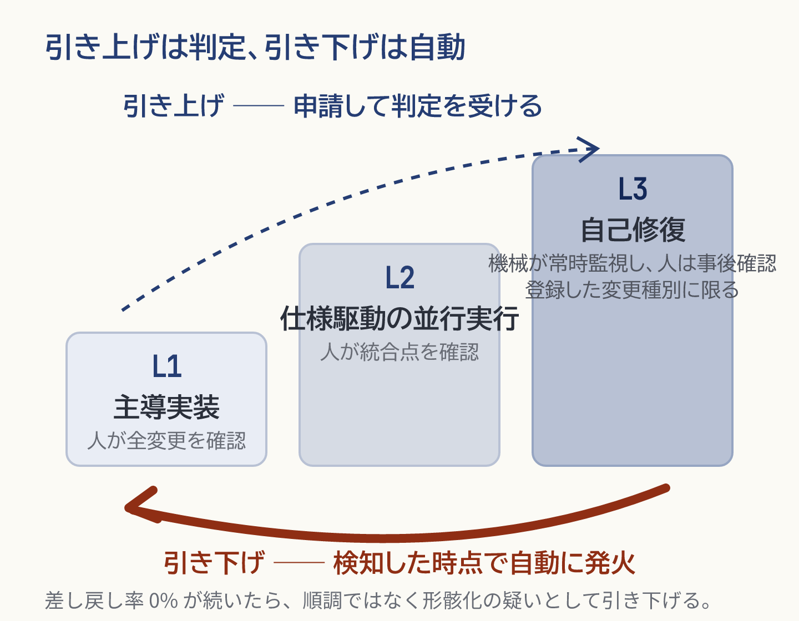
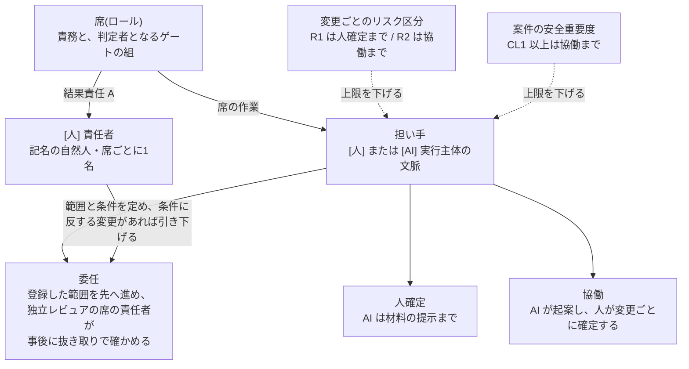

本章は、生成AIエージェントと人間の役割境界を規定します。境界は固定ではなく、AI の能力向上に応じて見直す対象として扱います。

## 5.1 本章が達成すべき成果

本章の要求事項を満たしたとき、次の成果が得られます。

- どの作業を AI が担い、どの判断を人間が担うかが、時点を明示した形で定義されている
- 人間が担う判断について、その判断が実質的に行われたことを確認できる
- AI の能力向上に伴って役割境界を見直す手続が定められている

## 5.2 責任の原則

役割境界がどのように変化しても、次の原則は変更しません。

- 結果責任(A)は常に人間に紐づく。AIエージェントは実行(R)のみを担う
- 結果責任は成果物ごとに1名とする。複数名への分散を認めない
- AI が生成した成果物は、その生成を指示した者と別の自然人を責任者とする席が確認する。確定の担い手の上限は 5.5 による

3点目が定めるのは、確認の責任です。確認する席の責任者は、記名の自然人です(5.5.1)。同一人物が別の席を兼ねて確認しても、3点目は満たせません。満たせない体制は、独立レビュー(G-6)を未達として表示します([第3章 3.5](/process-compass/phase4-process-design/roles-responsibilities/))。確認の時点と範囲は、担い手の運用形態によって変わります(5.5.2、5.5.4)。

<!-- impl IMPL-0591 target=claude-md state=delivered check=manual note="原則1(結果責任は人間に紐づき、AI は実行のみを担う)。準拠テンプレートの CLAUDE.md の「4種類の判断の確定…席の責任者(人)が記名で行う。AI の担い手へ移さない」の行が、結果責任を席の責任者(人)に置く。原則2・3 は別のマークで追う。 確かめる者: AI維持管理者(指示資産・様式を改めるとき)" -->

<!-- impl IMPL-0592 target=d0-template state=delivered check=manual note="原則2(結果責任は成果物ごとに1名)。templates/00-d0-governance.md 節3 末尾の担当表(成果物ごとの結果責任者 A を1名)が受ける。構成の席の責任者(seats[].accountable)との照合は機械では確かめない(内部監査)。原則3 は IMPL-0688 が追う。確かめる者: 体制図(D-0)を承認する席の責任者(承認のとき)と、採用者の内部監査" -->
<!-- impl IMPL-0688 target=config-unmet state=delivered check=manual note="原則3。生成を指示した者と別の自然人が確認する席の責任者を置くこと。兼務で確認しても満たせず、G-6 を未達として表示すること。scripts/init/generate-profile.mjs の detectUnmet が、確認する人がいない・同一人物・確認の担い手が示されていない構成で gates.g6.state を unmet にし、scripts/gate/config.mjs の confirmerOnRoster と verify-gate-contract.mjs が、未達の記録が無い構成を拒む。3名以上の体制は兼務禁止の表からの導出と、同一人物にする変更の拒否が generate-profile.mjs にある。第3章 3.5 のマークとの突き合わせは別の束で行う。実行は見ていない。確かめる者: 出荷判定者(PROCESS-PROFILE.md の未達の表示を読むとき)" -->

## 5.3 役割境界の時点表記

AI の能力は短期間で変化するため、役割境界の定義には必ず妥当な時点を併記します。

**2026-08-05 時点の前提**: 生成AIエージェントは、仕様を入力として実装・テスト生成・自己修正を主導的に実行できます。人間の主たる作業は、コードの記述ではなく、仕様の設計・コンテキストの整備・差分の検証へ移っています。

## 5.4 AI自律レベル

### 5.4.1 レベルを定義する3変数

本節は、自律の水準を、番号そのものではなく次の3変数で定義します。この3変数は、運転自動化の水準を定義する国際規格(ISO/IEC で参照される SAE J3016)が用いる構造と同型です。

| 変数 | 問い |
| --- | --- |
| 監視者 | エージェントの動作を、誰が、どの時点で見ているか |
| フォールバックの担い手 | 期待どおりに動作しなかったとき、誰が回復させるか |
| 適用範囲 | エージェントが動作してよい領域はどこまでか |

このうち**適用範囲が動的境界の実体**です。レベルを上げ下げすることは、適用範囲を広げること、狭めることと同義です。

適用範囲は次の4軸で記述します。

| 軸 | 記述する内容 |
| --- | --- |
| 対象 | リポジトリ、ディレクトリ、機能の単位 |
| 環境 | 開発環境 / 検証環境 / 本番環境 |
| 変更種別 | 実装 / テスト / 設定 / データ構造 / 権限 |
| リスク区分 | R1〜R3([第3章 3.8.1](/process-compass/phase4-process-design/roles-responsibilities/)) |

### 5.4.2 3つのレベル

| レベル | 名称 | 監視者 | フォールバック | 典型的な適用範囲 |
| --- | --- | --- | --- | --- |
| L1 | 主導実装 | 作成を指示した人が、エージェントの出力を確かめる。**独立の確認ではない。独立の確認は G-6 による。確認者を置けない体制では G-6 の未達を表示し続ける** | 人間 | 1機能単位。開発環境で実装・テストを生成する |
| L2 | 仕様駆動の並行実行 | 人間が統合点を確認する | 人間および自己修正ループ | 複数機能の並行実装。検証環境まで |
| L3 | 自己修復 | 機械が常時監視し、人間が事後に確認する | 自動的な切り戻し | 事前に登録した変更種別に限定する |

**人がどこで触るかは、事業ステージ・安全重要度・変更のリスク区分で決まります**。レベルの番号は、その結果として人が何を確かめるかの呼び名です。変更のどの場面で人が、いつ、どの形で触るかは、[第8章 軸B の後ろの表「人が触る場所」](/process-compass/phase4-process-design/tailoring-guide/)に一覧します。この表は既存の定めの索引であり、新しい義務を足しません。AI の能力についての時点つきの前提は、5.3 に置きます。

### 5.4.3 レベルによらない不変条件

次の要求事項は、レベルがどこまで上がっても変更しません。

| # | 不変条件 |
| --- | --- |
| 1 | 結果責任(A)は人間に紐づく。AIエージェントは実行(R)のみを担う |
| 2 | 本番環境への反映の承認は、人間が記名で行う |
| 3 | 認証・認可・個人データ・外部との契約に関わる変更は、レベルにかかわらず人間が判断する |
| 4 | 適用範囲の拡大そのものを、AIエージェントが決定してはならない |

要求事項2は、2026-08-05 時点の実務における到達点でもあります。エージェントによる変更の提案までを自律化し、反映の判断を人間が保持する構成は、主要な開発基盤で標準となっています。

<!-- impl IMPL-0593 target=claude-md-resident state=delivered check=manual note="不変条件2(本番環境への反映の承認は人の記名)。template/CLAUDE.md「判断の確定と委任」の行が書く(claude-md-resident.json の規則)。記名を照らす検査は IMPL-0251 の範囲に限られる。確かめる者: AI維持管理者(指示資産の四半期の棚卸しのとき、template/CLAUDE.md の該当の行を読む)。所在を読んだ(実行して確かめていない)" -->
<!-- impl IMPL-0689 target=claude-md state=delivered check=manual note="不変条件1(結果責任は人間)、不変条件3(認証・認可・個人データ・外部との契約に関わる変更の人の判断)、不変条件4(適用範囲の拡大を AI が決定しない)。template/CLAUDE.md の節「一律で AI に委譲できない領域(第5章 5.8.3・5.4.3)」が「認証・認可・個人データ・外部との契約に関わる決定」と「適用範囲(標準の適用境界)そのものの拡大」を箇条で置き、節「判断の確定と委任」が「4種類の判断の確定は席の責任者(人)が記名で行い、AI の担い手へ移さない」と置き(IMPL-0019 が追う)、行「リスク区分は変更ごとに判定」が認証・認可・個人データ・外部 IF を R1 とし、構成の riskFloor.rules を check-pr.mjs の riskFloorOf が下限として機械で課す。行「緩める向きの変更を AI が決めない」と AI の名義の記名の拒否は IMPL-0097 が追う。確かめる者: 各ロールの席の責任者(CLAUDE.md を読むとき)" -->

### 5.4.4 リスク区分による上限

実績が良好であっても、レベルの上限はリスク区分で固定します。担い手の運用形態(5.5.2)の上限も、同じ区分で固定します。

| リスク区分 | 適用できる最大レベル | 運用形態の上限 |
| --- | --- | --- |
| R1 | L1 | 人確定 |
| R2 | L2 | 協働 |
| R3 | L3(5.5.4 で登録した変更種別に限る) | 委任(5.5.4 の条件をすべて満たす変更に限る) |

2つの上限は、掛かる対象が異なります。AI自律レベルは、実装作業を誰が監視し、誰が回復させるかを定めます。運用形態は、席の判断を誰がどの時点で確定するかを定めます。

両者は、登録した変更種別で重なります。関係は次のとおりです。

- 委任の範囲として登録した変更種別には、L3 を適用する。**登録した変更種別への L3 の適用は、5.5.4 による**
- 委任の範囲、L3 の適用範囲、標準変更カタログ([第3章 3.7.4](/process-compass/phase4-process-design/roles-responsibilities/))は、同じ登録を指す。別々に登録しない
- 登録した変更種別のほかでは、一方を引き上げても、他方は引き上がらない
- 委任で先へ進める変更にも、L3 の監視(機械による常時監視)とフォールバック(自動的な切り戻し)が掛かる

この上限は実績によって緩和されません。取り消せない決定に対して、成功の積み重ねを根拠に監督を薄くする経路を作らないためです。

**安全関連ソフトウェアは無条件に R1 として扱います**。人身への危害につながりうる制御を担う部分は、事業上の可逆性にかかわらず最上位のリスク区分になります。

ただし範囲を限定します。安全関連システムに含まれるコードのすべてが安全関連ソフトウェアではありません。

| 区分 | 適用 |
| --- | --- |
| 安全関連部(安全機能を実現する部分) | R1 固定、L1 固定、人確定 |
| それ以外の部分 | 通常どおり R2 / R3 と L2 / L3 を適用してよい。運用形態の上限は 5.5.3 による |

切り分けを定めずに全体を安全関連として扱うと、安全機器を扱う組織で AI の活用が全面的に停止することがあります。切り分けの判定手順は[附属書F](/process-compass/phase4-process-design/safety-verification/)によります。

<!-- impl IMPL-0594 target=autonomy-derivation state=delivered check=machine test=template/scripts/gate/test-check-delegation.mjs note="リスク区分ごとの最大レベル(R1 は L1・R2 は L2)。実行で確かめた範囲として、AI自律レベルの導出(autonomy.mjs)は種別の単位で、変更ごとのリスク区分を読まない。L3 を読む箇所は委任の判定・D-0 の表・保証の開示・次の一手の表示で、変更ごとに効くのは委任の判定だけであり、その条件2 が R3 を求める(IMPL-0663)。R1・R2 の変更は種別が L3 でも委任で進まず協働で扱う。R2 は L2 を準拠テンプレートが支えず L1 側で進む(厳しい側。ADR-0081 決定6)。L3 の効果は委任の経路だけで、委任を経ない経路に L3 の効果は無い。試験は R1・R2 の変更が L3 の種別でも委任で進まない場面と、R3 で進む場面。安全関連部は IMPL-0919(Q1 の答えの正しさは機械で閉じない。案件の全体で止める。ADR-0220)。区分の正しさは IMPL-0062 の下限と確定の記名で、下限に当たらない R1 相当が R3 と記載されて通りうる(採用の手引きの開示)。IMPL-0663 は manual。safetyRelated の宣言による条件は採らない(ADR-0220)" -->

### 5.4.5 レベルの引き上げ

引き上げは判定を要します。次の条件をすべて満たしたとき、技術判断者が申請し、ステアリングコミッティ(B-2)が判定します。

| # | 条件 | 値 |
| --- | --- | --- |
| 1 | 現在のレベルでの連続運用期間 | 組織が定める期間(参考の値を置かない) |
| 2 | 独立レビューの差し戻し率が基準の範囲内にある | 組織が G-1 で定めた範囲から、期間中に上下いずれにも外れていない |
| 3 | 変更失敗率が基準を超えていない | 組織が G-1 で定めた値 |
| 4 | AI が起因となった是正を要する事象の発生 | 期間内に0件 |
| 5 | 5.4.7 の能力維持措置が実施済みである | 5.4.7 の実施の記録に、当該の範囲の数える行(5.4.7。基準日は引き上げの判定の日)がある |
| 6 | 引き下げの検知と切り戻しの手順が整備されている | 手順書と実行記録がある |
| 7 | [第3章 3.12.10](/process-compass/phase4-process-design/roles-responsibilities/) の実行の単位ごとに、停止条件を強制する手段の所在が記録されている | 本節の判定で作成または再評価したテンプレ9 の低減策に、単位ごとの手段と実装場所がある。使わない単位は該当なし(理由) |

表の値の扱いは、次のとおりです([第1章 1.7.7](/process-compass/phase4-process-design/overview/))。条件1 の値は組織が定める値で、標準は参考の値を置きません(定めが無ければ、この条件を満たさず、L1 のまま作業は続きます)。条件4 の値は既定値です。条件2・3 の値は組織が定める値です。条件5〜7 は値ではなく要求です。

条件6を欠いた引き上げを認めてはなりません。戻せない拡大は、拡大ではなく放棄です。

条件7 は、第3章 3.12.10 の要求事項5 を本節の判定で照らすものです。記録は、本節の判定で作成または再評価する[第6章 テンプレ9](/process-compass/phase4-process-design/deliverable-templates/)の低減策に置き、別の記録を作りません。L1 の案件でテンプレ9 の適用条件に当たらず表が無いときは、L2 への引き上げが適用条件4 に当たるので、本節の判定の時点で作成します。文章だけの記載は、所在として扱いません(テンプレ9 の記入時の注意が RRS1・RRS2 に数えない記載と同じです)。手段を示せない単位を使う範囲は、引き上げません。所在の記録は、強制が働くことを示しません。手段が停止を実際に起こすかは、B-2 と機械のどちらも確かめません。**課さないと決めたものであり、書かれていないだけではありません**([ADR-0170](/process-compass/adr/0170-l2-promotion-requires-enforcement-location-in-safety-risk-assessment/))。登録した変更種別の L3 では、5.5.4 の登録の根拠の4点目が同じ役割を持ちます。同じ設定を手段とするときは、両方が同じ所在を名指してかまいません。

条件7 を足す前に L2 を適用した範囲は、次のうち最も早い時点で条件7 の記録を備えます(適用: ADR-0170 の採用の日より前に本節の判定で L2 へ引き上げた範囲)。当該の範囲についての次の本節の判定、テンプレ9 の次の更新、次のプロセス内部監査([附属書H](/process-compass/phase4-process-design/assurance-case/) の観点23)。それまで L2 の適用は止めません。3.12.10 の要求事項1〜3 の強制は、この間も免除されません。

:::caution[暫定 EV-0313 / 見直し 2027-05]
**対象**: 5.4.5 の条件7(L2 への引き上げの判定で、停止条件を強制する手段の所在を照らすこと)と、記録の存在だけを確かめ手段の有効性を確かめない選択。
**根拠の水準**: E1(間接)。
**差し替え条件**: 条件7 を適用した採用組織での、L2 の範囲の停止の記録(3.12.10)と、所在の記録が実際の設定と食い違った件数の観測。段階ごとに停止の手段を書き分ける外部の規格(OWASP Agentic Top 10 の ASI10 の本文、ISO/IEC 22989 の定義)を原文で確かめた結果。

自律の段階を上げる前提として停止の手段を求める外部の規格・製品は、確認できませんでした(2026-11-17 時点。無いと確かめたのではありません)。停止の手段を一律に求める指針はあります。L2 に課す根拠は、本標準の内部(L2 は自己修正ループに依る唯一のレベルであること、CL1・CL2 の案件で唯一の引き上げの手段であること)にあります。
:::

:::caution[暫定 EV-0314 / 見直し 2027-05]
**対象**: 条件7 を足す前に L2 を適用した範囲の、記録を備える時点(次の本節の判定・テンプレ9 の次の更新・次の内部監査のうち最も早いもの)。
**根拠の水準**: E0(なし)。
**差し替え条件**: 移行の時点を過ぎた範囲で、観点23 の所見に条件7 の記録の欠落が出た件数の観測。

3つの時点は、L2 のまま運用を続ける範囲にも照らしが届くように選んだものです。期間と損失の関係を測った測定はありません。
:::

<!-- impl IMPL-1013 target=autonomy-derivation state=undelivered check=manual plan=adopter decision=ADR-0170 note="5.4.5 の条件7(3.12.10 要求事項5)。L2 への引き上げの判定で、3.12.10 の実行の単位ごとの停止条件を強制する手段の所在(または該当なし(理由))が、作成または再評価したテンプレ9 の低減策に実装場所として記録されていることを確かめる。準拠テンプレートは L2 を支えない(IMPL-0289、ADR-0081 決定6)ため、記録の有無も機械で確かめない。手段が停止を強制するかは確かめない(課さないと決めた。ADR-0170)。条件7 を足す前の L2 の範囲は、次の判定・テンプレ9 の次の更新・次の内部監査のうち最も早い時点で備える。確かめる者: B-2 の決定者(5.4.5 の判定のとき)と監査担当(観点23 の監査のとき)" -->
<!-- impl IMPL-1025 target=process-change-skill state=delivered check=manual note="5.4.5 の読みの固定。登録した変更種別の L3 は 5.5.4 の登録の判定が 5.4.5 の引き上げの判定を兼ね、登録の判定者(B-4、置かない体制は D-0 の決定の権限を持つ者)が、登録の時点で当該種別について条件2〜7 を照らすこと(条件2〜4 は判定の時点までに記録がある期間、条件5 は 5.4.7 の実施の記録に当該の範囲の数える行があること)。人の判断であり、機械は確かめない。降ろし先は /process-change の手引き .claude/skills/process-change/kinds/mode.md の節「引き上げと登録の判断点」(config.mjs の記入の検査には降ろさない。照らしの中身は自由な文で、条件ごとの語の有無を数えても閉じたように見せるだけのため)。手引きは、条件2〜7 のそれぞれについて照らした結果を変化点の理由に書くこととし、書式は例示にとどめる。照らした結果と実施の記録の行を、利用者から受け取らずにエージェントが書かない。既存の IMPL-0690・0823 は 5.5.4 の委任の条件と登録する者を追い、5.4.5 の条件2〜7 を登録の経路で照らすことは覆わない。確かめる者: 登録の判定者(登録の時点)。照らしの記録の有無は標準の内部監査(附属書H H.3 の観点23)" -->

条件4 の既定値(期間内に0件)の根拠水準は、5.4.6 の EV-0154 によります。5.4.6 の1行目の既定値(1件)と同じ規則を、引き上げの側から読んだ値です。

:::caution[暫定 EV-0147 / 見直し 2027-10]
**対象**: 条件1 の連続運用期間(組織が定める値で、標準は参考の値を置かないこと)。能力依存の定数の登録簿の RC-09(能力に依らない)。
**根拠の水準**: E0(なし)。
**差し替え条件**: 引き上げを判定した採用組織で、引き上げの後に 5.4.6 の引き下げが発火するまでの期間の分布の観測。

期間は、人の側の信頼を観測する周期として組織が定めます。期間と引き上げの後の安定の関係を測った測定は、見つかっていません。標準が既定の値を置かないのは、値が事業ステージ・プロダクトの特性で変わるためです。能力が上がったことを理由に短縮しません(登録簿の要求事項4)。
:::

5.5.4 で登録する変更種別には、上表の手続に代えて次を適用します。

- 登録した変更種別への L3 の適用は、5.5.4 の登録の判定による。**登録の判定が、当該種別についての本節の引き上げの判定を兼ねる**
- 「兼ねる」は、上表の条件2〜7(条件5 の実施記録を含む)に及ぶ。登録の判定の時点で、当該種別についてこれらの条件を満たしていることを照らす。これは新しい義務ではなく、「兼ねる」の読みの固定である(所有者の回答 2026-11-17、[ADR-0179](/process-compass/adr/0179-ai-free-practice-record-and-overdue-disclosure/))。条件1 は次の点、条件6 と条件7 はそれぞれ下の該当の点が、登録の経路での置き換えである。条件2〜4 は、当該種別について判定の時点までに記録がある期間を対象に照らす(期間の下限は条件1 の置き換えにより課さない)。条件5 は、5.4.7 の実施の記録に当該の範囲の数える行があることを照らす
- 登録の根拠は、条件1 の連続運用期間ではなく、5.5.4 の条件3・4(既存のテストで検出できること、取り消しを実行した実績)に置く
- 登録するのは、リリース判定会(B-4)である。B-4 を置かない体制では、D-0 体制図の決定の権限を持つ者(人)である([第3章 3.7.4](/process-compass/phase4-process-design/roles-responsibilities/))。この者が誰を指すかは、5.5.4 で特定する
- 登録の判定では、当該の種別について 5.4.6 の検知条件を計測できることを確かめる。計測できない種別は登録しない(5.5.4)
- 5.4.6 の引き下げと 5.4.7 の能力維持措置は、登録した変更種別にも適用する。5.4.7 の実施の記録と保証の開示の表示は、登録した変更種別にも同じ形で掛かる

同じ範囲について引き上げの判定を2つ持つと、条件の緩いほうだけが使われます。登録した変更種別の判定は、登録の判定の1つに揃えます([ADR-0054](/process-compass/adr/0054-seat-accountable-performer/) 決定4)。

### 5.4.6 レベルの引き下げ

引き下げは判定を待たず、検知した時点で自動的に発火します。**引き上げは判定を要し、引き下げは自動で行う**という非対称を意図的に設けます。監督の劣化は静かに進み、申告されないためです。

**ただし、表の1行目(AI が起因となった Sev1・Sev2)は、この原則を置き換え、自動の引き下げから警告へ改めています**。AI が起因となった重大な事故は、事後検証で記録に残る事実であり、静かに進む劣化ではありません。再発を防ぐ手立ては、そのときの AI と周辺の道具によって変わります。標準は、事故の起きた所を見えるようにして警告し、行動を促すところまでを役割とし、決まった対処を固定しません。この行の適用範囲は、表の中に書きます。2行目以降(申告されない劣化を拾う行)は、自動のままです。「書かれていない」のではなく、決めたことです。

本節の「自動」は、検知の記録が存在した時点で効力を生じ、判定を要しないことです。実行の担い手が機械か人かを問いません。実行する者は、事前に定めた規則を検知の記録に従って執行します。実行を見送る裁量を持ちません。

| 検知する状態 | 値 | 措置 |
| --- | --- | --- |
| AI が起因となった Sev1 または Sev2 が発生した | 1件 | 該当範囲を示して警告する。自動では引き下げない(適用: 安全重要度 CL1 以上・規制業を除く。CL1 以上・規制業は現行どおり該当範囲を1段階引き下げる) |
| 独立レビューの差し戻し率が0%のまま推移した | 観測の窓の長さの継続(窓は組織が定める。下限は2か月) | 形骸化の疑いとして引き下げる |
| 手戻り率(タスクの記録を持つ変更はタスクの単位、持たない変更は変更の単位で数え、行の帰属に依らない。算出の例は[運用メトリクス](/process-compass/phase6-operation/metrics/)を参照)が基準を超えた | 組織が定めた値 | 該当範囲を1段階引き下げる |
| コア機能の理解保持者数が1名以下になった | — | 該当機能を L1 へ引き下げる |

表の値の扱いは、次のとおりです([第1章 1.7.7](/process-compass/phase4-process-design/overview/))。1行目の値(警告を出す1件)は既定値であり、第4章「閾値の設定と較正」の要求事項1 のとおり記録します。2行目の観測の窓と、3行目の基準値は、組織が定める値です。標準は、観測の窓・最小標本数・同時保有の上限・事後の抜き取りの件数・手戻り率の基準値について、既定の値も参考の値も置きません。値は、自社の過去のトラブルとプロダクトの特性に合わせて定め、値・記録した日・決定した者・理由を残すことが推奨されます。定めていない値は、止める理由にしません。止めずに進め、働いていない検知の名を、次の一手・保証の開示の項目3・出荷の証跡の集約の宣言の表に出します(下記「計測できない検知条件がある場合」)。

1行目を警告にしたことで、次を失います(適用: 安全重要度 CL1 以上・規制業を除く案件)。

- 事故の後も、同じ原因の変更が、人に読まれないまま取り込まれ続けうる。失うのは、利用者(同じ原因の再発)と、採用者の品質責任者(事故の後に「なぜ止めなかったか」を説明する者)である
- 本標準に従ったことを、事故の後に同じ所の確認を強めた根拠として示せない。戻すかの判断と、その記録は、採用者の責任である。本標準が警告に留めるのは、再発を防ぐ手立てが、そのときの AI と周辺の道具によって変わるためである

残る手当ては、出荷の前の全件の確認、出荷判定 G-7 の基準2(未解決の欠陥)、形骸化の検知、5.4.5 の条件4(事故の後は引き上げない)です。委任した変更(登録した種別)では、事後の抜き取りだけが人の目になります。警告は、件数が変わらなくても出荷のたびに判定者の資料へ出します。警告が行動を生むかは、測っていません。

:::caution[暫定 EV-0382 / 見直し 2027-05]
**対象**: AI が起因となった Sev1・Sev2 の後を、警告に留め、自動では取り込む前の確認へ戻さない判断(安全重要度 CL1 以上・規制業を除く案件)。
**根拠の水準**: E0(なし)。
**差し替え条件**: 採用組織で、警告の後に同じ所で同じ原因の Sev1・Sev2 が再び起きた件数と、警告を受けて戻した件数・戻さなかった件数の観測。

自動で人の確認へ戻す型の公開の実務は、調べた範囲で一次の資料を得ていません。警告を読んで戻すかの判断は、採用者の責任であり、機械は確かめません(adopter)。
:::

:::caution[暫定 EV-0154 / 見直し 2027-10]
**対象**: 5.4.5 の条件4 の既定値(期間内に0件)と、AI が起因となった Sev1・Sev2 で警告を出す件数(1件)。
**根拠の水準**: E0(なし)。
**差し替え条件**: 採用組織で、この行によって引き下げた範囲のうち後の点検で引き下げが不要だったと分かった件数(誤発火)と、引き下げなかった範囲で同種の事象が続いた件数(見逃し)の観測。

1件と0件は、統計の閾値ではありません。事象の重大度による規則です。稀な事象の件数には、1件では偶然と区別する手段がありません。それでも1件で警告を出し、期間内に1件でもあれば引き上げないのは、重大な事象の発生そのものを扱うためです。[第7章 7.9.1](/process-compass/phase4-process-design/exception-escalation/) が単発の見逃しで承認権限の制限を発動しないのは、測定の値に含まれる偶然の変動を扱うためです。本行は、測定の値ではなく事象の発生を扱います。
:::

:::caution[暫定 EV-0146 / 見直し 2027-10]
**対象**: 独立レビューの差し戻し率が0%のまま推移した期間の下限(観測の窓の下限2か月。窓の値そのものは組織が定め、既定値を置かない)。能力依存の定数の登録簿の RC-12(能力に依らない)。
**根拠の水準**: E0(なし)。
**差し替え条件**: 採用組織で、差し戻し率0%が2か月続いて引き下げた範囲のうち、後の点検で形骸化を確かめた件数と、確かめられなかった件数の観測。

下限の2か月は、形骸化を疑う期間として置いた値です。窓を短くしすぎると検知が鳴らない向きの制約で、組織が定める値そのものではありません。期間と形骸化の関係を測った測定は、見つかっていません。能力が上がったことを理由に短縮しません(登録簿の要求事項4)。
:::

4行目の「1名以下」は、[第3章 3.4.3](/process-compass/phase4-process-design/roles-responsibilities/) が列挙に無い離脱([第1章 1.10.2](/process-compass/phase4-process-design/overview/))と定める状態です。値の根拠水準は、同節の EV-0071 によります。2名から0名へ一度で減った場合も発火させるため、「1名になった」の書き方を採りません。

各行の量は、次のとおりに数えます。

- AI が起因となった事象: 事後検証(ポストモーテム)で特定した原因の変更に、AI の関与の記録(コミットのトレーラなど。5.8.2)があるもの。記録の欄(AI 起因: あり / なし / 特定できない、原因の変更、該当する登録した変更種別)は、Sev1・Sev2 を記録する様式に置き、事後検証の結果を同じ行へ写す。事後検証の進め方の例は、[インシデント対応](/process-compass/phase6-operation/incident-response/)参照
- 1行目の Sev1・Sev2: 出荷の後に発生し、事後検証の対象となった事象に限る。出荷の前のゲート・検証で検出した欠陥は数えない。検出した欠陥で引き下げると、検出が罰になり、重大度の過小な記録を招くためである。欠陥の記録が出荷前と出荷後を区別できない場合は、出荷後として数える
- 原因を特定できない Sev1・Sev2: 「特定できない」と記録する。AI が起因でないものとして扱わない。1行目の事象として扱い、警告に「原因を特定できていない」と出す(適用: 安全重要度 CL1 以上・規制業を除く。CL1 以上・規制業は現行どおり、原因を特定するまで、該当範囲の登録した変更種別(5.5.4)を止める。特定した原因の変更に AI の関与の記録が無ければ、止めた種別は戻る。記録があれば、1行目の引き下げとして扱う)
- 1行目の警告(適用: 安全重要度 CL1 以上・規制業を除く): 事故は、欠陥の台帳の行のうち、重大度が Sev1・Sev2、検出の時点が「運用」か空欄、AI 起因が「あり」か「特定できない」か空欄、状態が「未解決」のものである。件数の基準を持たず、1行あれば警告を出す。警告は、事故の発生日より後に既定ブランチへ入った変更のうち、取り込む前に独立の人の承認を経ていない変更の件数を示し、「取り込む前に人が読む形へ戻すかは組織が決める。戻し方: 委任の範囲を狭める・協働へ下げる・保護するパスに足す」と書く。台帳が無いときは、止めずに「事故の警告は働いていない」と出す。行の状態が「解決済み」になるか、AI 起因が「なし」と確かめられたとき、次の一手と PR の注記から消える。数える範囲は事故の行の種類の範囲全体であり、台帳の「原因の変更」が触れたパスは読まない。**範囲が広く出る側に倒れる**(警告なので、止まらない)。警告を出す所は、次の一手・保証の開示の項目3・出荷の証跡の集約の宣言の表・委任の判定の注記である。出荷判定を落とさず、記載の欠落に数えない
- 登録外の ID・空欄の変更種別の列は、すべての種別に当てる(現行の向きを保つ)。警告を読んで戻すかの判断と、その記録は採用者の責任である
- 差し戻し率0%の継続: 毎月、直近の観測の窓で評価する。窓の中の件数が最小標本数に満たない評価は、継続を切る(後掲「計測できない検知条件がある場合」)
- 差し戻し率0%の継続の観測の窓: 窓は組織が定める値であり、標準は既定の値を置かない(下限は2か月。EV-0146)。継続の期間は観測の窓の長さと同じであり、組織が窓を長くすれば継続の期間も同じ長さになる。窓の定めが無い間、この検知は働かず、表示は名目の2か月とする。[第4章「閾値の設定と較正」](/process-compass/phase4-process-design/gate-criteria/)の要求事項3 の観測の窓は、この窓を引く(窓を二重に定めない)。最小標本数は組織が定める値であり、標準は既定の値を置かない(EV-0145)。最小標本数の定めが無い間も、止めない
- 差し戻し率の分子: 判定基準の番号を引いた差し戻しに限る([第4章 ゲート運用の共通ルール](/process-compass/phase4-process-design/gate-criteria/)の3)。番号の無い差し戻しは、0%の継続を切らない
- 宣言行の無い承認レビュー: 差し戻し率の分子に数えない。ホスティングの CHANGES_REQUESTED だけのレビューを含む。理由は、番号を引かないことではなく、宣言行(`G-6: 差し戻し / 基準 N`)を持たないレビューが判定記録ではないことである([第4章 判定の成立](/process-compass/phase4-process-design/gate-criteria/)の記録の媒体と G-6「承認レビューを判定記録とする条件」)。数えない向きは差し戻し率を低く出し、0%の継続の発火の側へ倒れる。誤発火は戻らないため、数えていない差し戻しの要求の件数を、窓ごと・種別ごとに次の一手と保証の開示の差し戻し率の文、および0%の継続による停止の理由に表示する。記録用ブランチを読めないときは「読めない」と表示し、0件と表示しない。宣言行の無いレビューを数える方向への変更は、分子の定義の変更であり採らない
- 差し戻し率の分子に数える G-6 の差し戻しの記録は、判定の時点に帰属をホスティングの記録で確かめたものに限る(効力を持つ記録。[第4章「判定記録を基底ブランチへ入れる操作」](/process-compass/phase4-process-design/gate-criteria/))。帰属を確かめられない記録は、0%の継続を切らない
- 手戻り率の母数と分子(変更の単位): タスクの記録(トレーラ `Spec: F-NNN / Task-N`)を持たない変更は、変更を単位に数えて母数へ足し、表示にタスクと変更の内訳を出す。分子は、取り消し(`git revert` の標準の文を持つ変更)だけである。再修正を示す印(新しいトレーラ)は定めない。付けないほうが手戻り率は低く出る自己申告の印は、統制を閉じないためである。**再修正は数えていない**ことを、数えていない残りの開示に1項として出す
- 手戻り率の分子(タスクの単位): 実装計画([第6章 テンプレ7](/process-compass/phase4-process-design/deliverable-templates/))の状態を「やり直し」としたタスク。「やり直し」は、タスクを指す変更(トレーラ `Spec: F-NNN / Task-N`)が取り込まれた後、または不採用となった後に、同じタスクを指す変更が再び作られた状態を指す。計画表の記録と、トレーラから数えた値は、同じ量を指す

:::caution[暫定 EV-0155 / 見直し 2027-10]
**対象**: 差し戻し率0%の継続を毎月評価する周期(評価の日を毎月の初日に置き、直近2か月の窓で評価すること)。
**根拠の水準**: E0(なし)。
**差し替え条件**: 採用組織で、毎月の評価で発火した引き下げのうち、評価の周期を四半期に置いた場合には発火しなかった件数と、後の点検で形骸化を確かめた件数の観測。

毎月は、2か月の継続を窓の重なりで見落とさないために置いた周期です。周期と形骸化の検知の関係を測った測定は、見つかっていません。
:::

措置の下限は L1 です。L1 の範囲で検知したときは、レベルを変えません。代わりに、5.4.5 の条件1(連続運用期間)と条件4(AI が起因となった事象)の期間を、検知の日から数え直し、検知と数え直しを記録します。[第3章 3.12.5](/process-compass/phase4-process-design/roles-responsibilities/) の要求事項3「1段階引き下げる」も、同じ下限で読みます。

<!-- impl IMPL-0294 target=defect-ledger-template state=delivered check=manual note="L1 の範囲で検知したときの、検知と数え直しの記録の置き場。準拠テンプレートでは欠陥の台帳の「引き下げの点検の記録」の表(扱い: L1 で数え直し)に置く。記録を書いたかは機械で確かめず、内部監査(観点23)で確かめる。確かめる者: AI運用担当者(引き下げの点検の記録を書くとき)" -->

<!-- impl IMPL-0290 target=defect-ledger-template state=delivered check=presence note="Sev1・Sev2 を記録する様式に、AI 起因(あり / なし / 特定できない)と、原因の変更・該当する登録した変更種別の欄を持つ。準拠テンプレートでは欠陥の台帳(運用の障害の Sev1・Sev2 の行を含む)に置く。原因の変更に AI の関与の記録があるかの判断は、事後検証を書く人が行い、機械は確かめない(単位: 欄)" -->

<!-- impl IMPL-0292 target=incident-artifact state=delivered check=manual note="障害時の補助ファイルのポストモーテムの書き方に、AI 起因(あり / なし / 特定できない)・原因の変更・該当する登録した変更種別を、欠陥の台帳の同じ行へ写すことを書く。写したかどうかは機械が確かめない。確かめる者: ポストモーテムの承認者(振り返りを閉じるとき)" -->

**変更の重複率を、引き下げの検知条件に置きません**。本標準は、変更の重複率を定義していません。定義の無い量を発火条件に残すと、発火したかどうかを誰も確かめられません。旧版はこの量を手戻り率と同じ行に置き、措置を「検討する」としていました。この行の措置は、自動の引き下げへ改めました。この扱いは意図的な決定です。「書かれていない」ではありません。外した理由と、検知条件へ戻す条件(量の定義と、記録から算出する手段が示されること)は [ADR-0081](/process-compass/adr/0081-autonomy-downgrade-delivered-as-registration-stop/)によります。

**承認の比率を、引き下げの検知条件に置きません**。本標準は、人の確認を経ずに進んだ操作や変更の比率にも、承認に占める特定の形の比率にも、検知条件と判断基準を課しません。これらの比率は、対象の品質、提示の設計、実行基盤の既定の設定、記録の書き方によって動き、監督の劣化だけを映さないためです。旧版が「自動承認の比率」と呼んだ検知条件は、この決定によって廃しました。<!-- retired-ok: 廃した旧称を示す -->この扱いは意図的な決定です。「書かれていない」ではありません。判断の根拠は [ADR-0059](/process-compass/adr/0059-no-approval-ratio-trigger/)によります。

人の承認から中身が抜けることの検知は、欠陥注入による検出能力の測定(5.6.2)と、承認権限の一時制限([第7章 7.9](/process-compass/phase4-process-design/exception-escalation/))が担います。承認の形の傾向は、[運用メトリクス](/process-compass/phase6-operation/metrics/)の「レビュー所要時間の分布」と「挙動要約の品質」で確認します。この2つの指標を、引き下げの検知条件にも、合否条件にもしません。検出能力が未測定の体制では、7.9 は発動しません。未測定であることは、保証の開示の項目6 に表示されます([第4章 G-7](/process-compass/phase4-process-design/gate-criteria/))。

引き下げた範囲は、5.4.5 の条件を再度満たすまで戻しません。

引き下げた後の点検で、引き下げが不要だったと分かった場合は、その件数を記録します(誤発火の記録)。記録は、EV-0146 と EV-0154 の差し替え条件の材料です。誤発火と記録しても、引き下げた範囲は戻りません。戻すのは 5.4.5 の判定だけです。

<!-- impl IMPL-0295 target=defect-ledger-template state=delivered check=manual note="誤発火の記録の置き場。準拠テンプレートでは欠陥の台帳の「引き下げの点検の記録」の表(扱い: 誤発火)に置く。誤発火と記録しても停止は解かない。記録を書いたかは機械で確かめず、内部監査(観点23)で確かめる。確かめる者: AI運用担当者(引き下げの点検の記録を書くとき)" -->

#### 計測できない検知条件がある場合

上表の検知は、いずれも常時の計測を前提とします。計測の基盤を持たない組織では、引き下げは発火しません。**発火しない引き下げを、備えているものとして扱ってはなりません**。

検知条件は、必要な計測の水準で2つに分かれます。

| 区分 | 検知条件 | 必要なもの |
| --- | --- | --- |
| 記録の存在で判定できる | AI が起因となった Sev1 または Sev2 の発生、コア機能の理解保持者数 | 障害記録、要員の名簿 |
| 継続的な集計を要する | 差し戻し率、手戻り率 | 判定の履歴を期間で集計する仕組み |

第2区分の検知条件の集計は、[第4章「閾値の設定と較正」](/process-compass/phase4-process-design/gate-criteria/)の要求事項3(観測の窓と、窓の中の最小標本数)によります。母数は、参照する量の単位で数えます(差し戻し率は変更、手戻り率はタスクの記録を持つ変更ではタスク、持たない変更では変更)。差し戻し率の0%の継続は、母数を G-6 を判定した変更(承認・差し戻し・事後の確認の記録のいずれかがある変更)にして数えます。委任を続けてよいかの判定(下記)とは分けます。判定した変更が最小標本数に届かない窓の0%は、「0%の継続の検知は働いていない」と表示し、止めません。窓の中の件数が最小標本数に満たない値で、引き下げを発火させません。満たない窓は、検知条件の「継続」の期間に数えません。手戻り率は、第4章の「AI 生成行の短期書き換え率」(行の帰属による量。合否条件にしない)を指しません。

窓の中の件数が最小標本数に満たない評価は、**判定不能**と記録します。判定不能は「異常なし」ではありません。発火しない状態です。判定不能が続く範囲は、第2区分を計測できない範囲として扱います。保証の開示と次の一手には「判定不能(発火しない)」と表示し、「異常なし」と表示しません。**判定不能の間も、登録した変更種別の委任は止めません**。その月の事後の抜き取りの定めを、当月の全件にします(5.5.4 の条件6)。事後の確認の記録を読めないとき、または判定の入力が渡されないときだけ、判定できないものとして止めます。全件の事後の確認は、形骸化の検知(0%の継続・手戻り率)の代わりになりません。確かめる人が、形骸化の当事者でありうるためです。判定不能の窓が生じるたびに受信箱へ渡すことは、求めません。表示を見る席が既にあり、窓ごとの引き渡しは警報の疲労を招くためです。

件数の少ない範囲では、観測の窓を長くしてかまいません。最小標本数は組織が定める値で、標準は下限を置きません。窓を長くした値も、第4章「閾値の設定と較正」の要求事項1 の記録の対象です。

長くした窓は、その値を記録した日より後の評価から当てます。それより前の評価へ遡って当てません。窓を長くしても、既に発火した引き下げは戻りません。戻すのは 5.4.5 の登録の判定だけです(上記)。

手引き: 手戻り率の基準値を実測から置くときは、止まっている間も算出される値を読み、判定可能な窓が得られてからその窓の値を見て置く例があります。

:::caution[暫定 EV-0259 / 見直し 2027-10]
**対象**: 観測の窓に上限を置かないこと。
**根拠の水準**: E0(なし)。
**差し替え条件**: 窓を既定より長くした採用組織での、差し戻し率0%の継続の発火までの期間と、後の点検で形骸化を確かめた件数の観測。

長い窓は、差し戻し率0%の継続を起こりにくくし、発火を遅らせます。上限の値を支える測定は、見つかっていません。そこで上限を置かず、窓の長さを次の一手と保証の開示に常に表示して開示します。既定より長いときは、決定した者と日付を併記します。
:::

本標準は、0%の継続を避ける意図で差し戻すこと自体を禁じません。記録から意図を判定できないためです。この扱いは意図的な決定です。形だけの差し戻しは、判定基準の番号を引かない限り分子に数えません(上記)。件数を増やすための変更の分割は、[第4章「分割しすぎない」](/process-compass/phase4-process-design/gate-criteria/)によります。

第2区分の計測ができない範囲へ、**L2 以上を適用しません**。5.4.5 の条件6(引き下げの検知と切り戻しの手順が整備されている)を満たさないためです。

この制約は、導入の可否を分けるものではありません。L1 は第1区分の記録だけで運用でき、全変更を人間が確認する構成のため、比率の集計を要しません。**計測の基盤が整うまでは L1 で運用します**。段階は、基盤の成熟に従って進みます。

代替として、月次の点検でレベルを引き下げる手順は置きません。人間の点検を挟むと、引き下げは判定になります。5.4.6 が自動を求める理由は、監督の劣化が申告されないことにあります。**点検する側が同じ劣化の当事者である構成では、非対称は成立しません**。

<!-- impl IMPL-0289 target=profile-generator state=delivered check=machine test=template/scripts/gate/test-check-delegation.mjs note="準拠テンプレートが支える AI自律レベルを、登録した変更種別の L3 と、それ以外の L1 に限る。L2 を支えない。レベルを書く欄を構成に持たず、委任の登録から導いて D-0 節12 と PROCESS-PROFILE.md に出す。テーラリングの上限(maxAutonomyLevel)を構成の autonomy.maxLevel へ落とし、上限が L3 未満の構成では変更種別の登録を拒否する。上限の欄の無い旧い構成は、回答からテーラリングの規則で導く" -->

#### 登録した変更種別での停止(適用: 5.5.4 で登録した変更種別)

登録した変更種別(5.5.4)での引き下げは、登録の停止です。登録の停止は、同じ登録を指す委任の停止を兼ねます(5.4.4)。止めた種別の変更は、協働で扱います。止めている間に協働で扱った変更も、第2区分の窓の母数に数えます(差し戻し率は変更、手戻り率はタスク)。

停止は、委任を判定するたびに、記録から導きます。停止を記録する手順を別に置きません。導く元の記録は、Sev1・Sev2 の記録、理解保持者の記録、窓の中の変更と判定記録、構成の手戻り率の基準値、登録の根拠です。

検知の入力となる記録の変更を、委任の範囲に含めません。委任された変更が自らの停止の入力を書き換えられる構成では、引き下げは発火しないためです。これは、委任の範囲を人の判定で決めること(5.5.4)と、発火しない引き下げを備えているものとして扱わないこと(本節)の帰結であり、新しい義務ではありません。

| 停止の原因 | 停止の性質 | 戻る条件 |
| --- | --- | --- |
| AI が起因となった Sev1・Sev2(適用: 安全重要度 CL1 以上・規制業。それ以外は警告で、止めない) | 引き下げ | 事象の日より後の、5.5.4 の登録の判定 |
| 原因を特定できない Sev1・Sev2(適用: 安全重要度 CL1 以上・規制業。それ以外は警告で、止めない) | 適用の条件の欠落 | 原因を特定し、AI の関与の記録が無いと分かった時点。記録があると分かった場合は、1行目の引き下げとして扱う。登録し直しでは戻らない |
| 台帳が無く、AI 起因を確かめられない(適用: 安全重要度 CL1 以上・規制業。それ以外は止めず「事故の警告は働いていない」と出す) | 適用の条件の欠落 | 台帳を置いた時点 |
| コア機能の理解保持者数が1名以下 | 引き下げ | 保持者数を回復したうえでの、5.5.4 の登録の判定 |
| 差し戻し率0%の継続 | 引き下げ | 当該の評価の日より後の、5.5.4 の登録の判定 |
| 手戻り率が基準を超えた | 引き下げ | 当該の評価の日より後の、5.5.4 の登録の判定 |
| 第2区分の比率(差し戻し率、手戻り率)の記録を読めない、または判定の入力が渡されない(判定不能そのものでは止めない) | 適用の条件の欠落 | 記録を読めた時点 |
| 事後の確認の記録の件数が、翌月の末までに定めに満たない種類(定めは、組織が定めた件数か、当月の全件) | 適用の条件の欠落 | 記録の件数が足りた時点。判定を待たずに戻る |
| 登録の根拠の4点目(5.5.4)が無い | 適用の条件の欠落 | 4点目を記録した時点 |

引き下げとしての停止を戻すのは、5.4.5 の後段のとおり、登録の判定だけです。適用の条件の欠落による停止は、引き下げではありません。5.4.5 の後段は、計測できない種別を登録しないと定めています。計測できなくなった種別に L3 を置き続けることも、同じ理由で認めません。条件が回復した時点で、判定を待たずに戻ります。基準値を記録していない手戻り率は、算出できても「基準を超えた」という検知条件が成立しません。判定不能とは別の状態として記録し、止めずに、働いていない検知として出し、当月の全件を事後に確かめます。事後の確認の記録の件数は、種類ごと(コミットのトレーラ `Delegated: <規則ID>`)に数えます。1〜2名の体制では、席の責任者本人の確認の記録も数えます(独立して数えないことと未達の表示は変えません)。表示は「記録の件数が揃っている」であり、確認が行われたことは示しません。確認の中身は、機械で確かめません(manual)。登録の根拠の4点目が無い種別は、5.5.4 が登録しないと定めた状態です。登録が完了していない種別に L3 を置き続けないため、同じく適用の条件の欠落として扱います。後から記録した4点目の内容は、登録の判定を経ません。機械が確かめるのは記入の有無までで、内容の確かめは内部監査の観点23(manual)に限ります。

:::caution[暫定 EV-0383 / 見直し 2027-05]
**対象**: 検知・知らせ・抜き取りの 5 つの値に既定の値も参考の値も置かず、定めが無ければ止めずに進めて、働いていない検知の名を開示する形が、既定値を置く形より信頼性を落とさないという判断。
**根拠の水準**: E0(なし)。
**差し替え条件**: 採用組織で、値を定めた組織と定めない組織の、検知の働きと欠陥の件数の比較。

同時保有の上限と、事故でない第2区分の2期連続の停止の値は、定めが無い側に代わりの行為が無く、書かないほうが得なままです。開示だけが閉じ手になります。公開の実務に同型の例は、調べた範囲で見つかっていません。
:::

:::caution[暫定 EV-0384 / 見直し 2027-05]
**対象**: 判定不能・値の未定義の間、当月の全件を事後に確かめれば、検知の働かない期間の統制として足りるという判断。事後の確認の記録の件数が翌月の末まで定めに満たない種類を止める規則の置き方を含む。
**根拠の水準**: E0(なし)。
**差し替え条件**: 全件の事後の確認の記録の件数と、その間に起きた欠陥の件数の観測。

確かめる人が形骸化の当事者でありうるので、全件の事後の確認は、形骸化の検知の代わりになりません。件数が揃っていることは、確認が行われたことを示しません。
:::

<!-- impl IMPL-0284 target=autonomy-derivation state=delivered check=machine test=template/scripts/gate/test-check-delegation.mjs note="登録した変更種別の停止(第1区分)を、委任を判定するたびに記録から導く。コア機能の理解保持者数1名以下(運用引き継ぎ文書の節2)は、全案件で該当する種別を委任に該当しないものとし、協働へ落とす。AI 起因の Sev1・Sev2・原因を特定できない Sev1・Sev2・欠陥の台帳が無いときは、安全重要度 CL1 以上・規制業(安全重要度が未記入の構成を含む)で従来どおり止める。それ以外の案件では止めずに警告を出す(事故の ID・重大度・発生日・AI 起因と、事故の後に入った変更のうち取り込む前に独立の人の承認を経ていない変更の件数。数える範囲は種類の範囲全体で、台帳の「原因の変更」のパスは読まない。解決で消える。警告は該当の判定を変えない)。以下の停止は、その線の内側の挙動である。AI 起因の停止は事象の日より後の登録日で戻る。原因を特定できない停止は、AI 起因を「あり」か「なし」へ改めるまで戻らない(登録し直しでは戻らない)。出荷前に検出した欠陥の行は数えない。理解保持者数による停止は、運用引き継ぎ文書の履歴から1名以下だった時点を導き、2名以上へ回復した日より後の登録日で戻る。履歴を読めない場合(浅い取得を含む)・登録日の無い種別・台帳や引き継ぎ文書が無い場合は判定できないものとして止める。欠陥の台帳と運用引き継ぎ文書に触れる変更は委任に該当させない。運用引き継ぎ文書の節2 の「関わる登録した変更種別」に登録の一覧に無い ID を書いた行は、その機能について空欄と同じ扱い(すべての種別を止める)にし、どの機能のどの ID が登録に無いかを出力に出す。欠陥の台帳の「登録した変更種別」の列に登録の一覧に無い ID を書いた行(登録の ID と混ざる行を含む)も、空欄と同じ扱い(すべての種別に当てる)にし、どの行のどの ID かを出力と保証の開示に出す(組織の外へ渡す形は件数だけ)。種別を取り下げると、その ID を書いた過去の行が残りの種別を止める。書き誤りと取り下げは見分けない。取り下げた種別の行は書き換えず、AI 起因が「あり」で発生日のある行なら、残りの種別は事象の日より後の登録の判定で戻る。区切りは読点・カンマ・スラッシュ(「・」では分けない)。安全重要度 CL1 以上・規制業の入力の試験が、2種別を並べて、関わる種別だけが止まる・「なし」は止まらない・空欄は両方が止まることを確かめ、一般の案件の試験が、止まらず警告が出る・関わる種別に出る・空欄は全種類に出る・台帳が無くても止めない・解決で消えることを確かめる。警告の注記が実際の PR に出ること、警告の強調、期間の開示への残し方、台帳の「原因の変更」の読みは、IMPL-1063 が追う" -->
<!-- impl IMPL-1063 target=delegation-workflow state=undelivered check=manual plan=scheduled issue=466 review=2027-04 note="一般の案件(安全重要度 CL1 以上・規制業を除く)の事故の警告と、定めていない値・働いていない検知の名が、委任の判定の注記(delegation-eligibility)に実際の PR で出ること。委任の判定が記録用ブランチの判定記録を、ワークフローの権限と checkout の設定で読めること(読めなければ事後の確認の記録の件数が少なく数えられ、止める側へ倒れる)。fixture の試験では、警告の分岐・件数・解決で消えること・台帳が無くても止めないことを確かめた。実機で確かめていない: 注記の PR での見え方、記録用ブランチの読み取り(試験用リポジトリは、警告を出す前提の整備(適合性確認の記録・D-0 の記入)を満たせなかった)。実装していない所は4つある。(a) 次の一手の件数が変わったときだけの強調。(b) 期間の開示に、解決済みの事故の発生日から解決の日までの件数を残すこと。(c) 件数の所を台帳の「原因の変更」のパスで絞ること(種類の範囲全体で数え、広く出る側に倒れる)。(d) G-5 の出力へ「その所に触れる PR」の 1 行を出すこと。確かめる者: 計画の Issue(issue= の番号)の担当者(降ろすときに確かめる。それまでは降りていない規定として台帳に出る)" -->
<!-- impl IMPL-1066 target=autonomy-derivation state=undelivered check=manual plan=adopter decision=ADR-0273 note="事故の警告を読んで、取り込む前に人が読む形へ戻すかの判断と、その記録。標準は警告に留め、戻すかの判断は採用者の責任とする(機械は確かめない。警告が行動を生むかは測っていない)。戻すと決めたときの経路は既存(委任の範囲を狭める・協働へ下げる・保護するパスに足す)で、厳しくする向きは検知した時点で適用する(5.5.7)。確かめる者: 席の責任者と採用者の内部監査(警告を読んだとき・観点23 の監査のとき)" -->
<!-- impl IMPL-0285 target=autonomy-derivation state=delivered check=machine test=template/scripts/gate/test-check-delegation.mjs note="登録した変更種別の差し戻し率を、毎月、構成の観測の窓(組織が定める値で既定は無い・下限2。定めが無い間は検知が働かず、表示は名目の2か月。値を記録した日より後の評価の日から当て、遡らない)で集計する。母数は既定ブランチの履歴のうち種別の規則の範囲に入る変更、分子は判定基準の番号を引いた G-6 の差し戻しの判定記録。判定記録は、様式(docs/gates/・記録用ブランチの records/gates/)と、レビューを媒体とした判定(写しの宣言行 G-6: 差し戻し / 基準 N。記録用ブランチの records/reviews/ と基底ブランチの docs/records/reviews/)の両方を読む。宣言行の無いレビュー(CHANGES_REQUESTED だけのものを含む)と、基準の番号を引かない差し戻しは数えない。数えていない宣言行の無い差し戻しの要求の件数を、窓ごと・種別ごとに次の一手・保証の開示の項目3・0%の停止の理由に出し、記録用ブランチを読めないときは「読めない」と出す。最小標本数(組織が定める値)以上の、G-6 を判定した変更(承認・差し戻し・事後の確認の記録のいずれかがある変更。承認レビューは宣言行の有無を問わず数える)での差し戻しが0件の評価は、評価の日より後の登録日まで種別を止める。覆わない範囲: 記録用ブランチを読めない環境では、出荷前のレビューの差し戻しを数えず、その旨を注記に出す(数え漏れは停止の側へ倒れる)。写しはマージの時点に取り出すため、マージされずに閉じた PR への差し戻しは数えない" -->
<!-- impl IMPL-0286 target=autonomy-derivation state=delivered check=machine test=template/scripts/gate/test-check-delegation.mjs note="差し戻し率の窓が最小標本数に満たない場合を判定不能とする。判定不能の間も止めず、その月の事後の抜き取りの定めを当月の全件にする。履歴を読めない場合(浅い取得を含む)・事後の確認の記録を読めない場合は、判定できないものとして止める。止めた後に戻る時点は、判定を待たず、読めた時点" -->
<!-- impl IMPL-0287 target=next-role state=delivered check=machine test=template/scripts/gate/test-check-delegation.mjs note="登録した変更種別ごとの現在のレベル・停止の原因・窓の件数と判定不能を、次の一手(/pit)の注記に出す。観測の窓の長さを常に出し(履歴を読めないときも)、既定より長いときは決定した者と日付を併記し、まだ効いていない新しい値は「次の評価の日から」で併記する。数えていない差し戻しの要求の件数は、書き手の名義・席を問わない。手戻り率は、算出した値・母数・分子の内訳・基準値・判定の状態と、数えていない残りを出す(基準値の未設定・最小標本数に満たない窓は、検知が働いていないと出し、止めない。記録を読めないときは、適用の条件の欠落として止めていると出し、戻る時点と戻し方を出す)。一発承認率を差し戻し率と同じ行に出す(IMPL-0268)。手戻り率の基準値の決め方を出す(IMPL-1006)。判定不能を「異常なし」と出さない(#314 の突合 X-6 で違反と適合の対の試験を足し、machine へ戻した)" -->
<!-- impl IMPL-0288 target=evidence-aggregation state=delivered check=machine test=template/scripts/gate/test-check-delegation.mjs note="登録した変更種別ごとの現在のレベル・停止の原因・窓の件数と判定不能を、保証の開示の項目3 に出す(組織の外へ渡す形にも出す)。観測の窓の長さを常に出し(履歴を読めないときも)、既定より長いときは決定した者と日付を併記し、まだ効いていない新しい値は「次の評価の日から」で併記する。数えていない差し戻しの要求の件数は、書き手の名義・席を問わない。手戻り率は、算出した値・母数・分子の内訳・基準値・判定の状態と、数えていない残りを出す(基準値の未設定・最小標本数に満たない窓は、検知が働いていないと出し、止めない。記録を読めないときは、適用の条件の欠落として止めていると出し、戻る時点と戻し方を出す)。一発承認率を差し戻し率と同じ行に出す(IMPL-0268)。手戻り率の基準値の決め方を出す(IMPL-1006)。判定不能を「異常なし」と出さない(#314 の突合 X-6 で違反と適合の対の試験を足し、machine へ戻した)。検知・知らせ・抜き取りの値(最小標本数・観測の窓・同時保有の上限・事後の抜き取りの件数・手戻り率の基準値)は構成から読み、直書きの既定を持たない。定めが無い(欄が無い、または履歴の最新が null)ときは止めず、働いていない検知の名を、次の一手・保証の開示の項目3・出荷の証跡の集約の宣言の表(欠落に数えない)に同じ文で出す。外へ渡す形は件数と値の名だけ。値の妥当性と値を決めた理由は確かめない。集約の宣言の表の行の見え方と /process-change の settings の書き込みは、通しで動かしていない" -->
<!-- impl IMPL-0517 target=autonomy-derivation state=delivered check=machine test=template/scripts/gate/test-check-delegation.mjs note="手戻り率の期間ごとの算出と、基準を超えたときの自動の引き下げ。母数は観測の窓(IMPL-0516 と共通)の中の、登録した変更種別に入る取り込みの変更を持つタスク(トレーラ Spec: F-NNN / Task-N。単位はタスク)。分子は、既定ブランチの第1親の履歴に同じタスクを指すトレーラの取り込みが2つ以上あるタスクと、実装計画(specs/F-NNN/plan.md)の履歴のいずれかの版で状態が「やり直し」だったタスクの和(履歴の和にするのは、やり直しの後に状態が進んでも、行を書き換えても、履歴に残った「やり直し」を消せないため)。基準値は構成の欄(reworkBaseline。0〜100の百分率。既定値なし。定めが無い間は検知が働かない)で、種別 settings の変化点で変える。向きを問わず決定した者の記名と理由を要し、値・記録した日・決定した者・理由を構成に残す。上げるのと、未設定から新しく置くのは緩める向き。外すのは強める向き。値は記録した日(入口を実行した日)より後の評価の日から当て、前の評価の日へ遡らない。評価の日より後に作られた記録は、その評価の日へ遡って数えない。母数が最小標本数(組織が定める値)以上で、比が基準値を超えた評価で、評価の日より後の登録の判定まで種別を止める。基準値が未設定・母数が最小標本数に満たない窓のときは止めず、働いていない検知として出して、当月の全件を事後に確かめる側へ倒す。記録を読めないときに止めるのは IMPL-0291 である。次の一手と保証の開示の項目3 に、算出した値・母数・分子の内訳・基準値・判定の状態と、数えていない残り(IMPL-0518)を常に出す。準拠テンプレートの手戻り率の窓は、差し戻し率と共通の観測の窓(組織が定める値)である。母数は、タスクの記録を持つ変更はタスク、持たない変更は変更を単位に数え、分子は取り消し(`git revert` の標準の文)を足す。再修正は数えない(数えていない残りに出す)。トレーラは、第1親のコミットの本文の末尾の段落のものだけを読む。次の一手の済みのタスクと証跡の集約も同じ末尾の段落を読む(ADR-0172 決定3。集約は G-4 の要否のため値の形を緩く読み、F-NNN だけを取る)。末尾の段落の外の Spec: 行は数えず、件数を次の一手の注記と、保証の開示の G-4 の行に出す。GitHub のスカッシュの実際のメッセージ(既定の箇条・PR の題名と本文)で数えられるかは確かめていない(#361)。トレーラの後に段落が続くもの、マージコミットで取り込んだ第2親の側のトレーラは数えない" -->
<!-- impl IMPL-0291 target=autonomy-derivation state=delivered check=machine test=template/scripts/gate/test-check-delegation.mjs note="第2区分の比率の記録を読めないとき(浅い取得を含む)、または判定の入力が渡されないとき、登録した変更種別を止める(適用の条件の欠落)。scripts/gate/autonomy.mjs は、手戻り率の記録(トレーラと実装計画の履歴)を読めないとき(浅い取得を含む)に種別を止める。判定不能・基準値の未設定では止めず、働いていない検知として出し、当月の全件を事後に確かめる。停止の理由に、戻る時点(記録を読めた時点)を書き、停止の理由として次の一手と保証の開示の項目3 に出す。判定を待たずに戻る。止めない状態(判定不能・基準値の未設定)でも手戻り率を算出し、母数に数える。基準値を新しく置く変化点は緩める向き、外す変化点は強める向きとして扱う(ADR-0129 の向き)。登録の根拠の4点目が無い種別の停止(停止の表の「登録の根拠の4点目が無い」行)は 3.12.10 の IMPL-0834 が追う。機械が確かめるのは、件数・基準値の有無・記録を読めたかまで。基準値の妥当性は確かめない(ADR-0158)。事後の確認の記録の件数が翌月の末までに定め(組織が定めた件数、または当月の全件)に満たない種類は、適用の条件の欠落として止める(種類ごと。1〜2名の体制では本人の記録も数える。足りた時点で判定を待たずに戻る。件数の導出は共通のモジュール post-hoc-confirmation.mjs)。確認の中身は確かめない" -->
<!-- impl IMPL-0518 target=autonomy-derivation state=undelivered check=manual plan=adopter decision=ADR-0129 note="手戻り率の分子のうち、不採用(マージされずに閉じた PR)の後に作り直したのに、実装計画へ「やり直し」と書かなかったタスク。準拠テンプレートは数えない(承認レビューの写しはマージの時点にしか作られず、閉じた PR を履歴から読めない。書き漏らしは機械で閉じない)。採用者は登録の根拠 basis.detection.reworkRate に書いた手段で補い、内部監査(観点23)で確かめる。確かめる者: 採用者(自らの手段を備えたときに確かめる)" -->

### 5.4.7 能力維持措置

レベルを上げるほど、人間が対象を自力で扱う機会は減ります。監督する能力は、監督だけを続けても維持されません。

したがって、L2 以上を適用する範囲には、次の措置を併せて義務づけます。

- 対象領域について、AIエージェントを用いずに実装または調査する機会を、定められた頻度で確保する。頻度は組織が定め、[第6章 テンプレ11](/process-compass/phase4-process-design/deliverable-templates/)の「確認の周期と後継」に書く。本標準は頻度の値を定めない([第3章 3.4.3](/process-compass/phase4-process-design/roles-responsibilities/))
- コア機能の理解保持者数を維持する([第2章 2.9.4](/process-compass/phase4-process-design/lifecycle/))。1名以下の状態は列挙に無い離脱として扱う([第3章 3.4.3](/process-compass/phase4-process-design/roles-responsibilities/))。判断を担う席の AI を使わない力量の確認は、自律レベルに依らず第3章 3.4.3 による
- 独立レビューにおける挙動要約の記載を、レベルにかかわらず継続する

機会を確保したことは、案件の実施の記録で示します。L2 以上を適用する範囲で、AIエージェントを用いずに対象領域を実装または調査したときは、実施した日・対象領域・実施者を、[第6章 テンプレ0](/process-compass/phase4-process-design/deliverable-templates/)の「AI を用いない実施の記録」へ追記します。対象領域は、D-0 の「AI自律レベルの適用」の範囲の名で書きます。実施者は、人の名簿(D-0 表5-2)の人で書き、AI の名義を受け付けません。1回の実施が複数の範囲に当たるときは範囲ごとに1行を書き、複数の人が実施したときは実施者を並べて書きます。記録は、L2 を適用する前から付けてかまいません。追記は体制の変化点に数えません([第3章 3.13.2](/process-compass/phase4-process-design/roles-responsibilities/))。5.4.5 の条件5 の「実施記録」は、この記録を指します。

保証の開示を作る日に、L2 以上を適用する範囲ごとに、この記録と層1 の頻度を照らします。数える行は次の3つをすべて満たすものだけです。実施した日が実在の日で保証の開示を作る日以前であること。対象領域が範囲の名と一致すること。実施者の名が1つ以上あり、そのすべてが人の名簿にあって、AI の名義を含まないこと。次の場合に、保証の開示の項目7 へ表示します。

- 層1 の頻度が空欄、または1回あたりの期間の長さとして読めない値のとき: 「AI を用いない実施の頻度を定めていない」。読めない値は併記する。1期間に2回以上を求める値(例: 3か月に2回)は読めない値とする
- 範囲に数える行が無いとき: 「AI を用いない実施の記録が無い」。範囲の名を併記する。L2 以上の適用を始めた直後も同じとする
- 最後の実施の日に頻度を足した日が、保証の開示を作る日より前のとき(月の加算で日が無いときは、その月の末日。年は12か月として加算する): 「AI を用いない実施が頻度を過ぎている」。範囲の名・最後の実施の日・頻度の値を併記する

L2 以上を適用する範囲が無い案件には表示しません。表示は、出荷を止めず、登録した変更種別も止めません。この表示は組織継続の側の状態([附属書H](/process-compass/phase4-process-design/assurance-case/)「組織継続の側の状態の表示」)に含めず、期限つきの受容を求めず、記載の欠落としても扱いません。範囲が 5.4.5 の引き上げの判定で L2 以上になったか、5.5.4 の登録の判定で L3 になったかを問わず、同じ記録と表示で照らします。登録の判定は 5.4.5 の引き上げの判定を兼ね、その条件5 を通じて登録の判定の時点でも実施の記録を照らします(5.4.5)。この務めは 5.4.5 の条件5 が持つもので、本節が足すものではありません。本節の常時の記録と表示は、登録の判定の時点の照らしと並んで続き、登録の後も保証の開示を作る日ごとに掛かります。

機械が確かめるのは、行の形式、範囲の名と人の名簿との一致、日付の比較までです。実施の中身が AI を用いないものだったか、実施者が実際に行ったかは、機械は確かめず、判定者も確かめません。記録は実施者の申告であり、機会を設けたことの証跡ではあっても、技能が維持されたことの証跡ではありません。表示が出ないことも、技能の維持を示しません。頻度の値、実施の中身と確かめた者の記録、頻度を過ぎたことや記録が無いことを理由に出荷・登録した変更種別・引き上げた範囲を止めること、頻度を満たせない期間を第7章 7.3 の例外承認で受けることは、**課さないと決めたものであり、書かれていないだけではありません**([ADR-0179](/process-compass/adr/0179-ai-free-practice-record-and-overdue-disclosure/))。

:::caution[暫定 EV-0322 / 見直し 2027-11]
**対象**: L2 以上を適用する範囲で、AI を用いない実施の日・対象領域・実施者を案件の記録に残させ、層1 の頻度を過ぎたことと記録が無いことを保証の開示に表示する判断(止めない)。実施の中身を確かめない選択と、記録の所在を求めない選択を含む。
**根拠の水準**: E1(間接)。
**差し替え条件**: (1) 頻度と技能の維持の関係を測った研究が出たとき。(2) 運用した採用組織の記録で、表示が出た範囲のうち後に記録が足された割合と、記録の日付が頻度の期限の直前に偏る分布(形骸化の兆し)を観測したとき。(3) 内部監査が記録から実施の中身へ辿れなかった事例が観測されたとき。記録の所在を求めるかを審議する。(4) 1〜2名の体制での記録の負担が報告されたとき。

品質と AI の管理の規格は力量の証拠の文書化を求め、航空は飛行の記録帳を常時求めます。いずれも力量または飛行の記録です。ソフトウェア開発で AI を用いない実施の記録を課した先例は、確認できませんでした(2026-11-17 時点。無いと確かめたのではありません)。手動の実施を勧める航空の勧告は、実施の記録を求めていません。運用の記録はありません。技能の維持への効果の根拠は E0(なし)です。
:::

:::caution[暫定 EV-0323 / 見直し 2027-05]
**対象**: 記録の無い範囲を、L2 以上の適用の開始から猶予を置かずに「記録が無い」と表示する判断。
**根拠の水準**: E0(なし)。
**差し替え条件**: 新しく L2 以上を適用した範囲で、初回の保証の開示から最初の記録までの期間の分布と、表示が出たまま読まれずに続いた件数の観測。

猶予を置かないのは、記録の無い状態を表示しない期間を作らないためと、第3章 3.4.3 の任命時の確認の記録が無い責任者を即時に「未確認」と表示する扱いに揃えるためです。猶予の長さと表示の読まれ方の関係を測った測定はありません。
:::

AI 支援を用いた群が、支援なしの後続作業で著しく高い失敗率を示したという実験結果が複数報告されています(2026年前半)。監督者の能力低下は、レベルを上げた組織が数年後に直面する固有のリスクです。個人の心構えではなく、プロセス上の措置として扱います。

<!-- impl IMPL-0978 target=d0-template state=delivered check=manual note="L2 以上を適用する範囲で、対象領域について AI エージェントを用いずに実装または調査する機会を、定められた頻度で確保すること。機会を確保したことは、D-0 の「AI を用いない実施の記録」(実施した日・対象領域・実施者)へ人が追記して示す(様式の欄は IMPL-1023)。頻度の置き場はテンプレ11 の層1 の行(IMPL-1020。空欄・読めない値の表示は IMPL-1021)、記録が無いことと頻度を過ぎたことの表示は IMPL-1022。経路(5.4.5 の引き上げ・5.5.4 の登録)を問わず同じ記録と表示で照らし、5.4.7 は登録の判定者に務めを足さない。登録の判定の時点の照らしは、5.4.5 の「兼ねる」が条件5 に及ぶ読みの固定による(ADR-0179、所有者の回答 2026-11-17。手引きは IMPL-1025)。頻度の値・中身の記録・頻度切れや記録なしでの停止・7.3 の例外承認は課さないと決めた(3.4.3・ADR-0178・ADR-0179)。実施の中身が AI を用いないものだったか、実施者が実際に行ったかは機械で閉じない(manual。実施の中身と実施の事実を確かめる者は置かない。EV-0322 で開示)。コア機能の理解保持者数の維持は第3章 3.4.3 の IMPL-0061・IMPL-0645、挙動要約の記載の継続は第4章 G-6 の IMPL-0093・IMPL-0077・IMPL-0112 が追う。確かめる者: 採用者の出荷判定者が保証の開示の項目7 を読むとき。実施の中身と事実は確かめる者を置かない" -->
<!-- impl IMPL-1022 target=evidence-aggregation state=delivered check=machine test=template/scripts/gate/test-ai-free-practice.mjs note="L2 以上を適用する範囲(準拠テンプレートでは登録した変更種別。範囲の導き方は IMPL-1021 と同じで、表が「L3(停止中は L1)」と書く停止中の範囲も含める)ごとに、D-0 の「AI を用いない実施の記録」と層1 の頻度を照らし、範囲に数える行が無いとき「AI を用いない実施の記録が無い」(範囲の名)、最後の実施の日から頻度を過ぎたとき「AI を用いない実施が頻度を過ぎている」(範囲の名・最後の実施の日・頻度の値・期限)を保証の開示の項目7 に出す。数える行は、実施した日が実在の日で基準日以前、対象領域が範囲の名と一致(先頭の「登録した変更種別」は除く)、実施者が1名以上で、そのすべてが人の名簿にあり AI の名義でない行。実施者は「、」「,」「/」で分ける。頻度を過ぎる日は practiceDue が出し、月の加算で日が無いときはその月の末日とする(既存の intervalEnd は他の周期が使うので変えない)。猶予を置かない(EV-0323)。表示は止めず、組織継続の側の状態にも記載の欠落にも入れず、受容を求めない。頻度が空欄・読めない値のときは日付を比べない(IMPL-1021 の表示は出す)。記録が無いことの表示は頻度に依らず出す。実施者の名は出力に出さない。基準日は保証の開示の他の期限の判定と同じ releaseDay(範囲の終点のコミットの日。取れないときは実行した日の時計)で、標準 5.4.7 の「保証の開示を作る日」より前になりえ、頻度を過ぎたことの表示が出ない側(緩い側)へずれうる。標準の文は変えず、項目7 の表示に「照らした基準日」を併記して開示する(時計に落ちたときもその旨を併記)。出荷の範囲の終点の日より後の実施は、後の出荷の集約で数える。実施の中身と事実は機械で閉じない(EV-0322)。確かめる者: 機械(集約の出力)" -->

### 5.4.8 見直しの頻度

- 本節の記述には、妥当な時点(YYYY-MM-DD)を必ず併記する
- 記載時点から1年を経過した場合、内容の妥当性を再評価しなければならない
- 外部の性能指標(ベンチマークのスコア)のみを根拠として引き上げてはならない。自組織の実測値を根拠とする

外部指標を単独の根拠にしない理由は、公開ベンチマークに評価データの混入や設問不備が繰り返し報告されており、2026年前半には主要な提供者がその一部の使用を取りやめているためです。

<!-- impl IMPL-0595 target=process-change-skill state=delivered check=manual note="外部の性能指標のみを根拠にレベルを引き上げないこと。.claude/skills/process-change/kinds/mode.md の節「引き上げと登録の判断点」の箇条が受け、自組織の実測値を根拠にする。エージェントの手順の文であり、根拠の中身は機械では確かめない。確かめる者: 体制の変化点を反映する席の責任者(反映のとき)" -->

## 5.5 判断の席と、確定の担い手

本節は、人が確定する判断と、席で作業する担い手を分けて規定します。**人に固定するのは判断の確定であり、席の作業ではありません**。

席は、責任者と担い手を別々に持ちます。担い手の運用形態は席ごとに宣言し、その上限を、変更ごとのリスク区分と案件の安全重要度が下げます。

### 5.5.1 席・責任者・担い手

判断は次の4種類に分類し、種類ごとに席を分けます。4つの席の責任者を1名に集中させません。人の単位の兼務の可否と、3名未満の体制での扱いは、[第3章 3.5・3.5.2](/process-compass/phase4-process-design/roles-responsibilities/)によります。

| 判断の種類 | 内容 | 席 |
| --- | --- | --- |
| 価値判断 | 何を作るか、どの順序で作るか | 価値責任者 |
| 技術判断 | どの設計を採るか、何を捨てるか | 技術判断者 |
| 理解の確認 | 成果物が仕様どおりに動くか | 独立レビュア |
| 記録の確認 | 判断と検証の記録が完備しているか | 出荷判定者 |

席について、次の3語を分けます。

| 語 | 定義 | 変わるとき |
| --- | --- | --- |
| 席 | ロールの別称。責務と、判定者となるゲートの組 | 体制が変わっても変わらない |
| 責任者 | 席の結果責任(A)を負う記名の自然人。席ごとに1名 | 体制の変化点([第3章 3.13](/process-compass/phase4-process-design/roles-responsibilities/))でのみ変わる |
| 担い手 | 席の作業を実際に行う実行主体。人、または AI の実行主体の文脈 | 運用形態の宣言(5.5.2)で変わる |

責任者と担い手には、次を要求します。

- 各席に責任者を1名置く。**AI を責任者にしてはならない**
- 席の作業を複数の人で担う場合(開発者5名、独立レビュア2名など)も、席の責任者は席ごとに1名とする。成果物ごとの結果責任者は、担当表(D-0 体制図)で1名に定める([第3章 3.2](/process-compass/phase4-process-design/roles-responsibilities/))
- 4種類の判断の確定は、席の責任者が記名で行う。確定とは、ゲートの判定と、R1・R2 の決定を指す
- AI を担い手に置くときは、適合性確認([第3章 3.4.2](/process-compass/phase4-process-design/roles-responsibilities/))を経る。確認を経ない担い手は、協働を上限とする
- 協働または委任で運用する席の責任者は、範囲と条件を定め、委任の条件に反する変更を検知したら運用形態を引き下げる
- 委任の変更に対する事後の抜き取りは、独立レビュー(G-6)の判定である。独立レビュアの席の責任者が行う。作成を指示した者と別の自然人とする(5.5.4 の条件6)

席の作業は、担い手が行います。**承認済みの受入基準とスコープの内側にある作業上の選択は、担い手が決めて記録します**。退けた案がある選択と、外部の制約に従った選択では、その選択を採った理由も記録します。運用形態が協働の席でも同じです。

| 作業上の選択 | 扱い |
| --- | --- |
| 承認済みの受入基準とスコープの内側にある選択 | 担い手が決めて、変更から到達できる記録(コミットのメッセージ、PR の本文など)へ記録する。退けた案がある選択と外部の制約に従った選択では、理由も記録する。**選択のたびに人へ戻さない**。人は、変更ごとの確定の場で、記録された選択と理由をまとめて確認する。委任の変更では、事後の抜き取りで確かめる |
| 5.5.5 の、人が確定する判断に当たる選択 | 人へ戻す |
| 受入基準・スコープ・公開インタフェース・データ形式を変える選択 | 人へ戻す。確定した版を変える場合は、[第4章「確定した版を変える場合」](/process-compass/phase4-process-design/gate-criteria/)のゲートで判定を受け直す |
| 取り消せない操作 | 人へ戻す |

作業上の選択の理由の記録には、次を要求します。

- 外部の制約は、受入基準・既存の規約・依存の制約・実行環境・既存の公開インタフェースなど、変更の外で決まっている条件とする
- 理由は、依った受入基準の項目・規約・制約の所在か、退けた案とそれを退けた理由で示す。所在を示せない理由には、推測である旨を添える
- 記録した理由は作成側の主張であり、後から説明するための記録とする。検証の根拠と、独立レビュー(G-6)の判定の根拠に数えない。確認側の担い手に AI を置く場合の入力の分離は、[第3章 3.5.3](/process-compass/phase4-process-design/roles-responsibilities/)による。人の判定者には読む順序を課さず、[附属書C](/process-compass/phase4-process-design/review-guide/)「入力の分離」の勧めによる。人の判定者が理由を先に読むことは止めないため、「数えない」は判定者の扱い(manual)で閉じる
- 確定の後に理由を改めるときは、確定の時点の記録を書き換えず、改めた内容と改めた理由を追記する
- 設計上の選択は、本節の理由の記録で代えない。判断記録([第2章 2.6](/process-compass/phase4-process-design/lifecycle/))による。判断記録が作業上の選択の理由の記録を兼ねてもよい。兼ねたとき、G-6 基準3 が確かめるのは設計意図の記録の存在で、作業上の選択の理由の中身ではない
- 置き場・様式・分量の下限は問わない

本節は、開発の道具として使う AI との会話と推論の経緯の保存を課しません。実行の記録の保持は 5.8.2 によります。採用者が自らの製品に組み込む AI の記録の義務(EU AI Act 第12条など。SRC-0771)は本節の対象の外であり、本節はその義務を免除しません。

:::caution[暫定 EV-0358 / 見直し 2027-11]
**対象**: 退けた案がある選択と外部の制約に従った選択だけの理由の記録(所在か退けた案で示す)。この記録が後からの説明を支え、定型文で埋まらないこと。範囲の限り方が、後から読む者の要る選択を取りこぼさないこと。人の判定者に読む順序を課さないこと(理由を先に読んでも、数えない扱いで閉じること)。
**根拠の水準**: E0(なし)。
**差し替え条件**: 採用組織の変更の記録で、(a) 理由が定型文だった割合(所在と退けた案のどちらも含まない理由の文を数える)、(b) 後の障害の調査・保守で理由の記録を引いた件数、(c) 理由が実際と違っていた件数、(d) 理由が無い選択のうち、後で制約に従っていたと判明した件数(過少申告)。(a) が高ければ形の書き方を、(d) が多ければ範囲を見直す。見直しの担い手は保守者で、材料は採用組織からの報告と、評価基盤・通し実行の記録の数え上げとする。採用者へ測定の義務は課さない。

変更の単位で設計の理由を求める規格・法令は、調べた範囲に見つかりませんでした。EU AI Act 附属書IV 2(b)(SRC-0772。第11条は SRC-0770)が求める理由は、システムの単位の判断に掛かります。ISO/IEC/IEEE 42010(SRC-0773)は、題目と目次だけを読みました。そこから、アーキテクチャの記述の単位の判断に掛かると読みました。本標準では 2.6 が担います。本節は本標準の上乗せであり、規格が求めることを根拠にしません。AI が書く理由は、実際の生成の原因と一致しないことがあります(arXiv:2505.05410、SRC-0769。要旨のみ)。この研究は推論モデルの思考の連鎖を測ったもので、変更の記録に書く理由を直接測ったものではありません(転用です)。そのため、理由を作成側の主張として扱います。理由の有無と質は機械で確かめず、manual で閉じます。AI が退けた案を申告しない過少申告は、防げません。
:::

<!-- impl IMPL-1050 target=claude-md-resident state=undelivered check=manual plan=scheduled issue=457 review=2027-01 note="作業上の選択のうち、退けた案がある選択と外部の制約に従った選択では理由も記録する。理由は所在か退けた案で示し、示せなければ推測と書く。理由は作成側の主張で判定の根拠に数えない。準拠テンプレートの CLAUDE.md の作業上の選択の行と claude-md-resident.json の core に置く(束 D1)。現在は manual(降りていない)。束 D1 で行を置いた時点で check=presence(単位: 行)へ移す。presence は語の存在だけを確かめ、理由が書かれたこと・質は確かめない。記録先の既定は PR の本文(ADR-0269)。確かめる者: 確定の場の人、委任では事後の抜き取りの判定者。#457 / ADR-0267" -->
<!-- impl IMPL-1051 target=pr-template state=undelivered check=manual plan=scheduled issue=457 review=2027-01 note="PR の「変更の概要」の注記に、退けた案と従った制約の所在を書くこと、理由は作成側の主張で判定の根拠に数えないこと、確定の後の訂正は追記で行うことを置く(束 D1)。様式は既に「何を・なぜ」を求めており先行している。降りていないのは範囲と形と扱い。機械は節を読まない。記録先の既定は PR の本文であると注記に書く。検証方法と結果の例を、受入基準の識別子(AC-N)で引く形にする(機械で検査しない)。ADR-0269。確かめる者: 確定の場の人。#457 / ADR-0267" -->
<!-- impl IMPL-1052 target=implement-skill state=undelivered check=manual plan=scheduled issue=457 review=2027-01 note="/implement の手順3 の作業上の選択の記録に、範囲に当たる選択の理由を、PR の本文へ、Draft の段階から選択のたびに書き足すことを置く(PR を経ないコミットはコミットのメッセージ)。途中のコミットのメッセージだけに書くと、準拠テンプレートが勧めるスカッシュの設定(PR の題名と本文)では既定ブランチに残らないため、PR の本文を既定にする(ADR-0269)(束 D1)。機械は確かめない。確かめる者: 確定の場の人。#457 / ADR-0267" -->

人へ戻す経路は、担い手へ明示します。

推定による注意の喚起(5.8.7)は、人へ戻す場合を増やさず、減らしません。人へ戻すかどうかを、注意の有無で決めません。注意が出たときは、上表の場合に当たるかを担い手が自ら確かめます。**注意が出ないことを、上表の場合に当たらないことの根拠にしてはなりません**。

<!-- impl IMPL-0398 target=claude-md-resident state=delivered check=presence note="推定による注意の喚起(分類器など)が出ないことを、人へ戻す場合に当たらないことの根拠にしない。注意が出たら、人へ戻す場合に当たるかを自ら確かめる。注意を判定・承認・ラベルの遷移に使わない。準拠テンプレートの CLAUDE.md「人へ戻す3つの場合」の箇条と常駐の規則(claude-md-resident.json)に置く。注意を出す部品は準拠テンプレートに無い(ADR-0103)(単位: 行)" -->

**取り消せない操作とは、取り消せない効果を、他の者の操作を介さずに生じさせる操作をいいます**。取り消せない効果の判定の基準は、取り消せない時間帯が存在することです([第8章「設計で下げられない危害」](/process-compass/phase4-process-design/tailoring-guide/))。

- 効果が後段の操作で初めて生じる編集は、効果を生じさせる操作そのもの(反映・発行・マージ・配備の起動)を後段で人が自ら行う場合(5.5.5 の項目4)に限り、取り消せない操作に数えない。ブランチの上で公開の設定を書き、公開は人が自ら行う場合の編集が、これに当たる
- 承認・レビュー・環境の承認のように、機械が効果を生じさせる前に人の承認を確かめる仕組みは門である。門があることは、後段の操作を人が自ら行うことに当たらない
- 後段が人でない経路では、上流の操作が取り消せない操作に当たる。委任(5.5.4)によるマージ、自動マージ、予約した公開、push を契機に動く配備が、これに当たる
- 既定ブランチへの取り込みや push が、発行・本番環境への反映を直接起動する構成では、その取り込み・push が取り消せない操作に当たる。その取り込みは本番環境への反映そのものである。委任(5.5.4)の一般のマージの対象にしてはならず、5.5.4 の行「本番環境への反映の承認」(登録時の記名による事前承認)の経路に限る
- **後段に人だけが通せる門が残ることを理由に、取り消せない操作を人へ戻さずに行ってはならない**。門が実在するか、効くかを、担い手や登録の手続に判定させないためである。最初の箇条は、後段の操作そのものを人が自ら行う編集を定義の外に置く。本箇条は、定義により取り消せない操作に当たるものを、後段の門を理由に停止から外さないことを定める

<!-- impl IMPL-0251 target=claude-md-resident state=delivered check=presence note="取り消せない操作を、取り消せない効果を他の者の操作を介さずに生じさせる操作と定義する。反映・発行・マージ・配備の起動そのものを後段で人が自ら行う上流の編集は当たらない。承認・レビューの門は、人が自ら行うことに当たらない。push・マージが配備・公開を直接起動する構成では、その push・マージが当たる。後段に人の門が残ることを理由に止めずに行わない。CLAUDE.md「人へ戻す3つの場合」の (c)、/pit の handoff.md、初期化が書き出すプロセス構成書(generate-profile.mjs)に置く。どの操作が当たるかは機械では判定しない(単位: 行)" -->

統制の弱化(検査・ガードの削除、閾値の緩和)は、本定義とは別の停止の事由として残します([第3章 3.5.5](/process-compass/phase4-process-design/roles-responsibilities/)「統制の弱化を検知したときの引き渡し」)。本定義によって、統制の弱化を人へ戻す扱いを狭めません。

:::caution[暫定 EV-0141 / 見直し 2027-10]
**対象**: 取り消せない操作を、取り消せない効果を他の者の操作を介さずに生じさせる操作と定義し、後段を人が行う上流の編集を数えないこと。後段に人の門が残ることを、停止を省く理由にしないこと。
**根拠の水準**: E2(単一事例)。
**差し替え条件**: 上流の編集で止めなかった変更のうち、後段で操作した人が、取り消せない効果を知らずに操作した件数。後段に人の門があったのに、迂回されて取り消せない効果が生じた件数。

依るのは、承認を経てマージした成果物の発行のたびに停止が立った単一の案件の観測です。[ADR-0053](/process-compass/adr/0053-irreversible-by-criterion-not-enumeration/) の EV-0039 の差し替え条件(b)は、本定義で取り消せない操作に当たる操作について数えます。後段の操作そのものを人が自ら行う上流の編集は、数えません。後段の監視が前段の停止を置き換えないとする提供者の指針と、承認の疲れの指摘は、二次資料で確かめました。
:::

<!-- impl IMPL-0024 target=claude-md-resident state=delivered check=presence note="承認済みの受入基準とスコープの内側にある作業上の選択は、協働の席でも担い手が決めて記録する。人へ戻す場合(人が確定する判断、基準・公開インタフェース・データ形式を変える選択、取り消せない操作)と経路を担い手へ明示する(単位: 行)" -->

決めてよい範囲と、人へ戻す場合は、対で示します。禁止だけを示して決めてよい範囲を示さない構成では、担い手には、自分で決めてよい選択を判別する手段がありません。決めてよい範囲を委任の範囲だけに限ると、協働の席の担い手は、小さな選択まで人へ戻し続けます。

5.8.3 との違いは、**禁止の理由**です。5.8.3 の4項目は、AI へ担わせると**安全または検証の成立そのものが崩れる**ため禁じます。本節が判断の確定を人に固定するのは、**結果責任(A)を負う者の確定でなければ責任の所在を失う**ためです。**どちらも自律レベルによって変わりません**。責任の所在は、席を人が占めることではなく、責任者の記名と関与で守ります([ADR-0054](/process-compass/adr/0054-seat-accountable-performer/))。

### 5.5.2 運用形態

担い手の運用形態は、次の3つです。席ごとに D-0 体制図で宣言します([第6章 テンプレ0](/process-compass/phase4-process-design/deliverable-templates/))。

| 運用形態 | AI が行うこと | 人が行うこと | 人が確定する時点 |
| --- | --- | --- | --- |
| 人確定 | 材料・複数案・リスク見積の提示まで | 判断し、理由を自分で書く | 変更ごと。先へ進める前 |
| 協働 | 判断の案と根拠を起案する | 変更ごとに確認し、確定する | 変更ごと。先へ進める前 |
| 委任 | 登録した範囲の変更を、人の事前確認なしに先へ進める | 委任した席の責任者が、範囲と条件を事前に定め、委任の条件に反する変更があれば引き下げる。独立レビュアの席の責任者が、事後に抜き取りで確かめる | 事後。抜き取りによる |

- 宣言は上限である。変更ごとのリスク区分の判定が、それを下げる(5.5.3)
- 人確定を残すのは、R1 の決定で AI に結論を起案させないためである(5.7.3)
- AI が判定を確定する形態は置かない。委任でも、判定者は席の責任者のままである(5.5.4)
- 委任の行の「人の事前確認なしに」は、委任した席についての記述である。開発者の席だけが委任の変更は、独立レビュアが G-6 を事前に判定する。「人の事前確認を経ていない変更」と呼ぶのは、G-6 の判定を事後へ移した変更に限る(5.5.4)

体制を「人と協働する AI」と「完全自律の AI」の2つで語る場合、前者は協働に、後者は委任に当たります。**本標準は「完全自律」の語を使いません**。公的な分類が全自律型と呼ぶ形も、事前に定めた目的・制約・監督の下での運用を前提にしているためです(2026-09 時点)。

### 5.5.3 リスク区分による上限

運用形態の上限は、変更ごとのリスク区分([第3章 3.8.1](/process-compass/phase4-process-design/roles-responsibilities/))で決まります。

| リスク区分 | 運用形態の上限 |
| --- | --- |
| R1(安全関連部を含む) | 人確定 |
| R2 | 協働 |
| R3 | 委任。5.5.4 の条件をすべて満たす変更に限る。満たさない変更は協働 |

上限は、次の要因でさらに下がります。複数に当たるときは、最も厳しいものを採ります。

| 要因 | 判定の単位 | 上限 |
| --- | --- | --- |
| 案件の安全重要度が CL1 以上である。または規制業に該当する | 案件ごと | 協働。委任を適用しない |
| AI の担い手が適合性確認を経ていない。または確認か承認が失効している(第3章 3.4.2) | 担い手の識別ごと | 協働 |
| 席が委任の対象でない(5.5.6) | 席ごと | 5.5.6 の表による |

- 席ごとの宣言から「この席は人の確認が要らない」を導いてはならない。リスク区分は変更ごとに判定する([ADR-0039](/process-compass/adr/0039-scope-in-heading-and-unit-of-judgement/))
- 案件の安全重要度を根拠に、リスク区分による上限を緩めてはならない。CL0 の案件でも、R1 の変更は人確定とする
- **上限を案件単位で引き上げる経路はない**。実績によっても緩和しない(5.4.4 と同じ理由)

<!-- impl IMPL-0025 target=config-seats state=delivered check=manual note="席ごとの運用形態の宣言は上限であり、変更ごとのリスク区分が下げる。案件単位で引き上げない。確かめる者: D-0 表1 の決定者(任命・交代と、層1 の周期の確認のとき)" -->

この線引き(R2 は協働、R3 は条件つきの委任)に、実測の裏づけはありません。根拠の水準と差し替え条件は、[ADR-0054](/process-compass/adr/0054-seat-accountable-performer/)の暫定マーク EV-0040 によります。

<!-- impl IMPL-0596 target=config-delegation state=delivered check=manual note="運用形態の上限を下げる要因。案件の安全重要度 CL1 以上・規制業は委任しない(delegation.mjs の条件1と、verify-gate-contract.mjs・config.mjs の configIntegrityProblems が delegation.allowed を拒む)。適合性確認が無い・失効した担い手は協働(config.mjs の qualificationProblems と classifyDelegation、generate-profile.mjs の「宣言の失効」の出力)。委任の対象でない席(5.5.6の表)は config.mjs の SEAT_CEILING を超える宣言を拒む。複数に当たるときは要因が重ねて拒否する(classifyDelegation と judgeDelegatedMerge の conditions)。リスク区分の上限は judgeDelegatedMerge の riskClassOf が R3 を要求し、案件の安全重要度で緩めない(CLAUDE.md の行「リスク区分は変更ごとに判定」)。席ごとの上限の宣言は IMPL-0025 が追う。実行は見ていない。確かめる者: 出荷判定者(構成を読むとき)" -->

### 5.5.4 委任の条件(適用: CL0・R3 の変更)

**委任で移るのは判定の時点です。判定の主体は移りません**。

- ゲートの判定者は、席の責任者(人)のままである。判定は記名の判定記録で成立する([第4章「判定の成立」](/process-compass/phase4-process-design/gate-criteria/))
- AI の確認は検出の層である。**承認として扱わず、合否条件にも用いない**
- 委任の根拠を「AI が代わりに読んだこと」に置かない。**壊れたことを検出でき、壊れたら取り消せること**に置く

委任を適用できるのは、次の7条件をすべて満たす変更です。1つでも満たさない変更は、協働で扱います。

| # | 条件 | 判定の単位 |
| --- | --- | --- |
| 1 | 案件の安全重要度が CL0 で、規制業に該当しない | 案件ごと |
| 2 | 変更がリスク区分 R3 で、登録した変更種別に当たる。**該当の判定は機械の規則で行い、行為する AI 自身に判定させない**。規則で分類できない変更は協働へ落とす | 変更ごと |
| 3 | 機械検査(G-5)の全項目を通過し、変更箇所の挙動を既存のテストで検出できる | 変更ごと |
| 4 | 単独で取り消せ、取り消しを実行した実績がある | 変更ごと |
| 5 | 確約範囲(SC-M)とコア指定の機能に触れない | 変更ごと |
| 6 | 独立レビュアの席の責任者が、事後に抜き取りで確かめる。委任の条件に反する変更を検知したら、該当範囲を協働へ自動で引き下げる | 席ごと |
| 7 | 記録の上で、委任で先へ進めた変更として変更単位で識別できる。G-6 の判定を事後へ移した変更は、人の事前確認を経ていない変更として識別できる | 変更ごと |

- [第8章「極小規模での事後監査への切替」](/process-compass/phase4-process-design/tailoring-guide/)は、本節の委任を 1〜2名体制へ適用したものである。切替の条件は、本節の7条件による。条件の緩い別の経路を置かない
- 条件2 の変更種別は、観測できる属性で登録する。属性の定め方は、同章「対象にできる変更の境界」による
- 条件2 の該当の判定は、**行為する側が書き換えられない形で行う**。判定の規則と構成は、判定の対象となる変更を取り込む先の版(基底ブランチ)から読む。変更の側に含まれる規則と構成で判定する構成は、条件2 を満たさない。判定の規則には、判定のコード(判定の定義・判定のスクリプト・それらの読み込み先。[第1章 1.4](/process-compass/phase4-process-design/overview/))を含む。G-5 の判定のうち変更のコードを実行しない判定も、同じ形で読む([第4章 G-5「判定のコードの読み元」](/process-compass/phase4-process-design/gate-criteria/))
- 条件2 の該当の判定は、決定的な検査として実装する。AI に判定させない。判定の結果は、必須でないステータスとして変更へ出す(該当する / 該当しない理由)
- 委任で先へ進めた変更に、機械は承認のレビューを付けない。「人の事前確認を経ていない変更として、規則により先へ進めた。承認ではない」と変更へ記録する
- 人の事前の承認を経ずに機械が取り込む経路は、組織が有効と明示した場合だけとする。取り込みは、判定した時点のコミットに固定して行う。判定の後に足されたコミットを、判定なしに取り込まない
- 条件6 の主語を分ける。委任した席の責任者が行うのは、範囲と条件を定めることと、委任の条件に反する変更を検知したときの引き下げである。事後の抜き取りは独立レビュー(G-6)の判定であり、独立レビュアの席の責任者が行う。作成を指示した者と別の自然人とする
- 条件6 の頻度・抜き取り数・確認すること・記録は、同章「事後監査の手続」による。**本標準は、新しい手続を定めない**
- 判定の材料が揃うまで(第2区分の窓が判定不能)と、検知の値が未記録の間は、委任を止めない。その月の事後の抜き取りの定めを、当月の全件にする。事後の確認の記録を読めないときだけ、判定できないものとして止める(5.4.6)
- 事後の確認の記録の件数が、翌月の末までに定め(組織が定めた件数。定めが無い間は当月の全件)に満たない種類は、委任を止める。種類ごと(コミットのトレーラ `Delegated: <規則ID>`)に数える。1〜2名の体制では、席の責任者本人の確認の記録も数える。記録の件数が足りた時点で、判定を待たずに戻る。表示は「記録の件数が揃っている」であり、確認が行われたことは示さない
- 委任の事後の確認の記録に、取り込んだ後に作る G-6 の判定記録の独立性の条件(出荷判定より前にあること、記録を足したアカウントが判定者と対応づくこと)を当てない。前者は事後の確認の定義と当たり、後者は署名の無い構成と1〜2名の体制で常に止まるためである。偽の記録(他人を判定者とした記録)で件数を満たせることを、集約の表示と手引きに「記録を足した者が判定者本人かは確かめない」と書いて開示する
- 条件6 で、作成を指示した者と別の人を抜き取りの実施者に置けないときは、独立レビュアの席の責任者本人が抜き取り、その旨を保証の開示へ表示する。本人による抜き取りを、独立した確認として数えない
- 条件7 の「人の事前確認を経ていない変更」は、G-6 の判定を事後へ移した変更を指す。開発者の席の規則にだけ該当し、独立レビュアが人として事前に承認した変更は、これに数えない。G-6 については、独立した人の確認を経た変更に数える([第4章 G-6](/process-compass/phase4-process-design/gate-criteria/)の条件を満たす場合)
- 開発者の席の委任は、変更ごとの検証を担い手へ委ねたことの識別として、別に数える
- 委任の識別を持つ変更のうち、独立した人の事前の承認が無いものには、2つの場合がある。G-6 の判定を事後へ移した変更と、それ以外である。後者は、人の事前確認を経ていない変更と呼ばず、独立した人の確認を経ていない変更として扱う(第4章 G-6)
- 委任の識別を持つ変更のリスク区分が R3 でない場合は、**委任の条件に反する変更**として扱う。条件2 を満たさない変更が、委任で先へ進めた変更として記録されているためである。記録の欠落として差し戻す([第4章 G-7](/process-compass/phase4-process-design/gate-criteria/))
- G-6 の判定を事後へ移した変更を、人の判定と同じ語(承認、通過、独立レビュー済み)で記録しない

<!-- impl IMPL-0026 target=config-delegation state=undelivered check=manual plan=scheduled issue=361 review=2027-04 note="委任の該当は機械の規則で判定し、行為する AI 自身に判定させない。判定の規則と構成は基底ブランチから読む。AI の確認を承認にも合否条件にもしない。該当の判定は実装、マージの実行は既定で無効、実環境で未確認。該当しない側の判定と記録(必須でないステータス、承認を付けない)は、2026-11-26 に合成のリポジトリ(private の1件)で確かめた。該当する側とマージは未確認(初期化の構成では委任の範囲が空で、該当する PR を作れなかった)。確かめる者: 計画の Issue(issue= の番号)の担当者(降ろすときに確かめる。それまでは降りていない規定として台帳に出る)" -->
<!-- impl IMPL-0235 target=delegation-workflow state=undelivered check=manual plan=scheduled issue=361 review=2027-04 note="要求事項1〜6 を delegation.yml と check-delegation.mjs が実装する。基底ブランチの定義で起動して既定ブランチを checkout し、判定を必須でないステータスで出し、承認を付けずに記録し、有効化の変数と Environment delegated-merge の秘密情報が揃った場合に限り、判定した時点のコミットに固定してマージする。test-check-delegation.mjs がワークフローの定義と模擬の入力で確かめる。実際の GitHub 上で実行していない(本節の開示)。該当しない側の判定と記録(必須でないステータス、承認を付けない)は、2026-11-26 に合成のリポジトリ(private の1件)で確かめた。該当する側とマージは未確認。委任のマージ(PAT を要する)は確かめていない。確かめる者: 計画の Issue(issue= の番号)の担当者(降ろすときに確かめる。それまでは降りていない規定として台帳に出る)" -->

<!-- impl IMPL-0597 target=config-delegation state=delivered check=machine test=template/scripts/gate/test-aggregate-records.mjs note="条件4(単独で取り消せ、取り消しを実行した実績がある)と条件6(独立レビュアの席の責任者が事後に抜き取りで確かめる)。条件4 の記入の有無は IMPL-0035。条件6 の件数として、期間ごとの保証の開示(集約)が月ごとに、G-6 を事後へ移した変更の件数 n と、独立レビュアの席の責任者の名義の抜き取りの記録の件数 k を数え、k が組織の定め(構成 delegation.sampling.perMonth、1以上の整数。書かなければ当月の全件。既定の件数を置かない。perMonth が n を上回る月は n を上限にする)に満たない月を表示する。独立レビュアの席の責任者を名簿から引けないときは、月ごとの不足を出さず、数えていない旨を出す。責任者を引けたかの結線(reviewerResolved)の試験は、samplingMonthly へ直接渡す形に限り、集約の全体の実走では確かめていない。合否にも記載の欠落にも数えない。翌月の末までに定めに満たない種類は、委任の判定が止める(月ごとの件数の導出は、判定と集約が共通のモジュールで行う。表示は「記録の件数が揃っている」で、確認が行われたことは示さない)。delegation.mjs は条件4・6 の中身を人の判断として判定せず、NOT_JUDGED として出力へ必ず載せる。機械が確かめないもの: 条件4 の実績の中身、抜き取りの選び方(当事者に選ばせない)、確認の中身。確かめる者: プロセス内部監査。条件1・3・5・7 と本人による抜き取りの表示は IMPL-0690 が追う" -->
<!-- impl IMPL-0690 target=config-delegation state=delivered check=manual note="委任の条件1(案件の安全重要度 CL0 で規制業でない)、条件3(G-5 の必須チェック gate-g5 の通過。変更箇所の挙動を既存テストで検出できることは機械で確かめない)、条件5(確約範囲とコア指定のパスに触れない)、条件7(トレーラ Delegated の規則ID で委任の変更を識別する)、条件6の本人による抜き取りの表示。scripts/gate/delegation.mjs の judgeDelegatedMerge と recordText、check-delegation.mjs の入口が判定し、aggregate-evidence.mjs が R3 でない委任の変更を記載の欠落として出し、作成を指示した本人が抜き取る体制を保証の開示に表示する(samplerIsAuthor)。要求事項1〜6は IMPL-0235 が追う。実環境での動作は未確認(check-delegation.mjs にも未実行と書かれている)。台帳では、同じ判定の経路の条件2 を追う IMPL-0026・IMPL-0235(#339。実環境で未確認を理由に降りていない扱い)と基準が割れて見える。本マークは降ろし先の実物が規定を運ぶことを読んで確かめた基準(rulings.md 1.4)で delivered とし、実環境での動作は未確認である。確かめる者: 出荷判定者(集約と保証の開示を読むとき)" -->

:::caution[暫定 EV-0385 / 見直し 2027-05]
**対象**: 委任の事後の確認の記録に、取り込んだ後に作る G-6 の判定記録の独立性の条件を当てず、偽の記録で件数を満たせることを開示で受ける判断。
**根拠の水準**: E0(なし)。
**差し替え条件**: 事後の確認の記録の足し手と判定者の食い違いの観測。署名を要する構成での、独立性の条件を当てた場合の止まる頻度の観測。

署名を要する構成に限って当てる形は、構成の分岐を足すので採りません。確認の中身は、機械で確かめません(manual)。
:::

#### 登録と、登録した変更種別の経路

条件2 の「登録した変更種別」は、**標準変更カタログ([第3章 3.7.4](/process-compass/phase4-process-design/roles-responsibilities/))に登録した変更種別**と同じものです。委任の範囲、標準変更、AI自律レベル L3 の適用範囲を、別々の登録にしません。

| 項目 | 規定 |
| --- | --- |
| 登録する者 | リリース判定会(B-4)。B-4 を置かない体制では、D-0 体制図の決定の権限を持つ者(人)。AI の名義の登録を受け付けない |
| D-0 体制図の決定の権限を持つ者 | D-0 表1「体制と運用形態」の決定者を指す([第6章 テンプレ0](/process-compass/phase4-process-design/deliverable-templates/))。決定者は1名である。本章と第3章の以降の箇所でも、同じ者を指す |
| 席の責任者が定めるもの | 登録された種別の内側で、自席の委任の範囲と条件を定め、D-0 体制図で宣言する(5.5.2)。登録されていない種別を、席の宣言だけで委任の範囲に入れない |
| 機械の規則の変更 | 条件2 の規則の追加と範囲の拡大は、統制の弱化として扱う。AI維持管理者の承認を要する(5.5.7) |
| 登録の根拠 | 条件3・4(既存のテストで検出できること、取り消しを実行した実績)に置く。連続運用の期間を根拠にしない |
| 登録の根拠の記録 | 種別ごとに、次の4点を登録とあわせて記録する。5.4.6 の第2区分の検知条件(差し戻し率、手戻り率)のそれぞれについての、算出の所在(算出元の記録と、算出する手段の置き場)。取り消しを実行した実績の所在。既存のテストで検出できることの根拠。[第3章 3.12.10](/process-compass/phase4-process-design/roles-responsibilities/)の実行の単位(自己修正のループ、AI の確認側と作成側の往復)ごとの、停止条件を強制する手段の所在(その単位を使わない種別は、該当なし(理由))。**4点の記録が無い種別は登録しない**。既に登録した種別で4点目が欠けたものは、登録が完了していないものとして止める(5.4.6 の停止の表の、登録の根拠の4点目が無い行)。算出の所在は、検知条件ごとに書く。検知条件の名前だけの記入と、計測している旨だけの記入を、算出の所在として扱わない。機械で確かめるのは、検知条件ごと、および4点目の実行の単位ごとの記入の有無までとする。記入の内容が検出の手段を指すか(所在の形・実在・登録時の算出の実行)と、強制の手段が停止を強制するかは、機械で確かめない。**課さないと決めたものであり、書かれていないだけではない**(機械が確かめる範囲は ADR-0059 決定5・ADR-0081 のとおり)。内容は登録する者が登録の時に判定する(manual)。適用中のレベルが検知条件を計測する手段に裏づけられているかは、プロセス内部監査の観点23(附属書H H.3)が確かめる(manual。ADR-0129・IMPL-0518 のとおりで、新しい義務を足さない)。登録する者の判定の実施を照らす検査は無い。登録は有効で、レベルの適用は変わらない。準拠テンプレートは、内容が機械で確かめられていない旨を、検知条件ごとの算出の所在と4点目(強制の手段の所在)について表示する(IMPL-0983)。4点目は、記入の有無を IMPL-0834 が機械で確かめ、同じ表示に出す。本標準は、登録の根拠の抜き取りを新たに課さない(EV-0279)。実行時の計測は AI自律レベルの導出(5.4.6)が出す。記入の文字列は、委任の可否と停止の判定には読まれない。D-0 節12 の生成は、手戻り率の記入の有無でレベルの表記を分け、記入の文字列を採用者の手段として表示する。4点目の記入の有無は IMPL-0834(機械)が確かめる |
| 登録の判定で確かめる計測 | 当該の種別について、5.4.6 の検知条件を計測できること。継続的な集計を要する検知条件(差し戻し率、手戻り率)を含む。**計測できない種別は登録しない**。7条件を満たすだけでは、登録の判定として足りない |
| AI自律レベル | 登録した種別には、L3(機械が常時監視し、人が事後に確認する)を適用する。**登録の判定が、当該種別についての 5.4.5 の引き上げの判定を兼ねる**。兼ねる範囲は 5.4.5 の条件2〜7(条件5 の実施記録を含む)に及ぶ(読みの固定。5.4.5) |
| G-5 | 登録した種別の個別の変更は、G-5 の通過をもって先へ進む |
| G-6 | 事後の抜き取りで判定する(条件6)。判定の時点を事後へ移すのは、次の3つをすべて満たす場合に限る。独立レビュアの席が委任を宣言している。変更が、その席の機械の規則に該当する。変更のリスク区分が R3 である。**開発者の席の規則にだけ該当する変更は、事後へ移さない**。G-6 を事前に判定する。この場合は、事前の判定が条件6 の確認に当たる |
| G-6 を事後へ移す変更で、開発者の席が協働である場合 | 開発者の席が委任でない変更と、開発者の席の機械の規則に該当しない変更が当たる。**開発者の席の人による検証が、変更ごとに要る**(5.5.6)。機械が変更を先へ進める条件に、開発者の席の責任者(人)の承認を含める。独立レビュアの席の委任だけで、人の確認が一切無い変更を作らない |
| G-7・G-8 | 個別の変更ごとには行わない。登録時の事前承認と、期間ごとの保証の開示([第4章 G-7](/process-compass/phase4-process-design/gate-criteria/))への計上で扱う。期間ごとの保証の開示にも、出荷判定者の突合と記名、事業決裁者の受容の記名、出荷判定者の異議の記載を要する(第4章 G-8) |
| 期間の開示への受容と異議の記録 | 判定記録([第6章 テンプレ4](/process-compass/phase4-process-design/deliverable-templates/))の「対象」へ、期間の起点と終点を書いて記録する。期間のための様式を足さない。異議の欄の扱いは、出荷ごとの記録と同じである(5.7.2) |
| 本番環境への反映の承認 | 登録時の記名による事前承認が、5.4.3 の不変条件2 の承認に当たる。既定ブランチへの取り込みが本番環境への反映を直接起動する構成では、委任による取り込みはこの経路に限る(5.5.1「取り消せない操作」) |
| 委任しない席 | 期間の開示を突合して記名する出荷判定者の席と、リリース決裁の席(5.5.5) |

<!-- impl IMPL-0035 target=config-delegation state=delivered check=presence note="変更種別の登録に、登録の根拠(5.4.6 の第2区分の検知条件(差し戻し率・手戻り率)ごとの算出の所在、取り消しの実績の所在、既存のテストで検出できることの根拠)を持たせ、未記入の種別は登録を受け付けない。機械が確かめるのは、検知条件ごとの記入の有無まで。記入として扱う値(様式の文言と「—」「未定」などの記入でない値を除く)は何であっても通り(所在の形・実在・検出の手段を指すかを見ない)、委任の可否と停止の判定には読まれない(D-0 節12 の生成は表示に使う)。内容は機械で閉じず、登録する者が登録の時に判定し(manual)、適用中のレベルが計測する手段に裏づけられているかは内部監査の観点23(附属書H H.3)が確かめる(manual。ADR-0129・IMPL-0518 のとおりで、新しい義務を足さない)。強制の手段の所在(4点目。単位: 欄)の記入の有無は IMPL-0834 が追う" -->

<!-- impl IMPL-0983 target=autonomy-derivation state=delivered check=machine test=template/scripts/gate/test-check-delegation.mjs note="登録の根拠の記入が「内容は機械で確かめていない」ことの表示。次の一手・期間ごとの保証の開示(外部向けを含む)・D-0 の節12 の表に、記入の有無は機械が確かめた旨(登録の検査と同じ判定)と、内容は機械で確かめていない旨・内部監査の結果を含まない旨を出す。README の一文と D-0 の様式 節12 の文は手引きで、機械の検査ではない。信頼性の向上とは称さない(誤読を減らす表示である)。4点目(強制の手段の所在)は、記入の有無を IMPL-0834(機械)が確かめた旨を同じ表示に出し、内容は機械で確かめていない旨を添える(ADR-0158 の「4点目を含める」は降りた)。準拠テンプレートが確かめない部分: 4点目の内容。登録の検査が拒否する構成(検知条件の未記入)では「記入の有無は機械が確かめた」を出さない。期間ごと(--period-*)の出力の実走は試験せず、共有の関数と文字列の結線だけを試験する" -->

:::caution[暫定 EV-0279 / 見直し 2027-05]
**対象**: 登録の根拠の記入の内容(検知条件ごとの算出の所在)が検出の手段を指すことを、登録する者の判定と内部監査の観点23 で確かめられるという前提(観点23 の確認が記入の内容まで届くことを含む)。
**根拠の水準**: E0(なし)。
**差し替え条件**: 採用組織の内部監査の記録で、観点23 の確認が記入の内容まで届いた事例の有無。

機械が確かめない内容を、登録する者の判定と、内部監査の観点23 の確認(既存の義務)に委ねています。観点23 の「監査は…を見る」は、登録の根拠の記入を読むとは定めていません。そのため、確認の記入の内容への到達は未検証です。登録する者の判定の実施を照らす検査はありません。確認の頻度と抜き取り数を定めた測定も、見つかっていません。本標準は、抜き取りを新たに課していません。
:::

:::caution[暫定 EV-0303 / 見直し 2027-05]
**対象**: 強制の手段の所在(登録の根拠の4点目)の記入の有無だけを機械で確かめ、手段が停止を強制するかを確かめない判断。
**根拠の水準**: E0(なし)。
**差し替え条件**: 内部監査(観点23)で4点目の所在を実行基盤と照らした記録が得られ、所在があるのに強制していなかった事例が1件でも観測されたとき。登録の時点の確かめの水準を審議する。0件が続く観測は、緩める根拠にしない。

記入があっても、強制が働くことは意味しません。強制の有効性は決定可能な条件ではないため、機械で確かめません。内容の確認は、登録する者の判定と内部監査に委ねています。
:::

期間ごとの保証の開示は、条件6 の事後の抜き取りと同じ周期で区切ります。抜き取りの結果と、人の事前確認を経ていない変更の件数を、同じ開示で読めるようにするためです。期間の開示は、出荷の範囲によらず、期間の起点と終点で区切って出します。載せるのは、委任で先へ進めた変更と、事後の抜き取りの結果です。期間の開示に対応する受容と異議の記録が無い状態は、記載の欠落として扱います(第4章 G-8)。準拠テンプレートは、期間が過ぎたのに開示が出ていないことを検出しません。期間ごとに開示が出たことは、期間の開示を突合して記名する出荷判定者が確かめます。

<!-- impl IMPL-0048 target=evidence-aggregation state=delivered check=machine test=template/scripts/gate/test-assurance-period.mjs note="委任の期間ごとの保証の開示を、期間の起点と終点を指定して出力し、対象が同じ期間で結果が通過の G-8 の記録が無い状態(記録なし・差し戻し・別の期間)を記載の欠落にする。委任を使っていない構成では開示を要らないとして成功で終える。試験が確かめるのは、集約の論理と、定期のワークフローの手順の結線まで。定期の起動と手動の起動は実際の GitHub 上で確かめていない(EV-0275)。期間が過ぎたのに開示が出ていないことは検出しない(期間の開示を突合する出荷判定者が確かめる)。記録の内容の妥当さは確かめない。記録は開示を読んでから書くため、初回の実行は失敗する" -->

:::caution[暫定 EV-0275 / 見直し 2027-02]
**対象**: 定期のワークフロー(cron・手動の起動・権限)が実機で期待どおりに動くという前提。初回の失敗と、期間に無関係の欠落による失敗が、欠落の見落としを生まないという前提。
**根拠の水準**: E0(なし)。
**差し替え条件**: 採用者または所有者の実機で、手動の起動が初回の失敗、記録、再実行の成功を通した記録と、cron の1回の起動の記録を得たとき。

採用の事例はありません。試験は集約の論理と手順の結線までを確かめ、GitHub 上の実行は確かめていません。
:::

登録の判定で確かめる計測は、5.4.6 の引き下げを発火させるための集計です。保証の開示の項目6 に載る検出能力の測定(5.6.2 の欠陥注入)とは、別の量です。項目6 が「未測定」であることは、それだけでは登録を妨げません。逆に、項目6 を測定していても、5.4.6 の検知条件を計測できない種別を登録してはなりません。

委任は、独立性の未達を解消しません。責任者が作成を指示した者と同一人物であれば、AI を何体に分けても独立は成立しません([第3章 3.5.4](/process-compass/phase4-process-design/roles-responsibilities/))。独立レビュー(G-6)が未達の体制は、委任を宣言しても未達のまま表示します([ADR-0028](/process-compass/adr/0028-unmet-gate-distinct-from-omitted/))。

7条件の根拠の水準と差し替え条件は、5.5.3 と同じく [ADR-0054](/process-compass/adr/0054-seat-accountable-performer/)の暫定マーク EV-0040 によります。

### 5.5.5 運用形態にかかわらず人が確定する判断

次の判断は、委任の対象にしません。席の宣言と変更のリスク区分にかかわらず、人が確定します。

| # | 人が確定する判断 | 関連する規定 |
| --- | --- | --- |
| 1 | R1 の決定と例外承認、およびその理由の記入 | 5.7.3、[第7章 7.3](/process-compass/phase4-process-design/exception-escalation/) |
| 2 | 委任の範囲と条件の決定、およびその拡大 | 5.4.3 の不変条件4 |
| 3 | 機械の規則で判定できないリスク区分の確定 | 第3章 3.8.1 |
| 4 | 出荷判定(G-7)の記名、リリース決裁(G-8)、本番環境への反映の承認 | [第4章](/process-compass/phase4-process-design/gate-criteria/)、5.4.3 の不変条件2 |
| 5 | AI を担い手に置くときの適合性確認の承認 | 第3章 3.4.2 |
| 6 | コア機能の理解の確認、安全に関する最終的な判断 | 5.4.7、5.8.3 |

- 1 は人確定とする。AI は結論を起案しない
- 出荷判定者・事業決裁者・AI運用担当者の席は委任しない。出荷判定者に残るのは記名と停止権であり、責任を負えない主体へ置くと「止めなかった」責任の所在が消える
- 出荷判定者の停止権の範囲は、出荷基準の未充足と、記載の欠落による差し戻しに限る([第4章 G-7](/process-compass/phase4-process-design/gate-criteria/))。開示された未達・未測定の多さを理由に出荷を止める権限ではない。それらへの意見は、異議として G-8 の決断の記録へ記載する。止めるかどうかは事業決裁者が決める
- 登録した変更種別では、G-7 と G-8 を個別の変更ごとに行わない(5.5.4)。これは席の委任ではない。登録時の事前承認と、期間の開示を突合したうえでの記名は、人が行う。期間の開示に載った残存リスクの受容の記名と、出荷判定者の異議の記載も同じである
- AI維持管理者の判断も委任しない。AI が自らを規定する指示資産を確定すると、適用範囲の拡大を AI が決めることになる

**本節と 5.5.3 の上限は、既定値ではありません。推奨でもありません**([第1章 1.7.7](/process-compass/phase4-process-design/overview/)の型の外です)。案件が判断記録(ADR)を書けば緩和できる、という規定ではありません。役割境界の見直しは 5.9 によります。**見直しの結果は本章へ反映するものであり、案件側の記録で本章の要求を緩和する経路はありません**。案件が選べるのは、上限の内側での運用形態だけです。

<!-- impl IMPL-0598 target=claude-md-resident state=delivered check=manual note="人が確定する判断3・6(機械の規則で判定できないリスク区分、コア機能の理解の確認、安全に関する最終的な判断)と、出荷判定者の停止権の範囲。template/CLAUDE.md「判断の確定と委任」の2行が書く(claude-md-resident.json の規則)。判断4は IMPL-0593 が追う。確かめる者: AI維持管理者(指示資産の四半期の棚卸しのとき、template/CLAUDE.md の該当の行を読む)。所在を読んだ(実行して確かめていない)" -->
<!-- impl IMPL-0691 target=config-delegation state=delivered check=manual note="出荷判定者・事業決裁者・AI運用担当者・AI維持管理者の席を委任しないこと、判断2(委任の範囲の決定は人)、判断5(適合性確認の承認は人)。config.mjs の SEAT_CEILING が biz-approver と ai-ops を人確定、qa-gatekeeper と ai-maintainer を協働の上限とし、verify-gate-contract.mjs が上限を超える宣言を拒み、generate-profile.mjs の delegable が委任の対象を絞る。委任の範囲の決定は NEVER_DELEGATED と ruleDeciderProblems・ruleApprovalProblems(IMPL-0097 が追う)、適合性確認の承認は qualificationAuthorityProblems が人の記名に限る。置き場は降ろし先の構成の鍵 delegation の外にも分かれる(席の欄 seats と、変化点のスキル process-change)。実行は見ていない。確かめる者: 出荷判定者(構成を読むとき)" -->

### 5.5.6 席ごとの上限

席ごとの上限は次のとおりです。**どの席でも、責任者は記名の自然人です**。

| 席 | 委任できる範囲(適用: 5.5.4 の7条件をすべて満たす変更) | 協働で AI が起案できるもの(適用: R2 までの変更) | 委任せず、人が確定する判断 |
| --- | --- | --- | --- |
| 事業決裁者 | なし | なし。AI は判断材料([附属書G](/process-compass/phase4-process-design/executive-projection/)の投影)の作成まで | すべての決定。決断の記録(5.7.2)は決裁者が書く |
| 価値責任者 | 承認済みの受入基準の内側にある仕様上の選択 | 受入基準の草案、機能仕様承認(G-4)の判定の草案、優先順位の案 | 要件合意(G-2)と G-4 の判定、確約範囲(SC-M)に触れる変更、R1 の決定 |
| 技術判断者 | 定型的な技術選定。第3章 3.6 が開発者への委譲を認める範囲に限る | 設計案と判断記録(ADR)の起案 | 技術設計判断(G-3)の判定、コア指定、AI自律レベルの引き上げの申請(5.4.5) |
| 開発者(検証) | 登録した変更種別の実装と挙動検証。完了は実行結果の証拠で示す | 実装とテスト生成。挙動の検証は人が変更ごとに行う | コア機能の理解の記録、安全関連コードの変更の確認(5.8.3) |
| 独立レビュア | この席が委任を宣言し、変更がこの席の機械の規則に該当する場合に限り、判定の時点が事後へ移る(5.5.4)。席の責任者が抜き取りで確かめる。事前の検出の層として AI を置いてよい | 指摘の列挙まで。挙動要約は人が書く([附属書C](/process-compass/phase4-process-design/review-guide/)) | G-6 の判定の記名、R1・R2 の変更の判定、コア機能の理解の確認 |
| 出荷判定者 | なし | 突合表の機械的な作成まで | 出荷判定(G-7)の記名と差し戻し |
| 文脈オーナー | 書き戻しの実行と、整合の機械検査 | 恒久層への書き戻しの採否の案 | 用語・規約の正本の変更の採否 |
| AI維持管理者 | なし | 矛盾の検出、分割・削除の案 | 指示資産の変更の承認、外部ツールの採否、適合性確認の実施 |
| AI運用担当者 | なし | なし。AI は監視と集計の実行まで | モデルの適合性の記名承認(第3章 3.12.3)、予算上限、停止条件 |

- R1 の決定と例外承認は、どの席でも人確定とする(5.5.3)
- 独立レビュアの席で委任が移すのは、判定の時点である。**AI の確認を、独立した人の確認に数えない**
- 委任の列に書かれた範囲でも、5.5.4 の条件を満たさない変更は協働で扱う
- 独立レビュアの席だけが委任で、開発者の席が協働である変更は、開発者の席の人による挙動の検証が変更ごとに要る。G-6 の判定の時点が事後へ移っても、この検証は省けない(5.5.4)
- 協働の列に書かれた起案の内側でも、承認済みの受入基準とスコープの内側にある作業上の選択は、担い手が決めて記録する(5.5.1)
- 評価用の基準集合の正解の草案([第3章 3.12.3](/process-compass/phase4-process-design/roles-responsibilities/) の要求事項13)は、正解を確定する席(同 要求事項12)の協働の起案として扱う。協働の列で AI が起案できるものを「なし」とする席の判断を再現する事例では、AI に正解の草案を作らせない。正解の確定は委任しない

開発者の席では、検証の記載を書く者と、変更をレビュー可能(Ready)にする者が、確定の形態によって変わります。

| 変更の確定の形態(開発者の席) | 検証の記載を書く者 | レビュー可能(Ready)にする者 | 独立レビュアの扱い |
| --- | --- | --- | --- |
| 人確定・協働 | 開発者の席の人。AI に代筆させない | 開発者の席の人 | 検証の記載が AI の出力であれば、差し戻してよい |
| 委任(開発者の席の機械の規則に該当する R3 の変更) | 担い手。実行結果の証拠として書く | 担い手 | 検証の記載が担い手によるものであることを理由に、差し戻さない。挙動要約と差分の確認([第4章 G-6](/process-compass/phase4-process-design/gate-criteria/) 基準1・2)は、事前に承認する独立レビュア(人)が行う |

- 委任の行は、開発者の席の委任の範囲に限る。範囲の外の変更は、人確定・協働の行による
- 担い手が Ready にした変更でも、G-6 の判定者は独立レビュアの席の責任者である。独立レビュアの席も委任を宣言し、5.5.4 の3つを満たす変更に限り、判定の時点が事後へ移る
- PR の上での手順の例は、[フェーズ5(PR ワークフロー)](/process-compass/phase5-implementation/pr-workflow/)を参照

:::caution[暫定 EV-0050 / 見直し 2027-03]
**対象**: 席ごとの上限の表のうち、委任できる範囲と、協働で AI が起案できるものの割当て。
**根拠の水準**: E0(なし)。
**差し替え条件**: 席ごとの、委任で先へ進めた変更の件数と事後の抜き取りで委任の条件に反すると判定された件数。協働で AI の起案を人が覆した件数。ある席で委任の条件に反する変更が1件でも生じた場合、その席の委任できる範囲から当該の変更種別を外す。覆した件数が0件のまま推移した席は、追認の疑いとして、AI が起案できるものの割当てを狭める。

AI が席の担い手として判断を引き受け続けた運用報告は、2026-09 時点の外部調査(`research/282-survey-2026-09/`)で見つかっていません。割当ては、既存の条項が人に固定している判断を除いた残りとして置いたものです。
:::

<!-- impl IMPL-0599 target=process-change-skill state=delivered check=manual note="席ごとの上限の表(5.5.6)の列(委任できる範囲・協働で AI が起案できるもの)に、委任の規則の範囲が収まるか。決定者が表の列を引いて確かめる手順を、process-change の mode の手引きに置く。運用形態の上限は IMPL-0691(機械)。列の中身は自由な文の範囲で、機械は読まない。表の外の割当ては、範囲の決定者が判断記録に残す。表は暫定(EV-0050)。開発者の席の検証の記載を書く者とレディーにする者の区別は IMPL-0692 が追う。確かめる者: 委任の範囲を決定した者(D-0 表1)とプロセス内部監査" -->
<!-- impl IMPL-0692 target=claude-md state=delivered check=manual note="開発者の席の検証の記載を書く者とレディーにする者の区別。template/CLAUDE.md の行が「人確定・協働の変更では PR の『検証方法と結果』を書くのも Ready にするのも人」と置き、delegation.mjs の judgeDelegatedMerge が開発者の席(DEVELOPER_SEAT)の規則に当たらない協働の変更で、開発者の席の責任者(人)の承認を機械がマージを実行する条件に加える。委任時の担い手が書く行は機械では検査しない。確かめる者: 各ロールの席の責任者(PR を Ready にするとき)" -->

### 5.5.7 運用形態の引き上げと引き下げ

統制を緩める向きは判定を要し、厳しくする向きは即時に適用します。5.4.5・5.4.6 と同じ非対称です。

| 向き | 該当する変更 | 手続 |
| --- | --- | --- |
| 緩める | 人確定から協働、協働から委任、委任の範囲の拡大 | 対象の席の責任者、または D-0 体制図の決定の権限を持つ者が記名し、理由を記録する。**AI の名義の記名を受け付けない**。登録されていない変更種別へ委任の範囲を広げるには、5.5.4 の登録の判定を要する。委任の該当を判定する機械の規則の追加と範囲の拡大には、あわせて AI維持管理者の承認を要する(下記)。体制の変化点として D-0 体制図を改訂する(第3章 3.13) |
| 厳しくする | 委任から協働、協働から人確定、委任の範囲の縮小 | 検知した時点で適用する。判定を待たない。D-0 体制図へは事後に反映する |
| 未達の発生 | 人の離脱で、独立レビューや兼務禁止が成立しなくなる。体制内の人が実際に減った場合、または席の責任者が体制から外れた場合に限る | 向きの決定として扱わない。記名を待たず、即時に未達として構成へ反映し、表示する。旧い構成のまま止めない(第3章 3.13.3)。人が減っていないのに人の確認を減らす変更は、緩める向きとして扱う |

- 緩める向きの決定を、AI が行ってはならない(5.4.3 の不変条件4)
- 委任の範囲を狭める変更は、厳しくする向きである。登録からの削除と、機械の規則の削除も同じ扱いとし、会議体の定例を待たない
- 登録した変更種別への L3 の適用は、5.5.4 の登録の判定による。それ以外の AI自律レベルの適用範囲の拡大は、5.4.5 の判定による。いずれも、D-0 体制図への記載で代替しない
- 事後の抜き取りで委任の条件に反する変更を検知したら、該当範囲を協働へ引き下げる(5.5.4 の条件6)
- 事後の確認の記録の件数が翌月の末まで定めに満たない種類の停止は、厳しくする向きである。検知した時点で適用し、判定を待たない。記録の件数が足りた時点で、判定を待たずに戻る(5.5.4)
- 担い手の識別(モデルの版・指示資産の版・権限の組)が変わったら、適合性確認は失効する。再確認まで協働を上限とする
- 識別を変える前に新しい識別の確認を済ませ、席の責任者が委任を続ける決定として記名した場合は、協働へ下げずに切り替えられる。条件は第3章 3.4.2 の4つによる。1つでも欠ければ、協働へ下げる
- 適合性確認を承認した席の責任者が交代したら(離脱を含む)、承認は失効する。新しい責任者が承認し直すまで、協働を上限とする。確認の記録は有効なまま残り、確認の再実施は要しない(第3章 3.4.2)
- 新しい責任者が承認し直して委任へ戻すのは、緩める向きである。承認し直しと、その席の委任を続ける決定の記名を、新しい責任者の記名と理由によって、1つの変化点で同時に行ってよい
- 確認の実施者が交代しても、または体制から外れても、確認の記録は有効なまま残る。承認し直しのときに、記録の実施者を現在の体制と照合しない(第3章 3.4.2)
- 提供者の障害による一時的な切り替えの間は、委任を協働へ下げる(第3章 3.12.5)
- 安全重要度が上がり、委任を適用できなくなったときは、抜き取り待ちの委任の変更を、協働の手続で全件確認し直す
- 未達のまま出荷するかどうかは、既存の規定による。R1 の変更は[第7章 7.3](/process-compass/phase4-process-design/exception-escalation/)の例外承認を要する。安全重要度 CL1 以上と規制業では出荷しない(第8章)
- 引き下げた範囲は、緩める向きの手続を再度経るまで戻さない

委任の該当を判定する機械の規則(5.5.4 の条件2)は、強制層です([第3章 3.11.3](/process-compass/phase4-process-design/roles-responsibilities/))。**規則の追加と範囲の拡大は、事前の承認という遮断を外す変更であり、統制の弱化として扱います**。[ADR-0038](/process-compass/adr/0038-detection-handoff-of-control-weakening/) 決定1 の「遮断の解除」に当たるためです。

| 項目 | 規定 |
| --- | --- |
| 委任するという決定 | 対象の席の責任者、または D-0 体制図の決定の権限を持つ者が記名する(上表)。AI維持管理者の記名だけでは、決定にならない |
| 規則そのものの変更の承認 | AI維持管理者が記名する(第3章 3.11.2 の承認権限)。委任へ緩める手続は、この2つの記名を要する。規則を変える変更は統制の設定の変更でもあり、取り込む前に AI維持管理者が本人のアカウントで出す承認のレビューを要する([第4章 G-5「統制の設定の変更の承認」](/process-compass/phase4-process-design/gate-criteria/)) |
| 経路 | 既存の `state:needs-platform` を用いる([第3章 3.5.5](/process-compass/phase4-process-design/roles-responsibilities/))。新しいラベルとゲートを足さない |
| 検知した者 | 出荷判定者と AI の担い手を含む。差分が変更の主張と一致するかの確認までに留め、許容可否を判断しない |
| 席の責任者と AI維持管理者が同一人物である場合(1〜2名体制) | 引き渡しと、どの席で判断したかを記録する。同一人物であることを理由に、記録を省かない |
| 委任を決定した者と AI維持管理者が同一人物である場合(3名以上の体制) | 上の行と同じく、どの席で判断したかを記録して受け付ける。ただし2つの記名が1人に集まり、1つの変化点で1人が委任を有効にできる。この事実を変化点の記録・D-0 体制図の改訂履歴・次の一手・保証の開示に出す。別の自然人で行うには、対象の席の責任者が委任を決定し、AI維持管理者が承認する(事業決裁者が AI維持管理者を兼ねる3名の体制。確約範囲の最初の宣言は D-0 体制図の決定の権限を持つ者が別に行う)。同一人物の承認を拒否する形は、本版では採らない([ADR-0057](/process-compass/adr/0057-organizational-quality-assurance/) 補足 S50) |
| 層1(テンプレ11)の項目4「AI の利用の拡大」の受容できる水準が「認めない」で始まる組織 | 委任の登録(席を委任にする、委任の規則と変更種別を足す、規則を承認する)を構成で受け付けない。トップマネジメントの定めが構成に優先する。委任を認めるには、層1 の記名者が水準を改めて版を上げる(体制の変化点)。委任を解く変更は受け付ける(厳しくする向き) |
| 範囲の縮小と規則の削除 | 弱化に当たらない。厳しくする向きとして、即時に適用する |
| 規則の範囲を広げた場合 | 承認待ちになるのは、広げた部分だけである。承認済みの範囲は有効なまま残る。承認済みの範囲まで承認待ちへ戻すと、範囲の拡大のたびに席が協働へ落ちる |
| AI維持管理者の席の責任者が交代した場合(離脱を含む) | 前任者が承認した規則は、承認待ちへ戻る。承認を新しい責任者へ引き継がない。新しい責任者は、既存の規則を読んで承認し直す。**規則を削除して登録し直すことを要しない**。承認し直すまで、当該の規則に該当する変更は協働で扱う |

委任の決定を AI維持管理者だけへ寄せません。席の結果責任を負う者が決めない形になるためです。事業決裁者の決裁を常に要する形も採りません。判断の要らない事項まで決裁へ集まる形は、ADR-0038 が退けています。

<!-- impl IMPL-0097 target=process-change-skill state=delivered check=manual note="委任を決定した者(decidedBy。保持していた宣言・規則の決定者を含む)と規則の承認者(ruleApprovedBy)が同一人物の変化点を、/process-change(generate-profile --change)が人数に依らず記録つきで受け付け、[注意] として出す。D-0 節13 に「決定した者と同一人物」、next.mjs と出荷の集約の項目1 に同一人物の変化点を出す。拒否は採らない(ADR-0057 補足 S50)(#288 第8巡 Y7)。確かめる者: 変化点の決定者(/process-change の出力を読むとき)" -->
<!-- impl IMPL-0098 target=config-delegation state=delivered check=manual note="層1 項目4「AI の利用の拡大」の受容できる水準が「認めない」で始まる組織では、/process-change(種別 mode・performer)が委任の登録(席の委任・規則・変更種別・規則の承認)を拒否する(構成の錠)。出荷の証跡の集約は、錠のもとで構成に委任の登録が残っていれば記載の欠落にし、next.mjs が注記に出す。語を含むだけで欄の先頭でない層1 は錠にせず「人が確かめる」と出す(#288 第8巡 Y7)。確かめる者: 変化点の決定者(委任の登録を決めるとき)" -->

<!-- impl IMPL-0019 target=claude-md-resident state=delivered check=presence note="4種類の判断の確定は席の責任者(人)が行い、AI の担い手へ移さないことを実行層へ書く(単位: 行)" -->

<!-- impl IMPL-0600 target=config-change-log state=delivered check=manual note="安全重要度の上昇時に全件を確認し直すこと。scripts/init/generate-profile.mjs が残作業に「委任を適用できない案件になった。抜き取り待ちの委任の変更(トレーラ Delegated: のある変更のうち、事後の抜き取りが済んでいないもの)を、協働の手続で全件確認し直す」を出し、.claude/skills/process-change/kinds/axis.md・reference/apply.md も同じ文を持つ。確認し直しの実施は人が行い、実施そのものを照らす検査は無い(IMPL-0724(3.13.3)と同じ規定を同じ表示にそろえた)。適合性確認の失効・識別を変える前の確認済みの切り替え・提供者の障害時の引き下げ・引き下げた範囲を緩める手続を経るまで戻さないことは IMPL-0693 が追う。変化点の記録(config-change-log)の記名・理由は IMPL-0097・0098 が追う。確かめる者: 変化点の決定者(安全重要度の変化点を反映するとき)。所在を読んだ(実行して確かめていない)" -->
<!-- impl IMPL-0693 target=config-delegation state=delivered check=manual note="適合性確認の失効(識別の変更・責任者の交代)と協働への引き下げ、識別を変える前の確認済みの切り替え、提供者の障害時の協働への引き下げ、引き下げた範囲を緩める手続を経るまで戻さないこと。config.mjs の qualificationProblems、scripts/init/generate-profile.mjs の「宣言の失効」の出力と lapsedApproval・切り替えの4条件・自動では戻さない処理、.claude/skills/process-change/kinds/performer.md・accountable.md・outage.md が運ぶ。実行は見ていない。置き場は降ろし先の構成の鍵 delegation の外にも分かれる(席の欄 seats と、変化点のスキル process-change の kinds/performer.md)。確かめる者: 変化点の決定者(/process-change で記録を書くとき)" -->

## 5.6 判断の深さに関する要求事項

人間の判断が承認操作のみに縮退した状態(以下、形骸化)は、本標準が防止すべき主要なリスクです。形骸化は個人の怠慢ではなく、正答率の高い自動化に接した人間が示す認知上の傾向として扱います。

判断の深さは、次の3水準で識別します。

| 水準 | 内容 | 本標準での扱い |
| --- | --- | --- |
| 知識 | 文法・API 仕様・定型手順の知識 | AI へ委譲してよい |
| 見識 | 複数案のトレードオフを自分の言葉で説明できる状態 | 人間が保持しなければならない |
| 胆識 | リスクを認識したうえで決定の責任を引き受ける状態 | ゲート判定において人間が到達すべき水準 |

本標準が規定する基本の防止手段は次のとおりです。

- 独立レビューの承認には、対象の挙動を承認者自身の言葉で記述した要約を必須とする
- 要約を伴わない承認は差し戻しとして扱う。独立した人の確認にも数えない([第4章 G-6](/process-compass/phase4-process-design/gate-criteria/))
- 承認に要した時間と変更規模の比を継続して計測する

<!-- impl IMPL-0159 target=evidence-aggregation state=delivered check=manual note="承認に要した時間と変更規模の比の計測(5.6)。出荷の証跡の集約が、出荷のたびに、作成から最後の人の承認までの時計時間と算定行数の比を、規模の区間ごとの分布を保証の開示に、PR ごとの組を evidence.json に出す。AI 名義の承認は数えない。時計時間は承認者が掛けた時間の上限で、短い値だけが確かである(EV-0276)。承認者別の内訳は出さない。前回との比較は出さない。散文の文書だけの変更は算定行数が無く、比を持たない。強制層・構成・ロックファイルだけの変更は算定行数 0 として比を持たない側に数える。母数は gh で PR の記録を読めたものだけで、件名から番号を読めた PR のうち記録を取得できなかったものは番号で開示する(PR でない番号を件名に持つコミットを含みうる)。件名に番号の無い PR は、取得に失敗しても件数に出ず、PR を経ていないコミットの節に出る。機械は兆候の有無を判定しない。確かめる者: 品質保証の機能(四半期ごと。運用メトリクス「レビュー所要時間の分布」の警戒サインを、出荷ごとの観測の系列で読む)" -->

:::caution[暫定 EV-0276 / 見直し 2027-05]
**対象**: 作成から最後の人の承認までの時計時間が、形だけの承認の兆候を読む材料になるという前提。起点を Ready 化でなく作成に取る近似。AI の名義の判定(is_bot と login の語と名簿)が、実機の gh の応答で働くという前提。
**根拠の水準**: E0(なし)。
**差し替え条件**: 採用組織の PR の記録で、短い側の値の PR を抜き取り、挙動要約の質と突き合わせた結果を得たとき。または、gh で Ready 化の時刻を取得できると確かめたとき。

採用の事例はありません。時計時間は承認者が掛けた時間の上限で、短い値だけが確かです。起点が運用メトリクスの定義(Ready 化)と違い、draft の期間を含みます。母数は gh で PR の記録を読めたものだけです。記録を取得できなかった PR の開示は、件名に番号を持つものに限ります。件名に番号の無い squash で gh が失敗した場合は、観測の件数に出ません(PR を経ていないコミットの節に出ます)。
:::

### 5.6.1 形骸化が生じる条件

形骸化は個人の努力によって防げる現象ではありません。稀にしか現れない対象を探す作業では、見逃しが構造的に増えます。視覚探索の実験では、対象の出現率が50%のとき見逃し率は0.07でしたが、出現率1%では0.30へ上昇しました(2005年)。この劣化は注意力の低下によるものではなく、**判定の基準そのものが移動する**ことによって生じます。

ここから、本標準にとって重要な帰結が導かれます。**AIの生成品質が上がるほど、レビューで見つかる欠陥は稀になり、レビューはより形骸化しやすくなります**。品質の向上と監督の劣化は同時に進みます。

### 5.6.2 欠陥注入による検出能力の測定

本節は、意図的に欠陥を混入させ、レビューが検出できるかを記録する手続を規定します。

#### 目的の限定

| 用いてよい目的 | 用いてはならない目的 |
| --- | --- |
| レビュー工程の検出能力の推移を測る | 個人の成績を評価する |
| 見逃されやすい欠陥の類型を特定する | 人事評価および処遇の材料にする |
| 対象の出現率を引き上げ、判定基準の移動を抑える | 残存する欠陥の総数を推定する |

残存欠陥数の推定に用いない理由は、その推定が「注入した欠陥と実際の欠陥が同じ見つけやすさを持つ」という前提に立つためです。この前提は現実にはほぼ成立しません。

委託による開発では、**受注側の評価および契約上のペナルティの根拠にも用いません**。禁止の理由は個人の場合と同じで、測定の対象が工程であることによります。評価へ接続した時点で、注入の告知は不利益の予告になります。受注側は検出しやすい対象へ最適化し、実務で問題になる欠陥は測定から外れます。委託時の役割分担は[第8章 軸D](/process-compass/phase4-process-design/tailoring-guide/)によります。

<!-- impl IMPL-0160 target=adoption-trial state=delivered check=manual note="欠陥注入の結果の用途の限定(レビュー工程の検出能力の測定と見逃しやすい類型の特定に限り、個人の評価・人事・残存欠陥数の推定・受注側の評価に用いない)。導入前の検証の基準の様式の注意書きと、スキル adoption-trial の「してはならないこと」「レビューの観点」が、限定を採用者と担い手へ伝える。コマンドは層ごとの検出率と見逃した類型だけを出し、人ごとの率と残存数の推定を出さない(ADR-0067 決定6)。用途は記録の外にあり、機械は確かめない。確かめる者: 品質保証の担当(採用の判断と人事の記録の突合で、結果の使われ方を読む)" -->

#### 事前の周知

| # | 要求事項 |
| --- | --- |
| 1 | 注入を実施することを、対象となる全員へ事前に周知する |
| 2 | 個々の注入の時期・箇所は知らせない |
| 3 | 周知なしに注入してはならない |
| 4 | 注入した欠陥が組織の外部へ到達しない経路を確保する |

<!-- impl IMPL-0161 target=adoption-trial state=delivered check=presence note="注入の事前周知(導入前の検証の分)。基準の様式の行「注入の事前周知の記録の所在」が未記入(様式の説明のまま)なら adoption-trial run を実行しない。行を持たない旧い様式は実行を止めず、記録に様式に行なしと出す。行を消した様式も同じく止めない(欄の有無の検査は外れる)。記録に様式に行なしと出るのを品質保証部門が読む。機械が確かめるのは欄の有無までで、周知の中身(6項目)と周知なしの注入の禁止は確かめない(単位: 欄)。運用中の継続の注入の周知は IMPL-0991 が追う。周知の中身は品質保証部門が記録を読んで確かめる(#356 / ADR-0139)" -->
<!-- impl IMPL-0991 target=seeded-error-drill state=undelivered check=manual plan=adopter decision=ADR-0139 note="運用中の継続の注入の事前周知(IMPL-0161 の運用中の分。要求事項1・3)。継続の注入は準拠テンプレートの外で人が行うため、周知の記録と、周知なしに注入しないことの確認は採用者が実装する。確かめる者: 採用者の品質保証の担当(採用者が実装した仕組みの記録を読む)" -->
<!-- impl IMPL-0162 target=adoption-trial state=delivered check=manual note="個々の注入の時期・箇所を知らせない(要求事項2)。導入前の検証のコマンドは、注入の記録をリポジトリの外に置かせて封じてから実行させ、リポジトリの中の記録を拒否する。試験は無い。導入前の検証の 1 回に限る(#314: 機械が確かめるのは降ろし先のファイルの実在までで、規則を運ぶ単位より粗い。単位: ファイルより粗い確認として、presence から manual へ下げた)。確かめる者: 導入前の検証の記入者(採用者の人。記録を突き合わせるとき)" -->

要求事項1の周知には、実施の告知だけでなく、**測定の対象が工程であること、個人の検出率を算出しないこと、結果を人事評価に用いないこと**を含めます。周知には、次の6項目を含めます。項目2〜4 を欠いた周知は、試されているという受け取りをそのまま残します。実施の告知だけでは足りません。

| # | 周知する内容 |
| --- | --- |
| 1 | 注入を実施すること。ただし個々の時期と箇所は知らせないこと |
| 2 | 測定の対象が工程であり、個人の検出率を算出しないこと |
| 3 | 結果を人事評価および処遇の材料にしないこと |
| 4 | 見逃しの区分(5.6.3)と、措置の対象が第3区分に限られること |
| 5 | 演習が自動的に停止する条件(後掲「演習の停止」) |
| 6 | 注入に気づいたときの報告の方法(後掲「注入に気づいたときの手続」) |

要求事項3と4を欠いた注入は、統制の手段ではなく事故です。2021年には、外部のオープンソースプロジェクトに対して周知のない欠陥混入が行われ、当該組織からの投稿禁止措置と研究の停止に至った事例があります。

運用中の継続の注入では、要求事項2 の秘匿が成り立たなかった層の検出率を、検出能力の測定値として扱わず、未測定として開示します。秘匿が成り立たない場合とは、次の3つです。注入する者が見つける者を兼ねる場合。見つける者がレビューに用いる面へ、標識か演習の印が出る場合。時期か箇所を見つける者へ知らせた場合。保証の開示の人の層の検出率は、目隠しの欠陥注入による値だからです([附属書H](/process-compass/phase4-process-design/assurance-case/)「人の層の値は誰の値か」)。本標準は、注入する者と見つける者を分ける体制を課しません。秘匿の不成立に代償措置も定めません。1〜2名の体制で注入する者と見つける者を分けられない場合は、これとは別に、列挙に無い離脱([第1章 1.10.2](/process-compass/phase4-process-design/overview/))に当たります。離脱は適合の主張を止め、未測定は値の表示を定めます。導入前の検証の扱いは[附属書I](/process-compass/phase4-process-design/adoption-guide/) I.11 の要件③によります。判断の記録は [ADR-0161](/process-compass/adr/0161-seeded-error-blinding-by-separating-surfaces-and-counting-misses-by-scope/) です。

<!-- impl IMPL-1012 target=seeded-error-drill state=undelivered check=manual plan=adopter decision=ADR-0161 note="運用中の継続の注入で、要求事項2 の秘匿が成り立たなかった層の検出率を測定値として載せず、未測定として開示すること(注入する者が見つける者を兼ねる、標識または演習の印が見つける者の面に出る、時期または箇所を知らせた、のいずれか)。運用中の記録は採用者の台帳にある。準拠テンプレートの集約は、記録の blind が false の層を測定値に載せない挙動を既に持つ。集約は記録の種類(導入前か運用中か)を区別せず、blind が false の層を載せない。blind: true は記録した者の宣言である(ADR-0161)。宣言の真偽と、面に標識が出たかは機械が知らない。導入前の検証には掛けない(ADR-0133 決定5)。採用者に求めること・委ねる理由は ADR-0161 の表。確かめる者: 採用者の品質保証の担当(測定の記録と、レビューに用いる面の設定を突き合わせる)" -->

#### 注入する欠陥の要件

| # | 要件 |
| --- | --- |
| 1 | 本番環境へ到達しない経路で注入する |
| 2 | 検出されなかった場合に自動的に取り消される |
| 3 | 規約上、指摘されるべきであることが明確な性質を持つ |
| 4 | 難度を較正し、見分けやすさの偏りを避ける |
| 5 | 単純な字句の置換に偏らせず、記述の欠落を含める |
| 6 | 動作に致命的な影響を与える欠陥を含めない |
| 7 | 演習用のブランチの外へ持ち出しうる形(共有ライブラリ、設定ファイル、生成器の既定値)へ注入しない |
| 8 | 依存関係の追加・更新として注入しない。依存の解決は演習の境界を越えて伝播する |
| 9 | 本番のデータストアおよび外部サービスへ到達する経路を持つ変更へ注入しない |

<!-- impl IMPL-0163 target=adoption-trial state=delivered check=manual note="注入する欠陥の性質(要件3 規約上指摘されるべき性質、要件4 難度の較正、要件5 記述の欠落を含める、要件6 致命的な影響を含めない)。スキル adoption-trial の手順が要件3〜6 を案内し、レビューの観点に確かめを置く。基準の様式に欄は足さない(欄の存在を確かめたことが性質を確かめた根拠に読まれるため)。要件1・2 は隔離の4層のマークで追跡する。確かめる者: 品質保証の担当(導入前の検証の記録のレビュー)" -->
<!-- impl IMPL-0196 target=adoption-trial state=delivered check=manual note="注入の設計の制約(演習用ブランチの外へ持ち出しうる形・依存関係の追加と更新・本番のデータストアと外部サービスへ到達する変更へ注入しない)。スキル adoption-trial の手順が要件7〜9 を案内し、レビューの観点に確かめを置く。依存のファイルなどへの警告は置かない(一覧は網羅できず、警告が出ないことが要件を満たした根拠に読まれるため)。流出は IMPL-0047 が出荷の時点で止める。確かめる者: 品質保証の担当(導入前の検証の記録のレビュー)" -->

要件5が重要です。自動生成しやすい欠陥は字句の置換に偏りますが、実務で問題になる欠陥の多くは**書かれていないこと**です。欠落を含めなければ、検出能力の一部しか測れません。

注入する欠陥の類型は次のとおりです。

| 類型 | 例 |
| --- | --- |
| 規約違反 | 使用を禁止した関数・記法の使用 |
| 検査の欠落 | 境界値・異常系に対する検証の省略 |
| 名称と実体の不一致 | 名称が示す動作と実装内容の相違 |
| 統制の緩和 | 検査の除外設定、基準値の引き下げ |
| 記録の欠落 | 必要な判断記録の省略 |

#### 頻度と集計の単位

- 頻度は、測定として意味のある件数を蓄積できる水準に設定する
- 頻度が低すぎる場合、件数を蓄積できず測定が成立しない。あわせて 5.6.1 の基準の移動も抑えられない
- 頻度が高すぎる場合、注入への反応が鈍化し、レビュー工数が純増する

参考として、航空保安検査における同種の仕組みでは、測定の信頼性を確保するために対象者あたり約100件の事象が必要であり、かつ平均検出率が0.9を下回る難度が必要であると報告されています(2025年)。

**多くの組織には、個人単位でこの件数を蓄積する手段がありません。したがって集計はチーム単位および工程単位に限り、個人単位の検出率を算出してはなりません**。件数の不足した個人単位の値が表すのは、能力の差ではなく偶然の変動です。

- 注入の台帳と検査の出力に、検出者・見逃した者・受注者を識別する欄を含めない
- 見逃しの区分(5.6.3)は、品質保証の機能が判定する。自動で判定しない
- 見逃しに対する措置を、実装へ組み込んではならない。措置の対象は 5.6.3 の第3区分に限られ、その判別は人の手続による。自動で権限を制限する仕組みを置くと、演習は隠蔽の対象になる
- 検出に対する報奨・表彰・順位付けを行わない。報奨は個人単位の集計を前提とし、見つけやすい欠陥を探す方向へ最適化させる(3.10.11 の事前レビューの応答と同じ立場)

注入の難度を前期の検出率から機械的に決めません。較正に共通する歯止め([第4章](/process-compass/phase4-process-design/gate-criteria/)「上限を自組織の実測で較正する」の後の「較正の歯止め」)を当てます。

<!-- impl IMPL-0164 target=seeded-error-drill state=undelivered check=manual plan=adopter decision=ADR-0139 note="注入の頻度を測定として意味のある件数を蓄積できる水準に置くことと、難度を前期の検出率から機械的に決めないこと。運用中の継続の注入の手段が無い。採用者に求めること・委ねる理由は ADR-0139 の表。確かめる者: 採用者の品質保証の担当(採用者が実装した仕組みの記録を読む)" -->
<!-- impl IMPL-0165 target=adoption-trial state=delivered check=manual note="集計をチーム単位・工程単位に限り、個人単位の検出率を算出しない。導入前の検証のコマンドは人ごとの率を出さない。記録に残す人ごとの指摘の添字(perFinder)は名簿の読み直しのためで、記録から率を算出する行為にも本禁止が掛かる(ADR-0067 決定6)。算出していないことは品質保証の機能が確かめる。確かめる者: 導入前の検証の記入者(採用者の人。記録を突き合わせるとき)" -->
<!-- impl IMPL-0197 target=seeded-error-drill state=undelivered check=manual plan=adopter decision=ADR-0139 note="継続の注入の台帳と検査の出力に、検出者・見逃した者・受注者の識別子を含めず、集計をチーム・工程の単位に限り、見逃しの区分を自動判定せず、見逃しへの措置を実装へ組み込まない。運用中の継続の注入の手段が無い。導入前の検証の記録の扱いは ADR-0067 決定6 による。採用者に求めること・委ねる理由は ADR-0139 の表。確かめる者: 採用者の品質保証の担当(採用者が実装した仕組みの記録を読む)" -->

#### AIによるレビュー層も対象とする

注入は、人間のレビューだけでなく、AIによるレビューにも同一の条件で適用します。AI のレビューの指摘のうち検出に数えるものは、[附属書H](/process-compass/phase4-process-design/assurance-case/) H.4「所在か根拠を欠く指摘」によります(所在が注入した箇所を指す指摘に限る)。2026年前半の評価では、モデルによって欠陥の検出率に20〜40ポイントの差があり、特定の類型で系統的に低下することが報告されています。**AIのレビューを通したという事実は、検出されたことの保証になりません**。

<!-- impl IMPL-0166 target=adoption-trial state=delivered check=manual note="注入を AI のレビュー層にも同じ条件で当てる。導入前の検証のコマンドは、AI の層の検出率を人の層と同じ数え方で出し、AI の担い手の宣言が無ければ未測定と出す。導入前の検証の 1 回に限る(#314: 機械が確かめるのは降ろし先のファイルの実在までで、規則を運ぶ単位より粗い。単位: ファイルより粗い確認として、presence から manual へ下げた)。確かめる者: 導入前の検証の記入者(採用者の人。記録を突き合わせるとき)" -->

#### 結果の反映

- 検出率と、見逃された欠陥の類型を記録する
- 見逃された類型を、レビューの観点および自動検査へ反映する
- 反映の経路を持たない注入を実施してはならない

測定した結果を訓練と手順の改善へ結び付けていないことは、同種の仕組みを運用する組織に対する監査で繰り返し指摘されています。**測定して終わりにする注入は、工数の浪費です**。

<!-- impl IMPL-0167 target=adoption-trial state=delivered check=manual note="検出率と見逃した類型を記録する。導入前の検証のコマンドは、層ごとの検出率と見逃した類型(missedTypes)を記録に出す。導入前の検証の 1 回に限る(#314: 機械が確かめるのは降ろし先のファイルの実在までで、規則を運ぶ単位より粗い。単位: ファイルより粗い確認として、presence から manual へ下げた)。確かめる者: 導入前の検証の記入者(採用者の人。記録を突き合わせるとき)" -->
<!-- impl IMPL-0168 target=defect-ledger-template state=delivered check=manual note="見逃した類型をレビューの観点と自動検査へ反映する経路と、反映の経路を持たない注入の禁止。経路は欠陥の台帳の様式の節「是正の記録」と、スキル /artifact adoption-trial の手順(集計で見逃された類型ごとに是正の記録へ行を足す)にある。起点の記録と行の対応は機械が確かめない(IMPL-0497 の領分)。確かめる者: 品質保証の担当(層1 の項目の担当。是正の記録の行を読む)" -->

#### 示した箇所の内と外

レビュアの注意を寄せる情報(PR の「レビュー観点の指定」、レビューパッケージの注意喚起部、AI のレビューの指摘)を示す工程では、絞り込みが外れたときに見逃しが増えていないかを測ります([第4章 G-6](/process-compass/phase4-process-design/gate-criteria/)「確認の範囲と深さ」)。

- 注入の一部を、示した箇所の外に置く。示した箇所の内と外の検出率を分けて記録する
- 集計は、チーム単位および工程単位に限る(前掲「頻度と集計の単位」)
- 欠陥の台帳に、G-6 を経た変更が原因の欠陥について、示した箇所と欠陥の箇所の関係(内 / 外 / 提示なし)を記録する。空欄は「不明」として扱う
- 外の検出率が内より低いことを、レビュアの個人の評価に用いない。示し方とレビューの観点の改善へ反映する(前掲「結果の反映」)

小規模な組織では件数が足りず、内と外の差を読めません。その場合は、差を読めないことを開示します。

<!-- impl IMPL-0387 target=seeded-error-drill state=undelivered check=manual plan=adopter decision=ADR-0139 note="運用中の継続の注入で、注入の一部を示した箇所(レビュー観点の指定・注意喚起部・AI の指摘)の外に置き、内と外の検出率を分けて工程単位で記録する。運用中の継続の注入の手段が準拠テンプレートに無い(導入前の検証のコマンドは示した箇所の内外を区別しない)。採用者に求めること・委ねる理由は ADR-0139 の表。確かめる者: 採用者の品質保証の担当(採用者が実装した仕組みの記録を読む)" -->
<!-- impl IMPL-0388 target=defect-ledger-template state=delivered check=manual note="欠陥の台帳に欄『レビューで示した箇所(内 / 外 / 提示なし)』を置き、G-6 を経た変更が原因の欠陥の行で書く。空欄は不明。個人の評価に用いない旨を書く。集約は欄を集計しない。確かめる者: 品質保証の機能(見逃しの区分を判定するとき)" -->

#### 実装上の要求

**注入した欠陥を後から取り除く設計(除去型)を採ってはなりません**。除去処理の成功を安全性の根拠に置かないのは、処理が一度飛んだ時点で製品へ流出するためです。要件1(本番環境へ到達しない経路)と要件2(自動的な取り消し)は、注入した成果物が製品のビルドの対象へ到達する経路そのものを設けない形(隔離型)で満たします。隔離は、次の4層で構成します。各層は独立に機能し、上位の層の成功を前提にしません。

| 層 | 要求事項 |
| --- | --- |
| 第1層 | 注入は、演習用のブランチでだけ行う。演習用のブランチに、本番のブランチへの取り込み先を持たせない。演習の変更は、判定の記録を採取した時点で閉じ、ブランチは期限で削除する |
| 第2層 | 注入したコミットに、機械が読める標識(識別子と期限)を、コミットとともに履歴に残る形で付ける。標識を欠いた注入をしてはならない。標識を含むコミットの、本番のブランチへの取り込みを拒否する。演習用のブランチで、標識の失われる履歴の書き換えをしない |
| 第3層 | リリースの候補を作る時点で、前回のリリースからの差分と履歴を走査する。標識を含むコミット、注入の台帳に載った未回収の識別子、期限を超過した未回収の注入が1件でもあれば失敗させる。注入の台帳は、注入の実施と回収を対で記録する |
| 第4層 | 走査を実施したことの記録を、出荷判定(G-7)の材料へ渡す。記録が無い出荷は、集約で失敗させる。残存の確認を、人の出荷判定者に委ねない |

第2層の標識は、機械が読むためのものです。見つける者がレビューに用いる面へ標識が出ると、要求事項2 の秘匿は成り立ちません。**この場合も、標識を外したり、取り込みの前の拒否を出荷の前の確かめに代えたりしてはなりません**。流出は取り消せないため、流出の防止を秘匿より先に取ります。秘匿の成り立たない層の検出率は、前掲のとおり未測定として扱います。標識を見つける者の面に出さない方法の例は、[フェーズ5(欠陥注入の隔離設計)](/process-compass/phase5-implementation/seeded-error-safety/)を参照。

演習用のブランチから人が手でコードを写し取る操作は、機械では止まりません。4層は、通常の操作の範囲で流出が起きないことを守るものです。**「4層あるので流出しない」と記録してはなりません**。この経路に対して、演習で用いたコードの持ち出しを規約で禁じ、演習の対象を製品の実装として再利用する動機の生じない範囲へ限ります。実装の例は、[フェーズ5(欠陥注入の隔離設計)](/process-compass/phase5-implementation/seeded-error-safety/)を参照。

<!-- impl IMPL-0169 target=seeded-error-isolation state=undelivered check=manual plan=adopter decision=ADR-0161 note="注入した欠陥を後から取り除く設計(除去型)を採らない。演習の設計は採用者が行う。準拠テンプレートの導入前の検証のコマンドが除去型でないこと(注入の後に取り除く処理に安全を依っていないこと)は、2026-11-17 に読んで確かめた(封印と照合だけで、取り除く処理を持たない。実行はしていない)。採用者に求めること・委ねる理由は ADR-0161 の表。確かめる者: 採用者の品質保証の担当(演習の設計の記録を読む)" -->
<!-- impl IMPL-0190 target=seeded-error-isolation state=undelivered check=manual plan=adopter decision=ADR-0161 note="第1層。注入を演習用のブランチでだけ行い、本番のブランチへの取り込み先を持たせない。判定の記録を採取した後に演習の変更を開いたまま残さず、期限を過ぎた演習用のブランチを残さない。演習用のブランチは運用中の継続の注入で採用者が作り、取り込み先の有無はホスティングの設定にある。流出を止める判定(取り込み先の有無・拒否)をブランチの名に依らせない。流出は IMPL-0047・0192 が出荷の時点で止める。IMPL-0191 が既定ブランチ宛の PR で取り込みの前に止める。採用者に求めること・委ねる理由は ADR-0161 の表。確かめる者: 採用者の品質保証の担当(ブランチの一覧と設定を読む)" -->
<!-- impl IMPL-0191 target=pr-checks state=delivered check=machine test=template/scripts/gate/test-check-pr.mjs note="第2層のうち、標識を含むコミットの、本番のブランチへの取り込みを、取り込みの前に拒否すること。準拠テンプレートの PR の検査(check-pr.mjs。gate-g5 と gate-g5-base の両方)は、PR の基底が既定ブランチ(--policy-base)と同じ名の参照のとき、基底との分岐点から PR の先頭までの全コミットの本文に、標識 Seeded-Error: の行(IMPL-0047 と同じ判定の関数)があれば失敗させる。基底の判定は参照の名で行い、SHA で比べない(既定ブランチの先端から切った演習用ブランチを取り違えない)。演習用ブランチなど既定ブランチ以外を基底とする PR は対象にしない(見つける者の面に標識を出さない)。--policy-base を渡さない手元の実行は検査をせず、その旨を出す。失敗の文はコミットの短い SHA だけを出し、本文と識別子を出さず、第7章の例外承認を案内しない(PR のブランチで文を直せるため。出荷の走査が例外承認を受けるのは直す手段が無いため)。本番のブランチは既定ブランチに限り、リリースブランチを数えない(ADR-0250)。PR の検査が拾えないもの: 既定ブランチへの直接の push(ルールセットに pull_request の規則が無い構成で欠ける。env-check の ruleset の項目の詳細が表示し、全体が確認済みのときは保証の開示の項目4 にも写る。経路の実在は実機で確かめていない。EV-0345)、PR のブランチの書き換えで標識を落とした履歴、標識を欠いた注入(これらは IMPL-1035。採用者)。出荷の時点は IMPL-0047・0192 が止める。標識を見つける者の面から外す方法は手引き(フェーズ5)。秘匿の成り立たない層は未測定(ADR-0161)" -->
<!-- impl IMPL-1035 target=seeded-error-isolation state=undelivered check=manual plan=adopter decision=ADR-0250 note="第2層のうち、注入したコミットに機械が読める標識(識別子と期限)をコミットとともに履歴に残る形で付け、標識を欠いた注入をしないこと、演習用のブランチで標識の失われる履歴の書き換えをしないこと。運用中の継続の注入の操作は採用者が行い、準拠テンプレートに運ぶ仕組みが無い。標識を欠いた注入と、書き換えで標識を落とした履歴は、取り込みの前の拒否(IMPL-0191)も出荷の走査(IMPL-0047)も見つけない。採用者に求めること・委ねる理由は ADR-0250。確かめる者: 採用者の品質保証の担当(演習の記録と演習用ブランチの設定を読む。IMPL-0190 と同じ)" -->
<!-- impl IMPL-0047 target=seeded-error-scan state=delivered check=machine test=template/scripts/gate/test-seeded-error-scan.mjs note="欠陥注入の残存の確認(第3層)。ship-evidence のタグの実行と verify ジョブが、集約の前に毎回無条件で走査(scripts/gate/seeded-error-scan.mjs)を走らせ、範囲の全コミットの本文に標識 Seeded-Error: の行があれば失敗させる。台帳の照合(未回収の識別子が範囲の差分にある・期限を超えた未回収)は、採用者が --ledger でリポジトリの外の台帳(キー id・expiresAt・reclaimedAt)を渡したときだけ行い、渡さなければ「台帳と照合していない」と記録に出す(任意の入力)。ship-evidence の経路は台帳を渡す入力を持たず、照合は採用者が走査の手順へ入力を足したとき(強制層の変更)だけ働く。台帳を渡したのに読めない・リポジトリの中にあるとき、浅い clone のときは、走査を成立させず(scanRun false・failures)集約が失敗させる。手で写した変更・標識の形を変えた注入・GitHub 上で文を書き換えた squash・リポジトリの squash の既定の文の設定(PR の題だけ等)で標識が消える経路は拾えず、流出がないとは記録しない。標識の文字列を本文に含むコミット(文書の変更など)も失敗になり、本文から語を外すか第7章の例外承認で受ける。番号と意味(残存の確認)は ADR-0076 のまま保つ(#356 / ADR-0139 / EV-0291)" -->
<!-- impl IMPL-0192 target=evidence-aggregation state=delivered check=machine test=template/scripts/gate/test-seeded-error-scan.mjs note="第4層。走査の記録 evidence/seeded-error-scan.json(scanRun・residual・ledgerChecked・range・scannedAt)を出荷の証跡の集約が読み、記録の欠落・scanRun が true でない・failures がある・residual が 0 でない・範囲(起点と終点の SHA)が対象と合わない場合に集約を失敗させる。表示は項目6(検出率)とは別の行で「標識の残存なし(手で写した変更は走査の対象外)」と書き、流出なしとは書かない。記録は準拠テンプレートが毎回作るため、演習をしない採用者の出荷は residual 0 で通る(#356 / ADR-0139)" -->

#### 演習の停止

演習は常時の実施ではありません。次のいずれかに当たる期間は、注入を自動で止めます。停止は自動で発火させ、停止の解除は人の操作によります。

| 条件 | 停止の範囲 |
| --- | --- |
| ファストトラック([第7章 7.4](/process-compass/phase4-process-design/exception-escalation/))を発動している | 当該案件の全体 |
| 障害の対応中である | 対象のシステムに関わる全ブランチ |
| リリースの凍結期間である | 対象のリポジトリの全体 |
| 未回収の注入が期限を超過している | 全社。回収まで新規の注入を行わない |

- 緊急時に演習を止める判断を、対応にあたる担当者へ求めてはならない。最も余裕の無い時点で余分な操作が生じるためである
- 上表の条件の外で、担当者の申告だけで注入を止める経路を設けてはならない。申告による停止を認めると、最も形骸化しやすい繁忙期が測定の母集団から系統的に抜ける
- 上表の条件の外の停止は、申請による。申請者は対象チームの責任者、承認者は品質保証の機能(開発組織の上位者ではない)とする。期限を必須とし、自動の延長を認めない。停止した期間と理由を、演習の記録へ残す

<!-- impl IMPL-0193 target=seeded-error-drill state=undelivered check=manual plan=adopter decision=ADR-0139 note="演習を停止する4つの条件(ファストトラック・障害対応中・リリース凍結・未回収の注入の期限超過)で注入を自動で止め、停止の解除を人の操作に限る。緊急時に止める判断を担当者へ求めない。運用中の継続の注入の手段が無い。採用者に求めること・委ねる理由は ADR-0139 の表。確かめる者: 採用者の品質保証の担当(採用者が実装した仕組みの記録を読む)" -->
<!-- impl IMPL-0194 target=seeded-error-drill state=undelivered check=manual plan=adopter decision=ADR-0139 note="担当者の申告だけで注入を止める経路を設けず、表の条件の外の停止は申請(申請者は対象チームの責任者、承認者は品質保証の機能、期限を必須、記録を残す)による。運用中の継続の注入の手段が無い。採用者に求めること・委ねる理由は ADR-0139 の表。確かめる者: 採用者の品質保証の担当(採用者が実装した仕組みの記録を読む)" -->

#### 注入に気づいたときの手続

| # | 手続 |
| --- | --- |
| 1 | 通常の指摘と同じ操作で報告する。演習の識別子を求めない。通常の指摘より多くの操作を求めない |
| 2 | 指摘と注入の突合は、注入した側が所在で行う。当該の変更は演習として閉じ、通常の差し戻しの手続へ載せない |
| 3 | 見つけた欠陥の類型をチームへ共有する。誰が見つけたかを含めない |

演習かどうかの判別を、担当者へ求めません。注入と気づかないまま通常の指摘として処理された場合も、検出として数えます。

<!-- impl IMPL-0195 target=seeded-error-drill state=undelivered check=manual plan=adopter decision=ADR-0161 note="注入に気づいたときの手続。通常の指摘と同じ操作で報告でき、演習の識別子を求めず、通常の指摘より多くの操作を求めないこと。指摘と注入の突合は注入した側が所在で行うこと。当該の変更を演習として閉じること。見つけた類型を、誰が見つけたかを含めずに共有すること。演習かどうかの判別を担当者へ求めないこと。運用中の継続の注入の手段が準拠テンプレートに無い。採用者に求めること・委ねる理由は ADR-0161 の表。確かめる者: 採用者の品質保証の担当(報告の手順と共有の記録を読む)" -->

### 5.6.3 見逃しが生じた場合の区分

見逃しを検出した場合、まず次の3区分のいずれに該当するかを判別します。判別は直属の上位者ではなく、品質保証の機能が行います。

| 区分 | 状態 | 対応 |
| --- | --- | --- |
| 過失によらない見逃し | 定められた手順に従って確認したが、気づかなかった | 是正の対象はプロセス。個人への措置を行わない |
| 危険な習慣 | 手順の一部を省略していた。省略に伴うリスクを認識していない | 対話による是正と、省略を招いた要因の除去 |
| 意図的な違反(承知の上の承認) | 確認していないことを認識したうえで承認した | 規程に基づく措置の対象とする |

**大半の見逃しは、第1区分に当たるものです**。第3区分にのみ懲戒的な措置を適用します。

この区別を置かない運用は、測定の目的そのものを損ないます。模擬的な攻撃メールによる訓練を対象とした大規模な無作為化比較(2025年、約19,500名・8か月)では、訓練による失敗率の低下は約2%にとどまり、教材の75%が1分以下しか閲覧されませんでした。**測定を個人の成績表として運用すると、形式的な通過だけが最適化されます**。

検出能力が基準を下回った場合の承認権限の扱いは、[第7章 7.9](/process-compass/phase4-process-design/exception-escalation/)によります。

:::note
判断の深さを指標化して可視化する仕組みの例は、[フェーズ6(運用メトリクス)](/process-compass/phase6-operation/metrics/)参照。
:::

## 5.7 ゲート承認における判断の要求事項

5.6 の3水準のうち、ゲート判定で人間が到達すべき水準は胆識です。本節は、その到達を確認できる形で記録する要求事項を規定します。

### 5.7.1 ゲートごとに求める水準

| ゲート | 求める水準 | 承認時に記録する内容 |
| --- | --- | --- |
| G-6 独立レビュー | 見識 | 対象の挙動を自分の言葉で記述した要約。確定の形態 |
| G-7 出荷判定 | 記録の確認 | 基準との突合結果。確定の形態 |
| G-8 リリース決裁・SG・例外承認 | 胆識 | 5.7.2 の決断の記録 |

確定の形態は、人確定・協働・委任のいずれかです(5.5.2)。変更単位で記録します。決断の記録(5.7.2)の確定の形態は、人確定に限ります。

- 協働で確定した判定でも、挙動要約と判定の記名は人が行う。AI が起案した文面を、人の要約として残さない
- G-6 の判定を事後へ移した変更は、事前の承認の記録を持たない。人の事前確認を経ていない変更として識別できる形で残す(5.5.4 の条件7)
- 開発者の席だけが委任で、独立レビュアが事前に承認した変更は、G-6 の承認の記録を持つ。委任の識別は、これとは別に残す
- 事後の抜き取りの記録は、[第8章「事後監査の手続」](/process-compass/phase4-process-design/tailoring-guide/)の書式による

確定の形態を記録する理由は、どの変更を人が事前に見て、どの変更を見ていないかを、出荷の時点で数えられる状態にするためです。件数は保証の開示([第4章 G-7](/process-compass/phase4-process-design/gate-criteria/))へ集約します。

<!-- impl IMPL-0170 target=gate-record-template state=delivered check=presence note="判定記録に確定の形態(人確定・協働・委任)を1つ残す欄を置き、出荷の証跡の集約が当該出荷の範囲の内訳を出す。決断の記録の確定の形態を人確定に限ることは様式の注記にあり、機械は確かめない(単位: 欄)" -->

### 5.7.2 決断の記録の構造

**自由記述による「決断の理由を1行」という形式を採りません**。記述の実質性を機械的に判定する手段が現時点で存在せず(5.7.4)、形式だけが残るためです。本節は、代わりに、記入すべき**構造**を規定します。

| 欄 | 記載する内容 |
| --- | --- |
| 確認した事項 | 判断の根拠として実際に確認したもの |
| 確認していない事項 | 確認しなかった範囲。「なし」を認めない |
| 判断が変わる条件 | どの事実が異なれば、別の判断になるか |
| 受容したリスク | 受容した内容と、顕在化した場合の対処。リリース決裁(G-8)では、保証の開示に載った残存リスクを含める |
| 確定の形態 | 人確定に限る。協働と委任を記入しない。リリース決裁(G-8)と例外承認は、運用形態にかかわらず人が確定する(5.5.5)。ステージ移行ゲートは、会議体の決定者が確定する([第3章 3.7](/process-compass/phase4-process-design/roles-responsibilities/)) |
| 出荷判定者の異議(リリース決裁 G-8 の記録に限る) | 保証の開示に載った未達・未測定についての異議の有無。出荷判定者が記載する。異議が無い場合も「異議なし」と記載する。保証の開示が[第4章 G-8](/process-compass/phase4-process-design/gate-criteria/)の4つの事項のいずれかに当たる場合は、理由をあわせて書く。「異議なし」とする場合も同じである。空欄と、事項に当たるのに理由が無い記載は、記載の欠落として扱う。事業決裁者は受容を記名しない |

**「確認していない事項」を必須の欄とすることが、この様式の要です**。すべてを確認したうえでの承認は存在しません。この欄が空欄、または「なし」と記載された記録は、確認の範囲を把握しないまま承認した記録として扱います。

「判断が変わる条件」は、決定を後から検証できるようにするための欄です。記載した条件が実際に生じた場合、再判定へ戻す経路になります。工程ゲートで確定した成果物を変える場合の戻る先は、[第4章「確定した版を変える場合」](/process-compass/phase4-process-design/gate-criteria/)によります。

<!-- impl IMPL-0171 target=gate-record-template state=delivered check=presence note="決断の記録の構造(確認した事項・確認していない事項・判断が変わる条件・受容したリスク・確定の形態・出荷判定者の異議の6欄)を様式に置く。「確認していない事項」の空欄と「なし」を、機械は検出しない。出荷判定者の異議の欄の空欄は、出荷の証跡の集約が記載の欠落にする(第4章 G-8)(単位: 欄)" -->

### 5.7.3 選択肢の比較(適用: R1 の決定・例外承認)

**本節は、リスク区分 R1 の決定と例外承認にのみ適用します**。それ以外の決定では、提示された案を読んで承認することで足ります。単一の案に対する承認が追認になるのは、取り消せない決定においてです。

R1 の該当条件は[第3章 3.8.1](/process-compass/phase4-process-design/roles-responsibilities/)によります。**リスク区分は変更ごとに判定します**。案件の安全重要度(CL)から本節の適用外を導いてはなりません([ADR-0039](/process-compass/adr/0039-scope-in-heading-and-unit-of-judgement/))。

R1 の決定および例外承認では、2案以上の比較を経た記録を求めます。

- AIエージェントは、複数の案と、それぞれのリスクの見積を提示してよい
- **R1 の決定および例外承認において、どの案を選ぶかの理由は、人間が記入しなければならない**。この記入をAIに生成させてはならない

<!-- impl IMPL-0016 target=gate-record-template state=delivered check=presence note="選択肢の比較を求める範囲を R1 と例外承認に限る(単位: 欄)" -->
<!-- impl IMPL-0172 target=claude-md state=delivered check=manual note="R1 の決定と例外承認で、どの案を選ぶかの理由を人が記入し、AI に生成させない。CLAUDE.md の判断の確定と委任の節に「R1 の決定と例外承認は人確定で、AI は結論を起案しない」を置く。記入した者を機械は確かめない。確かめる者: AI維持管理者(指示資産の棚卸しのとき)" -->

### 5.7.4 記述の質を機械的に判定しない

| # | 要求事項 |
| --- | --- |
| 1 | 記述の実質性を機械的に判定して、承認の可否を自動的に決めてはならない |
| 2 | 自動的な判定は、人間への提示(注意の喚起)に限って用いる |
| 3 | 欄の形式的な欠落は機械検査してよい |

<!-- impl IMPL-0173 target=gate-skill state=delivered check=manual note="記述の実質性を機械で判定して承認の可否を決めず、自動の判定は人への注意の喚起に限る(要求事項1・2)。/gate の G-1 の補助ファイルと check-g1 の注記に置く。ほかのゲートの補助ファイルには書いていない。検査を足す側(技術判断者・AI維持管理者)が守る規定で、機械は確かめない。確かめる者: 当該ゲートの判定者(判定記録を書くとき)" -->

要求事項1の根拠は次のとおりです。文章の自動採点は、内容を伴わない記述に高い評価を与えることが繰り返し示されており、最も強い予測因子は文章の長さでした。大規模言語モデルによる判定にも、提示順序・冗長さ・自らの生成物への選好といった系統的な偏りが報告されています。**判定を自動化すると、長く書けば通るという新しい形の形骸化を生みます**。

要求事項3で機械検査してよい形式的な欠落は次のとおりです。

- 欄が空欄である
- 「確認していない事項」に「なし」と記載されている
- 直前の同種の記録と、記述が一致している

3点目の検査は実務上有効です。同じ文面の複製を検出できます。

記述の内容そのものは、四半期ごとに人が抽出して確認します。抽出と確認は、次によります。

| # | 四半期の抽出の要求事項 |
| --- | --- |
| 1 | 母集団は、その四半期に作成した判定記録(様式と、判定者本人の承認レビューの本文)の、人が書く欄とする |
| 2 | 抽出は、四半期の締めの後に、実行者が選べない値(四半期と母集団の記録の識別子の一覧)から導いた種で、機械が無作為に行う。記録の当事者(判定者・作成を指示した者)に、抽出する記録を選ばせてはならない。抽出の記録は1回だけ残し、起こし直さない |
| 3 | 件数は5件とする。母集団が5件以下なら全件とする。組織は件数を増やしてよく、減らしてはならない |
| 4 | 確かめる者は、抽出した記録の判定者以外の人とする。体制の内が1名の体制では本人が確かめ、その旨を記録に書く。AI の確認を、確かめた者に数えない |
| 5 | 実質の無い記述を見つけたら、判定者へ所見として届ける。判定を自動で取り消さない。所見があった次の四半期は件数を倍にする |
| 6 | 種・母集団の件数・抽出した記録・確かめた者・所見を、記録に残す |

5件で見つかるのは、母集団に広がった形骸化だけです。所見が0件でも、母集団に実質の無い記述が無いことは示しません。結果を母集団へ一般化してはなりません。抜き取りの件数を規範として定める外部の規格は見つかっておらず、件数の値は外部の実務の目安に依ります。

:::caution[暫定 EV-0249 / 見直し 2027-05]
**対象**: 四半期の抽出の件数(5件。母集団が5件以下なら全件。所見があった次の四半期は倍)。
**根拠の水準**: E0(なし)。
**差し替え条件**: 観測の源は、四半期の抽出の記録(準拠テンプレートでは `docs/content-sampling/`)です。所見のあった四半期の割合と、所見を受けて倍にした四半期で所見が続いた割合を、4四半期以上で数えます。5件で所見が0件の四半期の後に、出荷の後の事後検証で実質の無い判定記録が見つかった件数も数えます。1件でもあれば、件数を増やす向きで見直します。

抽出の選び直しは、機械の統制だけでは閉じません。抽出する者はリポジトリを支配しており、締めの前に記録の名前や数を変えて種を試すことも、履歴を書き換えることも、機械は止めません。選び直しを止めるのは、抽出した記録の判定者以外の確かめる者(要求事項4)です。準拠テンプレートは母集団を締めの時点の履歴(境界は UTC)から取り、種を母集団から導きます。締めの後の名前の変更と遡った記録の追加は、コミットの日付を偽らない限り効きません。日付の偽りを含め、これで選び直しを防げるとは主張しません。止めるのは判定者以外の確かめる者です。

件数を決める要因を定める規範(ISO 19011 の附属書A、PCAOB AS 2315)はありますが、件数の値を規範として定める規格は見つかっていません。四半期の統制の検証で2件、記録の監査で母集団に応じて5〜20件などの目安は、実証の根拠を示していません(2026-11-12 時点。`research/359-deliberation/survey-external.md` 議題3)。
:::

<!-- impl IMPL-0174 target=gate-skill state=delivered check=manual note="記述の内容の四半期の抽出(要求事項1〜6)。/gate の節「四半期の抽出」と scripts/gate/content-sampling.mjs が、四半期の締めの後に、締めの時点のコミットの木にあり直前の四半期の締めの時点に無かった判定記録を母集団とし(境界は UTC。合流は第1親の連鎖でたどる。締めの後の名前の変更と遡った記録の追加は、コミットの日付を偽らない限り効かず、遅れて入った記録は次の四半期に入る。記録用ブランチは数える前に取得し、取得できない・履歴が浅いときは数えずに理由を添えて失敗にする)、母集団の一覧から導いた種で5件(全件・所見の後は10件)を選ぶ。--seed の照合、締めの前の抽出の拒否、履歴にある四半期の起こし直しの拒否、--verify(1回のコミット、種と抽出の再現、母集団の一致、記入)、別の訂正の記録による誤字の訂正(理由と記名の欄が空なら失敗)、/pit の注記を持つ。ただし要求事項2(当事者に抽出を選ばせない)は機械だけでは閉じない: 当事者はリポジトリを支配しており、締めの前に記録の名前や数を変えて種を試す、コミットの日付を偽る、履歴を書き換えるなどで抽出を動かせる。止めるのは判定者以外の確かめる者であり(EV-0249)、要求事項4 の確かめる者(判定者以外の人)は /gate の節「四半期の抽出」が運ぶ。機械は、選び直しが無かったことを確かめない(機械の統制ではない。ADR-0173)。確かめる者: 抽出した記録の判定者以外の人(四半期の抽出の記録を書くとき)と内部監査" -->

### 5.7.5 形骸化を遅らせる提示の設計

承認の様式を固定すると、2回目以降に急速に慣れが生じます。警告に対する脳活動を計測した研究では、**2回目の呈示ですでに反応が大きく低下し、以降さらに低下**しました。さらに、警告の文言を変えても慣れは防げず、**外観を変えた場合にのみ耐性が生じた**と報告されています(2015年)。

したがって、本節は次を規定します。

- 承認時に確認を求める項目の並び・表現・強調を、周期的に変更する。変更するのは提示(レビュー本文の雛形と、判定記録の草案で確認を求める項目の示し方)に限り、判定記録の見出しと機械が読む欄は変えない
- 摩擦をすべてのゲートへ一律に課さない。リスク区分に応じて配分する
- 摩擦の総量を管理する。総量が増えるほど、個々の摩擦は無視される

同じ文面の確認欄を毎回同じ位置に置く運用は、最短で形骸化することがあります。

<!-- impl IMPL-0175 target=review-order state=delivered check=manual note="承認時に確認を求める項目の並び・表現・強調を周期的に変える。対象は提示の層(/gate のレビュー本文の雛形と、判定記録の草案で確認を求める項目)で、判定記録の見出しと機械が読む欄は変えない。/human-verify の検証の順序は検証の論理であり、回さない。降ろし方は3つに分ける(束 B26 の裁定。所有者の回答 Q-B26-1)。並びと強調は機械: scripts/gate/review-order.mjs が、ゲート・対象・ISO 週から項目の並びを決定的に入れ替え(隣り合う週で並びが同じになる週は回転して変える。項目の集合が週の間で変われば保証しない)、強調の様式を1つ(先頭の識別を太字・1行目を太字・行頭に ▶・行頭に ◆。隣り合う週で必ず変わる)決めて全部の項目へ同じ様式で付ける(特定の1項目だけを強調しない。タスクリストの箱(- [ ]・- [x])は先頭の目印として本文に含めず、表の行(| で始まる行)には印を付けない。先頭の識別は最初の空白より前のコロンまで。入力にすでにある ** は除いてから様式を当て、含まない項目と同じ見た目にする(項目の間で見た目を割らない)。項目の文と番号は変えず、強調の印を除けば入力と同じ。R3 は回さず強調も付けない)。違反と適合の対の試験は test-review-order.mjs(gate-g5.yml の gate-contract から実行される)。表現は手引き: /gate の SKILL.md が、確認を求める前置きの文の言い回しを起案者が週ごとに変えてよいこと、判定基準の文そのものは変えないことを書く。表現の検査は作らない(意味を読む検査になる)。check は manual を置く: 規定の全体は機械では閉じず(表現は手引き)、機械の部分の試験は上のとおり。慣れが遅れることは機械で確かめない(5.7.5 の根拠水準マークで開示する: 条文が引く研究は文言の変更では慣れを防げず外観の変更だけが効いたとする)。強調と並びの見た目は実物の /gate の使用では確かめていない。確かめる者: G-6 の判定者(表現の手引きを守ったか。判定記録の草案を読むとき)" -->

:::caution[暫定 EV-0344 / 見直し 2027-05]
**対象**: 提示の外観(並び・強調)を週ごとに変えれば、確認の慣れを遅らせるという前提。および、表現(前置きの文の言い回し)を変えることが慣れを防ぐという前提。
**根拠の水準**: E1(間接)。
**差し替え条件**: 条文が引く研究(2015年。警告の文言を変えても慣れは防げず、外観を変えた場合にのみ耐性が生じたと報告)は、文言の変更では慣れを防げないとしている。表現を変える手引きは、この研究とは逆の向きの前提を置くため、効果を主張しない(採用者の任意の運用)。外観(並びと強調)の側も、この研究は警告の呈示での脳活動の計測であり、承認の確認欄への適用は確かめていない。判定記録の確認の誤り(見落とした基準)の件数が、外観を変える前後で減らない記録が是正の記録に現れたら、強調の様式を見直す。表現の手引きは、文言の変更が効かないと示す観測が増えたら、条文の「表現」を外す改正を所有者へ上げる。
:::

### 5.7.6 承認設計の評価指標

**承認設計の良否を、利用する側の満足度で判断してはなりません**。過度な依存を最も減らした設計が、最も低い主観評価を受けたことが対照実験で報告されています(2021年)。満足度を主たる指標に置くと、効く仕組みほど廃止の圧力を受けます。

| 区分 | 指標 |
| --- | --- |
| 主指標 | AIまたは前工程が誤っていた事例を、人間が捕捉した割合 |
| 副次指標 | 承認記録の欄の欠落率、直前の記録との一致率 |
| 用いない指標 | 承認手続に対する満足度・使いやすさの評価 |

満足度は、手続の設計を見直す際の材料としては記録します。可否の判断材料にしないという意味です。

なお、認知的な負荷を求める介入の効果は、対象者によって均一ではありません。同じ研究では、熟慮への動機づけが高い者ほど効果は大きいと報告されています。**単一の仕組みで全員の判断の質が揃うことを期待してはなりません**。

## 5.8 AI が生成した成果物の統制

本節は、AI が生成した成果物を開発工程へ取り込む際の統制を規定します。安全関連ソフトウェアに限らず、すべての案件に適用します。

### 5.8.1 未検証の入力として扱う

**AI の出力は、それ自体では成果物になりません**。人間または機械による決定論的な検証を経て初めて成果物になります。この原則の名は「未検証の入力として扱う」です。

<!-- impl IMPL-0572 target=rulesets state=delivered check=manual note="5.8.1 の原則。既定ブランチのルールセット(template/.github/rulesets/team.json)が、G-5 の必須チェック(gate-g5・gate-g5-base)と承認1件を取り込みの条件にする。AI の出力に限らず全ての変更に掛かる。採用者がルールセットを適用したかは、この確かめでは見ない。確かめる者: AI維持管理者(ルールセットを適用したとき)" -->

機能安全の分野では、開発を支援するツールの信頼性要求は、そのツールの誤りを後段で検出できる度合いに応じて下がるという枠組みが確立しています。生成モデルは仕様書をもたず、同じ入力に対して同じ出力を返さず、版が変わると挙動が変わるため、ツール自体の適合性を立証する経路は現実的に成立しません。したがって**後段の検証で誤りを捕捉しきる構成を採ることが、唯一の成立経路**になります。

この原則は、リスク区分 R1 に対して AI自律レベルを L1 に固定する規定(5.4.4)と同じ結論に至ります。本標準の体系は、この点で機能安全の枠組みと整合しています。

### 5.8.2 記録の要求事項

AI の支援を受けて作成した成果物には、次を記録します。

| 項目 | 内容 |
| --- | --- |
| モデルの識別 | 用いたモデルまたはサービスの名称と版 |
| 指示の保存 | 生成に用いた指示を構成管理の対象とし、成果物から参照できる状態にする |
| 検証の記録 | どの検証によって誤りを捕捉したか |

**記録の目的は、生成の再現ではありません**。生成は非決定的であり、同じ版と同じ指示を与えても、同じ出力は得られません。記録が支えるのは次の2点です。

- 当該の成果物が、どの条件のもとで生成されたかの特定
- 同じ条件で生成された他の成果物の一覧。ある条件の問題が判明したとき、影響範囲の絞り込みに用いる

版を記録しない生成では、生成の条件を特定する手段がありません。**条件を特定できない成果物は、ある条件の問題が判明したときに、影響範囲へ含まれるかを判定する手段がありません**。

「指示の保存」が求めるのは、生成時に参照した指示資産の版を特定できる状態です。指示の全文の保存は求めません。成果物が正しいことの根拠は、生成の条件ではなく検証の記録です。

生成の条件は、変更単位ごとに次の項目で記録します。いずれも観測できる事実であり、判断を含みません。**人の転記に頼らず、導出元から自動で記録します**。人へ転記させると、記録の欠落を目視で検査する構成になるためです。

| 項目 | 記録する内容 | 導出元 |
| --- | --- | --- |
| モデルの識別子と版 | 実行に用いた生成モデル | エージェントの実行記録 |
| 指示資産の版 | 参照した恒久層コンテキストと指示ファイルのコミットと、コミットに無い変更の有無。利用者の範囲の指示(リポジトリの外の個人の指示ファイル)は版を記録できないため、その旨を記録する | リポジトリの参照点 |
| 実行の識別子 | 当該の実行を後から引き当てる鍵 | エージェントの実行記録 |

**「生成時の条件を記録しているため再現できる」と外部へ説明してはなりません**。説明できるのは条件の特定までです([ADR-0012](/process-compass/adr/0012-ai-output-as-unverified-input/))。記録の実装例は、[フェーズ5(エージェントの操作の統制)](/process-compass/phase5-implementation/agent-trace-control/)を参照。

<!-- impl IMPL-0176 target=claude-md state=delivered check=manual note="モデルの識別。CLAUDE.md に、AI が関与したコミットのトレーラ Co-Authored-By を必須とし、モデルの名称と版を書く規則を置く(実装のスキルの補助ファイル commit.md も同じ)。版を書いたかは人が確かめる。確かめる者: AI維持管理者(指示資産の棚卸しのとき)" -->
<!-- impl IMPL-0177 target=evidence-aggregation state=delivered check=manual note="モデルの識別。出荷の証跡の集約は、コミットに記録された共著者を項目7 に出し、宣言に無い共著者を警告する(止めない)。Co-Authored-By の無いコミットは、Agent-Run を持つものだけを IMPL-1033 が警告し、Agent-Run も無いコミットは検出しない(複数コミットのスカッシュで途中のコミットの値を運ぶ処理は IMPL-1061。観測は EV-0367)。Agent-Run を持つコミットの版の欠けも IMPL-1033 が警告する(宣言との照合は部分一致で、両方の向きで通し、英数字を持たない名の記録はどの宣言とも一致したとみなす)(#314: 機械が確かめるのは降ろし先のファイルの実在までで、規則を運ぶ単位より粗い。単位: ファイルより粗い確認として、presence から manual へ下げた)。確かめる者: 出荷判定者(G-7 の判定で、集約の出力と保証の開示を読むとき)" -->
<!-- impl IMPL-1033 target=evidence-aggregation state=delivered check=machine test=template/scripts/gate/test-aggregate-drift.mjs note="モデルの識別の記録の欠け。出荷の証跡の集約は、トレーラ Agent-Run を持つコミットのうち、行A(Co-Authored-By が1件も無い)と行B(Co-Authored-By はあるが、名称の部分(角括弧の中を除く)に数字を含むものが1つも無い)を、別々の警告の行で出す(件数と先頭の数件)。警告であり、記録の欠落に数えない。限界: Agent-Run の無いコミットは数えない。複数コミットのスカッシュではトレーラが落ちて数えない(運ぶ処理は IMPL-1061。観測は EV-0367)。準拠テンプレートが勧める設定(PR の題名と本文)では、既定ブランチのコミットに Agent-Run がほぼ無く、警告もほぼ出ないと読める(観測していない)。人の共著者の名に数字があれば行B は通る。数字があっても版が正しいかは見ない。5.8.2 の「導出元から自動で記録」の代わりではない。試験は集約の入口を通して行A・行B の行が出ることを確かめる" -->
<!-- impl IMPL-1034 target=agent-run-record state=undelivered check=manual plan=scheduled issue=361 review=2027-05 note="生成の条件のうちモデルの識別子と版を、人の転記に頼らず導出元(エージェントの実行記録)から自動で記録する。準拠テンプレートは実行の識別子(Agent-Run)を自動で付けるが、モデルの識別は担い手が書くトレーラ Co-Authored-By に頼っており、導出元からの自動の記録は降りていない。降ろす手段(フックの入力からモデルを記録する形など)は、提供者の文書の確認と実機の確認が要り、未了。IMPL-1033 の警告は欠けを知らせるだけで、この記録の代わりではない。確かめる者: 計画の Issue(issue= の番号)の担当者(降ろすときに確かめる。それまでは降りていない規定として台帳に出る)" -->
<!-- impl IMPL-1061 target=evidence-aggregation state=undelivered check=manual plan=scheduled issue=457 review=2027-01 note="生成の条件(Agent-Run・Agent-Assets と、モデルの識別の Co-Authored-By)を、複数コミットの PR を既定ブランチへ取り込んだ後も、変更から引けるようにする(5.8.2 の目的: 同じ条件で生成された成果物の一覧)。準拠テンプレートは途中のコミットに付ける(IMPL-0207・IMPL-1019)が、スカッシュの後のコミットへ運ばず、集約は既定ブランチの第1親の履歴を読む。運ぶ手段は束 D1 で決める。候補は、PR の本文へ PR のコミットの値を機械で写し、値の一致を機械で確かめる形と、集約が PR のコミットをホスティングから読む形。前者は、GitHub が本文の後に段落を足す(#361 の D-8)ため、末尾の段落の読み方と併せて決める。後者はホスティングの保持に依る。人の転記に頼る形は採らない(5.8.2)。スカッシュの設定をコミットのメッセージを含む形に変える案は採らない(ADR-0269)。観測は EV-0367。確かめる者: 束 D1 の担当(降ろすとき。それまでは降りていない規定として台帳に出る)。#457 / ADR-0269" -->

:::caution[暫定 EV-0367 / 見直し 2027-05]
**対象**: 複数コミットの PR のスカッシュのマージの後に、途中のコミットのトレーラ `Agent-Run`・`Agent-Assets` が既定ブランチに残らないこと。AI の `Co-Authored-By` が残るかは、対象に含めない(未観測)。
**根拠の水準**: E0(なし)。
**差し替え条件**: 保護を掛けた GitHub 上のリポジトリで、`Agent-Run` を持つ複数コミットの PR を、スカッシュの2つの設定とマージコミットで取り込み、既定ブランチに残ったトレーラを記録したもの。残ると分かれば IMPL-1061 を改める。

観測していません。#361 の試行の記録(C-27・D-8)は、2コミットの PR のメッセージの形だけを見ており、試行のコミットは `Agent-Run`・`Agent-Assets` を持ちませんでした。観測したのは、設定「PR の題名と本文」で GitHub が本文の後に `---------` と `Co-authored-by:` の段落を足すこと(作者とマージする者が違う場合に起きた。付く条件は未切り分け)です。この段落が途中のコミットのトレーラ由来かは分かりません。`Agent-Run`・`Agent-Assets` が残らないという読みは、GitHub の設定の定義と、その形からの推論です。
:::

<!-- impl IMPL-1062 target=pr-template state=undelivered check=manual plan=scheduled issue=464 review=2027-05 note="PR の「AI 関与範囲」欄を、コミットのトレーラ(Co-Authored-By・Agent-Run)から導出して表示する。準拠テンプレートへ降ろす予定。それまで欄にはトレーラが正本である旨だけを置く。確かめる者: 出荷判定者(出荷 PR の本文とトレーラを突き合わせるとき)" -->
<!-- impl IMPL-0178 target=evidence-aggregation state=delivered check=manual note="指示の保存。出荷の証跡の集約は、出荷の範囲の指示資産(CLAUDE.md・.claude)の最終変更のコミットを出す。成果物ごとに生成時の指示資産の版を引く対応は、操作証跡の統制のマーク(IMPL-0207)で追跡する(#314: 機械が確かめるのは降ろし先のファイルの実在までで、規則を運ぶ単位より粗い。単位: ファイルより粗い確認として、presence から manual へ下げた)。確かめる者: 出荷判定者(G-7 の判定で、集約の出力と保証の開示を読むとき)" -->
<!-- impl IMPL-0179 target=pr-template state=delivered check=presence note="検証の記録。PR の本文の「検証方法と結果」(PR を経ないコミットはトレーラ Verification)の有無を、出荷の証跡の集約が確かめる。どの検証で誤りを捕捉したかの内容は確かめない(単位: 欄)" -->
<!-- impl IMPL-0207 target=agent-run-record state=delivered check=machine test=template/scripts/gate/test-agent-run-record.mjs note="生成の条件のうち実行の識別子を、Claude Code の実行で変更単位に自動で記録する。採る形は、実行の識別子を環境変数で受け取った git のフックが、コミットへトレーラとして足す形(ADR-0126 決定5。手引き「生成の条件の記録」、EV-0319)。人の端末のコミットには足さない。道具の入力を書き換える形(updatedInput)と、履歴からの導出は採らない。置いたもの: .githooks/commit-msg(環境変数がある実行のコミットにだけ Agent-Run と Agent-Assets を足し、amend で二重に足さない)、SessionStart の記録(scripts/gate/agent-run-record.mjs)、core.hooksPath が未設定のときだけ .githooks にする設定。test-agent-run-record.mjs が実物のフックの振る舞いを固定した(一時のリポジトリ)。実機の確認(2026-11-18、WSL2(Ubuntu-24.04)・Claude Code 2.1.314・node v22.23.4・git 2.43.0、記録は research/444-verification/): 実行の記録の識別子が --session-id の値と一致し、SessionStart の記録は -p でも作られた(T1)。AI のコミットに Agent-Run が 1 度だけ付き、Agent-Assets の値は assets の出力と一致した。人の端末のコミットには付かなかった(T2)。足場の扱いを直した後の再確認(F2T)では、隔離のもとのコミットのトレーラの assets=clean が、隔離の外の assets の出力の clean と一致した(トレーラ全体の文字列も一致)。再開の後も同じ識別子で、記録のファイルの要約値は再開の前後で同一だった(T3)。下位の担当(Agent ツール)の中のコミットには、親の識別子が付いた。下位では記録が増えなかった(T4)。確かめていないこと: macOS・ネイティブ Linux・ネイティブ Windows。信頼を受け入れていない作業場所(-p)での確認で、対話の起動は確かめていない。AI のコミットが必ずフックを通ることは確かめない(付与の漏れは IMPL-0743 の側で見る)。--no-verify・別の core.hooksPath・AI の印も付かないコミットは見えない。指示資産の版は IMPL-1019 が追う。モデルの識別は Co-Authored-By(IMPL-0176・IMPL-0177)による。トレーラ Agent-Run・Agent-Assets は、作成者が本文に書けば偽れます。--if-exists doNothing により、書かれた値がそのまま残り、集約は clean に分類します。機械の検査は改ざんを防ぎません。監査人は、トレーラを実行の記録の自己申告として読み、抽出した変更については実行基盤の記録と突き合わせます。.githooks/** の変更は、G-5 の統制の設定の変更(CONTROL_FILES)に数え、強制層の要約値に入れ、権限設定の Edit の拒否に載せた(R1-07)。ネイティブの Windows の T1〜T3 は未実施(EV-0319)" -->
<!-- impl IMPL-1019 target=agent-run-record state=delivered check=machine test=template/scripts/gate/test-agent-run-record.mjs note="生成の条件のうち、指示資産の版(コミットに無い変更の有無を含む)の自動の記録。採る形は、SessionStart のフックが観測した値(開始の時点の HEAD・指示資産の要約値・コミットに無い変更の有無)を、実行の識別子とともに記録し、トレーラ Agent-Assets として運ぶ形(ADR-0126 決定5)。置いたもの: scripts/gate/agent-run-record.mjs の record(.claude/agent-runs/ に実行の識別子ごとに書く。再開は書き換えない)。指示資産のパスだけで dirty を判定し、製品のコードの未コミットの変更は数えない。記録が無い実行は unknown(no-run-record)、読めない記録は unknown(unreadable-run-record) と出し、要約値を出さない。実機の確認(2026-11-18、WSL2(Ubuntu-24.04)・Claude Code 2.1.314・node v22.23.4・git 2.43.0、記録は research/444-verification/): 記録の base は開始の時点の HEAD と、digest は assetsDigest() と一致した(T1)。トレーラ Agent-Assets の値は記録した値と一致した(T2)。再開の前に CLAUDE.md を変えても記録のファイルは変わらず、トレーラは記録の値のままだった(T3)。下位の担当の起動では記録が増えず、下位のコミットのトレーラは親の記録の値で出た(T4)。下位の担当のコミットも親の記録を引き、コミットの時点の要約値を出す。確かめていないこと: macOS・ネイティブ Linux・ネイティブ Windows。利用者の範囲の指示は、版を記録できない旨(user-scope=unrecorded)を記録する(5.8.2)。assets=dirty は、開始の時点でコミットに無い変更があった場合に加え、実行の途中で指示資産を変えた場合(要約値が開始と違う。開始の要約値を start= に残す)と、コミットに入らない指示資産の変更(未ステージと未追跡)が残る場合を含む。ステージ済みの変更は、そのコミットに入るので数えない。追跡されていない、内容の無い足場(大きさ 0 の通常ファイルか文字特殊ファイル。隔離のもとの Claude Code が実行の間だけ作る)は数えない。追跡中のファイルの変更(空にした変更を含む)と、内容のある未追跡のファイルは数える。隔離のもとのコミットのトレーラは assets=clean となり、隔離の外の assets の出力と一致した(再確認 F2T。この版・この構成だけの確認)。git の状態を読めないときは clean と偽らず unknown(assets-unreadable) と出す。トレーラ Agent-Run・Agent-Assets は、作成者が本文に書けば偽れます。--if-exists doNothing により、書かれた値がそのまま残り、集約は clean に分類します。機械の検査は改ざんを防ぎません。監査人は、トレーラを実行の記録の自己申告として読み、抽出した変更については実行基盤の記録と突き合わせます" -->

:::caution[暫定 EV-0319 / 見直し 2027-05]
**対象**: 実行の識別子を、提供者の環境変数と git のフックで、変更単位に記録できること(IMPL-0207)。
**根拠の水準**: E1(間接)。
**差し替え条件**: macOS・ネイティブの Linux・ネイティブの Windows で、フェーズ5 の手引きの手順 T1〜T3 を行った記録(WSL2 は 2026-11-18 に済み。ネイティブの Windows の T1〜T3 は未実施)。下位の担当を親の実行と区別して記録する必要が出たときは、その形の実機の記録。

2つの基盤での実機の確認です。(1) ネイティブの Windows、Claude Code 2.1.326(2026-11-17)。提供者の文書(環境変数の参照。2026-11-17 に確認。SRC-0765)によると、`CLAUDE_CODE_SESSION_ID` は、シェルの道具とフックの子プロセスで設定され、フックの入力の `session_id` と一致します。`/clear` で更新されるため、1つの作業の中で識別子は変わりえます。(2) WSL2(Ubuntu-24.04)、Claude Code 2.1.314、ヘッドレスの実行(2026-11-18。`research/444-verification/`)。手順 T1〜T3 を行い、実行の記録の識別子が起動時に固定した値と一致し、AI のコミットに `Agent-Run` が 1 度だけ付き、再開の後も同じ識別子で記録の要約値が変わりませんでした。人の端末のコミットには付きませんでした。下位の担当(Agent ツール)の中のコミットには**親の識別子**が付き、下位の起動では SessionStart の記録が増えませんでした。つまり、下位の担当を親の実行と区別して引き当てる手段がありません(区別しない形で記録されます)。macOS とネイティブの Linux では確かめていません。

トレーラ Agent-Run・Agent-Assets は、作成者が本文に書けば偽れます。--if-exists doNothing により、書かれた値がそのまま残り、集約は clean に分類します。機械の検査は改ざんを防ぎません。監査人は、トレーラを実行の記録の自己申告として読み、抽出した変更については実行基盤の記録と突き合わせます。
:::

<!-- impl IMPL-0511 target=agent-run-record state=undelivered check=manual plan=adopter decision=ADR-0126 note="Claude Code 以外の実行基盤での、実行の識別子と指示資産の版の自動の記録。識別子の取り出し方が基盤ごとに異なる。採用者が自らの基盤の実行記録から導く。確かめる者: 採用者(自らの基盤に記録を実装したとき)" -->
<!-- impl IMPL-0512 target=agent-run-record state=undelivered check=manual plan=adopter decision=ADR-0126 note="実行の識別子が引き当てる先(実行の記録そのもの)の保持。準拠テンプレートは識別子までを扱い、実行の記録の保持の期間と置き場を定めない。採用者が実行基盤の保持の設定か外部の保管で定める。確かめる者: 採用者(保持の期間を定めたとき)" -->
<!-- impl IMPL-0208 target=claude-md-resident state=delivered check=presence note="「生成時の条件を記録しているため再現できる」と外部へ説明しない。準拠テンプレートの CLAUDE.md の判断の確定と委任の節の行に置く(保証の開示・PR の本文・対外の資料を含む)。説明の文を機械は確かめない(#358)(単位: 行)" -->

### 5.8.3 AI に担わせない領域

次の4項目は、AI自律レベルにかかわらず AI が担ってはなりません。

- 安全に関する最終的な判断
- 人間のレビューを経ない安全関連コードの変更
- 形式的な検証活動そのものの代替
- 挙動の非決定性を隠す目的の実装

<!-- impl IMPL-0180 target=claude-md-resident state=delivered check=presence note="AI に担わせない4領域を、CLAUDE.md の「一律で AI に委譲できない領域」の節に置く。check-process-rules が、規則ごとの核の文言を節の行と照合する(単位: 行)" -->

### 5.8.4 テスト生成における分離の段階

**実装とテストの両方を、同一の AI が同一の文脈で書いてはなりません**。テスト駆動開発が有効であった理由は、仕様と実装が切り離されていたことにあります。実装を読んだうえでテストを書かせると、その切り離しが失われ、実装の誤りをそのまま正解とみなすテストが生成されます。

実装と検証の切り離しを4段階に区分し、リスク区分に応じて適用します。

| 段階 | 呼び分け | 内容 | 適用 |
| --- | --- | --- | --- |
| 弱 | 分離(文脈) | 実装と検証を別のセッション・別の文脈で実行する | R3 |
| 中 | 分離(文脈と入力) | テストを実装より先に生成し、テスト生成に実装コードを渡さない | R2 |
| 強 | 分離(文脈と入力) | 中に加え、人間が受入基準を事前に定義し、生成されたテストの十分性を人間が判定する | R1 |
| 最強 | 独立 | 強に加え、検証の担当者に、実装の責任者から組織上の距離の段(第1章 1.4)で CL2 は段2 以上、CL3 は段3 以上の者を置く | 安全関連ソフトウェア(段は案件の CL による。第8章 軸E) |

段階「中」以上は、段階「弱」の文脈の分離を含みます。呼び分けの「分離(文脈と入力)」のとおりです。

本標準は、構成の兼務禁止表(`separations`)に、この段階もセッションの単位も持たせることを課しません。構成のキーにしても、文脈と入力を分けたことを機械で確かめられないためです。

<!-- impl IMPL-0181 target=implement-skill state=delivered check=manual note="実装とテストの両方を同一の AI が同一の文脈で書かない(見出しの禁止と段階「弱」)。実装のスキルは、テストを受入基準だけを渡した別の文脈(サブエージェントか別のセッション)で生成させる。文脈を分けたことを機械は確かめず、確かめる者も本標準は定めていない(突合 X-3)。確かめる者: G-6 の判定者(差分とテストの出自を確かめるとき)" -->
<!-- impl IMPL-0182 target=implement-skill state=delivered check=manual note="段階「中」。テストを実装より先に生成し、テスト生成に実装コードを渡さない。実装のスキルは区分によらず全変更に当てる。渡していないことを機械は確かめない。確かめる者: G-6 の判定者(差分とテストの出自を確かめるとき)" -->
<!-- impl IMPL-0183 target=implement-skill state=delivered check=manual note="段階「強」(R1)。人が受入基準を事前に定義し、生成されたテストの十分性を人が判定する。実装のスキルは R1 の変更と CL2 以上の構成でこれを求める。判定したことを機械は確かめない。確かめる者: G-6 の判定者(差分とテストの出自を確かめるとき)" -->
<!-- impl IMPL-0184 target=evidence-aggregation state=delivered check=machine test=template/scripts/gate/test-roster-conditions.mjs note="段階「最強」(安全関連ソフトウェア)。検証の担当者に、実装の責任者から組織上の距離の段で CL2 は段2 以上、CL3 は段3 以上の者を置く(第1章 1.4。#318)。CL2 以上の構成(independentSafetyAssessment)で、出荷の証跡の集約が、テンプレ4 の「最強の検証の担当者」に氏名が書かれた判定記録ごとに、AI の名義・名簿の外・開発者の席の責任者との同一を拒み、「段と根拠」の段を、構成から導ける反証(リリースの権限を持つ席、同じ所属)で引き下げて求める段と比べ、届かなければ記録の欠落にする。行の有無と「該当なし」の当否、距離そのもの(IMPL-0514)は確かめない(#357 / ADR-0127 決定6)" -->

弱・中・強の3段階は**分離**と呼び、最強の段階だけを**独立**と呼びます。独立が成立する単位は人と組織だけであり、分離が成立する単位は実行主体の文脈と入力です([第3章 3.5.4](/process-compass/phase4-process-design/roles-responsibilities/))。呼び分けるのは語だけで、段階の内容と適用は変わりません。

同一のモデルを用いる限り、担当のエージェントを分けても事前学習の知識という共通の原因が残ります。**エージェントを分けたことをもって独立を確保したとみなしてはなりません**。段階「中」以上では、順序と入力による分離を必ず併用します。

段階「最強」で組織上の距離を求めるのは、機能安全の分野で安全性の評価者に実施者からの独立が要求されるためです。要求される独立の水準は、安全度の要求に応じて同一組織内の別の担当者から別の組織まで段階的に上がります。本標準は、この段階を[第1章 1.4](/process-compass/phase4-process-design/overview/)の「組織上の距離」の段1〜4 で表し、求める段を第8章 軸E で定めます。承認者の人数は段を上げません。AI の担い手による確認は、どの段にも数えません([ADR-0088](/process-compass/adr/0088-organizational-distance-steps-and-cl1-stage-relaxation/))。

分離の効果を機械で確認する手続(変異試験、受入基準とテストの突合)の例は、[フェーズ5(AI生成テストの検出力検証)](/process-compass/phase5-implementation/test-effectiveness/)を参照。**これらの検査は、実装が仕様から乖離していることを検出しません**。検出できるのは、テストが実装の変更に反応しない状態だけです。

### 5.8.5 AI 協調の作業で行ってはならないこと

次の作業を禁止します。この表の番号が、禁止事項の番号の正本です。他の章・附属書・準拠テンプレートが引くときは「5.8.5 の禁止事項N」と書きます。廃した番号は再利用しません。

| # | 禁止事項 | 理由 | 関係する規定 |
| --- | --- | --- | --- |
| 1 | 受入基準を確定せずに実装を依頼する | 何をもって完了とするかが不定になる | 実装の開始は機能仕様承認(G-4)の通過後とする([第4章](/process-compass/phase4-process-design/gate-criteria/)) |
| 2 | AI が生成した受入基準を、人の判定(G-2・G-4)を経ずに確定とする | 受入基準の確定は、人が版を特定して記名する行為である | 第4章 G-2、5.5.6 |
| 3 | テストの失敗を、テスト側の変更で解消する | 検証の放棄であり、実装の完了ではない | 5.8.4、第4章 G-5 |
| 4 | 差分を確認せずに承認する | 独立レビューの前提が崩れる | 第4章 G-6 基準1・2 |
| 5 | 独立レビューの挙動要約を、AI に生成させる | 要約は理解の証拠であり、生成物は証拠にならない | 5.7.1、第4章 G-6 基準2 |

<!-- impl IMPL-0185 target=claude-md-resident state=delivered check=presence note="5.8.5 の禁止事項1(受入基準を確定せずに実装を依頼する)。CLAUDE.md の行ってはならない作業の表と実装のスキルの前提に置く。PR では G-5(pr-rules)がトレーラ Spec の指す仕様とタスクの実在を確かめる。着手そのものは機械で確かめない(単位: 行)" -->
<!-- impl IMPL-0186 target=claude-md-resident state=delivered check=presence note="5.8.5 の禁止事項2(AI が生成した受入基準を、人の G-2・G-4 の判定を経ずに確定とする)。CLAUDE.md の行ってはならない作業の表に置く。check-process-rules が、表の行の禁止事項の文言を照合する(単位: 行)" -->
<!-- impl IMPL-0187 target=guard-write-hook state=delivered check=machine test=template/scripts/gate/test-guard-write.mjs note="5.8.5 の禁止事項3(テストの失敗を、テスト側の変更で解消する)。自己修正のロック中は、フックがテストへの書き込み(Edit・Write・MultiEdit・NotebookEdit)とロックのファイルの書き換えを遮断し、拒否を記録する。guard.enabled に依らない。ロックの外のテストと、ロック中のテスト以外のパスは遮断しない。照合は大文字と小文字を区別しない。試験は一時の置き場でフックを起動して確かめ、権限設定の PreToolUse の結線も確かめる。シェルからのテストの書き換え・ロックの削除は止めない。ロックの外の既存のテストの変更は、G-5(pr-rules)が PR へ一覧を出す(合否に使わない)(#358)" -->
<!-- impl IMPL-0188 target=claude-md-resident state=delivered check=presence note="5.8.5 の禁止事項4(差分を確認せずに承認する)。CLAUDE.md の行ってはならない作業の表に置く。check-process-rules が、表の行の禁止事項の文言を照合する(単位: 行)" -->
<!-- impl IMPL-0189 target=claude-md-resident state=delivered check=presence note="5.8.5 の禁止事項5(独立レビューの挙動要約を AI に生成させる)。CLAUDE.md の行ってはならない作業の表に置く。check-process-rules が、表の行の禁止事項の文言を照合する(単位: 行)。挙動要約を誰が書いたかを機械は確かめない(集約が確かめるのは最低限の形と同一の文)" -->

- 5.8.5 の禁止事項2 は、旧版では「AI が生成した受入基準をそのまま承認する」だった。読んだうえで変えなかった承認と、読まずにした承認を、記録から区別する手段がない。記録で判定できる形へ改めた。読まずに承認しないことは、禁止ではなく推奨とする(附属書E E.3 参照)
- 5.8.5 の禁止事項3 のため、自己修正ループの書き込み範囲にテストを含めない。テストの修正を要すると判明した場合は、ループを終了して人が受入基準へ戻る。**テストの除外を解いてよいのは人だけとする**。エージェントに除外を解かせてはならない
- 5.8.5 の禁止事項5 は、形骸化の防止手段そのものを無効化する操作である。挙動要約は、承認者が対象を理解したことの記録である

検証を弱める変更(テストの削除、アサーションの削除、`skip` 相当の付与、テストだけの変更で失敗が解消した変更)は、差分から機械で検出し、独立レビュー(G-6)の必須の確認事項として示します。**この検出を G-5 の合否に使ってはなりません**。仕様変更に伴う正当な削除と区別する手段が無く、合否に使うと正当な変更まで止まり、検査の除外が常態化するためです。基準値と除外設定の変更は、[第4章 G-5](/process-compass/phase4-process-design/gate-criteria/)「基準値と除外設定の変更」によります。

- 試験の期待値を改めるときは、改める根拠となる決定(判断記録の決定・承認した受入基準・規程や本標準の条項)を、改めた期待値の記録に引かなければならない。Issue の番号だけでは根拠に足りない。Issue は決定の中身を持たないことがあるためである。根拠を引かずに期待値を改めて失敗を解消することは、5.8.5 の禁止事項3 に当たる。規則と期待値を同じ変更で改めてよい。改めた期待値の一覧(旧い期待値・新しい期待値・引いた根拠)を、その変更で改めたものに限って、独立レビュー(G-6)の確認事項として示す
- 「落ちることを期待する」印(既知の失敗の印。`xfail`・`expectFailure` 相当)の付与は、`skip` 相当の付与と同じく検証を弱める変更として扱い、独立レビュー(G-6)の必須の確認事項として示す。印には、結びつける Issue と、照合する失敗の理由と、見直しの時期を持たせる。予期せず通った場合と、別の理由で落ちた場合は、試験の失敗として扱う
- 検出の結果は、ラベルではなく一覧で示す。一覧の正本は、既定ブランチの定義で走る検査の出力とする。ラベルは誰でも外せ、PR の側の定義で付けた印は PR の変更で消せるためである。検出が0件のときも、検出しない形(列挙した語の外の弱め方、同じ変更の中で製品とテストを変えた場合)を併せて示す([ADR-0124](/process-compass/adr/0124-unmeasured-coverage-merge-control-and-detection-scope/) 決定2)
- 本標準は、落ちることを期待する印の件数の上限と、期待値の差分を理由に機械が変更を止めることを課さない。前者は案件ごとに適切な値が異なり、後者は正当な期待値の改めと区別する手段が無いためである([ADR-0089](/process-compass/adr/0089-regression-suite-under-version-control/))

:::caution[暫定 EV-0182 / 見直し 2027-10]
**対象**: 5.8.5 の後の段落の2つの要求。期待値を改めるときに根拠の決定を引き、改めた一覧を独立レビューへ示すこと。落ちることを期待する印に、Issue・照合する失敗の理由・見直しの時期を持たせ、予期せず通った場合と別の理由で落ちた場合を試験の失敗とすること。
**根拠の水準**: E1(間接)。
**差し替え条件**: 観測の源は、独立レビュー(G-6)の確認事項の記録と、是正の記録(第7章)です。根拠を引いた期待値の改めの後で、決定と食い違う挙動を固定した事例が現れたら、根拠の確かめ方を強める向きで見直します。印の欄を持たせても、印の付いた失敗が見直しの時期を過ぎて残り続ける事例が多数現れたら、時期を過ぎた印を試験の失敗とすることを要求へ加える向きで見直します。印の欄が判定に寄与しない(欄を書いても見直しが行われない)と観測された場合は、欄を減らす向きで見直します。
:::

既知の失敗を印で区別し、予期せず通った場合を失敗とする型は、pytest の strict の xfail [SRC-0695] にあります。無効にした試験と Issue を結びつけ、再び有効にする判断を追跡する運用は、Mozilla の試験の無効化の方針 [SRC-0698] にあります。期待値を版管理に置き、人が差分で確かめる型は、Jest のスナップショット試験 [SRC-0696] にあります。いずれも試験の枠組みや運用の型であり、印の欄や根拠の引用が判定の誤りを減らした程度を測ったものではありません。本プロジェクトでは、根拠なしに期待値の行を改め、引いた決定はその挙動を定めていなかった事例がありました(#319 の突合。単一の事例)。見直しの時期を過ぎた印を失敗にすることは、外部に公式の仕組みが見つからず、本標準の要求には含めません。本プロジェクトの回帰の試験(準拠テンプレートの振る舞いを固定する試験)だけが、その扱いを採ります([ADR-0089](/process-compass/adr/0089-regression-suite-under-version-control/))。

<!-- impl IMPL-0203 target=pr-checks state=delivered check=machine test=template/scripts/gate/test-check-pr.mjs note="検証の弱体化のうち、既存のテストの変更を G-5(pr-rules)が PR へ一覧で出す(G-6 の材料。合否に使わない)" -->
準拠テンプレートの検出の範囲は次のとおりです。

| 検出するもの | 読む差分 | 拾わない形 |
| --- | --- | --- |
| テストの削除・名前の変更 | 基底にあるテストのファイル | テストのパスの規則(guard.json の testPatterns)に当たらない置き場のテスト |
| アサーションの削除と、削除・追加の対(旧・新) | 削除行と、同じ塊の追加行 | 列挙した語の外の検証(自前の throw など) |
| skip・only 相当の付与 | 追加行(基底に無い新しいテストのファイルを含む) | 別名を経た付与、早期の return、注釈化、設定による除外 |
| 落ちることを期待する印の付与 | 追加行 | 採用者独自の印、別名を経た印の一部 |
| 製品のコードを変えずに既存のテストを変えた変更 | 変更の全体 | 同じ変更で製品とテストを変えた場合、ローカルで解消した失敗 |
| 根拠の識別子の無い期待値の改め | PR 本文の「期待値の改め」の表 | 引いた決定がその挙動を定めているか |

落ちることを期待する印には、枠組みに依らない注釈 `pit-in: known-failure issue=#NNN match="<照合する失敗の理由>" review=YYYY-MM` を添えます。欄の欠けと見直しの時期の超過は一覧に出し、合否に使いません。予期せず通った場合を試験の失敗とする扱いは、枠組みごとに降ろし方が異なります([ADR-0124](/process-compass/adr/0124-unmeasured-coverage-merge-control-and-detection-scope/) 決定3 の表)。pytest では、`strict` の無い xfail の付与を G-5 の失敗にします。これは試験の失敗の扱いの強制です。検出を合否に使う扱いには当たりません。

:::caution[暫定 EV-0247 / 見直し 2027-05]
**対象**: 検証の弱体化を、列挙した語(skip・only・xfail 相当の付与、アサーションの語)の差分の照合で検出するという方式と、その検出の範囲。
**根拠の水準**: E0(なし)。
**差し替え条件**: 独立レビュー(G-6)か是正の記録で、検出の拾い漏れの事例と、検出の一覧の誤検出の件数の観測。

列挙した語は、主要な枠組み(Jest・Vitest・pytest・unittest・go の testing・JUnit)の公開の書式から選びました。作った例 37 件で試し、取りこぼし 7 件と誤検出 2 件を確かめています。実在の変更の分布で測ったものではありません。
:::

<!-- impl IMPL-0204 target=pr-checks state=delivered check=machine test=template/scripts/gate/test-check-pr.mjs note="検証の弱体化の検出。基底に無い新しいテストのファイルを含め、追加行の skip・only・xfail 相当の付与、削除行のアサーション、同じ塊の削除と追加のアサーションの対(旧・新)を一覧にする。PR 本文の「期待値の改め」の表を読み、表の行の無い改め・解決できない根拠の識別子・Issue の番号だけの根拠を一覧に出す。一覧は G-5 の合否に使わない。正本は既定ブランチの定義で走る gate-g5-base の要約で、PR のコメントは便宜。ラベルは付けない。0 件でも検出しない形を定型で出す(#360。#319 の申し送りの2つを含む)" -->
<!-- impl IMPL-0486 target=pr-checks state=delivered check=machine test=template/scripts/gate/test-check-pr.mjs note="製品のコードを変えずに既存のテストを変えた変更を一覧に出す(合否に使わない)。「テストだけの変更で失敗が解消した」ことの近似であり、同じ変更で製品とテストを変えた場合とローカルで解消した失敗を拾わない旨を、0 件でも定型で出す(#360)" -->
<!-- impl IMPL-0487 target=pr-checks state=undelivered check=manual plan=scheduled issue=361 review=2027-05 note="テストだけの変更で失敗が解消したことを確かめる部分。push ごとの検査の結論と差分の履歴を読むか、変更後の製品のコードに基底の版のテストを流し、旧版が落ちて新版が通るテストを出す。push ごとの検査の結論の読み出し(失敗から成功への変化)は、2026-11-26 に合成のリポジトリ(private の1件)で確かめた。失敗の解消を確かめる部分の実装が無いため降ろしていない。確かめる者: 計画の Issue(issue= の番号)の担当者(降ろすときに確かめる。それまでは降りていない規定として台帳に出る)" -->
<!-- impl IMPL-0488 target=pr-checks state=delivered check=machine test=template/scripts/gate/test-check-pr.mjs note="落ちることを期待する印の付与に、注釈 pit-in: known-failure(issue・match・review)が添えられているかを読み、注釈の欠け・欄の欠け・見直しの時期の超過を一覧に出す(合否に使わない)(#360)" -->
<!-- impl IMPL-0489 target=pr-checks state=delivered check=machine test=template/scripts/gate/test-check-pr.mjs note="予期せず通った場合を試験の失敗とすること。pytest の xfail の付与で、印に strict=True が無く、構成(pyproject.toml・pytest.ini・setup.cfg・tox.ini)にも xfail_strict = true が無ければ、G-5(pr-rules)を失敗させる。pytest の印の別名(from pytest import mark の mark.xfail、import pytest as の別名、同じファイルで代入した別名)まで照合し、それより遠い別名は拾わない。Jest の test.failing・Vitest の test.fails は、枠組みが予期せず通った場合を失敗にするため検査しない(#360)" -->
<!-- impl IMPL-0490 target=pr-checks state=undelivered check=manual plan=adopter decision=ADR-0124 note="落ちることを期待する印の、照合する失敗の理由との一致(別の理由で落ちた場合を失敗にすること)と、印を持たない枠組み(go の testing・JUnit 5 ほか)の印。枠組みごとの扱いと採用者に求めることは ADR-0124 決定3 の表による。確かめる者: 採用者(自らの試験の補助に実装したときに確かめる)" -->

検証を弱める変更とは別に、次の2種も差分から機械で検出し、独立レビュー(G-6)の必須の確認事項として一覧に示します。**この検出も G-5 の合否に使ってはなりません**。どちらも、**リスク区分に依らず**示します。検証を弱める変更の一覧とは節を分け、混ぜません。skip・xfail の付与を指す「印」とも別に、後者は「未完了の語」と呼びます。

- 検証の語が1つも無い追加のテストのファイル: 追加・変更したテストのファイルのうち、追加行にテストの定義があり、検証の語が1つも無いもの。ファイル単位の近似であり、同じファイルに1つでも検証の語があれば、他の空のテストは出ない。0件は、中身があることを示さない。テストの置き場の定義(`.claude/guard.json` の `testPatterns`)の外のファイルは対象外とする。題の文字列・関数の宣言の名前・行注釈の中の語は、検証の語に数えない
- 製品のコードの追加行の未完了の語: 製品のコードの拡張子の追加行にある、行注釈の中の `TODO`・`FIXME`・`XXX` と、未実装を示す例外・マクロ。注釈の書式は拡張子で決める(`//`・`/*`・`#`・`--`・`<!--`)。文書・生成物・vendor・ロックファイルは読まない。同じ変更で削除した行と同じ本文の追加行(移動・整形)は出さない。一覧は件数で切らず全件を出す(ジョブの要約が大きさの上限を超えるときだけ、省いた件数と全件のファイルの所在を示して省く)。抽象の基底の未実装の例外や、技術負債台帳に記録済みの語も出る(偽陽性)

G-6 の判定者は、一覧の各行を確かめます。未完了の語は、技術負債台帳に行があるか、この変更の受入基準を満たすのに要らない箇所か。検証の語が無いテストは、受入基準のどの項目を確かめているか。確かめて偽陽性と分かった行は、確かめた結果として扱います。確認が行われたことは機械で確かめません(自己申告)。G-6 を事前に行わない変更(事業ステージによる範囲の限定、G-6 の省略・未達の構成、委任で判定を事後へ移した変更)では、一覧は出ますが事前に読む判定者がいません。この場合、検出できるとは主張しません。

<!-- impl IMPL-1058 target=pr-checks state=delivered check=machine test=template/scripts/gate/test-check-pr.mjs note="製品のコードの追加行の未完了の語(行注釈の未完了を示す慣習の3語と、未実装の例外・マクロ)を、検証を弱める変更とは別の節で一覧に出す(合否に使わない。リスク区分に依らない)。製品のコードの拡張子に限り、文書・生成物・vendor・ロックファイル、同じ PR で削除した行と同じ本文の追加行は出さない。0 件でも限界の文を出す。空の本体・固定値を返す本体・既存の行の語は拾わない(#454)" -->
<!-- impl IMPL-1059 target=pr-checks state=delivered check=machine test=template/scripts/gate/test-check-pr.mjs note="検証の語が1つも無い追加のテストのファイルを、別の節で一覧に出す(合否に使わない。リスク区分に依らない)。ファイル単位の近似で、同じファイルに検証の語が1つでもあれば他の空のテストは出ない。テストのパス(testPatterns)の外は対象外。題の文字列と宣言の名前を検証の語に数えない(既存の IMPL-0204 の削除行のアサーションの検出にも効く)。アダプタ(go・node・python 系)と Rust・JUnit の主な書式を試験で確かめる。行注釈の中の語は数えない。0 件でも限界の文を出す(#454)" -->
<!-- impl IMPL-1060 target=gate-skill-g6 state=delivered check=manual note="G-6 の判定者が、2種の一覧の各行(未完了の語は台帳の行か受入基準に要らない箇所か、検証の語が無いテストは受入基準のどの項目を確かめるか)を確かめる。確かめて偽陽性と分かった行は確かめた結果として扱う。確認が行われたことは機械で確かめない(自己申告)。確かめる者: G-6 の判定者(#454)" -->

:::caution[暫定 EV-0363 / 見直し 2027-05]
**対象**: 未完了の語と検証の語が無い追加のテストを、列挙した語の照合で検出する方式と、その検出の範囲(ファイル単位の近似)。
**根拠の水準**: E0(なし)。
**差し替え条件**: G-6 の確認の記録か是正の記録での、拾い漏れの事例と一覧の誤検出の件数の観測。実際の案件での誤検出の率は測っていません。誤検出が多く G-6 が一覧を読み飛ばしたと観測されたら、語の範囲を狭める向きで見直します。
:::

:::caution[暫定 EV-0364 / 見直し 2027-05]
**対象**: G-6 の判定者が、2種の一覧の各行を確かめること。
**根拠の水準**: E0(なし)。
**差し替え条件**: 一覧に出た行が確かめられないまま G-6 を通った事例の観測。

自己申告の統制です。確認が行われたことは機械で確かめません。
:::

準拠テンプレートの2種の検出の範囲は次のとおりです。

| 検出するもの | 読む差分 | 拾わない形 |
| --- | --- | --- |
| 検証の語が1つも無い追加のテストのファイル | テストのパスの追加行 | 個々のテストの単位(構文の分析は課さない)、列挙の外の検証、検証を外へ委ねるヘルパの呼び出し、弱いアサーション、決め打ち |
| 製品のコードの追加行の未完了の語 | 製品のコードの追加行 | 列挙の外の語、空の本体・`pass` だけの本体・固定値を返すだけの本体、既存の行の語、移動・整形した行 |

重複の比率・複雑度・決め打ち・弱いアサーションは、G-5 の合否に使わず、一覧にも出しません([ADR-0262](/process-compass/adr/0262-incomplete-words-and-assertionless-tests-as-g6-items-maintainability-not-claimed/))。

### 5.8.6 実行時の拒否と、エージェントの操作の確認

エージェントの操作を、人が痕跡を遡って目視で確かめる設計は成立しません。1回のタスクで数十から数百の操作が行われる環境では、目視の確認は、時間の制約のもとで確認済みの印を付ける操作へ縮退します(5.6 の形骸化)。本節は、起こしてはならない操作が実行される前に拒否し、人が見る範囲を数え上げられる範囲に限ることを規定します。

| # | 要求事項 |
| --- | --- |
| 1 | 次の3つの操作は、起きてから見つけるのではなく、**実行時に拒否しなければならない**。タスクの範囲外への書き込み、認証情報・秘密情報への接触、許可していない外部への通信 |
| 2 | 拒否の範囲(書き込み・ネットワーク・コマンド実行の許可範囲)は、実行環境の設定(強制層)に置かなければならない。指示ファイルにだけ書いた範囲は、拒否できたものとして扱わない([第3章 3.11.3](/process-compass/phase4-process-design/roles-responsibilities/))。設定は版管理下に置き、案件ごとに定める |
| 3 | 書き込みとネットワークは既定を拒否とし、許可する範囲を列挙する。書き込みの許可は、既定ブランチへ入った実装計画の対象のパスの和と、強制層に列挙した計画外の置き場(仕様・計画・記録の置き場など)に限る。範囲を決める入力は既定ブランチの版から読み、エージェントは範囲を狭められるが広げられない。タスクごとの超過は要求事項10 の差で示す。ネットワークの許可は必要な宛先に限る。コマンドの実行は許可リストによる |
| 4 | 秘匿情報は、実行環境から参照できない位置へ置かなければならない。読み取りの制限だけに頼ってはならない |
| 5 | 拒否した操作は、後から参照できる形で記録しなければならない |
| 6 | 許可範囲の変更を、エージェント自身の操作で行わせてはならない。範囲の変更は人の操作による。この条件を満たさない実行基盤では、要求事項1 の拒否は成立しない |
| 7 | AI のレビューに与える指示は、レビューの対象の変更が書き換えられない場所に置かなければならない |
| 8 | エージェントの操作の要約を、エージェント自身または別の AI に生成させてはならない。実行したコマンドの分類、変更したパスの一覧、通信先の一覧など、評価を含まない機械的な導出は許容する |
| 9 | 拒否が0件であることを、想定外の操作が無かったことの根拠として記録してはならない。拒否は、設定した範囲についてだけ働く |
| 10 | 実装計画の対象のパスと、実際に変更されたパスの差を、機械で突き合わせて出す |

担い手に操作のために与えた認証情報は、担い手の認証情報です。人の認証情報を担い手に与えた構成では、その使用は要求事項1 の「接触」に当たりません。名義の共有として[第3章 3.5.3](/process-compass/phase4-process-design/roles-responsibilities/)「人と AI の担い手の名義」が掛かります。与えた認証情報そのものの読み出し(トークンを表示する操作を含む)は、要求事項1 の接触に当たります。準拠テンプレートは、読み出しの命令の一部(`gh auth token`、`--show-token`、認証情報の変数の展開)を実行時のフックで拒否します(第3章 3.5.3 の要求事項4。抑止の層)。

人がエージェントの操作について確かめるのは、拒否の記録(要求事項5)、機械の検出の一覧(5.8.5 の後の段落)、パスの差(要求事項10)の3つです。いずれも件数を数え上げられます。何も出ていないときに痕跡を読む作業は求めません。

拒否されずに起きた認証情報・秘密情報への接触と、許可していない外部への通信について、影響を確かめる手順(漏えいの範囲の特定、認証情報の失効など)を、本標準は課しません。組織の情報セキュリティのインシデント対応の規程が扱う事項であり、本標準が手順を定めると規程と二重になるためです。拒否を実装していない実行基盤では要求事項1 を満たさないため、その案件は 5.8.6 に適合しません。

本節の「拒否」は、求められた操作をせずに終えることです。実行の前に人へ確認を求める設定(確認つき)は、拒否に数えません。確認を自動で判定する権限の形では、確認が人の確認にもなりません([ADR-0126](/process-compass/adr/0126-instruction-asset-checks-write-scope-and-agent-records/) 決定3)。

要求事項3 の書き込みの範囲を「実装計画の対象のパスの和」と「計画外の置き場」に置いたのは、エージェントがどのタスクを作業しているかを自ら選べる構成では、タスクごとの範囲が境界にならないためです。タスクごとの超過は、実行の前に止めず、要求事項10 の差で人が見ます。

:::caution[暫定 EV-0251 / 見直し 2027-05]
**対象**: 要求事項3 の書き込みの許可の範囲(既定ブランチへ入った実装計画の対象のパスの和と、強制層に列挙した計画外の置き場)が、実行時の拒否の境界として働くこと。
**根拠の水準**: E0(なし)。
**差し替え条件**: 前段として、既定ブランチの履歴で、取り込んだ変更のパスを照らします。照らす先は、その時点の計画の対象のパスの和です。範囲の外の件数を、置き場ごとに観測します(コミットしなかった書き込みは数えられません)。その後、この範囲で書き込みを拒否する実装の運用の記録で、誤った遮断の件数を観測します。

外部の調査(2026-11-12 時点)で読んだ提供者は、書き込みの範囲を作業ディレクトリ・ブランチ・コンテナの単位で限っており、実装計画の対象のパスに限る実装は見つかりませんでした(`research/358-deliberation/survey-external.md`)。準拠テンプレートにも降りていません(IMPL-0200)。

前段の観測を 2026-11-26 に1件行いました(EV-0350。合成のリポジトリ、盲検でない)。拒否は降りておらず、本マークの対象(拒否の境界として働くこと)の水準は変えません。
:::

:::caution[暫定 EV-0318 / 見直し 2027-05]
**対象**: 実行基盤の隔離(Claude Code の sandbox)が、シェルの書き込みと通信を既定で拒むこと。権限設定の拒否(deny)に置いた強制層の経路も、シェルから拒むこと(IMPL-0506・IMPL-0510・IMPL-0507)。
**根拠の水準**: E1(間接)。
**差し替え条件**: macOS とネイティブ Linux(ext4 の上の作業ツリー)で、フェーズ5 の手引きの手順 S1〜S4 を行った記録。Claude Code の版を上げたときは S3 をやり直します。結果が WSL2 と違えば、基盤ごとに note を分けて書きます。

単一の基盤(WSL2 の Ubuntu-24.04、Claude Code 2.1.314、ヘッドレスの実行)での実機の確認です。2026-11-17 は drvfs の上で、2026-11-18 は Linux 側のファイルシステムの上で行いました(`research/444-verification/`)。WSL2 では、作業ディレクトリの外・Claude Code の設定・`.git/hooks` への書き込みと、許可していない宛先への通信が拒否されました。生成した設定の deny の Edit と Write の 10 パスは、すべてシェルから書けませんでした(隔離を無効にした対照では 10 パスとも書けました)。隔離の外での実行の要求は無視され、ファイルは作られませんでした。確認つき(ask)の経路は拒否されませんでした。`.githooks/` は deny に載らず、隔離のもとでも書けます。隔離のもとでも、フックつきのコミットと `next.mjs` は動きました。`aggregate-evidence.mjs` は終了コード 1 でしたが、隔離なしの実行と出力が一致し、記録の欠落によるものでした。ネイティブの Windows(2.1.326)では、隔離は機能ゲートの裏にあり、有効にしても隔離なしで動きました。
:::

拒否の実装の手段(製品・拡張機能)は指定しません。指定すると、提供条件が変わったときに規定が破綻するためです。実装の例は、[フェーズ5(エージェントの操作の統制)](/process-compass/phase5-implementation/agent-trace-control/)を参照。

<!-- impl IMPL-0198 target=guard-write-hook state=delivered check=machine test=template/scripts/gate/test-guard-write.mjs note="要求事項5・6 のうち、Claude Code のファイルの道具(Edit・Write・MultiEdit・NotebookEdit)の経路。強制層(権限設定・guard.json・フック・ワークフロー・ルールセット・ゲートのスクリプト・アダプタ)への書き込みを遮断し、拒否した操作を .claude/denied.log へ残す。照合の前にパスを正規化し、大文字と小文字を区別せず、NTFS の代替データストリームの記法(::$DATA・:名前)を除き、存在するパスは realpath で長い名前へ解く(8.3 の短い名前、シンボリックリンク)。解けない成分に 8.3 の形(~ の後に数字)や : を含むパスは、強制層の置き場の下では拒否する(NTFS・APFS で同じファイルを指すため。#358 で直した)。guard.enabled の一時緩和では外れる。試験は一時の置き場でフックを起動し、遮断・通過・記録と、権限設定の PreToolUse の結線を確かめる。Claude Code が実際にフックを呼ぶことは確かめない(#358)" -->
<!-- impl IMPL-0510 target=agent-settings state=delivered check=manual note="要求事項6 のうちシェルの経路。Bash から強制層のファイルを書き換えて許可範囲を変える操作を、実行時に拒否する。guard-write はファイルの道具だけを遮断し、シェルの経路は開いている。構成の生成の後(guard.enabled が真)は、強制層を権限設定の拒否(deny)に置いている(IMPL-0199)。WSL2 では、deny に置いた経路は、隔離のシェルからも書けなかった(EV-0318。11 パスの確認は後述)。降ろす形は、隔離を有効にする設定(IMPL-0506)と、生成した後の権限設定の全パスで、シェルからの書き込みが拒否されることの対の試験である。置いたもの: 生成が sandbox の設定を置き、test-init-g5.mjs が生成後の deny の全パス(11行。.githooks を足した)と隔離の値を固定する。この試験は値の存在だけを確かめ、隔離が効くことは確かめない。実機の確認(2026-11-18、WSL2(Ubuntu-24.04)・Claude Code 2.1.314・node v22.23.4・git 2.43.0、記録は research/444-verification/): 生成した設定の deny のうち Edit と Write の 10 パス(再確認では .githooks を足した 11 パス)すべてで、隔離のもとのシェルからの書き込みが拒否され(Read-only file system)、ファイルの要約値が前後で同一だった(S3)。隔離を無効にした対照では 10 パスすべてが書き換わった(再確認の対照は 11 パスすべて)。初期化の前(確認つきの段)と guard.enabled が偽の間は、シェルの経路が開いている。.githooks/ は確認の時点では deny に載らず、隔離のもとでも書けた。その後 deny に Edit(./.githooks/**) を足した(R1-07)。足した後の隔離のもとの S3 の再確認では、11 パスすべてで Read-only file system・要約値が前後で同一だった(research/444-verification/ の再確認の節)。ネイティブの Windows では隔離が効かない(IMPL-0507)。macOS・ネイティブ Linux では確かめていない。0198 を根拠に要求事項6 の全体の適合を述べない(ADR-0126 決定4)。確かめる者: 採用者の AI維持管理者(自分の基盤で S3 を行う)" -->
<!-- impl IMPL-0199 target=agent-settings state=delivered check=manual note="権限設定で、秘匿情報の経路(.env・鍵・認証情報の置き場)の読み取りを拒否(deny)に置き、強制層の編集を、初期化の前は確認つき(ask)、構成の生成の後(guard.enabled が真)は拒否(deny)に置き、実行を許すコマンドを許可リストに置く。確認つきは拒否に数えない(本節の「拒否」)。確認を自動で判定する権限の形(auto)では、確認つきは人の確認にもならない。強制層の編集の拒否は権限設定の deny(一時緩和では外れる)と guard-write(IMPL-0198)に依る(#358 で秘匿情報の読み取りを確認つきから拒否へ改めた)。確かめる者: AI維持管理者(権限設定を変えるとき)" -->
<!-- impl IMPL-0509 target=agent-settings state=delivered check=presence note="要求事項1 の認証情報・秘密情報への接触のうち、ファイルの道具による読み取り。初期化の前の権限設定と、構成の生成(generate-profile.mjs)が書く権限設定の両方で、秘匿情報の経路の Read を deny に置く。シェルからの読み取り(cat など)は止めない(#358)(単位: キー)" -->
<!-- impl IMPL-0200 target=guard-write-hook state=undelivered check=manual plan=scheduled issue=452 review=2027-02 note="要求事項3 の書き込みの既定の拒否。既定ブランチの実装計画の対象のパスの和と、強制層に列挙した計画外の置き場の外への、ファイルの道具の書き込みをフックで拒否する(ADR-0126 決定3)。計画の読み方と計画外の置き場の既定の一覧を決める材料が足りない。2026-11-26 の試行(合成のリポジトリの既定ブランチの 11 コミット、盲検でない。research/452-deliberation/)では、読み方の差が出る場面(トレーラの書き損ね、完了のタスクのパスの再利用、複数機能の並行)を作れず、読み方の選択の材料にならなかった。外れは specs/** が 17 件のうち 10 件だった。計画と実装を同じ PR に入れると、その計画は既定ブランチの計画の和に無い(文書の読みから導ける食い違いで、観測ではなく、根拠の水準に数えない)。誤った遮断で採用者がフックを外す危険があるため降ろしていない。実測は #452 で追う。実測は、拒否しない動作の形を作らず、既定ブランチの履歴で、取り込んだ変更のパスを、その時点の計画の対象のパスの和と照らして行う(手引き)。権限設定の確認つき(ask)は拒否に数えない(ADR-0222)。確かめる者: 計画の Issue(issue= の番号)の担当者(降ろすときに確かめる。それまでは降りていない規定として台帳に出る)" -->
<!-- impl IMPL-0506 target=agent-settings state=delivered check=manual note="要求事項3 のシェルとネットワーク。隔離が効く基盤(macOS・Linux・WSL2)で、実行基盤の隔離(Claude Code の sandbox の書き込みの許可と許可する宛先)を既定の拒否として置く。隔離はシェルだけに掛かり、ファイルの道具・MCP・フックは隔離の外。WSL2 では、許可した宛先だけへの通信と、隔離の外での実行の要求を拒む設定が効いた(EV-0318)。macOS とネイティブ Linux では確かめていない(確認の手順と EV-0318 の開示で受ける。未確認の基盤を確認済みと書かない)。置いたもの: 生成(generate-profile.mjs)が sandbox.enabled を true、allowUnsandboxedCommands を false、network.allowedDomains をテンプレート自身の手順の宛先(registry.npmjs.org・github.com・api.github.com)に限って置く。採用者が足した宛先は再生成しても残る。試験は値の存在だけを確かめ、隔離が効くことは確かめない。実機の確認(2026-11-18、WSL2(Ubuntu-24.04)・Claude Code 2.1.314・node v22.23.4・git 2.43.0、記録は research/444-verification/): S1 は隔離なしで探りの全経路が書け、S2 は作業ディレクトリの外・設定・.git/hooks・scripts/gate・.github/workflows が拒否された(.githooks/ と作業ディレクトリの内は書けた)。S4 は許可した 3 宛先だけに通信でき、example.com は拒否された。隔離の外での実行の要求(dangerouslyDisableSandbox)は無視され、ファイルは作られなかった。条件を結果の後に改めたこと: 確認の条件は元は自身の手順(隔離のもとのコミット・next.mjs・集約の実行)が「3つとも終了コード 0」だった。実行では aggregate-evidence.mjs が終了コード 1 を返し、文言のままでは満たしていなかった。隔離なしの対照の終了コードと出力が一致し(差分 0 行)、失敗の原因は使い捨てのリポジトリの記録の欠落 17 件で、隔離による拒否ではない。条件の目的は隔離が手順を妨げないことであり、終了コード 0 は記録のそろった案件を前提にした代理の指標だったため、議長が条件を「隔離のもとの終了コードと出力が、隔離なしの対照と一致する」へ結果の後に改めた(research/444-verification/chair-ruling-0506.md)。記録のそろった案件で集約が終了コード 0 になることは、隔離のもとでは確かめていない。効いたかはファイルの実在では確かめられないため manual とし、採用者の AI維持管理者が自分の基盤で確かめる。確かめる者: 採用者の AI維持管理者(自分の基盤で確かめるとき)。自身の手順を確かめた使い捨てのリポジトリには origin も PR も無いため、集約の git fetch origin refs/pull/番号/head など通信を伴う経路は、隔離のもとで通っていない。隔離が手順を妨げないと確かめた範囲は、通信を伴わない経路までである。記録のそろった案件で集約が終了コード 0 になることも、隔離のもとでは確かめていない" -->
<!-- impl IMPL-0507 target=agent-settings state=undelivered check=manual plan=adopter decision=ADR-0126 note="要求事項1・3 のうち、隔離が効かない経路。ネイティブの Windows のシェル(2026-11-17 時点、Claude Code 2.1.326。隔離は機能ゲートの裏にあり、有効にしても警告を出して隔離なしで動いた。EV-0318)、MCP サーバー、WebFetch の宛先。準拠テンプレートの設定では既定の拒否にならない。採用者が実行環境(WSL2・コンテナ・送信の代理と許可の一覧)で拒否を置く。確かめる者: 採用者(実行環境を置いたとき)" -->
<!-- impl IMPL-0508 target=agent-settings state=undelivered check=manual plan=adopter decision=ADR-0126 note="要求事項4。秘匿情報を実行環境から参照できない位置へ置く。リポジトリの外の配置(実行環境の外の秘密の保管・実行時の注入)の問題で、準拠テンプレートの設定では置けない。読み取りの拒否(IMPL-0509)は要求事項4 を満たさない。確かめる者: 採用者(実行環境を置いたとき)" -->
<!-- impl IMPL-0403 target=agent-settings state=delivered check=manual note="要求事項1 の一部。準拠テンプレートが案内する道具(graft)の、組織の管理外への送信を既定で止める。構成の生成(generate-profile.mjs)が、.claude/settings.json の env に DO_NOT_TRACK=1 を置き(採用者が値を変えた場合は残す)、ソース・パス・シンボルを LLM の提供者へ送るコマンド(build --deep・blast --name)を deny に置く。ステージと guard.enabled に依らない。0.12.1 の日次の更新確認(npm レジストリ)は止められず、ネットワークの既定の拒否(IMPL-0200。降りていない)で扱う。test-init-g5.mjs が生成後の値を確かめる。確かめる者: AI維持管理者(道具の版を上げるとき)(#425)" -->
<!-- impl IMPL-0201 target=agent-settings state=delivered check=presence note="権限設定(.claude/settings.json)を版管理下に置き、構成の初期化が案件ごとに生成する(要求2)(単位: ファイル)" -->
<!-- impl IMPL-0205 target=pr-checks state=delivered check=machine test=template/scripts/gate/test-check-pr.mjs note="要求事項10。トレーラ Spec のタスクについて、既定ブランチの先端の実装計画の「変更の対象パス」と、変更されたパスの差を一覧に出す。計画の対象パスの列そのものの変更、既定ブランチの計画に無いタスク、読めない升、テストのパスを別の一覧で出す。合否に使わない。Spec: setup と bot の PR は対象外の旨を出す(#360)" -->
<!-- impl IMPL-0206 target=claude-md-resident state=delivered check=presence note="要求事項8。エージェントの操作の要約を、AI(自分を含む)に生成させない。人が操作を確かめる材料を、拒否の記録・機械の検出の一覧・計画の対象パスとの差と、評価を含まない機械的な導出に限る。PR の「変更の概要」(変更の意図と理由)は作成側の説明で、操作の要約に当たらない。CLAUDE.md の判断の確定と委任の節の行に置く。要約を書いたかを機械は確かめない(#358)(単位: 行)" -->
<!-- impl IMPL-0209 target=human-verify-skill state=delivered check=manual note="「拒否が 0 件だから安全である」と記録しない。/human-verify の拒否の記録を読む手順に、この禁止を置く(書き込みの遮断のフックの冒頭の注記にもある)。記録の文を機械は確かめない。独立レビュアが判定記録を読むときに確かめる。確かめる者: G-6 の判定者(/human-verify の記録を読むとき)" -->

<!-- impl IMPL-0333 target=ai-review-workflow state=delivered check=machine test=template/scripts/gate/test-base-judge-workflow.mjs note="要求事項7。AI のレビューに与える指示を、レビューの対象の変更が書き換えられない場所に置くこと。準拠テンプレートの ai-review.yml を、#371 の基底から読む型(ADR-0115)の上へ移した(#369): pull_request_target で動き、checkout は既定ブランチだけ(資格情報を残さない)、指示の置き場 .github/ai-review/ を既定ブランチの作業ツリーから AI の手順へ渡し、PR の先頭は fetch して差分をデータとして読む。プロンプトの注入の条件として、AI レビューのジョブの権限は read だけ、PR へ書くジョブは分けて PR の内容に依らない入力(PR の番号と既定ブランチの構成の有効かどうか)だけを渡し、題名・本文はどのジョブにも渡さず、秘密情報は環境変数でだけ参照し、承認・commit status を出さず、AI の手順は continue-on-error で、ルールセットの必須チェックに入れない。指示の置き場と構成の aiReview を、承認を要する統制の設定に足した(指示を弱める変更・AI レビューを切る変更を先に取り込む2段の経路を塞ぐ)。フォークからの PR では、既定で AI の手順を動かさない(構成の aiReview.allowForks で明示した場合だけ動かす)。差し込みの手順の失敗は、警告とジョブの要約に出す(PR へコメントする旧い実装が黙って失敗しないように)。test-base-judge-workflow.mjs が定義を許す形の一覧で静的に確かめる: 契機・トップの権限・ジョブの集合と見出し・決まった手順はテンプレートの形と一致すること、足せる手順は actions/setup-* だけ、式は一覧にあるものだけ、差し込みの手順の env に足せるのは1つの名前ごとの secrets だけ、その run: では PR の先頭・PR のイベント・PR の API を読む書き方と作業ツリーへ木を展開する git の操作を拒む。変異45件(#369 の独立の突合の変異を含む: FETCH_HEAD、変数を経由した参照、PR の先頭の CLAUDE.md、置き場の外への辿り、checkout の repository: のフォーク、read-tree・archive、toJSON、添字の書き方、GITHUB_EVENT_PATH、gh pr view・gh api、artifact、toJSON(secrets)、フォークの判定の除去、失敗の表示の除去ほか)を検出し、許す書き換え(依存の導入、secrets の env、setup-node)を不備にしない。一覧の外の書き方(外部のサービスを経由した PR の内容の取得など)と、差し込んだ道具が作業ツリーの指示ファイルを自動で読み込まないことは確かめない。AI レビューを無効にして ai-review.yml を消した構成では、対象外として飛ばしたことを出す。ジョブ ai-review が落ちても、位置づけの定型の文を出す(always())。実機の確認(2026-11-06、一時リポジトリ、準拠テンプレート ab4cf21 の ai-review.yml。research/369-delivery/probe-369.md)で確かめた範囲: (1) 既定ブランチの定義: pull_request_target で既定ブランチの定義が動き、PR の側の手順の追加・checkout の指定・構成の enabled の書き換えは効かない、(2) checkout: 全ての実行で既定ブランチだけを取り出し、PR の先頭は refs/pull/N/head の取得だけ、(3) 指示の sha256 の一致: PR の側で指示を削除・書き換えても、差し込みの手順が読んだ指示の sha256 は既定ブランチの版と一致し、PR の側の書き換えは差分としてだけ届く、(4) 式の展開: $(...)・逆引用符・引用符を含む題名・本文・ブランチ名で展開の痕跡は0件、(5) 権限: ai-review は contents・metadata・pull-requests の read だけ、ai-review-notice は pull-requests: write だけで PR の番号と enabled だけを受け取る、(6) 必須チェック: 必須は gate-g5・gate-g5-base だけで、AI の手順の失敗でもジョブ ai-review の失敗でもマージを止めない。確かめていない範囲(IMPL-0464): 実際のモデルの実行とプロンプトの注入への耐性(AI の API の鍵を置いていない)、フォークからの PR、確認の後に入れた定義の変更(許す形の一覧の検査、フォークの既定の限定、失敗の表示、always())の実機の振る舞い" -->
<!-- impl IMPL-0464 target=ai-review-workflow state=undelivered check=manual plan=scheduled issue=361 review=2027-05 note="要求事項7 の、実機で確かめていない部分。(a) フォークからの PR: ai-review.yml が既定ブランチの定義で動き、既定ではフォークの PR で AI の手順が動かず(aiReview.allowForks を true にした場合だけ動く)、AI レビューのジョブの GITHUB_TOKEN が read に留まり、書き込みのジョブだけが PR へ書けること。(b) 実際のモデルの実行とプロンプトの注入への耐性: 2026-11-06 の実機の確認(probe-369)は AI の API の鍵を置かず、差し込みの手順を読み出しの模擬に替えて行った。(c) 確認の後に入れた定義の変更(#369 の独立の突合への対応: フォークの判定、失敗の表示、ai-review-notice の always()、許す形の一覧)の実機の振る舞い。同じリポジトリからの PR での2つのジョブ(needs と outputs、書き込みのジョブの pull-requests: write)は probe-369 で確かめた。フォークからの PR の振る舞い(前回の実機の確認 E-12)は、所有者と別のアカウントが要るため確かめていない(#371 の J-8 と同じ扱い)。フォークからの PR では pull_request_target のジョブが秘密情報に届くため、プロンプトの注入の条件(IMPL-0333)が効く範囲もここで確かめる。確かめる者: 計画の Issue(issue= の番号)の担当者" -->

:::caution[暫定 EV-0175 / 見直し 2027-10]
**対象**: 起こしてはならない3つの操作が実行される前に拒否し、人がエージェントの操作について確かめる範囲を3つに限る定め(5.8.6)。附属書E E.6 とフェーズ5 の頁にあった定めを、本文へ移したもの。
**根拠の水準**: E1(間接)。
**差し替え条件**: 観測の源は、拒否の記録・機械の検出の一覧・パスの差の件数と、人がそれらの確認に費やした時間の記録です。拒否の範囲の外で起きた想定外の操作が、事後の調査で1件でも見つかれば、拒否の対象を広げる向きで見直します。一覧の確認を省いた変更の割合が増えれば、一覧を合否へ近づける向きで見直します。

最小権限と既定の拒否は、情報セキュリティの管理策で一般の原則です。AI のエージェントの操作について、この構成で目視の確認が縮退しないことを測った資料は、見つかっていません(2026-10-24 時点)。
:::

### 5.8.7 推定による注意の喚起(適用: 推定による注意の喚起を置く案件)

本節は、確率的な分類器などの推定の出力を、担い手または人へ注意を促す材料として用いる場合を規定します。**推定による注意の喚起**とは、利用者の指示・発話と作業の状態を分類し、人へ戻す場合(5.5.1)、禁止事項(5.8.5)、統制の弱化([第3章 3.5.5](/process-compass/phase4-process-design/roles-responsibilities/))に当たるおそれを示す出力をいいます。成果物の欠陥を見つけるために置く AI の確認([附属書H](/process-compass/phase4-process-design/assurance-case/) H.4 の「AI の推定による判定」)とは区別します。

注意の喚起は、判定にも検出の層にも数えません(附属書H H.4)。出力は誘導層([第3章 3.11.3](/process-compass/phase4-process-design/roles-responsibilities/))の材料であり、遵守を保証しません。部品と設定の置き場が強制層にあっても、出力の扱いは変わりません。

| # | 要求事項 |
| --- | --- |
| 1 | 注意の喚起の出力を、ゲートの判定、承認、遮断、完了、状態のラベルの付与と遷移、リスク区分の確定、区分の下限の規則([第3章 3.8.1](/process-compass/phase4-process-design/roles-responsibilities/))、「該当しない」の結論に用いてはならない |
| 2 | 注意の喚起は、厳しくする向き(人へ戻す場合に当たるかの確かめ直し、確認の追加、区分を高く見直すこと)にだけ働く出力に限る。確認の省略、区分の引き下げ、運用形態を緩める向きの判断(5.5.7)、委任の範囲に当たるかの判定(5.5.4)に働く出力を持たせてはならない |
| 3 | 注意の喚起が出ないことを、確認を省くこと・区分を下げること・統制を緩めることの根拠に数えてはならない。判定記録・保証の開示・PR の本文に、その根拠として書いてはならない。人へ戻す場合の判別は 5.5.1 による |
| 4 | 推定に用いるモデル・サービスは、[第3章 3.12.2](/process-compass/phase4-process-design/roles-responsibilities/)の AI 実行基盤に当たる。接続は AI運用担当者が用意した経路による。導入は第3章 3.12.3 による。依存先の一覧(第3章 3.12.11)に載せる |
| 5 | 評価用の基準集合の正解は、事例ごとの「当たる・当たらない」とする。正解の確定・草案・出所・改めは、[第3章 3.12.3](/process-compass/phase4-process-design/roles-responsibilities/) の要求事項11〜16 による |
| 6 | 確信度の閾値は、案件がモデルの版ごとに定め、技術判断者が記名で決める。実績から自動で変えない。モデルの版を固定し、応答の版が定めた版と異なるときは注意を出さない。版を変えるときは、基準集合で測り直す(第3章 3.12.3 の要求事項1・2) |
| 7 | 組織の管理外へ指示・発話・作業の状態を送る構成では、送信を始める設定の有効化と、送信先・送る項目の変更を、取り消せない操作の上流の操作(5.5.1)として扱う。担い手に行わせてはならない。有効化は、事業決裁者が、送信先・送る項目と送らない項目・期限を定めて記名で決める。決めた範囲の内側の個々の送信は、送信ごとに人へ戻さない |
| 8 | 要求事項7 の送信には、5.8.6 の要求事項1〜3 と第3章 3.12.8 の要求事項1〜3 を適用する。部品の中に書いた送信先の一覧と、部品の側で行う秘匿情報の検出を、これらを満たしたものとして扱ってはならない。送信先の追加は、要求事項7 の決め直しを要する |
| 9 | 注意の喚起の働きを、次の件数で観測する。AI維持管理者が、指示資産の四半期の棚卸し(第3章 3.11.4)で記録する。(a) 注意の件数 (b) 担い手が人へ戻した件数 (c) (b) のうち、受け取った席の責任者が戻しを要したと判断した件数 (d) 人へ戻さなかった件数 (e) 事後に人へ戻すべきだったと分かった操作・選択(是正の記録、G-6 の差し戻し)のうち、注意が出ていなかった件数 |

- 本標準は、注意の喚起を置くことを求めない。閾値の値と、観測した件数の警戒水準も定めない。案件と提供者のモデルの版で適切な値が異なり、定めた値を支える測定が無いためである
- (e) が 0 件であることを、注意の喚起が見逃さないことの根拠にしない。(e) が数えられるのは、事後に見つかった分だけである
- 注意の喚起の部品と設定は強制層に置かれる。無効にする変更を含め、その変更は AI維持管理者が承認する(第3章 3.11.2)
- 人へ直接示す注意は、承認時の摩擦(5.7.5)の総量に含める
- 推定に用いるモデルは、席の担い手ではない。第3章 3.4.2 の適合性確認と、3.12.3 の要求事項7〜9(退出の予行)は掛からない。依存先の一覧(第3章 3.12.11 の要求事項1〜3)には載せる。どの統制も注意の喚起に依らないため、単一障害点の一覧(同 要求事項4〜7)の対象にはしない
- 要求事項9 の件数を、検出率として開示しない。成果物の欠陥を見つける確認ではないためである(附属書H H.4)
- 本標準は、注意の喚起を置くことを、層1(テンプレ11)の項目4「AI の利用の拡大」へ読み込まず、除外もしない。項目4 の範囲は組織が層1 で定める。外部への送信は、要求事項7 の決定による
- 作業を先へ進める向きの出力(次の工程の候補の提示など)は、要求事項2 の限定の外であり、持たせない
- 要求事項7 の決定は、送信先・送る項目・モデルの版・部品の要約値・期限のどれかが変わったときに、決め直す
- 送信に関わる法令の整理(個人データの提供・委託、外国にある第三者への提供)は、組織の規程による。本標準は定めない

推定の手段(製品・サービス)は指定しません。指定すると、提供条件が変わったときに規定が破綻するためです。準拠テンプレートは、注意を出す部品を同梱しません([ADR-0103](/process-compass/adr/0103-attention-from-estimation-counts-for-nothing/))。実装の例は、[フェーズ5(エージェントの操作の統制)](/process-compass/phase5-implementation/agent-trace-control/)を参照。

<!-- impl IMPL-0399 target=attention-estimator state=undelivered check=manual plan=adopter decision=ADR-0103 note="要求事項1〜3。注意の喚起の出力を判定・承認・遮断・完了・ラベル・区分の確定と下限の規則に使わず、厳しくする向きにだけ働かせ、出ないことを確認の省略・区分の引き下げの根拠にしない。準拠テンプレートは注意を出す部品を同梱しない。確かめる者: 採用者の AI維持管理者(部品を置くとき、部品か設定を変えるとき)" -->
<!-- impl IMPL-0400 target=attention-estimator state=undelivered check=manual plan=adopter decision=ADR-0103 note="要求事項4〜6。推定のモデル・サービスを AI 実行基盤として正規の経路で接続し、3.12.3 で導入し、依存先の一覧へ載せる。基準集合の正解を人が確定する。閾値を版ごとに技術判断者が記名で決め、自動で変えず、版を固定する。確かめる者: 採用者の AI運用担当者(導入の記名承認のとき)" -->
<!-- impl IMPL-0401 target=attention-estimator state=undelivered check=manual plan=adopter decision=ADR-0103 note="要求事項7・8。組織の管理外へ送る構成の有効化と送信先・送る項目の変更を取り消せない操作の上流の操作とし、事業決裁者が範囲と期限を定めて記名で決める。送信先の許可を強制層のネットワークの許可に置き、送出の検査を接続経路の上に置く。担い手が有効化しないことは CLAUDE.md の (c)(IMPL-0251)が運ぶ。確かめる者: 採用者の事業決裁者(有効化を決めるとき)と AI維持管理者(送信先の許可を変えるとき)" -->
<!-- impl IMPL-0402 target=attention-estimator state=undelivered check=manual plan=adopter decision=ADR-0103 note="要求事項9。注意の件数・人へ戻した件数・戻しを要した件数・戻さなかった件数・注意が出なかった見逃しの件数を、四半期の棚卸しで記録する。確かめる者: 採用者の AI維持管理者(指示資産の四半期の棚卸しのとき)" -->

:::caution[暫定 EV-0210 / 見直し 2027-11]
**対象**: 5.8.7 の要求事項1〜3 と 5.5.1 の注意の不在の段落。注意の喚起を厳しくする向きにだけ働かせ、出ないことを根拠に数えなければ、注意の喚起の誤り(誤った注意・注入による抑制)が統制を緩めないという判断。
**根拠の水準**: E1(間接)。
**差し替え条件**: 観測の源は、要求事項9 の件数と、是正の記録(第7章)です。注意が出なかったことを理由に確認を省いた、または人へ戻さなかったと記録された事例を探します。1件でも見つかれば、記録の様式で根拠の欄を限る向きで見直します。次に、(a) の増加・(c) の低い割合・大半を占める (d) の3つがそろう案件を探します。2四半期続いた案件があれば、注意を担い手の文脈に限り、人へ直接示さない向きで見直します。

助言の誤りに従う作為の誤りと、助言が出なかったため行動しない不作為の誤りは、臨床の意思決定支援の系統的レビューにあります(2012年)。警報の出力も判断を方向づける出力として扱う規制当局の例示があります(2026年)。開発の工程で、片向きの注意が統制を緩めないことを測った資料は見つかっていません(2026-11-04 時点)。出典の所在は `research/401-deliberation/survey-401-2-external.md` の 2.2・2.4・4 です。
:::

:::caution[暫定 EV-0211 / 見直し 2027-11]
**対象**: 5.8.7 の要求事項7。組織の管理外への個々の送信を送信ごとに人へ戻さず、事業決裁者が範囲と期限を定めた常設の決裁で覆うという判断。
**根拠の水準**: E1(間接)。
**差し替え条件**: 決めた範囲の外へ送られた件数、期限を過ぎて送信が続いた件数、送る項目の変更が決裁を経ずに入った件数。いずれかが1件でも見つかれば、送信先と項目を強制層で固定する範囲を広げる向きで見直します。

登録時の記名で本番環境への反映を事前に承認する型(5.5.4)は本標準にあります。発話ごとに人の承認を求める形は、承認の疲れで記録の操作へ縮退します(5.7.5)。常設の決裁が範囲の外の送信を防ぐことを測った資料は、見つかっていません(2026-11-04 時点)。
:::

:::caution[暫定 EV-0212 / 見直し 2027-11]
**対象**: 5.8.7 の要求事項9 の 5 つの件数で、注意の喚起の形骸化(無視・放置)と見逃しを捉えられるという判断。
**根拠の水準**: E1(間接)。
**差し替え条件**: 件数を記録した案件で、注意の喚起を無効にした理由が件数から読めなかった事例。件数が記録されていたのに、注意の喚起の見直しが行われなかった事例。どちらかが現れたら、件数を減らすか、見直しの契機を件数に結びつける向きで見直します。

利用者から見た誤検知を「見たくなかった報告」と定義して継続して測り、誤検知の多い解析器を開発者の前から外す運用は、大規模な静的解析の基盤にあります(2015年)。推定による注意の喚起に当てはめて測った資料はありません(2026-11-04 時点)。
:::

## 5.9 役割境界の見直し

役割境界は、次のいずれかに該当した場合に見直します。

- AI エージェントの能力に関する前提が、記載された時点の内容と乖離した場合
- 人間の判断における形骸化の指標が、定めた警戒水準を超えた場合
- 事業フェーズまたは規制要件が変化した場合
- 体制の変化点([第3章 3.13](/process-compass/phase4-process-design/roles-responsibilities/))が生じた場合。見直す対象は、席ごとの運用形態の宣言と委任の範囲とする

見直しの結果は、時点を併記して本章へ反映し、変更履歴を残します。

体制の変化点で見直すのは、案件の宣言です。本章が定める上限(5.5.3、5.5.5)は、案件の体制が変わっても動きません。

<!-- impl IMPL-0684 target=process-change-skill state=delivered check=manual note="体制の変化点が生じたときに、席ごとの運用形態の宣言と委任の範囲を見直すこと。.claude/skills/process-change/SKILL.md が、運用形態と委任の範囲の変更を種別 mode(kinds/mode.md)として持ち、人の増減・交代や運用形態の変更のあと、最初のゲート判定より前に D-0 体制図と構成を改めること、最初のゲート判定より後へ反映を先送りしないこと、統制を緩める向きの変更は決定した者の記名と理由を要することを置く。確かめる者: 変化点の決定者(/process-change で記録を書くとき)" -->

## 5.10 関連する章

- 開発者の具体的な作業手順は[附属書E](/process-compass/phase4-process-design/developer-guide/)に示す
- 安全関連ソフトウェアの検証手順は[附属書F](/process-compass/phase4-process-design/safety-verification/)に示す
- 各ロールの任命基準と兼務規則は[第3章](/process-compass/phase4-process-design/roles-responsibilities/)に規定する。AI を担い手に置くときの適合性確認、独立と分離の語の定義、体制の変化点も同章による
- 判断の制御点は[第4章](/process-compass/phase4-process-design/gate-criteria/)に規定する
- 席ごとの責任者・担い手・運用形態を宣言する様式は[第6章 テンプレ0](/process-compass/phase4-process-design/deliverable-templates/)に規定する
- 本章の規定が品質保証の論証のどの主張を支えるかは[附属書H](/process-compass/phase4-process-design/assurance-case/)に示す
- 指標の測定方法の例は、[フェーズ6(プロセス運用)](/process-compass/phase6-operation/metrics/)を参照
