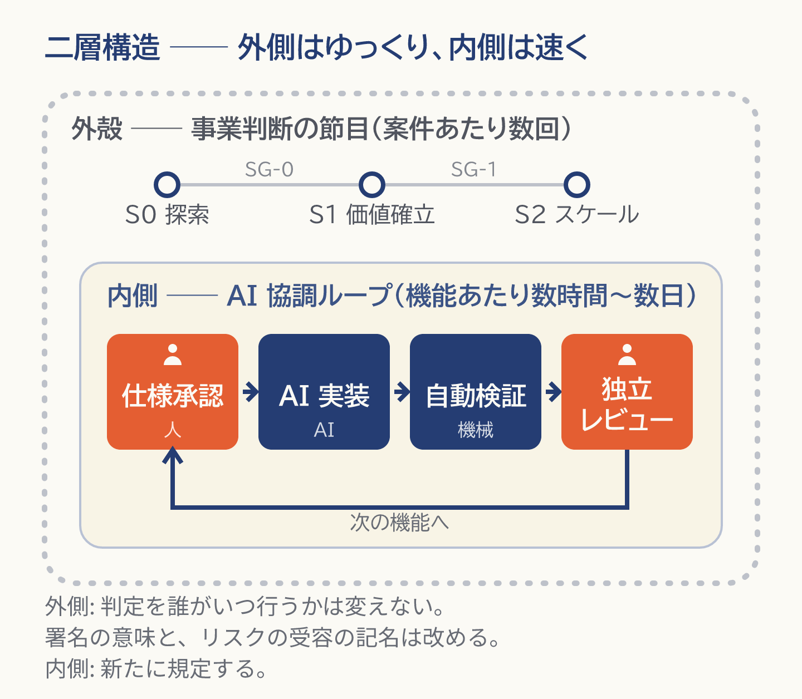
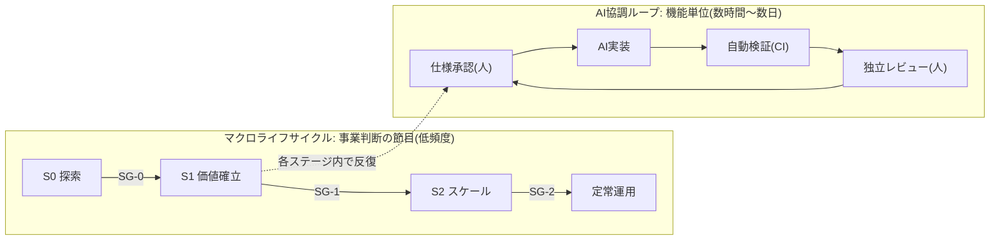
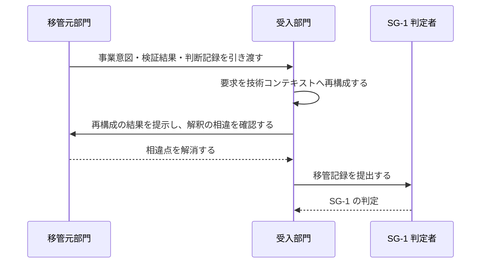
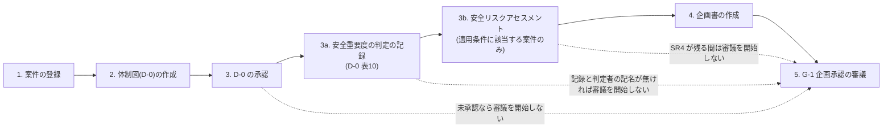
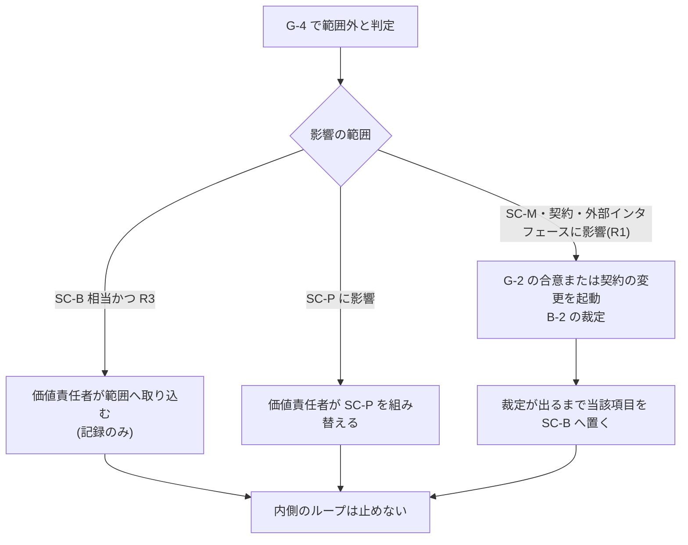

本章は、本標準が対象とする開発ライフサイクルの階層構造と、その節目に置くマイルストーンを規定します。

## 2.1 本章が達成すべき成果

本章の要求事項を満たしたとき、次の成果が得られます。

- 事業判断の節目と、日々の開発反復とが、それぞれ別の頻度で運用されている
- 各節目において、次段階へ移行してよいかを判定する制御点が定義されている
- 事業ステージに応じて、開発反復の厳格さが段階的に変化している
- 部門をまたぐ移管が、受入側の理解の成立をもって完了している

## 2.2 二層構造

本標準のライフサイクルは、頻度の異なる2階層からなります。図の「外殻」はマクロライフサイクルを、「内側」は AI協調ループを指します。

| 階層 | 頻度 | 判定の性質 | 既存制度との関係 |
| --- | --- | --- | --- |
| マクロライフサイクル | 案件あたり数回 | 投資継続・移管・出荷可否の判断 | 既存の稟議・決裁権限規程と、出荷判定の席・判定者・時点は変えない(規程を持たない体制では、D-0 体制図の記名で定める)。出荷判定者の署名の意味と、リリース決裁(G-8)での残存リスクの受容の記名は改める。出荷判定の規程を持つ組織では、その改定を要する([第4章 G-7・G-8](/process-compass/phase4-process-design/gate-criteria/)) |
| AI協調ループ | 機能あたり数時間〜数日 | 仕様適合・実装品質の判断 | 新たに規定する |

本標準は、AI協調ループについて、反復の周期・チームの会合の持ち方・事業ステージより短い期間の計画の方法を規定しません([第1章 1.2](/process-compass/phase4-process-design/overview/))。本標準は、作業の一覧については、2.10 が定める事項に限って規定します。この層にも、2.10(作業の単位の観測と調整)、[第3章 3.12.10](/process-compass/phase4-process-design/roles-responsibilities/)(停止の条件)、[第5章](/process-compass/phase4-process-design/human-ai-boundary/)(AI の自律)、[第6章](/process-compass/phase4-process-design/deliverable-templates/)(記録)の規定は掛かります。

二層に分ける理由は次のとおりです。

- 事業判断の頻度を上げると決裁が滞留し、開発反復の頻度を下げると AI の生成速度を活かせない
- 判断の性質が異なるため、判定者・判定基準・期限を分離しなければ責任の所在が曖昧になる

## 2.3 事業ステージ

事業ステージは、不確実性を段階的に低減する区分です。本節は、3ステージを定義します。

| 記号 | 名称 | ゴール | 出口ゲート |
| --- | --- | --- | --- |
| S0 | 探索 | 事業仮説と技術的実現性を検証し、投資継続の可否を判断できる状態にする | SG-0 |
| S1 | 価値確立 | 実利用者に価値が届くことを実証し、継続提供できる技術基盤を確立する | SG-1 |
| S2 | スケール | 利用者層の拡大に耐える品質・運用体制・再現性を確立する | SG-2 |

:::note
本標準の S0・S1・S2 は**事業ステージ**であり、製造業で一般に用いられる設計審査の DR1〜DR4 とは対象が異なります。本標準が事業ステージを S の記号で示すのは、両者を同じ記号で表すと現場で取り違えが生じるためです。
:::

### 実装スタックの確定時期

実装スタックは **S0 の出力であり、入力ではありません**。S0 のゴールが技術的実現性の検証である以上、どの構成で作るかは探索の結果として定まります。確定の時期は SG-0 とし、S0 の期間中は未確定でよいものとします([ADR-0034](/process-compass/adr/0034-stack-is-output-of-exploration/))。

| 時期 | スタックの状態 | 扱い |
| --- | --- | --- |
| S0 の期間中 | 未確定 | 正規の状態。時期が来ていないだけである |
| SG-0 | 確定 | 既存の判定基準「技術的実現性が確認されている」に含まれるものとして扱う |
| SG-0 の通過後 | 未確定が残る | **未達**として扱う |

**未確定は未達ではありません**。両者を次のとおり区別します([ADR-0028](/process-compass/adr/0028-unmet-gate-distinct-from-omitted/))。

- 未達は、目的を達成する構成を示せていない状態である
- 未確定は、確定の時期が来ていない状態である

SG-0 の判定基準を増やしてはなりません。基準を増やすと、投資継続の判定に実装の詳細が持ち込まれます。

S0 の結果に基づいて記録済みのスタックを変更する場合、技術判断者の判断とし、判断記録(ADR)を残します。**企画承認(G-1)の再判定は要しません**。G-1 の判定基準は実装スタックを含まないためです。

<!-- impl IMPL-0844 target=gate-skill state=delivered check=manual note="SG-0 の判定基準を増やさないこと、SG-0 で実装スタックが確定していなければそのことを示すこと(SG-0 の通過後に未確定が残ると未達)。.claude/skills/gate/gates/SG.md の「材料の集め方」6 が置く。判定の内容は機械が見ない。確かめる者: B-2 の決定者(SG-0 の判定記録を書くとき)。所在を読んだ(実行して確かめていない)" -->
<!-- impl IMPL-0845 target=process-change-skill state=delivered check=manual note="記録済みの実装スタックの変更を技術判断者の判断とし、判断記録(ADR)を残すこと。.claude/skills/process-change/kinds/settings.md の表の行 stack が置く(判断記録は /adr-write)。企画承認(G-1)の再判定を要しないことは、要しないことの表明で追わない。確かめる者: 変化点の決定者(/process-change の出力を読むとき)。所在を読んだ(実行して確かめていない)" -->

### 既存の設計審査体系との対応

製造業の設計審査(DR)を運用している組織は、ステージ移行ゲート(SG)と自組織の設計審査の対応を、テーラリング([第8章](/process-compass/phase4-process-design/tailoring-guide/))で確定します。次の表は対応の目安であり、確定した対応ではありません。

:::note
DR の番号体系は標準化されていません。実施の回数と時期は各社の判断で定まり、二次解説どうしでも DR1 の指す工程が一致しません([調査記録](/process-compass/phase1-current-state/jp-governance/))。下表の番号は説明のための例であり、自組織の番号と一致するとはかぎりません。
:::

| 本標準 | 製造業の設計審査(例) | 対象 |
| --- | --- | --- |
| S0 探索 / SG-0 | DR1 開発企画フェーズ | 開発の妥当性・事業性の評価 |
| S1 価値確立 / SG-1 | DR2 構想設計フェーズ | 実現手段・技術構成の評価 |
| S2 スケール / SG-2 | DR3 詳細設計、DR4 量産移行 | 量産・本番展開への移行判断 |

## 2.4 ステージ移行ゲート

ステージの境界には移行ゲートを置きます。判定は3択とし、判断を保留したまま継続する状態を作りません。

| ゲート | 名称 | 判定 | 主な判定基準 |
| --- | --- | --- | --- |
| SG-0 | 探索完了 | S1へ移行 / 継続検証 / 中止 | 事業仮説が実証データで支持されている。技術的実現性が確認されている。次ステージの投資規模と体制が示されている |
| SG-1 | 価値確立完了 | S2へ移行 / 継続 / 中止 | 実利用者における価値が実証されている。拡大に耐えるアーキテクチャが確定している。受入部門が要求を自らの言葉で再構成できている |
| SG-2 | スケール完了 | 定常運用へ移行 / 改善継続 | 対象利用者層の品質基準を満たしている。運用体制が定常運用として成立している。受容した負債の返却計画が承認されている |

SG-0 の「実証データ」と SG-1 の「実利用者における価値の実証」は、実在の顧客・利用者の観測から得たものに限ります。AI が顧客を模して生成した出力は数えません([第6章 D-0](/process-compass/phase4-process-design/deliverable-templates/)「AI が生成した顧客の声を、観測に数えない」、ADR-0091)。

SG-2 を設けない場合、プロジェクト体制のまま運用が継続し、技術負債の返却主体が消えます。定常運用への移行は明示的に判定しなければなりません。

ステージ移行ゲートの判定は、ステアリングコミッティ(B-2)が行います。会議体の構成・判定の語彙・判定期限は、[第3章 3.7](/process-compass/phase4-process-design/roles-responsibilities/)によります。ステージ移行ゲートの前提条件(D-0 の次回レビュー期日)は、2.8「前提条件の統制」によります。

次ステージの予算は、ステージ移行ゲートの判定と同時に確定させます。予算の構成と中止(Kill)の判断基準は、[第7章 7.7](/process-compass/phase4-process-design/exception-escalation/)によります。

<!-- impl IMPL-0846 target=gate-skill state=delivered check=manual note="ステージ移行ゲートの補助ファイル gates/SG.md が、判定の値(SG-0 と SG-1 は3値、SG-2 は定常運用へ移行 / 改善継続)と判定者(B-2)を表で置き、材料の集め方3 で次ステージの予算を SG の判定と同時に確定させると置く。保留のまま継続しない扱いは 3.7.3 の IMPL-0657 が、AI が顧客を模して生成した出力を実証データに数えない扱いは第6章 D-0 の IMPL-0359 が追う。確かめる者: B-2 の決定者(SG の判定記録を書くとき)。所在を読んだ(実行して確かめていない)" -->

<!-- impl IMPL-0953 target=gate-skill state=delivered check=manual note="SG-0・SG-1 の実証に、AI が顧客を模して生成した出力を数えないこと。.claude/skills/gate/gates/SG.md の材料の集め方の項9に置く。確かめる者: 当該ゲートの判定者(判定記録を書くとき)。所在を読んだ(実行して確かめていない)" -->

## 2.5 工程ゲートとの関係

ステージ移行ゲート(SG)と工程ゲート(G-1〜G-8)は、別の軸です。混同してはなりません。

| 観点 | ステージ移行ゲート(SG) | 工程ゲート(G) |
| --- | --- | --- |
| 判断の対象 | 投資を継続するか、次ステージへ進むか | この成果物を次工程へ進めてよいか |
| 頻度 | 案件あたり3回 | 開発サイクルごと |
| 判定者 | 会議体(投資判断・事業決裁) | 単独の判定者 |
| 期限 | 会議体の開催周期 | 24〜72時間 |

各ステージでの工程ゲートの状態は、[第8章 軸B](/process-compass/phase4-process-design/tailoring-guide/)によります。本節に表を置きません。同じ規定を2か所に書かないためです(第1章 1.7)。ステージが上がるほど、適用するゲートが増えます。

G-4 と G-5 は、どのステージでも省略しません。この2つを外すと、仕様の承認を経ない実装と、機械検証を経ない統合が発生するためです。S0 でも、技術設計判断(G-3)とリリース決裁(G-8)を適用します(第8章 軸B)。

<!-- impl IMPL-0847 target=config-gates state=delivered check=manual note="G-4 と G-5 をどの事業ステージでも省略しないこと。契約検査(verify-gate-contract.mjs の「G-4 と G-5 はどの構成でも省略できない」の節)が、構成の gates.g4・gates.g5 の state が required か simplified 以外の構成を失敗にする。S0 でも G-3 とリリース決裁(G-8)を適用する旨は第8章 軸B の規則が持ち、本マークは追わない。確かめる者: AI維持管理者(契約検査の結果を読むとき)。所在を読んだ(実行して確かめていない)" -->

## 2.6 AI協調ループの構成

AI協調ループは、機能単位で次の4工程を反復します。

| 工程 | 主体 | 完了条件 | 配置するゲート |
| --- | --- | --- | --- |
| 仕様承認 | 人間 | 受入基準が検証可能な形式で確定している | G-4 |
| AI実装 | AIエージェント | 実装計画の全タスクが完了している | — |
| 自動検証 | CI | 定めた機械判定基準をすべて満たす | G-5 |
| 独立レビュー | 人間(作成を指示した者以外) | 仕様と実装の一致を確認し、挙動を記録した | G-6 |

ループの反復単位は、次の制約を満たさなければなりません。

- 1周期の実装量は、独立レビューが単独で完結できる大きさに収める
- 受入基準を満たさない実装は、次工程へ進めずループ内で差し戻す
- 反復の終わりに、該当がある記録をコンテキスト基盤へ書き戻す。該当が無い反復に、記録を求めない
  - 設計上の選択を伴った場合は、判断記録(ADR)
  - 妥協・仮実装を受容した場合は、技術負債台帳
  - 規約・用語が変わった場合は、恒久層コンテキスト

<!-- impl IMPL-0879 target=claude-md-resident state=delivered check=manual note="反復の終わりの書き戻し。設計上の選択を伴ったら判断記録(ADR)、妥協・仮実装を受容したら技術負債台帳、規約・用語が変わったら恒久層コンテキストへ書き戻すこと。準拠テンプレートの CLAUDE.md 節「文脈への書き戻し」が置き、claude-md-resident.json がその節の存在を照合する。節は判断記録・技術負債台帳・恒久層の3つを置き、該当が無い反復に記録を求めない旨(課さない側の文)は置かない。書き戻したかを機械は確かめない。第6章 テンプレ3 の IMPL-0788 は技術負債台帳の側から同じ趣旨を追う。 確かめる者: 技術判断者(反復を終えるとき)。所在を読んだ(実行して確かめていない)" -->

<!-- impl IMPL-0880 target=pr-checks state=delivered check=manual note="1周期の実装量を、独立レビューが単独で完結できる大きさに収めること。構成の task の基準値(既定 400行・15ファイル)を超えた PR で、G-5(pr-rules)が PR の規模の確認の欄(実施者・読み切れたか・分割しなかった理由)を求め、区分の下限を R2 へ上げる。超過は失敗にならず、読み切れたかは自己申告である。 確かめる者: 独立レビューの担当者(G-6 で規模の確認の欄を読むとき)。所在を読んだ(実行して確かめていない)" -->

<!-- impl IMPL-0881 target=rulesets state=delivered check=manual note="受入基準を満たさない実装は次工程へ進めず、ループ内で差し戻すこと。ルールセット(.github/rulesets/checks-only.json ほか)が gate-g5・gate-g5-base を必須チェックにし、失敗した PR は既定ブランチへマージできない。G-5 の基準を満たすかは各検査が判定する。 確かめる者: 独立レビューの担当者(マージの前)。所在を読んだ(実行して確かめていない)" -->

### 判断記録の範囲

判断記録(第6章 テンプレ2)の範囲は、本節に定めます。ほかの章と準拠テンプレートは、本節を引きます。

判断記録に書くのは、設計上の選択です。設計上の選択には、次のものが当たります。この一覧は例示であり、網羅ではありません([ADR-0041](/process-compass/adr/0041-scope-is-not-exhaustive/))。

- 依存の追加・変更(ライブラリ、フレームワーク、データストア、外部サービス)
- 外部インタフェース(公開するインタフェース、ほかのシステムとの連携の方式)
- データ形式(永続化の形式、交換の形式)
- 構成単位の境界(モジュール・サービスの分け方と、責務の割り当て)
- 非機能への影響(性能・可用性・セキュリティの見込みを変える選択)

次の変更も、既存の規定のとおり判断記録の対象です。

- プロセスの構造の変更([改善サイクル](/process-compass/phase6-operation/improvement-cycle/)の外側ループ)
- 安全重要度(CL)の引き下げ([第8章](/process-compass/phase4-process-design/tailoring-guide/)「設計によって区分を下げる」)
- 記録済みの実装スタックの変更(2.3「実装スタックの確定時期」)

範囲について、次のとおり定めます。

- 原則と規約は、恒久層(プロダクトの原則・用語集・設計標準)に置く。判断記録に置かない。プロダクトの原則の様式は[第6章 テンプレ12](/process-compass/phase4-process-design/deliverable-templates/)による
- 選択が可逆であることを理由に、判断記録を省いてはならない。可逆性は、判断記録の「可逆性」欄に書き、技術設計判断(G-3)の基準3 で判定者が評価する。可逆性で判断記録の要否を分けると、可逆性の評価が判定の前に起案者の申告で済むためである([ADR-0071](/process-compass/adr/0071-structure-of-principles-decisions-and-gate-records/))

<!-- impl IMPL-0848 target=adr-template state=delivered check=manual note="判断記録の範囲。様式 templates/02-adr.md の冒頭の注記が範囲を 2.6 から引き、節「可逆性」の欄が可逆性を書く場所を置く(様式が運ぶ分)。原則と規約を判断記録でなく恒久層に置くこと、選択が戻せることを理由に判断記録を省かないこと、プロセスの構造の変更・安全重要度の引き下げ・記録済みの実装スタックの変更を判断記録の対象とすることのスキル側は IMPL-0952 が追う。確かめる者: 技術判断者(判断記録を起こすとき)。所在を読んだ(実行して確かめていない)" -->

<!-- impl IMPL-0952 target=adr-write-skill state=delivered check=manual note="判断記録の範囲(スキル側)。原則と規約を判断記録でなく恒久層に置くこと、選択が戻せることを理由に判断記録を省かないこと、プロセスの構造の変更・安全重要度の引き下げ・記録済みの実装スタックの変更を判断記録の対象とすること。.claude/skills/adr-write/SKILL.md が置く。IMPL-0848 から分けた(束 C の突合 1巡目 C1-38)。確かめる者: 技術判断者(判断記録を起こすとき)。所在を読んだ(実行して確かめていない)" -->

#### 判断記録の要否の規則

設計上の選択は、PR の差分に埋もれます。作成者の自己確認だけでは、判断記録を書かないまま取り込んだ選択を見つけられません。そこで、変更の対象から機械で導ける「判断記録を要する変更」の規則を構成に置き、PR と照合します。新しい承認の席は置きません。判断記録は、既存の技術設計判断(G-3)へ渡ります。

| # | 要求事項 |
| --- | --- |
| 1 | 判断記録の要否の規則を、プロセス構成に置く。規則は、変更の対象のパス(例: 公開インタフェースの定義、永続化のスキーマ、データの移行、構成単位の境界の定義)と変更種別から、判断記録を要する変更を導く形で書く |
| 2 | 規則に当たる変更は、判断記録の識別(トレーラ `ADR`)を要する。識別が指す判断記録が実在しない変更は、識別が無い変更として扱う |
| 3 | 規則に当たった変更を、申告(「設計上の選択を含まない」の記載など)で規則の対象から外してはならない。選択の余地が無かった場合も、判断記録にそう書いて G-3 に掛ける |
| 4 | 判断記録の識別を持つ変更は、取り込む前に、その判断記録の G-3 の判定記録を要する([第4章 G-3](/process-compass/phase4-process-design/gate-criteria/)) |
| 5 | 規則の起案は技術判断者が行い、AI維持管理者が承認する。規則を削る変更と、当たる範囲を狭める変更は、統制を緩める向きの変更として、D-0 表1「体制と運用形態」の決定者の記名と理由を要する([第3章 3.13.3](/process-compass/phase4-process-design/roles-responsibilities/)) |
| 6 | 規則を変える変更の区分の下限は、R2 とする。規則と製品のコードを同じ変更で変えてはならない。規則は、変更の対象の側でなく基底ブランチの構成から読む |

- 規則は、組織がそのパスの選択を判断記録の対象と定めた範囲である。下の「ステージによるループの回し方の変化」の表の判断記録の行(S1 はコア機能)より広い範囲を規則に書いた場合も、S1 以降は規則の宣言を優先する
- 規則に当たって識別の無い変更を失敗させず、注意として示す(適用: S0)。表の S0 の行が、判断記録を G-3 の判定の対象とした選択に限るためである
- ステージを確かめられない構成は、失敗させる側に倒す
- 規則が確かめるのは、判断記録の照会を漏らさないことだけである。選択が適切か、判断記録の中身が十分かは確かめない。それは G-3 の判定者が行う
- 規則の網羅は主張しない([ADR-0041](/process-compass/adr/0041-scope-is-not-exhaustive/))。規則に当たらない設計上の選択は、作成者の判断記録の追加、PR の自己チェック、G-6 のパス1 と差し戻しに残る。規則が無い構成と、規則のパスが追跡中のファイルに1件も当たらない構成は、未宣言として「判断記録を要する設計上の選択を検出できない」と示す
- 作成者・レビュア・AI の担い手は、規則に当たらない変更について「判断記録が要る」と足してよい。AI の担い手の「当たらない」との出力で、規則の当たりを外さない
- 依存の追加・更新は、G-5 基準8 と G-6 基準5 に既に経路がある。規則に自動で含めない。依存のマニフェストを規則に書くことは妨げない
- 区分の下限の規則([第3章 3.8.1](/process-compass/phase4-process-design/roles-responsibilities/))と同じ構成に置いてよい。区分の下限と判断記録の要否は、別の値として書く。区分が R3 であることを、判断記録を要しない理由にしない

<!-- impl IMPL-0384 target=pr-checks state=delivered check=machine test=template/scripts/gate/test-check-pr.mjs note="判断記録の要否の規則(構成の decisionRules.rules。基底ブランチから読む)に当たる変更で、本文の末尾の段落にトレーラ ADR が無い、または指す判断記録が context/decisions/ に無い PR を、G-5(pr-rules)が失敗させる。事業ステージ S0(構成の回答 q-biz-phase が poc)では失敗させず注意を出す。ステージを確かめられない構成(回答 q-biz-phase が無い)は失敗させる。申告で外す経路を置かない。規則が無い・規則のパスが追跡中のファイルに1件も当たらない・形の誤った規則だけの構成は、検出できない旨を出す。保管領域(context/_archive/decisions/)の判断記録を指すトレーラは、置き換え・廃止済みとして失敗させる。PR を経ないコミットは、出荷の証跡の集約が照合する(IMPL-0389)。decisionRules を変える PR の下限を R2 とし、decisionRules と製品のコードの同時変更を失敗させる。G-3 の判定記録への到達(要求事項4)は IMPL-0972 が確かめる。判断記録の中身は確かめない(G-3・G-6 の判定者が確かめる)" -->
<!-- impl IMPL-0389 target=evidence-aggregation state=delivered check=machine test=template/scripts/gate/test-direct-commit-rules.mjs note="要求事項2・3・6 のうち、PR を経ないコミット(トレーラ Risk・Verification で扱う経路)への照合。出荷の証跡の集約が、当該コミットの直前の構成の decisionRules.rules をコミットの差分に当て、トレーラ ADR が無い、または指す判断記録がそのコミットの context/decisions/ に無いコミットを記載の欠落にする。事業ステージ S0 では欠落にせず品質レポートに注意を出す。decisionRules と製品のコードを同じコミットで変えたコミットを欠落にする。成立済みのコミットは書き換えず、判定記録の「対象」で補う(#423)" -->
<!-- impl IMPL-0390 target=config-change-log state=delivered check=machine test=template/scripts/gate/test-loosening-decider.mjs note="要求事項5 のうち、規則を削る・対象のパスを外す・変更の種類を絞る構成の変更を、緩める向きの変更として D-0 表1『体制と運用形態』の決定者の記名と理由なしには受け付けないこと。変化点の入口(generate-profile.mjs --change の種別 settings)が拒否する。起案者が技術判断者であること、AI維持管理者の承認は確かめない" -->

<!-- impl IMPL-0972 target=pr-checks state=delivered check=machine test=template/scripts/gate/test-check-pr.mjs note="2.6 要求事項4: トレーラ ADR が指す判断記録ごとに、G-3 の判定記録の様式(基底ブランチの docs/gates/ と記録用ブランチの records/gates/。後者は判定者の記名が名簿の人へ対応づくものに限る)か、判断記録を入れた PR の宣言行 `G-3: 通過` を1行目に持つ名簿の人(AI の名義でない)のレビュー(状態は問わない。基底へ入っている判断記録は記録用ブランチの写し records/reviews/pr-N.json を読む)を確かめ、無ければ G-5 が失敗させる(S0 は注意)。宣言行の無い承認は数えない。この PR のレビューを読めないとき、ホスティングの記録を引けないとき、基底へ入っている判断記録を入れた PR の写しの置き場(衝突の記録を含む)を読めないときは、失敗にせず確かめられない旨を注意に出す。記録用ブランチを読めないときは「まだ無い」と区別できないため、この PR で足した判断記録と PR を経ない判断記録は失敗を残し、理由の文に読めない旨を書く。写しが記録用ブランチに無いときも失敗を残し、写しが無い旨を書く。判定した版と取り込む版の一致は確かめない(IMPL-0523)。判定の中身は G-3 の判定者が確かめる" -->

:::caution[暫定 EV-0206 / 見直し 2027-11]
**対象**: 判断記録の要否をパスと変更種別の規則で導き、当たった変更に判断記録の識別を求め、申告で外す経路を置かない判断。S0 で失敗させず注意に留める扱い。
**根拠の水準**: E2(単一事例)。
**差し替え条件**: 採用組織での、規則が当たった変更の件数、そのうち判断記録が「選択の余地が無かった」だけを書いた件数、規則を狭めた変更の件数。規則が当たらないまま取り込まれ、後から設計上の選択と判明した変更の件数(事後の判断記録、欠陥の台帳、内部監査の抜き取り)。「選択の余地が無かった」の比率の高い組織が複数あれば、規則の書き方の手引きを見直す。後から判明した変更が多ければ、自己チェックに頼る範囲を見直す。

パス・型から公開 API の変更を機械的に検出し、別の承認者へ回すオープンソースの長期の運用1件に依ります。規格化された作法は見つかっていません。
:::

### ステージによるループの回し方の変化

ステージが上がるほど、反復の速度より記録の厳格さを優先します。

| 観点 | S0 探索 | S1 価値確立 | S2 スケール |
| --- | --- | --- | --- |
| ループの主目的 | 学習 | 適合 | 品質と再現性 |
| 判断記録(ADR) | G-3 の判定の対象とした選択 | コア機能は必須 | 全件必須 |
| コンテキスト基盤 | 案件層のみ | 恒久層の整備を開始 | 恒久層の維持が必須 |
| 想定する反復周期 | 数時間〜1日 | 1〜3日 | 2〜5日 |

:::caution[暫定 EV-0149 / 見直し 2027-10]
**対象**: 「ステージによるループの回し方の変化」の表の、想定する反復周期の値(S0 数時間〜1日、S1 1〜3日、S2 2〜5日)。
**根拠の水準**: E0(なし)。
**差し替え条件**: 採用組織の案件で、機能仕様承認(G-4)から独立レビュー(G-6)の判定までの所要時間を、事業ステージごとに集めた分布。

ステージが上がるほど記録の厳格さを優先する、という設計の意図を示すために置いた想定の値です。測った値ではありません。本標準は反復の周期を規定しません(第1章 1.2)。この行は要求事項ではありません。
:::

独立レビュー(G-6)のステージごとの状態は、第8章 軸B によります。

本標準は、探索(S0)の記録の量に上限を課しません。量を掛ける対象である探索の記録を、本標準は成果物として定義していないためです([ADR-0072](/process-compass/adr/0072-document-volume-is-not-a-metric/))。

**探索の記録の置き場と様式も、本標準は課しません**。ステージ移行ゲート(SG-0)へ渡すのは、SG-0 の決断の記録([第5章 5.7.2](/process-compass/phase4-process-design/human-ai-boundary/))の「確認した事項」と「確認していない事項」です。基準「技術的実現性が確認されている」について、確認した事項には依った探索の記録を挙げ、その記録へ到達できなければなりません。到達できる期間は、[第4章「判定が指す記録の保管」](/process-compass/phase4-process-design/gate-criteria/)と同じく、組織が定める保管期間です。確認していない事項に書いた技術的な問いは、S1 の機能仕様の前提か、実装計画の検証のタスクへ移します([ADR-0078](/process-compass/adr/0078-rejudge-on-change-and-irreversible-operation/))。

<!-- impl IMPL-0252 target=gate-record-template state=delivered check=manual note="SG-0 の決断の記録の「確認した事項」に、依った探索の記録を挙げて所在を書き、到達できるようにする。確認していない技術的な問いごとに、移し先(S1 の機能仕様の前提の ID、または実装計画の検証のタスク)を書く。テンプレ4(templates/04-gate-record.md)の決断の記録と /gate の SG の補助ファイルが注記で置く。探索の記録の様式は足さない(ADR-0078)。所在へ届くか、問いが移ったかは機械で確かめない。確かめる者: 会議体の決定者(SG-0 を判定するとき)(#359)" -->

本標準は、事業ステージ S1 以降の技術的な検証も、作業の種別として定めません。検証の結果が確定した成果物を変える場合の扱いは、[第4章「確定した版を変える場合」](/process-compass/phase4-process-design/gate-criteria/)によります。

## 2.7 部門間移管

事業ステージの移行に伴って担当部門が変わる場合、移管を SG-1 の判定要件として扱います。

移管の完了条件は次のとおりです。文書の引き渡しをもって完了とはしません。

| # | 完了条件 |
| --- | --- |
| 1 | 受入部門が、事業意図と価値仮説を自らの言葉で再構成した文書を作成している |
| 2 | 再構成の結果を移管元が確認し、解釈の相違が解消されている |
| 3 | 移管で確定しなかった事項(持ち越し事項)が一覧化され、それぞれに解消の期限と責任者が割り当てられている |
| 4 | 恒久層コンテキストに、移管対象の用語・制約・判断基準が登録されている |
| 5 | 移管後の結果責任者(A)が指名され、担当表に記録されている |

条件1を文書の受領で代替してはなりません。受入側が再構成できない状態は、移管が完了していない状態です。

人員の交代を伴う移管、および定期異動によるロールの継続性の断絶については、2.9 のコンテキスト移管ゲートを併せて適用します。

<!-- impl IMPL-0882 target=gate-skill state=delivered check=manual note="部門間移管を SG-1 の判定要件とし、完了条件5つを満たすこと(条件1を文書の受領で代替しない)。.claude/skills/gate/gates/SG.md の材料の集め方の項10に置く。移管記録の様式と検査はテンプレートに無く、判定者が記録の所在を判定記録に書く。確かめる者: 当該ゲートの判定者(判定記録を書くとき)。所在を読んだ(実行して確かめていない)" -->

## 2.8 案件の立ち上げ手順

事業ステージ S0 の開始時に、次の順序で立ち上げを行います。順序を入れ替えてはなりません。

| # | 手順 | 成果物 | 責任者 |
| --- | --- | --- | --- |
| 1 | 案件を登録し、案件IDを付与する | 案件登録記録 | 起案者 |
| 2 | 意思決定・エスカレーション体制図(D-0)を作成する | D-0 | 起案者(AIが草案を生成) |
| 3 | D-0 を承認する | 承認記録 | D-0 表1 の投資継続を決定する者 |
| 3a | 安全重要度の判定を記録し、判定者と別の自然人の確認を得る | D-0 表10 | D-0 表1「体制と運用形態」の決定者 |
| 3b | 安全リスクアセスメント表を作成し、作成者と別の自然人の承認を得る(適用条件に該当する案件のみ) | テンプレ9 | 技術判断者 |
| 4 | 企画書を作成する | 企画書 | 価値責任者 |
| 5 | 企画承認(G-1)を審議する | 判定記録 | 事業決裁者 |

手順3b の適用条件と様式は[第6章「AIエージェント安全リスクアセスメント」](/process-compass/phase4-process-design/deliverable-templates/)によります。該当しない案件では手順3b を省略します。

<!-- impl IMPL-0883 target=g1-check state=delivered check=machine test=template/scripts/gate/test-project-id.mjs note="案件の登録。S0 の開始時に案件を登録して案件IDを付与し、案件登録記録を残すこと(手順1)。降ろし先は scripts/gate/check-g1.mjs で、企画書の project_id が構成の projectId と一致すること、案件の記録 context/projects/案件ID.md が実在することを確かめる。ファイルの不在は G-1 の前では失敗にし、G-1 を通過済みの既存の案件では注意にとどめる(遡って失敗させない)。一致の検査は通過済みでも失敗にする。確かめるのは値の一致とファイルの実在だけで、記録の内容は確かめない。専用の様式は置かず、context/projects/README.md の項目を使う(ADR-0222)" -->

<!-- impl IMPL-0884 target=gate-entry-workflow state=delivered check=machine test=template/scripts/gate/test-brief-estimates.mjs note="立ち上げの順序(D-0 の承認、安全重要度の判定の記録、安全リスクアセスメント、企画書、G-1)を入れ替えないこと。scripts/gate/check-g1.mjs(gate-entry.yml の g1-check)が、G-1 の通過の記録がまだ無いとき(最初の G-1)だけ、作業ツリーの (a) D-0 の承認日 ≤ (b) 節16 の判定日 ≤ (c) 様式 09 の承認日(表を置いた案件だけ) ≤ (d) 企画書(docs/project-brief.md)の最後のコミットの日付を読み、前後が逆なら失敗にする。G-1 の通過の記録があるとき(通過の後の実行と、判定し直しの G-1)は、機械で比べない。変化点や設定の変更で D-0 と様式 09 を承認し直すと承認日が正当に改まり、判定した版の文書は squash の取り込みの後に辿れなくなるため、決定可能な条件にならない。これは緩和ではなく、検査の閉じ方の開示である。通過の後は、比べない旨の表示を1行だけ出す(失敗にも警告にもしない)。判定し直しの G-1 で順序の逆が機械で止まらない点は、機械で閉じないと決めた点で、G-1 の判定者が確かめる。読めない日付は確認できないと注意に出し、失敗にしない。企画書の作成は最後のコミットの日付で見る(下書きを先に置くことは妨げない)。案件の登録(組織の台帳)はリポジトリの外で確かめない。日付は記録の自己申告とコミットの日付で、改ざんは機械が確かめない。gate-entry.yml の実行は実物の GitHub で確かめていない。判定の記録(第8章 軸E)は IMPL-0449、テンプレ9 の承認の欄は IMPL-0453 が追う。確かめる者: G-1 の判定者" -->

### D-0 を前提条件とする理由

D-0([第6章 テンプレ0](/process-compass/phase4-process-design/deliverable-templates/))は、企画承認の判定対象ではなく**判定を開始するための前提条件**です。両者を区別します。

| 区分 | 定義 | G-1 における対象 |
| --- | --- | --- |
| 前提条件 | 満たしていなければ判定を開始しない条件 | D-0 の承認 |
| 判定基準 | 判定において合否を評価する基準 | 投資対効果、リスク受容、基盤整備の予算化 |

D-0 を判定基準に含めると、体制の不備が投資対効果と相殺されて通過することがあります。前提条件に置くのは、体制が定まらないまま審議へ進む経路をなくすためです。

**誰が決めるかが決まっていない状態で、何を作るかを決裁してはなりません**。決裁の後に体制を決めると、決裁内容に合わせて責任者が選ばれ、責任の所在が事後的に構成されます。

### 前提条件の統制

- D-0 が承認されていない案件は、G-1 の審議を開始してはならない
- 安全重要度の判定の記録(D-0 表10)と判定者の記名がそろっていない案件は、G-1 の審議を開始してはならない。判定の確認が届かないことは、審議を止めない。未達として表示する([第8章 軸E「判定の記録と確認」](/process-compass/phase4-process-design/tailoring-guide/))
- 安全リスクアセスメントの適用条件に該当し、かつ SR4 の危険源が残っている案件は、G-1 の審議を開始してはならない
- D-0 の次回レビュー期日を超過している案件は、ステージ移行ゲート(SG)の判定を開始してはならない
- 前提条件の充足は、人の確認ではなく機械的な検査によって判定する([フェーズ5](/process-compass/phase5-implementation/ci-gates/))

<!-- impl IMPL-0849 target=g1-check state=delivered check=machine test=template/scripts/gate/test-brief-thresholds.mjs note="第4章 G-1 前提条件3。テンプレ9 を置いた案件で、危険源ごとの最新の SR(残留 SR、無ければ低減後 SR、無ければ見積りの SR)が SR4 の行が残る間、check-g1.mjs が G-1 の審議を止める(G-1 通過済みは注意)。値の一致だけを見る。適用条件への該当・表の要否・見積りの中身は人が判定する" -->
<!-- impl IMPL-0850 target=gate-entry-workflow state=delivered check=manual note="D-0 の次回レビュー期日を超過している案件を検出し、ステージ移行ゲート(SG)の判定の材料に並べること(検出の分)。scripts/gate/check-d0.mjs が next_review の超過で失敗し、gates/SG.md の節「材料の集め方」1 が check-d0 の結果を SG の材料に並べさせる(G-1 の IMPL-0679 が追う検出と同じ検査を判定者が読む)。check-d0.mjs の冒頭の文言と失敗の文は G-1 と SG を名指す。失敗のとき SG を開始しないことは IMPL-0951 が追う。IMPL-0850 から分けた(束 C の突合 1巡目 C1-13)。確かめる者: SG の判定者(判定の材料を集めるとき)。所在を読んだ(実行して確かめていない)" -->

<!-- impl IMPL-0951 target=gate-entry-workflow state=delivered check=manual note="D-0 の次回レビュー期日を超過している案件で、SG の判定を開始させないこと。gates/SG.md の材料の集め方1 が、check-d0.mjs の超過の失敗のとき SG を始めないと書き、check-d0.mjs が SG を名指して失敗する(表示の回帰は test-cl-judgment.mjs が見る)。実装は G-1 の審議も止める。標準より広い停止(ADR-0154 決定5。安全側)。確かめる者: SG の判定者(判定の材料を集めるとき)。所在を読んだ(実行して確かめていない)" -->

期日を超過した D-0 を放置したまま判定を続ける運用を認めると、体制図は初回の作成時にのみ存在する文書になります。

## 2.9 コンテキスト移管ゲート

定期的な人事異動が制度として存在する組織では、対象システムを理解している人が数年で入れ替わります。本節は、要員の交代に際して理解の断絶を防ぐ手続を規定します。

### 2.9.1 適用対象

次のいずれかに該当する交代に適用します。

- 成果物の結果責任者(A)の交代
- 文脈オーナーの交代
- コア機能の理解保持者が交代し、残る保持者が1名以下になる場合

<!-- impl IMPL-0885 target=process-change-skill state=delivered check=manual note="コンテキスト移管ゲートの適用。.claude/skills/process-change/kinds/accountable.md の節「交代に続くコンテキスト移管」が、A・文脈オーナーの交代と理解保持者が1名以下になる交代で H-1〜H-3 を残作業として渡す。専用の様式は作らない。記録の置き場は採用者が決める。確かめる者: 体制の変化点を反映する席の責任者(反映のとき)" -->

### 2.9.2 移管の成立条件

移管は、口頭説明の完了によって成立しません。**後任者が前任者へ問い合わせずに判断できる状態**をもって成立とします。

この定義は 2.7 の部門間移管と同型です。文書の引き渡しは移管の手段であり、完了条件ではありません。

<!-- impl IMPL-0886 target=handover-guide state=delivered check=manual note="移管の成立の定義。.claude/skills/artifact/artifacts/05-handover.md の節「コンテキスト移管(H-1〜H-3)の記録の書き方」が、口頭説明の完了で成立とせず後任者が前任者へ問い合わせずに判断できる状態をもって成立とし、判定を H-3 で行うと置く。専用の様式と機械の検査は作らない。確かめる者: 交代を処理する価値責任者と文脈オーナー(H-1 の判定のとき)" -->

### 2.9.3 3つのゲート

| ゲート | 判定時期 | 判定者 | 判定の対象 |
| --- | --- | --- | --- |
| H-1 移管準備 | 交代の通知から3営業日以内(予告期間が5営業日未満の場合は翌営業日まで) | 価値責任者 | 対象範囲、理解保持者数、コンテキスト基盤の欠落、予告期間の区分 |
| H-2 書き戻し完了 | **予告期間に応じて定める**(2.9.5) | 文脈オーナー | 予告期間の区分に対応する範囲の解消 |
| H-3 理解の実証 | 交代日以降、合意した期限内 | 前任者でも後任者でもない者 | 後任者が独立して判断できること |

<!-- impl IMPL-0887 target=process-change-skill state=delivered check=manual note="3つのゲートの判定者と期限。.claude/skills/process-change/kinds/accountable.md の節「交代に続くコンテキスト移管」の表が受ける。判定者の割当と判定記録の種別は機械では確かめない。確かめる者: 体制の変化点を反映する席の責任者(反映のとき)" -->

### 予告期間

本節の期限は、すべて**予告期間**を基準に定めます。

> **予告期間**: 交代が**本人へ通知された時点**から交代日までの営業日数。

- 組織の内部で決定した日ではなく、**通知された日を起点とする**。前任者と後任者が動けるのは通知の後であるため
- **本標準は予告期間の長さを要求しない**。予告期間は人事制度が定めるものであり、開発プロセスの標準が介入する対象ではない。本標準が規定するのは、与えられた予告期間の中で何を行うか

<!-- impl IMPL-0888 target=handover-guide state=delivered check=manual note="予告期間の数え方。同節の H-1 の表が、交代の通知日(本人へ通知された日で、組織の内部で決めた日ではない)から交代日までの営業日数を予告期間とし、通知日と交代日から導く欄を置く。予告期間の長さは要求しない。営業日の導出の機械の検査は足さない。確かめる者: H-1 の判定者(価値責任者)" -->

:::caution
日本の一次統計では、転居を伴う異動の打診を**2週間前以内**に行う企業が 21.5%、**1ヵ月前以内**が 56.4% を占めます([調査記録](/process-compass/phase1-current-state/workforce-mobility/))。**予告期間が3週間以上あることを前提とした手続は、企業の2割強で成立しません**。満たせない期限を置くと、手続は運用されずに迂回されます。

なお同統計は転居を伴う異動のみを対象としており、**転居を伴わない異動の予告期間は確認できていません**。引越しの準備を要しないため、より短い可能性があります。本節が予告期間を区分して扱うのは、この不確実性を吸収するためです。
:::

### 2.9.4 H-1 移管準備: 欠落の棚卸し

コンテキスト基盤へ記録されていない知識を、次の4類型で洗い出します。文書化されずに個人へ留まりやすい知識の類型です。

| 類型 | 内容 | 書き戻し先 |
| --- | --- | --- |
| 設計の背景と制約 | 判断した時点の人員・期限・既存資産の制約 | 判断記録(ADR) |
| 却下した選択肢 | 検討したが採らなかった案と、採らなかった理由 | 判断記録(ADR)の代替案欄 |
| 運用上の勘所 | 壊れやすい箇所、監視値の読み方、負荷の周期性 | 運用引き継ぎ文書 |
| 組織的文脈 | 承認権限の所在、利用者との約束、過去の経緯 | D-0 および恒久層コンテキスト |

あわせて、コア機能ごとの**理解保持者数**(その機能について独立して判断できる人数)を数えます。理解保持者が1名の機能は、交代の前に2名以上へ増やさなければなりません。

保持者に数えるのは、本人以外の者が日付を付けて理解を確認した記録を持つ人に限ります。記録は、H-3 理解の実証(2.9.6)、[第3章 3.4.3](/process-compass/phase4-process-design/roles-responsibilities/)の演習、コア機能の障害対応の記録のいずれかです。運用引き継ぎ文書(第6章 テンプレ5)へ名前を書いただけの人は数えません。

:::caution
変更履歴の作成者数は、理解保持者数ではありません。AIエージェントが生成した変更の比率が高い環境では、作成者の記録が理解の所在を表さないためです。保持者の数え方の定めは、前の段落にあります。
:::

<!-- impl IMPL-0889 target=handover-guide state=delivered check=manual note="H-1 の欠落の棚卸し。同節が4類型(設計の背景と制約・却下した選択肢・運用上の勘所・組織的文脈)と書き戻し先の表を置く。専用の様式は作らず、記録の置き場は採用者が決める。確かめる者: H-1 の判定者(価値責任者)" -->

<!-- impl IMPL-0890 target=process-change-skill state=delivered check=manual note="コア機能ごとの理解保持者数を数え、理解保持者が1名の機能を、交代の前に2名以上へ増やすこと。降ろし先は process-change の種別 accountable の手順「交代の前に、理解保持者の数を確かめる」で、運用引き継ぎ文書の節2 の表を人が数える。保持者数を数える機械も、交代を止める機械も置かない(条文に無い停止は課さない。ADR-0222)。確かめる者: H-1 の判定者(交代の変化点を反映する前)" -->

<!-- impl IMPL-0891 target=handover-template state=delivered check=manual note="理解保持者の数え方。保持者に数えるのは、本人以外の者が日付を付けて理解を確認した記録(H-3・3.4.3 の演習・コア機能の障害対応の記録)を持つ人だけを数え、運用引き継ぎ文書へ名前を書いただけの人は数えないこと。templates/05-handover.md が同じ数え方を置き、確認した者が本人である行を受け付けない(IMPL-0066)。 確かめる者: 運用引き継ぎ文書の作成者と技術判断者(保持者を記入するとき)。所在を読んだ(実行して確かめていない)" -->

### 2.9.5 H-2 書き戻し完了

書き戻しの進め方は次のとおりです。

- 書き戻しは**前任者が書き、後任者がレビューする**。順序を逆にしない。後任者が読んで理解できることが検証の条件であるため
- AIエージェントが草案を生成してよい。ただし却下した選択肢と当時の制約は前任者しか保持していない情報であり、人が記入する
- 完了の判定は、追記した分量ではなく **H-1 で特定した欠落項目の消化**で行う

<!-- impl IMPL-0892 target=handover-guide state=delivered check=manual note="H-2 の書き戻しの進め方。同節が、前任者が書き後任者がレビューする順序、AI が草案を生成してよいが却下した選択肢と当時の制約は人が記入すること、完了を H-1 の欠落項目の消化で判定することを置く。確かめる者: H-2 の判定者(文脈オーナー)" -->

#### 期限と範囲を予告期間で決める

**予告期間の長短にかかわらず同じ期限と範囲を課してはなりません**。予告期間が短い場合、全部の書き戻しは物理的に完了しません。期限を固定すると、その手続は未達のまま放置されます。

期限と範囲を次のとおり定めます。期限はすべて**交代日を基準とする相対の指定**です。

| 予告期間 | H-2 の期限 | 書き戻す範囲 | 残りの扱い |
| --- | --- | --- | --- |
| 20営業日以上 | 交代日の10営業日前まで | H-1 で特定した欠落の全部 | — |
| 10〜19営業日 | 交代日の5営業日前まで | 全部 | — |
| 5〜9営業日 | 交代日の前営業日まで | 下記の優先順位の上位2類型 | 交代後へ繰り越す |
| 5営業日未満 | **交代日の前に H-2 を置かない** | — | 全部を交代後へ繰り越す |

繰り越しが生じる場合(予告期間 10営業日未満)、**前任者の関与の延長を H-1 の判定と同時に確定させます**。確定していない案件を H-1 で通過させてはなりません。

| 確定させる事項 | 内容 |
| --- | --- |
| 期間 | 延長する関与の終期。交代後の日付で指定する |
| 稼働の目安 | 週あたりの時間。「必要に応じて」は不可 |
| 連絡手段 | 前任者への到達手段と、応答の期限 |
| 繰り越した項目 | H-1 で特定した欠落のうち、未消化の項目の一覧 |

**「必要に応じて協力する」という合意を関与の延長として認めません**。前任者は次の配属先で別の業務を負うため、期間と稼働を定めない約束は履行されません。

<!-- impl IMPL-0893 target=handover-guide state=delivered check=manual note="予告期間に応じた H-2 の期限と範囲。同節の表が4区分の期限と範囲を置き、繰り越しがあるときは前任者の関与の延長(期間・稼働の目安・連絡手段・繰り越した項目)を H-1 の判定と同時に確定させ、確定していない案件を H-1 で通過させないこと、「必要に応じて協力する」を延長として認めないことを置く。期限の導出の機械の検査は足さない。確かめる者: H-1 の判定者(価値責任者)" -->

#### 短い予告のときに何から書き戻すか

上位2類型は次の優先順位で決めます。**この順序を入れ替えてはなりません**。

| 順位 | 類型 | この順位である理由 |
| --- | --- | --- |
| 1 | 組織的文脈 | 承認権限の所在や利用者との約束が分からないと、後任者には**単独で判断を開始する手段がない**。業務が即座に止まる |
| 2 | 運用上の勘所 | 障害が起きたときに必要となる。発生の時期を選べない |
| 3 | 設計の背景と制約 | 後から再構成できる。ただし前任者の関与を要する |
| 4 | 却下した選択肢 | 同上。前任者しか保持していないが、判断の停止には直結しない |

順位1・2 は**前任者の不在と同時に必要になるもの**、順位3・4 は**時間をかけて回収できるもの**です。

<!-- impl IMPL-0894 target=handover-guide state=delivered check=manual note="短い予告のときの書き戻しの優先順位(組織的文脈、運用上の勘所、設計の背景と制約、却下した選択肢)を同節が置き、入れ替えないとする。確かめる者: H-2 の判定者(文脈オーナー)" -->

#### 機械検査

期限を相対の指定へ変えても、検査は機械化できます。H-1 の記録に次の欄を必須とします。

| 欄 | 検査 |
| --- | --- |
| 交代の通知日 | 空でないこと |
| 交代日 | 空でないこと。通知日以降であること |
| 予告期間(営業日) | 上記2つから導出した値と一致すること |
| 前任者の関与の延長 | 予告期間が10営業日未満の場合、4項目がすべて埋まっていること |

**予告期間の区分は申告させません**。通知日と交代日から導出します。区分を申告させると、期限の緩い区分を選ぶ動機が生まれます。

<!-- impl IMPL-0895 target=handover-guide state=delivered check=manual note="H-1 の記録の必須欄の点検表。同節の表が交代の通知日・交代日・予告期間(営業日)・前任者の関与の延長の欄と、人が読む点検(空でないこと、交代日が通知日以降、通知日と交代日から導いた値との一致、10営業日未満なら4項目が埋まっていること)を置き、予告期間の区分を申告させず導出する。様式を作らないので機械の検査の入力が無く、check=machine を足さない(決定可能な条件だが降ろさない)。確かめる者: H-1 の判定者(価値責任者)" -->

### 2.9.6 H-3 理解の実証

移管が完了したかを、後任者の自己申告で判定してはなりません。熟練した開発者を対象とした対照実験では、作業時間が実測で19%長くなった条件について、本人は20%短くなったと申告しています(2025年7月公表)。理解の自覚は理解の証拠になりません。

判定は次の4課題の組み合わせで行います。

| # | 課題 | 合格の条件 |
| --- | --- | --- |
| 1 | 設計の説明 | 対象のコア機能について、記録を参照せずに設計判断とその理由を自分の言葉で説明できる |
| 2 | 却下案の再構成 | 採らなかった選択肢を1つ以上挙げ、採らなかった理由を説明できる |
| 3 | 障害時の初動 | 過去の障害事例を提示され、一次切り分けの手順と確認箇所を挙げられる |
| 4 | 変更の実作業 | 小規模な変更を、独立レビューを通過するまで単独で完遂する |

- 課題1〜3 は、AI へ問い合わせない状態で実施する
- 課題4 では AI の利用を制限しない。実務の作業条件と一致させるため
- 評価者・評価方法・課題・結果を記録する。評価者には前任者と後任者のいずれも充ててはならない

課題2を含める理由は、却下した選択肢を再構成できることが、結論の暗記と理解の区別になるためです。

<!-- impl IMPL-0896 target=handover-guide state=delivered check=manual note="H-3 の理解の実証。同節が4課題の表(課題1〜3 は AI へ問い合わせない状態で実施、課題4 は利用を制限しない)と、評価者・評価方法・課題・結果の記録、評価者に前任者と後任者のいずれも充てないことを置く。評価者の検査は無い。確かめる者: H-3 の判定者" -->

### 2.9.7 準備段階における AI の利用

後任者が準備段階でAIエージェントを用いることを禁止しません。ただし利用の仕方に要求を課します。

- 生成された説明をそのまま受け取る使い方(受動的な委譲)を認めない
- 疑問点を問いとして立て、回答の根拠を記録と突き合わせる使い方を求める

未知のライブラリを用いる課題の対照実験では、AI 支援を受けた群の事後理解度が支援なしの群より17ポイント低く、群内では能動的に質問を重ねた者ほど高い成績を示しました(2026年1月公表)。**AI の利用そのものではなく、受動的な委譲が理解の形成を妨げます**。

<!-- impl IMPL-0897 target=handover-guide state=delivered check=manual note="準備段階の AI の利用。同節が、生成された説明をそのまま受け取らず、疑問点を問いとして立て、回答の根拠を記録と突き合わせることを置く。使い方を観測する機械の手段は無い。確かめる者: H-3 の判定者" -->

### 2.9.8 H-3 が期限内に合格しない場合

本節は **H-3 のみ**を扱います。H-2 が予告期間内に完了しない場合の措置は 2.9.5 に規定しており、本節と重複しません。

- 交代日までに H-3 が合格しない場合、前任者の関与を延長するか、対象を他の理解保持者へ一時的に移す
- 結果責任者(A)を空席にしたまま交代日を過ぎてはならない
- **H-3 の不合格を後任者の人事評価に用いてはならない**。判定の対象は個人の能力ではなく、コンテキスト基盤の十分性と移管手続の設計である

最後の項目は運用上の要です。不合格を個人の評価へ跳ね返す運用では、合格の目的化と判定の形式化を招くことがあります。

<!-- impl IMPL-0898 target=process-change-skill state=delivered check=manual note="H-3 が期限内に合格しない場合。.claude/skills/process-change/kinds/accountable.md の節「交代に続くコンテキスト移管」の箇条が、前任者の関与の延長か一時的な移管、A を空席にしたまま交代日を過ぎないこと、不合格を人事評価に用いないことを置く。空席の機械検出は無い。確かめる者: 体制の変化点を反映する席の責任者(反映のとき)" -->

## 2.10 スコープの確約と進捗の統制

本節は、事業ステージの期間内にどこまでを行うかを合意し、その進み具合を観測し、必要に応じて範囲を調整する手続を規定します。本標準は、本節のために新しい会議体・ゲート・様式を定めません。本節は、既存の判定の記載事項を増やし、既存の報告の対象を狭める構成です。

### 2.10.1 スコープの3層

スコープを単一の一覧として扱ってはなりません。すべてが必須である計画は、期日と衝突した時点で削る対象を持たず、削減の判断がそのまま基準の引き下げへ向かいます。

| 記号 | 層 | 定義 | 動かすときの手続 |
| --- | --- | --- | --- |
| SC-M | 確約範囲 | これを欠くと当該ステージのゴールに到達しない範囲 | ステージ移行ゲート(SG)の判定、または[第7章 7.6](/process-compass/phase4-process-design/exception-escalation/)のエスカレーション |
| SC-P | 計画範囲 | 計画に含むが、期日と競合した場合に次ステージへ送れる範囲 | 価値責任者の単独判定 |
| SC-B | 調整枠 | 着手順を最後に置き、余力が生じた場合にのみ実施する範囲 | 価値責任者の単独判定 |

確約範囲(SC-M)は、当該ステージの計画容量の 60% を超えてはなりません。調整枠(SC-B)には 20% 程度を残します。計画容量と、割合を数える量は、作業単位の個数です([第1章 1.4](/process-compass/phase4-process-design/overview/))。

<!-- impl IMPL-0970 target=project-brief-template state=delivered check=presence note="確約範囲(SC-M)を当該ステージの計画容量の 60% 以内に置くこと(60%は暫定値 EV-0150)と、作業単位へ分けていない要求を SC-M として確定しないこと。template/templates/06-project-brief.md の「次ステージのスコープ3層」が、SC-M の行に「作業単位へ分けてから数える(分けていない要求は SC-M として確定しない)」と「60%以内」を置く。割合の値の検査はしない(単位: 欄)" -->

:::caution[暫定 EV-0150 / 見直し 2027-10]
**対象**: 確約範囲(SC-M)の上限 60% と、調整枠(SC-B)の 20% の既定値。
**根拠の水準**: E0(なし)。
**差し替え条件**: 採用組織の案件の、SG の判定記録に書いた層ごとの作業単位の個数(2.10.2 の要求事項4)と、SC-M の増減(第7章 7.6 の判定記録を含む)の件数。

60% と 20% は、DSDM の MoSCoW 優先順位付けが推奨する配分を既定値として採ったものです。**実証研究に基づく値ではありません**。DSDM の 60% は工数の比です。本標準は、これを作業単位の個数の比へ移しました。移したことにも実証はありません([ADR-0098](/process-compass/adr/0098-flow-measurement-by-work-unit-count/))。原典は「Must Have の工数が 60% を超える水準は、見積りの正確さ・進め方の理解・チームの成熟・低リスクな環境の4条件をすべて満たす場合を除き、失敗のリスクを持ち込む」としています。既定値は、自組織の実測で置き換えることを想定した値です([第1章 1.7.7](/process-compass/phase4-process-design/overview/))。
:::

配分は、要求を作業単位へ分けてから、作業単位の個数で算出します。**作業単位へ分けていない要求は、SC-M として確定しません**。その要求は SC-P に置きます。分けた後に SC-M へ移すことは SC-M の増加であり、ステージ移行ゲート(SG)または第7章 7.6 によります。SC-P・SC-B の要求で分けていないものは、分けた見込みの個数で数えます。大きな要求を1件として数えると、確約範囲へ入れても割合が動かないためです。

:::caution[暫定 EV-0199 / 見直し 2027-10]
**対象**: 作業単位へ分けていない要求を SC-M として確定しない定めと、計画容量を作業単位の個数で表す定め。
**根拠の水準**: E0(なし)。
**差し替え条件**: 採用組織の案件の、SG の時点で分けていないため SC-P に置いた要求の件数(スコープ3層の記録)と、その要求を分けた後に SC-M へ移した件数(SC-M の増加の判定記録)。

件数で数えると大きさのばらつきが割合に入ります。工数で数えると作業単位 × 人の実績が要り、[ADR-0094](/process-compass/adr/0094-flow-observation-without-new-seats/)の決定と当たります。件数で予測する実務(Kanban Guide、Vacanti)はありますが、件数の比で確約の上限を置くことの効果を測った資料は、見つかっていません。
:::

### 2.10.2 規模の合意(適用: 事業ステージのスコープ3層の規模の合意)

規模の合意は、次の要求事項に従って行います。工数・点数などの見積り値による合意は、1 により認められません。

| # | 要求事項 |
| --- | --- |
| 1 | 規模は工数の絶対値ではなく、計画容量([第1章 1.4](/process-compass/phase4-process-design/overview/))に対する作業単位の個数で合意する |
| 2 | 実測が存在しない間(S0 の初回を含む)は、確約範囲を置かない。全体を計画範囲として扱い、計画容量を「実測なし」と記録する |
| 3 | 見積りの精度を根拠として、確約範囲の上限を引き上げてはならない |
| 4 | 合意した規模と、その根拠とした実測値を記録する。1件の作業単位の定義、単位期間の長さ、完了の条件を併せて記録し、合意・計画容量・実測に同じ定義を用いる。記録の置き場は、S0 の初回は企画書(第6章 テンプレ6)、ステージ移行ゲートではその判定記録とする |
| 5 | 実測値を測った同じ期間に、閉じたが完了に当たらない作業単位の個数を記録する |
| 6 | 実測は、当該案件で、同じ作業単位の定義で作業単位を完了させる組織(委託では受注側の実行の体制)の観測に限る。その組織が変わった場合(委託先の交代を含む)は、実測が存在しない状態に戻る。実測の主体を、規模の合意とともに要求事項4 の置き場に記録する。組織の交代は第3章 3.13.1 の変化点として記録する |

:::caution[暫定 EV-0203 / 見直し 2027-05]
**対象**: 要求事項6 の、実測の主体を当該案件で作業単位を完了させる組織に限り、組織が変われば実測が存在しない状態に戻す定め。
**根拠の水準**: E0(なし)。
**差し替え条件**: 2 期分の、委託先の交代・体制の変化点(第3章 3.13)の前後の実測スループットの比と、交代の後に「実測なし」として扱った期間の件数。

前の体制の実測を流用して確約範囲を置く事故の型は、会議体の現場の委員が挙げたものです(`research/414-deliberation/council-02-field.md`)。流用の誤差を測った資料は、見つかっていません。
:::

<!-- impl IMPL-0373 target=project-brief-template state=delivered check=presence note="企画書の様式の『次ステージのスコープ3層』に、作業単位の個数と計画容量に対する割合の列、1件の作業単位の定義・単位期間の長さ・完了の条件・実測スループット・閉じたが完了に当たらない作業単位の個数・計画容量の欄と、実測の主体・契約で固定した範囲(受託)の欄を置く(#414 で要求事項6 の実測の主体を足した)。実測がない場合の記載「実測なし。確約範囲を置かない」と、SC-M の「60%以内」の行も同じ節が置く。値と記入は確かめない(#417 / ADR-0098)(単位: 欄)" -->
<!-- impl IMPL-0375 target=gate-skill state=delivered check=manual note="ステージ移行ゲートの補助ファイル gates/SG.md が、継続で次ステージのスコープ3層を確定するときに、要求事項4・5 の規模の記録を判定記録へ書く材料を並べさせ、分けていない要求を SC-M に入れないことを書く(#417 / ADR-0098)。確かめる者: B-2 の決定者(事業決裁者。SG の判定記録を書くとき)" -->
<!-- impl IMPL-0374 target=next-role state=delivered check=machine test=template/scripts/gate/test-next-records.mjs note="要求事項4・5 の実測スループットの集計。準拠テンプレートは既定の完了の条件(既定ブランチへ取り込んだ PR が closes で結び付き、完了の理由で閉じた作業単位)を1つの決まった文で持つ。完了の条件(2.10.2 要求事項4 の置き場。S0 の初回は企画書の欄、ステージ移行ゲートの後はその判定記録)がその文と一致する案件でだけ算定し、一致しない案件は算定できないと出す(ADR-0173、EV-0317)。同じ期間に閉じたが完了に当たらない作業単位の個数を並べて出す。実装した部分(試験済み): 企画書の欄の完了の条件が既定の文(DEFAULT_DONE_CONDITION。NFKC 正規化と末尾の句点の有無を同一視する)と一致する案件だけ、観測の窓の単位期間ごとに、既定ブランチへ取り込んだ PR が closes で結び付き完了の理由で閉じた Issue の個数を数え、同じ期間に閉じたが完了に当たらない個数を並べる(next.mjs の節「フロー」。閉じた日は手元の日付に直して期へ分ける)。作業単位は閉じた Issue で数え、企画書の「1件の作業単位の定義」の意味は読まない。ステージ移行ゲートの通過の後は、その判定記録(様式 04)の欄「作業単位の完了の条件」(最新の通過の記録)を読む(next.mjs の doneConditionSource)。通過した記録が1件でもあれば、後に別のステージ移行ゲートの差し戻しがあっても、最新の通過の記録を読む。欄が未記入または読めないなら算定できないと出し、企画書の欄へは戻らない。単位期間の長さも同じ置き場(様式 04 の行「単位期間の長さ」。N日・N週間)から読む。ステージ移行ゲートの前は企画書の欄(見込み)を読む。GitHub の読み出し(fetchClosedUnits)は試験で確かめていない。完了の条件の一致は、ADR-0173 決定2 の「完全に一致」に対し、NFKC 正規化と末尾の句点の同一視を足している(差は note での開示で閉じる)。前の版の様式(行「単位期間の長さ」を持たない)で記録した SG の後は算定できないと出る。次の SG で行を書くか、記録を書き足す" -->

:::caution[暫定 EV-0317 / 見直し 2027-05]
**対象**: 準拠テンプレートの既定の完了の条件(既定ブランチへ取り込んだ PR が結び付き、完了の理由で閉じた作業単位)が、案件の作業単位の完了を表すこと。
**根拠の水準**: E0(なし)。
**差し替え条件**: 既定の文を企画書に採った案件で2期分、価値責任者が完了と認めた作業単位の個数と、既定の述語で数えた個数の差を観測します。

既定の述語は、取り込みと結び付きから決定できる最小の条件です。実際の完了とどれだけ離れるかを測った記録は、まだありません。
:::

<!-- impl IMPL-0971 target=claude-md-resident state=delivered check=manual note="2.10.2 要求事項3: 見積りの精度を根拠として確約範囲の上限を引き上げないこと。template/CLAUDE.md「判断の確定と委任」の行が書く(claude-md-resident.json の規則)。確かめる者: AI維持管理者(指示資産の四半期の棚卸しのとき、template/CLAUDE.md の該当の行を読む)。所在を読んだ(実行して確かめていない)" -->

要求事項3を置く理由は、工程の進行によって見積りの不確実性が収束するとは限らないという報告があるためです(2006年、実案件のデータに基づく)。**確約の量を支えるのは見積りの巧拙ではなく、実測された完了の速さです**。

### 2.10.3 スコープを確定する時期

ステージ移行ゲート(SG)の「継続」の判定と同時に、次ステージの SC-M・SC-P・SC-B を確定させます。[第3章 3.7.3](/process-compass/phase4-process-design/roles-responsibilities/)が「継続」の判定に求める確定事項へ、スコープを加える形をとります。**本標準は、事業ステージのスコープを定めるための場を、ステージ移行ゲート(SG)の判定と別に定めません**。

S0 の初回については、企画承認(G-1)の時点で確定させます。様式は[第6章 テンプレ6](/process-compass/phase4-process-design/deliverable-templates/)によります。

### 2.10.4 進捗の観測

**進捗を担当者の完了率の申告で測ってはなりません**。申告による完了率が長期にわたり高い水準を示し続ける現象は、1988年に NASA の案件を対象とした分析で報告されており、原因は規模の過小な見積りと、進捗の可視性の低さの相互作用にあるとされています。

観測は、到達を測る指標と停滞を測る指標の対で行います。

| 観点 | 指標 | 定義 | 性質 |
| --- | --- | --- | --- |
| 到達 | 進捗率 | 完了した受入基準の数 ÷ 計画した受入基準の数([第7章 7.7.2](/process-compass/phase4-process-design/exception-escalation/)) | 遅行 |
| 停滞 | 作業単位の滞留期間 | 着手した時点から現在までの経過時間 | 先行 |

滞留期間の運用は次のとおりです。

- 未完了の作業単位について継続的に観測する。完了した作業単位には適用しない
- 実測サイクルタイムの85パーセンタイル、または企画承認(G-1)で合意した値を超えた項目を**滞留**として扱う
- 滞留した項目は、担当者と価値責任者へ**非同期で**通知する。通知を、定例の開催まで待たせてはならない
- 観測と通知は、D-0 表1「フローの観測と見込みの報告」の行の実行の担い手が行う。AI の担い手でよい。担い手の権限の限りは 2.10.6 による([ADR-0094](/process-compass/adr/0094-flow-observation-without-new-seats/))
- **完了スループットを、チーム間の比較・目標値に使ってはならない**。作業単位を細かく分けるだけで上がるためである
- 完了スループットの水増しは、滞留期間に現れにくい。閉じた作業単位は観測から外れ、細かく分けた作業単位は早く閉じて閾値を超えにくいためである。価値責任者は 2.10.6 の見込みの評価で、完了スループットを次の2つと併せて読む。閉じたが完了に当たらない作業単位の個数(2.10.2 の要求事項5)と、1件の作業単位の定義の記録である。細かく分けたことによる増加を値で捉える指標は、本標準に無い

<!-- impl IMPL-0282 target=claude-md-resident state=delivered check=presence note="進捗を担当者の完了率の申告で測らないこと。CLAUDE.md の受信箱とラベルの節の行に、PR・Issue・報告の進捗を完了した受入基準の数 ÷ 計画した受入基準の数で書き、担い手が申告する完了率を進捗の値にしないと置く。報告の値を機械は確かめない。価値責任者が進捗の値の出所を確かめる(#358)(単位: 行)" -->
<!-- impl IMPL-0283 target=flow-observation state=undelivered check=manual plan=scheduled issue=443 review=2027-05 note="降りているのは85パーセンタイルの側だけ。降りていない部分は、条文の「または G-1 で合意した値」の側で、様式に欄が無く、読む処理が無い(G-1 で85パーセンタイルより短い値を合意した案件では、その値と85パーセンタイルの間の項目が滞留に当たるのに通知が出ない)。一部だけ降りた規定は降りていない側に置く(IMPL-0175 と同じ扱い)。降りている部分:実装済み・結線済み(試験 test-flow-observation.mjs が gate-g5.yml の gate-contract から実行される。2026-11-18): template の scripts/gate/flow-observation.mjs と flow-observation.yml(日次)が、着手からの経過が閉じた作業単位の85パーセンタイル(窓の標本が足りなければ算定できない)を超えた Issue に、担当者と価値責任者を記名して1回だけコメントする。観測の窓と完了した作業単位の判定は単位8(next.mjs)と共用する。最小の標本数 10 は標準に値が無く、実証もない暫定の既定値(--min-sample で変える)。着手の時点の「作業単位を指す PR」は、タイムラインの言及(cross-referenced)で近似している(同じリポジトリの PR に限り、Issue の作成より前には遡らない。言及しただけの PR も数える)。実物の GitHub では未確認。未完了の作業単位の滞留期間を継続して観測し、実測サイクルタイムの85パーセンタイルまたは G-1 で合意した値を超えた項目を、担当者と価値責任者へ非同期で通知すること。準拠テンプレートの /pit(next.mjs)は受信箱の状態を出すが、作業単位の滞留期間を観測せず、通知もしない。降ろす形は、GitHub の上の観測と作業単位への Issue のコメントによる通知(他の席のラベルを遷移させない)。GitHub の外への通知の経路は採用者の任意(#359 の裁定 2)。着手した時点は本文に定義を足さず、準拠テンプレートの定義として開示する(ADR-0173)。 降ろし先は #345 で予定の置き場とし、束 B21 で template の実物になった。workflow の契機と呼び出しは試験で確かめていない(実物の GitHub で未確認)。確かめる者: 計画の Issue(issue= の番号)の担当者(降ろすときに確かめる。それまでは降りていない規定として台帳に出る)" -->

:::caution
作業単位の滞留期間は、[第4章](/process-compass/phase4-process-design/gate-criteria/)の**ゲート滞留時間**とは対象が異なります。ゲート滞留時間は提出から判定までを測り、判定者の帯域を表します。滞留期間は作業単位そのものの停滞を表します。両者は始点と終点の異なる別の指標です。
:::

測定の実装の例は、[フェーズ6(メトリクス)](/process-compass/phase6-operation/metrics/)を参照。

### 2.10.5 棚卸しとスコープの調整

本標準は、棚卸しのための会議体を定めません。採用組織が設ける会議体の議題は、[第3章 3.7.5](/process-compass/phase4-process-design/roles-responsibilities/)によります。滞留した項目の一覧と、スコープ3層の現状を非同期に確認します。滞留した項目は 2.10.4 の通知で届き、スコープの調整は下表の記録に残ります。この確認には、[第3章 3.10](/process-compass/phase4-process-design/roles-responsibilities/)の事前レビュー期間を掛けません。事前レビュー期間は判定日と決定者を前提にしますが、この確認はどちらも持たないためです([ADR-0178](/process-compass/adr/0178-scope-procedure-records-backlog-review-and-ai-free-practice-frequency/))。調整を B-1〜B-4 のいずれかへ上程する場合(例。B-2 を置く体制では、B-2 によるステージ移行ゲートの判定、第7章 7.6 の段階3、契約で固定した範囲に触れる調整の B-2 の裁定)は、その上程に 3.10 が掛かります(3.10.1)。第7章 7.6 の段階1・2 の事業決裁者の記名の決定と、B-2 を置かない体制で事業決裁者が判定する段階3 と契約の裁定は、B-1〜B-4 への上程ではないため(3.10.1)、3.10 は掛かりません。

調整の権限は次のとおりです。

| 調整 | 判定者 | 記録 |
| --- | --- | --- |
| SC-P を SC-B へ降格する | 価値責任者(単独) | 調整の記録のみ |
| SC-B を削除する、または SC-B へ項目を追加する | 価値責任者(単独) | 調整の記録のみ |
| SC-P へ項目を追加する | 価値責任者(単独)。SC-M・SC-P・SC-B の作業単位の個数の合計が計画容量を超える追加をしてはならない(計画容量が「実測なし」の間は、この上限を置かない) | 調整の記録のみ |
| SC-M を増減する | ステージ移行ゲート(SG)、または[第7章 7.6](/process-compass/phase4-process-design/exception-escalation/)のエスカレーション | 判定記録 |

調整の記録は、[第6章 テンプレ4](/process-compass/phase4-process-design/deliverable-templates/)(ゲート判定記録)で残します。ゲート欄は「価値責任者の調整」と書き、対象には作業単位(F-NNN または Issue #N)を書きます。調整の種別(表の行)と理由は、テンプレ4 の人が書く欄に残します。欄は名指しせず、5.7.2 の決断の記録の構造(確認していない事項の必須など)は課しません。新しい様式のファイルは足しません。

<!-- impl IMPL-0851 target=flow-observation state=undelivered check=manual plan=adopter decision=ADR-0173 note="2.10.5 の表の「SC-P へ項目を追加する」の行の上限。SC-M・SC-P・SC-B の作業単位の個数の合計が計画容量を超える追加をしないこと(計画容量が「実測なし」の間は置かない)。確かめる者: 価値責任者(SC-P へ項目を追加する調整を記録するとき)。準拠テンプレートに層ごとの個数を数える手段は無く、作業単位ごとの層の帰属を機械が読める置き場も標準に定まっていない。企画書の様式(IMPL-0373)は合意の時点の値を運び、合意の後の追加を運ばないため、降ろし先にしない。層の帰属を機械が読めるラベルの運用は課さないと決めた(ADR-0173)。採用者が層ごとの個数を数える手段を置く。" -->

<!-- impl IMPL-0954 target=flow-observation state=undelivered check=manual plan=scheduled issue=443 review=2027-05 note="2.10.5 の調整の権限の表の行1〜3(SC-P を SC-B へ降格する、SC-B を削除する・追加する、SC-P へ追加する)を価値責任者の単独で判定し、調整の記録に残すこと。調整の記録は第6章 テンプレ4(ゲート欄「価値責任者の調整」)で残す(2.10.5)。様式 04 の手引きは、ゲート欄「価値責任者の調整」と結果欄の読み替えを書く(降りた部分)。降りていない部分: 準拠テンプレートの集約(aggregate-evidence.mjs)と /pit の節「フロー」は調整の記録を読まず、件数と種別を出さない(単位18)。テンプレ4 の「決断の記録」の節は G-8・ステージ移行ゲート・例外承認に限られ、調整には使わない。調整の種別と理由を残す置き場と結果の欄の読み替え(「通過」を「調整を行った」と読む)は、5.7.2 の構造を課さない形で準拠テンプレートの項目として降ろす。滞留した項目の一覧とスコープ3層の現状の非同期の確認には 3.10 の事前レビュー期間を掛けないと決めた(判定日と決定者を持たないため。ADR-0178)。B-1〜B-4 へ上程する調整への 3.10 の適用は IMPL-0571 が追う。行4 の SC-M の増減は SG(IMPL-0846)と 7.6 の判定記録が追う。上限は IMPL-0851。 確かめる者: 計画の Issue(issue= の番号)の担当者(降ろすときに確かめる。それまでは降りていない規定として台帳に出る)" -->

受託で契約が範囲を固定した場合([第8章 軸D](/process-compass/phase4-process-design/tailoring-guide/))、契約で固定した範囲に触れる調整は、上の表の層によらず価値責任者の単独判定の外とします。2.10.8 の「契約に影響」の経路で B-2(B-2 を置かない体制では事業決裁者)の裁定を求めます。この限定は、2.10.6 の手順1、2.10.7 の SC-P・SC-B の増減、2.10.8 の SC-P の組み替えにも掛かります。

**計画範囲と調整枠の増減を、計画に反する変更として扱ってはなりません**。利用者の要望の変化や学習を反映できる柔軟なスコープを持たない案件は、顧客便益の実現において平均を下回ったという調査があります(2016年、実務者への調査)。スコープの削減は計画に反する変更ではなく、便益を実現するための通常の操作です。

### 2.10.6 期日に間に合わない見込みが立った場合

見込みは、**価値責任者が**、2.10.4 の2指標によって評価します。**見込みが立った時点で、価値責任者が手続を開始します**。期日の到来を待ってはなりません。

[第7章 7.7.3](/process-compass/phase4-process-design/exception-escalation/)の到達の見込みの区分が乙・丙になった期の記録は、価値責任者がこの評価の材料にします。区分は SC-M の到達を測る値であり、区分が乙・丙であることは、それだけでは 7.6 のエスカレーションレポートの起票の条件ではありません。

手順1(範囲を削る)のうち SC-B・SC-P を削ることは、価値責任者が決めます。手順2(期日を動かす)と、SC-M を動かすことは、価値責任者が決めません。[第7章 7.6](/process-compass/phase4-process-design/exception-escalation/)の段階に従い、事業決裁者または B-2 が判定します。手順3(基準を下げる)は、第7章 7.3 の例外承認の権限を持つ者が決めます([ADR-0095](/process-compass/adr/0095-escalation-stages-by-seat-and-scm-without-tolerance/))。

材料の集計(残る作業単位の個数、実測スループット、残る期間)と、範囲を削る案の起案は、D-0 表1「フローの観測と見込みの報告」の行の実行の担い手に任せてよいものとします。AI の担い手でもかまいません。その担い手は、作業単位の割当と再配分、スコープの層を調整してはならず、他の席の状態ラベルを遷移させてもなりません。価値責任者の判断を求めるときは、見込みの報告の Issue を起こして `state:needs-po` を付けます。既存の作業単位のラベルは変えません([ADR-0094](/process-compass/adr/0094-flow-observation-without-new-seats/))。

<!-- impl IMPL-0367 target=d0-template state=delivered check=presence note="D-0 表1 に行『フローの観測と見込みの報告』を置き、決定は価値責任者、実行の担い手は役割名で書く(AI の担い手でよい)。その担い手が割当・再配分・スコープの層の調整・他の席の状態ラベルを遷移させないことを、表1 の注記へ降ろす(#406 / ADR-0094)(単位: 行)" -->

<!-- impl IMPL-0899 target=handoff-reference state=delivered check=manual note="期日に間に合わない見込みの評価と手続。価値責任者が 2.10.4 の2指標で見込みを評価して見込みが立った時点で手続を開始し期日の到来を待たないこと、選択の順序(範囲を削る、期日を動かす、基準を下げる)を入れ替えないこと、範囲は調整枠(SC-B)から先に削り SC-M へ手を付けないこと。手順1 で不足するときの 7.6 のエスカレーションレポート(選択肢3案の起票)は降りているため本件に数えず、第7章 7.6 の IMPL-0617(handoff.md の節「エスカレーション」)が追う。見込みの評価そのものと順序を記録する義務は課さないと決めた(ADR-0178)。選んだ手順は、手順1 は 2.10.5 の調整の記録、手順2 と SC-M の増減は 7.6 のエスカレーションレポートと判定記録、手順3 は 7.3 の例外承認の記録に残る。後段の判定者に前段の不足を確かめる務めは課さない。手順の権限の割当は第7章 7.3・7.6 のマークが追う。降ろし先は handoff.md の手引き(節「エスカレーション」の小節「期日に間に合わない見込みのとき」。2026-11-19 に降ろした。内容は7.6 の報告の項目1・2 に手順1 で削った SC-B・SC-P と残りを書く例、調整の理由に「2.10.6 手順1」と書く例、SC-M に触れる疑いが出たら 2.10.5 の表の行4 へ回す例)。準拠テンプレートは見込みの評価を読まない(到達の見込みの区分の欠落検査は IMPL-0381)。順序の遵守は機械で閉じない(層の帰属を機械が読めない。ADR-0173 決定4)。確かめる者: 価値責任者(手続を開始し、手順を選ぶとき。EV-0321)。手引きは指示文で、機械は止めない" -->

:::caution[暫定 EV-0193 / 見直し 2027-05]
**対象**: 進行管理の席を置かず、滞留の通知と間に合わない見込みの材料の集計を D-0 表1 の行の実行の担い手に記名させ、見込みの評価と手続の開始を価値責任者に置く判断。
**根拠の水準**: E0(なし)。
**差し替え条件**: 2 期分の記録で、滞留の通知が出てから価値責任者が手続を始めるまでの時間と、期日を越えた作業単位のうち通知が出ていなかったものの件数。通知の無い期日超えが続く場合は、担い手の置き方を見直す。

困りごとの正体を、席の不在ではなく務めの主語の欠落と見た判断は、会議体の 5 委員の一致によります。運用の記録はありません。
:::

選択の順序を次のとおり定めます。順序を入れ替えてはなりません。

- 手順1では、調整枠(SC-B)から先に削る。確約範囲(SC-M)へは手を付けない
- 手順1で不足する場合、[第7章 7.6](/process-compass/phase4-process-design/exception-escalation/)のエスカレーションレポートを起票する。選択肢は3案を必須とする
- 手順3(判定基準の引き下げ)は、[第7章 7.3](/process-compass/phase4-process-design/exception-escalation/)の例外承認を経た場合に限る。動かせない期日に該当する場合は 7.4 のファストトラックによる

見込みの評価そのもの(見込みが立たないと評価したことを含む)と、手順を選んだ順序を記録する義務を、本標準は課しません(第7章 7.7.3 の到達の見込みの区分の算定と、見込みの報告の Issue への記録は変わりません)。選んだ手順は、既存の記録に残ります。手順1 は 2.10.5 の調整の記録、手順2 と SC-M の増減は[第7章 7.6](/process-compass/phase4-process-design/exception-escalation/)のエスカレーションレポートと判定記録、手順3 は第7章 7.3 の例外承認の記録です。後段の手順を判定する者(事業決裁者・B-2・7.3 の例外承認の権限を持つ者)に、前段の手順で足りないことを確かめる務めを、別に課しません([ADR-0178](/process-compass/adr/0178-scope-procedure-records-backlog-review-and-ai-free-practice-frequency/))。

:::caution[暫定 EV-0321 / 見直し 2027-05]
**対象**: 選択の順序を守ったかの確認を、手続を開始し手順を選ぶ価値責任者に委ね、後段の判定者や別の席で照らさない判断。
**根拠の水準**: E0(なし)。
**差し替え条件**: 2 期分の記録で、SC-B に項目が残るまま SC-P を削った調整の記録の件数と、SC-B・SC-P に項目が残るまま、手順1 の調整の記録が無いまま起票された第7章 7.6 の予算・日程の段階2 の報告の件数。どちらかが続く場合は、確かめる者の置き方を見直す。

順序を破ったときの損失(期日の延伸・範囲の縮小)は取り消せる操作に留まる、という見立てによります。運用の記録はありません。
:::

### 2.10.7 通常運転と例外の境界

境界を次のとおり定めます。この境界を曖昧にすると、通常の調整までが例外の手続を通り、例外の件数が意味を失います。

| 事象 | 扱い |
| --- | --- |
| SC-P・SC-B の増減 | 通常運転。価値責任者の単独判定 |
| 滞留の発生と解消 | 通常運転。非同期の通知 |
| SC-M の増減 | **例外**。SG またはエスカレーション |
| 判定基準を満たさないまま進める | **例外**。[第7章 7.3](/process-compass/phase4-process-design/exception-escalation/) |
| 動かせない期日に対する短縮 | **例外**。[第7章 7.4](/process-compass/phase4-process-design/exception-escalation/) |

### 2.10.8 合意した範囲から外れた変更の扱い

内側の AI協調ループは数時間から数日で回り、G-2(要件合意)の合意と契約は更新されません。この速度差を放置すると、実装と合意の乖離が蓄積し、出荷判定(G-7)で全面的な差し戻しが生じます。

**乖離は G-4(機能仕様承認)で捕捉します**。判定基準は、[第4章](/process-compass/phase4-process-design/gate-criteria/)によります。範囲外と判定された変更の経路は次のとおりです。

- **G-2 の合意または契約の変更を起動しても、内側のループ全体を停止してはならない**。停止する設計は、判定を避ける動機を生む
- 裁定を待つ項目は調整枠(SC-B)へ移し、着手しない。着手したまま裁定を待つ状態を作らない
- 受託開発では、確約範囲(SC-M)の変更と、契約で固定した範囲に触れる調整が、契約の変更に直結する。対応づけは[第8章 軸D](/process-compass/phase4-process-design/tailoring-guide/)による
- G-4 の外(2.10.5 の棚卸し、2.10.6 の手順1)で、契約で固定した範囲に触れる調整が要ると分かった場合も、上図の「契約に影響」の枝へ入れる

<!-- impl IMPL-0852 target=gate-skill state=delivered check=manual note="範囲外と判定した変更の扱い。gates/G-4.md が、範囲外と判定した場合に内側のループを止めず影響の範囲に応じて経路を分けること(2.10.8)、判定を待つ項目を調整枠(SC-B)へ置いて着手しないこと、内側のループ全体を止めないことを置く。経路の分岐の中身(SC-B 相当かつ R3、SC-P、SC-M・契約・外部インタフェース)は 2.10.8 を引くだけで、補助ファイルは写さない。確かめる者: 価値責任者(G-4 で範囲外と判定するとき)。所在を読んだ(実行して確かめていない)" -->

生成の量が増えても統制の側が追随しなければ不安定さが増すことは、2025年の大規模調査で報告されています。**G-2 の合意を更新しないまま内側の生成量だけが増える構成は、この所見の一例にあたります**。

## 2.11 関連する章

- 各工程ゲートの判定基準は[第4章](/process-compass/phase4-process-design/gate-criteria/)に規定する
- ステージごとの欠陥の扱いは[第4章](/process-compass/phase4-process-design/gate-criteria/)に規定する
- 判定者および会議体は[第3章](/process-compass/phase4-process-design/roles-responsibilities/)に規定する
- ステージの省略・統合はテーラリング([第8章](/process-compass/phase4-process-design/tailoring-guide/))の対象とする
