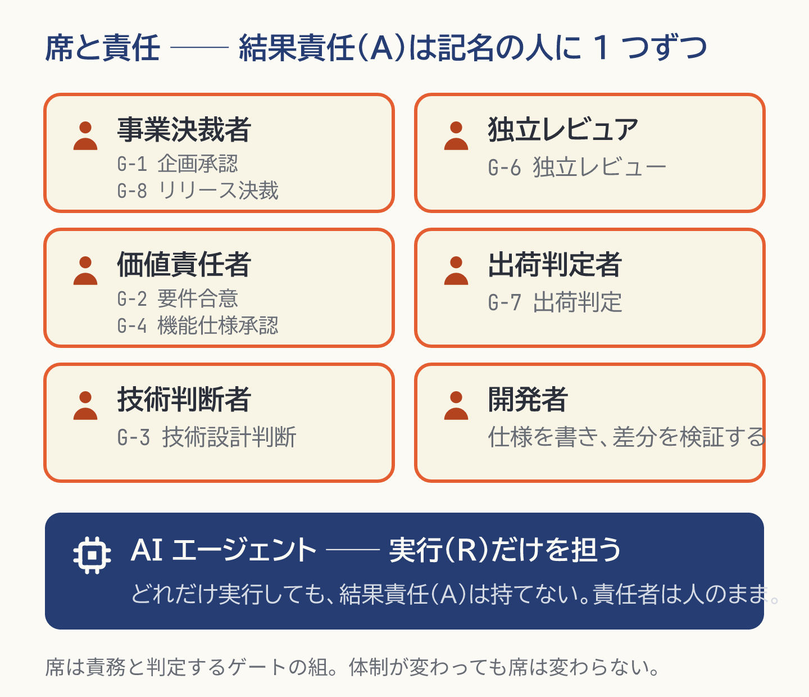
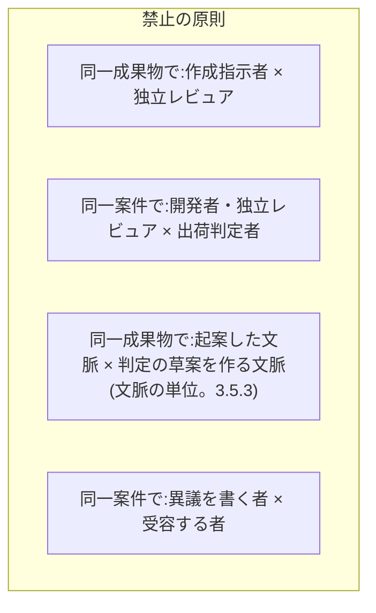
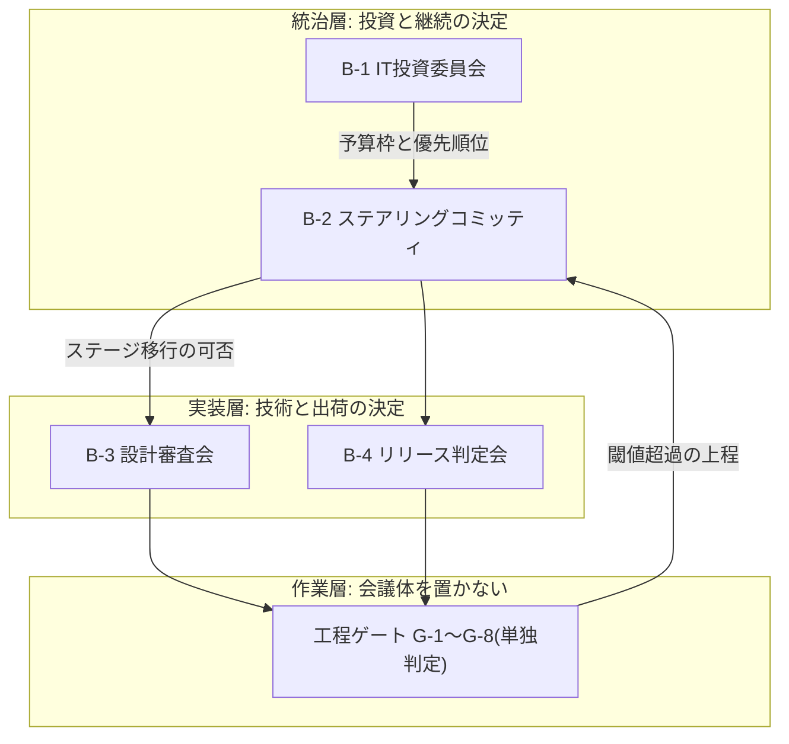
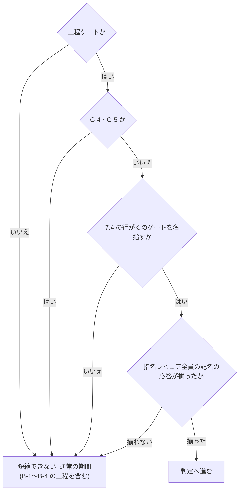
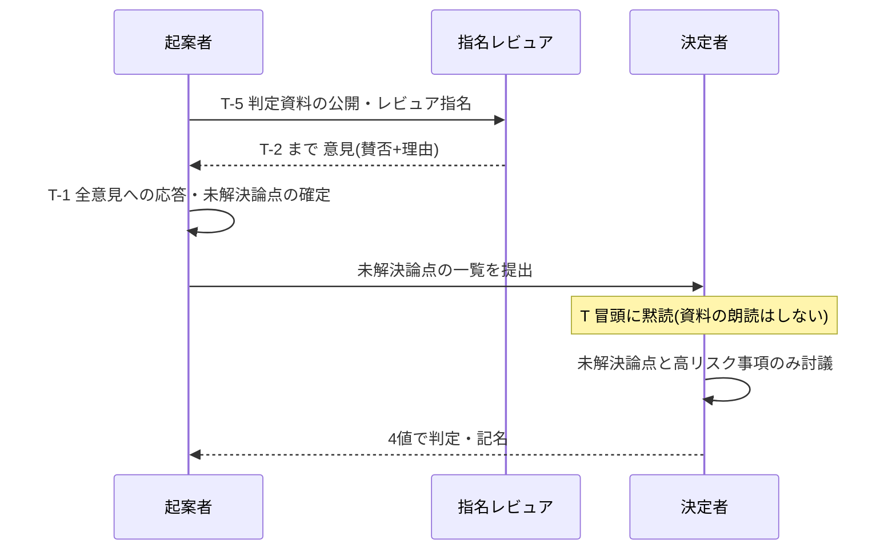

本章は、本標準を実施する体制を規定します。本章は、ロールの定義と責任の割当、ならびに決定を下す会議体とその決裁権限を扱います。

## 3.1 本章が達成すべき成果

本章の要求事項を満たしたとき、次の成果が得られます。

- 各成果物に対する結果責任者が1名に特定されている
- 決定を下す場と、そこで扱う事項の範囲が明示されている
- 決定の重さに応じた決裁者が、金額とリスクの2軸で一意に定まる
- 決定の待ち時間が計測され、滞留が検知される



図が示すのは、工程ゲートの判定に就く5つの席と開発者の席の、6つの席です。席の全数は9です(3.4 の任命基準の表)。図に無い3つは、文脈オーナー、AI維持管理者、AI運用担当者の席です。

## 3.2 責任の種類: A と R を分ける

本章は、責任分担を RACI で示します。生成AI時代に重要なのは **A(結果責任)と R(実行)の分離**です。

- **A(Accountable)= 結果責任**: 成果の正しさに最終責任を負う。**各成果物に必ず1人だけ**。A は責任者を指す
- **R(Responsible)= 実行**: 実際に作業する。**AIエージェントは担い手として R になれるが、A には絶対になれない**
- **C(Consulted)= 事前相談**: 判定前の非同期コメントで意見を出す
- **I(Informed)= 事後共有**: 結果の共有を受ける

A と R の分離は、ロール(席)に置く人と実行主体の区別に対応するものです。

- **責任者**: 席の結果責任(A)を負う記名の自然人。席ごとに1名
- **担い手**: 席の作業を実際に行う実行主体。人、または AI の実行主体の文脈

本章は「ロール」を主に用い、責任者・担い手と対で述べるときに「席」を用います。AI を担い手に置いても、責任者は変わりません。**AI を責任者にしてはなりません**。

席の作業を複数の人で担う場合(開発者5名、独立レビュア2名など)も、席の責任者は席ごとに1名です。成果物ごとの結果責任者は、担当表(D-0 体制図)で1名に定めます。責任者でない担い手(人)の増減・交代を体制の変化点に数える条件は、3.13.1 によります。

担い手の運用形態(人確定・協働・委任)と、判断を確定する担い手の上限は、[第5章 5.5](/process-compass/phase4-process-design/human-ai-boundary/)によります。判断の根拠は[ADR-0054](/process-compass/adr/0054-seat-accountable-performer/)によります。

<!-- impl IMPL-0634 target=config-seats state=delivered check=manual note="3.2 の責任者は席ごとに記名の自然人1名とし、AI を責任者にしない(AI の列に A を置かない)。準拠テンプレートの D-0 の様式(templates/00-d0-governance.md の節1 役割の割り当て)は、責任者は記名の自然人で AI を書いてはならないと書く。責任者は構成の seats[].accountable に名簿の人として書き、生成(scripts/init/generate-profile.mjs)が責任者を名簿と照合して AI の名義を受け付けない。確かめる者: D-0 表1 の決定者(任命・交代のとき)。実行して確かめていない(文の所在を読んだ)" -->

<!-- impl IMPL-0635 target=d0-template state=delivered check=manual note="3.2・3.3 の成果物ごとの結果責任者(A)を1名に定めること。templates/00-d0-governance.md 節3 末尾の担当表が受け、A が2人の行と A を欠く行を作らない旨を書く。担当表と構成の照合は機械では確かめない(内部監査)。確かめる者: 体制図(D-0)を承認する席の責任者(承認のとき)と、採用者の内部監査" -->

## 3.3 RACI マトリクス(作業 × ロール)

| 作業 | 価値責任者 | 技術判断者 | 開発者(検証) | AI | 独立レビュア | QA | 事業決裁者 | 文脈オーナー |
| --- | --- | --- | --- | --- | --- | --- | --- | --- |
| 事業意図の言語化 | **A**/R | C | I | R | — | — | C | — |
| コンテキスト基盤整備 | C | C | R | R | — | — | — | **A**/R |
| 協働仕様化・受入基準 | **A** | C | R | R | — | C | — | C |
| 技術設計(ADR) | C | **A**/R | C | R | — | — | — | I |
| 機能仕様サイクル | **A** | C | C | R | — | — | — | — |
| 実装・テスト生成 | I | C | **A**/R | R | — | — | — | — |
| 挙動検証・理解記録 | I | C | **A**/R | — | — | — | — | — |
| 独立レビュー | I | I | — | — | **A**/R | I | — | — |
| 出荷判定 | I | I | I | R | — | **A**/R | I | — |
| リリース決裁 | C | I | — | — | — | C | **A**/R | — |
| 負債返却の計画 | **A** | C | R | R | — | I | I | — |
| 文脈への書き戻し | I | C | R | R | — | — | — | **A** |

読み方の要点は次のとおりです。

- どの行にも **A は1人だけ**。A が2人いる行を作ってはならない。A を欠く行も作ってはならない
- **AI の列に A が存在しない**。AI の列が示すのは、担い手としての R である。AI がどれだけ実行(R)しても、結果責任は必ず責任者(人間)に紐づく
- 表の列は、上の作業に関与する7つの席と AI である。席の全数は9である(3.4)。表に無い AI維持管理者と AI運用担当者の作業は、3.11.8 の RACI に置く

## 3.4 任命基準

| ロール | 任命基準(何ができる人か) | 職位要件 |
| --- | --- | --- |
| 価値責任者 | 対象プロダクトの価値を語れ、優先順位を単独で決められる。決定権の委譲を組織から受けている。顧客接点を持つ、または価値仮説の検証を設計し発注できる | 不問(職位でなく権限委譲で決める) |
| 技術判断者 | 対象技術領域のトレードオフを評価でき、ADR を書ける | 不問(技術力量で決める) |
| 開発者(検証者) | AI生成コードを読み解き、挙動を自分の言葉で説明できる | 不問 |
| 独立レビュア | 開発者と同等の読解力。対象成果物の作成指示に関与していないこと | 不問 |
| QA(出荷判定者) | 品質記録と基準の突合ができる。開発ライン(同一案件の開発者の席と独立レビュアの席)から独立していること | 既存のQA部門の任命規程どおり |
| 事業決裁者 | 既存の決裁権限規程どおり。規程を持たない体制では、D-0 体制図への記名と、権限の出所(代表権、出資者の決定、上位の組織からの委任など)の記録による | 規程どおり(変更しない)。規程を持たない体制では問わない |
| 文脈オーナー | 対象領域の規約・用語に責任を持てる。継続的に保守できる | 不問 |
| AI維持管理者 | 対象リポジトリの規約と設計標準を理解し、指示資産の記述と実際の挙動の一致を検証できる | 不問 |
| AI運用担当者 | AI 実行基盤の構成・費用・統制要件を理解し、全社の規程と開発組織を接続できる | 全社の統制部門の任命規程どおり |

監査担当は、上の9つの席に含めません。3.5.1 の写像が Audit レーンへ置く監査担当(プロセス内部監査の実施者)には、次の要件を課します。

| # | 要件 |
| --- | --- |
| 1 | 監査の対象となる案件に関与していない |
| 2 | 当該案件の支援(移行支援担当・標準所管)に関与していない(3.5.2「支援と判定の分離」) |
| 3 | 監査の結果を、開発部門の長が差し戻せない報告線を持つ |
| 4 | 監査の対象となる案件で出荷判定者の席の責任者であった者は、出荷判定者が突合した保証の開示と、出荷判定者が記載した異議を監査しない |

- 要件を満たす担い手を置けない場合は、他チーム・他部門の担い手への委託、外部への委託、チーム間の相互の監査のいずれかを選び、選んだ事実を監査記録へ明記する。相互の監査では、同一期間に相互を監査しない
- 要件4 の監査を担う者を置けない場合は、その観点を未実施として監査記録へ表示する。実施したものとして所見 0 件と記録しない
- 本表の要件は、一定期間の運用全体を対象とする内部監査の実施者に掛かる。委任の変更に対する事後の抜き取り([第8章](/process-compass/phase4-process-design/tailoring-guide/)「事後監査の手続」)の実施者は、同章による

<!-- impl IMPL-0901 target=d0-template state=delivered check=manual note="3.4 の監査担当の充足方法(置く・他チーム・他部門へ委託・外部へ委託・チーム間の相互の4値)と、要件4 の観点を担う者を置けないときその観点を未実施として表示すること(未実施は充足方法の値ではない)。templates/00-d0-governance.md 節8 末尾の表「監査担当の充足方法」が受ける。監査記録との一致は採用者の監査担当が確かめる。確かめる者: 体制図(D-0)を承認する席の責任者(承認のとき)と、採用者の内部監査" -->

監査の手続の例(対象の抽出、観点、判定と是正)は、[フェーズ6(プロセス内部監査)](/process-compass/phase6-operation/process-audit/)を参照。

価値責任者に顧客接点または検証の設計・発注の能力を求めるのは、[ADR-0031](/process-compass/adr/0031-market-hypothesis-by-structure-not-fields/)の決定2 によります。価値責任者は 3.3 の RACI で「事業意図の言語化」の A/R を持ちます。しかし従来の任命基準は価値を語る能力と決定権のみを問い、**その価値の前提を確かめる手段の保有を問うていませんでした**。検証の設計と発注のいずれもできない者を任命すると、企画書の記述は確かめられないまま残ります。ここでの顧客接点は、実在の顧客・利用者との接点です。AI が顧客を模して生成した出力との対話を、顧客接点に数えません([ADR-0091](/process-compass/adr/0091-customer-voice-without-new-seats/))。

### 3.4.1 任命基準の充足をどう確認するか

上表の基準は「何ができる人か」で書かれています。**できることの確認手続を持たない任命基準は、実質的に無条件の任命です**。本節は確認の手続を規定します。

| # | 要求事項 |
| --- | --- |
| 1 | ロールへの任命に先立ち、任命基準の充足を確認し記録する |
| 2 | 確認は、**実務の成果物または実務に相当する演習の記録**によって行う |
| 3 | 確認の記録には、判定者・判定日・用いた成果物・判定結果を含める |
| 4 | 確認を経ない任命は、期限付きの暫定任命に限る(下記) |
| 5 | 確認の有効期間を定める。無期限としない |

<!-- impl IMPL-0636 target=config-seats state=undelivered check=manual plan=scheduled issue=446 review=2027-05 note="3.4.1 要求事項1〜3 と「確認に用いるもの」。ロールへの任命に先立つ任命基準の充足の確認を、実務の成果物か演習の記録で行い(筆記試験を主たる手段としない)、判定者・判定日・用いた成果物・判定結果を記録する。準拠テンプレートは、判断を担う4席の責任者本人について確認日・本人以外の確認した者・記録の所在を seats[].competence に持つ(IMPL-0082・0089)が、判定結果と用いた成果物の欄は無く、開発者・事業決裁者・文脈オーナー・AI維持管理者・AI運用担当者の任命の確認の置き場は無い(generate-profile.mjs の JUDGE_SEAT_IDS を読んだ)。要求事項5 の確認の有効期間も、判断を担う4席の力量の確認の周期(層1。IMPL-0070)のほかは、これらの席の任命の確認の有効期間を書く置き場が無い。確かめる者: 計画の Issue(issue= の番号)の担当者(降ろすときに確かめる。それまでは降りていない規定として台帳に出る)" -->

#### 確認に用いるもの

**筆記試験を確認の主たる手段としません**。本標準がロールへ求めるのは知識ではなく判断であり、判断は成果物にしか表れないためです。

| ロール | 確認に用いる成果物 |
| --- | --- |
| 開発者(検証者) | AI生成コードに対する挙動要約([附属書E](/process-compass/phase4-process-design/developer-guide/)の書式)。第三者が読んで、実装と一致することを検証できる水準にあるか |
| 独立レビュア | 実際の差し戻し記録。指摘が基準の項目番号で示されているか、指摘の妥当性が第三者に追えるか |
| 技術判断者 | 執筆した ADR。選択肢の比較と却下理由が書かれているか |
| 価値責任者 | 判定の記録。4値のいずれで判定し、理由をどう書いたか。あわせて、過去に実施した顧客ヒアリングまたは調査の記録。誰に何を確かめ、結果を価値の記述へどう反映したか |
| QA(出荷判定者) | 判定記録と基準の突合の記録。突合の網羅と、疑義の扱い |
| 文脈オーナー | 保守した恒久層コンテキストの差分。記述と実際の挙動の一致 |
| AI維持管理者 | 指示資産の検証記録。記述と実際の挙動の不一致を検出できているか |

#### 暫定任命

確認の手続は、任命を止める仕組みではありません。**確認が済むまで任命できない運用は、現場を停止させます**。

- 確認を経ない任命を、**期間を定めた暫定任命として認める**
- 暫定任命の期間は組織が定める。定めない暫定任命を認めない
- 暫定任命の期間中、当該ロールの判定は単独で確定させない。確認済みの者による併記を求める
- 確認済みの者による併記を置けない場合は、その判定を未達として表示する。併記のない判定を、成立した判定として表示しない
- 期間内に確認へ至らない場合、任命を解くか、期間の延長を記録して決裁する

<!-- impl IMPL-0637 target=d0-template state=delivered check=manual note="暫定任命の期間を組織が定めること。templates/00-d0-governance.md 節9 末尾の表「暫定任命の期間」(期間・満了時の扱い・延長の決裁)と、併記・未達の表示の箇条が受ける。期間内の確認の有無は機械では確かめない(内部監査)。確かめる者: 体制図(D-0)を承認する席の責任者(承認のとき)と、採用者の内部監査" -->

<!-- impl IMPL-0638 target=evidence-aggregation state=delivered check=machine test=template/scripts/gate/test-aggregate-records.mjs note="暫定任命の期間中(D-0 節9)の判定の併記。席の責任者(対象が責任者)か代行者(対象が代理者)の判定で、判定日が期間内のものについて、様式の任意の欄「確認済みの者の併記」が無い・名簿の人でない・AI の名義・判定者本人なら未達として項目1 に出す。CL1 以上と規制業は、出荷の範囲の中の判定の未達を IMPL-0738 が欠落に数える(範囲の外は表示だけ)。G-6 は対象にしない(第3章「席の責任者でない確認者の力量」が別の扱いを定める)。期間が日付として読めない行は確認できないと表示し、欠落にしない(ADR-0217 決定11)" -->

#### 席の責任者でない確認者の力量(適用: 承認を独立した人の確認に数える人)

力量の基準は、確認者の位置づけで変えません。承認が独立した人の確認として数えられる人([第4章 G-6](/process-compass/phase4-process-design/gate-criteria/))は、席の責任者でなくても、独立レビュアの任命基準(3.4)の対象とします。席の作業を担う体制の内の人、人の名簿に載せる外部の確認者、独立レビュアの席の責任者に置く外部の確認者の、いずれにも同じ基準を当てます([ADR-0060](/process-compass/adr/0060-drafting-context-and-two-layer-independence/) 決定4)。

- 確かめ方は、上表「確認に用いるもの」の成果物による。独立レビュアでは、その人の実際の差し戻し記録である。外部の確認者のための別の基準と数値は置かない
- 確認の記録が無い人による承認は、独立した人の確認に数える。数えたうえで、「力量の確認の記録が無い確認者による確認」として、件数を保証の開示の項目1 へ表示する
- 確認済みの者がいない体制では、確認を依頼した本人が確認してよい。この確認は受け付け、「依頼した本人による確認」として、ほかの者による確認と区別して表示する
- 「確認を依頼した本人」は、その変更の作成を指示した者とする(適用: 承認を独立した人の確認に数える人)。確認者の力量を確認した者がその変更の作成を指示した者である確認を、「依頼した本人による確認」として数える([ADR-0127](/process-compass/adr/0127-external-reviewer-seats-restriction-scope-and-organizational-distance/) 決定4)
- 確認の記録が無いこと、依頼した本人による確認であることを理由に、出荷を止めない

G-6 の変更ごとの承認については、上記「暫定任命」の「併記のない判定を、成立した判定として表示しない」に代えて、本項の扱い(数えたうえで件数を開示する)を当てます。位置づけに連動させません。名簿にだけ載せる置き方が、力量の確認を避ける抜け道になるためです。

<!-- impl IMPL-0117 target=evidence-aggregation state=delivered check=machine test=template/scripts/gate/test-roster-conditions.mjs note="承認を独立した人の確認に数える人(席の責任者でない確認者、外部の確認者を含む)の力量の確認。名簿の人の行の reviewCompetence(確認日・確認した者・記録の所在)を引き、出荷の証跡の集約が、数えた承認のうち「力量の確認の記録が無い確認者による確認」と「依頼した本人による確認」(力量を確認した者がその変更の作成を指示した者)の件数を保証の開示の項目1 に出す。出荷は止めない。記録の中身は確かめない。席の責任者本人の力量(3.4.3)は従来どおり seats[].competence と項目7(#307 / #357 / ADR-0127 決定4)" -->

:::caution[暫定 EV-0105 / 見直し 2027-04]
**対象**: 確認済みの者がいない体制で、確認を依頼した本人による力量の確認を受け付け、区別して表示する扱い。および、確認の記録が無い人の承認を数えたうえで件数を開示する扱い。
**根拠の水準**: E0(なし)。
**差し替え条件**: 力量の確認の記録が無い確認者による確認の件数と、依頼した本人による確認の件数。確認した者が依頼した本人である確認者と、それ以外の者が確認した確認者での、確認を経た変更の出荷後の欠陥の件数の比較。

依頼する側が1名で、外部の個人の力量を誰がどう確かめるかを定めた規範は、確認できていません(2026-10-12 時点。`research/302-310-deliberation/survey-307.md`)。依頼者の立場は、確認の結果に依存します。この確認が力量の確認として働くことを示す資料はありません。
:::

#### 有効期間を置く理由

AI生成コードの読解に必要な能力は、モデルの世代交代によって変わります。**2年前の確認記録は、現在の能力を保証しません**。

有効期間は組織が定めます。本標準は値を規定しません。期間の設定にあたっては、確認の手続そのものの改訂(用いる成果物・判定の観点)を同時に行います。期間だけを更新し、確認の中身を据え置く運用は、形骸化することがあります。

#### 教育の対象範囲

**本標準はロールに任命される者への教育を要求します。組織の全構成員への一律の教育を要求しません**。

| 対象 | 求める水準 |
| --- | --- |
| ロールに任命される者 | 上表の確認を通過する水準 |
| 業務でAIを利用する者(ロール任命の有無を問わない) | 統制の遵守([第5章](/process-compass/phase4-process-design/human-ai-boundary/)の役割境界、機密の取り扱い、知財の取り扱い) |
| 上記のいずれにも該当しない者 | 本標準は教育を要求しない |

第2区分の内容を、第1区分の内容と混ぜてはなりません。混ぜると、AIを利用しない者にも実装の読解を教えることになり、費用が水準に見合わなくなります。段階別の内容の例は、[フェーズ5の社会実装計画](/process-compass/phase5-implementation/enablement/)を参照。

### 3.4.2 AI を担い手に置くときの適合性確認

3.4.1 は、人をロールへ任命するときの確認です。AI を担い手に置くときは、その対応物として担い手の**適合性確認**を求めます。AI に「任命」の語を用いません。任命は結果責任(A)を含意し、3.2 と衝突するためです。担い手が AI であっても、責任者は記名の自然人のままです。

3.12.3 のモデルの適合性評価は、全社のモデル単位の評価です。当該の席の判断を担えるかは確かめていません。本節は席の単位で確かめます。3.12.3 を通過していないモデルを、本節の確認の対象にしてはなりません。

| # | 要求事項 |
| --- | --- |
| 1 | 確認の単位は**担い手の識別**とする。担い手の識別は、モデルの版・指示資産の版・権限の組である |
| 2 | 確認には、当該の席で人が確定した過去の判定の再現と、欠陥注入による検出の記録([第5章 5.6.2](/process-compass/phase4-process-design/human-ai-boundary/))を用いる |
| 3 | ペルソナや席名の付与を、確認に数えない |
| 4 | 実施は AI維持管理者が行い、承認は席の責任者が行う。承認は人が確定する |
| 5 | 確認の記録には、実施者・承認者・実施日・担い手の識別・用いた事例・事例の正解の出所(3.12.3 の要求事項14 の区分と所在)・結果を含める。再現の照合に AI の採点を用いた場合は、3.12.13 の要求事項6 の記録を含める |
| 6 | 確認を経ない担い手は、運用形態の上限を協働とする。単独で確定させない |
| 7 | 確認は、担い手の識別が変わった時点で失効する(3.13.1 の変化点4 のうち、担い手の識別の変更)。失効した担い手は、再確認まで要求事項6 による |
| 8 | 確認の日付・確認した担い手の識別・失効後の再確認の期日を、D-0 体制図へ記載する |
| 9 | 承認は、承認した席の責任者が交代した時点で失効する。離脱を含む。**承認を、新しい責任者へ引き継がない**。新しい責任者が承認し直すまで、要求事項6 による |

失効の契機は、期間ではなく担い手の識別の変化とします。これは、確認の記録(事例と結果)の失効についての定めです。承認の失効は、別の契機です(要求事項9)。

担い手の名義(3.5.3「人と AI の担い手の名義」)は、担い手の識別に含めません。名義は、担い手の操作を誰の操作として記録するかを決めるもので、席の判断を再現する力を変えないためです。要求事項1 の「権限の組」は、担い手の実行環境の設定(使える道具と許可範囲)を指します。ホスティング上の権限は、名義の側で扱います。名義の変更は変化点4 に数えますが(3.13.1)、確認の記録と承認は失効させません。

| 失効するもの | 契機 | 戻すために要ること |
| --- | --- | --- |
| 確認の記録 | 担い手の識別の変化 | 新しい識別について、確認を実施し直す。承認も要る |
| 承認 | 承認した席の責任者の交代(離脱を含む) | 新しい責任者が、既存の確認の記録を読んで承認し直す。担い手の識別が変わっていなければ、確認の再実施は要しない |

承認を引き継がない理由は、結果責任を負う者が受け入れていない担い手を、委任で動かさないためです。どちらの失効も厳しくする向きであり、即時に適用します。責任者の交代と離脱の変化点を、承認者であることを理由に止めません(3.13.3)。

担い手の識別を変える前に、新しい識別について確認を済ませておく運用を妨げません。次の4つをすべて満たす場合は、協働へ下げずに切り替えられます。1つでも欠ければ、協働へ下げます。

| # | 協働へ下げずに切り替える条件 |
| --- | --- |
| 1 | 確認の記録の担い手の識別が、新しい識別と一致する |
| 2 | 確認の記録が、旧い記録の使い回しでない。確認日が、旧い識別についての記録の確認日より後である |
| 3 | 実施者が AI維持管理者の席の責任者であり、承認者が当該の席の責任者である(要求事項4) |
| 4 | 当該の席の責任者が、新しい識別で委任を続ける決定として記名し、理由を書く |

条件4 を求めるのは、委任を続けることが緩める向きの決定に当たるためです([第5章 5.5.7](/process-compass/phase4-process-design/human-ai-boundary/))。確認の記録を識別の変更と同時に出すだけでは、記名を省けません。条件4 の記名は、当該の席の責任者に限ります。D-0 体制図の決定の権限を持つ者の記名で代えません。担い手を受け入れるのは、その席の結果責任を負う者であるためです。

**条件2 のうち機械で確かめられるのは、確認日の前後までです**。事例と結果が旧い記録と同一で、日付だけを新しくした記録は、機械で判別しません。使い回しでないことは、承認する席の責任者が、確認の記録を読んで確かめます。

引き継ぎでは、次のとおり扱います。

| 変化 | 確認の記録 | 承認 |
| --- | --- | --- |
| 承認した席の責任者が交代した(離脱を含む) | 有効なまま残る | 失効する。新しい責任者が承認し直す(要求事項9) |
| 確認の実施者(AI維持管理者の席の責任者)が交代した、または体制から外れた | 有効なまま残る。記録は、実施した時点の実施者の記名で有効である | 失効しない |
| 担い手の識別が変わった | 失効する(要求事項7) | 新しい識別の確認について、承認が要る |

- 承認し直しのときに、記録の実施者を現在の体制と照合しない。実施者の離脱を理由に、確認の再実施を求めない
- 新しい責任者が承認し直して委任へ戻すのは、緩める向きである。承認し直しと、委任を続ける決定の記名を、1つの変化点で同時に行ってよい(第5章 5.5.7)
- AI維持管理者の席の責任者が交代したときの、委任の規則の承認の扱いは、第5章 5.5.7 による

確認に用いる事例の件数と合格の基準は、組織が定めて記録します。**本標準は件数を定めません**。下限も置きません。書き漏らしではなく、課さないと決めたものです。値を支える測定が無いためです。少ない件数で確認した事実は、要求事項5 の記録に件数として残ります。

**適合性確認は、AI の判断が正しいことの保証ではありません**。確かめるのは、当該の席で人が下した判定と同じ結論に至るかと、仕込んだ欠陥を検出できるかの2点です。確認を通過した担い手の運用形態も、[第5章 5.5](/process-compass/phase4-process-design/human-ai-boundary/)の上限を超えません。

この確認の方法には先例が見つかっておらず、実証を欠きます。根拠の水準と差し替え条件は、[ADR-0054](/process-compass/adr/0054-seat-accountable-performer/)の暫定マーク EV-0042 によります。

<!-- impl IMPL-0020 target=config-seats state=delivered check=machine test=template/scripts/gate/test-check-delegation.mjs note="AI を担い手に置くときの適合性確認(確認を経ない担い手は協働を上限とする)" -->

<!-- impl IMPL-0639 target=config-seats state=delivered check=manual note="3.4.2 要求事項1・3・4・7・9。担い手の識別(モデルの版・指示資産の版・権限の組)を確認の単位とし、ペルソナや席名の付与を確認に数えない。実施は AI維持管理者、承認は席の責任者が行い、識別が変われば確認の記録が失効し、承認した席の責任者が交代すれば承認が失効して新しい責任者が承認し直すまで協働を上限とする。D-0 の様式の節12(templates/00-d0-governance.md の担い手の識別・実施と承認の者・失効の記述)と、generate-profile.mjs の qualification(performedBy・approvedBy・lapsed の処理、識別の変更と承認の失効の差分)が運ぶ。確かめる者: 席の責任者(確認の記録を読むとき)。実行して確かめていない(所在を読んだ)" -->

<!-- impl IMPL-0640 target=config-seats state=undelivered check=manual plan=scheduled issue=446 review=2027-05 note="3.4.2 要求事項2・5。確認に、当該の席で人が確定した過去の判定の再現と、欠陥注入による検出の記録を用いること。確認の記録に実施者・承認者・実施日・担い手の識別・用いた事例・事例の正解の出所・結果を含めること。準拠テンプレートの qualification は performedBy・approvedBy・confirmedAt・result・conditions を持つが、用いた事例と正解の出所の欄、再現と欠陥注入の記録を確認に使う検査は無い(generate-profile.mjs の qualification の項目を読んだ)。確かめる者: 計画の Issue(issue= の番号)の担当者(降ろすときに確かめる。それまでは降りていない規定として台帳に出る)" -->

<!-- impl IMPL-0641 target=config-seats state=delivered check=manual note="3.4.2 の協働へ下げずに切り替える4条件(確認の記録の識別が新しい識別と一致する、旧い記録の使い回しでない(確認日が旧い記録より後)、実施者が AI維持管理者の席の責任者で承認者が当該の席の責任者、当該の席の責任者が委任を続ける決定として記名し理由を書く)。generate-profile.mjs の担い手の識別が変わる変更の処理が、1つでも欠ければ委任を協働へ下げ、確認日が旧い記録より後でない記録の使い回しを受け付けない。確かめる者: 席の責任者(確認の記録を読むとき)。実行して確かめていない(所在を読んだ)" -->

<!-- impl IMPL-0642 target=d0-template state=delivered check=presence note="3.4.2 要求事項8。確認の日付・確認した担い手の識別・失効後の再確認の期日を D-0 体制図へ記載する。D-0 の様式の節12 の表に、担い手(人 / AI の担い手の識別)と適合性確認の期限または失効条件の列がある(単位: 欄。識別と失効条件)。確認の日付と失効後の再確認の期日は表の見出しに列を持たず、構成の qualification.confirmedAt から生成区間の出力で運ぶ" -->

<!-- impl IMPL-0643 target=config-seats state=undelivered check=manual plan=scheduled issue=446 review=2027-05 note="3.4.2 の、3.12.3 のモデルの適合性評価を通過していないモデルを、席の単位の適合性確認の対象にしてはならないこと。準拠テンプレートは AI 実行基盤とモデルの適合性評価を持たない(ADR-0104)。scripts/gate/model-adoption.mjs はモデルの導入の記録を読む(IMPL-0405)が、席の適合性確認の対象のモデルが導入の記録の評価を通過したかを照らす検査は無い。確かめる者: 計画の Issue(issue= の番号)の担当者(降ろすときに確かめる。それまでは降りていない規定として台帳に出る)" -->

### 3.4.3 判断を担う席の力量の維持と後継

本標準は、実装の大半を AI が担い、人が判断の席に座る構成を想定しています。監視へ移された人は、自力で扱う機会を失うと、監視に要る技能を失います。**このリスクは、本標準を採用すること自体から生じます**。本節は、その歯止めを規定します。新しい台帳と様式を足しません。記録は 3.4.1 の確認記録と、D-0 体制図の表5 に置きます。

判断を担う席とは、価値責任者・技術判断者・独立レビュア・QA(出荷判定者)の席のことです。

| # | 要求事項 |
| --- | --- |
| 1 | 判断を担う席の責任者は、**AI を使わずに判断できる力量の確認**を、任命時と、品質保証の方針と受容の基準([第6章 テンプレ11](/process-compass/phase4-process-design/deliverable-templates/))の項目4 の「確認の周期と後継」の表が定める周期で受ける。確認は 3.4.1 の確認に含めて行う。周期を過ぎた確認は失効する |
| 2 | 確認は、自己申告では認めない。証拠は次のいずれかとする。(1) AI への接続のログ(3.12.2 の接続経路)で、AI を使っていないことを確かめられる期間に作った成果物 (2) 判定者の面前で行った演習の記録。演習は[開発避難訓練](/process-compass/phase6-operation/incident-drill/)の類型E を兼ねてよい。確認した者は、人の名簿の外の者(外部の研修機関、前任の部門長など)でもよい。名簿の外の者による確認は受け付け、D-0 と保証の開示に「(名簿の外)」と注記する。名簿の外の名前は機械で突合できないため、確認の記録に所属・役職を残し、プロセス内部監査の観点6 で確かめる |
| 3 | 要求事項1 の確認を経ない任命は、確認を経ない任命として扱う(3.4.1 の暫定任命) |
| 4 | 判断を担う席の後継候補(D-0 表5 の代理者。複数を書いてよい)が、要求事項1 の有効な確認を持っているかを、候補ごとに表5 へ記録する(確認済み / 暫定任命 / なし) |
| 5 | 確認済みの後継候補の数が、層1 の定める「判断の席ごとの後継候補の最低数」に満たない席は、「**後継不在**」と表示する。層1 の最低数の欄が空欄の場合は、すべての判断の席を後継不在と表示する。層1 の受容の権限の段階で定めた権限者が、期限つきで受容する |
| 6 | コア機能の理解の保持者([第2章 2.9.4](/process-compass/phase4-process-design/lifecycle/))が1名以下の状態を、**列挙に無い離脱**([第1章 1.10.2](/process-compass/phase4-process-design/overview/))として扱う。是正の期限と責任者を技術負債台帳(第6章 テンプレ3)へ登録し、層1 の権限者が期限つきで受容する |
| 7 | 要求事項5 の後継不在と、要求事項6 の列挙に無い離脱は、出荷を止める条件にしない。保証の開示の項目5・7 と、単一障害点の一覧(3.12.11)へ表示し続ける。要求事項6 の登録と受容は、離脱を解くまでの扱いであり、離脱を認める条件でも、補う措置でもない。受容している間も、この状態は列挙に無い離脱であり、適合の主張と逸脱を伴う適合の主張を妨げる(第1章 1.10.2)。受容しても離脱は消えない。本標準は、この状態に条件と代償措置を定めないと決めた。欠けるのは規定の目的(コア機能の理解の所在が2名以上にあること)そのものであり、受容と台帳登録は是正の手順にとどまる([ADR-0133](/process-compass/adr/0133-no-conditions-or-compensating-measures-for-unlisted-deviations/)) |
| 8 | 理解の保持者に数えるのは、**本人以外の者が日付を付けて理解を確認した記録**を持つ人に限る。記録は、H-3 理解の実証([第2章 2.9.6](/process-compass/phase4-process-design/lifecycle/))、要求事項2 の演習、コア機能の障害対応の記録のいずれかとする。記録の無い名前と、記録の日付が層1 の力量の確認の周期を過ぎた名前は数えない |
| 9 | 層1 の定める**育成の担当**(役割)は、後継不在の席について、受容の期限より前に、後継候補を要求事項1 の確認へ進めるか、受容の更新を権限者へ求める。担当の席を空欄にした層1 では、後継不在の受容を更新してはならない |

要求事項1 の確認の記録は、席の責任者本人について、確認日・本人以外の確認した者・記録の所在を持ちます。後継候補の確認(要求事項4。D-0 表5 の代理者の欄)とは別の記録です。任命時の確認の記録が無い責任者は、確認を経ない任命(要求事項3)として、保証の開示の項目7 と次の一手に「未確認」と表示します。確認日が周期を過ぎた責任者は「失効」と表示します。いずれも出荷を止めません(#288 第6巡)。

<!-- impl IMPL-0082 target=config-seats state=delivered check=manual note="判断を担う席の責任者本人の、AI を使わずに判断できる力量の確認(3.4.3 要求事項1。任命時と層1 の周期)。確認日・本人以外の確認した者・記録の所在を構成の seats[].competence に持ち(/process-change の種別 accountable。記名は要らない)、D-0 節9 の表を生成する。責任者が交代すると前任の記録を引き継がない。出荷の集約の項目7 と next.mjs が、記録の無い任命を「未確認(確認を経ない任命)」、周期を過ぎた確認を「失効」と出す。欠落にはしない(#288 第6巡)。確かめる者: D-0 表1 の決定者(任命・交代と、層1 の周期の確認のとき)" -->

<!-- impl IMPL-0089 target=config-seats state=delivered check=manual note="席の責任者本人の力量の確認の確認した者(seats[].competence.confirmedBy)が人の名簿の外でも受け付ける(拒否しない)。受け付けたうえで、構成の差分・残作業・D-0 節9 の生成区間・出荷の集約の項目7・next.mjs に「(名簿の外)」と注記し、確認の記録に所属・役職を書くこととプロセス内部監査の観点6 での突合を案内する。注記の無い旧い D-0 の区間は失敗させない(#288 第7巡 T)。確かめる者: D-0 表1 の決定者(任命・交代と、層1 の周期の確認のとき)" -->

次の表は、AI を使わない判断の成果物の例を示します。

| 席 | 成果物の例 |
| --- | --- |
| 技術判断者 | AI の案を見る前に書いた選択肢の比較(ADR の代替案の欄) |
| 独立レビュア | AI の所見を見る前に行ったレビューの差し戻しの記録 |
| QA(出荷判定者) | 保証の開示の1項目を、機械の集約に頼らず原記録からたどった突合の記録 |
| 価値責任者 | AI の要約を使わずに書いた、顧客ヒアリングの記録から価値の記述への反映 |

- 確認の目的は、技能の水準の測定ではない。**AI なしで判断を組み立てられることの存在の確認**である。合格の基準と件数は組織が定める
- AI を使わない作業の頻度を、本標準は定めない。第5章 5.4.7 の「定められた頻度」と同じく、組織が定める。頻度と技能の維持の関係を測った研究を、確認できていないためである(2026-11-17 時点。無いと確かめたのではない)。L2 以上を適用する範囲での実施の記録と、頻度を過ぎたことの表示は 5.4.7 による
- 10年後の後継者を、本標準は予測しない。周期ごとに AI なしの確認を繰り返すことで、技能の低下を**検出**する。後継の空白は、層1 の最低数と育成の担当(要求事項5・9)で答える。最低数を満たす手段(採用、配置転換、外部からの確認者の招へい)の選択は、組織の人事の制度で行う。手段の選択は本標準の対象としない。最低数と担当が空欄の層1 では、すべての判断の席が後継不在と表示され、その受容を更新しない(要求事項9)
- 後継の計画書は書かせない。後継の状態は、確認済みの候補の数で判定する
- 本節は自律レベルに依らず掛かる。第5章 5.4.7(L2 以上の能力維持措置)の適用範囲は変えない
- 第2章 2.9.4 の「交代の前に2名以上へ増やす」は維持する。要求事項6 は、交代の時点に限らず常時の列挙に無い離脱として扱う点で、2.9.4 を広げる
- 1名の体制(体制の内の人が1人の体制)では、コア機能の理解の保持者は常に1名以下であり、代理者も置けない。列挙に無い離脱と後継不在を表示し続ける。1名の体制が適合の主張と逸脱を伴う適合の主張をしない理由は、第1章 1.10.2 による

:::caution[暫定 EV-0070 / 見直し 2027-04]
**対象**: AI を使わない判断の成果物を、任命時と周期ごとの確認に用いることで、判断を担う席の技能の低下を検出できるという判断。
**根拠の水準**: E1(間接)。
**差し替え条件**: 確認を通らなかった者の割合と、その者が判定した変更の下流での欠陥の比率。確認を通った者と通らなかった者で下流の欠陥の比率に差が無い場合、確認の中身を見直す。確認を通らない者が見直しの時点まで1名も出ない場合、確認が形式になっていないかを見直す。

自動化の監視で技能が落ちるという理論と規範(1983 年の自動化の皮肉の論考、航空当局の手動操縦の勧告)は一致しています。AI に特有の測定は単発です(2025〜2026 年)。熟練者の判断力が AI の常用で長期に落ちるかを測った研究は見つかっていません(2026-10 時点。出典の所在は `research/phase4-standard/288/`)。
:::

:::caution[暫定 EV-0071 / 見直し 2027-04]
**対象**: コア機能の理解の保持者の最低数を2名とし、1名以下を列挙に無い離脱とする判断。
**根拠の水準**: E2(単一事例)。
**差し替え条件**: 保持者が1名以下の状態で生じた障害の、復旧までの時間と、2名以上の状態の同種の障害の時間の比較。差が見られない場合、離脱としての扱いを見直す。

属人化とブラックボックス化が品質不正の背景にあったとする第三者委員会の報告(2023 年)に依ります。最低数の値に実証はありません。
:::

:::caution[暫定 EV-0078 / 見直し 2027-04]
**対象**: 判断の席ごとの後継候補の最低数と育成の担当を層1 に記名で置き、確認済みの候補の数で後継不在を判定すれば、後継の空白を事前に検出できるという判断。理解の保持者を、本人以外の者が日付を付けて確認した記録を持つ人に限る判断。
**根拠の水準**: E0(なし)。
**差し替え条件**: 判断の席の責任者の交代の事例ごとの、交代の前の後継不在の表示の有無と、交代の後の暫定任命の期間の有無の対応。後継不在と表示されないまま暫定任命の期間の生じた事例が1件でもあれば、最低数の数え方を見直す。候補を確認へ進めないまま後継不在の受容を2回以上更新した席が過半を占める場合、育成の担当の規定を見直す。

採用判断シートでの1回目の判定(2026-10-03)の指摘(後継の採用・育成を範囲外にしていた。保持者が名前を書くだけで数えられた)を受けて置いた規定です。最低数の値は組織が定め、本標準は値を持ちません。
:::

<!-- impl IMPL-0060 target=d0-template state=delivered check=presence note="D-0 の節9(代行者)で、判断の席ごとに後継候補を複数書けるようにし、候補ごとの確認の状態と確認日を持たせる。証跡の集約が、確認済みで周期内の候補の数を層1 の『判断の席ごとの後継候補の最低数』と比べ、満たない席(最低数の欄が空欄なら全席)を後継不在として出す(単位: 欄)" -->

<!-- impl IMPL-0061 target=evidence-aggregation state=delivered check=manual note="コア機能の理解の保持者を、運用引き継ぎ文書の保持者の表で、本人以外の確認者と確認日がある行だけ数える。確認日が層1 の力量の確認の周期を過ぎた行は数えない。数えなかった名前と理由を出す。確かめる者: 出荷判定者(G-7 の判定で、集約の出力と保証の開示を読むとき)" -->

<!-- impl IMPL-0053 target=d0-template state=delivered check=presence note="D-0 の節9(代行者)に、判断を担う4席の代理者の確認の状態(確認済み / 暫定任命 / なし)の列を持たせる。証跡の集約が、確認済み以外の席を『後継不在』として保証の開示の項目5・7 と単一障害点の一覧へ出す。表5 は準拠テンプレートでは生成区間のため、確認の状態は手で書く節9 に置く(単位: 欄)" -->

<!-- impl IMPL-0644 target=evidence-aggregation state=delivered check=manual note="3.4.3 要求事項9。育成の担当(役割)を空欄にした層1 では、後継不在の受容を更新しない。scripts/gate/org-assurance.mjs が、層1 の育成の担当が空欄のとき後継不在の受容を受け付けず、集約と next.mjs が空欄の旨と、育成の担当が後継候補を力量の確認へ進める案内を出す。確かめる者: 出荷判定者(G-7 の判定で、集約の出力を読むとき)。実行して確かめていない(所在を読んだ)" -->

<!-- impl IMPL-0645 target=debt-ledger-template state=undelivered check=manual plan=scheduled issue=450 review=2027-05 note="3.4.3 要求事項6・7。コア機能の理解の保持者が1名以下の状態を、列挙に無い離脱として扱い、是正の期限と責任者を技術負債台帳へ登録すること。層1 の権限者が期限つきで受容することは、D-0 節15「組織継続の状態の受容」(状態・受容した者・受容の期限)と scripts/gate/org-assurance.mjs(コア理解の保持者が1名以下を組織継続の状態として扱い、期限の無い受容・期限を過ぎた受容を記載の欠落にする)が運び、このマークは追わない。準拠テンプレートの集約は保持者の人数を「(1名以下)」と表示し、next.mjs が保持者を増やす案内を出す(IMPL-0061)が、列挙に無い離脱の数への算入と、台帳への是正の期限と責任者の登録を確かめる検査は見つけていない(受容の側は上のとおり降りている)(aggregate-evidence.mjs・next.mjs を検索した)。確かめる者: 計画の Issue(issue= の番号)の担当者(降ろすときに確かめる。それまでは降りていない規定として台帳に出る)" -->

## 3.5 兼務ルール(許可 / 禁止)

本節は、兼務と異動が常態である組織を前提に、**禁止する組み合わせを最小限に絞って**規定します。表に無い組み合わせの兼務は許容です。表の語は[第1章 1.7.3](/process-compass/phase4-process-design/overview/)の升の語彙(許容・非推奨・禁止)によります。限定は語の後ろの括弧に書きます。



| 組み合わせ | 可否 | 理由 |
| --- | --- | --- |
| 価値責任者 × 文脈オーナー | 許容 | 小規模では自然な兼務 |
| 技術判断者 × 開発者 | 許容 | 小規模では自然な兼務 |
| 価値責任者 × 技術判断者 | 許容(1〜2名)、非推奨(3〜9名。兼務する場合は兼務の事実と理由を D-0 体制図へ記録する)、**禁止**(10名以上) | 価値判断(G-2・G-4)と技術判断(G-3)の相互の牽制が、1人の中で閉じる |
| 作成指示者 × 独立レビュア(同一成果物) | **禁止** | 独立レビューの意味が消える。ブランチ保護と、出荷の証跡の集約で強制する(下記) |
| 開発者 × 出荷判定者(同一案件) | **禁止**(3名未満は例外あり。3.5.2) | 作成を指示する側が、自分の変更の出荷基準の充足を判定することになる |
| 独立レビュア × 出荷判定者(同一案件) | **禁止**(3名未満は例外あり。3.5.2) | 出荷判定(G-7)は、独立レビュー(G-6)の通過記録と独立の成立状況を突合する。同じ人が兼ねると、自分の記録を自分で突合する |
| 出荷判定者 × 事業決裁者(同一案件) | **禁止**(3名未満で成立しない場合は、列挙に無い離脱として記録する。下記) | 異議を書く者と、残存リスクを受容する者が同一になり、受容が自己完結する([第4章 G-8](/process-compass/phase4-process-design/gate-criteria/)) |
| 事業決裁者 × 価値責任者 | 許容(1〜2名)、非推奨(3名以上。兼務する場合は兼務の事実と理由を D-0 体制図へ記録する) | 事業の決裁と価値判断の相互の牽制が、1人の中で閉じる。どの規模でも禁止しない(下記) |
| 技術判断者 × AI維持管理者 | 許容 | 小規模では自然な兼務 |
| AI維持管理者 × AI運用担当者 | **禁止** | 案件の都合で全社の統制を緩める経路が生じる |
| 移行支援担当 × 出荷判定者(同一案件) | **禁止** | 自らの支援の成果を自ら評価する構造になる |
| 標準所管 × 適合性監査の判定者 | **禁止** | 標準の欠陥が、判定の甘さとして現れる |

上表の「開発者 × 出荷判定者」と「独立レビュア × 出荷判定者」の2行を、あわせて「開発ライン × 出荷判定者」と呼びます。開発ラインとは、同一案件の開発者の席と独立レビュアの席のことです([第1章 1.4](/process-compass/phase4-process-design/overview/))。

表の「非推奨」は禁止ではありません。非推奨の組を兼務する場合は、兼務する組、席の責任者、兼務を選んだ理由を、D-0 体制図の「非推奨の兼務の記録」へ書きます([第6章 テンプレ0](/process-compass/phase4-process-design/deliverable-templates/)の表5)。記録の無い非推奨の兼務は、記載の欠落として扱います。

本標準は、非推奨の兼務に代替の統制を課しません。意図的な決定です。兼務で失われる牽制を、どの措置が補うかを特定した記録がありません。何を確かめるかを定義できない確認は、記入の有無の検査に落ちます。兼務の事実と理由の記録と、その表示で代えます([ADR-0082](/process-compass/adr/0082-seat-combination-boundaries-and-lane-mapping/))。

価値責任者 × 技術判断者の兼務の境界は、3名と10名に限ります。5名の境界は置きません。5名を越えたことを、体制の変化点(3.13.1)・テーラリングの設問・機械のどれも捉えられず、監査できない境界は統制にならないためです。人数の数え方は[第8章 軸A](/process-compass/phase4-process-design/tailoring-guide/)によります。

事業決裁者 × 価値責任者の兼務は、10名以上の体制でも禁止しません。意図的な決定です。リリース決裁(G-8)の受容が自己完結することは、出荷判定者 × 事業決裁者の禁止が止めています。この組を禁止へ広げる根拠になる記録と測定は、確認できていません。

<!-- impl IMPL-0296 target=config-roles state=delivered check=machine test=template/scripts/gate/test-roster-rules.mjs note="10名以上の体制で、価値責任者の席と技術判断者の席の責任者を同一人物にする構成を拒否する(規模の規則 r-a-large の mustSplitFrom から、構成の生成が兼務禁止の組 sep-size-value-owner-tech-lead を足す)。構成の変更と契約検査が拒否する。3〜9名では拒否しない。test-roster-rules.mjs が固定する(#312)" -->
<!-- impl IMPL-0297 target=next-role state=delivered check=machine test=template/scripts/gate/test-roster-rules.mjs note="非推奨の兼務(3〜9名の価値責任者 × 技術判断者、3名以上の事業決裁者 × 価値責任者)の席の責任者が同一人物の構成を拒否せず、次の一手(/pit)と構成の生成の出力の注記に、兼務の事実と D-0 節2 への記録の要否を出す。test-roster-rules.mjs が固定する(#312)" -->
<!-- impl IMPL-0298 target=evidence-aggregation state=delivered check=machine test=template/scripts/gate/test-discouraged-evidence.mjs note="非推奨の兼務があり、D-0 節2「非推奨の兼務の記録」に、その組の担当者と理由を書いた行が無い場合、出荷の証跡の集約が記載の欠落として扱う。理由の中身の妥当性は確かめない(プロセス内部監査で確かめる)。test-roster-rules.mjs が固定する(#312)。理由の欄が「節13 の YYYY-MM-DD の行」(標準の様式の呼び方「表8 の YYYY-MM-DD の行」も同じ)と書いて節13 の改訂履歴の行を指すときは、その日付の変化点の記録が在り、決定した者と理由がともに埋まったもの(節13 に理由が出る形)が1件以上あることも確かめる(#351 H-4。test-discouraged-evidence.mjs が通しで、test-roster-rules.mjs が単体で固定する)。指した行が当該の兼務の決定かどうかは自由な文の意味で、機械では閉じない(manual。標準の内部監査が確かめる)。日付の字面は1つに絞り、広げない(決定可能に保つ)" -->

:::caution[暫定 EV-0156 / 見直し 2027-10]
**対象**: 10名以上の体制で価値責任者 × 技術判断者の兼務を禁止し、3〜9名では非推奨にとどめる判断。
**根拠の水準**: E0(なし)。
**差し替え条件**: 観測の源は D-0 表5 の「非推奨の兼務の記録」です。3〜9名の採用者のうち、この組を兼ねて記録した体制と、2つの席を分けた体制とで、案件あたりの次の2つの件数を比べます。価値判断と技術判断の対立の記録の件数と、G-2・G-3・G-4 の判定の後に受入基準または判断記録へ戻った件数(手戻り)です。10名以上の兼務は準拠テンプレートが拒むため観測できず、3〜9名の比較で代えます。兼ねた体制の件数が分けた体制を上回らなければ、10名以上の禁止を非推奨へ緩める向きで [#338](https://github.com/Takenori-Kusaka/process-compass/issues/338) に諮ります。上回れば、禁止の境界を10名より下へ引き下げる向きで諮ります。

この組は、3.5 の禁止の原則(X1〜X4)のどれにも当たりません。G-3 と G-2・G-4 は、互いを確認する手続を持ちません。人数によって独立の意味が変わる根拠も、外部の規格・枠組みの人数の閾値も、見つかっていません(2026-10-23 時点。`research/312-deliberation/`)。禁止を外す向きは統制を緩める向きであり、外すことを支える観測も無いため、禁止を残しました。人数ではなくチームの数で境界を引く案の審議([#338](https://github.com/Takenori-Kusaka/process-compass/issues/338))で、この組の扱いを改めて問います。
:::

:::caution[暫定 EV-0157 / 見直し 2027-10]
**対象**: 事業決裁者 × 価値責任者の兼務を3名以上で非推奨とし、どの規模でも禁止しない判断。
**根拠の水準**: E0(なし)。
**差し替え条件**: 観測の源は D-0 表5 の「非推奨の兼務の記録」です。3名以上の採用者のうち、この組を兼ねて記録した体制と、2つの席を分けた体制とで比べます。比べる量は、企画承認(G-1)とリリース決裁(G-8)の後に価値判断の前提の誤りが見つかった、案件あたりの件数です。兼ねた体制の件数が分けた体制を上回らなければ、非推奨を許容へ緩める向きで見直します。上回れば、上回りの生じた規模を境界として禁止へ上げる向きで見直します。

従来の表は、許容する範囲を人数の無い限定で書いていました。規則データとテーラリングのエンジンも、この組を禁止したことがありません。人数の境界を新たに置く根拠は、外部と内部のどちらでも見つかっていません(2026-10-23 時点)。
:::

**最小体制は3名とします**。開発者・独立レビュア・出荷判定者の3つの席は、どの2つも責任者を同一人物にしてはなりません。3つの席に別の人を置ける最小の人数が3名です。この人数は、兼務禁止の組から総当たりで導き、`npm run check` の検査で保ちます。3名未満で出荷判定者の兼務を避けられない場合の扱いは 3.5.2 によります。

3名以上の体制では、独立レビュアの席の責任者と、開発者の席の責任者を、同一人物にする構成を認めません。判定を記名する席の責任者が、判定される側の席の責任者と同一になるためです。出荷判定者の席と、開発者の席・独立レビュアの席も同じです。席の作業を複数の人が担うことは妨げません。認めないのは、責任者が同一である構成です。

本標準は、出荷判定者の席と、価値責任者・技術判断者・文脈オーナー・AI維持管理者・AI運用担当者の席との兼務を禁じません。意図的な決定です。本文が出荷判定者と分けてきたのは、作成を指示する席と、それを確認する席です。禁じる範囲を広げる根拠になる記録と測定は、確認できていません([ADR-0066](/process-compass/adr/0066-shipping-approver-separation-and-development-line/) 決定1)。

席の兼務禁止は、構成の条件です。出荷判定者の席の責任者が、席の責任者でない担い手として作成を指示した変更と、独立レビュー(G-6)を承認した変更を、席の兼務禁止は止めません。このため、出荷ごとの条件を重ねます。出荷判定(G-7)を記名した人が、範囲内の変更の作成を指示した者でも、G-6 の承認者でもないことを、保証の主張の成立条件4 で確かめます。規定は[第4章 G-7「保証の主張の成立判定」](/process-compass/phase4-process-design/gate-criteria/)によります。

<!-- impl IMPL-0114 target=config-roles state=delivered check=machine test=template/scripts/gate/test-roster-rules.mjs note="3名以上の体制で、出荷判定者の席の責任者を、開発者の席・独立レビュアの席の責任者と同一人物にする構成を拒否する(規則データ sep-dev-shipping・sep-reviewer-shipping)。構成の変更と契約検査が拒否する。3名未満は、出荷判定者の兼務の例外(3.5.2)として記録する。最小体制の3名は、エンジンの試験が兼務禁止の組から総当たりで導く。出荷ごとの条件(G-7 の記名者)は IMPL-0113。test-roster-rules.mjs が固定する(#304)" -->

:::caution[暫定 EV-0103 / 見直し 2027-04]
**対象**: 出荷判定者の席が独立レビュアの席を兼ねないとする範囲。および、出荷判定を記名した人が範囲内の変更の指示者でも G-6 の承認者でもないことを、保証の主張の条件に置く判断。
**根拠の水準**: E1(間接)。
**差し替え条件**: 出荷判定の記名者を理由に、保証の主張の成立条件4 が不成立となった出荷の件数。その後の扱いの内訳(別の人が記名し直した・対象外として出荷した)。独立レビュアが出荷判定者を兼ねた出荷と兼ねなかった出荷での、出荷後に見つかった欠陥の件数の比較。

評価した者が決定しないという型は、適合性評価の機関の規格にあります。社内の出荷を直接は規定しません(2026-10-12 時点。`research/302-310-deliberation/survey-304.md`)。検証の役割と認可の役割の兼務を禁じない規格もあり、向きは一致していません。兼務した場合としない場合の欠陥の流出を比べた測定は、確認できていません。
:::

出荷判定者の席と事業決裁者の席も、3名以上の体制では、責任者を同一人物にする構成を認めません。出荷判定者は、開示された未達・未測定への異議の有無を書きます。事業決裁者は、それを読んで残存リスクの受容を記名します([第4章 G-8](/process-compass/phase4-process-design/gate-criteria/))。この仕組みは、書く者と受容する者が別の自然人であることを前提にしています。

| 体制 | 出荷判定者 × 事業決裁者の兼務の扱い |
| --- | --- |
| 3名以上 | 認めない。責任者を同一人物にする構成を拒否する |
| 3名未満 | 成立しない場合(下記「1〜2名の体制で兼務禁止が成立しない場合」)は、列挙に無い離脱として D-0 体制図へ記録する。別の人を置ける体制で同じ人が兼ねるのは、統制を緩める向きの決定であり、3.13.3 の記名を要する。どちらの場合も、保証の開示の項目1 へ「異議を書く者と、残存リスクを受容する者が同一である」と表示する。異議の欄の記載と受容の記名は省かない。本標準は、この兼務に条件と代償措置を定めない。体制の内の人が2人以上なら席を分けられ、1人なら、書く者と受容する者が別の自然人であるという前提そのものが欠けるためである([ADR-0133](/process-compass/adr/0133-no-conditions-or-compensating-measures-for-unlisted-deviations/))。この兼務は逸脱(第1章 1.10.2)に当たらず、この兼務がある範囲では適合の主張と逸脱を伴う適合の主張をしない(第1章 1.10.2) |

3名未満の体制でも禁止する案は、採りませんでした。1名体制を宣言できなくなり、未達と離脱を隠さずに表示するという[ADR-0028](/process-compass/adr/0028-unmet-gate-distinct-from-omitted/)の方針に合わないためです。判断の根拠は[ADR-0056](/process-compass/adr/0056-assurance-argument/)の決定5 によります。

「作成指示者 × 独立レビュア」の禁止は、2つの層で強制します。**ブランチ保護だけでは止まらない経路があります**。

| 層 | 止めるもの | 止めないもの |
| --- | --- | --- |
| ブランチ保護 | 変更の作成者本人による承認 | 作成者が AI または bot である変更への、作成を指示した者の承認。リポジトリの上では、指示した者は作成者でない |
| 出荷の証跡の集約 | 独立した人の確認の条件([第4章 G-6](/process-compass/phase4-process-design/gate-criteria/))を満たさない承認。数えず、G-6 を適用する体制では記録の欠落として差し戻す(第4章 G-7) | D-0 体制図の記載の誤り。内部監査で確かめる |

AI に作成させた変更を、指示した本人が承認する形は、ブランチ保護を通ります。この形を止めるのは、マージの時点ではなく、出荷判定の時点です。

3名未満の体制でも、独立レビュー(G-6)は、作成を指示した者以外の人が確認するという型を変えません。本標準は、独立を人の単位で定義します(3.5.4)。確認者は、体制と変更によって次のとおりです。

| 体制と変更(適用: 3名未満の体制) | 独立レビュー(G-6)の確認者 |
| --- | --- |
| 2名体制で、相手が作成の指示に関与していない変更 | 相手。**作成を指示していない側の人が確認すれば、G-6 は成立する** |
| 2名体制で、相手も作成の指示に関与した変更 | 外部の確認者(他チーム・別部門・社外コミュニティ)。置けなければ[未達](/process-compass/adr/0028-unmet-gate-distinct-from-omitted/) |
| 1名体制 | 外部の確認者(他チーム・別部門・社外コミュニティ)。置けなければ未達 |

外部の確認者の置き方は、次の2つです。効果が異なります([ADR-0060](/process-compass/adr/0060-drafting-context-and-two-layer-independence/) 決定2)。

| 置き方(適用: 3名未満の体制) | 引き受ける範囲 | 構成上の独立レビュー(G-6) | 確認を経ていない変更の扱い |
| --- | --- | --- | --- |
| (ア)人の名簿に載せる | 依頼された変更の確認 | 未達のまま。確認した変更だけを、独立した人の確認に数える | R1 は例外承認を要する。R2・R3 は件数として開示する(下表) |
| (イ)独立レビュアの席の責任者に置く | 全変更の確認 | 適用する。承認の強制を設定する | 記録の欠落として差し戻す([第4章 G-7](/process-compass/phase4-process-design/gate-criteria/)) |

- 既定は(ア)とする(適用: 3名未満の体制)。変更ごとに確認を頼まれる人は、席の責任を負わない
- (イ)は、次の3つをすべて満たす場合に限る(適用: 外部の確認者を独立レビュアの席の責任者に置く体制。体制の規模によらない)。任免の決定者の記名(3.13.3)、力量の確認(3.4.1)、当人が独立レビュアの席の規定に従うことの書面による合意
- (イ)に、3.4.1 の暫定任命の経路を当てない(適用: 外部の確認者を独立レビュアの席の責任者に置く体制)。暫定任命は確認済みの者による併記を要し、(イ)を要する体制には併記できる者がいないためである
- (イ)の外部の確認者に、統制を緩める向きの決定権を与えない(適用: 外部の確認者を独立レビュアの席の責任者に置く体制)。独立レビュアの席の委任の宣言と範囲の拡大は、D-0 表1「体制と運用形態」の決定者が決定する(3.13.3)
- 外部の確認者を責任者に置ける席は、独立レビュアの席に限る(体制の規模によらない)。価値責任者・出荷判定者・事業決裁者など、ほかの席の責任者は「体制の内」の人とし、体制の人数に数える(受託の案件で発注側に置く席も同じ。[第8章 軸D](/process-compass/phase4-process-design/tailoring-guide/))。外部の確認者を席に置く経路を定めるのは(イ)だけであり、(イ)は独立レビュアの席のための定めである
- 3名以上の体制でも、外部の確認者を独立レビュアの席の責任者に置いてよい(適用: 3名以上の体制で外部の確認者を独立レビュアの席の責任者に置く体制)。条件は(イ)の3つで、3名未満の体制と同じである。その体制の G-6 を外部の確認者が担う。外部の確認者を体制の人数に数えないため、人数の境界の判定は変わらない([ADR-0127](/process-compass/adr/0127-external-reviewer-seats-restriction-scope-and-organizational-distance/) 決定2)
- 外部の確認者が D-0 表1「体制と運用形態」の決定者になる経路も、席の限定で塞がる。決定者が席(既定は事業決裁者)によって定まり、外部の確認者が独立レビュア以外の席の責任者になれないためである
- どちらの置き方でも、承認を数える条件は第4章 G-6 の4条件である。外部の確認者は、体制の人数に数えない
- 本標準は、外部の確認者を担い手だけに限らない。守秘・対価・利害の扱いも定めない([第8章 軸A](/process-compass/phase4-process-design/tailoring-guide/))

<!-- impl IMPL-0115 target=config-change-log state=delivered check=machine test=template/scripts/gate/test-loosening-decider.mjs note="独立レビュアの席の責任者が外部の確認者(名簿の external)である席では、その席の統制を緩める向きの決定(委任の宣言、範囲の拡大)を、席の責任者の記名では受け付けない。決定できるのは D-0 表1「体制と運用形態」の決定者に限る。2つの置き方の効果(名簿だけは未達のまま変更ごとに数える、席の責任者に置くと適用になり未確認は欠落)は、従来から構成の生成と出荷の証跡の集約が出し分けている。test-roster-rules.mjs が固定する(#307)" -->
<!-- impl IMPL-0116 target=config-seats state=delivered check=machine test=template/scripts/gate/test-roster-conditions.mjs note="外部の確認者を独立レビュアの席の責任者に置く条件のうち、力量の確認(3.4.1)と、席の規定に従うことの書面による合意。名簿のその人の行の reviewCompetence(確認日・本人以外の自然人の確認した者・記録の所在)と、席の agreement(合意の日と書面の所在。本文は写さない)の記録を、体制の規模によらず要する。変化点の入口・契約の検査・出荷の証跡の集約(記録の欠落)の3か所で確かめる。記録の有無と形だけを確かめ、力量と合意の中身は確かめない(#357 / ADR-0127 決定2・3)" -->
<!-- impl IMPL-0463 target=config-seats state=delivered check=machine test=template/scripts/gate/test-roster-conditions.mjs note="外部の確認者を責任者に置ける席を独立レビュアの席に限る。価値責任者・出荷判定者・事業決裁者などの席の責任者を名簿の外部の確認者(external)とする構成を、変化点の入口・契約の検査・出荷の証跡の集約(記録の欠落)で拒み、受託で発注側に置く席の人も体制の内として載せるよう名指す。D-0 表1 の決定者は席で定まるため、外部の確認者が緩める向きの決定者になる経路も同じ拒否で塞がる(#370 / #357 / ADR-0127 決定1)" -->

:::caution[暫定 EV-0253 / 見直し 2027-11]
**対象**: 3名以上の体制で外部の確認者を独立レビュアの席の責任者に置く場合も、(イ)の3つの条件を体制の規模によらず掛ける判断(上の「3名以上の体制でも」の箇条)。
**根拠の水準**: E1(間接)。
**差し替え条件**: 3名以上の体制で(イ)を採る構成の数と、外部の確認者が責任者の独立レビュアによる見逃しの件数の観測。ISO 26262-2:2018 の責任者の指定と力量の管理、IEC 61508 の評価者の独立の条項の原文との照合。

条件を人数で変えない判断は、規格の評価者の独立が規模で限られないことからの類推です。3名以上の体制で(イ)を採った事例の観測はありません。EV-0104 は3名未満の観測で差し替え条件が書かれているため、その対象を広げず別に置きました([ADR-0083](/process-compass/adr/0083-standard-edition-end-of-application-and-deviation/) 決定6)。
:::

:::caution[暫定 EV-0104 / 見直し 2027-04]
**対象**: 外部の確認者を独立レビュアの席の責任者に置く条件を、任免の記名・力量の確認・書面の合意の3つとし、既定を人の名簿に載せる置き方とする判断。
**根拠の水準**: E1(間接)。
**差し替え条件**: 外部の確認者を置いた体制のうち、名簿に載せた件数と席の責任者に置いた件数。席の責任者に置いた体制での、3つの条件の記録の有無と、確認を経ていない変更が欠落になった件数。

責任のある役割に外部の個人が就く場合に、書面の取り決めと力量の実証を条件にする型は、適合性評価の機関の規格にあります(2026-10-12 時点。`research/302-310-deliberation/survey-307.md`)。複数人の機関と契約者の関係を前提にした規格であり、1名の依頼者と外部の個人の関係を扱う規範は、確認できていません。
:::

外部の確認者を要する変更では、確認者の配分を変えてよいものとします。変更のリスク区分ごとに、次のとおり扱います。置き方(イ)の体制には、この表を当てません。

| 変更のリスク区分 | 外部の確認者を要する変更の独立レビュー(G-6)(適用: 3名未満で、置き方(イ)を採らない体制) |
| --- | --- |
| R1 | 外部の確認者へ依頼する。外部の確認者は R1 の変更へ集中させてよい。G-6 未達のまま出荷する場合は、[第7章 7.3](/process-compass/phase4-process-design/exception-escalation/)の例外承認を要する |
| R2 | 外部に置けなければ未達とし、**リリースごとの件数**で表示する |
| R3 | R2 と同じ。委任の条件を満たし、独立レビュアの席が委任を宣言している変更は、判定の時点が事後へ移る([第5章 5.5](/process-compass/phase4-process-design/human-ai-boundary/))。時点が移っても、責任者が同一人物であれば独立は成立しない(3.5.4)。作成を指示した者と別の人が抜き取れない場合は、責任者本人が抜き取った旨を保証の開示へ表示する |

R1 は、事後の取り消しを前提にしません(3.8.1)。未達のままの出荷に例外承認を求めるのは、このためです。**AI の確認を置いても、未達は解けません**(3.5.4)。出荷判定(G-7)の兼務は、2名体制でも逸脱のままです(3.5.2)。判断の根拠は[ADR-0054](/process-compass/adr/0054-seat-accountable-performer/)の決定8 によります。

AI維持管理者 × AI運用担当者の兼務禁止と、欠陥注入における時期と箇所の秘匿([第5章 5.6.2](/process-compass/phase4-process-design/human-ai-boundary/))は、1〜2名体制では成立しない場合があります。成立しない場合は、列挙に無い離脱(第1章 1.10.2)として D-0 体制図へ記録し、表示し続けます。3.5.2 の例外をこれらへ広げません。AI維持管理者 × AI運用担当者の兼務は、体制の内の人が2人以上なら席を分けられ、1人なら、全社の統制を保つ者と案件の都合を持つ者が別の人であるという前提が欠けるためです。欠陥注入の秘匿は、検出能力の測定が成り立つための条件であり、兼務を許す代わりに置ける同程度の防御がありません。判断の根拠は [ADR-0133](/process-compass/adr/0133-no-conditions-or-compensating-measures-for-unlisted-deviations/)によります。

**1〜2名の体制で兼務禁止が成立しない場合**とは、体制の内の人が1人で、組の2つの席に別の人を置けない場合をいいます。体制の内の人は、外部の確認者と組織上の任命権者を除いて数えます。名簿の行数では数えません。体制の内の人が2人以上なら、同じ人が組の2つの席を兼ねることは、統制を緩める向きの決定です。3.13.3 の記名を要します。出荷判定者 × 事業決裁者の組と、AI維持管理者 × AI運用担当者の組で同じです。

兼務は、組と当事者で照らします。当事者は、人の名簿の識別子で照らします。当事者が替わる変更は、旧い兼務の解消と新しい兼務の発生として扱います(3.13.1 の変化点1「兼務の変更」)。

成立しない兼務禁止として入った兼務(発生)は、選択の余地が生じた後に、決定へ移します。選択の余地が生じるとは、体制の内の人が1人から2人以上になることです。

| 事項(適用: 1〜2名の体制で、成立しない兼務禁止として入った兼務) | 規定 |
| --- | --- |
| 決定待ち | 選択の余地が生じた変化点から、兼務を解くか、兼務を続ける決定をするまでの状態 |
| 期限 | 選択の余地が生じた変化点の後の、最初のゲート判定より前(3.13.3 の手続と同じ時点)。機能とゲートを問わない。日数を置かない |
| 人を足す変化点 | 兼務の決定を待たずに反映する。2人目を名簿へ足す変化点を、兼務の決定の記名で止めない。名簿の変更の記名(第4章「アカウントと人の対応表」)は要する |
| 決め方 | 兼務を解く(厳しくする向き)か、兼務を続ける決定(緩める向き)をする。続ける決定の記名者は 3.13.3 による。当事者が D-0 表1「体制と運用形態」の決定者なら、本人以外が記名する |
| 期限を過ぎたとき | 決定待ちのまま記録したゲート判定を、記載の欠落として扱う。判定記録の検査と、出荷判定(G-7)の証跡の集約の両方で扱う。自動で決定にも、自動で解消にもしない。後で兼務を決めても(解いても)、その判定の欠落は残る。欠落を解くのは、決定の後にそのゲートを判定し直した記録だけである |
| 由来 | 発生か決定かは、変化点の記録の行ごとの種類(3.13.4 記録7)と、決定した自然人(記録5)から導く。由来の欄を別に持たない。手で書いた印を、由来の根拠にしない |
| 体制の内が1人へ戻ったとき | 決定した兼務も、発生の扱いへ戻す。再び2人以上になれば、決定待ちになる |
| 旧い記録からの移行 | 同じ組と同じ当事者について、緩める向きの行の記名を記録から機械で照らせ、その記名が当事者以外のものである件に限り、決定済みとする。それ以外は決定待ちとする。当事者が自分で決めた旧い記録は引き継がない。移行で決定待ちになった件の期限の起点は、従う版を切り替えた変化点とする。版の切り替えの記録が無いときは、この規定を含む版で記録した最初の変化点を起点とし、それより前の判定記録は数えない |
| 出荷判定者 × 事業決裁者の組の決定 | 決定の記録に、解いた先の割り当て(組のどちらかの席を誰へ移せるか、移すと新たに生じる兼務)を書く。決定の後も、保証の開示の項目1 の表示と、この兼務がある範囲で適合の主張をしない扱いを続ける |

本標準は、人を足す変化点で兼務の決定の記名を求める扱い、日数の期限と猶予、関係するゲートだけを期限とする扱い、定期の再承認、期限を過ぎた後の変化点の拒否を採りません。採らない理由は [ADR-0122](/process-compass/adr/0122-self-related-decisions-and-arising-separations/) によります。

<!-- impl IMPL-0481 target=config-change-log state=delivered check=machine test=template/scripts/gate/test-loosening-decider.mjs note="兼務の鍵を席の組と当事者(名簿の id)にする(generate-profile.mjs の deviationKeyOf)。当事者が替われば、旧い兼務の解消と新しい兼務の発生の行を差分へ出す。体制の内の人が2人以上の構成で新しく生じる兼務は緩める向きの行とし、解いた先の割り当て(separationAllocationText)を行に書く。体制の内が1人から2人以上になった変化点では、続く兼務に「選択の余地が生じた(決定待ち)」の行を出し、記名を要しない。1人へ戻れば「選択の余地が無くなった」の行を出す。由来は changeLog の行・rowKinds・decidedBy から導く(separationStates)。決定待ちの兼務を続ける決定は入力 keepSeparations で出し、緩める向きの行として 3.13.3 の記名者が決める。回帰の場面 self-decision の L1a・L1c〜L1f が固定する(#432)" -->
<!-- impl IMPL-0482 target=evidence-aggregation state=delivered check=machine test=template/scripts/gate/test-loosening-decider.mjs note="決定待ちの期間(変化点の記録の行から導く。separationPendingIntervals)に記録した判定記録を、契約検査(verify-gate-contract)と出荷の証跡の集約(aggregate-evidence)が記載の欠落として扱う(generate-profile.mjs の pendingSeparationProblems)。後で決定・解消しても欠落は残り、決定の後に同じゲートを判定し直した記録があるときだけ解く(突合 X-5)。旧い構成からの移行は、同じ組・同じ当事者の緩める行の記名が当事者以外で、その後に組の席の任免が無い件だけを決定済みとし、それ以外を決定待ちとする。期限の起点は、最後の取り込み・版の切り替え・形式の移行の変化点。記録が無ければ、この版で記録した最初の変化点に「決定待ち(旧い構成からの移行)」の行を出してそこを起点とし、それより前の判定記録は数えない(X-6)。回帰の場面 self-decision の L1f と、入口の試験が固定する(#432)" -->

:::caution[暫定 EV-0244 / 見直し 2027-05]
**対象**: 発生で入った兼務の決定の期限を、選択の余地が生じた変化点の後の最初のゲート判定より前とし、機能とゲートを問わず、日数を置かない判断。
**根拠の水準**: E0(なし)。
**差し替え条件**: 観測の源は、変化点の記録の「選択の余地が生じた」の行と、判定記録の検査・出荷の証跡の集約が出した決定待ちの欠落です。決定待ちになった件数と、期限の前に決めた件数、欠落として出た件数を数えます。欠落として出た件のうち、そのゲート判定が兼務に頼っていなかった件数も数えます。頼っていない判定で欠落になる件が多ければ、期限の時点を関係するゲートへ絞る向きで見直します。

この時点を支えるのは、変化点の後の最初のゲート判定より前に構成を改めるという 3.13.3 の内部の前例だけです。外部の調査は、例外の再評価の契機を扱っていません(2026-11-11 時点。`research/432-deliberation/`)。

2人目を名簿へ載せなければ、決定待ちは生じません。この誘因を、3.13.5 の宣言と実態のずれの検出は拾いません。準拠テンプレートの検出は、期間中の承認者の数が宣言したチーム規模の上限(1〜2名なら2名)を超えた場合に限るためです。1名の名簿で1〜2名と宣言し、名簿に無い2人目が承認しても、ずれは出ません(`research/432-deliberation/implementation.md`)。名簿に無い人の承認は独立した確認に数えないため、2人目の確認は G-6 の未達として表示に残ります。
:::

この表が定めるのは**禁止する組み合わせ**です。**それを判定する単位は人だけではありません**。生成AIのセッションが作業を担う場合の判定は 3.5.3 によります。図の X3 は、実行主体の文脈の単位でだけ課す規定です。人の単位では課しません(3.5.3「成果物を起案した文脈と、判定の草案を作る文脈」)。

<!-- impl IMPL-0001 target=config-roles state=delivered check=machine test=template/scripts/gate/test-roster-rules.mjs note="兼務を禁止する組み合わせ。表の移行支援担当 × 出荷判定者の行は準拠テンプレートの禁止の組に無く、IMPL-0900 が追う" -->

### 3.5.1 物理隔離（ロール別 clone / worktree）による兼務禁止の強制

本標準が規定する「作成指示者（Dev） × 独立レビュア（Review）」などの兼務禁止ルールを、生成AI（AIエージェント）環境で実効的に順守させることは困難です。これらを機械的に強制するためには、コンポーネント別（フロント、バック等）の分割ではなく、**役割（ロール）別の物理的な作業ディレクトリ（git clone または git worktree）の分離が不可欠**となります。

```
【不適切: コンポーネント分割】
<作業ルート>/<リポジトリ名> (単一リポジトリ、あるいはコンポーネント別)
 └── AIエージェントが同一ディレクトリ内で「実装(R)」と「自己レビュー(A/R)」を連続実行
     ⚠️ 作成者と承認者の分離（ADR-0035）が機械的に崩壊する

【適切: ロール別物理分割（ピットイン推奨構成）】
<作業ルート>/
 ├── <リポジトリ名>-po       (価値責任者: 受入基準・PO判断)
 ├── <リポジトリ名>-dev      (開発者: 実装・単体テスト)
 ├── <リポジトリ名>-review   (独立レビュア: 独立レビュー)
 ├── <リポジトリ名>-ship     (出荷判定者: 出荷判定・マージ)
 ├── <リポジトリ名>-owner    (事業決裁者: 決裁)
 ├── <リポジトリ名>-audit    (監査担当: 適合性監査)
 └── <リポジトリ名>-platform (AI維持管理: 検査・CI/CD基盤)
```

物理的にディレクトリ（クローン）をロール別に分離することには、以下の決定的な統制上の理由があります。

1. **「作成者 ≠ 承認者」ルールの機械的強制（認証情報を分離した場合に限る）**:
   単一の作業領域でAIエージェントを自走させた場合、AIが同一コンテキスト内でコードを書き（R）、そのまま自分のPRを自分で承認（A）してマージする「セルフ・アプルーブ」を防ぐことは極めて困難である。ディレクトリの分離に加えて**兼務を禁止した組のロールどうしで認証情報（GitHubトークン等）を分ける**ことで、Dev用セッションのAIはマージ権限へ物理的にアクセスできなくなる。**全ロールが同一の認証情報を共有する構成では、この強制は成立しない**（[ADR-0035](/process-compass/adr/0035-separation-by-execution-context/)）。分離できない場合は、権限の分離の不成立を列挙に無い離脱(第1章 1.10.2)として記録する。本標準は、この不成立に代償措置を定めていない。
2. **AIコンテキストの汚染とインデックス破壊の防止**:
   単一の作業コピーをPO・Dev・Review 等の複数エージェントが同時に変更すると、gitのインデックスファイル（`.git/index`）のロック競合や破損が即座に発生する。また、前段の未確定な途中状態が他のロールのコンテキストに混ざり込み、AIの判断が歪む（自動化バイアスや追従バイアス）ことを物理的に遮断できる。
3. **非同期協調への強制**:
   各ディレクトリが物理的に分かれているため、ロール間のやり取りは必ず「文書・コミット・PR・GitHubラベル」などの検証可能な証跡（エビデンス）を経由せざるを得なくなる。これは口頭やチャットによる非公式な合意を排除し、QMSが要求するトレーサビリティを自然に強制する。

#### 同じロールの中で並行して実行する場合

同じロールの中で複数の実行主体を並行して走らせる場合も、実行主体ごとに作業ツリーを分けます。同一の作業ディレクトリで、複数の実行主体を並行して実行しません。ファイルの上書きと、版管理の索引の破損が起きるためです。

<!-- impl IMPL-0646 target=claude-md-resident state=delivered check=manual note="3.5.1 の、同じロールの中で複数の実行主体を並行して走らせるとき、実行主体ごとに作業ツリーを分け、同一の作業ディレクトリで並行して実行しないこと。template/CLAUDE.md「判断の確定と委任」の行が書く(claude-md-resident.json の規則)。作業ツリーの分離を機械は照らさない。確かめる者: AI維持管理者(指示資産の四半期の棚卸しのとき、template/CLAUDE.md の該当の行を読む)。所在を読んだ(実行して確かめていない)" -->

#### ロールとレーンの写像

**レーンの数と、ロールの数は一致しません**。上の推奨構成では、案件のレーンは7つです(PO・Dev・Review・Ship・Owner・Audit・Platform)。AI運用担当者の Ops は案件の外(全社の実行基盤)に置き、案件のレーンに数えません。3.2 が定めるロールはこれより多く、1つのレーンが複数のロールを担います。

写像を案件が独自に決めると、割り当て先のないロールが生じます。標準は既定の写像を次のとおり定めます。

| ロール | 既定のレーン | 受信箱のラベル |
| --- | --- | --- |
| 価値責任者 | PO | `state:needs-po` |
| 文脈オーナー | PO | なし(ゲートの判定者でなく、引き渡しの経路を要しない) |
| 技術判断者 | Dev(セッションを分ける)または独立 | `state:needs-tech` |
| 開発者(検証者) | Dev | `state:needs-dev` / `state:qm-blocked` |
| 独立レビュア | Review | `state:dev-done` |
| QA(出荷判定者) | Ship | `state:ready-to-merge`(G-6 が省略・未達の構成では `state:dev-done`) |
| 監査担当 | Audit | `state:needs-audit` |
| AI維持管理者 | Platform | `state:needs-platform` |
| AI運用担当者 | Ops(案件のレーンと共有しない。全社の実行基盤の側) | なし(ゲートの判定者でなく、引き渡しの経路を要しない) |
| 事業決裁者 | Owner(決裁のみ) | `state:needs-owner` |

- 独立レビュアと出荷判定者は、別のレーンに置く。旧い既定の写像は両者を1つの QM レーンに置いていた。QM の語は、ラベル `state:qm-blocked` の名に残る。`state:qm-blocked` は開発者への差し戻しを表す。名の qm は旧い写像の名残であり、ロールを指さない。ラベルの名は変えない([ADR-0142](/process-compass/adr/0142-resolve-name-collisions-by-definition-not-rename/))
- 文脈オーナーと AI運用担当者には、受信箱のラベルを置かない。ラベルの要否は [ADR-0037](/process-compass/adr/0037-label-points-to-lane-not-role/) の決定2 による
- ラベルの語彙と遷移は、3.5.5 による。この表は受信箱を引くだけである

<!-- impl IMPL-0013 target=next-role state=delivered check=machine test=template/scripts/gate/test-roster-rules.mjs note="ロールと受信箱のラベルの既定の写像(MAILBOX と構成ごとの mailboxFor)。G-6 が有効なら state:dev-done の受け手は独立レビュアだけで、state:ready-to-merge は独立レビュアが付け、出荷判定者の受信箱に入る。G-6 が省略・未達の構成では出荷判定者が dev-done を受け、ready-to-merge を使わない。事業決裁者の受信箱は needs-owner。ゲートの判定者となるロールを受信箱のラベルで指せること(条件2)を test-roster-rules.mjs が構成ごとに固定する(#312)" -->

写像は次の2条件を満たさなければなりません。

| # | 条件 |
| --- | --- |
| 1 | 3.5 の兼務の表で**禁止**とされた組み合わせを、同一レーンへ写像しない。**非推奨**とされた組み合わせを同一レーンへ写像する場合は、3.5 の「非推奨の兼務の記録」へ記録する |
| 2 | ゲートの判定者となるロールは、いずれかの受信箱のラベルで指せること |

レーンは、作業領域・セッション・認証情報の組です(3.5.3 の実行主体の文脈と同じ組)。同じレーンに置いた2つのロールの作業は、同じ文脈が担い、同じ認証情報から承認と記名が出ます。席の責任者が別の人でも、同じレーンに置いた席の分離は記録から確かめられません。このため条件1 は、体制の人数に依らず、人の単位の兼務を認める場合(3.5.2 の例外を含む)にも当てます。

条件1により、**技術判断者を価値責任者のレーンへ既定で置きません**。ラベルの設計が、標準が非推奨とする兼務を強制してはならないためです。技術判断者が開発者とレーンを共有する場合は、3.5.3 の文脈の分離が成立しないため、セッションを分けます。

案件は写像を D-0 体制図へ記載し、構成(`process.config.json` の `roles[]`)へ出力します。**空欄や未定にしません**。判断の根拠は[ADR-0037](/process-compass/adr/0037-label-points-to-lane-not-role/)と[ADR-0082](/process-compass/adr/0082-seat-combination-boundaries-and-lane-mapping/)によります。

<!-- impl IMPL-0299 target=config-roles state=undelivered check=manual plan=adopter decision=ADR-0084 note="ロールとレーンの写像を、D-0 体制図へ記載し構成の roles[] へ出力すること。準拠テンプレートの構成はレーンの概念を持たず、ロールと受信箱のラベルの固定の表(MAILBOX)だけを持つ。レーン(作業領域・セッション・認証情報の組)の分け方は、採用者が実行環境の設定で定め、D-0 体制図へ手で書く(#312)。確かめる者: 採用者(自らの実行層に実装したときに確かめる)" -->

### 3.5.2 出荷判定者の兼務に限った例外(代償措置つき)

3名未満の体制では、**開発ライン × 出荷判定者**の兼務禁止が成立しません。開発ラインとは、同一案件の開発者の席と独立レビュアの席のことです(第1章 1.4)。3つの席に別の人を置けないためです。この組に限り、次の4つをすべて満たす場合に兼務を認めます。

| # | 条件 |
| --- | --- |
| 1 | 体制が3名未満であること(3名以上になった時点で例外は失効する) |
| 2 | G-7 の判定記録を必須とし、基準の各項目との突合を記録に残すこと |
| 3 | リリース後の抜き取り確認を[運用作業カタログ](/process-compass/phase6-operation/operations-catalog/)へ定常作業として置くこと |
| 4 | 兼務の事実と代償措置を **D-0 体制図へ明記する**こと。空欄・未定にしないこと |

この例外は**他の禁止の組み合わせへ広げません**。とくに「作成指示者 × 独立レビュア」へは適用しません。3名未満の体制での「出荷判定者 × 事業決裁者」の兼務は、この例外ではなく、3.5 の定めによる列挙に無い離脱として記録します。逸脱の閉じた列挙(第1章 1.10.2)にあるのは、この例外(D-1)だけです。広げない理由は、下表の線引きによります。この例外を認めたのは、規定の目的を1人で達成でき、欠けるのが判定者の独立性に限られるためです。この線引きは、ほかの離脱を認める基準ではありません。ほかの離脱に条件と代償措置を定めないと決めた理由は、[ADR-0133](/process-compass/adr/0133-no-conditions-or-compensating-measures-for-unlisted-deviations/)によります。両者の違いは次のとおりです。

| | 作成指示者 × 独立レビュア(G-6) | 開発ライン × 出荷判定者(G-7) |
| --- | --- | --- |
| ゲートの目的 | 作成時の思い込みを、抱えていない人が見る | 品質の記録と基準を突き合わせ、出荷の可否を判定する |
| 1人での達成 | **不可能**(見る人が同一である以上、目的が成立しない) | 可能(突合と判定は単独で実行できる) |
| 欠けるもの | 目的そのもの | 判定者の独立性 |
| 扱い | [未達](/process-compass/adr/0028-unmet-gate-distinct-from-omitted/)として表示し続ける | 代償措置つきの逸脱(第1章 1.10.2 の D-1)として記録し、表示し続ける |

**代償措置は独立性の回復ではありません**。判定が甘くなる可能性は残ります。記録と抜き取りが行うのは、甘さが後から検出できる状態にすることだけです。判断の根拠は[ADR-0029](/process-compass/adr/0029-shipping-approver-merge-exception/)によります。

<!-- impl IMPL-0002 target=config-deviations state=delivered check=machine test=template/scripts/gate/test-roster-rules.mjs note="出荷判定者の兼務に限った例外と代償措置" -->

<!-- impl IMPL-0647 target=gate-record-template state=delivered check=manual note="3.5.2 の例外の条件2。G-7 の判定記録を必須とし、基準の各項目との突合を記録に残すこと。判定記録の様式 templates/04-gate-record.md が節「確認した項目」「機械が確認した項目」と「確認していない事項(空欄および「なし」は無効)」を持ち、.claude/skills/gate/gates/G-7.md が「G-7 は記録と基準の突合に限る」と基準ごとの突合の手順を書く。突合の記録が在ることを例外の条件として照らす検査は無い(verify-gate-contract.mjs は閉じた列挙の逸脱について判定を実施したうえで代償措置つきで属性を持たせるだけ)。IMPL-0724・IMPL-0600・IMPL-0756 と同じく、文と欄が運び、実施や条件の照合は無いものを降りた側で表示する。確かめる者: 出荷判定者(G-7 の判定記録を書くとき)。実行して確かめていない(所在を読んだ)" -->

<!-- impl IMPL-0648 target=d0-template state=delivered check=presence note="3.5.2 の条件3・4。リリース後の抜き取り確認を運用作業の定常作業として置くことと、兼務の事実と代償措置を D-0 体制図へ明記すること。D-0 の様式(templates/00-d0-governance.md の出荷判定者の兼務の例外の節)に、リリース後の抜き取り確認を定常作業として置いている旨のチェック欄と、兼務の事実・代償措置を書く欄がある(単位: 欄)" -->

#### 支援と判定の分離

組織へ本標準を広げる支援の役割(移行支援担当・標準所管)と、適合性の判定・監査の機能は、分けます。同一の組織が支援と判定を兼ねると、現場は不備を隠し、支援を求めなくなるためです。**役割の名称を分けただけでは分離になりません**。次の3点をすべて満たしたときに、分離が成立します。

| # | 要求事項 |
| --- | --- |
| 1 | 支援に関与した者は、同一案件の出荷判定(G-7)および適合性監査の判定者にならない |
| 2 | 監査・判定の機能は、開発部門の長を経由しない報告線を持つ。報告の経路を指し、所属の場所を指さない |
| 3 | 監査・判定の機能の要員と予算を、個別案件の予算から配賦しない |

- 要員が不足し、支援と判定を同じ担い手が担わざるを得ない場合は、兼務を隠して形式だけ整えてはならない。判定の担い手を3つ(他チーム・他部門への委託、外部への委託、兼務のままの実施)から選び、選んだ事実を記録する。兼務のまま実施する場合は、兼務の事実と、判定時に支援へ関与した範囲を判定記録へ明記する
- 兼務のまま実施したことを、独立性の確保として扱ってはならない。記録は、後から判定の偏りを疑える状態を保つだけである
- 支援の側から判定の側へ渡すのは、標準の記述の欠陥(解釈できなかった箇所、実務に合わない手順、改訂が要る事項)に限る。次の3つを渡してはならない。特定のチームの習熟度の評価、支援を求めた回数、支援の場で観測した個人の言動である。ただし、法令違反・安全に関わる不備・意図的な統制の回避は、当該チームへ先に伝えて是正の期限を合意し、期限内に是正されなければ上げる。上げることは事前に伝える。緊急に停止すべき事象は即時に上げ、事後に当該チームへ通知する

<!-- impl IMPL-0831 target=gate-record-template state=delivered check=manual note="3.5.2 の、兼務のまま実施する場合に兼務の事実と支援へ関与した範囲を判定記録へ明記し、独立性の確保として扱わないこと。templates/04-gate-record.md の節「支援と判定の兼務」の欄(単位: 欄)。確かめる者: 当該の判定の判定者(判定記録を書くとき。所在を読んだ(実行して確かめていない))" -->

<!-- impl IMPL-0900 target=config-roles state=undelivered check=manual plan=scheduled issue=446 review=2027-05 note="3.5.2「支援と判定の分離」の要求事項1。支援に関与した者(移行支援担当・標準所管)を、同一案件の出荷判定(G-7)の判定者にしないこと。準拠テンプレートの兼務禁止の組(scripts/vendor/tailoring-kb.json の sep-author-reviewer・sep-dev-shipping・sep-maintainer-ops・sep-reviewer-shipping・sep-self-approval・sep-shipping-business の6つ)に、移行支援担当 × 出荷判定者の組は無い。scripts/gate/config.mjs・scripts/init/generate-profile.mjs・D-0 の様式にも「移行支援」は無い。3.5 の兼務の表の IMPL-0001 は上の6組を運ぶもので、この組を運ばない(2026-11-15 に確かめた)。適合性監査の判定者に関する部分は 3.4 の監査担当の要件2(制度設計)。確かめる者: 計画の Issue(issue= の番号)の担当者(降ろすときに確かめる。それまでは降りていない規定として台帳に出る)" -->

体制の規模による支援の役割の調整は、[第8章](/process-compass/phase4-process-design/tailoring-guide/)「社会実装の段階の調整」によります。役割の職掌と計画の例は、[フェーズ5(イネーブルメント計画)](/process-compass/phase5-implementation/enablement/)を参照。

### 3.5.3 兼務を判定する単位(人と実行主体の文脈)

3.5 の兼務禁止表は、**人と実行主体の文脈という2つの単位で判定します**。いずれか一方でも同一であれば、兼務禁止は成立していません。

| 単位 | 対象 | 判定 |
| --- | --- | --- |
| 人 | 役割を担う自然人 | 3.5 の表による |
| 実行主体の文脈 | 作業を担うセッション・作業領域・認証情報の組 | 同一の文脈が、禁止された2つの役割の作業を担ってはならない |

人の単位で独立していても、文脈の単位で分離していなければ、兼務禁止は成立していません。**役割の割り当てを人へ書いただけでは、実行主体には届きません**。判断の根拠は[ADR-0035](/process-compass/adr/0035-separation-by-execution-context/)によります。

<!-- impl IMPL-0649 target=process-profile state=delivered check=manual note="3.5.3 の、兼務を人と実行主体の文脈の2つの単位で判定し、同一の文脈が禁止された2つの役割の作業を担ってはならないこと。PROCESS-PROFILE.md の生成区間(scripts/init/generate-profile.mjs)が、文脈の単位の規定の文と、受信箱を自ロールに限る文を出す。文脈の同一を機械で突き合わせる検査は無い(レーンの分け方は IMPL-0299)。確かめる者: 各ロールの席の責任者(PROCESS-PROFILE.md を読むとき)。実行して確かめていない(所在を読んだ)" -->

#### 文脈の分離が成立する条件

次の3つがすべて分かれている場合に限り、文脈は分離しています。

| # | 分離する対象 | 満たせない場合 |
| --- | --- | --- |
| 1 | 作業領域(clone または worktree) | 3.5.1 の分離が成立しない |
| 2 | セッション(会話文脈。1セッションが複数の役割を担わない) | 役割の越境を検出する手段がない |
| 3 | 認証情報(トークン) | 権限の分離が成立しない。列挙に無い離脱として記録する(第1章 1.10.2)。本標準は、この構成に条件と代償措置を定めない。兼務を禁止した組の席どうしの認証情報は、体制の人数によらず分けられるためである([ADR-0133](/process-compass/adr/0133-no-conditions-or-compensating-measures-for-unlisted-deviations/)) |

1 だけを満たした構成は、よくある誤りです。**ディレクトリを分けても、1つのセッションが複数のレーンの受信箱を見に行けば、文脈は合流するためです**。**受信箱の確認(ポーリング)は、自分のロールを指すラベルに限らなければなりません**。他のロールの受信箱を見に行ってはなりません。技術判断者が開発者とレーンを共有する体制では、セッションを分けて確認します。

<!-- impl IMPL-0007 target=claude-md-resident state=delivered check=presence note="ポーリングの対象を自ロールの受信箱に限る(単位: 行)" -->
<!-- impl IMPL-0829 target=d0-template state=delivered check=manual note="3.5.3 の全ロールが同一の認証情報を共有する構成での権限の分離の不成立。templates/00-d0-governance.md 節12 の箇条と表「認証情報を共有している範囲」が、列挙に無い離脱として記録する場所を置く。共有の有無は機械では確かめない。この表は出荷判定の証跡の集約へ載らない(集約が数えるのは構成の deviations[] と記録から決まる離脱)ため、記録がある間は適用の表明で人が列挙に無い離脱を併記し、適合の主張をしない。確かめる者: 体制図(D-0)を承認する席の責任者(承認のとき)と、採用者の内部監査" -->

#### 入力の分離(適用: 確認側の担い手に AI を置く場合)

文脈を分けても、作成側の説明が確認側へ渡れば、確認は作成側の主張に引き寄せられます。確認側の担い手に AI を置く場合は、文脈の分離に加えて**入力の分離**を求めます。

| # | 要求事項 |
| --- | --- |
| 1 | 確認側の担い手へ、作成側の説明文・主張・推論の過程を、判断の前に渡さない |
| 2 | 確認側の担い手へ渡すのは、仕様・受入基準・差分とする |

入力の分離は、兼務を判定する単位ではありません。人と実行主体の文脈が分かれていることを前提に、確認側へ何を渡すかを定める条件です。AI の確認を検出の層として数える条件は、[ADR-0056](/process-compass/adr/0056-assurance-argument/)の決定4 によります。入力の分離はその条件の1つです。人の確認者への提示は、[ADR-0023](/process-compass/adr/0023-review-package-cues-not-conclusions/)の決定3 によります。範囲を広げる情報(受入基準と差分の対応、影響範囲。レビューパッケージの索引部)を、仕様との突合(パス1)の開始時に提示します。注意を狭める情報(過去の指摘、読む観点。レビューパッケージの注意喚起部)を、仕様との突合を終える前に開いてはなりません。この禁止が人の確認者に掛かるのは、レビューパッケージの注意喚起部です。PR の「レビュー観点の指定」と AI のレビューの指摘は含めず、パス1 の後に読むことを勧めるにとどめます([第4章 G-6](/process-compass/phase4-process-design/gate-criteria/)「確認の範囲と深さ」)。手順は[附属書C](/process-compass/phase4-process-design/review-guide/)参照。

生成側の文脈や実装を切り離すと検出が上がるという向きは、複数の測定で一致しています(2026-09 時点)。ただし、作成側の説明文を除いた効果そのものを測った資料は1件です。出典は `research/282-survey-2026-09/` にあります。根拠の水準と差し替え条件は、[ADR-0054](/process-compass/adr/0054-seat-accountable-performer/)の暫定マーク EV-0041 によります。

<!-- impl IMPL-0650 target=gate-skill-g6 state=delivered check=manual note="レビューパッケージの注意喚起部を、仕様との突合(パス1)を終える前に開かないこと。.claude/skills/gate/gates/G-6.md の材料の集め方の項7に置く。確かめる者: 当該ゲートの判定者(判定記録を書くとき)。所在を読んだ(実行して確かめていない)" -->

#### 成果物を起案した文脈と、判定の草案を作る文脈

同一の成果物について、成果物を起案した実行主体の文脈は、その成果物の判定の草案を作りません。判定の草案を担い手に作らせる場合は、成果物を起案した担い手と、作業領域・セッション・認証情報を分けます。この規定は、体制の人数によって変わりません。1名の体制でも、文脈は分けられるためです。

人の単位では、この規定を課しません。人の単位で禁止する組み合わせは、3.5 の表の組に限ります。要件合意(G-2)、技術設計判断(G-3)、機能仕様承認(G-4)および出荷判定(G-7)では、成果物の結果責任(A)を負う席の責任者が、その成果物の判定者を兼ねます。本標準は、これを禁止しません。これらの判定は、結果責任者が内容を確定する行為であり、別の人による確認ではないためです(3.3、[第4章](/process-compass/phase4-process-design/gate-criteria/)「ゲート運用の共通ルール」)。この扱いは意図的な決定です。「書かれていない」ではありません。1名体制に、この扱いによる未達と逸脱の表示を足しません。仕様の誤りに歯止めが無いことは、[附属書H H.11](/process-compass/phase4-process-design/assurance-case/)に開示しています。判断の根拠は [ADR-0060](/process-compass/adr/0060-drafting-context-and-two-layer-independence/)によります。

<!-- impl IMPL-0105 target=process-profile state=delivered check=manual note="成果物を起案した実行主体の文脈は、その成果物の判定の草案を作らない(3.5.3)。人の単位では課さない。文は PROCESS-PROFILE.md に出る。担い手の識別を突き合わせる機械の検査は無い。内部監査で、判定記録の確定の形態と D-0 の担い手の宣言から確かめる。確かめる者: 当該ゲートの判定者(草案を作った文脈を確かめるとき)" -->

#### 実行主体が参照するもの

各実行主体は、次の3つを起動時に参照できなければなりません。参照先は D-0 体制図から導出し、実行主体が手で書き足す運用にしません。

| # | 参照する内容 |
| --- | --- |
| 1 | 自らのロールと、判定者となるゲート |
| 2 | 担ってはならない工程(兼務禁止表と未達の記録から導出する) |
| 3 | 引き渡し先のロールと、使用するラベル |

参照先が D-0 の改訂に追随しているかは、機械的に検査できなければなりません。**形式と配置は準拠テンプレートが定めます**。本標準は宣言の内容と検査可能性のみを規定します。

<!-- impl IMPL-0003 target=next-role state=delivered check=manual note="実行主体が起動時に参照する内容(判定するゲート・担ってはならない工程・引き渡し先)。確かめる者: 各ロールの席の責任者(/pit の出力を読むとき)" -->

<!-- impl IMPL-0651 target=process-profile state=undelivered check=manual plan=scheduled issue=446 review=2027-05 note="3.5.3 の、実行主体が参照する内容(自ロールと判定ゲート・担ってはならない工程・引き渡し先)が D-0 の改訂に追随しているかを、機械的に検査できること。CLAUDE.md の構成依存部分と次の一手の側は IMPL-0824 が追う。PROCESS-PROFILE.md の参照先が D-0 の改訂に追随しているかを確かめる検査は、scripts/gate/check-process-rules.mjs・verify-gate-contract.mjs で見つからなかった。確かめる者: 計画の Issue(issue= の番号)の担当者(降ろすときに確かめる。それまでは降りていない規定として台帳に出る)" -->
<!-- impl IMPL-0824 target=claude-md state=delivered check=manual note="3.5.3 の、実行主体が参照する内容(自ロールと判定ゲート・担ってはならない工程・引き渡し先)が D-0 の改訂に追随しているかを、機械的に検査できること。scripts/gate/check-process-rules.mjs が CLAUDE.md の構成依存部分と process.config.json の一致を検査し、不一致で失敗する。D-0 の生成区間と構成の一致は check-d0.mjs(IMPL-0728)が、次の一手は next.mjs --role が構成から毎回導出する。D-0 → 構成 → CLAUDE.md・次の一手の連鎖は機械で検査される。PROCESS-PROFILE.md の追随は IMPL-0651 が追う。確かめる者: AI維持管理者(D-0 を改訂するとき)。実行して確かめていない(所在を読んだ)" -->

#### 人と AI の担い手の名義(適用: AI の担い手がホスティングを操作する構成)

担い手の**名義**とは、AI の担い手の操作を、ホスティングがどのアカウントの操作として記録するかです。上の表の条件3 は、担い手どうしの認証情報を分けることを求めます。席の責任者(人)とその席の担い手が1つの認証情報を使う構成は、条件3 の対象ではありません。この構成では、担い手の操作が、ホスティングの記録の上でその人の操作と区別できなくなります。署名とコミットのトレーラ(Co-Authored-By など)は、この区別の証拠になりません。署名は鍵を示すだけで、トレーラは誰でも書けるためです。

| # | 要求事項 |
| --- | --- |
| 1 | 担い手ごとに、名義を構成で申告する。値は「専用」「共有」のいずれかとする。申告の無い担い手は「未申告」とし、その席の責任者と名義を共有するものとして扱う |
| 2 | 「共有」は、担い手の実行環境から使える認証情報で、名簿の人のアカウントとして、変更の承認・レビュー・記録用ブランチへの push のいずれかを作れる構成とする。誰のアカウントかを、人の名簿の識別子で書く。実行環境の設定で拒否していても、「共有」として申告する |
| 3 | 「専用」は、2 に当たらない構成とする。担い手が操作に使うアカウントがある場合は、ホスティングが与える変わらない識別子(数値の識別子)とログイン名で書く。担い手のアカウントを、人の名簿に書いてはならない |
| 4 | 「共有」と「未申告」の担い手には、その認証情報による次の操作を、実行時に拒否する設定を置く。変更の承認とレビュー(状態を問わない)、変更のマージ、記録用ブランチへの push、ブランチ保護の変更、認証情報そのものの読み出し。**この設定を、名義の分離として扱ってはならない**。担い手が書いたプログラムから認証情報を使う経路を、設定は塞がないためである |
| 5 | 申告は、機械が確かめられる範囲で確かめる。担い手の実行環境で、ホスティングが認証したアカウントを引き、名簿の人のアカウントと照合する。確かめた日時と結果を残す。照合で名簿の人に当たった担い手を、「専用」として扱ってはならない |
| 6 | 「共有」と「未申告」の構成で崩れる統制の扱いは、[第4章 G-6](/process-compass/phase4-process-design/gate-criteria/)と「判定記録を基底ブランチへ入れる操作」による。この構成は、列挙に無い離脱として記録する([第1章 1.10.2](/process-compass/phase4-process-design/overview/)) |

**本標準は、専用の名義を課しません**。課さないと決めた理由は3つです。人の認証情報を担い手と共有することを禁じる明文の規範が、調べた範囲に無いこと(2026-11 時点)。禁じても機械で確かめる手段が申告と実行環境での照合に限られ、禁止が申告の義務に縮むこと。崩れる統制を統制ごとに特定でき、数え方と開示で扱えることです。崩れるのは承認・記名を出す側の共有です。作成の側の共有では、作成者の承認をブランチ保護が止め、作成を指示した者の既定値も作成者を含むため、統制は安全側に倒れます。判断の根拠は [ADR-0107](/process-compass/adr/0107-performer-account-declared-and-shared-account-controls/) によります。

<!-- impl IMPL-0418 target=guard-bash-hook state=delivered check=machine test=template/scripts/gate/test-guard-bash.mjs note="要求事項4 の実行時の拒否(抑止の層)。PreToolUse(Bash)のフック .claude/hooks/guard-bash.mjs が、gh pr review・gh pr merge、書き込みの形の gh api(-X・--method が GET 以外、-f・-F・--input による POST、GraphQL の mutation とファイルから渡す問い合わせ)、記録用ブランチ records への git push、認証情報の読み出し(gh auth token、--show-token、GH_TOKEN・GITHUB_TOKEN の展開、printenv)、curl などによる GitHub の API への書き込みを、guard.enabled に依らず拒否し、.claude/denied.log に残す。区画は ; & && || | ( ) { } と $( で分け、bash -c・eval の中も見る。止めないもの: 担い手が書いたプログラム・スクリプトからの呼び出し、変数の展開や命令の組み立てによる回避、ブランチ保護の変更(Web の画面と API。API の書き込みは上の gh api の規則に当たる)。名義の申告の有無に依らず掛ける。既存の settings.json を持ち込む採用者へは TEMPLATE_HOOKS の併合で登録を足す(登録の欠けを契約の不備にしない)(#429)" -->
<!-- impl IMPL-0419 target=agent-settings state=delivered check=presence note="要求事項4 の権限設定。generate-profile.mjs の standardReview が gh pr review・gh auth token と、前方一致で表せる書き込みの形の gh api(-X・--method の POST・PUT・PATCH・DELETE)をステージと guard.enabled に依らず拒否し、雛形の settings.json は gh api graphql を確認つき(ask)に置き、Bash のフックを登録する。拒否は抑止であり分離ではない(#429)(単位: ファイル)" -->
<!-- impl IMPL-0420 target=config-seats state=delivered check=machine test=template/scripts/gate/test-performer-account.mjs note="要求事項1〜3 と 6。構成の seats[].performerAccount に名義(dedicated は account{login,id}、shared は person に名簿の id、無記入は未申告)を書き、契約検査が kind の値、id が正の整数、dedicated のアカウントが名簿の人の login・id と重ならないこと、shared の person が名簿に実在することを確かめる。未申告の担い手の席は、その席の責任者と名義を共有するものとして扱う。述べられる名(IMPL-0430)は、担い手を宣言した席で専用でないものと、共有を明示した席を離脱に数える。担い手の識別(performerKey)には名義を入れない。限界: 初期化の「自分たちのアカウント」の回答は名簿が空の時点のため person を書けず、person の無い shared を受け付けて席の責任者と共有するものとして扱う(契約検査の注記で記入を促す)。同じ専用アカウントを複数の席に書く構成は拒否しないenv-check の照合(--seat を付けたもの)で名簿の人に当たった席は、申告が専用でもその人と名義を共有する席として扱い、照合が確認済みでない専用の申告は述べられる名で「名義の照合が無い」離脱に数える。(#430)" -->
<!-- impl IMPL-0422 target=d0-template state=delivered check=presence note="要求事項1〜3 の記録の欄。D-0 の様式の表5-2 に列「アカウントの数値の識別子」、表7 に列「担い手の名義(専用 / 共有 / 未申告)」を置き、生成区間(IMPL-0301)が構成の people[].accounts の id と seats[].performerAccount から埋める。#430 より前の生成区間も一致として受け付け、/pit が再生成を勧める(#430)(単位: 欄)" -->
<!-- impl IMPL-0428 target=profile-generator state=delivered check=machine test=template/scripts/gate/test-init-g5.mjs note="要求事項1。/process-init が全規模で担い手の名義(AI 専用のアカウント・アプリ / 自分たちのアカウント / まだ決めていない)を問い、回答から人確定に限らない席の seats[].performerAccount を生成し、PROCESS-PROFILE.md に名義と、共有・未申告なら列挙に無い離脱を出す。専用のアカウントの login と数値の識別子は人が書く(#430)" -->
<!-- impl IMPL-0429 target=process-change-skill state=delivered check=machine test=template/scripts/gate/test-loosening-decider.mjs note="要求事項1〜3 の変更。/process-change の種別 performer で名義を変え、変化点4 に数え、適合性確認を失効させず即時通知も出さない。専用から共有・未申告への切り替えは緩める向きの変更として、当該の席の責任者の記名と理由を要する(席の責任者が外部の確認者の場合は、第3章 3.13.3 の記名の制限を優先する)。種別 performer 以外で名義を変える入力は拒否する。種別 accountable で名簿のアカウントを login と数値の識別子の対で書く共有・未申告から専用への切り替えも、統制の数え方を外す変更として当該の席の責任者の記名と理由を要する(ADR-0107 が定めていない逆向きを、記名を要する側に倒した)。1名の体制で、既存のログイン名に数値の識別子を足すだけの変化点は、本人の記名で受け付け、変化点の記録に区別して残す。(#430)" -->
<!-- impl IMPL-0421 target=adoption-trial state=delivered check=machine test=template/scripts/gate/test-env-check.mjs note="要求事項5。env-check が、実行した環境の gh が認証したアカウント(gh api user の login と数値の識別子)を引き、名簿の people[].accounts と各席の performerAccount に照合し、名簿の人に当たり申告が dedicated または無記入の席を所見に出し、確かめた日時と結果を記録(performerAccount の checkedAt・status・席ごとの所見・scope)に残す。照合は env-check を実行した環境と時点に限り、その旨を出力と記録に書く(--seat で、その環境で動く担い手の席を限れる)。所見であり、9項目の判定と終了コードには入れない。担い手の実行環境と人の環境が別の場合、人の環境での照合は担い手の環境を確かめない照合の結果(docs/adoption-trial/env-check.json の performerAccountBySeat。--seat を付けた照合だけ)を、述べられる名・G-6 の承認の印・効力を持つ記録の帰属の確認が読む。--seat を省いた照合は「どの席の環境かを指定していない」所見だけを出し、判定に使わない。照合の記録に期限は置かない。(#430)" -->

### 3.5.4 独立と分離の語の定義

本標準は、「独立」を人の単位でだけ使います。「分離」は、文脈と入力の単位で使います。

| 語 | 単位 | 成立の条件 |
| --- | --- | --- |
| 独立(構成の条件) | 席の責任者(人) | 確認する席の責任者が、確認される側の席の責任者と別の自然人である。成立しない構成は、未達・逸脱・列挙に無い離脱として表示するか、拒否する(3.5)。安全関連の評価・確認の活動には、組織上の距離の段を重ねる(第1章 1.4「組織上の距離」、第8章 軸E) |
| 独立(変更ごとの条件) | 確認した人 | 変更を確認して承認した人が、その変更の作成を指示した者と別の自然人である。数える条件は[第4章 G-6](/process-compass/phase4-process-design/gate-criteria/)の4条件による |
| 分離(文脈) | 実行主体の文脈 | 作業領域・セッション・認証情報が別である(3.5.3) |
| 分離(入力) | 確認側への入力 | 作成側の説明文・主張・推論の過程を、判断の前に渡さない。渡すのは仕様・受入基準・差分とする(3.5.3) |

独立は、2層で定めます([ADR-0060](/process-compass/adr/0060-drafting-context-and-two-layer-independence/) 決定3)。構成の条件は、構成を変える時点に、人の名簿と席で確かめます。変更ごとの条件は、出荷の時点に、承認者と指示者の記録で確かめます。2つの条件の組み合わせは、次のとおり扱います。

| 構成の条件 | 変更ごとの条件 | 扱い |
| --- | --- | --- |
| 成立 | 成立 | 独立した人の確認を経た変更として数える |
| 成立 | 不成立 | 独立した人の確認を経ていない変更である。G-6 を適用する体制では、記録の欠落として差し戻す |
| 不成立(未達) | 成立(外部の確認者による) | 構成は未達のまま表示し、当該の変更を、独立した人の確認を経た変更として数える |
| 不成立(未達) | 不成立 | 独立した人の確認を経ていない変更として、件数を開示する。R1 の変更は例外承認を要する |

- 席の責任者は、構成の条件の成立、確認する人の割り当て、委任の宣言と事後の抜き取りに責任を負う。変更ごとの確認は、席の責任者、または席の作業を担う名簿の人が行う
- 承認した人が独立レビュアの席の責任者であるかは、変更ごとの条件にしない。席の作業を複数の人が担う体制を妨げないためである
- 独立レビュアの席の責任者が作成を指示した変更は、その者以外の人が確認する。2名体制で、開発者の席の責任者が確認する場合を含む
- 出荷判定(G-7)の独立も、同じ2層で定める。構成の条件は席の兼務禁止(3.5)、出荷ごとの条件は第4章 G-7 の成立条件4 である
- 起案と判定の分離(3.5.3)は、構成の条件を持たない。実行主体の文脈の単位でだけ課す

この定義から次が導かれます。

| # | 帰結 |
| --- | --- |
| 1 | AI を担い手に置いて得られるのは、分離までである。**責任者が同一人物なら、AI を何体に分けても独立は成立しない** |
| 2 | 文脈だけを分けた AI の確認を「独立レビュー」と呼ばない。記録と対外の表示でも、独立した人の確認と区別する |
| 3 | 分離した AI の確認によって、G-6 の未達を解かない。AI の確認は代償措置として記録し、未達の解消に数えない |
| 4 | モデルの系統の違いを、独立と分離のどちらの条件にも数えない |
| 5 | 承認者の人数は、組織上の距離の段(第1章 1.4)を上げない。段も、承認者の人数を満たさない。2名の承認の目的は、1名の承認者の確認だけでは変更を取り込めない状態を作ることであり([第4章 G-6](/process-compass/phase4-process-design/gate-criteria/))、距離の目的は、確認者が作成側の指揮・資源・リリースの権限から受ける影響を断つことである。片方で他方を置き換えない([ADR-0088](/process-compass/adr/0088-organizational-distance-steps-and-cl1-stage-relaxation/)) |

帰結4 の理由は、次の3つです。

- 系統を混ぜる効果は、測定によって向きが分かれる(2026-09 時点。単一事例の水準で、出典は `research/282-survey-2026-09/`)。系統の違うモデルの誤りは強く相関し、最も相関した組が系統をまたいでいた測定もある。独立に作った版の誤りが相関した古典的な実験(1986年)も、相関の裏づけになる
- 提供が停止されると維持できない条件である
- 航空と機能安全の規格の独立も責任の分離であり、多様性を条件にしない

**本標準は、モデルの系統・提供元の異質性を求めません。禁止もしません**。系統を混ぜた構成も、[附属書H](/process-compass/phase4-process-design/assurance-case/) H.4 の条件と、欠陥注入による検出率の測定を同じく受けます。

- 系統の違いを、保証の開示・判定記録・対外の表示で、確認の強さの根拠として書いてはならない。「独立」の語を使わずに強さを主張する場合も含む

<!-- impl IMPL-0158 target=claude-md-resident state=delivered check=presence note="系統の違いを、保証の開示・判定記録・対外の表示で、確認の強さの根拠として書かない(「独立」の語を使わない主張を含む)。CLAUDE.md の判断の確定と委任の節に置く。対外の表現の正本は附属書H H.8 の使ってはならない表現の表。書いた文の中身は機械で確かめない(単位: 行)" -->

系統を混ぜることを推奨しない、とも書きません。併存する測定は2つです。系統の違う相手を混ぜると有害な改訂が減った測定と、系統をまたいだ誤りの相関の測定です。推奨しないと書く根拠は、単一事例の水準(E2)に届きません。判断の根拠は[ADR-0075](/process-compass/adr/0075-acceptance-criteria-coverage-premises-and-ai-findings/)の決定12 によります。

[第5章 5.8.4](/process-compass/phase4-process-design/human-ai-boundary/)の段階も、この呼び分けに従います。弱・中・強は分離に、最強は独立に当たります。判断の根拠は[ADR-0054](/process-compass/adr/0054-seat-accountable-performer/)の決定7 によります。

<!-- impl IMPL-0021 target=claude-md-resident state=delivered check=presence note="確認側への入力の分離(3.5.3)と、独立・分離の語の使い分け(3.5.4)(単位: 行)" -->

<!-- impl IMPL-0652 target=gate-skill-g6 state=delivered check=manual note="分離した AI の確認を、構成の unmet[] の代償措置として記録し、未達の解消に数えないこと。.claude/skills/gate/gates/G-6.md の材料の集め方の項10に置く。未達の表が代償措置を別の欄に持つ構造は IMPL-0843 が運ぶ。確かめる者: 当該ゲートの判定者(判定記録を書くとき)。所在を読んだ(実行して確かめていない)" -->

<!-- impl IMPL-0653 target=config-seats state=delivered check=manual note="3.5.4 帰結5。承認者の人数が組織上の距離の段(第1章 1.4)を上げず、段も承認者の人数を満たさないこと。scripts/gate/config.mjs の組織上の距離の段の反証(stepCeiling)は、判定記録に書いた段と根拠を求める段と比べ、入力は席の責任者の席(出荷判定者・事業決裁者はリリースの権限を持つため段2 以上に数えない)と名簿の所属(team)だけで、承認者の人数を入力に使わない。人数が段を上げる経路が無いことを確かめた。承認者の数が段の求める人数を満たすかは、構成の review.reviewerCount(.claude/skills/gate/gates/G-6.md の「承認者の数は構成の…」)が別の検査で運ぶ(規定の半分を別の検査が運ぶ。IMPL-0771 は経路が無いため降りていないと表示し、本マークとは向きが異なる)。確かめる者: 判定の確認者(段を記録するとき)。実行して確かめていない(所在を読んだ)" -->

### 3.5.5 受信箱のラベルによる引き渡し

席の間の引き渡しは、作業単位(課題・変更の単位)に付ける状態のラベルで行います。ラベルは「次に動く席」を指す状態です。判定の結果ではなく、環境の事実(検査の結果など)の代わりにもなりません。席の間で直接に依頼を割り込ませると、実行主体の文脈の上書き、確認と修正の往復の暴走、人による転記の中継が起きるためです。ロールとラベルの既定の写像は 3.5.1 の表によります。実装の手引きは、[フェーズ5(Label Mailbox)](/process-compass/phase5-implementation/label-mailbox/)を参照。

| # | 要求事項 |
| --- | --- |
| 1 | 引き渡す側が、次に動く席を指すラベルを付ける。自分の席に作業を残したまま、相手を指すラベルを付けてはならない |
| 2 | 受け取った席は、対応を終えたら、下表の遷移先のラベルへ替える。古いラベルを外すだけにしてはならない。自分の席を指したままにしてはならない |
| 3 | 判断の依頼と引き渡しを、ラベルを付けずに、コメントや宛先の指定(メンション)だけで済ませてはならない |
| 4 | 判定記録を作成してから、ラベルを遷移させる。逆の順にしてはならない。ラベルの遷移は判定の成立要件ではない([第4章](/process-compass/phase4-process-design/gate-criteria/)「判定の成立」)。判定記録の媒体と置き場は、第4章と準拠テンプレートが定める |
| 5 | ラベルが遷移していて判定記録が無い作業単位は、未判定のまま渡ったものとして扱う。受け取った席は着手せず、判定者へ差し戻す |
| 6 | 「条件付き通過」を表すラベルを設けてはならない。条件を付して先へ進める手続は、[第7章 7.3](/process-compass/phase4-process-design/exception-escalation/)の例外承認である |
| 7 | 状態のラベルの無い作業単位を検出し、受信箱へ再配分するのは、価値責任者の務めとする。価値責任者は、再配分した作業を自ら拾ってはならない |
| 8 | ラベルが付いていても、判定者は、検査の結果などの事実を自ら確かめる。ラベルを事実の代わりにしてはならない |
| 9 | 要求事項5 の前提の判定記録は、次による。state:needs-po・state:needs-owner を経た state:needs-dev は、価値責任者の判断・事業決裁者の決裁の記録(第6章テンプレ4 の判定記録で、ゲートを「価値責任者の判断」「事業決裁者の決裁」とし、対象を作業単位とする)を前提とする。独立レビュー(G-6)が省略・未達の構成の state:qm-blocked は、出荷判定者の G-7 の差し戻しの判定記録を前提とする。機能へ対応づけない作業単位は、価値責任者が作業の類型ごとに前もって記録した判断(対象を「類型 <名>」とする)があり、作業単位がその類型に当たる場合に限り、その記録を前提とする。類型の記録が無い作業単位は、前提の判定記録を導けないものとして着手しない |

<!-- impl IMPL-0012 target=claude-md-resident state=delivered check=presence note="ラベルの遷移は判定の成立要件ではなく順序は記録が先(単位: 行)" -->

<!-- impl IMPL-0330 target=claude-md-resident state=delivered check=presence note="要求事項1〜3。引き渡しを状態のラベルで行い、コメントや宛先の指定だけで済ませず、対応を終えたら遷移先のラベルへ替える。CLAUDE.md の受信箱とラベルの節(Draft PR の間と dev-done への付け替え)と、ラベルによる引き渡しの節の2行(標準の所在の列を含む)に置く。check-process-rules が行の文言を照合する(単位: 行)" -->

<!-- impl IMPL-0331 target=next-intake state=delivered check=machine test=template/scripts/gate/test-next-records.mjs note="要求事項5。ラベルが遷移していて判定記録が無い作業単位に着手せず、判定者へ差し戻すこと。遷移の表の ready-to-merge → dev-done の行(#328)は、この判定の受信箱の出力に当たる。準拠テンプレートの next.mjs --pickup(ラベル・作業単位・needs-dev では前のラベルを渡す)が、遷移の前提の判定記録を最新の判定で読み、無ければ「着手しない」と判定者の受信箱を出す。前提は本節の状態の遷移から導く(state:ready-to-merge は G-6 の通過、state:qm-blocked は G-6 の差し戻し、needs-tech を経た state:needs-dev は G-3 の通過)。needs-dev の G-2・G-4 の通過は本節でなく第5章 5.8.5 の禁止事項1 による。構成にゲートのキーが無い・記録を読めないときは「判定できない」。受け手の手順(handoff.md・/pit・/implement・next.mjs --role)と CLAUDE.md のラベルによる引き渡しの節が着手の前に実行させる。試験は入口を --offline で通す。機械が止めるのは確認の出力までで、着手そのものは指示文。様式の無い記録と実環境の読み出しは IMPL-0467・IMPL-0468。テンプレートの変更は、所有者の作業の指示にもとづいて pit-in-template の main へ直接入れた(#371 の C-11 と同じ扱い)。採用者のリポジトリでの強制層の変更の承認(AI維持管理者)の手続とは別であり、その承認の記録はまだ無い(research/368-delivery/implementation.md)(#368)" -->

<!-- impl IMPL-0467 target=next-intake state=delivered check=machine test=template/scripts/gate/test-next-records.mjs note="要求事項5 のうち、準拠テンプレートが前提の判定記録を読めなかった場面(要求事項9)。next.mjs --pickup が、(a) G-6 が省略・未達の構成の state:qm-blocked で出荷判定者の G-7 の差し戻しの判定記録を、(b) state:needs-po・state:needs-owner を経た state:needs-dev で G-2・G-4 の通過に加えて価値責任者の判断・事業決裁者の決裁の記録(テンプレ4 のゲート欄、対象は作業単位)を、(c) 機能へ対応づけない作業単位(Issue #N と類型の名をあわせて指定する)で価値責任者が前もって記録した類型の判断と、--from の経路の前提(needs-owner は作業単位の決裁、needs-tech は作業単位の G-3、作業単位ごとの価値責任者の差し戻し)を、最新の判定として読む。無ければ (a)(b) と経路の前提は着手しない、類型の判断が無い・作業単位か類型の指定が無いときは判定できない。作業単位がその類型に当たるかと判定者の本人性は機械が確かめない(価値責任者が類型の範囲を定め、内部監査が見る)。確かめる者: 内部監査(#359 の重の裁定5・重の実装の突合への裁定)" -->
<!-- impl IMPL-0500 target=next-intake state=delivered check=machine test=template/scripts/gate/test-next-records.mjs note="--pickup が「判定できない」で止めた件数を、作業単位ごとに数えて /pit に出すこと(合否に使わない表示。止め方の形骸化の兆候を見せる。#359 の重の裁定5)。結果の置き場は、作業単位の Issue へ1行残す宣言行とする(ADR-0173)。書く権限が無く残せなかった件数は、別に数えて出す。実装(降りている): --pickup が判定できないで止めたとき、指定から導ける作業単位の Issue へ宣言行(pit-in: pickup-undecided に日付とラベルを続けた1行)をコメントし、書けなかった(権限なし・F-NNN など Issue を導けない・--offline)件数を evidence/pickup-undecided-unwritten.jsonl に数える。/pit が宣言行を作業単位ごとに数え、書けなかった件数を別に出す。手元の記録は端末ごとで共有されない。GitHub の読み書きは試験で確かめていない。止め方が妥当かは確かめない。開示: 宣言行は PR の番号の指定でも、その PR の番号の Issue として数える。宣言行は誰が書いた行も数え、偽造を防がない(結果を書くだけで判定には読まない)" -->

<!-- impl IMPL-0975 target=claude-md-resident state=delivered check=manual note="3.5.5 要求事項8。ラベルが付いていても判定者は検査の結果などの事実を自ら確かめ、ラベルを事実の代わりにしないこと。template/CLAUDE.md「受信箱とラベル」の行が書く(claude-md-resident.json の規則)。確かめる者: AI維持管理者(指示資産の四半期の棚卸しのとき、template/CLAUDE.md の該当の行を読む)。所在を読んだ(実行して確かめていない)" -->

<!-- impl IMPL-0468 target=next-intake state=undelivered check=manual plan=scheduled issue=361 review=2027-05 note="要求事項5 のうち、開いている PR の判定記録を実環境で読む部分。next.mjs --pickup は state:ready-to-merge・state:qm-blocked で PR のレビューを gh api で読み、写しと同じ形で読むが、実際の GitHub の上で読み出しと承認の失効・挙動要約の読み方を確かめていない(試験は --offline と模擬の写しだけ)(#368 の突合 X-7)。確かめる者: 計画の Issue(issue= の番号)の担当者" -->

<!-- impl IMPL-0332 target=claude-md-resident state=delivered check=presence note="要求事項7。状態のラベルの無い作業単位の再配分を価値責任者の務めとし、再配分した作業を自ら拾わない。CLAUDE.md の受信箱とラベルの節に置く(単位: 行)" -->


#### ラベルの語彙

| ラベル | 状態 | 付ける席 | 次に動く席 |
| --- | --- | --- | --- |
| `state:needs-dev` | 価値責任者・技術判断者・事業決裁者が、判断の後に開発者へ着手を渡した | 価値責任者・技術判断者・事業決裁者 | 開発者 |
| `state:dev-done` | 開発者が実装と自動検証を終え、確認へ渡した。または、出荷判定者が判定記録の無い作業単位を独立レビュアへ戻した(要求事項5) | 開発者・AI維持管理者・出荷判定者(適用: 要求事項5 の差し戻し) | 独立レビュア(G-6 が省略・未達の構成では出荷判定者) |
| `state:qm-blocked` | 独立レビュアが G-6 で、または出荷判定者が記録の突合で、差し戻した | 独立レビュア・出荷判定者 | 開発者 |
| `state:ready-to-merge` | 独立レビュアが G-6 の判定記録を作成し、取り込みを待つ | 独立レビュア | 出荷判定者 |
| `state:needs-audit` | 監査を依頼した | 価値責任者 | 監査担当 |
| `state:needs-platform` | 検査・試験の装置、エージェントの指示資産(強制層)の変更(追加・改修・統合・削除)を依頼した | 価値責任者・開発者・独立レビュア・出荷判定者 | AI維持管理者 |
| `state:needs-po` | 価値の判断(仕様・優先度・語彙の改訂など)を要する | 誰でも | 価値責任者 |
| `state:needs-tech` | 技術設計の判断(G-3)を要する | 誰でも | 技術判断者 |
| `state:needs-owner` | 事業決裁者の決裁または追認を要する | 誰でも | 事業決裁者 |

- `state:needs-owner` が指す範囲は、取り消せない操作([第5章 5.5.1](/process-compass/phase4-process-design/human-ai-boundary/))に限らない。第7章 7.6 の段階2・段階3 とスコープ(確約範囲 SC-M)の段階1、3.8 の決裁権限が事業決裁者を指す事項、案件がテーラリングで追認を要するとした事項を含む
- 強制層の変更を要する場合は、`state:needs-platform` を付ける。強制層の変更が取り消せない操作に当たる場合と、強制層の縮小のうちガード・検証のゲート・重要なテストを削除する場合は、`state:needs-owner` を併記する(併記は取り消せない操作の定義によらない。後掲「統制の弱化を検知したときの引き渡し」と同じ)。指示資産の統合・削除の権限は、AI維持管理者に集める(3.11.2)
- `state:dev-done` の受け手は1つの席とする。G-6 が有効な構成では独立レビュアだけとし、出荷判定者の受信箱に入れない。G-6 が省略・未達の構成では、出荷判定者とする。出荷判定者は、G-6 の省略・未達を作業単位と G-7 の判定記録に開示する。この構成では `state:ready-to-merge` を使わない
- 開発者が自ら `state:ready-to-merge` を付けてはならない
- 独立レビュアと出荷判定者は、新たな着手を `state:needs-dev` で開発者へ渡さない。変更の差し戻しは `state:qm-blocked` で、変更の外の新しい作業は `state:needs-po` で渡す
- 出荷判定(G-7)は、ラベルでは起動しない。G-7 は出荷の範囲ごとの判定である。既定ブランチへの取り込みが出荷を起動する構成では、出荷判定者は G-7 の判定記録を作成した後に取り込む

<!-- impl IMPL-0302 target=next-role state=delivered check=machine test=template/scripts/gate/test-roster-rules.mjs note="state:dev-done の受け手は、G-6 が有効なら独立レビュアだけ、G-6 が省略・未達の構成では出荷判定者(準拠テンプレートの mailboxFor と next.mjs --role・/pit)。state:ready-to-merge を付けるのは独立レビュアだけで、出荷判定者の受信箱に入る。G-6 が省略・未達の構成では誰も付けず、開発者も付けない。needs-dev を独立レビュア・出荷判定者は付けず、needs-platform は付けられる。G-7 は next.mjs の出荷の段が出荷の範囲ごとに出し、ラベルでは起動しない。test-roster-rules.mjs が構成ごとに固定する(#312。突合 X-1・X-4)" -->
<!-- impl IMPL-0303 target=deploy-workflow state=undelivered check=manual plan=adopter decision=ADR-0184 note="既定ブランチへの取り込みが出荷を起動する構成で、出荷判定者が G-7 の判定記録を作成した後にマージすること。準拠テンプレートは配備のワークフローを持たず(ADR-0090 決定6)、マージの前に G-7 の判定記録の有無を確かめない。その取り込みは取り消せない操作として人へ戻す経路(IMPL-0251)に限る。採用者は、配備を起動する取り込みの前に G-7 の判定記録を確かめる手順を社内で定める(#312)。確かめる者: 採用者の出荷判定者(配備の構成を設けるとき)" -->

#### 状態の遷移

| 現在の状態 | 席 | 遷移の契機 | 遷移先 |
| --- | --- | --- | --- |
| `state:needs-dev` | 開発者 | 実装と自動検証を終え、確認へ渡す | `state:dev-done` |
| `state:needs-dev` | 開発者 | 実装中に価値・事業の判断が要ると分かった | `state:needs-po` または `state:needs-owner` |
| `state:dev-done` | 独立レビュア | G-6 で差し戻しを判定記録へ書く | `state:qm-blocked` |
| `state:dev-done` | 独立レビュア | G-6 の判定記録を作成し、承認する | `state:ready-to-merge` |
| `state:dev-done` | 出荷判定者(適用: G-6 が省略・未達の構成) | 記録の突合で差し戻す | `state:qm-blocked` |
| `state:dev-done` | 出荷判定者(適用: G-6 が省略・未達の構成) | G-6 の省略・未達を開示して取り込む。取り込みが出荷を起動する構成では、G-7 の判定記録の作成の後に限る | (完了。ラベルは残してよい) |
| `state:qm-blocked` | 開発者 | 差し戻しへの対応を終え、自動検証が通った | `state:dev-done` |
| `state:ready-to-merge` | 出荷判定者 | G-6 の判定記録が無く、着手せずに判定者へ差し戻す(要求事項5) | `state:dev-done` |
| `state:ready-to-merge` | 出荷判定者 | 記録の突合で差し戻す | `state:qm-blocked` |
| `state:ready-to-merge` | 出荷判定者 | 取り込む。取り込みが出荷を起動する構成では、G-7 の判定記録の作成の後に限る | (完了。ラベルは残してよい) |
| `state:needs-po` | 価値責任者 | 判断を記録に残す | 次に動く席のラベル |
| `state:needs-tech` | 技術判断者 | G-3 の判定記録を作成し、採否と却下の理由を ADR に残す | 次に動く席のラベル。差し戻しは `state:needs-po` |
| `state:needs-owner` | 事業決裁者 | 決裁を記録に残す | 次に動く席のラベル |
| `state:needs-audit` | 監査担当 | 監査の判定を終える | `state:needs-po`(理由を添える) |
| `state:needs-platform` | AI維持管理者 | 装置・指示資産の変更を終える | `state:dev-done`(自分の変更を自分で承認しない) |

#### 統制の弱化を検知したときの引き渡し

統制を弱める変更は、稀にしか現れません。稀な対象を探す作業では見逃しが増えます([第5章 5.6.1](/process-compass/phase4-process-design/human-ai-boundary/))。検知しても回す先が無ければ、次からは検知そのものが止まります。

統制の弱化は、次の3つの性質で定義します。パスの列挙では定義しません。列挙の漏れが、そのまま検知の漏れになるためです。

| 性質 | 例 |
| --- | --- |
| 遮断の解除 | 禁止していた操作を許可する。ブランチ保護を外す。配備の環境の保護規則を削除する。ルールセットへ迂回の主体を足す |
| 閾値の緩和 | カバレッジや検査の合格基準を下げる。警告を無視の設定にする |
| 強制層の縮小 | 指示資産の禁止設定を削る。検査の対象から外す |

- 表の「例」の列は例示であり、閉じた列挙ではない。性質は3つに限る(ADR-0038 決定1)。配備の環境の保護規則の削除と、ルールセットへの迂回の主体の追加は、遮断の解除の例として統制の弱化に当たる(適用: 配備の環境の保護規則・ルールセットを対象とする変更)
- 取り消せない操作と統制の弱化は、混ぜない別の概念とする。取り消せない操作は定義を[第5章 5.5.1](/process-compass/phase4-process-design/human-ai-boundary/)に置き、人へ戻す先は `state:needs-owner` だけである(第7章 7.6)。統制の弱化は定義を本節(ADR-0038 決定1)に置き、`state:needs-platform` で渡す。統制の弱化のうちガード・検証のゲート・重要なテストの削除には、[ADR-0078](/process-compass/adr/0078-rejudge-on-change-and-irreversible-operation/) 決定2 の `state:needs-owner` の併記が掛かる
- 配備の起動が取り消せない操作に当たるかは、5.5.1 の定義による。この表の例は配備の起動を対象としない

- 検知者は、差分が変更の主張と一致するかまでを確かめる。弱化を許容してよいかは判断しない。許容の判断を検知者が持つと、指示資産の承認の権限を AI維持管理者へ集めた意味(3.11.2)が失われる
- 強制層の縮小は `state:needs-platform` で AI維持管理者へ渡す。取り消せない操作に当たる場合と、ガード・検証のゲート・重要なテストを削除する場合は、`state:needs-owner` を併記する。弱化の範囲そのものの適否は `state:needs-po` で価値責任者へ渡す。ガード・検証のゲート・重要なテストに当たるかは、列挙で決めず、削除によって止めていたものを止めなくなるかで判断する。理由は、統制の弱化をパスで定義しないことと同じである([ADR-0038](/process-compass/adr/0038-detection-handoff-of-control-weakening/) 決定1)。ルール化で足した検査(G-5)も同じ判断による
- 監査担当を引き渡し先にしない。監査が個別の変更の許容を決めると、次の監査で自らの判断を監査することになる
- 引き渡し先を特定できないことを、自ら決める理由にしてはならない。特定できない場合は `state:needs-po` で価値責任者へ渡す
- 検知者と承認者が同一人物でも(兼務を記録した案件)、ラベルを経由させ、引き渡しを記録する。どの職務で判断したかは、記録によってしか追えない([ADR-0038](/process-compass/adr/0038-detection-handoff-of-control-weakening/))
- 統制の弱化は、取り消せない操作([第5章 5.5.1](/process-compass/phase4-process-design/human-ai-boundary/))とは別の停止の事由とする。取り消せない操作の定義に当たらなくても、自律実行を止めて引き渡す。1つの変更が両方に当たる場合は、どちらの停止も外さない(5.5.1)

:::caution[暫定 EV-0286 / 見直し 2027-05]
**対象**: 「ガード・検証のゲート・重要なテスト」に当たるかを列挙でなく性質で判断し、ルール化で足した検査を別扱いにしない判断(3.5.5)。
**根拠の水準**: E0(なし)。
**差し替え条件**: 同じ削除について、当たるかの判断が席の間で割れた記録が1件出たとき。割れた例を性質の説明へ足すか、列挙を置くかを審議し直す(列挙は ADR-0038 決定1 の変更になるので重)。
:::

<!-- impl IMPL-0984 target=claude-md-resident state=delivered check=presence note="強制層の変更は state:needs-platform、取り消せない操作に当たる場合とガード・検証のゲート・重要なテストを削除する場合は state:needs-owner も併記する(3.5.5 の語彙の節と本節。単位: 行)。template の CLAUDE.md の戻す先の表の行と claude-md-resident.json の CR-014 が運び、check-process-rules が CR-014 の核を行に照合する。pit の handoff.md も運ぶ。ガード・検証のゲート・重要なテストに当たるかを、列挙でなく削除によって止めていたものを止めなくなるかで判断することは handoff.md の行が運び、機械では閉じない(人が確かめる。EV-0286)" -->

<!-- impl IMPL-0014 target=claude-md-resident state=delivered check=presence note="統制の弱化を性質で定義し検知の対象とする(単位: 行)" -->
<!-- impl IMPL-0015 target=claude-md-resident state=delivered check=presence note="検知者は許容可否を判断せず引き渡し先が不明なら価値責任者へ回す(単位: 行)" -->

## 3.6 委譲ルール

- 価値責任者は、機能単位の仕様承認(G-4)を**機能責任者へ明示的に委譲してよい**。委譲は文書(担当表)で行い、口頭では行わない
- **委譲しても結果責任(A)は価値責任者に残る**
- 技術判断者は、定型的な技術選定(ライブラリ更新等)の判定を開発者へ委譲してよい。アーキテクチャに影響する判断は委譲しない
- 本節の委譲は、人から人への委譲である。AI の担い手への委任は本節によらず、[第5章 5.5](/process-compass/phase4-process-design/human-ai-boundary/)による
- 委任で移るのは判定の時点である。判定の主体と結果責任(A)は、席の責任者に残る

<!-- impl IMPL-0654 target=d0-template state=delivered check=manual note="3.6 の委譲を文書(担当表)で行い口頭で行わないこと。templates/00-d0-governance.md 節3 末尾の担当表の「委譲先」「委譲を文書にした日」の欄と箇条が受ける。アーキテクチャに影響する判断は委譲しない旨を含む。委譲の有無は機械では確かめない。確かめる者: 体制図(D-0)を承認する席の責任者(承認のとき)と、採用者の内部監査" -->

<!-- impl IMPL-0655 target=d0-template state=delivered check=manual note="3.6 の、委譲しても結果責任(A)は価値責任者に残ること、委任で移るのは判定の時点であり判定の主体と結果責任は席の責任者に残ること。G-4 の補助ファイルに、委譲先の記名を判定者の欄へ書かない旨の1文を足した。委譲先の記名を判定者として受け付けない検査は、記名の意味を機械が決められないため置かない。確かめる者: 内部監査(ADR-0217 決定14)" -->

## 3.7 会議体

### 3.7.1 会議体を置く階層

決定の場は3階層に分かれます。上位ほど扱う決定の不可逆性が高く、開催頻度は低くなります。



作業層に会議体を置かないことが本標準の基本方針です。工程ゲート(G-1〜G-8)は単独判定であり、判定会議を開きません([第4章](/process-compass/phase4-process-design/gate-criteria/))。承認のために独立した委員会を通す運用は、変更失敗率を下げない一方で、変更のリードタイムと復旧時間を悪化させることが大規模調査で報告されています(DORA、2019年)。

<!-- impl IMPL-0656 target=gate-record-template state=delivered check=presence note="3.7.1 の、作業層に会議体を置かず、工程ゲート(G-1〜G-8)を単独判定とし判定会議を開かないこと。準拠テンプレートの判定記録の様式(templates/04-gate-record.md)は、判定者を1人とし合議体にしないと書き、再判定のために会議体も設けないと書く(単位: 欄)" -->

### 3.7.2 4つの会議体

| 記号 | 会議体 | 階層 | 扱う決定 | 接続するゲート |
| --- | --- | --- | --- | --- |
| B-1 | IT投資委員会 | 統治層 | 案件の採否、予算枠の配賦、案件間の優先順位、中止 | G-1 |
| B-2 | ステアリングコミッティ | 統治層 | 事業ステージの移行可否、閾値を超えた基準の不充足・期日の超過の裁定 | SG-0 / SG-1 / SG-2 |
| B-3 | 設計審査会 | 実装層 | 部門をまたぐ設計の要求適合性 | G-3(補完) |
| B-4 | リリース判定会 | 実装層 | 変更のリスク区分の規則、標準変更カタログの維持 | G-8(補完) |

B-3 と B-4 は工程ゲートを**置き換えません**。工程ゲートの単独判定はそのまま維持し、単独判定者の権限を超える事項のみを会議体が扱います。

### 3.7.3 判定の語彙

すべての会議体は、次の4値のいずれかで判定しなければなりません。判定を保留したまま次回へ持ち越す運用を認めません。第7章 7.7.4 の併合で判定要求を上の会議体へ移した場合は、移した側の会議体は、その要求について判定を出しません。移送は保留に当たりません。

| 判定 | 意味 | 判定と同時に確定させる事項 |
| --- | --- | --- |
| 継続 | 次段階へ進める | 次段階の予算・要員・期間、**次段階のスコープ3層**、次回の判定日 |
| 中止 | 案件を終了する | 資産の扱い、要員の再配置先、記録の保管 |
| 保留 | 進めないが終了もしない | 保留を解く条件、再判定の期限 |
| 差し戻し | 条件を付して前段階へ戻す | 満たすべき条件、再提出の期限 |

ステージ移行ゲート(第2章 2.4)では差し戻しを用いず、継続・保留・中止のいずれかで判定します。前段階が存在しないためです。

「継続」の判定に次段階の資源配分・スコープ・次回判定日を含めることを要求します。これらを欠いた継続は、判定ではなく先送りです。スコープ3層(SC-M・SC-P・SC-B)の定義と確定の手続は[第2章 2.10](/process-compass/phase4-process-design/lifecycle/)によります。**本標準は、スコープを定めるための会議体を、「継続」の判定と別に定めません**。

「保留」には必ず解除条件と再判定期限を付けます。期限のない保留は、記録上は生存しているが誰も進めない案件を生みます。

:::note
[第2章 2.4](/process-compass/phase4-process-design/lifecycle/)のステージ移行ゲートに示した「移行 / 継続検証 / 中止」は、本節の語彙では「継続 / 保留 / 中止」に対応する語です。
:::

<!-- impl IMPL-0657 target=gate-record-template state=delivered check=manual note="3.7.3 の、会議体の判定を継続・中止・保留・差し戻しの4値で記録し、保留のまま次回へ持ち越さず、7.7.4 の併合で判定要求を移した会議体は判定を出さないこと。templates/04-gate-record.md の節「会議体の判定の記録」の欄「判定」(単位: 欄)。確かめる者: 当該の判定の決定者(判定記録を書くとき。所在を読んだ(実行して確かめていない))" -->
<!-- impl IMPL-0825 target=gate-record-template state=delivered check=presence note="3.7.3 の会議体の判定の4値のうち、ステージ移行ゲートと棚卸しの判定。ステージ移行ゲートでは差し戻しを用いない(3.7.3)。様式の欄は4値を示し、ステージ移行ゲートでは差し戻しを用いない旨は欄に書かれている(IMPL-1000)。判定記録の様式(templates/04-gate-record.md)の節「AI の利用の評価(適用: ステージ移行ゲート・案件に関与していない者による棚卸し)」に、欄「判定」(標準 第3章 3.7.3 の4値(継続 / 中止 / 保留 / 差し戻し)と、縮小の場合はその手段)がある(判定者は B-2 の決定者。単位: 欄)。冒頭の対象には、会議体がステージの途中で行う必達基準の判定も挙がる。確かめる者: 会議体の決定者(判定記録を書くとき)。実行して確かめていない(所在を読んだ)" -->
<!-- impl IMPL-1000 target=gate-record-template state=delivered check=manual note="ステージ移行ゲート(第2章 2.4)の判定を、差し戻しを除く継続・保留・中止のいずれかにすること(3.7.3)。準拠テンプレートの判定記録の様式(templates/04-gate-record.md)の節「会議体の判定の記録」の判定の欄と、節「AI の利用の評価」の判定の欄が、ステージ移行ゲートでは差し戻しを用いないと書く(B16 の突合の直し、2026-11-18)。確かめる者: 判定者(ステージ移行ゲートの記録を読むとき。機械は欄の値を検査しない)" -->

<!-- impl IMPL-0658 target=gate-record-template state=delivered check=manual note="3.7.3 の、判定と同時に確定させる事項。templates/04-gate-record.md の節「会議体の判定の記録」の表「判定と同時に確定する事項」(継続・中止・保留・差し戻しの4行。単位: 欄)。確かめる者: 当該の判定の決定者(判定記録を書くとき。所在を読んだ(実行して確かめていない))" -->

### 3.7.4 各会議体の規定

#### B-1 IT投資委員会

| 項目 | 内容 |
| --- | --- |
| 目的 | 案件を横断して投資枠を配分し、実施しない案件を決める |
| 決定する事項 | 案件の採否、年度および四半期の予算枠、案件間の優先順位、中止、[第7章 7.7.4](/process-compass/phase4-process-design/exception-escalation/)の上程の判定(B-2 から移した判定要求と、綴じた 7.6 の発火を含む) |
| 決定しない事項 | 個別案件の技術選択、仕様の内容、要員の日々の割当 |
| 決定者(A) | 既存の決裁権限規程に定める投資決裁者。規程を持たない体制では、D-0 表1「投資の継続・中止」の決定者(権限の出所を D-0 に記録する)。1名 |
| 意見(C) | 価値責任者、技術判断者、品質保証部門、財務部門 |
| 開催 | 四半期ごとの定例、および上程による臨時 |
| 判定期限 | 上程から10営業日以内 |
| 記録 | 判定記録、配分した予算枠、次回判定日 |

<!-- impl IMPL-0659 target=d0-template state=delivered check=manual note="3.7.4 B-1 の決定者・判定期限(上程から10営業日以内)・記録。templates/00-d0-governance.md 節10 末尾の表「会議体の運用」の B-1 の行が受ける。権限の出所は節11。確かめる者: 体制図(D-0)を承認する席の責任者(承認のとき)と、採用者の内部監査" -->

#### B-2 ステアリングコミッティ

| 項目 | 内容 |
| --- | --- |
| 目的 | 個別案件の進行を監視し、ステージ移行と、基準の不充足・期日の超過への対処を決める |
| 決定する事項 | SG-0〜SG-2 の判定、[第7章 7.6](/process-compass/phase4-process-design/exception-escalation/)の段階3に達した基準の不充足・期日の超過・予算の超過・確約範囲(SC-M)の変動の裁定、第7章 7.6 の品質側の「事業性の前提が崩れた状態」の判定、第7章 7.7.4 の上程の判定(中止を含む)、案件内の予算・要員の再配分 |
| 決定しない事項 | 工程ゲート(G-1〜G-8)の判定、技術設計の良否 |
| 決定者(A) | 事業決裁者。1名 |
| 意見(C) | 価値責任者、技術判断者、QA、AI維持管理の担当部門 |
| 開催 | 月次の定例、および上程による臨時 |
| 判定期限 | 上程から5営業日以内 |
| 記録 | 判定記録、変更した計画、次回判定日 |

<!-- impl IMPL-0660 target=d0-template state=delivered check=manual note="3.7.4 B-2 の決定者・判定期限(上程から5営業日以内)・記録・決定しない事項。templates/00-d0-governance.md 節10 末尾の表「会議体の運用」の B-2 の行が受ける。確かめる者: 体制図(D-0)を承認する席の責任者(承認のとき)と、採用者の内部監査" -->

#### B-3 設計審査会(適用: S2 スケール、または安全・法規制の対象となる機能)

| 項目 | 内容 |
| --- | --- |
| 目的 | 単独の技術判断者では判定できない、部門をまたぐ設計の適合性を審査する |
| 決定する事項 | 複数部門の要求に影響する設計の採否、外部インタフェースの確定、安全・法規制に関わる設計の適合性 |
| 決定しない事項 | 実装の良否(G-6 の対象)、テスト結果の合否(G-7 の対象) |
| 決定者(A) | 技術判断者。1名 |
| 意見(C) | 関係部門の技術担当、品質保証部門、運用部門 |
| 開催 | 対象設計が確定した時点。定例を待たない |
| 判定期限 | 提出から5営業日以内 |
| 適用条件 | S2 スケール、または安全・法規制の対象となる機能。それ以外は G-3 の単独判定で足りる |

設計審査会に検証結果の読み合わせをさせてはなりません。検証(テストによる要求充足の確認)は工程ゲートの対象であり、本会議体が扱うのは審査(設計が要求を満たすかの評価)です。この区別を失うと、会議体は資料の朗読の場になります。

<!-- impl IMPL-0661 target=d0-template state=delivered check=manual note="3.7.4 B-3 の決定者・判定期限(提出から5営業日以内)・適用条件。templates/00-d0-governance.md 節10 末尾の表「会議体の運用」の B-3 の行が受ける。確かめる者: 体制図(D-0)を承認する席の責任者(承認のとき)と、採用者の内部監査" -->

#### B-4 リリース判定会

| 項目 | 内容 |
| --- | --- |
| 目的 | 変更の区分規則を定め、会議体を通さずに出せる変更の範囲を維持する |
| 決定する事項 | 変更のリスク区分の判定規則、標準変更カタログへの登録と削除、重大変更の実施可否、緊急度 U1 の事象と原因の欠陥が Sev1 の事象の後の是正確認 |
| 決定しない事項 | 標準変更および通常変更の個別の可否 |
| 決定者(A) | QA(出荷判定者)。1名 |
| 意見(C) | 運用部門、セキュリティ部門、価値責任者 |
| 開催 | 月次の定例 |
| 判定期限 | 重大変更は上程から3営業日以内 |

変更は3区分で扱います。すべての変更を同一の経路に通すと、リスクの差に応じた速度差が失われます。

| 区分 | 定義 | 承認の経路 |
| --- | --- | --- |
| 標準変更 | カタログに登録済みで、手順とロールバック手段が確立した反復的な変更 | 事前承認済み。G-5 の通過をもって実施可 |
| 通常変更 | 標準にも重大にも該当しない変更 | G-7 および G-8 の単独判定 |
| 重大変更 | リスク区分 R1(3.8.1)に該当する変更 | B-4 の判定 |

**標準変更カタログを育てることが B-4 の主たる仕事**です。会議体の価値は、通す変更の数ではなく、通さずに済ませられる変更の範囲で測ります。

標準変更カタログは、委任の範囲([第5章 5.5.4](/process-compass/phase4-process-design/human-ai-boundary/))の登録先です。**標準変更として登録した変更種別と、委任の範囲として登録した変更種別は、同じものです**。委任のためのカタログを別に作りません。

| 項目 | 規定 |
| --- | --- |
| 登録できる変更種別 | リスク区分 R3 の変更種別に限る。属性の定め方は[第8章「対象にできる変更の境界」](/process-compass/phase4-process-design/tailoring-guide/)による |
| 登録の根拠 | 第5章 5.5.4 の条件3・4(既存のテストで検出できること、取り消しを実行した実績)に置く。連続運用の期間を根拠にしない |
| 登録する者 | B-4。B-4 を置かない体制では、D-0 体制図の決定の権限を持つ者(人)。これは D-0 表1「体制と運用形態」の決定者を指す(3.13.3)。AI の名義の登録を受け付けない。席の責任者は、登録された種別の内側で、自席の委任の範囲と条件を定める |
| 登録の判定で確かめる計測 | 当該の種別について、第5章 5.4.6 の検知条件を計測できること。計測できない種別は登録しない(第5章 5.5.4) |
| AI自律レベル | 登録した種別には L3 を適用する。登録の判定が、当該種別についての第5章 5.4.5 の引き上げの判定を兼ねる |
| 個別の変更の経路 | G-5 の通過をもって先へ進む。G-6 は、独立レビュアの席が委任を宣言している場合に限り、事後の抜き取りで判定する(第5章 5.5.4)。G-7 と G-8 は個別の変更ごとには行わず、登録時の事前承認と、期間ごとの保証の開示への計上で扱う |
| 登録した種別に当たるが、第5章 5.5.4 の7条件を満たさない変更 | 標準変更として扱わない。通常変更の経路による。安全重要度 CL1 以上の案件と規制業の案件の変更は、これに当たる |
| 登録からの削除と範囲の縮小 | 厳しくする向きの変更である。委任の条件に反する変更を検知した時点で適用し、B-4 の定例を待たない(第5章 5.5.7) |

期間の開示を突合して記名する出荷判定者の席と、リリース決裁の席は委任しません(第5章 5.5.5)。判断の根拠は[ADR-0054](/process-compass/adr/0054-seat-accountable-performer/)の決定4 によります。

<!-- impl IMPL-0662 target=d0-template state=delivered check=manual note="3.7.4 B-4 の決定者・重大変更の判定期限(上程から3営業日以内)・3区分。templates/00-d0-governance.md 節10 末尾の表「会議体の運用」の B-4 の行が受ける。確かめる者: 体制図(D-0)を承認する席の責任者(承認のとき)と、採用者の内部監査" -->

<!-- impl IMPL-0663 target=config-delegation state=delivered check=manual note="3.7.4 B-4 の、標準変更として登録した変更種別と委任の範囲として登録した変更種別を同じものとし、登録した種別の変更だけを先へ進めること。準拠テンプレートの構成の delegation.changeTypes が登録した変更種別を持ち、scripts/gate/delegation.mjs が、登録されていない種別の規則を拒み、変更のリスク区分が R3 でなければ委任の条件2 を満たさないとする。確かめる者: 席の責任者(委任の範囲を定めるとき)。実行して確かめていない(所在を読んだ)" -->

<!-- impl IMPL-0664 target=config-delegation state=undelivered check=manual plan=scheduled issue=446 review=2027-05 note="3.7.4 B-4 の標準変更カタログの規定のうち、登録できる種別は R3 だけとすること(種別の属性)と、登録からの削除と範囲の縮小を B-4 の定例を待たずに適用することを、準拠テンプレートの検査が運ぶか。登録する者の記名と AI の名義の拒否、登録の根拠(計測できる検知条件)の確認は IMPL-0823 が追う。登録の時点で種別の属性が R3 かの照合と、削除・縮小を定例を待たず適用する処理は、scripts/gate/config.mjs の changeTypeProblems で見つからなかった。変更ごとに R3 でなければ委任の条件2 を満たさないとする検査は scripts/gate/delegation.mjs にあり、IMPL-0663 が追う。確かめる者: 計画の Issue(issue= の番号)の担当者(降ろすときに確かめる。それまでは降りていない規定として台帳に出る)" -->
<!-- impl IMPL-0823 target=config-delegation state=delivered check=manual note="3.7.4 B-4 の標準変更カタログの規定のうち、登録する者を B-4(置かない体制は D-0 表1 の決定者の人)とし AI の名義の登録を受け付けないことと、登録の判定で第5章 5.4.6 の検知条件を計測できる種別だけを登録すること。scripts/gate/config.mjs の changeTypeProblems が、変更種別ごとに登録した者(registeredBy)と登録日(registeredAt)を必須とし、AI の名義を受け付けず(nameProblems の requireRoster で名簿の人に限る)、登録する者の席を governance.catalogRegistrar(既定は D-0 表1 の決定者の席。B-4 のときは注記を出す)で定める。missingBasis が、登録の根拠 basis.detection(検知条件ごとの算出の所在)の無い種別を「登録しない(標準 第5章 5.5.4)」と拒む。第5章 5.5.4 の IMPL-0035 が登録の根拠の欄を追う。確かめる者: 席の責任者(委任の範囲を定めるとき)。実行して確かめていない(所在を読んだ)" -->

### 3.7.5 会議体に持ち込んではならない事項

- 会議体は、3.7.4 の「決定する事項」に列挙した事項のみを扱う。列挙外の事項を議題としてはならない
- 判定を要しない報告のみの議題を、定例の議題としてはならない。報告は非同期の記録で行う
- 工程ゲートの判定を会議体へ持ち込んではならない。判定者の帯域が不足する場合は、[第7章 7.5](/process-compass/phase4-process-design/exception-escalation/)の措置による

<!-- impl IMPL-0665 target=committee-operation state=undelivered check=manual plan=adopter decision=ADR-0175 note="3.7.5 と 3.7.4 の、会議体は決定する事項に列挙した事項のみを議題とし、判定を要しない報告のみの議題を定例の議題としないこと。B-3・B-4 は工程ゲートを置き換えず単独判定者の権限を超える事項のみを扱うこと(3.7.2)。議題の運営は組織の会議体に属し、列挙を様式へ写すと標準と二重に管理する(IMPL-0701 と同じ理由。ADR-0175)。工程ゲートの判定を会議体へ持ち込まないことは IMPL-0656 が追う。確かめる者: 採用者の会議体の判定者(上程の判定資料を読むとき)" -->

## 3.8 決裁権限マトリクス

### 3.8.1 リスク区分

金額のみで決裁者を決めてはなりません。少額でも取り消せない決定が存在するためです。リスクは次の3区分とし、観測可能な条件で判定します。

| 区分 | 該当条件(いずれかに該当すれば当該区分) |
| --- | --- |
| R1 | 外部との契約・公開インタフェース・データ形式を変更し、取り消しに相手方の同意を要する。認証・認可・個人データの取扱いに影響する。事業継続に影響する |
| R2 | 取り消しに人手の作業を要するが、自組織の判断のみで戻せる。限定した実利用者に影響する |
| R3 | 取り消しが自動化された手段で完結する。影響が組織内に留まる |

<!-- impl IMPL-0695 target=d0-template state=delivered check=presence note="3.8.1 の、金額のみで決裁者を決めないこと。準拠テンプレートの D-0(templates/00-d0-governance.md 節4「金額区分の境界額」)が、決裁者は金額区分とリスク区分の交点で決まると書き、境界額をその交点の一方として記録させる。交点ごとの既定の割当の表は D-0 に無い(3.8.2 の IMPL-0701)。リスク区分の判定は区分の下限の節のマークが追う(単位: 行)" -->

区分の判定材料は観測可能な事実に限るため、AIエージェントに草案を作成させてよいものとします。確定は人間が行います。

**区分を確定した者を、判定記録へ記名します**。誰が確定したかを、後から確かめられる状態にするためです。区分が、変更の作成を指示した者の自己記載だけに依る場合は、保証の開示の項目3 へその旨を表示します([第4章 G-7](/process-compass/phase4-process-design/gate-criteria/))。

<!-- impl IMPL-0696 target=gate-record-template state=delivered check=presence note="3.8.1 の、区分を確定した者を判定記録へ記名し、確定は人が行うこと。判定記録の様式(templates/04-gate-record.md)の項目表に「リスク区分を確定した者」の欄があり、機械の規則による分類は規則の所在、起案者の自己記載のままなら「自己記載」と書くと注意し、AI は草案を書けるが確定は人が行うと本文に書く(単位: 欄)" -->

#### 区分の下限と確定者

区分の記載は、作成を指示した者が低く書けば、それだけで R1・R2 の統制(テストの生成の分離、変異試験、人確定)を外せます。記名だけでは、この経路を塞げません。そこで、変更の対象から機械で導ける**区分の下限**を構成に置き、記載された区分と照合します。

| # | 要求事項 |
| --- | --- |
| 1 | 区分の下限の規則を、プロセス構成に置く。規則は、変更の対象のパス(例: 認証・認可、個人データ、公開インタフェース、データの移行、ビルドと配備の設定)と変更種別から、R1 または R2 の下限を導く形で書く。規則に当たらない変更の下限は R3 とする |
| 2 | 記載された区分が下限より低い変更は、G-5 で失敗させる。下限より高い区分の記載は妨げない |
| 3 | R1・R2 の区分は、作成を指示した者以外の自然人が確定し、記名する。指示した者だけの記名、または AI の名義の記名で確定した R1・R2 の区分は、確定していないものとして G-5 で失敗させる |
| 4 | R3 の区分は、作成を指示した者の記載で確定してよい。保証の開示の項目3 へ、自己記載の件数として表示する |
| 5 | 規則の起案は技術判断者が行い、AI維持管理者が承認する。下限を下げる変更と、規則を削る変更は、統制を緩める向きの変更として、D-0 表1「体制と運用形態」の決定者の記名と理由を要する(3.13.3) |
| 6 | 規則のファイルを変える変更の下限は、R2 とする。規則と製品のコードを同じ変更で変えてはならない |

<!-- impl IMPL-0697 target=evidence-aggregation state=delivered check=manual note="区分の下限と確定者の節の、R3 の自己記載の件数の表示と、確定した者の記名が無い区分(1名体制の R1・R2 を含む)の表示。出荷の証跡の集約(scripts/gate/aggregate-evidence.mjs)が判定記録のリスク区分を確定した者の記名を数え、「自己記載」と AI の名義を確定に数えず、区分の出所を保証の開示の項目3 へ出す(PR 本文の自己記載だけに依る旨を含む)。確かめる者: 出荷判定者(G-7 の判定で、集約の出力と保証の開示を読むとき)。実行して確かめていない(所在を読んだ)" -->
<!-- impl IMPL-0698 target=process-change-skill state=delivered check=manual note="要求事項5。区分の下限の規則(構成の riskFloor.rules)を下げる・削る・対象のパスを外す変更を、緩める向きとして D-0 表1「体制と運用形態」の決定者の記名と理由を要するとする。scripts/init/generate-profile.mjs の差分の分類(区分の下限の規則の箇所)と、.claude/skills/process-change/kinds/settings.md の riskFloor の行が運ぶ。規則の起案は技術判断者、承認は AI維持管理者と同じ行に書くが、機械は起案と承認の記名を見ない。確かめる者: 変化点の決定者(/process-change で記録を書くとき)。実行して確かめていない(所在を読んだ)" -->

- 下限の規則が判定するのは、区分が低すぎないことだけである。区分が変更の内容に照らして正しいことは判定しない。正しさは、確定者の記名と、内部監査の観点10 で確かめる
- 規則の網羅は主張しない。規則に当たらない R1 相当の変更は、指示した者の記載どおり R3 として通りうる。この残余は、保証の開示の項目3 の自己記載の件数と、[附属書H](/process-compass/phase4-process-design/assurance-case/) H.11 に開示する
- 1名体制では、要求事項3 の確定者を内側に置けない。R1・R2 の変更は外部の確認者が確定するか、確定していない区分として扱い、保証の開示の項目3 へ表示する

- 機械の一次判定からの引き下げは、下限より低い区分へは記名の有無に関わらず効かない(要求事項2)。下限以上の範囲で一次判定から下げた区分の確定は、R1・R2 が要求事項3、R3 が要求事項4 による。[フェーズ5](/process-compass/phase5-implementation/pre-review-automation/)の技術判断者の記名は手引きの手段であり、本文の要求事項ではない([第1章 1.8](/process-compass/phase4-process-design/overview/))

<!-- impl IMPL-0391 target=evidence-aggregation state=delivered check=machine test=template/scripts/gate/test-direct-commit-rules.mjs note="要求事項2・6 のうち、PR を経ないコミットへの照合。出荷の証跡の集約が、当該コミットの直前の構成の riskFloor.rules をコミットの差分に当て、トレーラ Risk(または判定記録の区分)が下限より低いコミットと、riskFloor と製品のコードを同じコミットで変えたコミットを記載の欠落にする。R1・R2 の確定者の記名は、PR を経ないコミットについては判定記録の件数として開示するだけで、コミットごとに欠落にしない(#423)" -->
<!-- impl IMPL-0062 target=pr-checks state=delivered check=machine test=template/scripts/gate/test-check-pr.mjs note="プロセス構成に区分の下限の規則(パスと変更種別から R1・R2 の下限を導く)を置き、pr-rules が、PR の差分から導いた下限より低い区分の記載を失敗させる。R1・R2 の区分に、作成を指示した者以外の名簿の人による確定の記名(AI の名義でない)が無い PR を失敗させる。規則のファイルを変える PR の下限を R2 とし、規則と製品のコードの同時変更を失敗させる。下限の規則は基底ブランチから読む" -->

委任の範囲([第5章 5.5.4](/process-compass/phase4-process-design/human-ai-boundary/))に当たるかどうかは、事前に定めた機械の規則で判定します。**行為する AI 自身に判定させません**。規則で分類できない変更の区分は、人間が確定します。規則に関わる者は、次のとおり分かれます。

| 行うこと | 行う者 |
| --- | --- |
| 変更種別を標準変更カタログへ登録する | B-4。B-4 を置かない体制では、D-0 表1「体制と運用形態」の決定者(3.7.4) |
| 登録された種別の内側で、自席の委任の範囲を宣言する | 席の責任者 |
| 該当を判定する機械の規則の追加と、範囲の拡大を承認する | AI維持管理者(第5章 5.5.7) |

席の責任者は、変更種別を登録しません。登録されていない種別を、席の宣言だけで委任の範囲に入れません。

<!-- impl IMPL-0699 target=config-delegation state=delivered check=manual note="委任の範囲の規則の登録の節の、登録されていない変更種別を席の宣言だけで委任の範囲に入れないこと。scripts/gate/delegation.mjs が、構成の delegation.changeTypes に無い種別の規則を拒む(3.7.4 の IMPL-0663 と同じ検査)。登録する者(B-4・D-0 表1 の決定者)と AI の名義の登録の拒否は IMPL-0823(3.7.4 B-4)が追う。確かめる者: 席の責任者(委任の範囲を定めるとき)。実行して確かめていない(所在を読んだ)" -->

<!-- impl IMPL-0212 target=review-queue-control state=delivered check=machine test=template/scripts/gate/test-review-queue.mjs note="実装済み・結線済み(試験 test-review-queue.mjs が gate-g5.yml の gate-contract から実行される。2026-11-18): review-queue-control.yml の pull_request_target のジョブが、risk/* のラベルが無い PR へ区分の下限から risk/R1〜R3 の一次判定(下限)を付ける(人が付けた risk/* があれば変えない。機械が付けたものは下限へ引き上げるだけで、下げない)。実物の GitHub では未確認。リスク区分の一次判定のラベル(risk/R1〜R3)を自動で付与すること。区分の下限の照合と、R1・R2 の確定者(作成を指示した者以外の名簿の人)の記名の検査は G-5 の pr-rules にあり、IMPL-0062 が追う。ラベルの自動付与は実装済み。機械(github-actions)が付けたラベルだけを、下限が厳しくなったときに下限へ引き上げる。下げない。人が付けたラベルには触れない。一次判定からの引き下げに技術判断者の記名を求めるのはフェーズ5 の手段で、本文の要求事項ではない(第1章 1.8)。引き下げの扱いは3.8.1 要求事項2〜4 が決めており、下限より低い区分は記名の有無に関わらず G-5 で失敗する。記名を本文の要求事項へ上げるかは未決(#325 のコメント案の未決の点)。 機械で閉じないのは、一次判定の区分が正しいかどうか(下限は機械、確定は人)。" -->

### 3.8.2 決裁者の割当

決裁者は、金額区分とリスク区分の交点で一意に定まります。表の割当は既定値です([第1章 1.7.7](/process-compass/phase4-process-design/overview/))。割当を変える交点は、その交点で表の割当により決裁する者(B-1・B-2 の交点では、その会議体の決定者)が記名して、D-0 表2-2 に記録します。決裁を失う側の記名なしに、決裁を移さないためです。決裁権限規程を持つ組織は、規程の定めによります。記録の無い交点は、表の割当によります。

| リスク \ 金額 | 区分I(小) | 区分II(中) | 区分III(大) |
| --- | --- | --- | --- |
| R3 | 技術判断者 | 価値責任者 | B-2 |
| R2 | 価値責任者 | B-2 | B-2 |
| R1 | B-2 | B-1 | B-1 |

<!-- impl IMPL-0701 target=d0-template state=delivered check=manual note="3.8.2 の決裁者の既定の割当(リスク × 金額の表)。templates/00-d0-governance.md 節4 に既定の割当の表を置き、記録の無い交点はこの表による旨を書く。交点ごとの決裁者を機械が照らす検査は無い。確かめる者: 体制図(D-0)を承認する席の責任者(承認のとき)と、採用者の内部監査" -->

金額区分I・II・IIIの境界額は、本標準では定めません。値と例示を置きません。境界額は、企画承認(G-1)の時点で案件ごとに D-0 体制図へ記録しなければなりません。

- 決裁権限規程を持つ組織は、規程に定める境界額をそのまま用いる。規程と別の金額体系を新設してはならない(適用: 決裁権限規程を持つ組織)
- 決裁権限規程を持たない体制は、境界額を D-0 に記名で宣言する。決定者が金額区分で変わらない体制は、境界額の代わりに、その旨を書けば足りる(適用: 決裁権限規程を持たない体制)
- D-0 表2(権限境界)の費用の層と金額区分の全面の対応表は、課さない。同じ変更について、表2 と本節の表が別の決定者を指す場合に、どちらが決めるかを D-0 に書く

<!-- impl IMPL-0700 target=d0-template state=delivered check=presence note="3.8.2 の、規程と別の金額体系を新設しないことと、割当を変えた交点を決裁を失う側の記名で D-0 に記録すること。D-0 の様式(節4「金額区分の境界額」)が、規程の境界額をそのまま写し別の金額体系を新設しないと書き、「決裁者の割当を変えた交点」の行(変えた交点と、その交点で表の割当により決裁する者の記名)を置く。境界額と出所の欄は IMPL-0341。値と記名の真偽は確かめない(単位: 行)" -->

二重の権限体系は、どちらに従うかの解釈を現場に委ねる結果を生みます。規程を持たない体制には、二重になる相手の体系がありません。新設の禁止を規程を持つ組織に限るのは、このためです。表2 と本節の表は、どちらも金額で権限を区切ります。どちらが決めるかを書かないと、本標準の内側に二重の権限体系が生じます。

<!-- impl IMPL-0341 target=d0-template state=delivered check=presence note="D-0 体制図に、金額区分の境界額(区分I/II・II/III)とその出所(決裁権限規程の条項 / D-0 で宣言)、決定者が金額区分で変わらない旨、表2 と金額区分が別の決定者を指す場合にどちらが決めるか、の欄を置く。必須欄の検査が欄の存在を確かめる。値と記入は確かめない(#317)(単位: 欄)" -->

:::caution[暫定 EV-0178 / 見直し 2027-04]
**対象**: 同じ変更について、D-0 表2(権限境界)と 3.8.2 の金額区分が別の決定者を指す場合に、どちらが決めるかを D-0 に書かせる定め。全面の対応表は課さない。
**根拠の水準**: E0(なし)。
**差し替え条件**: D-0 にこの欄を書いた案件の数と、表2 と金額区分の食い違いで決定者が争われた件数、または同じ変更に2人の決定が出た件数。

品質保証の委員の「二重の権限体系」の指摘への答えとして置いた定めです。外部の規範(ISO 9001:2015 5.3、COSO 原則3、J-SOX)は権限の割り当ての記録を求め、規程の形式と固定の閾値を求めません(`research/317-deliberation/survey-317-2-external.md` 4)。全面の対応表を課す根拠は見つかっていません。
:::

### 3.8.3 起案・意見・決定の分離

各決定について、次の3つの役割を分けて記録します。

| 役割 | 内容 | 人数 |
| --- | --- | --- |
| 起案 | 提案文書を作成し、上程する | 1名 |
| 意見 | 期限までに賛否と理由を述べる | 複数 |
| 決定 | 判定を下し、記名する | **1名** |

意見を述べた者は決定者ではありません。意見の数によって決定を導く運用(実質的な多数決)を認めません。決定者が1名であることは、[第7章](/process-compass/phase4-process-design/exception-escalation/)の例外承認における記名要件と同じ原則です。

<!-- impl IMPL-0702 target=gate-record-template state=delivered check=manual note="3.8.3 の、起案・意見・決定の分離。templates/04-gate-record.md の節「会議体の判定の記録」の欄「起案者」「意見を述べた者と賛否・理由」「決定者」(決定者は1名。意見の数によって決定を導かない。単位: 欄)。確かめる者: 当該の判定の決定者(判定記録を書くとき。所在を読んだ(実行して確かめていない))" -->

### 3.8.4 決定は技術的正しさの承認ではない

本標準は技術設計判断(G-3)と事業決裁(G-8・SG)を分離し、上位の決裁者が技術品質を蒸し返さない構成をとっています。この構成が成立するために、**本節は、決定の意味を次のとおり定義します**。

> **事業決裁者の決定は、技術的な正しさの承認ではなく、記載された事業影響の受容である。**

この定義から次が導かれます。

| # | 帰結 |
| --- | --- |
| 1 | 決裁者が確認するのは、事業影響が観測可能な事象で記述されていることと、それを受容できるかである。**設計の良否を判定しない** |
| 2 | 決裁者が承認しても、**技術的な誤りの結果責任は技術判断者から移転しない** |
| 3 | 逆に、技術判断者へ委譲した事実は、**決裁者の受容の記録がない場合の説明にならない** |
| 4 | 受容できない場合の差し戻し先は[第4章 G-3](/process-compass/phase4-process-design/gate-criteria/)に規定する3経路による |

帰結3が要です。**分離は責任の消去ではありません**。技術判断を専門家へ委ね、その結果を検討したうえで決めたという**過程を記録すること**が、分離を成立させます。記録のない委譲には、単に判断していない状態と区別する手段がありません。

<!-- impl IMPL-0703 target=gate-record-template state=delivered check=presence note="3.8.4 の帰結3 のうち、決裁者の受容の記録を判定記録に残すこと。判定記録の様式(templates/04-gate-record.md)の「受容したリスク」の欄(受容した内容と顕在化した場合の対処)と、G-8 の層1 に照らした受容の3行が運ぶ。技術判断者への委譲の事実が受容の記録の代わりにならないという読みは、機械が判定しない(単位: 欄)" -->

事業影響を記述する様式は[第6章 テンプレ2](/process-compass/phase4-process-design/deliverable-templates/)、記載の判定基準は[第4章 G-3](/process-compass/phase4-process-design/gate-criteria/)によります。

## 3.9 会議体の運用規律

### 3.9.1 判定期限の起算

判定期限は**定例の開催日ではなく、上程の受理日から起算**します。定例を起算点にしないのは、開催直後に上程された案件の待ち時間が1周期分伸び、期限が形骸化するためです。

<!-- impl IMPL-0704 target=d0-template state=delivered check=manual note="3.9.1 の判定期限の起算点(上程の受理日)。templates/00-d0-governance.md 節5 の表の後の段落が受け、節10 の会議体の期限にも同じ旨を書く。起算点を照らす検査は無い。確かめる者: 体制図(D-0)を承認する席の責任者(承認のとき)と、採用者の内部監査" -->

### 3.9.2 定例を待てない場合の措置

判定期限内に定例が開催されない場合は、持ち回り決議を用います。

- 持ち回り決議は、決定者の記名による非同期の承認とし、意見期間を明示する
- **リスク区分 R1 の決定に持ち回り決議を用いてはならない**。取り消せない決定は、意見の相互参照が成立する場で判定する
- 持ち回り決議の結果は、次回の定例で報告する

<!-- impl IMPL-0705 target=gate-record-template state=delivered check=manual note="3.9.2 の持ち回り決議。templates/04-gate-record.md の節「会議体の判定の記録」の欄「決議の方式」(決定者の記名による非同期の承認、意見期間、R1 に用いない、次回の定例での報告。単位: 欄)。R1 に持ち回りを用いたことを拒む検査は無い。確かめる者: 当該の判定の決定者(判定記録を書くとき。所在を読んだ(実行して確かめていない))" -->

### 3.9.3 期限を超過した場合

判定期限の超過を自動承認としてはなりません。[第7章 7.5](/process-compass/phase4-process-design/exception-escalation/)の措置を適用し、代理の決定者を指名します。通知の宛先と指名する者は、D-0 表3 の行「ゲート判定・会議体の決定が期限を超過」の判定する者とします。期限を超えた決定者が、この行の判定する者と同じ人のときは、D-0 の「組織上の任命権者」とします。決定者を決裁権限規程が定める会議体(B-1 など)では、規程の代決の定めによります(第7章 7.5)。

<!-- impl IMPL-0706 target=d0-template state=delivered check=presence note="3.9.3 の、判定期限の超過を自動承認としないことと、代理の決定者の指名先。D-0 の様式の節5 の各ゲートの「超過したときの扱い」の列が「エスカレーション。自動承認にしない」と書き、節6 の行「ゲート判定・会議体の決定が期限を超過(標準 7.5)」が判定する者を節3「体制と運用形態」の決定者とし、同じ人のときは組織上の任命権者が代理を指名し、任命権者もいない体制は「指名できる者なし」と書いて未達として表示し続けると書く。超過の検知と通知の実施は確かめていない(単位: 行)" -->

### 3.9.4 会議体の健全性指標

会議体が機能しているかを、次の指標で継続計測します。計測と改善の運用の例は、[フェーズ6](/process-compass/phase6-operation/overview/)を参照。

| 指標 | 何が分かるか | 警戒サイン |
| --- | --- | --- |
| 上程から判定までの日数 | 会議体が滞留点になっていないか | 期限超過率が10%を超える |
| 判定に占める中止・差し戻しの比率 | 判定が実質を伴っているか | 0%が続く(=素通しの疑い) |
| 議題に占める報告のみの比率 | 会議体が報告の場に転じていないか | 増加が続く |
| 持ち回り決議の比率 | 定例の頻度が実態に合っているか | 半数を超える(=開催周期の見直し) |
| 標準変更カタログの登録件数(B-4) | 会議体を通さない経路が育っているか | 増加が止まる |

中止・差し戻しが一度も出ない会議体は、判定の場ではなく通過点です。この状態が続く場合、会議体の廃止または判定基準の見直しを検討します。

<!-- impl IMPL-0707 target=committee-operation state=undelivered check=manual plan=adopter decision=ADR-0175 note="3.9.4 の会議体の健全性の指標の継続計測。会議体は案件をまたぎ、単一の案件のリポジトリの記録だけでは分母が欠けて誤った値になる(ADR-0175)。確かめる者: 採用者の会議体の事務局(四半期ごと)" -->

## 3.10 事前レビュー期間

会議体の判定は、当日に議論を始めるのではなく、**公開された期限までに非同期で意見を集め終えた状態**から始めます。日本の組織では、会議の前に関係者へ個別に説明し合意を作る調整が実務として広く行われています。この調整は記録に残らず、参加できなかった者には見えません。本節は、この事前調整を期限と記録を伴う正規の手続として規定します。

### 3.10.1 適用範囲

- B-1〜B-4 の全ての上程に適用する
- 工程ゲート(G-1〜G-8)にも同じ様式を適用する。工程ゲートでは判定会議を開かないため、非同期コメント期間のみを設ける
- 標準変更(3.7.4)には適用しない。事前承認済みの経路であるため
- AI の担い手の出力は、本節の意見に当たらない。AI の指摘は[附属書H](/process-compass/phase4-process-design/assurance-case/) H.4 による。指名されたレビュアが AI を使って書いた意見は、そのレビュアの意見として本節に従う

<!-- impl IMPL-0571 target=pre-review-automation state=delivered check=machine test=template/scripts/gate/test-pre-review.mjs note="実装済み・結線済み(試験 test-pre-review.mjs が gate-g5.yml の gate-contract から実行される。2026-11-18): template の scripts/gate/pre-review.mjs と Issue の様式 .github/ISSUE_TEMPLATE/pre-review.yml が、種別 B-1〜B-4 と工程ゲートの上程を対象にし、標準変更(3.7.4)を対象から外す。工程ゲートは非同期コメント期間だけで、判定当日の手順は起動しない。AI の担い手の出力を意見に数えないことは、IMPL-0214 と IMPL-0216 が追う(0216 は実装済み)。対象は、起票者の関係が OWNER・MEMBER・COLLABORATOR の Issue だけで、外れたものは注意に出す(公開リポジトリで外部の者の起票により、機械が任意の利用者を記名で呼ばないため。名簿との照合はしない)。ラベルは workflow が作る(無いリポジトリでは様式のラベルが付かないため)。実物の GitHub では確かめていない。workflow の契機と呼び出しは試験で確かめていない(実物の GitHub で未確認)。" -->

AI の出力を本節の意見に含めないのは、意見を求めるレビュアを記名で指名する構成(3.10.2)と、全ての意見への応答を期間を閉じる条件にする構成(3.10.4)のためです。AI の出力を意見に数えると、AI の指摘への応答が進行の条件になり、AI の確認を合否条件に入れない附属書H H.4 の条件4 と矛盾するためです。意見は判断への賛否で、AI の指摘は事実の主張です。

### 3.10.2 期間の構成

判定日を T とし、次の時点を定めます。

| 時点 | 行為 | 責任者 |
| --- | --- | --- |
| T−5営業日 | 判定資料を公開し、意見を求めるレビュアを記名で指名する | 起案者 |
| T−2営業日 | 意見の受付を締め切る | 指名レビュア |
| T−1営業日 | 全ての意見に応答を記載し、未解決論点の一覧を確定する | 起案者 |
| T | 黙読、未解決論点の討議、判定 | 決定者 |

リスク区分 R1(3.8.1)の案件は、T−10営業日の公開・T−5営業日の締切とします。取り消せない決定には、意見を出す側の検討時間を確保する必要があるためです。

期間を短縮できるのは、[第7章 7.4](/process-compass/phase4-process-design/exception-escalation/)のファストトラックを適用した工程ゲートに限ります(適用: 7.4 の行がそのゲートを名指す場合)。この短縮は、7.4 が後回しにできる対象の限定列挙に事前レビュー期間を足すものではなく、7.4 を適用したゲートの事前レビュー期間を縮めるものです。7.4 が後回しを禁止したゲート(G-4・G-5)と、第7章 B-1〜B-4 の会議体の上程は、短縮してはなりません。

短縮した場合、判定へ進めるのは、指名したレビュア(必須応答ロールを含みます)の全員が記名で応答(賛否いずれか)した後です。1名でも応答が無ければ、通常の期間に戻ります。このとき判定日 T を、公開の時点から通常の期間を満たす日へ移します。起案者の応答の記載と未解決論点の一覧の確定(T−1営業日の行)は、短縮しても省けません。短縮した上程も、判定資料の公開の時点と各応答の時点を残します。

短縮の下限の営業日数は定めません。定めないと決めたことであり、書き漏らしではありません。根拠にできる数値が外部に無く、数値を満たす形だけの運用を招くためです([ADR-0223](/process-compass/adr/0223-pre-review-shortening-requires-all-named-responses/))。



:::caution[暫定 EV-0337 / 見直し 2027-05]
**対象**: 3.10.2 の短縮で、下限の日数の代わりに指名レビュア全員の記名の応答を条件とすること。全員が応答すれば検討が確保される、という前提。
**根拠の水準**: E0(なし)。
**差し替え条件**: 短縮した上程と通常の期間の上程での、3.10.8 の指標「判定当日に初めて出た論点の比率」と判定後の差し戻しの件数の比較。

外部に、会議体の事前配布の最短日数を定める規格の条文は見つかっていません。会社法の招集手続は全員の同意による省略を持ちますが、条文の原文は確かめていません。
:::

<!-- impl IMPL-0830 target=pre-review-automation state=delivered check=machine test=template/scripts/gate/test-pre-review.mjs note="3.10.2 の、事前レビュー期間を短縮できるのは第7章 7.4 の行がそのゲートを名指す工程ゲートに限り、G-4・G-5 と B-1〜B-4 は短縮できず、短縮したら指名レビュア全員の記名の応答が揃うまで判定へ進めないこと(ADR-0223)。実装済み・結線済み(試験 test-pre-review.mjs が gate-g5.yml の gate-contract から実行される)。pre-review.mjs が、判定資料の公開が T の5営業日前(R1 は10)より遅いものを短縮として検出し、(a) 台帳の行の印 ファストトラック(短縮: ゲート)のゲートが上程のゲートを名指す行だけを数え(印はあるがゲートを読めない行は、通知の文にその旨を出す)、無ければ起案者と D-0 節6 の宛先へ通知する、(b) G-4・G-5 と B-1〜B-4 の短縮は行の有無に依らず短縮できないと通知する、(c) 短縮した上程は判定予定日までに指名レビュアと必須応答の者(CODEOWNERS から導出できる分)の全員の記名の応答(賛否の欄が書かれた意見)が揃っていなければ通知する。出力に EV-0281 は出さない。締切は T から導く値で、採用者が遅らせる入力を持たない。公開の時点は GitHub の上の値で読む(判定資料の Issue の草案の印を外した時刻。履歴が無い非草案の資料は作成の時刻。所在だけで公開した上程は、上程と所在の PR(同じリポジトリのもの)の作成の時刻の遅い方を下限とし、所在の欄を書いた時刻は読めない)。公開の時点を読めない所在(外部の URL など)は検出せず、公開の時点を確かめていないと出力に出す(確かめていない)。行の有効性・限定列挙・制約は問わない(第7章 7.4 の IMPL-0608〜0610 が追う)。通知は止める強制ではなく、止める検査は IMPL-0214(既定で必須にしない)。実物の GitHub では確かめていない。確かめる者: 決定者(通知を受けて短縮の可否を決める者)" -->

### 3.10.3 判定資料の要求事項

判定資料は次を含まなければなりません。AIエージェントが草案を生成し、起案者が確定します。

| # | 記載事項 |
| --- | --- |
| 1 | 判定基準の項目ごとの充足状況(充足・未充足・該当なし) |
| 2 | 未解決の論点と、それぞれの現時点の扱い |
| 3 | 自動検査が検出した高リスク事項(認証・認可・個人データ・不可逆な変更・基準の不充足) |
| 4 | リスク区分(R1〜R3)の判定と、その根拠となる事実 |
| 5 | 決定者に求める判断の明示 |

**経緯の記述を評価対象としません**。判定に必要なのは現在の状態と選択肢です。

<!-- impl IMPL-0210 target=pre-review-automation state=delivered check=manual note="実装済み・結線済み(試験 test-pre-review.mjs が gate-g5.yml の gate-contract から実行される。2026-11-18): pre-review.mjs が、判定予定日 T の5営業日前(R1 は10営業日前)に判定資料の Issue を題名の先頭「[草案] 」の印つきで起票し、3.10.3 の5項目の見出しを置く。各項目の中身(項目5 の求める判断を含む)は起案者が書き、機械は埋めない。印を起案者が外すまで「公開」に数えない。内容の確定は人。機械が確かめるのは起票の時点と見出しの欄の存在までで、判定資料の5項目が揃い中身が足りているかは、人(決定者)が判定の当日に確かめる。5項目を欠く判定資料を検出する試験は無い。確かめる者: 決定者(判定の当日に5項目の充足を確かめる)。判定資料の Issue は、本文の印か題名の「判定資料: #番号」で見つける(起案者が印を消しても重ねて起票しない)。実物の GitHub では確かめていない。workflow の契機と呼び出しは試験で確かめていない(実物の GitHub で未確認)。" -->

### 3.10.4 意見の様式

- 意見は賛否と理由をあわせて記載する。**理由のない反対は意見として扱わない**
- 意見として扱わないかは、起案者が応答に理由を添えて記録し、決定者が判定記録で確かめる。起案者だけで決めない。起案者は意見の採否に利害を持つためである。機械は意見の様式の欄の空欄を示すだけで、意見として扱わないかを決めない
- 反対には、代替案または充足すべき条件のいずれかを添える
- 1つの論点につき1つのスレッドを立てる。複数論点を1つのスレッドに混ぜない
- 起案者は全ての意見へ応答を記載する。意見を採用しない場合も、採用しない理由を残す

<!-- impl IMPL-0231 target=gate-skill state=delivered check=manual note="理由のない反対を意見として扱わないかは、起案者が応答に理由を添えて記録し、決定者が判定記録で確かめる。機械は欄の空欄を示すだけで決めない。起案者が応答の宣言行(応答: と意見の URL)に「意見として扱わない(理由: …)」を添える書き方と、決定者が判定の当日に上程の Issue で読み、判定記録の既存の欄(工程ゲートは「確認した項目」、会議体は「意見を述べた者と賛否・理由」)で確かめる書き方を、.claude/skills/gate/reference/sync-escalation.md に置いた。様式に欄は足さない(第6章の様式に無い)。応答として数えるかは宣言行の URL だけで決まり、添えた文は機械が読まない。所在を読んだ(実行して確かめていない)。確かめる者: 決定者(判定記録)" -->

論点を小さく分割することを要求するのは、判断の対象が大きいほどレビューの質が下がるという報告があるためです。承認者の人数を増やしても、この劣化は補えません。

:::caution[暫定 EV-0093 / 見直し 2027-04]
**対象**: 判断の対象が大きいほどレビューの質が下がり、承認者の人数を増やしても補えないという記述。
**根拠の水準**: E1(間接)。
**差し替え条件**: 1つのスレッドに含まれる論点の数と、判定後に差し戻された件数の対応。承認者の人数と1人あたりの検出の関係を測った資料。

依るのは、人が書いたコードのレビューについての産業データ(2006 年。対象の行数が大きいほど欠陥の検出が下がる)です。2020 年の追試は、レビューの指標がリリース後の欠陥をほとんど説明しないとしています。ゲート判定の論点について測った資料と、承認者の人数について測った資料は確認できていません(所在は `research/phase4-standard/review-burden-01-evidence.md`)。
:::

<!-- impl IMPL-0215 target=pre-review-automation state=delivered check=machine test=template/scripts/gate/test-pre-review.mjs note="実装済み・結線済み(試験 test-pre-review.mjs が gate-g5.yml の gate-contract から実行される。2026-11-18): pre-review.mjs が、意見のコメントの雛形(賛否:・理由:・代替案または充足条件:)の欄の空をコメントで示し、論点を分けるよう促す。注意の喚起に限り、意見を応答の対象から外さない。複数の論点に見えるかは機械が数えない(意味を読むため)。意見として扱わないかは機械が決めない(IMPL-0231)。実物の GitHub では確かめていない。workflow の契機と呼び出しは試験で確かめていない(実物の GitHub で未確認)。" -->

### 3.10.5 期限までに意見がない場合の扱い

意見がないことをどう扱うかは、決定の取り消し可能性によって変えます。

| リスク区分 | 期限までに意見がない場合 |
| --- | --- |
| R3 | 異議なしとみなして判定へ進む |
| R2 | 異議なしとみなして判定へ進む。指名レビュアの不応答を記録する |
| R1 | 判定へ進めない。指名レビュア全員の記名による応答(賛否いずれか)を必須とする |

R1 で応答が揃わない場合は、3.9.3 の措置(D-0 表3 に記名した者への通知と、代理の指名)を適用します。取り消せない決定について、沈黙を同意と読み替えてはなりません。

<!-- impl IMPL-0214 target=pre-review-automation state=delivered check=machine test=template/scripts/gate/test-pre-review.mjs note="R1 の上程の指名レビュアの全員、必須応答の者を記載できる上程(3.10.9)の必須応答の者の全員に応答の宣言行が揃ったかを、判定の記録を基底ブランチへ入れる PR で確かめる検査。実装済み・結線済み(pre-review.mjs の下位命令 responded を、workflow pre-review-responded.yml から呼ぶ。試験 test-pre-review.mjs が gate-g5.yml の gate-contract から実行される)。判定の記録 docs/gates の ゲートの語の一致と対象の欄の番号(上程の Issue か判定資料の PR)の一致で上程に結ぶ。合格は宣言行が揃ったで、応答の中身は確かめない。上程と結べない PR と判定の記録を含まない PR は失敗にせず確かめていないと出し、確かめていないが混ざる PR は総合を合格にせず(優先は失敗、確かめていない、合格、範囲外)、注記とジョブの要約に出す。判定の記録のファイルを読めないとき(記録ごとに確かめていないとして数える。記録2件のうち1件を読めなくても合格にしない)と、変更ファイルの一覧を読めないときも確かめていないとして注記に出し、記録を含まない PR とは表示しない(一覧を読めて記録のパスが無いときだけその表示で、注記は出さない)。終了コードは失敗だけ非 0。注記の対象は確かめていない行だけで、合格の行は含めない。R1 で判定資料の PR があるのに必須応答の者を導出できないときは、指名レビュアの分だけ照らし、揃っていても確かめていないとする。workflow は記録を含まない PR を含む全 PR で動かす(パスで絞ると必須チェックが保留のまま残るため)。R2・R3 の短縮は範囲に入れない(IMPL-0830 の通知が担う)。gate-g5 の needs に入れず、既定の必須ステータスチェックにしない。必須にする手順は README に書く(ADR-0223)。ブランチ保護の回避と応答の中身は確かめない(確かめる者: 決定者)。CODEOWNERS を置いていないリポジトリでは、判定資料が PR の R1 の上程は常に確かめていないになる。上程の Issue の一覧の読み取りの失敗(レート制限など)は非 0 終了で、必須にした採用者では記録を含まない PR もその間マージできない(記録の一覧と記録ファイルの読み取りの失敗は確かめていないで 0 終了。上程の一覧を先に読む順は改めていない)。実物の GitHub での上程と PR の結び付けは未確認(#361 で確かめる)" -->

### 3.10.6 意見を出さなかった者の責任

- 期限までに意見を出さなかった者は、判定の後にその論点を理由として差し戻しを要求してはならない
- ただし、判定の後に新たに判明した事実に基づく場合は、この制限を適用しない
- 指名レビュアの応答率を記録し、継続して応答がない場合は指名を見直す。応答しない者を指名し続ける運用は、レビューを経た外形だけを作る

この規定を置かない場合、期間中は沈黙し、判定の後に異議を述べる行動が有利になります。その結果、事前レビュー期間そのものが使われなくなります。

### 3.10.7 判定当日の進め方



- 冒頭に資料の黙読時間を置く。**資料の読み上げを議事に含めてはならない**
- 議題は未解決論点と高リスク事項に限る。事前レビュー期間で解決した事項を再度扱わない
- 期限までに解消しなかった対立は、決定者が判定によって決める。合意の成立を待たない
- 判定に異議を述べた者も、判定の後はその決定に従って実行する

<!-- impl IMPL-0832 target=gate-skill state=delivered check=manual note="判定当日の議題を未解決論点と高リスク事項に限り、事前レビュー期間で解決した事項を再度扱わないこと(議題を判定資料の未解決論点の一覧に照らす)。.claude/skills/gate/SKILL.md の判定の原則の項8に置く。黙読の時間・資料の読み上げの禁止・判定の後の実行は追わない。専用の照合の置き場は作らない。確かめる者: 当該ゲートの判定者(判定記録を書くとき)。所在を読んだ(実行して確かめていない)" -->

意見が一致するまで議論を続ける運用は、最も長く主張を続けた者の案が通る結果を招きます。決定者を1名に定める(3.8.3)のは、この帰結を避けるためです。

### 3.10.8 形骸化の検知

事前レビュー期間が機能しているかを、次の指標で計測します。

| 指標 | 何が分かるか | 警戒サイン |
| --- | --- | --- |
| 事前意見が0件の上程の比率 | レビューが行われているか | 増加が続く |
| 判定当日に初めて出た論点の比率 | 事前レビュー期間が使われているか | 高い(=事前に読まれていない) |
| 指名レビュアの応答率 | 指名が実態に合っているか | 低下が続く |
| 資料公開から判定までの日数 | 期間の短縮が常態化していないか | 規定日数を下回る事例が続く |
| 起案者の応答が付いていない意見の比率 | 意見が処理されているか | 0%より大きい状態が続く |

<!-- impl IMPL-0216 target=pre-review-automation state=delivered check=machine test=template/scripts/gate/test-pre-review.mjs note="3.10.8 の5指標のうち機械が集計する4指標。実装済み・結線済み(試験 test-pre-review.mjs が gate-g5.yml の gate-contract から実行される): pre-review.mjs の metrics が、月次で上程の数・事前意見が0件の上程の比率・指名レビュアの応答率・応答が付いていない意見の比率・資料公開から判定までの日数(中央値と、規定日数(5営業日、R1 は10)を下回った上程の件数)を集計し、指標の Issue(リポジトリの変数 PRE_REVIEW_METRICS_ISSUE)へコメントする。応答は起案者の宣言行(応答: に意見のコメントの URL を続ける1行)で結ぶ。日数は IMPL-0214 と同じ結び付け(判定の記録のゲートの語と対象の番号)で判定の記録に結べた上程だけを母数にし、結べない上程は母数から外して件数と比率を同じ行に出し、外した理由ごとの件数(欄に不備の上程でリスク区分を読めないものを含む・記録に結べない・公開の時点を読めない・判定の時点を読めない)も同じ行に出す。判定の時点は判定記録の判定日の欄を先に読み、読めないときだけ記録を基底ブランチへ入れた PR のマージの時刻(PR を読めないときはコミットの時刻)で代理して代理と出し、根拠ごとの件数を出す。予定日 T では代用しない。工程ゲートの上程も母数に含む。規定日数を下回ったかは IMPL-0830 の短縮の検出と同じ関数を通す。AI の担い手のコメントを分子にも分母にも数えない。個人別の値を出さない。閾値は置かない。警戒の解釈は人。判定当日に初めて出た論点の比率は別の番号で manual とした(IMPL-1031)。通知の印は機械(github-actions[bot])のコメントのものだけを読む。実物の GitHub では確かめていない。確かめる者: 指標を読むプロセス内部監査(結べない上程の比率が高いときは実態を表さない)" -->
<!-- impl IMPL-1031 target=gate-skill state=delivered check=manual note="3.10.8 の指標「判定当日に初めて出た論点の比率」の素材として、会議体(B-1〜B-4)の判定記録の未解決の論点の欄に、決定者が判定当日に初めて出た論点を事前に出た論点と区別して書く。手引きは .claude/skills/gate/SKILL.md の判定の原則の項10。工程ゲートは判定会議を開かない(3.7.1・3.10)ため当たらない。記入は決定者の申告で、機械は確かめない(当日の論点かは意味の判断で、コメントの時刻で代理すると事前の意見への返信も数えて誤る)。集計は人(プロセス内部監査)。様式 04 に欄は足さない(ADR-0040)。確かめる者: 会議体の決定者(判定記録)とプロセス内部監査" -->

### 3.10.9 必須応答ロール

3.10.5 の R1 の要求は、**指名されたレビュアの範囲でしか働きません**。起案者が指名しなかった領域では、沈黙すら記録されません。判定の後に出てくる「聞いていない」という申し立ては、多くの場合、指名の漏れから生じます。

したがって指名を起案者の裁量だけに委ねません。次の条件へ該当する案件では、対応するロールを**必ず指名レビュアに含めます**。

| 条件 | 必須応答ロール |
| --- | --- |
| 認証・認可・暗号・秘匿情報の取り扱いに変更が及ぶ | セキュリティ担当 |
| 個人データの取得・保存・第三者提供の範囲が変わる | 個人データ保護の所管 |
| 契約・ライセンス・知的財産の条件へ影響する | 法務 |
| 確約範囲(SC-M)または公開済みの外部仕様が変わる | 価値責任者、および対外説明を担う部門 |
| 安全重要度 CL2 以上の構成要素に変更が及ぶ | 安全性の評価者 |
| 運用手順・監視・障害対応の前提が変わる | 運用の担当 |

**該当するかどうかの判定を、人手の申告だけに委ねません**。機械的に判定できる条件(対象パスの一致、依存関係の変化、設定項目の種別)は自動検査の出力から判定し、判定資料へ記載します。

必須応答ロールを含む案件は、リスク区分にかかわらず 3.10.5 の R1 と同じ扱いとします。つまり**当該ロールの記名応答が揃わない状態で判定へ進めません**。この扱いは、当該ロールの記名応答を判定へ進める条件とする点に限ります。事前レビュー期間の長さは、3.10.2 のリスク区分によります。

ロールの担い手が組織内にいない場合は、[第8章](/process-compass/phase4-process-design/tailoring-guide/)の軸Aに従って外部へ求めます。**担い手を置けないことを理由に、この要求を外せません**。

<!-- impl IMPL-0217 target=pre-review-automation state=delivered check=manual note="必須応答ロールの該当を自動検査の出力(対象パス・依存関係・設定項目の種別)から判定して判定資料へ記載し、当該ロールの記名応答が揃わない状態で判定へ進めない。機械が行う分(実装済み・結線済み。試験 test-pre-review.mjs): 判定資料の所在が PR を指すとき、pre-review.mjs が変更ファイルに当たる CODEOWNERS の行の所有者(個人の login。起案者と AI の名義を除く)を必須応答として上程の Issue へコメントで記載し(判定資料への転記は起案者が行い、機械は判定資料の本文を編集しない)、指名レビュアに含まれない者を示し、締切で記名の応答が無い者を D-0 節6 の宛先(IMPL-0219)へ通知する。PR 上のレビューは読まず、チーム・電子メールの所有者は個人に解決しない。別のリポジトリの PR の URL は読まない。出力の文は、条文は有効であり機械は既定で止めない(必須にするかは採用者が決める。ADR-0223)と分けて書く。依存関係・設定項目の種別・SC-M・CL2 以上の構成要素の行は、所有者(ロール)への対応を定めていないため機械で導出せず、手引き(.claude/skills/gate/reference/sync-escalation.md)に従い起案者と決定者が判定資料で確かめる。判定へ進めない強制は、採用者が IMPL-0214 の検査を必須にしたときに機械が止め、そうでなければ決定者が止める(ADR-0223)。揃わないときの経路は 3.9.3 の通知と代理の指名で、7.3 を用いない。実物の GitHub では確かめていない。確かめる者: 起案者(判定資料への転記)と決定者(導出しない行と、判定へ進めてよいか)" -->

<!-- impl IMPL-0211 target=pr-checks state=delivered check=machine test=template/scripts/gate/test-check-pr.mjs note="所有者の定義が基底ブランチの CODEOWNERS(.github/CODEOWNERS・CODEOWNERS・docs/CODEOWNERS を順に探し、最初に見つけた1つ)に在ることを G-5 が確かめる。3か所のどれにも無い構成、置き字 @OWNER が残る行、所有者の無い行、所有者がチームだけの行、どの行の型にも当たらない変更を失敗させる。名簿(people[].accounts)の人へ対応づかない個人(外部の保守担当など)は失敗にせず、注意に出す(名簿の個人を勧める)。部署名・グループ名の実質(チームの構成員が誰か)は確かめない。型は gitignore の書式の部分集合(*・**・?・先頭と末尾の /。末尾が /* の型は直下だけ)で、どれかの行に当たるかを見る。@OWNER は既存の契約検査がすでに失敗させる。この検査で新しく落ちるのは、チームだけの行・所有者の無い行・型に当たらない変更である(移行の注意: 準拠テンプレートに CHANGELOG は無い。採用者が読む所在は README の「失敗したとき」の表と取り込みの差分。ADR-0200 決定6)" -->

### 3.10.10 同期の場へのエスカレーション

3.10.7 は、期限までに解消しなかった対立を決定者の判定で決めると規定しています。ただし**非同期のまま決めてはならない対立**があります。文面での応酬は、往復が増えるほど、双方が相手の前提を取り違えたまま進む状態を生むためです。

次のいずれかへ該当した時点で、起案者は同期の場へ上げます。**判定日を待ちません**。

| 条件 | なぜ非同期で決めないか |
| --- | --- |
| 同一論点のスレッドで応酬が3往復を超えた | 論点が収束していない。文面の追加では前提の食い違いが解けない |
| リスクの受容可否について、必須応答ロールと起案者の判断が分かれた | 受容の主体を確定しないまま進むと、事後に責任の帰属が争われる |
| 対立が判定基準の解釈に及んでいる | 個別案件の判定ではなく、基準の側の問題である |
| 反対意見が代替案として設計の変更を求めている | 判定で決めても実装は変わる。設計審査の対象になる |

:::caution[暫定 EV-0002 / 見直し 2027-08]
**対象**: 同一論点の応酬3往復というエスカレーションの閾値。
**根拠の水準**: E0(なし)。
**差し替え条件**: 自組織における、往復回数と合意到達率の記録。

非同期の議論が収束しなくなる回数を測った資料を確認できていません。
:::

上げる先は対立の性質によります。

| 対立の性質 | 上げる先 |
| --- | --- |
| 設計の変更を伴う | B-3 設計審査会 |
| 投資・期日・範囲に及ぶ | B-2 ステアリングコミッティ |
| 判定基準の解釈 | 標準を所管する部門(EN-3)。個別案件の判定と分けて扱う |
| 上記以外 | 決定者が招集する臨時の場 |

エスカレーションした事案は**判定を保留にします**。同期の場を開けないことを理由に、非同期のまま判定してはなりません。

同期の場の結論は、根拠と反対意見をあわせて記録し、元の非同期スレッドへ戻します。**記録を伴わない口頭の合意を、有効な合意として扱いません**。この一点を外すと、本節は記録に残らない事前調整を復活させる経路になります。

<!-- impl IMPL-0218 target=gate-skill state=delivered check=manual note="同一論点の応酬が3往復を超えたときなどに起案者が同期の場へ上げ、判定を保留にし、同期の場の結論を根拠と反対意見とともに元のスレッドへ戻す手順を、.claude/skills/gate/reference/sync-escalation.md に置き、/gate の SKILL.md の参照から辿れるようにした(T を改めた後の締切の通知を新しい締切で出し直すのは、実装済み・結線済みの自動化 pre-review.mjs で、降りているのはこの手引きだけ。出し直しは IMPL-0219 が追う。欄を改めた時点で過ぎた時点の通知は出ない。判定資料の本文の T は起案者が直す)。往復の機械の検知は作らない(Issue のコメントは平らで、論点の境界が構造に無く、同一論点の判断は意味を読むため)。往復を交互の回数で近似すると、論点が違う往復を数えて誤った保留を促す。確かめる者: 決定者(判定当日に、保留の記録と結論の書き戻しの有無を見る)。所在を読んだ(実行して確かめていない)" -->

### 3.10.11 応答を引き出す手段

必須応答ロールを定めても、応答が来なければ判定は止まります。止まること自体は正しい挙動です。ただし**止まったまま放置される状態を許しません**。

| 時点 | 行為 |
| --- | --- |
| 締切の2営業日前 | 未応答のレビュアへ自動で通知する |
| 締切の前営業日 | 未応答のレビュアと、D-0 表3 の行「ゲート判定・会議体の決定が期限を超過」の判定する者へ、自動で通知する |
| 締切 | 未応答が残る場合、3.9.3 の措置(D-0 表3 に記名した者への通知と、代理の指名)を起動する |

**督促を起案者の手作業にしません**。手作業による督促は、起案者と相手の関係の強さに依存し、実施の記録も残りません。

<!-- impl IMPL-0219 target=pre-review-automation state=delivered check=machine test=template/scripts/gate/test-pre-review.mjs note="実装済み・結線済み(試験 test-pre-review.mjs が gate-g5.yml の gate-contract から実行される。2026-11-18): pre-review.mjs が、締切の2営業日前と前営業日に未応答の者へ通知し(前営業日は D-0 節6 の判定する者にも)、締切を過ぎて未応答が残れば 3.9.3 の措置の宛先(D-0 節6 の同じ行)へ通知する。措置(代理の指名)そのものは人が行う。自動の再割り当てと自動承認はしない。賛否の欄が書かれたコメントを応答に数える。措置の通知は、R1 では 3.9.3 の措置を宛先へ依頼し、R2・R3 では 3.10.5 により異議なしとして進む旨と、必須応答ロール(3.10.9)を含む案件は R1 と同じ扱いで措置の要否を宛先が判断する旨を書く(3.10.5 が求めない措置を機械の文が求めない。必須応答ロールの該当は機械が決められない)。通知の鍵に締切の日を含め、T を改めたら新しい締切で一度ずつ出る。実物の GitHub では確かめていない。workflow の契機と呼び出しは試験で確かめていない(実物の GitHub で未確認)。" -->

:::caution[暫定 EV-0003 / 見直し 2027-08]
**対象**: 締切の2営業日前・前営業日という督促の時点。
**根拠の水準**: E0(なし)。
**差し替え条件**: 自組織における、督促の時点別の応答率。

督促の時点と応答率の関係を測った資料を確認できていません。
:::

本標準は、応答に対する報奨を定めません。**3.10.8 で記録する応答率と、応答の件数・速さを、個人の評価指標にしてはなりません**。応答の件数や速さを個人の評価指標にすると、内容を伴わない賛成の増加を招くことがあります。**機能する誘因は 3.10.6 の失権だけです**。すなわち、期限までに意見を出さなかった者は、後からその論点で差し戻しを要求しません(3.10.6)。

応答率は個人ではなく**指名の妥当性**を測る指標として用います(3.10.8)。応答率の低いロールは、指名の条件が実態に合っていないか、担い手の人数が足りていないかのいずれかです。**個人の評価対象にすると、応答率は改善し、レビューの質は下がることがあります**。

:::caution[暫定 EV-0299 / 見直し 2027-05]
**対象**: 応答率と応答の件数・速さを、個人の評価指標にしない禁止(3.10.11)。
**根拠の水準**: E1(間接)。
**差し替え条件**: 応答率の指標化の効果の実測が得られたときに見直します。応答率の照会の件数を数えます。

指標が目標になると指標としての質を失うという理論(SRC-0755)と、指標を個人評価に流用することを戒める DORA の警告(SRC-0466・SRC-0467)に基づきます。応答の指標化の効果を測った統制実験は、見つかっていません。標準は採用組織の評価の基準を見ません。確かめる者は採用組織です(manual)。
:::

<!-- impl IMPL-0999 target=pre-review-automation state=undelivered check=manual plan=adopter decision=ADR-0155 note="3.10.8 で記録する応答率と、応答の件数・速さを、個人の評価指標にしないこと(3.10.11 の本文の禁止)。禁止するのは評価への使用で、ロール単位の計測ではない。評価の基準は採用組織の人事の制度で、標準も準拠テンプレートも見ない。降ろし先に検査は無い。確かめる者: 採用組織(評価の基準を定める者)と、応答率の記録の承認者" -->

<!-- impl IMPL-0213 target=pre-review-automation state=delivered check=machine test=template/scripts/gate/test-pre-review.mjs note="実装済み・結線済み(試験 test-pre-review.mjs が gate-g5.yml の gate-contract から実行される。2026-11-18): pre-review.mjs が、締切の2営業日前と前営業日に指名レビュアを記名して通知し(宛先は未応答の者。IMPL-0219)、誰がいつ通知を受け、いつ最初に応答したかの一覧を Issue の1件のコメントに残す。営業日は business-days.mjs(祝日のファイルが無ければ土日だけで、その旨を出す)。通知の印と一覧は機械(github-actions[bot])のコメントのものだけを読み、人が書いた印で通知を止めたり時刻を偽ったりできない。残る改ざんの余地(同じ権限を持つ者が機械の名義で書く・コメントを削除する)は機械で閉じず、判定当日に決定者が一覧を見て確かめる。一覧は締切後の措置の通知の時刻も載せる。前営業日の判定する者の行は載せない。機械が見つけた注意(起案者を読めない・欄の誤り・login として成り立たない綴りなど)は Actions の出力だけに出て Issue へは書かない(外部の者を記名で呼ぶ経路を増やさないため。採らないと決めた)。実物の GitHub では確かめていない。workflow の契機と呼び出しは試験で確かめていない(実物の GitHub で未確認)。" -->

### 3.10.12 重点箇所の提示

判定者の認知帯域を守るため、確認すべき箇所を事前に提示します。提示の生成元は**自動検査の出力**とし、3.10.3 の項目3 がこれにあたります。

AI による差分の要約を、**判定資料の必須要件にしません**。また、要約だけを読んで判定してはなりません。生成物の確認を生成器へ委ねる構成は、自動化バイアスによって見落としを増やす方向に働くためです([第4章](/process-compass/phase4-process-design/gate-criteria/))。

要約を補助として添付することは認めます。添付する場合、次を守ります。

- 要約と原資料の双方へ到達できる状態にする
- 判定の記録には、要約ではなく原資料の該当箇所を根拠として記載する

<!-- impl IMPL-0220 target=gate-skill state=delivered check=manual note="AI による差分の要約を判定資料の必須にせず、要約だけを読んで判定しない。要約を添付するときは要約と原資料の両方へ届く所在を並べ、判定の記録には原資料の該当箇所を根拠に書く。/gate の判定の原則6 が置き、テンプレ4 の「人が判断する項目」の列「根拠とした原資料の所在」が書く場所になる。挙動要約(人が書く欄)と混同しない注記も置く。根拠が要約でないことは機械で確かめない。確かめる者: 当該ゲートの判定者(判定記録を書くとき)(#359)" -->

## 3.11 AI基盤に関するロール

AIエージェントを実装主体とする場合、開発の成果物とは別に、**エージェントを動かすための資産**が保守の対象になります。この資産に責任者を置かないと、記述が矛盾したまま蓄積し、エージェントの挙動が予測できなくなります。

### 3.11.1 2つのロールを分ける

| ロール | 責任範囲 | 所属の性質 |
| --- | --- | --- |
| AI維持管理者 | 案件内のエージェント指示資産と、その一貫性・鮮度 | 案件の内側 |
| AI運用担当者 | 全社のAI実行基盤(モデル接続・予算・統制) | 案件の外側 |

分ける理由は、責任の対象が異なるためです。前者はリポジトリ内の資産に責任を持ち、後者は複数案件が共有する基盤に責任を持ちます。1名に兼ねさせないのは、兼ねると、案件の都合で全社の統制を緩める経路が生じるためです。

AI運用担当者の職掌は、3.12 によります。

### 3.11.2 AI維持管理者の職掌

| 区分 | 内容 |
| --- | --- |
| 結果責任(A) | エージェント指示資産の一貫性と鮮度 |
| 実行(R) | 矛盾の除去、分割、削除、読み込み実績の監査 |
| 承認権限 | 指示資産の変更(強制層の検査の追加・削除・統合を含む。検査の追加の要否は技術判断者が決める。委託で AI維持管理者の席の責任者が強制層を所有する組織に属さない場合は、緩める向きの変更に所有する組織の同意の記録も要する。[第8章 軸D](/process-compass/phase4-process-design/tailoring-guide/)「強制層をどちらが所有するか」)、エージェントが用いる外部ツールの採用可否。強制層と検査を変える変更の承認は、向きに依らず、本人のアカウントで出す承認のレビューで成立する。本文の記名を承認に数えない([第4章 G-5「統制の設定の変更の承認」](/process-compass/phase4-process-design/gate-criteria/)) |
| 決定しない事項 | 機能仕様の内容、技術設計の採否 |

任命基準は「対象リポジトリの規約と設計標準を理解し、指示資産の記述が実際の挙動と一致しているかを検証できること」です。職位は問いません。

### 3.11.3 指示資産の3層

エージェントへ与える指示は、強制力の違いで3層に分けます。

| 層 | 手段 | 強制力 | 用いる対象 |
| --- | --- | --- | --- |
| 強制層 | 権限設定・実行前フック・CI の必須検査(ルールセットとブランチ保護、CI のワークフロー、検査のスクリプト、検査の閾値と除外設定を含む) | 機械的に強制される | 違反を許容できない規則 |
| 誘導層 | エージェント指示ファイル | 遵守は保証されない | 望ましい振る舞い、慣行の明文化 |
| 再利用層 | 手順の定義(必要時に読み込む) | 呼び出したときのみ作用する | 定型作業の手順 |

**違反を許容できない規則を、誘導層だけに置いてはなりません**。強制層へ降ろす手段が無い規則は、機械で止まらないことを示して誘導層に書いてかまいません。ただし、書いたことを守られた根拠にしてはなりません。降ろす手段が無い規則は、降りていない規定として表示し続けます([ADR-0126](/process-compass/adr/0126-instruction-asset-checks-write-scope-and-agent-records/) 決定1)。2026-08-05 時点の主要な実装では、複数の指示ファイルは上書きではなく連結され、矛盾する記述があった場合、どちらが採用されるかは決まりません。優先順位表を整備しても、この非決定性は解消しません。

したがって AI維持管理者の職掌は、優先順位の設計ではなく**矛盾そのものの除去**に置きます。

:::caution
指示ファイルへ書いた内容は、守られる保証の無い誘導層の記述です。違反を許容できない規則の置き場と、書いたことを守られた根拠にしないことの定めは、前の段落にあります。
:::

<!-- impl IMPL-0221 target=claude-md-resident state=delivered check=presence note="違反を許容できない規則を誘導層だけに置かない。準拠テンプレートの CLAUDE.md の「指示資産と外部ツール」の節に、規則を足す起案で強制層の候補を併せて示し、手段が無ければ止まらないことを行に書いて機械の印を付けない規則を置く。check-process-rules が、書いたことを守られた根拠にしない句まで、核の文言を照合する。起案が守ったかは機械で確かめない(#358)(単位: 行)" -->

### 3.11.4 指示資産の保守要求

| # | 要求事項 | 値・内容 |
| --- | --- | --- |
| 1 | 1ファイルあたりの分量に上限を設ける | 上限の値は組織が定める。参考の値は 200行 |
| 2 | 追記は条件を満たした場合に限る | 同種の誤りが2回以上発生した、またはレビューで指摘された |
| 3 | 削除と統合の権限を1名へ集約する(強制層の検査を含む) | AI維持管理者 |
| 4 | 定期的に棚卸しし、矛盾および陳腐化した記述を削除する(強制層の検査の廃止の候補を含む) | 四半期ごと |
| 5 | コードベースから導出できる内容を記載しない | ディレクトリ構成、依存一覧、自動生成できる概要 |
| 6 | 実際に読み込まれたファイルを記録し、監査できる状態にする | 読み込み実績のログ |
| 7 | 参照対象から外した記述を、削除せず保管領域へ移す | 外した日・理由・外した者・復帰の条件を記録する |

表の右の列の扱いは、次のとおりです([第1章 1.7.7](/process-compass/phase4-process-design/overview/))。要求事項1 の上限は組織が定める値です。要求事項2・4 の回数と周期は既定値です。要求事項3・5〜7 の列は値ではなく、要求事項の中身です。

<!-- impl IMPL-0222 target=claude-md state=undelivered check=manual plan=adopter decision=ADR-0084 note="要求事項1。指示資産の1ファイルあたりの分量の上限(参考の値 200行)。準拠テンプレートは値を定めない(組織が .claude/guard.json の instructionAssetLimit.maxLinesPerFile に置く)。置いた値の検査のうち、変えたファイルの超過を失敗させる部分は IMPL-0501 で降りた。変えていないファイルの超過を拾う検査は降りていない。上限が未設定の間、G-5 の集約は基準6 の分量の項を満たさないまま通る(未設定を失敗にしないのは ADR-0126)。確かめる者: 採用者(自らの実行層に実装したときに確かめる)" -->
<!-- impl IMPL-0223 target=claude-md-resident state=delivered check=presence note="要求事項2。指示資産へ規則を足す起案は、同種の誤りが2回以上起きたか、レビューで指摘された場合に限り、その所在を PR の「指示資産の変更の確認」の「追記の根拠」へ書く。CLAUDE.md の行と PR の様式の欄に置く。欄の記入と所在の実在は機械で確かめない(#358)(単位: 行)" -->
<!-- impl IMPL-0224 target=claude-md-resident state=delivered check=presence note="要求事項5。指示資産の手で書く部分に、コードベースから導出できる内容を書かない。CLAUDE.md の行に置く。形で特定できるもの(ディレクトリの木の図)は IMPL-0502 が一覧に出す。テンプレートの CLAUDE.md の自動生成の区間(構成の要約)は手で書く部分に含めない。この区間と要求事項5 の字面の食い違いは残る(#358)(単位: 行)" -->
<!-- impl IMPL-0225 target=agent-settings state=delivered check=machine test=template/scripts/gate/test-agent-run-record.mjs note="要求事項6。実際に読み込まれたファイルを記録し、監査できる状態にする。置いたもの: scripts/gate/agent-run-record.mjs の下位命令 read(指示資産 ASSET_ROOTS のパスの Read だけを .claude/agent-runs/(実行の識別子).reads.jsonl へ追記。指示資産の外・除外のパスは記録しない。壊れた入力でも 0 で終わり作業を止めない)と、.claude/settings.json の PostToolUse(matcher: Read)。実機で確かめた(WSL・Claude Code 2.1.314・2026-11-19。claude -p で .claude/skills/gate/SKILL.md を Read させ、記録が残った)。記録できないもの: 道具による読み込みを経ずに文脈へ入るファイル(常駐の CLAUDE.md・AGENTS.md・下位のディレクトリの指示ファイル・条件つきの規則のファイル・スキルの定義)。read --unrecordable が出力に出す。読み込みの記録が無い状態では、0 回を「読まれていない」と読まない。記録は書き換えを防げず、監査できる状態の証明ではない(確かめる者: プロセス内部監査)" -->

:::caution[暫定 EV-0088 / 見直し 2027-04]
**対象**: 指示資産 1ファイルあたりの分量の上限の参考の値 200行。
**根拠の水準**: E1(間接)。
**差し替え条件**: 常駐する指示の長さを変えた場合の、規則の遵守件数の比較(遵守の場面集)。200行を超えても遵守件数が下がらないなら上限を上げ、200行以内でも下がるなら下げる。

ベンダーの手引きの目安に由来し、長さと遵守率の関係を測った値ではありません。能力依存の定数の登録簿(RC-07)に載せています。
:::

要求事項2 は、指示資産へ追記してよい条件(量の歯止め)です。同種の誤りの件数で、規則を機械の検査へ移すこと(昇格)を起動する条件ではありません。是正と再発防止の起動は、[第4章 G-5「是正の起動」](/process-compass/phase4-process-design/gate-criteria/)によります。

要求事項7の保管領域は、**エージェントが読み込むパスの指定から明示的に除外しなければなりません**。置き場を移すだけでは参照が止まりません。手続の例は、[コンテキスト基盤](/process-compass/phase5-implementation/context-base/)を参照。

<!-- impl IMPL-0130 target=agent-settings state=delivered check=presence note="保管領域(context/_archive/)をエージェントの読み込みから除外する。権限設定の deny に Read(./context/_archive/**) を置き、構成の生成はステージに依らずこの行を残す(単位: 行)" -->

要求事項7 の保管の手続は、判断記録([第6章 テンプレ2](/process-compass/phase4-process-design/deliverable-templates/))にも及びます。全部を置き換えた判断記録と廃止した判断記録は、その状態にした変更で保管領域へ移します。一部を置き換えた判断記録は、効いている決定を含むため移しません。判断記録の保管領域への移動は、置き換える判断記録を判定した G-3(人が判定する)の帰結として行う事務です。読み込み実績に基づいて外す判断(要求事項4 の棚卸し、[ADR-0025](/process-compass/adr/0025-context-forgetting-over-detection/)の決定8・10・11)ではありません。ADR-0025 の決定9(削除せず保管する、読み込みから明示的に除外する、記録する)は、判断記録にも及ぼします。要求事項7 の記録の4項目は、次のとおり、判断記録の状態の行と、置き換える判断記録の記録で満たします。

| 記録の項目 | 判断記録での所在 |
| --- | --- |
| 外した日 | 状態を改めた日(状態の行) |
| 外した理由 | 置き換え、または廃止(状態の行) |
| 外した者 | 置き換える判断記録、または廃止を判定した G-3 の判定者(判定記録) |
| 復帰の条件 | 置き換えた判断記録が廃止されたとき |

手続は第6章 テンプレ2「置き換えと廃止」によります([ADR-0071](/process-compass/adr/0071-structure-of-principles-decisions-and-gate-records/))。

**外す判断を AI に行わせてはなりません**。要求事項3 のとおり、権限は AI維持管理者1名に集約します。AI が行ってよいのは候補の提示までです。AI の名義の承認は受け付けません。誤って外すと、必要な前提が失われます。

要求事項3 と要求事項4 は、強制層の検査とそれを動かす構成([第1章 1.4](/process-compass/phase4-process-design/overview/)「検査装置」)に及びます。要求事項1 と要求事項2 は及びません。検査の追加は件数を条件にせず、第4章 G-5 によります。強制層への組み込みは、追加・削除・統合のいずれも AI維持管理者が承認します([ADR-0038](/process-compass/adr/0038-detection-handoff-of-control-weakening/) 決定3「強制層の変更の承認者」と同じ席です)。どの規則を機械化するか(検査の追加の要否)は、技術判断者が決めます([第4章 G-5](/process-compass/phase4-process-design/gate-criteria/))。要否の判断と、強制層の一貫性の承認を分けます。外す変更の記録は、第4章 G-5「検査を外す変更の記録」によります。

要求事項4の棚卸しでは、次を入力とします。**本標準は、新しい判定の場を定めません**。

- 読み込み実績(要求事項6)。**一定期間 0 回のファイルを、外す第一の候補とする**。記録の単位はファイルとする。ファイルの中の記述の単位の読み込みを観測する手段はない
- 道具による読み込み(ファイルの読み取りの操作)を経ずに文脈へ入るファイルがある。起動時に常に読み込まれる指示ファイル(常駐の指示ファイル)、下位のディレクトリの指示ファイル、条件つきで自動に読み込まれる規則のファイル、スキルの定義などである。道具の記録で取った読み込み実績を、これらのファイルを外す候補の根拠にしない
- コードの変更と文脈の更新の乖離の台帳([コンテキスト基盤](/process-compass/phase5-implementation/context-base/))
- 強制層の検査の廃止の候補([附属書H](/process-compass/phase4-process-design/assurance-case/) H.3 の「論証のどの主張も支えない検査」)。候補を挙げる材料は、検査装置を起点とする是正の記録([第4章 G-5](/process-compass/phase4-process-design/gate-criteria/)「是正の起動」)と、検査ごとの失敗の履歴(CI の実行の記録)とする。外すかは AI維持管理者が決める

<!-- impl IMPL-0145 target=enforcement-inventory state=undelivered check=manual plan=scheduled issue=326 review=2027-04 note="強制層の検査の棚卸しの入力(検査装置を起点とする是正の記録、検査ごとの失敗の履歴)を一覧に出す。実装済み・結線済み(試験 test-enforcement-inventory.mjs が gate-g5.yml の gate-contract から実行される。2026-11-18): scripts/gate/enforcement-inventory.mjs --quarter YYYYQn が、欠陥の台帳の節「是正の記録」のうち窓の中で検査装置(scripts/gate/・.github/workflows/ のパスかジョブ名)を対象とする行と、GitHub Actions の実行の記録のワークフロー・ジョブごとの失敗の回数と最後の失敗の日を一覧に出す。読み出せないとき(権限)は「読めない」と出し、一覧の上限(1,000 件)に達した・応答の総数より少ないときは「一部しか読めていない」と出して数を確定の値にしない。窓の前半の記録が欠けたかは、最も古い実行が窓の始まりより後かどうかを出すだけで、実行が無かった場合・保持期間で消えた場合・手で削除した場合を区別できない(開示。注意の文は 2026-11-19 に事実に合わせて直した: 90 日はログと成果物の保持期間で、GitHub の文書は 2026-10-01 以降、実行の記録にも保持期間(既定 90 日)を適用すると書き、保持期間を変えたときは新しい対象にだけ適用して既存の対象には遡らないとも書く(2026-10-01 の適用が既存の実行に及ぶかは文書から読めない)ため、「実行の記録は残る」とは言わない。日付つきの観測は採用者の出力へ固定せず、EV-0342 に残す。SRC-0768)。この区別が降りていないため、結線済みでも undelivered・check=manual のまま置く。実行の記録が保持期間の後も読めることを、2026-10-01 の後に作られ 90 日を超えた実行が読めるかの観測(2027-01 以降)または文書で確かめたら、delivered・check=machine・test=template/scripts/gate/test-enforcement-inventory.mjs に上げる。ジョブの記録を読めなかった失敗の実行の件数を出し、再実行で成功した失敗は数えない。合否に使わず、廃止の候補は選ばない(解釈と棚卸しは AI維持管理者が四半期に行う)。是正の行との対応は文字列の一致(ジョブ名は前後が英数字でない語として)で、意味は読まない。実物の GitHub では確かめていない。確かめる者: 計画の Issue(issue= の番号)の担当者(降ろすときに確かめる。それまでは降りていない規定として台帳に出る)" -->

:::caution[暫定 EV-0342 / 見直し 2027-05]
**対象**: 強制層の検査の棚卸しの入力(Actions の実行とジョブの記録)が、90 日の保持期間の後も読めるという前提。棚卸しの出力は、窓の前半の欠けの原因(実行が無い・保持期間の経過・手の削除)を区別しない。
**根拠の水準**: E2(単一事例)。
**差し替え条件**: 2026-10-01 の後に作られ、90 日を超えた実行の記録が読めるかを、2027-01 以降に観測する。読めなくなっていたら、実行の記録も保持期間の後に消えると確かめられたとして、出力の既定の注意を「欠けを区別できない」のまま `undelivered` に置く。読めると続けて観測できたか、実行の記録が保持期間の後も読めると文書が明記したら、`delivered` に上げる。2027-01 より前の観測は、この条件を満たさない(2026-10-01 の後に作られた実行が 90 日を超えるのは 2026-12-30 以降)。

2026-11-19 に、2つのリポジトリを1回だけ観測しました。一方のリポジトリ(process-compass)の最も古い実行は 134 日前(2026-07-08)で、もう一方のリポジトリでは 142 日前(2026-06-30)の失敗の実行が読めました。どちらも 2026-10-01 より前に作られた実行です。142 日前の失敗の実行の `runs/<id>/jobs` がジョブの名と結論を返しました。ログだけが 410 Gone でした。GitHub の文書(SRC-0768)は「実行の記録は残る」とは書かず、2026-10-01 から保持期間がワークフローの実行にも掛かると予告します。文書は、保持期間を変えたときは既存の対象に遡らないとも書きます。2026-10-01 の適用が既存の実行に及ぶかは文書から読めないので、この遡らないの記述を 2026-10-01 の適用にも当てはめれば観測は予告と矛盾しません(推論です)。2026-10-01 より前に作られた実行が残っていたことを示すだけで、新しい方針の下で実行の記録が 90 日を超えて読めるかは、まだ試せていません(試せるのは 2026-12-30 以降)。
:::

:::caution[暫定 EV-0127 / 見直し 2027-10]
**対象**: 強制層の検査の削除・統合の承認を AI維持管理者に置き、廃止の候補を四半期の棚卸しで判定すること。
**根拠の水準**: E1(間接)。
**差し替え条件**: 棚卸しで挙がった廃止の候補のうち承認された割合と、外した後に同じ場面の流出が起きた件数。

検査を外す判断を中央の席に集める実務の報告に依ります。この文脈で、席を置いた効果を測った結果はありません。
:::

**乖離の検知でビルドを落としてはなりません**。落とすと、内容のない形式的な更新が入ります。乖離は記録し、本棚卸しで扱います。

<!-- impl IMPL-0226 target=context-drift-workflow state=delivered check=manual note="乖離の検知でビルドを落とさない。恒久層コンテキストの陳腐化は週次のワークフローで記録し Issue へ残すだけで、PR の必須チェックにしない。必須チェックへ加えられていないかを機械は確かめない。AI維持管理者が四半期の棚卸しで確かめる。確かめる者: AI維持管理者(必須チェックの構成を変えるとき)" -->

要求事項5の理由は、導出できる情報を書くと、実体との乖離が生じたときに誤った情報が優先されるためです。指示資産に残すべきは、**エージェントが自力で発見できない事項**に限ります。具体的には、既定の慣行と異なる規約、過去に問題が生じた箇所、判断の根拠です。

要求事項1には2つの根拠があります。1つは、指示の分量が増えるほど遵守率は下がるという提供者側の記載です。もう1つは、入力長の増加に伴って精度が非一様に低下するという研究報告(2025年)です。

分量は、費用にも直結する量です。指示ファイルの付与によって成功率は改善せず、推論費用を平均2割超増やしたとする評価もあり(2026年)、無条件に増やしてよい資産ではありません。

### 3.11.5 競合の防止

複数の担当者がそれぞれ独自の規則を追加した結果、指示が矛盾する事態を防ぎます。

- 追記は誰でも起案してよい。ただし**統合と削除は AI維持管理者のみが行う**
- 指示資産の変更は、AI維持管理者の本人による承認を必須とする。手段は所有者定義(CODEOWNERS)に限らない
- 変更時に、決定的に判定できる2点を機械で検査する。1ファイルあたりの分量が上限内か(3.11.4 要求事項1。上限が定められていなければ「上限未設定」と示し、上限内とは記録しない)と、コードベースから導出できる内容のうち形で特定できるもの(ディレクトリの木の図など)の検出である。検出が0件であることを、導出できる内容が無いことの根拠にしない
- 既存の記述と矛盾しないか、形で特定できない導出できる内容でないかは、AI維持管理者がレビューで確かめ、結果を記録する。AI の確認の指摘は材料に使ってよいが、機械の検査とこの確認のどちらにも数えない(附属書H H.4)
- 個人の作業環境に固有の指示は、版管理の対象から除外し、共有資産へ混入させない

<!-- impl IMPL-0004 target=claude-md-resident state=delivered check=presence note="指示資産の統合・削除の権限を AI維持管理者へ集約する(単位: 行)" -->
<!-- impl IMPL-0227 target=pr-checks state=delivered check=machine test=template/scripts/gate/test-control-approval.mjs note="指示資産の変更に AI維持管理者の本人による承認を必須とする。準拠テンプレートの G-5(gate-g5-base)は、指示資産(CLAUDE.md・AGENTS.md・下位の同名のファイル・.claude/ の skills/・rules/・agents/・commands/・output-styles/。下位のディレクトリの .claude/ も含む。大文字と小文字は区別しない)を、統制の設定の変更の承認と同じ数え方(本人の承認のレビュー。本文の記名は数えない)の範囲に入れる。陰性の確認は課さない。出荷の集約も同じ範囲で数える。規則の前の版(既定ブランチの判定のコードが規則を持たない)の変更は遡って数えない。.mcp.json は統制の設定として承認の対象に数えるが、陰性の確認の記録は求めない(止める仕組みではなく、書く中身が定まらないため。IMPL-0229)(#358)" -->
<!-- impl IMPL-0501 target=pr-checks state=delivered check=machine test=template/scripts/gate/test-check-pr.mjs note="1ファイルあたりの分量。G-5(pr-rules)が、変えた指示資産の行数と文字数を一覧に出し、既定ブランチの強制層の設定(.claude/guard.json の instructionAssetLimit.maxLinesPerFile)の上限を超えれば失敗させる。上限が null の間は「上限未設定」と出して判定しない(上限内と記録しない。失敗にもしない)。値が正の整数でないときは設定の誤りとして失敗させる。値は組織が定める(ADR-0084。IMPL-0312)。変えていない指示資産は数えない(#358)" -->
<!-- impl IMPL-0502 target=pr-checks state=delivered check=machine test=template/scripts/gate/test-check-pr.mjs note="導出できる内容のうち形で特定できるもの。G-5(pr-rules)が、変えた指示資産のディレクトリの木の図の形(罫線の枝 ├ と └ に横線が続く行)を機械の検出の一覧に出す。合否に使わない。依存の一覧の形は、版の固定の記述を誤検出するため検出しない。0 件が導出できる内容の無いことを示さない旨を定型で出す(#358。EV-0250)" -->
<!-- impl IMPL-0503 target=pr-template state=delivered check=manual note="矛盾と、形で特定できない導出できる内容のレビューの記録。PR の様式の「指示資産の変更の確認」の欄(既存の記述との矛盾・コードから導出できる内容・確かめた者)を AI維持管理者が書く。AI に生成させない。欄の記入を機械は確かめない。確かめる者: AI維持管理者(指示資産の変更の承認のとき)(#358)" -->
<!-- impl IMPL-0504 target=pr-checks state=delivered check=machine test=template/scripts/gate/test-check-pr.mjs note="個人の作業環境に固有の指示(CLAUDE.local.md・.claude/settings.local.json。下位の階層を含む)を版管理から除外する。テンプレートの .gitignore に置き、PR がそれを追跡へ入れたら G-5(pr-rules)を失敗させる。消す変更は通す。Claude Code 以外の基盤の個人用のファイルは数えない(#358)" -->

:::caution[暫定 EV-0250 / 見直し 2027-05]
**対象**: 機械で検査する2点の分け方(決定的に判定できるのは分量と、形で特定できる導出内容だけであること)と、準拠テンプレートが形として検出する範囲(ディレクトリの木の図)。
**根拠の水準**: E0(なし)。
**差し替え条件**: 指示資産の変更の記録で、木の図の検出の誤検出と拾い漏れの件数、AI維持管理者のレビューで見つかった矛盾・導出できる内容の件数の観測。

業界の道具(2026-11-12 時点)が決定的に検査できているのは、分量・参照の実在・設定ファイルと重なる規則の型の照合だけで、矛盾と導出できる内容は AI の判定か近似に留まります(`research/358-deliberation/survey-external.md`)。木の図に限ったのは、作った例で版の固定の記述(`@nanonets/graft@0.12.1`)が依存の一覧の形に当たったためで、実在の指示資産の分布で測ったものではありません。
:::

追加の権限を絞るのではなく、**削除の権限を集約する**構成にしています。追加を制限すると現場が迂回し、共有されない個人設定が増えるためです。

強制層の検査も同じです。**足す側を軽く、外す側を重くする非対称は、意図した設計です**。検査を外す変更は統制を緩める向きの変更であり、記名と理由を要します。体制の変化点の緩める向き([ADR-0055](/process-compass/adr/0055-team-change-points/) 決定5)と同じ非対称です。不可逆の操作に当たる削除は、[Label Mailbox](/process-compass/phase5-implementation/label-mailbox/) 4.2 原則4 の上申も要します。第4章 G-5 の判定基準を実装する検査は、[第8章](/process-compass/phase4-process-design/tailoring-guide/)の調整によってだけ外せます。外した検査が誰にも気づかれないまま統制が失われる経路を塞ぐためです。本標準は、検査の総数を増やさない形(ratchet)と、外す手続の軽減を課しません([ADR-0074](/process-compass/adr/0074-no-cap-on-inspection-apparatus/))。

<!-- impl IMPL-0146 target=claude-md-resident state=delivered check=presence note="準拠テンプレートの CLAUDE.md に、指示資産と CI の検査(ワークフロー・検査のスクリプト・アダプタ)の統合・削除を AI維持管理者へ集約し、AI は候補の提示までとする規則を置く。外す PR の記録は pr-rules、基準を実装する検査の集約からの除外は契約検査が止める(単位: 行)" -->

### 3.11.6 エージェントが用いる外部ツールの統治

エージェントに追加するツール(外部連携サーバ)は、次の要求を満たさなければなりません。

| # | 要求事項 |
| --- | --- |
| 1 | 採用するツールの一覧を版管理下に置き、案件ごとに明示する |
| 2 | 提供元が自組織であるか、信頼できる提供者であることを確認する |
| 3 | 付与する権限を、必要な範囲に限定する |
| 4 | ツールの説明文を、信頼できない入力として扱う |
| 5 | 追加および変更は AI維持管理者の承認を要する |

<!-- impl IMPL-0228 target=agent-settings state=delivered check=presence note="要求事項1・3。採用する外部ツールの一覧を、版管理下の案件の設定 .mcp.json に置く(テンプレートはサーバーを持たない空の一覧)。権限設定の enableAllProjectMcpServers を偽にし、一覧のサーバーの自動の有効化をしない。付与する道具の権限は権限設定の mcp__サーバー名__道具名 の規則で限る。権限の範囲の妥当さは機械で確かめない(#358)(単位: ファイル)" -->
<!-- impl IMPL-0505 target=agent-settings state=undelivered check=manual plan=adopter decision=ADR-0126 note="要求事項1・5のうち、利用者の範囲(Claude Code の user・local の範囲。~/.claude.json)に足した外部ツール。リポジトリの外に保存され、案件の設定では止められない。採用者が組織の管理の設定(許可・拒否の一覧)で限る。確かめる者: 採用者(組織の管理の設定を置いたとき)" -->
<!-- impl IMPL-0229 target=claude-md-resident state=delivered check=presence note="要求事項2・4・5。CLAUDE.md の行に、外部ツールは .mcp.json に置いたものだけを使い各自の範囲へ足さないこと、足す起案で提供元と付与する権限を PR に書くこと、ツールの説明文と出力を信頼できない入力として扱うことを置く。追加と変更の AI維持管理者の承認は、.mcp.json を承認の対象の統制の設定に入れた G-5(gate-g5-base)が求める(陰性の確認は課さない)(test-control-approval.mjs)。提供元の確認の中身は機械で確かめない(#358)(単位: 行)" -->

要求事項4の理由は、ツールの実行が任意のコード実行と同等の作用を持ち、その説明文が第三者の制御下にある場合があるためです。説明文を経由して意図しない操作を誘導する攻撃が知られています。掲載先の登録簿に載っていることは、安全性の検証を意味しません。

### 3.11.7 生成物の劣化の検知

AI維持管理者は、生成された変更の性質を継続して計測します。

| 指標 | 何が分かるか |
| --- | --- |
| 重複した記述の比率 | 既存の実装を再発明していないか |
| 移動された行の比率 | 整理(リファクタリング)が行われているか |
| 短期間で書き換えられた行の比率 | 定着しない変更が増えていないか |
| 定義の相互参照の密度 | 再利用が働いているか |

2023年から2026年にかけて、重複の増加と整理の減少が大規模な変更履歴の分析で報告されています。典型的な兆候は、生産性・速度の指標が改善する一方で、これらの値だけ悪化する組み合わせです。**これらの値は単独で提示せず、採用者が用いる生産性・速度の指標と並べて確認します**([運用メトリクス](/process-compass/phase6-operation/metrics/)の原則「単独の指標で判断しない」)。並べる相手は採用者が定め、本標準は特定しません。本標準は、個人の単位の指標を定義せず、その収集を求めません。課さないと決めたことであり、書き漏らしではありません([ADR-0159](/process-compass/adr/0159-g7-criteria-3-6-7-8-records-prose-sla-and-degradation-pairing/))。

これらの値は、傾向の確認に用います。AI自律レベルの引き下げの検知条件([第5章 5.4.6](/process-compass/phase4-process-design/human-ai-boundary/))の入力にしません。5.4.6 が用いる手戻り率は、タスクの単位の手戻り率(5.4.6 の表の定義)です。短期間で書き換えられた行の比率(行の帰属で数える量)ではありません。算出の例は、[運用メトリクス](/process-compass/phase6-operation/metrics/)参照。重複した記述の比率も、5.4.6 の検知条件に置きません。

<!-- impl IMPL-0230 target=evidence-aggregation state=undelivered check=manual plan=adopter decision=ADR-0137 note="生成物の劣化の4指標(重複した記述・移動された行・短期間で書き換えられた行の比率、定義の相互参照の密度)の継続の計測。準拠テンプレートは算出を実装しない。採用者が、G-1 で定めた定義・観測の窓・最小標本数で、自動の集計の手段を置く。確かめる者: 採用者の AI維持管理者(集計の手段を置いたとき。値は傾向の確認にだけ用い、5.4.6 の入力にしない)" -->

<!-- impl IMPL-0981 target=evidence-aggregation state=undelivered check=manual plan=adopter decision=ADR-0159 note="4指標を単独で提示せず、採用者が用いる生産性・速度の指標と並べて確認すること。並べる相手と手段は採用者が IMPL-0230 の集計の手段の中で置く。準拠テンプレートは個人の単位の指標を集めない。確かめる者: 採用者の AI維持管理者(集計の手段を置いたとき)" -->

:::caution[暫定 EV-0306 / 見直し 2027-11]
**対象**: 4指標を採用者の生産性・速度の指標と並べれば、劣化の兆候(生産性の改善と保守性の悪化の組み合わせ)を読めるという判断。根拠は DORA の指標の手引き(複数の指標を緊張関係で組ませる。二次資料)です。SPACE の一次資料は読めていません。
**根拠の水準**: E1(間接)。
**差し替え条件**: 採用者が並べた指標の組と、劣化の兆候を見つけた事例、または見落とした事例を観測したとき。
:::

### 3.11.8 AI基盤に関する作業の RACI

| 作業 | AI維持管理者 | AI運用担当者 | 技術判断者 | 開発者 | 文脈オーナー |
| --- | --- | --- | --- | --- | --- |
| 指示資産の追記 | **A** | — | C | R | C |
| 指示資産の削除・統合 | **A**/R | — | C | I | C |
| CI の検査の追加の要否 | C | — | **A** | R | — |
| 強制層の検査の追加・削除・統合(委託で所属が異なる場合の緩める向きの変更は、所有する組織の同意の記録も要する。第8章 軸D) | **A** | — | C | R | — |
| 外部ツールの採用可否 | **A** | C | C | — | — |
| 生成物の劣化の計測 | **A**/R | C | I | I | — |
| モデルの採用・切り替え | C | **A** | C | I | — |
| 実行予算の配分 | C | **A**/R | I | I | — |
| 全社統制の反映 | R | **A** | C | — | — |

## 3.12 AI運用担当者と全社統制の接続

### 3.12.1 位置づけ

AI運用担当者は、全社のAI実行基盤に責任を持ち、複数の案件へ共通の統制を届けます。

**統制は規程としてではなく、実行環境として届けます**。文書で配布した規則は遵守を各案件の裁量に委ねますが、接続経路そのものに組み込んだ統制は迂回されません。ただし、この方式が成立する条件は次節のとおりです。

### 3.12.2 インタフェース

| 方向 | 内容 |
| --- | --- |
| AI運用担当者 → 開発組織 | 承認済みモデルの一覧、接続経路、実行予算の枠、セキュリティ統制、CI の必須検査 |
| 開発組織 → AI運用担当者 | 実行費用の消費実績、品質劣化の報告、モデル追加の要望、例外の申請 |

開発組織が AI 実行基盤へ直接接続することを認めません。**接続はすべて AI運用担当者が用意した経路を通ります**。組織が用意した契約(定額の契約を含む)は、正規の経路です。**個人で契約した経路は、定額であっても、正規の経路に当たりません**。課金の形態は、経路が正規かどうかを変えません。

<!-- impl IMPL-0568 target=ai-runtime-connection state=undelivered check=manual plan=adopter decision=ADR-0175 note="AI 実行基盤への直接接続の禁止(個人で契約した経路は定額でも正規の経路に当たらない)。接続経路は採用者の AI 実行基盤に属し、準拠テンプレートは接続経路を持たない(ADR-0175)。案件の側でエージェントの接続先を組織の経路に固定する設定をテンプレートが持つかは、本件で決めていない(課すとも課さないとも決めていない。個人の契約を使っていないことは機械で閉じない)。手元のログの日次複製は課さない(ADR-0078)。確かめる者: 採用者の AI運用担当者(経路を設けるとき・改めるとき)" -->

本標準は、端末に残る実行の記録(手元のログ)を日次で複製して退避することを課しません。消費の実績は接続経路の側で記録します。手元のログの保持は提供者の仕様に依り、本標準の判定が読む記録ではないためです([ADR-0078](/process-compass/adr/0078-rejudge-on-change-and-irreversible-operation/))。

この要求が実効性を持つ条件は、正規の経路が個人で契約した経路より速く、かつ扱いやすいことです。統制だけを課して利便性が劣る場合、経路は迂回され、統制の外側で AI が使われます。正規経路の整備は統制の前提条件であり、統制の結果ではありません。

### 3.12.3 モデルの適合性評価

新しいモデルを開発組織へ導入する前に、次を満たさなければなりません。

| # | 要求事項 |
| --- | --- |
| 1 | 評価用の基準集合に対する回帰評価を実施する |
| 2 | 評価結果を、現行モデルとの差分として記録する |
| 3 | 導入の可否を AI運用担当者が記名で承認する |
| 4 | 差し替えを変更管理の対象として記録し、監査に提示できる状態で保管する |
| 5 | 評価用の基準集合、指示資産、仕様、受入基準、テスト、判断記録(ADR)、運用手順は、自組織が管理するリポジトリに置く。提供者の環境だけに置いてはならない |
| 6 | 指示資産のうち、特定の提供者の書式・機能に依存する記述を識別し、印を付ける。3.11.4 の四半期の棚卸しで行う |
| 7 | 出荷に要る席の担い手のモデルについて、**現行と異なる提供者のモデル**(自組織で運用するモデルを含む)に対する要求事項1・2 の回帰評価を、品質保証の方針と受容の基準([第6章 テンプレ11](/process-compass/phase4-process-design/deliverable-templates/))の定める間隔と、提供者の変化点で実施し、差分を記録する。この記録を**退出の予行**の記録とする |
| 8 | 要求事項7 を実施していない依存先は、依存先の一覧(3.12.11)と保証の開示の項目5・7 に「退出を試していない」と表示する。層1 の受容の権限の段階で定めた権限者が、期限つきで受容する |
| 9 | 退出の予行は1回で永続しない。最後の予行の日から、層1 の項目4 の「確認の周期と後継」の表が定める退出の予行の間隔を過ぎた依存先は、「退出を試していない」へ戻す。間隔の欄が空欄の層1 では、予行の記録があっても「退出を試していない」と表示する |
| 10 | 評価用の基準集合の範囲(含める機能と含めない機能、含めない理由)は、AI運用担当者が起案し、技術判断者が記名で承認する。範囲を狭める変更は、統制を緩める向きの変更として扱う(3.13.3)。基準集合の十分性を一人で判断させない |
| 11 | 評価用の基準集合の各事例の**正解**は、人が確定する。正解とは、事例について評価が照らす期待であり、期待する出力、合否の判定、または採点の基準と参照解のいずれかをいう。一意の正解を持てない事例の正解は、人が確定した採点の基準と参照解の組とする。確定した者は記名の自然人とし、AI の名義の確定を数えない。複数の AI の合議や多数決の一致、AI の採点の一致、判定に使う AI の出力、評価の対象のモデルの出力を、確定した正解に数えない |
| 12 | 正解を確定するのは、事例が再現する判断の属する席の責任者とする。どの席の判断にも属さない事例と、AI運用担当者の席の判断を再現する事例は、技術判断者が確定する。AI運用担当者は正解を確定せず、確定の記録を基準集合とともに保管する。確定した者が、導入を承認する AI運用担当者と同一人物の場合は、分離が成り立たないことを記録と、依存先の一覧(3.12.11)・保証の開示の項目5・7 に出し、層1 の受容の権限の段階で定めた権限者が期限つきで受容する |
| 13 | AI に正解の草案を作らせてよい。草案を作る AI へ、評価の対象のモデルの出力を渡してはならない。確定する者に、確定の前に評価の対象のモデルの出力を示してはならない。確定は事例ごとに行い、事例ごとに確定した者・確定の日・草案の有無と草案を作ったモデルの版を記録する。草案の一覧を一括で承認する記名と、抜き取りで確かめた残りの事例を、確定に数えない。草案を見る前に人が付けた事例(盲検の確定)を設けた場合は、その件数と草案との一致を記録し、設けない場合は「なし」と記録する |
| 14 | 事例ごとに、正解の出所を記録する。出所は、(a) 外部の観測(試験の実行結果、確定した欠陥(第1章 1.4)、障害の記録)、(b) 人が確定した過去の判定(判定記録、独立レビューの指摘の採否)、(c) 新たに人が確定した正解、のいずれかとする。(a) の試験の期待値は、人が承認した受入基準に由来するものに限る(附属書H H.4 の決定論的な検査の条件)。(a)・(b) は、出所を引けば確定をやり直さない |
| 15 | AI の採点で要求事項2 の差分を求める評価では、3.12.13 により、人が採点した事例の部分集合で AI の採点と人の採点の一致を測り、3.12.13 の要求事項6 の項目を要求事項2 の記録に書く。部分集合には、比べる双方のモデル(現行と候補)の出力を含める。測っていない場合は「未測定」と書き、その評価の差分で導入を承認するときは、層1 の受容の権限の段階で定めた権限者が期限つきで受容する。比べるモデルのいずれかと同じモデル・版を採点に用いた場合は、その旨を書く。未測定のまま同じモデル・版で採点した差分は、受容があっても導入の根拠に数えない。AI の採点の結果を、正解に数えない |
| 16 | 正解を改めるときは、旧い正解・新しい正解・改める根拠・確定した者(要求事項12)を記録する。モデルの出力を、確定を経ずに正解へ写してはならない。導入を判断する評価の結果を見た後に改めた正解は、その導入の承認の記録(要求事項3)に一覧で示し、改める前の正解による結果を併記する。候補のモデルが不合格だった事例の正解を合格へ改める変更と、事例を除く変更は、統制を緩める向きの変更として扱う(3.13.3) |

**承認されていないモデルを開発組織で用いてはなりません**。モデルの差し替えは、ライブラリの更新と同種の変更ではなく、成果物の品質特性そのものを変える変更です。

要求事項7 は、複数の提供者の常時の並行運用を求めません。切り替えた場合に何が変わるかを、**試した記録**として持つことを求めます。「別の製品へ切り替えられる」という主張は、試した記録を伴わなければ証拠になりません。同じ提供者の世代交代の評価は、提供者からの退出を試したことにならないため、要求事項7 の記録に数えません。指示資産は同じ提供者の世代の間でも書き直しを要することがあります。したがって「移管できる」とは主張せず、書き直しを要する記述を識別していること(要求事項6)を示します。

契約やデータ保護の制約(3.12.8)で別の提供者を試せない組織は、要求事項8 の表示と受容で扱います。取り出しが成立する条件は、資産が自組織のリポジトリにあること(要求事項5)です。予行の欠如は、機能するかを確かめていないこととして開示します。

要求事項11〜16 は、評価の物差しを人に結びつける定めです。基準集合の範囲(要求事項10)を二人で承認しても、各事例の正解を AI が付ければ、物差しの正しさは誰も確かめていません。正解が誤れば、回帰評価の差分、品質の監視の基準値(3.12.4)、注意の喚起の評価([第5章 5.8.7](/process-compass/phase4-process-design/human-ai-boundary/))のすべてが誤ります([ADR-0104](/process-compass/adr/0104-evaluation-answers-confirmed-by-people/))。

- 正解の確定は、正解に誤りが無いことの保証ではない。人が確定した正解も誤りを含む。差分の中に、モデルでなく正解の誤りによるものがありうる前提で、要求事項2 の差分を読む
- 正解の出所は、(a) 外部の観測、(b) 人が確定した過去の判定を、(c) より優先して用いる。(c) は人がその場で下した判断であり、外部の結果に照らされていないためである。優先は手引きであり、(c) だけで構成した基準集合を妨げない
- 要求事項11〜16 は、体制の人数によらず課す。確定は、確定する席の責任者が1人で満たせる。本標準は、正解を二人で確定すること、抜き取りの比率、事例の件数、盲検の確定、要求事項15 の一致の値の下限を課さない。課さないと決めたものである。事例の件数は組織が定め、確定の負担は件数で調整する。負担を理由に、確定していない事例を基準集合に含めてはならない
- 採点のモデルを、比べるモデルと別の系統にすることを求めない。系統の違いを、採点の正しさの根拠として書かない([ADR-0075](/process-compass/adr/0075-acceptance-criteria-coverage-premises-and-ai-findings/) の決定12)
- AI の採点者の較正の手続は、3.12.13 が定める。本標準は、部分集合の件数、一致の値の下限、区間の幅を定めない。課さないと決めたものである。一致の値をどう読むかは、組織が評価の前に定める(3.12.13 の要求事項2)

:::caution[暫定 EV-0213 / 見直し 2027-11]
**対象**: 基準集合の正解を人が確定することを課す判断(要求事項11〜13)。AI の草案は、事例ごとの確定と、草案に掛ける2つの制限(評価の対象の出力を渡さない・示さない)で扱う。これで AI の誤りの相関と草案への引きずられが、導入の判断を損なわない程度に収まるとみる。盲検の確定と抜き取りの比率を課さない判断を含む。
**根拠の水準**: E1(間接)。
**差し替え条件**: 観測の源は、要求事項13 の草案の有無と盲検の確定の記録、要求事項16 の正解の改めの記録です。草案のあった事例の正解の改めの割合が、草案の無い事例より高い組織が複数あれば、草案のある事例に盲検の確定を課す向きで見直します。改めの記録が無いまま見直しの時点を迎えた場合は、測っていないこととして開示し、盲検の確定を課す向きで見直します。

AI 同士の誤りの相関、合議の実効の票の少なさ、判定のモデルが対象より正確でない場合のラベルの節約の上限、自己優遇の偏り、AI の事前注釈への人の引きずられを示した研究があります(2024〜2026 年)。規格と規制(EU AI Act 第10条など)はラベルを付ける主体を指定しておらず、人の確定を課すことは本標準自身の判断です。AI の草案を全件確定した正解と、人が草案なしに作った正解の誤りの率を同じ集合で比べた研究は見つかっていません。出典は `research/424-deliberation/survey-424-2-external.md` にあります。
:::

:::caution[暫定 EV-0214 / 見直し 2027-11]
**対象**: AI の採点を用いる評価で、人が採点した部分集合との一致を測って開示すれば、AI の採点の偏りが導入の判断を損なわないという判断(要求事項15)。一致の下限を定めない判断を含む。
**根拠の水準**: E1(間接)。
**差し替え条件**: 観測の源は、要求事項15 の一致の記録と、導入後に見つかった品質の劣化(3.12.4 の監視、是正の記録)です。一致の値が記録されていた導入で、評価に現れなかった劣化が重大な欠陥を生んだ場合、部分集合を広げるか、AI の採点を差分の算出に用いない向きで見直します。

主要な提供者の評価の手引きは、AI の採点を人の採点で較正することを求めています(2026-11 時点)。部分集合の件数と一致の値の下限を、測定に基づいて定めた資料は見つかっていません。観測の源のうち 3.12.4 の監視は、準拠テンプレートに降りていません(IMPL-0408・0412。採用者の実装)。降りるまで、導入後の劣化を観測する源は是正の記録だけです。記録の項目は 3.12.13 の要求事項6 による(ADR-0105)。
:::

<!-- impl IMPL-0405 target=evidence-aggregation state=delivered check=machine test=template/scripts/gate/test-model-adoption.mjs note="要求事項1〜4。出荷の証跡の集約(org-assurance.mjs が model-adoption.mjs で読む)が、docs/model-adoption.json の導入の記録の基準集合の所在・回帰評価の日・現行モデルとの差分の記録・AI運用担当者の席の責任者の記名による承認(AI の名義を数えない。承認の日が評価の日より後)・差し替えの変更の記録を確かめ、依存先の一覧の『導入の承認』に承認あり・承認なし・導入の記録なしを出す。導入の記録の無い構成は欠落にしない。差分の中身と評価の十分性は確かめない(#426)" -->
<!-- impl IMPL-0406 target=evidence-aggregation state=delivered check=machine test=template/scripts/gate/test-model-adoption.mjs note="要求事項11〜14。基準集合の所在の answers.json の事例ごとに、正解の種類・出所(外部の観測・人の過去の判定は所在を引けば確定をやり直さない)・確定した者(事例が再現する席の責任者、席が無い・AI運用担当者の席は技術判断者。AI の名義を数えない)・確定の日・草案のモデルの版・盲検の確定の記録を確かめ、欠けた事例を『確定なし』として導入の記録の欠けに出す。確定した者と導入を承認した者の同一を注記に出す。依存先の一覧と注記は保証の開示の項目7 に出る。項目5 への投影は行わない。事例を人が実際に見たかは確かめない(#426)" -->
<!-- impl IMPL-0407 target=evidence-aggregation state=delivered check=machine test=template/scripts/gate/test-model-adoption.mjs note="要求事項15・16。AI の採点を用いた導入の記録で、3.12.13 の較正の記録が未測定なら、層1 の権限者の期限つきの受容(unmeasuredAcceptance)の無いものと、未測定かつ比べるモデルと同じモデル・版で採点したもの(受容があっても根拠に数えない)を導入の記録の欠けに出す。結果を見た後に改めた正解(revisedAfterResults)に改める前の結果の併記が無いものを出し、不合格を合格へ改めた事例と除いた事例を緩める向きとして注記に出す(#426)" -->
<!-- impl IMPL-0404 target=claude-md-resident state=delivered check=presence note="評価用の基準集合の正解・採点の基準・品質の監視の基準値を AI が確定しない。草案は草案と明記し、確定した正解として記録へ書かない。複数の AI の合議や多数決の一致、AI の採点の一致を正解に数えない。モデルの出力を正解へ写さない。準拠テンプレートの CLAUDE.md「判断の確定と委任」の箇条と常駐の規則に置く(単位: 行)" -->

:::caution[暫定 EV-0072 / 見直し 2027-04]
**対象**: 別の提供者のモデルに対する回帰評価(退出の予行)の差分が、実際の切り替えで生じる差分を予測できるという判断。
**根拠の水準**: E1(間接)。
**差し替え条件**: 実際の提供者の切り替え・モデルの退役の際に記録した差分と、直前の予行の差分の比較。予行で現れなかった差分が切り替え後に1件でも重大な欠陥を生んだ場合、予行の範囲(基準集合)を広げる。

金融分野の規制が「試験した退出計画」を求める規範はあります。ソフトウェア開発の AI 提供者へ当てはめた効果の測定はありません。予行は基準集合の範囲で確かめるだけで、全機能の移行を保証しません。
:::

<!-- impl IMPL-0054 target=evidence-aggregation state=delivered check=manual note="依存先の一覧(席の担い手のモデルを広げたもの)を構成と退出の予行の記録(docs/exit-rehearsal.json)から作り、退出の予行を最後に行った日と、別の提供者での予行の記録が無い依存先を『退出を試していない』として保証の開示の項目5・7 へ出す。同じ提供者の世代交代の記録は数えない。予行の間隔が層1 の定める間隔を超えたかは判定しない。確かめる者: 出荷判定者(G-7 の判定で、集約の出力と保証の開示を読むとき)" -->

<!-- impl IMPL-0063 target=evidence-aggregation state=delivered check=manual note="退出の予行の最後の日が、層1 の『確認の周期と後継』の表の退出の予行の間隔を過ぎた依存先を『退出を試していない』へ戻して出す。間隔の欄が空欄なら、予行の記録があっても『退出を試していない』と出す。基準集合の範囲の承認(AI運用担当者の起案と技術判断者の記名)の記録が無い場合は、その旨を出す。確かめる者: 出荷判定者(G-7 の判定で、集約の出力と保証の開示を読むとき)" -->
<!-- impl IMPL-0708 target=handoff-reference state=delivered check=manual note="3.12.3 要求事項6。指示資産のうち提供者の書式・機能に依存する記述を識別して印を付ける、四半期の棚卸し(3.11.4)の観点と印の付け方の例。.claude/skills/pit/reference/handoff.md の節「指示資産の提供者依存の棚卸し」が書く。識別と印の検査は無く、棚卸しを行う者が目で確かめる。 確かめる者: AI維持管理者(四半期の棚卸しのとき)" -->
<!-- impl IMPL-0709 target=config-change-log state=undelivered check=manual plan=scheduled issue=446 review=2027-05 note="3.12.3 要求事項10 のうち、評価用の基準集合の範囲を狭める変更を統制を緩める向きの変更として扱うこと(3.13.3)。基準集合の範囲の承認(AI運用担当者の起案と技術判断者の記名)は IMPL-0063 が追う。範囲を狭める変更を緩める向きに分類する処理は、generate-profile.mjs の差分の分類で確かめられなかった。確かめる者: 計画の Issue(issue= の番号)の担当者(降ろすときに確かめる。それまでは降りていない規定として台帳に出る)" -->
<!-- impl IMPL-0710 target=evidence-aggregation state=delivered check=machine test=template/scripts/gate/test-model-adoption.mjs note="3.12.3 要求事項12。基準集合の正解を確定した者と導入を承認した AI運用担当者が同一人物の場合、分離が成り立たないことを単一障害点の項目(受容の対象「基準集合の確定者と導入承認者が同一人物」)として項目5・7 に出し、層1 の品質の残存リスクの受容者が D-0 節15 で期限つきで受容する。期限切れは記載の欠落。同一の判定は名簿の識別の一致までで、別名義の同一人物は閉じない(ADR-0217 決定13)" -->
<!-- impl IMPL-0711 target=claude-md-resident state=delivered check=manual note="3.12.3 要求事項13 のうち、正解の草案を作る AI へ評価の対象のモデルの出力を渡さないこと、確定する者に確定の前に評価の対象のモデルの出力を示さないこと、草案の一覧の一括承認と抜き取りで確かめた残りを確定に数えないこと。template/CLAUDE.md「判断の確定と委任」の IMPL-0404 の隣の行が書く(claude-md-resident.json の規則)。確かめる者: AI維持管理者(指示資産の四半期の棚卸しのとき、template/CLAUDE.md の該当の行を読む)。所在を読んだ(実行して確かめていない)" -->

### 3.12.4 可用性と品質を分けて監視する

応答が正常に返っている状態でも、出力の品質だけの劣化は起こりえます。2025年に大規模な提供者が公開した事後分析では、要求の振り分けの誤りにより、一定期間にわたって最大16%の要求が劣化した状態で処理されていました。この間、応答自体は正常に返っています。

したがって、可用性の監視だけでは品質の劣化を検知する手段がありません。2種類の監視を分けて実施します。

| 種類 | 監視の対象 | 頻度 |
| --- | --- | --- |
| 可用性 | 応答の成否、遅延、レート制限への到達 | 常時 |
| 品質 | 基準集合に対する定期的な試行と、結果の基準値との比較 | 日次以上 |

品質側の監視を持たない組織は、劣化を「エージェントの調子が悪い」という個人の感覚のほかに観測する手段がありません。

品質の監視の**基準値**は、導入を承認した評価(3.12.3 の要求事項3)の結果とします。照らす正解は、3.12.3 の要求事項11〜16 によります。基準集合への試行を AI の採点で採点する場合は、3.12.13 によります。採点者の識別が変わった後の監視の結果は、変わる前の基準値と比べません。新しい識別で測り直した基準値を用いるかは、下の箇条により AI運用担当者が記名で決めます。

- 監視の結果から、基準値を自動で改めてはならない。直近の出力を基準値に取ると、劣化した出力が物差しになるためである
- 基準値を改めるときは、AI運用担当者が記名で決め、理由と旧い値・新しい値を記録する。基準値を下げる変更は、統制を緩める向きの変更として扱う(3.13.3)
- 正解を改めたとき(3.12.3 の要求事項16)は、改めた正解で現行のモデルを測り直す。その結果を新しい基準値にするかは、上の箇条により AI運用担当者が記名で決める。基準値が下がる場合は、統制を緩める向きの変更として扱う

:::caution[暫定 EV-0215 / 見直し 2027-11]
**対象**: 品質の監視の基準値を、導入を承認した評価の結果に固定するという判断(3.12.4)。
**根拠の水準**: E0(なし)。
**差し替え条件**: 観測の源は、品質の監視の記録と、基準値を下回った件数のうち、調べて劣化でなかった件数(誤った警報)です。提供者の側の出力のばらつきで、誤った警報が監視を止めるほど続いた場合、基準値を区間(承認時の評価のばらつきの幅)として持つ向きで見直します。自動で改める向きには見直しません。

監視の基準値の作り方を定めた資料は、見つかっていません(2026-11 時点)。統制の定数を契機で自動に変えない定め(3.12.12 の要求事項2)と同じ考え方を当てています。
:::

<!-- impl IMPL-0408 target=model-quality-monitor state=undelivered check=manual plan=adopter decision=ADR-0104 note="3.12.4 の基準値。品質の監視の基準値を、導入を承認した評価の結果とし、監視の結果から自動で改めない。改めは AI運用担当者の記名と理由・旧い値・新しい値の記録による。基準値を下げる変更を緩める向きとして扱う。準拠テンプレートは AI 実行基盤と品質の監視を持たない。確かめる者: 採用者の AI運用担当者(基準値を定めるとき、改めるとき)" -->
<!-- impl IMPL-0712 target=model-quality-monitor state=undelivered check=manual plan=adopter decision=ADR-0175 note="可用性と品質の監視の分離。品質の監視は AI 実行基盤に属し、準拠テンプレートは監視を持たない(IMPL-0408 と同じ。ADR-0175)。確かめる者: 採用者の AI運用担当者(監視を設けるとき)" -->
<!-- impl IMPL-0713 target=model-quality-monitor state=undelivered check=manual plan=adopter decision=ADR-0175 note="採点者の識別を変えた後の監視の結果を変える前の基準値と比べないことと、正解を改めたとき(3.12.3 要求事項16)に改めた正解で現行のモデルを測り直すこと。品質の監視は AI 実行基盤に属する(ADR-0175)。確かめる者: 採用者の AI運用担当者(採点者を変えるとき・正解を改めるとき)" -->

### 3.12.5 障害と切り替え

提供者の障害・レート制限・性能劣化に対して、代替の接続先へ切り替える手順を定めます。

| # | 要求事項 |
| --- | --- |
| 1 | 切り替え先は、3.12.3 の適合性評価を通過したモデルに限る |
| 2 | 切り替えの発生を記録し、開発組織へ通知する |
| 3 | 切り替えの期間中は、AI自律レベルを1段階引き下げる |
| 4 | 切り替え後に品質監視の結果を確認し、基準を下回る場合は作業を停止する |
| 5 | 復旧後、切り替え期間中に生成された変更を特定できる状態にする |
| 6 | 切り替えの期間中は、委任([第5章 5.5.4](/process-compass/phase4-process-design/human-ai-boundary/))を協働へ下げる。担い手の識別が変わり、適合性確認(3.4.2)の前提を欠くためである |

<!-- impl IMPL-0826 target=ai-runtime-connection state=undelivered check=manual plan=adopter decision=ADR-0175 note="3.12.5 要求事項1・2 のうち、切替先の限定と切替の発生の通知。切替は AI 実行基盤の運用に属し、準拠テンプレートは AI 実行基盤を持たない(ADR-0175)。切替の期間の記録と保証の開示への集約は IMPL-0726・IMPL-0729 が運び、通知を受けた案件が作業を止めること(要求事項4)は IMPL-0827 が追う。確かめる者: 採用者の AI運用担当者(切替のとき)" -->
<!-- impl IMPL-0827 target=process-change-skill state=delivered check=manual note="3.12.5 要求事項4。切り替え後に品質監視の結果を確認し、基準を下回る場合は作業を停止すること。品質の監視は採用者の AI 実行基盤にあり(ADR-0104)、準拠テンプレートは持たない。降ろし先は process-change の種別 outage の手順で、切り替えを記録するとき結果を確かめ、基準を下回る、または読めないときは handling を stop で記録する。基準を決めて値を読むのは人で、機械は確かめない(ADR-0222)。確かめる者: AI運用担当者(切り替えを記録するとき)" -->
<!-- impl IMPL-0828 target=agent-run-record state=delivered check=machine test=template/scripts/gate/test-aggregate-records.mjs note="3.12.5 要求事項5。復旧後、切り替え期間中に生成された変更を特定できる状態にすること。出荷の証跡の集約(保証の開示 項目7)が、切り替えの期間(outage の switched)の件数と、その期間に生成された AI の印のあるコミットの一覧を出す。一覧は長くなりすぎないよう20件までとし、超えた分は件数で示す。AI の印は Co-Authored-By または実行の識別子のトレーラによる。トレーラ Agent-Run の付与は IMPL-0207 が追う(WSL2 の実機で確かめた。2026-11-18)。AI の印の付かないコミットと、--no-verify のコミットは見えない" -->

要求事項3 の下限は L1 です。L1 の範囲では、段階を下げません。代わりに、第5章 5.4.5 の条件1(連続運用期間)を、切り替えの終了の日から数え直します(第5章 5.4.6 の措置の下限と同じ読み)。

要求事項3の理由は、切り替え先の挙動の特性が現行と異なるためです。可用性を確保するために、品質の担保を暗黙に下げてはなりません。**評価を経ていない接続先への自動的な切り替えは、可用性のために品質を犠牲にする設計**です。

基盤が利用できない期間については、次を定めます。

- 案件ごとに、基盤が使えない期間の作業手順を定める
- 人間が自ら実装する手順へ縮退する経路を確保する。この縮退は自律レベルの引き下げと別の措置である。L1 は、AI が実装を主導し、人間が全ての変更を確認する水準を指す([第5章 5.4.2](/process-compass/phase4-process-design/human-ai-boundary/))
- 期日への影響が[第7章 7.6](/process-compass/phase4-process-design/exception-escalation/)の閾値を超える場合、エスカレーションする
- 提供者の障害・利用上限で AI が使えない期間は、体制の変化点に数えない(3.13.2)。期間と、その間の扱い(人へ戻した / 止めた)を D-0 体制図の改訂履歴へ記録し、保証の開示の項目7 へ出す

#### 縮退の能力を量で示す

縮退の能力は、経路だけでなく量で示します。

| # | 要求事項 |
| --- | --- |
| 1 | 出荷に要る席は、D-0 表7 の縮退の3列(人へ戻したときに処理できる量、縮退で止める業務、復旧の目安)を書く |
| 2 | 処理できる量は、見積りではなく実測で示す。実測の出所は、AI が使えなかった期間の記録(D-0 表8)と、その期間の変更の履歴、または[開発避難訓練](/process-compass/phase6-operation/incident-drill/)の類型E の記録とする |
| 3 | 出荷に要る席で実測が無い間は、処理できる量を「未確認」と表示する。未確認は出荷を止める条件にしない。単一障害点の一覧(3.12.11)と保証の開示の項目5・7 へ表示し、品質保証の方針と受容の基準の権限者が期限つきで受容する |
| 4 | 実測は、層1 の項目4 の「確認の周期と後継」の表が定める縮退の実測の頻度と、体制の変化点で取り直す。値の更新そのものは体制の変化点に数えない |
| 5 | 実測は1回で永続しない。最後の実測の日から頻度の期間を過ぎた席は、処理できる量を「未確認」へ戻す。頻度の欄が空欄の層1 では、実測があっても「未確認」と表示する |

<!-- impl IMPL-0064 target=evidence-aggregation state=delivered check=manual note="D-0 の縮退の3列に実測の日を持たせ、証跡の集約が、層1 の『確認の周期と後継』の表の縮退の実測の頻度を過ぎた席(頻度の欄が空欄なら全席)の処理できる量を『未確認』として出す。確かめる者: 出荷判定者(G-7 の判定で、集約の出力と保証の開示を読むとき)" -->

処理できる量の下限を、本標準は定めません。値の根拠が無いためです。何を下限とし、どこまでの縮退を受容するかは、層1 の受容の権限の段階で決めます。

:::caution[暫定 EV-0073 / 見直し 2027-04]
**対象**: AI が使えなかった期間の記録と演習から、人へ戻したときに処理できる量を実測で示せるという判断と、演習の2類型(人へ戻す、別の提供者へ替える)で縮退・退出・AI を使わない判断力の証拠を取れるという判断。
**根拠の水準**: E0(なし)。
**差し替え条件**: 類型E の演習と実際の停止での処理量の実測の差。2つの差が大きく、演習の値が実停止の値を上回り続ける場合、演習の値を処理量の実測に数えない。

事業継続の規格は「あらかじめ定めた能力」での継続を求めます。AI 開発での縮退の能力の実測は見つかっていません。数か月単位の長期の停止は、実測で確かめられません。
:::

### 3.12.6 モデルの廃止への追随

- 開発組織で用いるモデルは、版を固定して指定する
- 廃止予定の一覧を四半期ごとに棚卸しし、影響する案件へ通知する
- 廃止の通知から退役までの猶予は提供者により異なり、数十日から数か月の幅がある。回帰評価・差分の修正・展開に要する期間を差し引いた**着手の期限**を定める

猶予期間の全体を移行に使えると想定してはなりません。評価と修正のリードタイムを確保できない計画は、期限直前の無評価の差し替えを招きます。

<!-- impl IMPL-0714 target=d0-template state=delivered check=manual note="3.12.6 の開発組織で用いるモデルの版固定。templates/00-d0-governance.md 節12 の箇条が受け、担い手の識別のモデルの版は固定した版を書く。版固定の確認は機械では確かめない。確かめる者: 体制図(D-0)を承認する席の責任者(承認のとき)と、採用者の内部監査" -->
<!-- impl IMPL-0715 target=deprecation-inventory state=undelivered check=manual plan=adopter decision=ADR-0184 note="3.12.6 の、廃止予定の一覧を四半期ごとに棚卸しして影響する案件へ通知することと、回帰評価・差分の修正・展開に要する期間を差し引いた着手の期限を定めること。依存先の欄の通知の期間(IMPL-0065)は持つが、棚卸し・通知は AI 実行基盤の側の活動で案件のリポジトリの外にある(IMPL-0408・ADR-0104 と同じ型)。着手の期限を依存先の欄へ日付で足す案は採らない(ADR-0184)。確かめる者: 採用者の AI運用担当者(四半期ごと)" -->

### 3.12.7 実行予算の配給

- 接続経路の上でチーム単位の上限を設定し、消費の前に強制する。定額の契約でも、組織が自ら上限(利用量の単位)を G-1 で定める
- 上限に到達した場合の扱い(実行の停止・通知のみ・一時的な引き上げ・従量への切り替え)は、企画承認(G-1)の時点で合意し記録する。到達時の扱いを決める対象には、組織が設定した上限のほか、提供者が課す利用上限への到達を含める。提供者の上限は別に記録し、組織の上限より先に来うる停止として、到達した場合の扱い(待つ・従量へ移る・止める)を G-1 で決める
- 提供者が課す利用上限を、組織が設定した上限に数えてはならない。提供者の上限は量が公開されず、提供者の裁量で変わる場合があり、組織が統制する上限ではないためである
- 待つことで費用が増えること(キャッシュの保持時間の失効など)を、ゲートの判定や人の承認を急がせる理由にしてはならない。承認の待ちで生じる費用は、AI実行予算の中で扱う([コンピューティングリソース戦略](/process-compass/phase5-implementation/compute-strategy/)「AI トークン予算の管理」)
- 月次の消費実績を B-2 へ報告する。[第7章 7.7.4](/process-compass/phase4-process-design/exception-escalation/)の閾値を超えた場合は自動的に上程する

<!-- impl IMPL-0257 target=claude-md-resident state=delivered check=presence note="待つことで費用が増えることを、ゲートの判定や人の承認を急がせる理由にしない。CLAUDE.md の判断の確定と委任の節の行に置く。催促の有無を機械は確かめない。AI維持管理者が、承認の催促に費用を理由として挙げた記録が無いかを抜き取りで確かめる(#358)(単位: 行)" -->
<!-- impl IMPL-0833 target=ai-runtime-connection state=undelivered check=manual plan=adopter decision=ADR-0175 note="接続経路上のチーム単位の上限の強制(消費の前)と、提供者が課す利用上限を組織の上限に数えないこと。経路は採用者の AI 実行基盤に属する(ADR-0175)。G-1 での上限到達時の扱いの合意の記録は IMPL-0902 が企画書で受け、月次の消費実績の報告と閾値超過の自動の上程は IMPL-0370(ADR-0096)が追う。確かめる者: 採用者の AI運用担当者(上限を設けるとき)" -->

<!-- impl IMPL-0902 target=project-brief-template state=delivered check=manual note="3.12.7 の、チーム単位の上限に到達したときの扱いを G-1 で合意して記録すること。templates/06-project-brief.md の節「指標の閾値と予算区分」の行「チーム単位の上限に到達したときの扱い」が置く(提供者の上限への到達時の扱いを含む)。確かめる者: 事業決裁者(G-1 で企画書を判定するとき。所在を読んだ。実行して確かめていない)" -->

上限到達時に実行を停止する設定は、開発を止める代わりに費用の暴走を防ぐ選択です。どちらを選ぶかは案件ごとの判断であり、本標準は**事前に決めて記録すること**を要求します。決めていない状態で上限に到達すると、その場の判断で上限が引き上げられ、統制が事実上消えます。

本節が規定するのは消費の**総量**の統制です。実行時に暴走そのものを遮断する仕組みは、3.12.10 によります。両者を混同してはなりません。

### 3.12.8 セキュリティとデータ保護

| # | 要求事項 |
| --- | --- |
| 1 | 承認された経路以外からモデルへ接続してはならない |
| 2 | 機密情報の送出を検査する仕組みを、接続経路の上に置く |
| 3 | 提供者との契約において、入出力の学習利用の有無と保持期間を確認し、記録する |
| 4 | 統制の内容を、CI の必須検査として開発組織へ反映する |
| 5 | 統制の変更は、猶予期間を置いて開発組織へ通知する |

<!-- impl IMPL-0716 target=ai-runtime-connection state=undelivered check=manual plan=adopter decision=ADR-0175 note="機密情報の送出の検査を接続経路に置くこと。接続経路は採用者の環境に属する(ADR-0175)。確かめる者: 採用者の AI運用担当者(経路を設けるとき)" -->
<!-- impl IMPL-0717 target=process-change-skill state=delivered check=manual note="3.12.8 要求事項3 のうち、提供者との契約で入出力の学習利用の有無を確認し記録すること。構成の依存先の欄の data に学習利用の有無を書く手引きを /process-change の種別 settings に足した。学習利用の有無の値は機械で閉じない(自由な文の意味)ので機械は見ない。新しいキーは足さない。確かめる者: AI運用担当者(依存先の欄を書くとき。ADR-0217 決定14)" -->

### 3.12.9 統制と CI 検査の同期

全社の統制が更新された場合、開発組織へ次の順序で反映します。


- 猶予期間を置かずに必須検査へ昇格させてはならない。既存の案件が一斉に停止する
- 猶予期間の長さは統制の緊急度によって定める。セキュリティ上の重大な事象に対応する統制は、この限りではない
- 昇格の予定日を、先行導入の時点で通知する

<!-- impl IMPL-0718 target=control-rollout state=undelivered check=manual plan=adopter decision=ADR-0184 note="3.12.9 の、全社の統制の更新を、検査ルールの更新・警告として先行導入・猶予期間・必須検査へ昇格の順で開発組織の CI に反映すること(猶予期間なしの昇格の禁止、猶予の長さを統制の緊急度で定めること、昇格の予定日を先行導入の時点で通知すること)。3.12.8 要求事項4・5 も同じ。統制の更新と予定日を決めるのは全社の側で、組織の側の文だけを採用者に委ねる。受け手の側(新しい検査を警告として先に入れる書き方)は IMPL-1024 が追う。昇格の予定日で gate-g5 の阻止を切り替える仕組みは採らない(ADR-0184)。確かめる者: 採用者の AI運用担当者(統制を更新するとき)" -->
<!-- impl IMPL-1024 target=handoff-reference state=delivered check=manual note="3.12.9 の受け手の側。新しい検査を、警告として先に入れ、猶予の後に必須へ昇格させる書き方を、準拠テンプレートの手引き .claude/skills/pit/reference/handoff.md の節「全社の統制の更新を受けるとき」に置く。昇格の予定日は全社の側の通知(Issue)で受け取り、構成には持たせない(ADR-0184)。昇格の変更の承認の経路は採用者の定めによる(手引きは特定の承認の経路を課さない。AI維持管理者の承認を経るとは書かないと決めた。根拠が無い)。猶予の長さと予定日はエージェントが決めない。確かめる者: 採用者の AI運用担当者(全社の統制の更新を受けるとき)" -->

### 3.12.10 実行の強制停止(サーキットブレーカー)

予算の上限が統制するのは、消費の総量です。**暴走を止める用途には間に合いません**。月次で配賦した枠の超過が判明するのは、翌月の集計です。夜間に自己修復のループへ入った実行は、その前に枠を使い切ります。

総量の統制(3.12.7)と、実行時の遮断(本節)は別の仕組みです。片方だけでは費用の暴走を防げません。

| # | 要求事項 |
| --- | --- |
| 1 | 実行の単位ごとに停止条件を定め、接続経路またはエージェント実行基盤の上で強制する |
| 2 | 停止条件は、下記の3種を最低限含む |
| 3 | 停止は失敗として記録し、人へ返す。**自動で再開してはならない** |
| 4 | 停止条件の値は案件ごとに定め、企画承認(G-1)の時点で記録する |
| 5 | 停止条件を強制できない環境で、AI自律レベルを L1 より上へ上げ、または実行形態 E3 を解禁してはならない |

要求5は[第5章](/process-compass/phase4-process-design/human-ai-boundary/)の自律水準および[フェーズ5の実行環境](/process-compass/phase5-implementation/ai-environment/)の段階導入に対応するものです。**遮断の手段を持たないまま自律水準を上げる構成を認めません**。登録した変更種別へ L3 を適用するときは、強制する手段の所在を[第5章 5.5.4](/process-compass/phase4-process-design/human-ai-boundary/)の登録の根拠に記録します。記録が無い種別は登録しません。記録は手段の所在を示すもので、強制が働くことを示しません。AI自律レベルを L2 へ引き上げるときは、強制する手段の所在を、[第5章 5.4.5](/process-compass/phase4-process-design/human-ai-boundary/) の条件7 により、引き上げの判定で作成または再評価する[第6章 テンプレ9](/process-compass/phase4-process-design/deliverable-templates/)に記録します。記録が無い範囲は引き上げません。実行形態 E3 の解禁の時点でこれを照らすか([フェーズ5](/process-compass/phase5-implementation/ai-environment/) の段階導入の目安の前提条件)は、まだ決めていません。決めていないものであり、課さないと決めたものではありません。

本節は、AI の実行の単位の停止条件の正本です。実行の単位には、自己修正のループ(テストの失敗を AI が直し続ける反復)と、AI の確認側と作成側の往復(レビューの指摘と修正の反復)を含みます。[附属書E](/process-compass/phase4-process-design/developer-guide/) E.7 と[附属書H](/process-compass/phase4-process-design/assurance-case/)は本節を引きます。

<!-- impl IMPL-0272 target=self-heal state=delivered check=machine test=template/scripts/gate/test-self-heal.mjs note="要求事項1(自己修正のループ)。自己修正のループの単位(機能・タスク)ごとに、停止条件を self-heal.mjs の iterate で強制する。iterate はスクリプト自身がテストを実行して結果を判定し、担い手の申告を使わない。強制の範囲は start を呼んだ単位に限る。start を呼ばない自己修正(ロックの外の反復)は検知も遮断もしない(IMPL-0519)。AI のレビューの往復は IMPL-0279。test-self-heal.mjs が固定する" -->
<!-- impl IMPL-0519 target=self-heal state=undelivered check=manual plan=adopter decision=ADR-0129 note="要求事項1(自己修正のループ)のうち、start を呼ばない反復(ロックの外)。準拠テンプレートは検知も遮断もしない(ロックの外の反復は、テストを先に書く作業と区別できない)。採用者が実行基盤の側で、テストの実行の経路を限る等の手段で強制し、手段の所在を 5.5.4 の登録の根拠に書く(D-0 節12 は構成から出す。IMPL-0834。L2 の範囲では 5.4.5 の条件7。IMPL-1013)。強制できない環境では、要求事項5 により、AI自律レベルを L1 より上へ上げず、E3 を解禁しない。確かめる者: 採用者(自らの実行層に実装したときに確かめる)" -->
<!-- impl IMPL-0279 target=ai-review-workflow state=undelivered check=manual plan=adopter decision=ADR-0084 note="要求事項1(AI の確認側と作成側の往復)。準拠テンプレートは、AI のレビューの指摘と修正の往復を実行の単位として数えず、停止条件を強制しない(self-heal.mjs はテストの失敗の反復だけを止める)。採用者が接続経路・エージェント実行基盤の上で往復の停止条件を強制する。手段の所在は登録の根拠の4点目(IMPL-0834)。L2 の範囲では 5.4.5 の条件7(IMPL-1013)。確かめる者: 採用者(自らの実行層に実装したときに確かめる)" -->
<!-- impl IMPL-0273 target=self-heal state=delivered check=machine test=template/scripts/gate/test-self-heal.mjs note="要求事項3。停止は保留として記録し、人へ返す。自動で再開しない。保留の解除(release)は名簿の人の名義に限り、AI の名義と名簿に無い名義を拒否する。保留・解除・解除の拒否を、追跡する置き場のタスクごとのファイル(docs/self-heal/F-NNN-Task-N.tsv の形)に残し、同じ PR でコミットする手順を implement の SKILL.md に置く。書き込みに失敗したら警告を出す。コミットしたかは機械で確かめない" -->
<!-- impl IMPL-0274 target=profile-generator state=delivered check=manual note="要求事項4 のうち値を定めること。停止条件の値(連続失敗の上限 task.selfHealMaxIterations、無進捗の上限 task.selfHealNoProgressLimit)を構成に持ち、/process-change(種別 settings)で変える。値を上げる向きは緩める向きとして記名を要する。G-1 の時点の記録は IMPL-0280(#314: 機械が確かめるのは降ろし先のファイルの実在までで、規則を運ぶ単位より粗い。単位: ファイルより粗い確認として、presence から manual へ下げた)。確かめる者: AI運用担当者(停止条件の値を /process-change で変えるとき)" -->
<!-- impl IMPL-0280 target=project-brief-template state=delivered check=machine test=template/scripts/gate/test-brief-thresholds.mjs note="要求事項4 のうち企画承認(G-1)の時点で記録すること。企画書の様式(templates/06-project-brief.md と3つのプロファイル)の「指標の閾値と予算区分」に行「停止条件の値」を置き、G-1 の検査(check-g1.mjs)が行の欠けと空欄・様式の説明のままを、G-1 の前は失敗、G-1 を通過済みは欠落(遡って失敗させない)として出す。G-1 の通過は、基底ブランチの docs/gates/ と記録用ブランチの records/gates/(判定記録の正本)の両方から読み、記録用ブランチの通過の記録は、判定者の記名が人の名簿の人に対応づくものだけを数える(交代の前の責任者・代行者を外さないため席では照らさない。記名の照合は自己申告で、帰属は集約が確かめる)。記録用ブランチを読めないか、対応づかない通過の記録しか無く通過を決められないときは、「G-1 の通過を判定記録で決められない」という失敗として理由と欠けた行を出す(閾値の行・観点3・G-1 の時点の見積り・安全リスクアセスメントの承認も同じ。#359 の独立の突合 高-1)。行の連続失敗・無進捗の上限が構成(task.selfHealMaxIterations・task.selfHealNoProgressLimit)と異なれば、構成の値が効くことを注意に出す。累積消費の上限の中身は確かめない(IMPL-0277)。値の妥当性は G-1 の判定者が確かめる(#359)" -->
<!-- impl IMPL-0834 target=autonomy-derivation state=undelivered check=manual plan=scheduled issue=446 review=2027-05 note="3.12.10 要求事項5。登録の根拠の4点目(実行の単位ごとの強制の手段の所在、または該当なし(理由))の記入の有無を登録の時点で確かめ、無い種別の登録を拒み(登録の拒否は config.mjs の登録の検査が持つ。IMPL-0035)、既に登録した種別で欠けたものを止める(停止の導出は autonomy.mjs)。4点目は D-0 節12 へ出す(構成から生成する。IMPL-0519)。登録の根拠の「内容は機械で確かめていない」旨の表示も、4点目については欄の降ろしと同時に出す(IMPL-0983 は4点目を含まない)。記入の内容が強制するかは確かめない(課さないと決めた。ADR-0158)。準拠テンプレートが強制するのは start を呼んだ単位だけ(IMPL-0272)。scripts/gate/autonomy.mjs は登録した変更種別から範囲ごとの AI自律レベル(L3)を導くが、登録の時点で4点目を照らす検査は確かめられなかった。確かめる者: 計画の Issue(issue= の番号)の担当者(降ろすときに確かめる。それまでは降りていない規定として台帳に出る)" -->

#### 停止条件の3種

| 条件 | 検知するもの | 単独では不十分な理由 |
| --- | --- | --- |
| 連続失敗回数 | 同じ工程が閾値の回数だけ続けて失敗した状態 | 難しい修正は何度も失敗しながら進む。回数だけでは正当な実行を止める |
| 無進捗 | 失敗の内容が変化しない状態(同一の検査が同一の理由で落ち続ける) | 失敗の内容が毎回変わる振動を検知する手段がない |
| 単一タスクの累積消費 | 1タスクのトークン量または金額が上限に達した状態 | 検知が最も遅い。上2つをすり抜けた場合の最後の砦である |

**回数だけの遮断を採用してはなりません**。正当な実行を頻繁に止める仕組みは、開発者の信頼を失います。信頼を失った閾値は引き上げられ続け、やがて統制として機能しなくなります。無進捗の判定を併せて持つことが、閾値を現実的な水準に保つ条件です。

逆に、無進捗の判定を持つことを理由に、連続失敗回数の上限を外してはなりません。失敗の内容が毎回変わる振動は、無進捗の判定では止まりません。連続失敗回数の上限を外すと、この振動は累積消費の上限まで続きます。**連続失敗回数の上限を廃する形は、本標準は採りません**([ADR-0079](/process-compass/adr/0079-coverage-scope-approval-binding-self-heal/)「課さないと決めたこと」)。

<!-- impl IMPL-0275 target=self-heal state=delivered check=machine test=template/scripts/gate/test-self-heal.mjs note="連続失敗回数。iterate が失敗の反復の回数を数え、task.selfHealMaxIterations(既定3回)に達したら保留にする。失敗の内容が毎回変わる振動でも止まる" -->
<!-- impl IMPL-0276 target=self-heal state=delivered check=machine test=template/scripts/gate/test-self-heal.mjs note="無進捗。iterate が失敗したテストの識別と失敗の理由の要約(node --test の TAP の error、pytest の FAILED の後ろ、go の file.go:N: の行、jest の Expected・Received などを正規化したもの)の組を記録し、同じ組の集合が task.selfHealNoProgressLimit(既定2回)続いたら保留にする。理由が変われば進捗とみなす。jest の ● Console は失敗のテストとして読まない。理由を読めないテストは識別だけで比べ、その旨を出力と記録に出す(3.12.10 の定義より多く止まる向き)。識別を読めない失敗は無進捗に数えない(同一と確かめられない)" -->
<!-- impl IMPL-0277 target=self-heal state=undelivered check=manual plan=adopter decision=ADR-0084 note="単一タスクの累積消費(トークン量・金額)。準拠テンプレートは消費量を測らない。採用者が接続経路・エージェント実行基盤の上で上限を強制する。確かめる者: 採用者(自らの実行層に実装したときに確かめる)" -->

#### 停止したときの扱い

- 停止を「中断」として扱わない。**中断として扱うと、再開が既定の動作になる**
- 停止の記録に、消費量・最後の失敗内容・発火した条件を残す。この記録が閾値の較正の入力になる
- 停止の記録は、記録を消しても残る置き場(版管理で追跡する置き場など)に置く。実行の作業領域の一時ファイルだけに残す形は、較正の入力にならない
- 停止を解いて再開する判断は人が記名で行う。AI の名義で解除してはならない
- 同一のタスクで停止が繰り返される場合、原因は閾値ではなくタスクの分解にある。実装計画へ差し戻す
- 停止条件の緩和を、その場の判断で行わない。[第7章 7.4](/process-compass/phase4-process-design/exception-escalation/)の例外手続による

#### 閾値の定め方

本標準は停止条件の値を規定しません。**組織が定め、記録することを要求します**。値は環境・言語・タスクの性質に依存し、外部の一般値を持ち込む根拠がないためです。

定めていない状態で運用を始めてはなりません。最初の暴走が起きた時点で値を決める運用は、その時点の損失を防げません。

値は組織が定める値です([第1章 1.7.7](/process-compass/phase4-process-design/overview/))。値を定める組織の出発点として、参考の値に連続失敗3回・無進捗2回を示します。3か月分の停止記録がそろった時点で、正当な実行を止めた割合(誤検知率)を見て較正します。

:::caution[暫定 EV-0001 / 見直し 2027-02]
**対象**: 連続失敗3回・無進捗2回という停止条件の参考の値。
**根拠の水準**: E0(なし)。
**差し替え条件**: 3か月分の停止記録と、そこから算出した誤検知率。

実証に基づく値ではなく、記録を開始するために置いた値です。
:::

### 3.12.11 依存先の一覧と単一障害点

AI運用担当者は、3.12.2 の承認済みモデルの一覧を広げ、**依存先の一覧**として保守します。手で書く別の台帳は作りません。一覧は、構成と既存の記録から生成します。

| # | 要求事項 |
| --- | --- |
| 1 | 依存先の一覧には、提供者、モデル(版)、接続経路とエージェント実行基盤、指示資産、外部の道具(3.11.6)、評価用の基準集合の置き場、鍵となる個人(席の責任者とコア機能の理解の保持者)、データを載せる |
| 2 | 各行に、代替の有無(3.12.3 を通過した代替があるか、代替が別の提供者か)、廃止・契約変更の通知の期間(3.12.6)、退出の予行を最後に行った日(3.12.3 の要求事項7)を持たせる。通知の期間とデータは記録から導けないため、AI運用担当者がプロセス構成の依存先の欄へ書く。提供者との契約・規約で確かめた通知の期間と、提供者へ渡すデータの種別と保持の条件(3.12.8 の要求事項3)を書く。空欄の行は、単一障害点の候補として要求事項4 の一覧へ出す |
| 3 | 席と鍵となる個人の行は、D-0 体制図の表5・表7 と、コア機能の理解の記録から生成する。人に二重に書かせない |
| 4 | 次の**単一障害点の一覧**を、機械で生成する。人に書かせない。(1) 代替の無い依存先 (2) 退出を試していない依存先 (3) 出荷に要る席のうち、AI が使えないときの扱いが「止める」の席、または処理できる量が「未確認」の席(3.12.5) (4) 後継不在の判断の席(3.4.3) (5) 理解の保持者が1名以下のコア機能(3.4.3) (6) 自組織の管理するリポジトリに無い基準集合・指示資産(3.12.3 の要求事項5) (7) 通知の期間またはデータの欄が空欄の依存先(候補として表示する) |
| 5 | 一覧の再生成は、3.12.6 の四半期の棚卸し、ステージ移行ゲートの判定時、体制の変化点(3.13.1)で行う。新しい周期を作らない |
| 6 | 単一障害点の一覧は、B-2 へ報告する。解消するか受容するかは、品質保証の方針と受容の基準([第6章 テンプレ11](/process-compass/phase4-process-design/deliverable-templates/))の受容の権限の段階に従い、記名で決める。受容は期限つきとする |
| 7 | 単一障害点の一覧のうち、受容の期限を過ぎたものは、保証の開示で記載の欠落として扱う(第4章 G-7 基準9) |

依存先は、モデルだけではありません。人(席の責任者、コア機能の理解の保持者)と資産(基準集合、指示資産)も単一障害点になります。束ねた一覧を人に書かせると、表5・表7 と二重の記入になり、片方だけが改められます。したがって、束ねた一覧は生成とします。

正規の経路を迂回した利用(3.12.2 で禁止)は、一覧に載りません。一覧の網羅は、接続経路の統制が働いていることを前提とした規定です。

<!-- impl IMPL-0055 target=evidence-aggregation state=delivered check=manual note="依存先の一覧(モデルと提供者、指示資産、評価用の基準集合、鍵となる個人、データ)を構成・D-0・運用引き継ぎ文書・退出の予行の記録から生成し、単一障害点の一覧(代替の無い依存先、退出を試していない依存先、止める席と処理量が未確認の席、後継不在の席、保持者1名以下のコア機能、自組織に無い資産)を機械で出す。期限切れの受容を記載の欠落にする。通知の期間とデータは構成から導けず『記録なし』と出す。確かめる者: 出荷判定者(G-7 の判定で、集約の出力と保証の開示を読むとき)" -->

<!-- impl IMPL-0065 target=evidence-aggregation state=delivered check=manual note="プロセス構成に依存先の欄(提供者ごとの廃止・契約変更の通知の期間、提供者へ渡すデータの種別と保持の条件)を置き、証跡の集約が依存先の一覧へ転記する。欄が空欄の依存先を、単一障害点の候補として単一障害点の一覧へ出す。確かめる者: 出荷判定者(G-7 の判定で、集約の出力と保証の開示を読むとき)" -->
<!-- impl IMPL-0719 target=process-change-skill state=delivered check=manual note="3.12.11 要求事項5。依存先の一覧(単一障害点の一覧を含む)の再生成を、四半期の棚卸し・ステージ移行ゲートの判定時・体制の変化点の時に行うこと。SG の補助ファイル・/process-change の入口・handoff に再生成の手順を1行ずつ足した。一覧は集約の実行のたびに生成される(IMPL-0055)ので、契機で実行したかは機械で見ない。確かめる者: AI運用担当者(ADR-0217 決定14)" -->
<!-- impl IMPL-0720 target=d0-template state=delivered check=manual note="3.12.11 要求事項6。単一障害点の一覧を B-2 へ報告し、解消するか受容するかを層1 の受容の権限の段階に従い記名で決めること(受容は期限つき)。受容の記録の書き場所は D-0 節15 で既にあり、期限切れの欠落は IMPL-0055 が追う。B-2 への報告そのものは会議の議事にしか現れず、機械は見ない。ファイルの変更なし。確かめる者: 事業決裁者(ADR-0217 決定15)" -->

### 3.12.12 能力依存の定数の再評価(適用: 能力依存として登録した定数)

本標準の定数のうち、**担い手の能力や人の作業の速度を前提にしたもの**は、その前提が変われば見直す対象です。ただし「世の中のモデルが賢くなった」を、案件から観測する手段はありません。観測できる記録だけを契機にします。

| ID | 定数 | 依拠する前提 | 担っている保証と、移った先 | 能力に依るか | 超過・未達のときの扱い |
| --- | --- | --- | --- | --- | --- |
| RC-01 | 規模の基準値(400行・15ファイル) | 1レビュー単位を人が読み切れる大きさ | 超過は規模の確認と区分の下限 R2 で扱う(遮断から移した。[ADR-0058](/process-compass/adr/0058-size-over-is-confirmed-not-blocked/)) | 依る | 止めない。規模の確認を求め、区分の下限を R2 にする(第4章 G-5「基準値を超えた変更の扱い」、ADR-0058)。委任では、超えた変更を委任の対象にしない(IMPL-0741) |
| RC-02 | レビューの所要の目安 30分 | 人が 30分で読み切れる量 | 規模の確認の「読み切れたか」 | 依る | 止めない。規模の確認の「読み切れたか」に記録する。読み切れなかった旨の超過は差し戻す(第4章 G-5) |
| RC-03 | タスクの見積の目安 8時間 | 人の作業量に基づく見積 | 超えたら理由を記録する(目安) | 依る | 止めない。超えた理由を記録する。見積の列の無い様式では適用なし(ADR-0098。本節の注) |
| RC-04 | レビュアの帯域 3〜4件/日 | 人のレビューの速度 | 判定完了時間と SLA 充足率の観測 | 依る | 止めない。判定完了時間と SLA 充足率を観測する(第4章「レビュー SLA と滞留の措置」、第4章「上限を自組織の実測で較正する」手順3。帯域の値の所在は[レビューの手引き](/process-compass/phase4-process-design/review-guide/)) |
| RC-05 | 自己修正の停止条件の参考の値(連続失敗3回・無進捗2回。第3章 3.12.10) | 正当な修正の反復を止めない回数 | 停止を失敗として記録し人へ返す(3.12.10 要求事項3) | 依る | 自己修正を止め、失敗として記録して人へ返す(3.12.10 要求事項3)。値を上げる向きは記名を要する(IMPL-0274) |
| RC-06 | カバレッジの下限(80%・90%) | テストの網羅の代理指標 | 受入基準ごとのテスト(G-5) | 依る | G-5 基準3 の合否に使う。基準値は組織が定める値。参考の値は 80%、G-5 を強める構成と未達の代償措置の間は 90%(第4章 G-5「カバレッジの測る範囲と規模」)。準拠テンプレートの値の導き方は IMPL-0346 |
| RC-07 | コンテキストの目安(CLAUDE.md 200行・6,000トークン) | 指示文の長さと遵守率の関係 | 規則の索引と所在の分離 | 依る | 200行: 組織が上限を定めた場合、変えた指示資産の超過を G-5 の失敗にする(基準6、IMPL-0501)。定めていない間は基準6 の分量の項を満たさず、記録の無い値はテーラリングの宣言の欠落とする(第1章 1.7.7)。6,000トークン: 準拠テンプレートの CLAUDE.md の目標で、合否に使わない(第5章 テンプレートリポジトリ) |
| RC-08 | 層数 3 | 層ごとの検出能力 | 検出能力の測定(保証の開示の項目6) | 依る | 止めない。検出能力を測定し、保証の開示の項目6 に出す(第4章 G-5「保証の開示」) |
| RC-09 | 自律度の引き上げの観測窓 3か月 | 人の側の信頼の観測の周期 | 能力が上がっても短縮しない | **依らない** | 対象外(能力に依らない) |
| RC-10 | 力量確認の周期 92日 | 人の力量の維持 | 能力が上がっても短縮しない | **依らない** | 対象外(能力に依らない) |
| RC-11 | 監査の周期と抽出数 | 内部監査の周期と、母集団の大きさに比例させない抽出数 | 能力が上がっても短縮・削減しない | **依らない** | 対象外(能力に依らない) |
| RC-12 | 段階の引き下げの観測期間(差し戻し率0%が2か月) | 形骸化を疑う観測の期間 | 能力が上がっても短縮しない | **依らない** | 対象外(能力に依らない) |

「超過・未達のときの扱い」の列は、各セルが引く条項と実装の要約です。正本は引いた条項です。

| # | 要求事項 |
| --- | --- |
| 1 | 再評価の契機は2つだけとする。(a)担い手の変化点(3.13)の記録にある、モデル・指示資産の版の変更。(b)暦(最後の再評価から半期。最後の再評価が無ければ、構成の最初の変化点の記録の日付から数える。構成の生成日は、変化点のたびに更新されるため使わない) |
| 2 | **契機で値を自動で変えない**。再評価待ちの定数の件数を示し、人が判断する |
| 3 | 人は、定数ごとに「残す」「外す」「移す」を、記名と日付つきで記録する。「移す」場合は、移した先の保証を書く。AI の名義の記録は数えない |
| 4 | 「能力に依らない」と登録した周期・窓(RC-09〜RC-12)と、人の帯域に由来する定数(RC-01・RC-02・RC-04)は、**能力が上がったことを理由に短縮・緩和しない**。変えられるのは、実績(判定完了時間の充足率)と、手段の変化(影響範囲の提示、実行可能な保証など)の記録を示せる場合に限る |
| 5 | 登録簿の「担っている保証」は、定数を外しても失わない。外すときは、保証を担う別の仕組みへ移したことを示す |

登録簿の再評価(要求事項3)を記録するのは、採用組織の人です。契機(モデル・指示資産の版の変更)を持つのは、案件の体制だからです。**本標準の起草者は、登録簿の定数を自ら再評価して記録することをしません**。起草者の側には変化点が無く、契機と記名の無い記録が登録簿の運用に見えてしまうためです。本標準が示す値そのものは、根拠水準のマーク(EV)の見直し日で見直します([ADR-0079](/process-compass/adr/0079-coverage-scope-approval-binding-self-heal/)「課さないと決めたこと」)。

定数が働く記録を採用組織の様式が持たない場合、その定数は再評価待ちに数えず、適用なしとして示します。RC-03(タスクの見積の目安)は、見積の列を持たない実装計画では働きません([ADR-0098](/process-compass/adr/0098-flow-measurement-by-work-unit-count/))。

<!-- impl IMPL-0372 target=process-change-skill state=delivered check=machine test=template/scripts/gate/test-recalibration.mjs note="準拠テンプレートの実装計画は見積の列を持たないため、能力依存の定数の再評価(recalibration.mjs)が RC-03 を再評価待ちに数えず、/pit と /process-change の注記に『適用なし』として出す。登録簿 recalibration-registry.json の notApplicable による。再評価待ちが1件以上あるときの注記に併記する。採用者が実装計画へ見積の列を足した場合は、登録簿の notApplicable を外す(#417 / ADR-0098)" -->

組織の構造に由来する境界(第8章 軸A の10名の境界など)は、登録簿に載せません。担い手の能力に依らないうえ、観測の周期の性質も持たないためです。値の根拠は、各所の根拠水準のマークで開示します。

<!-- impl IMPL-0103 target=process-change-skill state=delivered check=machine test=template/scripts/gate/test-recalibration.mjs note="再評価待ちの能力依存の定数の件数を /process-change の出力と /pit の注記に出す。契機は performer の変化点の記録と暦だけで、値を自動で変えない。再評価の記録(残す・外す・移す)は docs/calibration-register.md に記名で置き、AI の名義は数えない" -->

<!-- impl IMPL-0976 target=process-change-skill state=delivered check=manual note="3.12.12 要求事項4・5。能力が上がったことを理由に定数を短縮・緩和しないこと(recalibration.mjs は capabilityDependent の定数を再評価待ちの件数として数えるだけで、値を自動で変えない)と、判断「移す」の行に移した先の保証を示させること(docs/calibration-register.md の再評価の記録の表の列「移した先の保証」。recalibration.mjs は「移す」に移した先の保証が無い行を無視して所見に出す)。判断「外す」の行に移した先の保証を求めないことは IMPL-0980(undelivered)。IMPL-0103 と同じ降ろし先。実績や手段の変化の十分性は人の判断。確かめる者: AI維持管理者(再評価の記録を記名するとき)(単位: 列)" -->

<!-- impl IMPL-0980 target=process-change-skill state=undelivered check=manual plan=scheduled issue=446 review=2027-05 note="3.12.12 要求事項5 のうち、判断「外す」の再評価の記録でも、外した後に失わない保証(移した先)を示すこと。recalibration.mjs が移した先の保証を求めるのは判断「移す」の行だけで、判断「外す」の行は移した先が空でも再評価の記録として受け付ける。docs/calibration-register.md の説明も「移す」場合だけを挙げる(2026-11-15 に確認。束 D 突合 2巡目 D2-03 と議長の裁定。外すことを保証ごと不要とする読みは採らない)。確かめる者: 計画の Issue(issue= の番号)の担当者(降ろすときに確かめる。それまでは降りていない規定として台帳に出る)" -->

:::caution[暫定 EV-0089 / 見直し 2027-04]
**対象**: 能力依存の定数の登録簿と、再評価の契機(performer の変化点の記録と暦)、能力に依らない周期・窓の区分。
**根拠の水準**: E0(なし)。
**差し替え条件**: 登録簿を運用した採用組織3件で、再評価待ちの注記が出た件数と、人が「残す・外す・移す」を記録した件数、および「外す」「移す」を選んだ定数のその後の差し戻し率・取り消し率の観測。再評価待ちが記録されないまま半期を超えた組織が過半なら、契機を暦だけに絞るかを再検討する。

登録簿の区分(どの定数が能力に依るか)は、定数ごとの前提を読んで付けた分類であり、測定に基づきません。
:::

能力依存の定数の運用の例は、[フェーズ6(運用メトリクス)](/process-compass/phase6-operation/metrics/)を参照。

### 3.12.13 AI の採点者の較正(適用: AI の採点を用いる評価)

本節は、AI のモデル(採点のモデル)が、評価の対象のモデルの出力を評価用の基準集合の正解に照らして合否・点数を付ける作業(**AI の採点**)を、評価の結果に用いる場合を規定します。人が付ける採点は AI の採点に当たりません。照らす正解は 3.12.3 の要求事項11〜16 によります。正解を作る作業ではありません。

AI の採点者は、評価の結果を作る測定器の一部です。測定器が誤れば、正解が正しくても差分・基準値・確認の結果が誤ります。本節は、測定器が人の採点にどこまで一致するかを、測り方を揃えて記録させます。一致の値の下限は定めません。

**採点者の識別**とは、採点に用いたモデルの版、採点の指示(採点の基準・参照解・採点の指示文)の版、推論の設定(温度・標本の数など)の組をいいます。

| # | 要求事項 |
| --- | --- |
| 1 | 本節は、AI の採点の結果を次に用いる評価に掛かる。(a) 3.12.3 の要求事項2 の差分(要求事項7 の退出の予行を含む) (b) 3.12.4 の品質の監視の試行と基準値との比較 (c) 3.4.2 の要求事項2 の、人が確定した過去の判定の再現の照合 |
| 2 | AI の採点を評価に用いる前に、一致の読み方(どの指標がどの値に届かなければ、AI の採点を当該の評価に用いないか)を、AI運用担当者が起案し、技術判断者が記名で定める。値は組織が定める値(第1章 1.7.7)とする。評価の結果を見た後に読み方を改める変更は、統制を緩める向きの変更として扱う(3.13.3) |
| 3 | 人が採点する部分集合は、比べる双方のモデルの出力から、無作為または層別の無作為で選ぶ。比べるモデルが1つの評価(要求事項1 の (b)・(c))では、「比べる双方」を当該のモデルの出力に読み替える。選び方と件数の決め方を記録する。採点者どうしの判定が割れた事例など、特定の事例を意図して上乗せした場合は、上乗せした事例の一致を分けて記録し、無作為に選んだ事例の一致と合算しない。採点の指示の調整に使った事例を、一致の測定に数えない |
| 4 | 人の採点者は記名の自然人とし、AI の名義の採点を数えない。採点者に、採点の前に、AI の採点の結果と、どちらのモデルの出力かを示してはならない。採点の基準は、AI の採点と同じ確定した正解(3.12.3 の要求事項11)による |
| 5 | AI の採点には、確定した正解(期待する出力、合否の判定、または採点の基準と参照解)を与える。採点のモデルは明示して指定する。道具の既定で決まったモデル(評価の対象のモデル自身を含む)を、指定に数えない。二つの出力を比べさせる採点では、提示の順を入れ替えて両方の順で採点し、順で判定が変わった件数を記録する |
| 6 | 記録には次を含める。(a) 採点者の識別 (b) 部分集合の件数と、人の採点と AI の採点の組ごとの件数(合否なら 2×2 の分割表。点数なら区分の組の表) (c) 偶然の一致を除く一致の指標の名と値(κ、α、均衡化した正解率、または感度と特異度の組) (d) 単純な一致の割合 (e) (c) の区間と算出の方法 (f) 比べる双方のモデルの出力ごとに分けた (b)・(c)・(d)・(e) (g) 要求事項5 の順で判定が変わった件数(対の比較のとき) (h) 長さ・書式の統制を行ったか。行わなければ「なし」 (i) 人の採点者と採点の日 (j) 要求事項2 の読み方に届いたか |
| 7 | 単純な一致の割合だけを、要求事項6 の記録として扱わない。(c) を欠く記録は「未測定」とする |
| 8 | 較正の記録は、採点者の識別ごとに持つ。識別が変わった時点で失効する。失効した記録で、要求事項1 の評価の結果を用いてはならない |
| 9 | 3.12.3 の評価では、評価ごとに部分集合を採点する(候補のモデルの出力を含めるため)。3.12.4 の監視では、導入を承認した評価の較正の記録を用いる。3.4.2 の再現の照合では、確認ごとに測る。監視の較正は、(a) 採点者の識別の変更 (b) 正解の改め(3.12.3 の要求事項16) (c) 暦(最後の較正から半期)のいずれかで測り直す。契機で、一致の読み方と基準値を自動で改めない |
| 10 | 採点のモデルは、3.12.2 の AI 実行基盤に当たる。接続は AI運用担当者が用意した経路による。導入は、3.12.3 の要求事項1・2 の回帰評価に代えて本節の較正により、要求事項3・4 の承認と記録による。依存先の一覧(3.12.11 の要求事項1〜3)に載せる |

- 一致の値は、採点者が正しいことの保証ではない。部分集合の分布の外(強くなった候補のモデルの出力など)で、採点者は劣化しうる。要求事項6 の (f) で、候補の側の一致を分けて読む
- 本標準は、部分集合の件数、一致の値の下限、区間の幅を定めない。課さないと決めたものである。件数は、目標とする区間の幅から決めることを手引きとする。件数が少なければ区間が広がり、読み手に現れる
- 本標準は、人どうしの一致(評定者間の一致)を測ることを課さない。測った場合は記録する。人の採点者ごとの一致を、個人の評価に用いてはならない(第5章 5.6.2 と同じ理由)
- 採点のモデルを、比べるモデルと別の系統・別の版にすることを求めない。比べるモデルと同じモデル・版での採点を禁止しない。その旨を書き(3.12.3 の要求事項15)、要求事項6 の (f) で偏りを測る。採点のモデルと比べるモデルの系統・提供者・版の違いを、採点の正しさの根拠として書かない([ADR-0075](/process-compass/adr/0075-acceptance-criteria-coverage-premises-and-ai-findings/) の決定12)
- 複数の採点のモデルの判定を合わせて用いてよい。合わせた判定を1つの採点者として要求事項6 で測る。採点のモデルどうしの一致を、採点の正しさの根拠として書かない(ADR-0075 の決定11)
- 採点のモデルは、席の担い手ではない。3.4.2 の適合性確認と、3.12.3 の要求事項7〜9(退出の予行)は掛からない
- 要求事項6 の値を、附属書H の検出能力の値として示さない。評価の物差しであり、確認ではないためである(附属書H H.4)
- 採点の指示を部分集合へ合わせて改め、同じ部分集合で一致を測り直す運用は、一致を高く見せる。改めた後は、調整に使っていない事例で測り直す(要求事項3)
- 導入の記録の一致には、附属書H H.7 の少件数の扱い(値を載せない)を持ち込まない。少件数の弱さは要求事項6 の (e) の区間の幅で示す。組織の外へ示す場合は H.7 による
- 要求事項4 の人の採点は、評価の対象の出力に対する採点であり、3.12.3 の要求事項13 の正解の確定とは別の行為である。採点の対象として出力を示すことは、要求事項13 に反しない。採点の基準(正解)を改める場合は、3.12.3 の要求事項16 による
- 本節の評価の結果を見た後に、一致の読み方(要求事項2)を改めた記録は、内部監査の観点27 で抜き取る

:::caution[暫定 EV-0216 / 見直し 2027-11]
**対象**: AI の採点者の一致を記録の項目(偶然の一致を除く指標・合否の内訳・区間・双方に分けた値)で残し、読み方を評価の前に組織が定める判断(3.12.13 の要求事項2・3・6・7)。一致の下限を本標準が定めなくても、未較正の採点が導入の判断を損なわないとみる。件数と下限を定めない判断を含む。
**根拠の水準**: E1(間接)。
**差し替え条件**: 観測の源は、3.12.13 の要求事項6 の記録と、導入後に見つかった品質の劣化(3.12.4 の監視、是正の記録)です。読み方に届いた採点者で導入した後に、評価に現れなかった劣化が重大な欠陥を生んだ場合、候補の側の一致(要求事項6 の (f))を読み方の対象に必ず含める向きか、部分集合を広げる向きで見直します。評価の後に読み方を改めた記録が複数の組織で見つかれば、読み方の承認を導入の承認と別の者に限る向きで見直します。

一致率と偶然の一致を除く指標の差が基準集合で 10〜40 ポイント異なること、件数が目標の精度と採点者の予測しにくさで決まることは、2024〜2026 年の研究にあります。公的な指針(NIST AI 800-2 初期公開草案、2026-01)は人の採点との比較と不確かさの報告を例示し、数値を定めていません。読み方を事前に定めることが事後の読み替えを防ぐことを、採点者の較正で測った資料は見つかっていません(2026-11-04 時点)。出典は `research/427-deliberation/survey-427-2-external.md` にあります。
:::

:::caution[暫定 EV-0217 / 見直し 2027-11]
**対象**: 較正の記録を採点者の識別ごとに持ち、識別の変更・正解の改め・半期の暦で測り直せば、採点者の劣化が監視と評価を損なわないという判断(3.12.13 の要求事項8・9)。評価の対象が採点者より強くなったことを独立の契機に置かず、評価ごとの候補の側の一致で捉える判断を含む。
**根拠の水準**: E1(間接)。
**差し替え条件**: 観測の源は、監視の較正の測り直しの記録と、3.12.4 の監視で基準値を下回った件数のうち、調べて採点者の側の原因だった件数です。識別が変わっていない期間に、採点者の側の原因による誤った警報または見逃しが見つかった場合、暦の間隔を短くする向きで見直します。

採点のモデルの版によって点数の動いた例があり、第三者は再現できませんでした(日本語の評価、2024年)。強い生成器や分布の変化で採点者が劣化した研究もあります(2025〜2026 年)。どの変化を較正の見直しの契機とするかを列挙した規格・公的指針は見つかっていません(2026-11-04 時点)。
:::

:::caution[暫定 EV-0218 / 見直し 2027-11]
**対象**: 偏りの統制として、確定した正解の付与と対の比較での提示の順の入れ替えを課し、長さ・書式の統制を記録に留め、同じ版での採点を禁止せず双方に分けた一致で測る判断(3.12.13 の要求事項5・6)。
**根拠の水準**: E1(間接)。
**差し替え条件**: 観測の源は、要求事項6 の (f)(g)(h) の記録です。一方の側だけで一致の低い記録を数えます。それが同じ版で採点した評価に偏って現れた場合、同じ版での採点を禁止する向きで見直します。長さ・書式を統制しなかった評価で、長さの差で判定の動いた事例が見つかれば、長さの統制を課す向きで見直します。

位置の入れ替え・参照解の付与・長さの統制の効果の数値は、2023〜2024 年の世代の採点モデルのものが中心です。2025〜2026 年の世代で系統的に測り直した研究は限られます。系統の違う採点者が自己優遇を抑える効果を測った研究は見つかっていません(2026-11-04 時点)。
:::

<!-- impl IMPL-0409 target=claude-md-resident state=delivered check=presence note="AI の採点の一致を測る部分集合の人の採点の欄を AI が埋めない。単純な一致の割合だけを一致の記録として書かない。採点のモデルを明示せずに、道具の既定のモデルで採点した結果を差分の根拠に書かない。準拠テンプレートの CLAUDE.md「判断の確定と委任」の箇条に置く(単位: 行)" -->
<!-- impl IMPL-0410 target=evidence-aggregation state=delivered check=machine test=template/scripts/gate/test-model-adoption.mjs note="3.12.13 の要求事項2〜4・6〜8。較正の記録(judge)の採点者の識別(モデルの固定した版・採点の指示の版・推論の設定)、一致の読み方と技術判断者の記名と日、部分集合の選び方と件数の決め方、人の採点者の記名(AI の名義を数えない)、比べる双方ごとの組の件数・偶然の一致を除く指標・区間を確かめ、欠けた記録を『未測定』と出す。読み方を回帰評価の日より後に定めた記録を緩める向きの変更として出す。値の妥当性と、識別の変更後の測り直しの有無は確かめない(#426)" -->
<!-- impl IMPL-0411 target=process-change-skill state=delivered check=machine test=template/scripts/gate/test-model-adoption.mjs note="3.12.13 の要求事項1(a)。退出の予行の記録 docs/exit-rehearsal.json の rehearsals[] に、AI の採点を用いたか(grading)と較正の記録(judge)の欄を置き(kinds/performer.md)、出荷の証跡の集約が AI の採点を用いて較正の記録の欠けた予行を『未測定』と出す(#426)" -->
<!-- impl IMPL-0412 target=model-quality-monitor state=undelivered check=manual plan=adopter decision=ADR-0105 note="3.12.13 の要求事項5・8〜10 と 3.12.4 の追加の段落。監視の試行を AI の採点で採点する場合に、採点のモデルを明示して版を固定し、採点者の識別の変更・正解の改め・半期の暦で較正を測り直し、識別が変わった後の結果を変わる前の基準値と比べない。準拠テンプレートは AI 実行基盤と品質の監視を持たない。確かめる者: 採用者の AI運用担当者(採点のモデルを導入するとき、識別を変えるとき)" -->

## 3.13 体制の変化点

本節は、定期異動でロールの継続性が切れることを前提とした規定です。変わるのは人だけではありません。担い手の運用形態も、AI の担い手を構成するモデルと指示資産も変わります。本節は、こうした変化を受けて D-0 体制図と構成を改める手続を規定します。

個々の変化には、既に規定があります。3.5.2 の例外の失効、3.12 のモデルの差し替え、[第2章 2.9](/process-compass/phase4-process-design/lifecycle/)のコンテキスト移管ゲートなどです。本節は、それらを1つの記録へ束ねます。**変化点のための新しいゲート・会議体・台帳を置きません**。

変化点に備えて、次の状態を常に保ちます。

- 引き継ぎの実体は**人ではなくコンテキスト基盤と判断記録(ADR)**に置く。後任は基盤を読めば判断の経緯を追える状態を保つ
- ロールの担当表(誰がどの成果物のAか)を常に最新に保ち、空席を作らない。担当表の保守は文脈オーナーの責務
- 兼務が変わったら、禁止組み合わせに抵触しないかを機械で検査する(3.13.3 の再導出)

<!-- impl IMPL-0721 target=d0-template state=delivered check=manual note="3.13 のロールの担当表を最新に保ち空席を作らないこと、保守は文脈オーナーの責務。templates/00-d0-governance.md 節3 末尾の担当表の箇条が受ける(IMPL-0635 と同じ表)。確かめる者: 体制図(D-0)を承認する席の責任者(承認のとき)と、採用者の内部監査" -->

変化点の列挙と手続は、製造と労働安全の変更管理からの類推です。開発体制や AI の編成へ転用した例と、その効果の測定は見つかっていません(2026-09 時点。出典は `research/282-survey-2026-09/`)。根拠の水準と差し替え条件は、[ADR-0055](/process-compass/adr/0055-team-change-points/)の暫定マーク EV-0043 によります。

### 3.13.1 変化点に数えるもの

D-0 体制図、テーラリングの入力(軸A〜E)、担い手の適合性確認の前提、のいずれかを変える変化を、**体制の変化点**とします。

| # | 変化点 | 個別の規定 |
| --- | --- | --- |
| 1 | 責任者の増減・交代・長期の不在、兼務の変更。責任者でない担い手(人)の増減・交代は、兼務禁止と独立の再判定に影響する場合、または人数の境界を通過する場合に限り数える | 3.2、3.4.1、3.5、[第2章 2.9](/process-compass/phase4-process-design/lifecycle/) |
| 2 | 人数の境界の通過(3名未満と3名以上、10名) | 3.5.2、[第8章 軸A](/process-compass/phase4-process-design/tailoring-guide/) |
| 3 | 担い手の運用形態の変更と、委任の範囲の変更 | [第5章 5.5](/process-compass/phase4-process-design/human-ai-boundary/) |
| 4 | AI の担い手の識別の変更(モデルの版・提供者、指示資産の恒久層、ツールと権限、実行基盤)と、担い手の名義の変更(専用と共有の切り替え、共有する人の変更、専用のアカウントの交代。3.5.3。専用から共有への切り替えは緩める向き) | 3.4.2、3.5.3、3.11.5、3.11.6、3.12.3、3.12.6 |
| 5 | 軸B〜E の入力の変化(ステージ移行、規制への該当、委託への切替と委託先の交代、安全重要度) | [第8章](/process-compass/phase4-process-design/tailoring-guide/)、[第2章 2.4](/process-compass/phase4-process-design/lifecycle/) |

### 3.13.2 変化点に数えないもの

次は、体制の変化点に数えません。次の表は、数えないと決めたものを、扱う規定とあわせて示します。

| 数えないもの | 扱う規定 |
| --- | --- |
| 目的・範囲・納期・予算の変更のうち、3.13.1 の1〜5 へ波及しないもの | [第2章 2.10](/process-compass/phase4-process-design/lifecycle/)、[第7章 7.6](/process-compass/phase4-process-design/exception-escalation/)、ステージ移行ゲート |
| 納期だけの変更 | 変化点に数えない。起票された場合は「構成の変更なし」と記録する(3.13.4) |
| 責任者でない担い手(人)の増減・交代のうち、兼務禁止と独立の再判定に影響せず、人数の境界も通過しないもの | 担当表(D-0 体制図)の更新による。変化点の手続を課さない |
| 短期の不在 | 3.9.3 の代理指名 |
| 版を固定したままのセッションの再起動と、並列数の変更 | 手続を課さない |
| 提供者の障害・利用上限で AI が使えない期間と、一時的な切り替え | 3.12.5。変化点の手続を課さない。期間と、その間の扱い(人へ戻した / 止めた)を D-0 体制図の改訂履歴へ記録し、保証の開示の項目7 へ出す。切り替えの間は、委任を協働へ下げる |
| L2 以上を適用する範囲での、AI を用いない実施の記録の追記(D-0) | [第5章 5.4.7](/process-compass/phase4-process-design/human-ai-boundary/)。変化点の手続を課さない。構成から生成する欄に含めない |
| 個々の変更のリスク区分の判定 | 3.8.1。変更ごとの判定であり、体制の変化ではない |

**納期を理由に統制を外す要求は、納期の変更として扱いません**。統制を緩める向きの変更として、3.13.3 の決定に掛けます。

**人が減っていないのに人の確認を減らす変更を、未達の発生に数えません**。独立レビューの確認者を外す変更や、承認の数を下げる変更が当たります。これらは統制を緩める向きの決定であり、記名と理由を要します(3.13.3)。未達の発生として扱うのは、体制内の人が実際に減った場合と、席の責任者が体制から外れた場合に限ります。

<!-- impl IMPL-0730 target=config-change-log state=delivered check=manual note="3.13.2 の、人が減っていないのに人の確認を減らす変更(独立レビューの確認者を外す、承認の数を下げる)を未達の発生に数えず緩める向きの決定として記名と理由を要すること。scripts/init/generate-profile.mjs の差分の分類が、体制内の人が減ったか・席の責任者が名簿から外れたか(departure)を見て、人が減っていないときの独立レビューや承認数を下げる変更を緩める向きに分け、G-6 の未達を発生でなく緩める向きの側へ出す(g6Forced。試験: test-loosening-decider.mjs)。納期を理由に統制を外す要求を納期の変更として扱わず緩める向きの変更として 3.13.3 の決定に掛けることは、第8章の IMPL-0733(.claude/skills/process-change/kinds/schedule-only.md が schedule-only では扱えないと書き、構成が変わる入力をスクリプトが拒否する)が追う。ここでは重ねて数えない。確かめる者: 変化点の決定者(/process-change で記録を書くとき)。実行して確かめていない(所在を読んだ)" -->

### 3.13.3 手続

変化点の後、**最初のゲート判定より前に**、D-0 体制図と構成を改めます。期限を日数で定めません。値の根拠が無いためです。


| 段階 | 誰が | 何をするか |
| --- | --- | --- |
| 起票 | 気づいた者。変化点1・2・5 は文脈オーナーが責任を持つ。変化点3 は対象の席の責任者が責任を持つ。変化点4 は AI維持管理者と AI運用担当者が責任を持つ | 変化点を D-0 の改訂として起こす |
| 決定 | D-0 体制図の決定の権限を持つ者。D-0 表1「体制と運用形態」の決定者を指す([第6章 テンプレ0](/process-compass/phase4-process-design/deliverable-templates/))。緩める向きの変更は、対象の席の責任者が決定してもよい(下表)。席の責任者の任免は、この決定者の記名を要する。ただし受託・委託の構成の任免は、決定者その人を替える任免を除き、その人が属する側の組織が定めた決定者の記名とする(下記「席の責任者の任免」)。決定者が自分に関わる変更を含む変化点は、本人以外が記名する(下記「決定者が自分に関わる変更」) | 新しい体制と運用形態を確定する |
| 再導出 | 文脈オーナー | テーラリングを再実行し、構成と、実行主体が起動時に参照する内容(3.5.3)を再生成する。兼務禁止を機械で検査する |
| 失効 | 自動 | 3名未満の例外(3名以上になった時)、適合性確認(担い手の識別が変わった時)、適合性確認の承認(承認した席の責任者が交代した時)、暫定任命(期間が満了した時)を失効させる |
| 無効になった確認の特定 | 文脈オーナー | 仕掛かり中の成果物のうち、作成を指示した者と確認する者の関係が変わったものを挙げ、確認のやり直しの要否を決める |
| 移行 | 席の責任者 | 新任の責任者は暫定任命(3.4.1)とする。確認済みの者による併記を置けない場合は、その判定を未達として表示する。新しい担い手は、適合性確認(3.4.2)まで協働を上限とする |

決定の段階では、統制を緩める向きと厳しくする向きで扱いを分けます。[第5章 5.4.5・5.4.6](/process-compass/phase4-process-design/human-ai-boundary/)と同じ非対称です。**人の離脱で成立しなくなった統制は、どちらの向きの決定でもなく、未達の発生として扱います**。

| 向き | 例 | 扱い |
| --- | --- | --- |
| 緩める | 人の確認を減らす、委任の範囲を広げる、ゲートを省略へ変える。人が減っていないのに、独立レビューの確認者を外す変更と、承認の数を下げる変更を含む | 記名と理由を要する。決定するのは、対象の席の責任者、または D-0 体制図の決定の権限を持つ者である。独立レビュアの席の責任者が外部の確認者である席では、D-0 体制図の決定の権限を持つ者に限る(3.5)。**AI の名義の記名を受け付けない** |
| 緩める(ステージを前へ戻す) | 軸B を PoC へ戻す | 記名と理由だけでは足りない。ステージ移行ゲート(SG)の判定を要する([第2章 2.4](/process-compass/phase4-process-design/lifecycle/)) |
| 厳しくする | 委任から協働へ引き下げる、委任の範囲を狭める、人の確認を増やす | 検知した時点で即時に適用する |
| 未達の発生 | 人の離脱で、独立レビューや兼務禁止が成立しなくなる。体制内の人が実際に減った場合、または席の責任者が体制から外れた場合に限る | 決定として扱わない。記名を待たず、即時に[未達](/process-compass/adr/0028-unmet-gate-distinct-from-omitted/)として構成へ反映し、表示する。旧い構成のまま止めない |

**席の責任者の任免**は、統制の向きにかかわらず、決定として扱います。人の離脱そのものは、決定ではなく発生です。

| 変化 | 扱い |
| --- | --- |
| 席の責任者を任命する。別の人へ交代させる。空いた席へ後任を置く | 決定である。D-0 表1「体制と運用形態」の決定者の記名と理由を要する。緩める向きでない交代にも要する。受託・委託の構成では、表1 の決定者は既定であり、その人が属する側の組織で任命の権限を持つ者を組織ごとに様式 08 第9項へ記録し、その者の記名と理由とする(決定者その人を替える任免を除く。[第8章 軸D](/process-compass/phase4-process-design/tailoring-guide/))。決定者が自分に関わる変更を含む変化点では、本人以外の記名と理由を要する(下記) |
| 人が体制から外れる。席が空く | 発生である。記名を待たず、即時に構成へ反映する(上表「未達の発生」) |
| 決定者その人を替える。決定者の席の責任者の交代と、表1 の決定者の変更が当たる。決定者の席を新しい行(同じ人の別のアカウントを含む)へ移す任命も含む | 前任の決定者が体制に残っている場合は、本人以外(下記「決定者が自分に関わる変更」)の記名と理由を要する。前任の決定者の記名では確定しない。前任者が体制から外れている場合は、組織上の任命権者の記名と理由を要する |
| 初回の記入。どの席にも責任者が記入されたことのない状態から、全席を記入する(人数に依らない) | 初期の設定として、D-0 表1「体制と運用形態」の決定者の席に記入する人の記名と理由で受け付ける。1人体制では本人が記名する。全員が離脱して全席が空いた状態は初回に当たらず、組織上の任命権者の記名による |

- 任免に決定者の記名を求めるのは、記名なしで席の責任者を替えられると、替わった者の名義で緩める向きの決定が通るためである
- 離脱と後任の任命を分けて扱う。離脱は事実であり、記名を待たない。後任を置くこと、別の人へ替えることは決定である
- 組織上の任命権者は、体制の外の人として D-0 体制図へ記載する。任命権者の記名で決定者を任命した場合は、「決定者の任命を、組織上の任命権者の記名で行った」と変化点の記録へ残し、保証の開示の項目7 へ表示する
- 新任の決定者が、自分の任命を自分の記名で確定してはならない。例外は、上表の初回の記入と、本人の上に任命の権限を持つ者がいない1名の体制(個人事業主、または1名で代表権を持つ法人。根拠は D-0 の「決裁の権限の出所」へ書く)に限る。後者は自己の任命として変化点の記録へ残し、保証の開示の項目7 へ表示する。より大きな組織の中の1名の体制は、任命権者が別にいるため当たらない

**決定者が自分に関わる変更**は、決定者の記名で決めてはなりません。前項の自己の任命の禁止と同じ原則であり、次の変更へ広げます。

| 自分に関わる変更 | 当たるもの |
| --- | --- |
| 自分が当事者になる兼務 | 決定者が、3.5 の兼務禁止の組の2つの席の責任者を兼ねる兼務。新しく生じる兼務と、決定待ちの兼務を続ける決定(3.5)を含む |
| 自分の名簿の行の表記の変更 | 決定者本人の行の氏名またはアカウントの変更 |
| 決定者の席のアカウントか氏名を変える変更 | 経路を問わない。決定者その人を替える任免(決定者の席を新しい行へ移す任命を含む)と、表記の変更の両方が当たる |

| 体制(適用: 自分に関わる変更を含む変化点) | 記名する者 |
| --- | --- |
| 体制の内に、当事者以外で記名できる者がいる | 本人以外。組織上の任命権者、本人以外の席の責任者、または2名の体制のもう1人とする。変化点より前から名簿にいる人に限る。新任の決定者(前項)と外部の確認者は当たらない。記名は事前に要する |
| 体制の内に、当事者以外で記名できる者(組織上の任命権者を含む)がいない | 本人以外に決められる者がいないため、本人(変化点より前の決定者)の記名で受け付ける。人数を条件にしない。この例外は変化点の単位ではなく行ごとに判定する。当事者以外が記名できる行(2名の体制での本人の表記の変更など)を同じ変化点に束ねたときは、その行がもう1人の記名を要するため受け付けず、変化点を分ける。1名で組織上の任命権者を置いていない体制が典型であり、任命権者を置いていない2名の体制で決定者その人を替える変化点(前任と新任がともに当事者である)も当たる。自己の決定として変化点の記録へ区別して残し、保証の開示の項目7 へ表示する。根拠(本人の上に任命の権限を持つ者がいないこと)は、自己の任命の例外と同じく D-0 の「決裁の権限の出所」へ書く。組織上の任命権者を名簿へ置くこと、外部の者による確認は、推奨にとどめ、義務にしない |

- 自分に関わる変更を含む変化点では、その変化点の任免の行と名簿へ人を足す行の記名者も、本人以外へ移す。記名者は1人のままとし、1人の記名者がすべての行の要件を満たせるようにする(次項)。初回の記入では、同じ変化点で記入されるもう1人が記名してよい(記名者の資格を照らす時点の、初回の記入の例外による)
- 2名以上の体制で、自分に関わる変更を事後の確認で済ませない。事前の記名が得られる体制で、事後の確認に頼る理由が無いためである
- 前任の決定者が体制に残る2名の体制で、組織上の任命権者を置いていない場合、決定者その人を替える変化点は、前任の記名を自己の決定として受け付ける(上表)。前任と新任はともに当事者であり、新任は自分の任命を確定できないためである。記名できる者がいないまま止めない

<!-- impl IMPL-0483 target=config-change-log state=delivered check=machine test=template/scripts/gate/test-loosening-decider.mjs note="決定者が当事者になる行(決定者が当事者の兼務の緩める行、決定者本人の行の表記の変更、決定者の席の責任者を替える任免と表1 の決定者の変更)を含む変化点では、すべての任免の行・名簿へ人を足す行と、決定者が当事者になる行の記名者を、本人以外(変化点より前の名簿の組織上の任命権者、本人以外の席の責任者、2名の体制のもう1人。初回の記入では記入する名簿のもう1人。新任の決定者と外部の確認者を除く)に限る(generate-profile.mjs の selfDecisionContext・deciderRowProblems)。例外は行ごとに判定し(行の当事者以外に記名できる者がいない行に限り、本人(変化点より前の決定者)の記名を受け付ける)、変化点の記録に selfDecided を残す。当事者以外が記名できる行を束ねた変化点は、分け方を案内して拒否する(再確認 Y-1)。そのとき D-0 節11 の「決裁の権限の出所」が様式のままなら拒否する(authoritySourceFilled)。出荷の証跡の集約は、保証の開示の項目7 の変化点の表に自己の決定と出す。回帰の場面 self-decision の L1c・L1e・L2a〜L2c・S8・S9・S11・外部・U1・交代が固定する(#432・#433。突合 X-1・X-3・X-7)" -->

:::caution[暫定 EV-0241 / 見直し 2027-05]
**対象**: 体制の内に当事者以外で記名できる者(組織上の任命権者を含む)がいない場合(1名の体制が典型)に決定者が自分に関わる変更を自分の記名で決めることを、自己の決定の記録と保証の開示の項目7 への表示によって受け付ける例外。
**根拠の水準**: E0(なし)。
**差し替え条件**: 観測の源は、変化点の記録の自己の決定の印と、保証の開示の項目7 です。自己の決定を記録した組織の数と、その記録が監査または受け入れる側の確認で受け付けられなかった件数を数えます。受け入れる側が、開示を読んで追加の確認を求めた件数も数えます。

外部の枠組みは、分離できない部分を特定し、代わりの統制を置き、記録して開示する型を取ります(COSO 2013・J-SOX の事例。2026-11-11 時点。`research/432-deliberation/survey-432-2-external.md`)。1名の体制で、記録と開示が代わりの統制として働くことを示した資料は見つかっていません。自己の任命の例外(EV-0179)と同じ水準です。本人の上に任命の権限を持つ者がいないことは、機械では確かめません。準拠テンプレートが確かめるのは、D-0 の「決裁の権限の出所」に記載があることまでです。
:::

:::caution[暫定 EV-0242 / 見直し 2027-05]
**対象**: 2名の体制で、決定者に関わる変更をもう1人が事前に記名する形が、決定者の自己の決定に対する牽制として働くという前提。発生で入った兼務を、2人目が入った後にもう1人の記名で続ける決定(3.5)にも当てる。
**根拠の水準**: E0(なし)。
**差し替え条件**: 観測の源は、変化点の記録の記名(決定した自然人)と、自分に関わる変更で拒否された変化点です。2名の体制で、もう1人が記名した自分に関わる変更の件数と、そのうち後に兼務を解いた件数、または表記の変更を取り消した件数を数えます。もう1人が記名を拒んだ記録の件数も数えます。もう1人が決定者の部下・家族などで事実上は拒めない場合の扱いは、内部監査の所見で拾います。

もう1人は、執行から独立した層(J-SOX 事例3-10 の監査役会など)ではありません。2名の体制での実証は、外部の調査でも見つかっていません(2026-11-11 時点。`research/432-deliberation/`)。
:::

:::caution[暫定 EV-0243 / 見直し 2027-05]
**対象**: 決定者に関わる変更(自分が当事者の兼務、自分の名簿の行の表記、決定者の席のアカウントか氏名)を、経路を問わず本人以外の記名で止めるという、迂回の封鎖の網羅性。
**根拠の水準**: E0(なし)。
**差し替え条件**: 観測の源は、変化点の記録と、内部監査の観点6(名簿の実在)の所見です。名簿へ足した行(組織上の任命権者の行を含む)が、既存の人の別のアカウントであったと分かった件数と、その行の記名で決定者に関わる変更が通っていた件数を数えます。

準拠テンプレートの実行で確かめたのは、表記の変更、新しい行を決定者の席へ任命する経路、2手に分けて別の行を決定者の席へ移す経路です。いずれも本人以外の記名を要します。残る経路が3つあります(回帰の場面 self-decision)。

- 席を持たない別のアカウント: 決定者が自分の別のアカウントを名簿の人として足すと、機械には2名の体制のもう1人に見える。その行の記名で、決定者本人の行の表記の変更が通る(「2手」)
- 任命権者としての別のアカウント: 決定者が自分の別のアカウントを組織上の任命権者として名簿へ置くと、その行の記名で決定者に関わる変更が通る。自己の決定として開示されない(「任命権者の経路」)
- 決定待ちの兼務を続ける記名: 決定者が自分の別のアカウントを名簿へ足すと、自分が当事者の兼務が決定待ちになり、その行の記名で続ける決定が通る。当事者以外が決めた記録に見える(「兼務の経路」)

3つとも、名簿のアカウントが別の人であることを機械が確かめられないという、同じ根に由来します(第5章 準拠テンプレート)。止めるのは、名簿の変更の記名(第4章「アカウントと人の対応表」)、氏名の確認、構成の変更を確認する人です(3.13.5)。本標準は、本人が名簿へ足した人の記名を本人以外に数えない規則を置きません。本物の2人目を足した2名の体制で、牽制が働かなくなるためです([ADR-0122](/process-compass/adr/0122-self-related-decisions-and-arising-separations/))。
:::
- いずれの記名も、AI の名義を受け付けない
- 1つの変化点の記名者は、その変化点のすべての行(任免・緩める向き・名簿の表記の変更)の要件を満たす1人に限る。要件は行ごとに照らす。満たす者がいなければ、その変化点を受け付けない。名簿の表記の変更は、同じ人の氏名またはアカウントだけを改める変更である。表記の変更の行の記名の要件は、[第4章「アカウントと人の対応表」](/process-compass/phase4-process-design/gate-criteria/#判定の成立)の名簿の変更の記名である(変更前の D-0 表1「体制と運用形態」の決定者の記名と理由。決定者が体制から外れている場合は、組織上の任命権者の記名と理由)。決定者本人の行の表記の変更は、上記「決定者が自分に関わる変更」による
- 名簿の表記の変更は、その行を名簿へ足したときの値と比べて、氏名かアカウントの一方だけを改める変更に限る。両方が足したときの値と異なることになる変更は、変化点を分けても、既存の行の別の人への差し替えであり、受け付けない。別の人は新しい識別子の行として足し、席への任命は任免の手続による
- 名簿へ人を足す変更も名簿の変更であり、第4章「アカウントと人の対応表」の名簿の変更の記名を要する。決定待ちの兼務のために、人を足す変化点を止めない(3.5「人を足す変化点」)

<!-- impl IMPL-0484 target=config-change-log state=delivered check=machine test=template/scripts/gate/test-loosening-decider.mjs note="名簿の既存の行の氏名とアカウントの両方を変える変更と、その行を名簿へ足したときの値と比べて両方が異なることになる変更を、記名者に依らず拒否する(generate-profile.mjs の rosterSwaps と rosterOrigin。K67・K74)。回帰の場面 self-decision の「差し替え」が、1回の変更と、2回に分けた変更の両方を固定する(#433 の a-1)" -->
- 満たす者がいない場合は、変化点を分ける。決定者その人を替える変化点と、組織上の任命権者が記名する変化点には、緩める向きの行を入れない。緩める向きの行は、新しい決定者が記名する後の変化点で決める([ADR-0110](/process-compass/adr/0110-mixed-change-point-direction-and-signer/))

<!-- impl IMPL-0036 target=config-change-log state=delivered check=manual note="席の責任者の任命と交代は D-0 表1 の決定者の記名と理由を要する。決定者の交代は前任の決定者または組織上の任命権者の記名を要する。離脱は発生として記名を待たない。テンプレート担当の実装後に主担当が改める。確かめる者: 変化点の決定者(/process-change で記録を書くとき)" -->
<!-- impl IMPL-0342 target=config-change-log state=delivered check=machine test=template/scripts/gate/test-loosening-decider.mjs note="1名の体制で本人の上に任命の権限を持つ者がいない場合(個人事業主、または1名で代表権を持つ法人)に、自己の任命を変化点の記録へ残し、保証の開示の項目7 へ表示する。/process-change(generate-profile.mjs の selfAppointmentOf)は、初回の記入でない・前任の決定者が体制から外れている・記名者が変化点の後の決定者・変化点の後の体制の内が本人1名・変化点の前の名簿にも本人と前任以外の体制の内の人がいない(同じ変化点で人を外して例外へ入らない)・名簿の前後に組織上の任命権者がいない・D-0 節11 の選択の欄「体制の法的な形態(自己の任命の例外)」の値が「個人事業主」か「1名で代表権を持つ法人」と完全に一致し、かつ「決裁の権限の出所」が記入済み(様式の説明文のまま・空・「—」は未記入とし、様式の文と照らす)である(自由な文の中身では受け付けない。欄の無い #359 より前の D-0 は例外に入らず、欄を書く案内を出す)・決定者が当事者になるほかの行を束ねていない、のすべてを満たすときに限り、新任の決定者の記名を受け付け、changeLog に selfAppointed を残す。法人で、記入済みの「決裁の権限の出所」に登記・議事録への言及が無ければ selfAppointedNoExternalRef を残す(様式の説明文の語は数えない)。出荷の証跡の集約が項目7 に出す。法的な形態の真偽は確かめない(EV-0248)。離脱だけの変化点は記名なしで通るため、先に人を外してから承継する2段の経路は残る(内部監査が見る)。確かめる者: 内部監査(附属書H H.3)と外部の確認者(#359 の重の裁定1・重の実装の突合への裁定)" -->

:::caution[暫定 EV-0248 / 見直し 2027-05]
**対象**: 1名の体制の自己の任命の例外(上の任免の箇条)を、D-0 の選択の欄「体制の法的な形態(自己の任命の例外)」の値(「個人事業主」か「1名で代表権を持つ法人」)で受け付けるという判断。準拠テンプレートは欄の値の完全一致だけを見て、自由な文(決裁の権限の出所)の中身では受け付けない。法的な形態の真偽と、名簿の外に組織上の任命権者がいないことは確かめない。
**根拠の水準**: E0(なし)。
**差し替え条件**: 観測の源は、変化点の記録の自己の任命(selfAppointed)と、内部監査(附属書H H.3)の観点6 の所見です。自己の任命を使った案件のうち、名簿の外に任命権者がいた件数、または法的な形態の記載が事実と異なった件数を数えます。1件でもあれば、外部の記録の所在を必須にする向きで見直します。

自由な文から法的な形態を語で読む形は採りません。狭めれば否定や複数の代表権を見逃し、広げれば正当な書き方を拒むためです(`research/359-deliberation/crosscheck.md` の確認の記録)。

外部の統制の枠組みは、1名の体制で職務を分離できないことを認め、禁止せずに代わりの統制と開示を求めます。一人会社の自己の選任は株主総会の決議と登記に残りますが、個人事業主に当たる公的な記録と、自己の任命の開示を直接定める規範は見つかっていません(2026-11-12 時点。`research/359-deliberation/survey-external.md` 議題1)。
:::


:::caution[暫定 EV-0179 / 見直し 2027-04]
**対象**: 本人の上に任命の権限を持つ者がいない1名の体制(個人事業主、または1名で代表権を持つ法人)で、自己の任命を記録したうえで認め、保証の開示の対象とする例外。
**根拠の水準**: E0(なし)。
**差し替え条件**: この例外で任命を記録した組織の数と、その組織の変化点の記録が監査や受け入れる側の確認で受け付けられなかった件数。

第1章 1.2 が1名の体制を適用の範囲に含める以上、自己の任命を禁じると適用を始められません。自己の任命が権限の出所の記録として外部に通用するかは、確かめていません。権限の出所は D-0 に書きます([第6章 テンプレ0](/process-compass/phase4-process-design/deliverable-templates/))。
:::

<!-- impl IMPL-0444 target=config-change-log state=delivered check=machine test=template/scripts/gate/test-loosening-decider.mjs note="1つの変化点の記名者に、すべての行(任免・緩める向き・名簿の表記の変更)の要件を行ごとに照らし、名簿のだれの記名でも全行の要件を満たせない変化点を受け付けない(generate-profile.mjs の deciderProblems)。緩める向きの行を除けば記名できる者がいる場合に限り、その拒否の文言に、変化点の分け方(決定者その人を替える段と、組織上の任命権者が記名する段に緩める向きの行を入れず、緩める向きの行は新しい決定者が後の変化点で決める)を案内する。分けた変化点を受け付けること、全行の要件を満たす者がいる場合と任免の段を記名できる者がいない場合に案内しないことを試験が確かめる(#376)" -->

:::caution[暫定 EV-0228 / 見直し 2027-05]
**対象**: 1つの変化点のすべての行の要件を満たす記名者がいないとき、要件を緩めずに変化点を分ける規定。分ければ各段をその段の要件を満たす者が記名して通る、という前提。
**根拠の水準**: E0(なし)。
**差し替え条件**: 採用組織での、全行の要件を満たす記名者がおらず拒否された変化点の件数と、そのうち分けても通せなかった件数(席の組と体制の人数ごと)。束ねた変更の承認の要件の合わせ方を定めた規格の原典の確認の結果。

分ければ通ることは、準拠テンプレートの実行で確かめた組にしか支えられていません。確かめたのは、2名の体制で安全重要度 CL0 の3行(事業ステージ PoC・MVP・グロース)と、前任の決定者が離脱して組織上の任命権者が決定者を任命する組、決定者を交代する組です([#376](https://github.com/Takenori-Kusaka/process-compass/issues/376) の実行による確認)。新しく生じる兼務の行を含む組は、決定者を交代する組の1つだけを確かめました。3名以上の体制と、外部の確認者が独立レビュアの席に就く組では確かめていません。NIST SP 800-53 Rev.5 は束ねた変更の承認の要件の合わせ方を明文で定めず、組織に委ねます(転載で確認。原典は未読。2026-11-05 時点)。
:::

手続には、次の規定が伴います。

- 未達のまま出荷するかどうかは、既存の規定による。R1 の変更は[第7章 7.3](/process-compass/phase4-process-design/exception-escalation/)の例外承認を要する(3.5)。安全重要度 CL1 以上と規制業では出荷しない([第8章](/process-compass/phase4-process-design/tailoring-guide/))
- 安全重要度が上がり、委任を適用できなくなったときは、抜き取り待ちの委任の変更を、協働の手続で全件確認し直す
- 適合性確認を承認した席の責任者が交代する変化点(離脱を含む)を、承認者であることを理由に止めない。承認を失効させ、新しい責任者が承認し直すまで協働を上限とする。厳しくする向きの変更であり、即時に適用する。確認の記録は有効なまま残る(3.4.2)
- 適合性確認の実施者が交代する変化点と、体制から外れる変化点でも、確認の記録は有効なまま残る(3.4.2)
- AI維持管理者の席の責任者が交代する変化点では、前任者が承認した委任の規則が承認待ちへ戻る。新しい責任者が承認し直す([第5章 5.5.7](/process-compass/phase4-process-design/human-ai-boundary/))
- 担い手の識別を変える変化点では、3.4.2 の4条件を満たす場合に限り、協働へ下げずに切り替えられる
- 成立済みの判定記録は書き換えない([ADR-0036](/process-compass/adr/0036-gate-closure-by-record/))
- 変化点をまたぐ未完了の判定は、新しい体制の判定者が引き継ぐ
- 結果責任者または文脈オーナーの交代には、[第2章 2.9](/process-compass/phase4-process-design/lifecycle/)のコンテキスト移管ゲートをあわせて適用する
- 担い手の識別が変わっても、出荷済みの成果物の再検証を求めない。成果物の正しさの根拠は検証の記録であり、生成の条件ではない。再確認するのは工程の検出能力である(3.4.2)

<!-- impl IMPL-0722 target=config-change-log state=delivered check=manual note="3.13.3 の、変化点の差分を向きで分けること。緩める向きは記名と理由を要し、事業ステージを前へ戻す変更はステージ移行ゲート(SG)の判定による旨を示し、人の離脱で成立しなくなった統制(体制の縮小、未達の発生)は決定でなく発生(arising)として記名を待たず反映する。scripts/init/generate-profile.mjs の差分の分類(direction・arising・stageBack)が運ぶ。厳しくする向きの即時適用は確かめていない。緩める向き・任免を含む変化点の決定者の記名は、deciderProblems → scripts/gate/config.mjs の nameProblems(requireRoster)が AI の名義・担い手の識別と同じ文字列・名簿にない名義を拒む(第8章の IMPL-0735 と同じ所在)。確かめる者: 変化点の決定者(/process-change で記録を書くとき)。実行して確かめていない(所在を読んだ)" -->
<!-- impl IMPL-0723 target=config-change-log state=delivered check=manual note="3.13.3 の、無効になった確認の特定(仕掛かり中の成果物のうち、作成を指示した者と確認する者の関係が変わったものを挙げ、確認のやり直しの要否を決めること)。scripts/init/generate-profile.mjs が、席の責任者が替わる変化点で判定者となるゲートの仕掛かり中の判定、運用形態が変わる変化点で仕掛かり中の変更の確認を candidates に積み、変化点の報告に「無効になった確認の候補(やり直しの要否は文脈オーナーが決める)」として出す。D-0 節13 の生成区間は invalidatedChecks を無効になった確認(やり直しの要否)の列に、やり直し 要 / 不要 / 未定 で出す。候補は席と運用形態の変化から導くだけで、個々の仕掛かりの成果物の一覧との照合は無い。確かめる者: 文脈オーナー(変化点の報告を読むとき)。実行して確かめていない(所在を読んだ)" -->
<!-- impl IMPL-0724 target=config-change-log state=delivered check=manual note="3.13.3 の、安全重要度が上がり委任を適用できなくなったときに、抜き取り待ちの委任の変更を協働の手続で全件確認し直すこと。scripts/init/generate-profile.mjs が残作業に「委任を適用できない案件になった。抜き取り待ちの委任の変更(トレーラ Delegated: のある変更のうち、事後の抜き取りが済んでいないもの)を、協働の手続で全件確認し直す」を出し、.claude/skills/process-change/kinds/axis.md も同じ文を持つ。実施そのものを照らす検査は無い(第5章 5.5.7 の IMPL-0600 が同じ規定を追い、同じ表示にそろえた)。確かめる者: 変化点の決定者(安全重要度の変化点を反映するとき)。実行して確かめていない(所在を読んだ)" -->
<!-- impl IMPL-0725 target=config-change-log state=delivered check=manual note="3.13.3 の、AI維持管理者の席の責任者が交代する変化点で、前任者が承認した委任の規則が承認待ちへ戻り、新しい責任者が承認し直すこと。scripts/init/generate-profile.mjs の lapsedApproval の扱いが、承認した者が席を離れた規則の承認を外して承認待ちへ戻し(委任は働かない)、差分に「承認した AI維持管理者が交代したため、承認待ちへ戻る」と出す。規則を消さずに、新しい責任者が ruleApprovedBy で承認し直す経路がある。確かめる者: 変化点の決定者(/process-change で記録を書くとき)。実行して確かめていない(所在を読んだ)" -->

### 3.13.4 記録

記録は、D-0 体制図の改訂履歴と、構成の変更記録に置きます。変化点のための台帳を別に作りません。

| # | 記録する内容 |
| --- | --- |
| 1 | 変化点の種別・日付・変更前後の D-0 の版 |
| 2 | 兼務禁止と独立性の再判定の結果 |
| 3 | 無効になった確認と、やり直しの要否 |
| 4 | 失効した適合性確認と例外、再確認の期日 |
| 5 | 決定した自然人。組織上の任命権者の記名で決定者を任命した場合は、その旨(3.13.3)。本人以外に決められる者がいない体制で決定者が自分に関わる変更を自分の記名で決めた場合は、自己の決定である旨(3.13.3) |
| 6 | 即時の通知を要する事象(3.13.6)では、通知先と通知日。通知する者と通知先が同一人物である場合は、その旨 |
| 7 | 変更の行ごとの種類。種類は、任免・緩める・名簿の表記の変更・厳しくする・未達の発生のいずれかとする。5つの種類で区分しない行(回答の変更、名簿への追加、氏名・アカウントの確認、委任の規則の承認など)は、その旨。種類で区分しない行の記名の要件は、各行の規定による。名簿への追加は[第4章「アカウントと人の対応表」](/process-compass/phase4-process-design/gate-criteria/#判定の成立)の名簿の変更の記名による。そのほかの行は 3.13.3 の各行の規定による |

<!-- impl IMPL-0445 target=config-change-log state=delivered check=machine test=template/scripts/gate/test-loosening-decider.mjs note="変化点の記録(changeLog[])に、差分の行ごとの種類(rowKinds。diff と同じ順・同じ数。appoint・loosen・rename・tighten・arising と、いずれにも当たらない none)を残す(generate-profile.mjs の diffConfig と changeLogEntry)。規則の承認だけで委任が有効になる変化点では、承認の行を緩める行とする。D-0 の改訂履歴の欄「変更の行ごとの種類」に種類ごとの行の数を出す。最初に rowKinds を持つ記録より前の記録は、種類の区分の無い記録として受け付ける。それより後で欄を欠く記録(init・migrate・intake を除く)、diff の行と数が合わないもの、不明な種類を含むもの、向きと種類が食い違うもの(向きが loosen なのに loosen の行が無いなど)を、契約検査(verify-gate-contract)と出荷の証跡の集約(configIntegrityProblems)が問題にする(#376)" -->

**「構成の変更なし」という結果も記録します**。記録が無い状態は、検討して変更を不要とした状態と区別できないためです。納期だけの変更が起票された場合も、この結果を記録します。

変化点に数えない事象のうち、提供者の障害・利用上限で AI が使えなかった期間は、D-0 体制図の改訂履歴へ記録します(3.12.5)。記録するのは、期間と、その間の扱い(人へ戻した / 止めた)です。

<!-- impl IMPL-0726 target=config-change-log state=delivered check=manual note="3.13.4 の記録の項目。変化点の記録(構成の changeLog[]。scripts/init/generate-profile.mjs の changeLogEntry)が、種別・日付・変更前後の D-0 の版(d0Before・d0After)、兼務禁止と独立性の再判定の結果(separationRecheck)、無効になった確認(invalidatedChecks)、失効した適合性確認と例外・再確認の期日(expired・recheckDue)、決定した自然人と理由(decidedBy・reason。組織上の任命権者の記名は appointerSigned)の欄を持ち、変更なしを result の no-change として「構成の変更なし」と記録する。欄の中身の十分性は確かめていない。無効になった確認を挙げる処理は IMPL-0723 が追う。確かめる者: 変化点の決定者(/process-change で記録を書くとき)。実行して確かめていない(所在を読んだ)" -->

<!-- impl IMPL-0022 target=config-change-log state=delivered check=presence note="体制の変化点の手続(最初のゲート判定より前に D-0 と構成を改める)と、D-0 の改訂履歴への記録(単位: キー)" -->

構成と D-0 体制図の書き換えには、次を要求します。

| # | 要求事項 |
| --- | --- |
| 1 | **構成を書き換えるのは、変化点の手続(3.13.3)だけとする**。手で構成を編集する運用を置かず、案内もしない |
| 2 | 構成の変更記録は、追記だけで保つ。過去の記録の削除と差し替えを、検出できる形で持つ(3.13.5) |
| 3 | D-0 体制図のうち、構成から導ける欄は、構成から生成してよい。席・責任者・担い手・運用形態の表、委任の範囲、改訂履歴が当たる |
| 4 | 要求事項3 の生成を用いる場合は、構成を正とする。生成した欄と構成の一致を、機械で検査する。不一致のまま判定へ進まない |
| 5 | 要求事項3 の生成を用いる場合も、決定の理由と記名は人が書く |

要求事項1 の理由は、手で書き換えた構成が、記名と理由を残さないまま統制を緩められるためです。要求事項3 の理由は、同じ内容を D-0 と構成へ二重に記入させると、片方だけが改められるためです。生成した欄は構成と同じ内容を持つため、実行主体が参照する内容(3.5.3)の導出元は変わりません。

<!-- impl IMPL-0727 target=claude-md state=delivered check=presence note="3.13.4 要求事項1。構成を書き換えるのは変化点の手続だけとし、手で編集する運用を置かず案内もしないこと。準拠テンプレートの CLAUDE.md が「構成の正本は process.config.json。手で編集しない。書き換える経路は /process-change だけ」と常駐させる(単位: 行)" -->
<!-- impl IMPL-0728 target=d0-template state=delivered check=manual note="3.13.4 要求事項4。生成した欄と構成の一致を機械で検査し、不一致のまま判定へ進まないこと。scripts/gate/check-d0.mjs が、D-0 の生成区間(席・責任者・担い手・運用形態の表、委任の範囲、改訂履歴)が構成と一致するかを照らし、目印があって一致しない体制図をほかの生成区間と同じ扱いにする。確かめる者: 変化点の決定者(/process-change で記録を書くとき)。実行して確かめていない(所在を読んだ)" -->

### 3.13.5 宣言と実態のずれの検出

変化点の起票を、申告だけに頼りません。申告だけの運用は、申告しないほうが楽な側へ崩れるためです。次の3組のずれを機械で検出します。

| 宣言 | 突き合わせる実態 |
| --- | --- |
| D-0 体制図に宣言した人数 | 直近の承認者の数 |
| 宣言した担い手の識別 | 実際に動いたモデル |
| 構成が参照する D-0 の版 | 判定記録が参照する D-0 の版 |

検出したずれは、3.13.3 の起票として扱います。起票するのは人です。機械は起票せず、構成も書き換えません(3.13.4 の要求事項1)。準拠テンプレートは、出荷判定の証跡の集約が、人数と担い手の識別のずれと、起票に使う変化点の種別を保証の開示に出します。D-0 の版の不一致は記録の欠落として出ます。変化点の種別は併記しません。起票されたか、前回の出荷で出たずれが残っているかを、機械は確かめません。

あわせて、**変化点の手続を経ない構成の書き換え**を機械で検出します(3.13.4 の要求事項1・2)。

| 検出する状態 | 突き合わせるもの |
| --- | --- |
| 構成が変わっているのに、変更記録の追記が無い | 現在の構成と、変更記録の最後の記録 |
| 変更記録が切り詰められた、または差し替えられた | 変更を取り込む先の版の変更記録と、変更後の変更記録 |

検出した書き換えは、取り込みません。変化点の手続を経て出し直します。

<!-- impl IMPL-0034 target=config-change-log state=delivered check=manual note="変化点の手続を経ない構成の書き換えを検出する。変更記録は要約値の連鎖を持ち、契約検査が現在の構成との一致と、取り込む先の版の変更記録が保たれていることを確かめる。確かめる者: 変化点の決定者(/process-change で記録を書くとき)" -->

**起票されない変化点は、検出できない場合があります**。機械で検出できるのは、人数・担い手の識別・版の不一致と、構成の書き換えに限ります。

- 手続を飛ばした書き換えと、変更記録の切り詰め・差し替えは、機械で検出できる
- 構成を書き換えたうえで、要約値を合わせた記録を偽って追記する改ざんを、機械で検出する手段はない。取り込む先の版との比較も通る
- 後者を止めるのは、構成の変更に AI維持管理者の承認を要することと(3.11.2)、変更を確認する人である
- 準拠テンプレートの人数の検出は、承認者の数が宣言した規模の上限を上回る場合に限る(上限の無い規模と、下回る向きは検出しない)
- 担い手の識別は、コミットの共著者の記録と宣言したモデルの名称の部分一致で比べる。版を含まない記録と名称だけの宣言では、版の違いを検出しない

<!-- impl IMPL-0023 target=evidence-aggregation state=delivered check=machine test=template/scripts/gate/test-aggregate-drift.mjs note="宣言と実態の3組のずれの検出。D-0 の版の不一致は記録の欠落、人数と担い手の識別は警告(合否にしない)として出荷の証跡の集約が出す。人数は上限を上回る向きだけ、担い手の識別は共著者の記録との部分一致で、人の共著者を検出することがある。起票は IMPL-0524" -->
<!-- impl IMPL-0524 target=evidence-aggregation state=delivered check=manual note="検出したずれを 3.13.3 の起票として扱う。集約が、人数と担い手の識別のずれごとに /process-change の種別と補助ファイルの所在を保証の開示に出す(文が出ることは test-aggregate-drift.mjs が確かめる)。機械は起票せず、起票されたか・前回のずれが残っているかを確かめない。D-0 の版の不一致は記録の欠落として出て、変化点の種別は併記しない。確かめる者: 出荷判定者(出荷判定の時点。保証の開示のずれと、変更記録の変化点の記録を突合する)" -->

:::caution[暫定 EV-0268 / 見直し 2027-05]
**対象**: 案内の文が変化点の起票につながるという前提。部分一致で版の違いを見逃す量。
**根拠の水準**: E0(なし)。
**差し替え条件**: ずれが出た出荷のうち、次の出荷までに対応する変化点の記録が在った割合を数えたとき。

採用の事例はありません。担い手の識別の部分一致は、宣言「claude」が別の版を通し、版の無い共著者を通します。この見逃しの量は実履歴が無く未確認です。
:::

### 3.13.6 品質保証部門への通知

体制の変化点は、出荷の記録の中で品質保証部門へ知らせます。通知のための帳票を別に作りません。

| 知らせる時点 | 対象 | 通知先 |
| --- | --- | --- |
| 出荷ごと | 期間中のすべての変化点と、AI が使えなかった期間。出荷ごとの保証の開示(項目7)へ集約する | 保証の開示を突合する出荷判定者 |
| 即時 | 下表の6つの事象 | 出荷判定者の席の責任者。事象によって通知先が加わる(後掲「通知先」) |

即時の通知は、次の者が行います。変化点に当たる事象では、変化点を起票する責任を持つ者(3.13.3)が通知します。

| # | 即時に知らせる事象 | 通知する者 |
| --- | --- | --- |
| 1 | 人数の境界の通過 | 文脈オーナー |
| 2 | 運用形態の変更 | 対象の席の責任者 |
| 3 | 検出の層に数えている AI の担い手の識別の変更 | AI維持管理者と AI運用担当者 |
| 4 | 権限の一時制限([第7章 7.9](/process-compass/phase4-process-design/exception-escalation/))の発動 | 発動を記録した者。品質保証の機能が当たる(第7章 7.9.6) |
| 5 | 独立レビュー(G-6)が、成立から未達へ変わる変化。責任者が同一人物になり、成立しなくなる場合を含む | 文脈オーナー |
| 6 | 出荷判定者の席の責任者の交代 | 文脈オーナー |

- 事象3 を即時に知らせるのは、検出率の測定値が失効するためである。失効した値が、保証の開示へ載り続けないようにする
- 事象5 は、人数の境界を通過しない変化でも知らせる。2名のまま、相手による確認を置けなくなる変化を含む
- 事象5・6 を即時に知らせるのは、独立した人の確認と、出荷判定の記名の前提が変わるためである。次の出荷の開示まで待つと、前提の変化を知らないまま判定を続けることになる

**通知先**は、次のとおり定めます。

| 場合 | 通知先 |
| --- | --- |
| 事象1〜5 | 出荷判定者の席の責任者 |
| 事象6 | 新任の責任者と、前任の責任者。前任者が体制から外れている場合は、D-0 表1「体制と運用形態」の決定者 |
| 品質保証部門の通知先を D-0 体制図に定めている組織 | 上の通知先に加えて、部門の通知先。すべての即時の通知を送る |
| 通知する者と通知先が同一人物である場合(1人体制など) | 通知の記入を求めない。「通知する者と通知先が同一」と変化点の記録へ残し、表示する。部門の通知先を定めている場合は、そこへの通知を記録する |

- 品質保証部門を置く組織は、D-0 体制図に部門の通知先を定めてよい。**本標準は、部門の設置を要求しない**。定めない組織では、部門への到達は出荷ごとの保証の開示による
- 事象6 で前任者へも通知するのは、新任者だけへ通知すると、交代の事実が交代した本人にしか届かないためである
- 通知した者は、通知先と通知日を、変化点の記録(3.13.4)へ書く。通知のための台帳を別に作らない
- 権限の一時制限の発動は、変化点に数えない。通知先と通知日は、同じ記録へ書く
- 通知先と通知日の無い即時の通知は、記録の欠落として扱う([第4章 G-7](/process-compass/phase4-process-design/gate-criteria/)の基準9)。通知する者と通知先が同一である旨の記録は、欠落に当たらない

<!-- impl IMPL-0033 target=config-change-log state=delivered check=manual note="即時に知らせる事象では、通知する者が通知先と通知日を変化点の記録へ書く。未記入の即時通知は記録の欠落として扱う。確かめる者: 変化点の決定者(/process-change で記録を書くとき)" -->

<!-- impl IMPL-0037 target=config-change-log state=delivered check=manual note="即時通知の事象5・6(G-6 が未達へ変わる変化、出荷判定者の席の責任者の交代)、前任者と品質保証部門の通知先、通知する者と通知先が同一の場合の記録。テンプレート担当の実装後に主担当が改める。確かめる者: 変化点の決定者(/process-change で記録を書くとき)" -->
<!-- impl IMPL-0729 target=evidence-aggregation state=delivered check=manual note="3.13.6 の、期間中のすべての変化点を出荷ごとの保証の開示(項目7)へ集約して出荷判定者へ知らせること。出荷の証跡の集約が変化点の記録を保証の開示の項目7 の変化点の表に出す(IMPL-0483 の note は自己の決定を同じ表に出すと書く)。AI が使えなかった期間は aggregate-evidence.mjs が outagePeriods を読み、期間とその間の扱いを出す(閉じていない期間は継続中)。期間と変化点の突き合わせは確かめていない。確かめる者: 出荷判定者(G-7 の判定で、集約の出力と保証の開示を読むとき)。実行して確かめていない(所在を読んだ)" -->

保証の開示の項目は、[第4章 G-7](/process-compass/phase4-process-design/gate-criteria/)の「保証の開示」によります。各項目の読み方と表示の例は、[附属書H](/process-compass/phase4-process-design/assurance-case/) H.6 によります。本節の判断の根拠は、[ADR-0055](/process-compass/adr/0055-team-change-points/)によります。

## 3.14 関連する章

- 席の判断を確定する担い手の運用形態と、その上限は[第5章 5.5](/process-compass/phase4-process-design/human-ai-boundary/)に規定する
- 再テーラリングの契機は[第8章](/process-compass/phase4-process-design/tailoring-guide/)に規定する

- 工程ゲートの判定基準および期限は[第4章](/process-compass/phase4-process-design/gate-criteria/)に規定する
- ステージ移行ゲートの判定基準は[第2章](/process-compass/phase4-process-design/lifecycle/)に規定する
- 基準の不充足・期日の超過の上程基準および例外承認の手続は[第7章](/process-compass/phase4-process-design/exception-escalation/)に規定する
- 会議体の削減・統合はテーラリング([第8章](/process-compass/phase4-process-design/tailoring-guide/))の対象とする
- 事前レビュー期間を Git・チケット上で強制する方法の例は、[フェーズ5(事前レビュー期間の自動化)](/process-compass/phase5-implementation/pre-review-automation/)を参照
