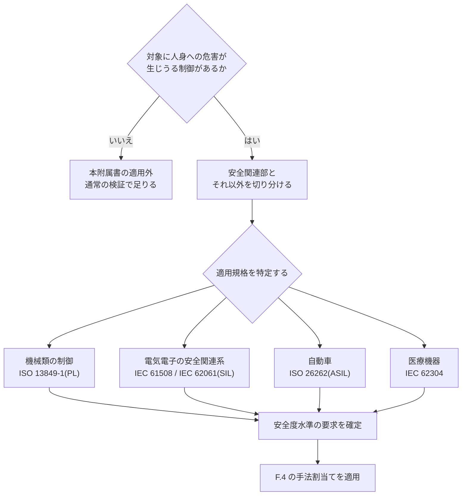

本附属書は、開発対象に**人身への危害につながりうる制御**が含まれる場合の検証手順を示します。**本附属書は規定です**(第1章 1.5)。[第5章 5.4](/process-compass/phase4-process-design/human-ai-boundary/)が、安全関連部の切り分けの判定手順を本附属書によると定めます。安全関連ソフトウェアの要求事項は[第5章 5.8](/process-compass/phase4-process-design/human-ai-boundary/)および[第6章](/process-compass/phase4-process-design/deliverable-templates/)にもあります。本附属書の記述がこれらと食い違う場合は、本文によります。

危険源の同定とリスクの低減は[第6章「AIエージェント安全リスクアセスメント」](/process-compass/phase4-process-design/deliverable-templates/)が扱います。本附属書は、そこで定めた保護方策のうち**ソフトウェアで実現する部分が、意図どおりに働くことを確かめる手順**を扱います。

## F.1 本附属書の位置づけ

本標準は特定の業界向けの規格適合ガイドではありません。したがって本附属書は、**どの規格を適用するかを標準側で決めず、適用規格を特定する手順を提供します**。

本附属書は、機能安全に関する各規格への適合性を証明しません。規格適合が必要な案件で、認証機関または適合性評価の担当部門の指示と本附属書が食い違うときは、本標準はその指示に優先しません。本附属書の記述は、規格本文ではなく公開されている解説に基づく箇所を含みます。

### 用語を安易に併記しない

安全度の要求を表す指標は、規格ごとに別の体系です。

| 指標 | 規格 | 対象 |
| --- | --- | --- |
| PL / PLr | ISO 13849-1 | 機械類の安全関連制御システム部。技術を問わない |
| SIL | IEC 61508 / IEC 62061 | 電気・電子・プログラマブル電子による安全関連系 |
| ASIL | ISO 26262 | 自動車の電気電子システム |

**「PLr/SIL」のように並べて書いてはなりません**。両者は算出方法が異なり、対応表は条件付きの参考情報です。PL a に対応する SIL は存在せず、算出値が区分の境界に近い場合は規格の附属書で帰属を判定する必要があります。

<!-- impl IMPL-0914 target=safety-risk-assessment-template state=delivered check=manual note="安全度の指標の併記の禁止。templates/09-safety-risk-assessment.md の節「安全関連部の検証の記録」が「適用規格と安全度水準」の欄を置き、規格ごとに1つの指標で書き「PLr/SIL」のように並べないと注記する。併記を検出する検査は無い。確かめる者: 安全関連部の検証の記録の作成者と承認者(記録を書くとき)" -->

上表の記述の根拠は、版を特定しない解説(二次)と、ISO 13849-1 の 2015 年版の解説(二次。下の 4.6 の記述は EV-0235)です。規格の本文は読んでおらず、読んだ版は特定していません。以下は、2026-11 時点の現行の版です(目録の頁で確かめました。現行の版は、表の記述の根拠の版ではありません)。

- ISO 13849-1: 現行は第4版(2023)で、2015 年版を置き換える(SRC-0740)。本頁の 4.6 の記述は 2015 年版の解説による
- IEC 62061: 現行は第2版(2021)。統合版に +AMD1:2024 がある(SRC-0741)。表の記述の根拠の版は不明
- ISO 26262: 現行は 2018 年版(第2部の発行日は 2018-12-17)。各部の版は確かめていない。改訂の素案(ISO/DIS 26262-2)が審議中(SRC-0744)。表の記述の根拠の版は不明
- IEC 61508: 第2.0版(2010)。目録で確かめた(SRC-0649)。本文は読んでいない。本節の記述は版を特定しない解説による

本標準の一般的な記述では、抽象語として「**安全度水準**」を用います。具体的な指標は適用規格を特定してから確定します。

## F.2 適用の判定

第4章 G-7 基準7 では、Q1 が「はい」の場合も、安全重要度が CL2・CL3 の場合も、安全関連として扱います。CL2・CL3 で Q1 が「いいえ」のときは、判定者が備考に書きます。Q1 が「はい」の案件は、事業ステージ S0・標準品質・CL0 の構成でも G-7 を適用します([第8章 軸B「S0 の省略が成立する前提」](/process-compass/phase4-process-design/tailoring-guide/) 前提4)。

### 安全関連部の切り分け

安全関連システムに含まれるコードの**すべてが安全関連ソフトウェアではありません**。切り分けは次の基準で行い、結果を記録します。

| 区分 | 判定基準 |
| --- | --- |
| 安全関連部 | 安全機能の実現、安全状態への遷移、監視・診断のいずれかを担う |
| それ以外 | 障害時にも安全機能の動作を妨げないと、隔離または独立性の設計によって示せる |

切り分けを記録しないまま全体を安全関連として扱うと、検証の負荷が実態を超え、形式的な適合の記録だけが残ります。逆に切り分けの根拠を書かずに範囲を狭めると、安全機能へ影響する変更が通常の経路で入ります。**根拠を書くことが切り分けの成立条件です**。

Q1 の答えと理由、切り分けの結果と根拠は、安全重要度の判定の記録([第6章 テンプレ0](/process-compass/phase4-process-design/deliverable-templates/) 表10)に書きます。判定者と別の自然人が確かめます。Q1 が「はい」の案件では、確認者に段3 を求めます([第8章 軸E「判定の記録と確認」](/process-compass/phase4-process-design/tailoring-guide/))。

<!-- impl IMPL-0915 target=d0-template state=delivered check=presence note="安全関連部の切り分けの結果と根拠を、安全重要度の判定の記録に書くこと(Q1 の答えと理由。Q1 が「はい」なら切り分けの結果と根拠)。D-0 の節16「安全重要度の判定の記録」の欄「附属書F F.2 の回答」が、この記入を説明する(templates/00-d0-governance.md の節16の表)。欄が空・様式の説明のままであること、答えが「はい」「いいえ」で始まらないことは check-d0.mjs と cl-judgment.mjs が失敗させる(IMPL-0449)。「はい」のときに切り分けの結果と根拠が書かれているか、切り分けの内容の妥当性は確かめない。判定者と別の自然人の確認と、Q1 が「はい」なら段3 の確認は IMPL-0450・IMPL-0452 が追う。確かめる者: 判定者(判定の記録を書くとき)。所在を読んだ(実行して確かめていない)(単位: 欄)" -->

### 安全関連ソフトウェアの区分

機械類の制御では、安全関連ソフトウェアを次の2種に分けます。

| 区分 | 内容 | 記述言語 |
| --- | --- | --- |
| 組込ソフトウェア | 安全部品の内部で動作するもの。部品の供給者が開発する | 完全可変言語 |
| 応用ソフトウェア | 安全制御装置の上に構築する応用プログラム | 限定可変言語または完全可変言語 |

ISO 13849-1(2015 年版の 4.6)では、応用ソフトウェア向けの簡略化された手順は、**限定可変言語で記述する場合にのみ適用するとされています**。完全可変言語で書く場合は、組込ソフトウェアと同等の措置を求めるとされています。

<!-- impl IMPL-0916 target=safety-risk-assessment-template state=delivered check=manual note="安全関連ソフトウェアの区分。同節が「安全関連ソフトウェアの区分(機械類の制御)」の欄(組込・応用、記述言語、適用した措置)と、完全可変言語の応用ソフトウェアに同等の措置を記録する注記を置く。区分の正否の検査は無い。確かめる者: 安全関連部の検証の記録の作成者と承認者(記録を書くとき)" -->

:::caution[暫定 EV-0235 / 見直し 2027-05]
**対象**: 応用ソフトウェアの簡略化された手順の適用の条件を、ISO 13849-1 の 2015 年版の 4.6 の内容として紹介する記述。
**根拠の水準**: E1(間接)。
**差し替え条件**: ISO 13849-1 の原本(2015 年版と 2023 年版)で確かめた、該当する箇条の番号と文。

機能安全の解説の資料(`research/phase4-standard/123-safety-verification.md` 1.2)によります。原本は読んでいません。2023 年版で該当する箇条の番号も、確かめていません。
:::

また、最上位の安全度水準では、機械安全の規格による簡略化された手順は使えません。この場合、汎用の機能安全規格によるソフトウェア要求を適用します。**要求水準が上がるほど、規格間の委譲によって手法の要求は厳しくなります**。

<!-- impl IMPL-0917 target=safety-risk-assessment-template state=delivered check=manual note="最上位の安全度水準の扱い。同節が、最上位の水準では機械安全の規格による簡略化された手順を使わず汎用の機能安全規格によるソフトウェア要求を適用した旨を書く注記と、適用規格と水準の欄を置く。確かめる者: 安全関連部の検証の記録の作成者と承認者(記録を書くとき)" -->

## F.3 AI を用いる場合の追加要求

### 2つのケースを混同しない

| ケース | 内容 | 本附属書の扱い |
| --- | --- | --- |
| AI が安全機能そのものを実現する | 推論結果が制御出力になる | **本附属書の対象外**。適用規格の特定から専門部門と行う |
| AI が開発を支援する | 実装・テスト・文書の作成を支援する | **本附属書の対象** |

前者は、学習した振る舞いを安全機能として保証する問題であり、本標準の範囲を超えます。後者は、生成物を人間と機械の検証で捕捉する問題であり、既存の検証体系で扱えます。

<!-- impl IMPL-0918 target=claude-md-resident state=delivered check=manual note="AI が安全機能そのものを実現する場合(推論結果が制御出力になる)を附属書F の対象外とし、適用規格の特定から専門部門と行うこと。template/CLAUDE.md「一律で AI に委譲できない領域」の箇条が名指す(claude-md-resident.json の規則)。確かめる者: AI維持管理者(指示資産の四半期の棚卸しのとき、template/CLAUDE.md の該当の行を読む)。所在を読んだ(実行して確かめていない)" -->

### 追加要求

安全関連部に AI の支援を用いる場合、[第5章 5.8](/process-compass/phase4-process-design/human-ai-boundary/)の要求に加えて次を満たします。

| # | 要求 |
| --- | --- |
| 1 | AI自律レベルは L1 に固定する。引き上げの判定の対象としない |
| 2 | 生成に用いたモデルの版と指示を構成管理下に置き、成果物から参照できるようにする |
| 3 | 生成された各行が、要求へ追跡でき、コーディング規約に適合し、独立した担当者のレビューを受け、決定論的な試験で検証されている |
| 4 | テスト生成における分離の段階は[5.8.4](/process-compass/phase4-process-design/human-ai-boundary/)の段階「最強」を適用する。検証の担当者は、実装の責任者から組織上の距離の段([第1章 1.4](/process-compass/phase4-process-design/overview/))で、CL2 は段2 以上、CL3 は段3 以上の者とする |
| 5 | 安全度の評価を、実装の責任者・作成を指示した者・当該の判定者から組織上の距離の段で、CL2 は段2 以上、CL3 は段3 以上の担当者が行う([第8章 軸E](/process-compass/phase4-process-design/tailoring-guide/)) |
| 6 | 自己修正ループ([附属書E E.7](/process-compass/phase4-process-design/developer-guide/))の反復で自動検証が合格へ転じた場合、その合格をもって修正の完了としない |

<!-- impl IMPL-0919 target=autonomy-derivation state=delivered check=machine test=template/scripts/gate/test-check-delegation.mjs note="安全関連部に AI の支援を用いる案件(D-0 表10 の F.2 の Q1 が「はい」)の AI自律レベルを L1 に固定し、引き上げの判定の対象としないこと。準拠テンプレートは安全関連部の範囲を持たないため、委任を案件の全体で止める(標準が求めるのは安全関連部の L1 固定まで。ADR-0220)。Q1 を委任を判定するたびに D-0 から読み、「いいえ」と読めないとき(未記入・様式のまま・読めない・D-0 が無い)も止める。判定は scripts/gate/autonomy.mjs の safetyPartStop の1関数で、種別の停止・登録の拒否・D-0 の表の生成と L3 の範囲が同じ関数を通る。構成へ Q1 を写さない(D-0 と食い違うため)。Q1 の答えの正しさは機械で閉じない。確かめる者: 判定者と確認者(安全重要度の判定の記録を書くとき)。同じ規定の安全関連部の R1・L1 固定は第5章の IMPL-0594 が追う。Q1 の読みは、先頭の「はい」「いいえ」の直後が区切り(終わり・空白・句読点・括弧・コロン)のときだけ採る。「はい / いいえ」の並記、判定が定まっていない記入(未定・判定中・検討中・後日・保留・TBD)、HTML の注釈とコードの囲みの中の行、値の違う複数の行は読めない(null)として委任を止める。安全関連部の検証の記録の検査(IMPL-1007)と判定の状態も同じ読みで、行が食い違うときは適用として扱う。節の外の見出しの表は読まない。様式 D-0 は「いいえ」の後に理由の記入を認めるため、列挙した語の外の留保(未確定・暫定・要確認など)を付けた「いいえ」は機械では落ちず、「いいえ」と読んで委任を止めない(語の列挙は閉じないため、語を足さない。ADR-0220 の議長の裁定)。この部分は機械で閉じない。確かめる者: 判定者と確認者(判定の記録を書くとき)" -->
<!-- impl IMPL-0920 target=safety-risk-assessment-template state=delivered check=manual note="生成された行の4条件の記録の置き場。同節が「生成された行の検証」の欄(要求への追跡・コーディング規約への適合・独立した担当者のレビュー・決定論的な試験の4条件を満たした記録の所在)を置く。4条件の検査は、Spec: トレーラ・G-5・G-6 が全変更に掛けて運ぶ。記録の中身の検査は無い。確かめる者: 安全関連部の検証の記録の作成者と承認者(記録を書くとき)" -->
<!-- impl IMPL-0921 target=implement-skill state=delivered check=manual note="安全関連部で、自己修正ループが合格へ転じた反復を修正の完了としない手順。.claude/skills/implement/SKILL.md の手順4 が、反復の記録を添えて仕様へ戻し、附属書F F.3 要求3の4条件を改めて満たすことを書く。遵守を機械は確かめない。 確かめる者: AI維持管理者(指示資産・様式を改めるとき)" -->

要求3の4条件は、生成物であるか人間の記述であるかを問わず同一です。**生成物であることは、検証を省く理由にも、追加の検証を課す理由にもなりません**。追加になるのは、要求2の再現性の確保と、要求4の独立性の確保です。

### 反復して合格へ至った修正の扱い

要求1は自律レベルを L1 に固定しますが、**自己修正ループは自律レベルによらず回ります**。L1 が定めるのは変更を人が確認する構成であり、確認へ至るまでの反復を止めるものではありません。要求6はこの区間を対象とします。

反復の末に合格へ転じた変更は、実装が仕様へ近づいた結果とも、検証を実装へ合わせた結果とも読めます。**結果からこの2つを判別する手段はありません**。安全関連部では、反復の記録を添えて仕様へ戻し、要求3の4条件を改めて満たします。

<!-- impl IMPL-0922 target=implement-skill state=delivered check=manual note="安全関連部で、反復の末に合格へ転じた変更を、反復の記録(docs/self-heal)を添えて仕様へ戻し、要求3の4条件を改めて満たす手順。.claude/skills/implement/SKILL.md の手順4 が書く(IMPL-0921 と同じ段落)。遵守を機械は確かめない。 確かめる者: AI維持管理者(指示資産・様式を改めるとき)" -->

不変条件の記述と、その静的な検証を要するかは、**特定した規格の要求によります**。F.1 のとおり、本附属書は適用する手法を規格に先立って定めません。実行時に不変条件を確認する構成を採る場合、その確認は保護方策の一部であり、F.5 の故障挿入試験の対象になります。

<!-- impl IMPL-0923 target=safety-risk-assessment-template state=delivered check=manual note="実行時の不変条件の確認の扱い。同節が「実行時の不変条件の確認」の欄(採る場合は故障挿入試験の対象にした結果)を置く。確かめる者: 安全関連部の検証の記録の作成者と承認者(記録を書くとき)" -->

## F.4 検証手法の割当て

手法の推奨度は、機能安全の規格が用いる記法に倣います。

| 記法 | 意味 |
| --- | --- |
| HR | 強く推奨する。適用しない場合は、しない理由を記録する |
| R | 推奨する |
| — | 推奨も非推奨もしない |

| 手法 | R3 | R2 | R1 | 安全関連部 |
| --- | --- | --- | --- | --- |
| 独立レビュー(G-6) | R | HR | HR | HR |
| 静的解析・コーディング規約への適合 | R | R | HR | HR |
| 単体試験 | HR | HR | HR | HR |
| 境界値解析 | R | R | HR | HR |
| 構造カバレッジ(分岐) | R | HR | HR | HR |
| 構造カバレッジ(条件と判定の組合せ) | — | — | R | HR |
| ミューテーション試験 | — | [附属書H H.1](/process-compass/phase4-process-design/assurance-case/)による | [附属書H H.1](/process-compass/phase4-process-design/assurance-case/)による | HR |
| 故障挿入試験 | — | — | R | HR |
| 独立した安全性の評価 | — | — | — | HR |

表のミューテーション試験の R2・R1 の欄は、変更ごとの実行を規定する附属書H H.1 の表(R1 は必須、R2 は週次で合否条件にしない)が正本なので、そちらを指します。

附属書F の適用の判定(F.2 の Q1)が「はい」の案件と、安全重要度 CL3 の案件では、ミューテーション試験を、しない理由の記録で省けません。第4章 G-5 の段として必須です(適用: Q1 が「はい」の案件、CL3 の案件)。特定した規格の表とテーラリングによる調整は、この必須を外しません。CL2 で Q1 が「いいえ」の案件には課しません(G-7 基準7 の記録の層は CL2 を含みます)。これは本標準の判断であり、規格の要求ではありません([ADR-0224](/process-compass/adr/0224-g5-mutation-and-regulatory-stages-required-for-safety-and-regulated/))。

:::note
安全関連部の列は、公開されている規格解説に基づく例です。条件と判定の組合せによるカバレッジは安全度水準が最上位で強く推奨され、故障挿入は上位の水準で強く推奨されます。監視タイマは水準によらず強く推奨されます。
:::

**安全関連部の列は例です。実際の適用では、特定した規格の該当する表によります**。

R1〜R3 の列は本標準が定めた既定値であり、規格に基づく値ではありません([第1章 1.7.7](/process-compass/phase4-process-design/overview/))。組織の実情に応じて第8章のテーラリングで調整します。ただし、附属書H H.1 を指す欄(ミューテーション試験の R1・R2)は既定値ではなく、附属書H の規定により、この調整は及びません。

<!-- impl IMPL-0924 target=safety-risk-assessment-template state=delivered check=manual note="検証手法の適用の記録。同節が「適用した手法」の欄(附属書F F.4 の表のうち適用したもの、適用しなかった HR の項目はしない理由)を置く。手法の表(推奨度・出典・適用・しない理由)の記入の形は IMPL-0934 が検査する。手法ごとの割当ての妥当性の検査は無い。確かめる者: 安全関連部の検証の記録の作成者と承認者(記録を書くとき)" -->

## F.5 故障挿入試験の実施手順

故障挿入試験は、**正常系では到達しない経路を強制的に通し、保護方策が働くことを確かめる**手法です。

### 手法の分類

| 分類 | 内容 | 本標準での用途 |
| --- | --- | --- |
| 実行前の挿入 | ソースまたはバイナリを改変して欠陥を作り込む | ミューテーション試験として CI で実行する |
| 実行時の挿入 | 実行中に変数・レジスタ・メモリを破壊する | 運用から切り離した環境(試験台の実機、または実機を模擬した環境)で実行する |
| ハードウェアによる挿入 | 信号線・電源へ物理的に故障を与える | 専門部門の設備で実行する |

**運用に供している(本番稼働中の)安全関連システムへ、故障を挿入してはなりません**。実行時の挿入とハードウェアによる挿入は、運用から切り離した環境で行います。この禁止は、第7章 7.3 の例外承認の対象にしません。挿入そのものが危険事象を起こしうるためです。

:::caution[暫定 EV-0296 / 見直し 2027-05]
**対象**: 運用中の安全関連システムへの故障挿入の禁止と、F.7 に挿入した環境を記録する義務(F.5)。
**根拠の水準**: E0(なし)。
**差し替え条件**: IEC 61508・ISO 26262 の故障挿入の条項の抜き書きを出典台帳(`research/sources/`)へ足し、本標準の禁止と照合します。稼働中の安全関連システムへの挿入による事故・ヒヤリの事例が見つかったときに見直します。

根拠は本標準のリスク論です。稼働中への挿入を明文で禁じる規格は、見つけていません。準拠テンプレートの検査(IMPL-0925)が見るのは環境の欄の記入の形だけで、実際に本番でないことを保証しません。IEC 61508 と ISO 26262 の故障挿入の条項の逐語は、未確認です。
:::

:::danger
分散システムの可用性の検証で行う本番環境への障害注入は、安全関連部には及びません。禁止の定めは、前の段落にあります。
:::

<!-- impl IMPL-0925 target=safety-verification-record state=delivered check=machine test=template/scripts/gate/test-safety-record.mjs note="運用に供している(本番稼働中の)安全関連システムへ故障を挿入しないこと(F.5 の本文の禁止。第7章 7.3 の例外承認の対象にしない)。F.7 の故障挿入の結果の挿入した環境の欄を、「試験台の実機」「模擬環境」「専門部門の設備」の識別つき(例: 模擬環境(HIL-2))か「実行前の挿入」の形に限り、種別だけ・3種でない語・種別の併記・空欄・括弧を2組持つ形・例外承認の ID を記載の欠落に数える(scripts/gate/check-safety-record.mjs。前方一致で通さない)。形だけを検査し、識別の語の意味は見ない。「模擬環境: 本番と併用」のように識別の欄へ書かれた併用は機械では落ちない。実際に本番でないことは機械で閉じない。確かめる者: 独立した評価者と G-7 の判定者" -->

### 最小限の試験項目

安全関連部では、少なくとも次を試験します。

| # | 項目 | 確認する挙動 |
| --- | --- | --- |
| 1 | 監視タイマの不応答 | 定めた時間内に安全状態へ遷移する |
| 2 | 監視タイマの早すぎる応答 | 時間窓を持つ監視では、早い応答も異常として検出する |
| 3 | 入力の境界値と範囲外の値 | 範囲外を検出し、危険側へ倒れない |
| 4 | 入力の欠落と滞留 | 前回値の保持によって異常が隠れない |
| 5 | メモリまたは変数の破壊 | 診断が検出し、安全状態へ遷移する |
| 6 | 処理順序の誤り | 順序の監視が検出する |
| 7 | 安全状態からの復帰 | 定めた条件を満たさない限り復帰しない |

<!-- impl IMPL-0926 target=safety-risk-assessment-template state=delivered check=manual note="最小限の試験項目。同節が7項目(監視タイマの不応答・早すぎる応答・入力の境界値と範囲外・入力の欠落と滞留・メモリまたは変数の破壊・処理順序の誤り・安全状態からの復帰)の結果の表を置く。項目の実施の検査は無い。確かめる者: 安全関連部の検証の記録の作成者と承認者(記録を書くとき)" -->

項目2を省いてはなりません。**時間窓を持たない単純な監視タイマは、異常に早い応答を正常として通します**。監視の実装が単純な形式である場合、その旨と診断能力の限界を記録します。

<!-- impl IMPL-0927 target=safety-verification-record state=delivered check=machine test=template/scripts/gate/test-safety-record.mjs note="最小限の試験項目のうち、項目2(監視タイマの早すぎる応答)を省かないこと。試験項目の7行すべての結果の欄を「一致」「不一致」で始める形に限り、省く場合は「例外承認: 行の ID」(技術負債台帳の区分「例外」の、失効していない行)と書く。空欄・省略・該当なし・未実施は記載の欠落に数える。時間窓を持たない単純な監視は「不一致(時間窓なし。早い応答を通す)」と書く(新しい免除は作らない)。結果の欄の形を検査する。試験を実際に行ったことは機械で閉じない。確かめる者: 独立した評価者と G-7 の判定者。承認者(様式 03 が区分「例外」の行で必須とする欄)が空欄・名簿の外・AI の名義の行は成立させない(resolveSigner と aiNameBlocked)。結果の欄は先頭の語だけを見ます。「一致」「不一致」に続く文の意味は見ないので、「一致(未実施)」のような記入は機械では落ちません。確かめる者: 独立した評価者と G-7 の判定者。例外承認の行は、技術負債台帳の対象の欄に「基準7」(「基準 7」・全角の表記を含む)か「安全関連部の検証の記録」の語を持つことを機械が確かめます。「基準7」は、G-7 以外のゲート名が直前に付く出現(G-5 基準7 など)と、後ろに数字が続く出現(基準70)を数えません。機械が見るのは語の有無と直前のゲート名だけです。対象の文が当該の試験項目を正しく指すか(「G-5 の件。基準7 とは無関係」のような文の意味を含む)、省く理由が妥当かは機械では確かめません。確かめる者は、独立した評価者と G-7 の判定者です" -->

:::caution[暫定 EV-0334 / 見直し 2027-05]
**対象**: 試験項目を名指しして省略を禁じ、7 行すべてに結果の形を求める判断(F.5)。
**根拠の水準**: E0(なし)。
**差し替え条件**: 項目を実施できない案件の件数と、例外承認で受けた件数の観測。

規格に項目を名指しした先例は、確かめられていません。本標準が足す判断です。

結果の欄は先頭の語だけを見ます。「一致」「不一致」に続く文の意味は見ないので、「一致(未実施)」のような記入は機械では落ちません。確かめる者: 独立した評価者と G-7 の判定者。例外承認の行は、技術負債台帳の対象の欄に「基準7」(「基準 7」・全角の表記を含む)か「安全関連部の検証の記録」の語を持つことを機械が確かめます。「基準7」は、G-7 以外のゲート名が直前に付く出現(G-5 基準7 など)と、後ろに数字が続く出現(基準70)を数えません。機械が見るのは語の有無と直前のゲート名だけです。対象の文が当該の試験項目を正しく指すか(「G-5 の件。基準7 とは無関係」のような文の意味を含む)、省く理由が妥当かは機械では確かめません。確かめる者は、独立した評価者と G-7 の判定者です。
:::
<!-- impl IMPL-0928 target=safety-risk-assessment-template state=delivered check=manual note="単純な監視の実装の記録。同節が「監視の実装」の欄(時間窓を持たない単純な監視タイマの場合は、その旨と診断能力の限界)を置く。確かめる者: 安全関連部の検証の記録の作成者と承認者(記録を書くとき)" -->

項目7は見落とされやすい項目です。安全状態へ遷移する試験だけを行い、復帰の条件を試験しない構成では、異常が解消していない状態での自動復帰を検出する手段がありません。

### AI に故障挿入の試験項目を生成させる場合

生成させてよいのは**試験項目の候補**までです。次の順序を守ります。

1. 人間が、上表の項目と、対象に固有の安全要求から**期待する挙動**を先に書く
2. AI には期待する挙動のみを渡し、**実装コードを渡さずに**試験項目を生成させる
3. 生成された項目を、上表との突合と境界値の観点で人間が点検する
4. 不足を人間が補う

<!-- impl IMPL-0929 target=implement-skill state=delivered check=manual note="故障挿入の試験項目を AI に生成させるときの順序(人が期待する挙動を先に書く・実装コードを渡さない・生成された項目を表との突合と境界値で点検する・不足を人が補う)。.claude/skills/implement/SKILL.md の手順2 が書く。遵守を機械は確かめない。 確かめる者: AI維持管理者(指示資産・様式を改めるとき)" -->

段階2で実装コードを渡すと、実装が想定している異常だけを試験する項目が生成されます。**実装が想定していない異常を試すことが故障挿入の目的**であるため、この順序を崩すと手法の意味が失われます。

## F.6 ミューテーション試験

### 位置づけ

ミューテーション試験は、コードへ意図的に小さな変更を加え、**試験がその変更を検出できるか**を測る手法です。機能安全の分野では、単体試験の水準における故障挿入の一形態として挙げられています。

本標準では、**AI が生成した試験の十分性を測る指標**として用います。

### カバレッジを試験の品質指標にしない

**行や分岐の網羅率は、AI が生成した試験の品質を表しません**。網羅率の高い試験群であっても、検出能力はほとんどない場合があります。実行はするが結果を検査しない試験は、網羅率を上げても欠陥を検出しません。

したがって、AI に試験を書かせる工程では、網羅率ではなく**ミューテーションスコアの閾値**を通過条件にします。

<!-- impl IMPL-0930 target=g5-adapter state=delivered check=machine test=template/scripts/gate/test-adapter.mjs note="AI に試験を書かせる工程で、行や分岐の網羅率ではなくミューテーションスコアの閾値を通過条件にすること。G-5 の入口(scripts/gate/adapter.mjs)の段 mutation が、スコアと閾値(構成の ci.mutationThreshold)の比較を合否にする。閾値が無ければ「閾値なしで通過」と出し、検出力が足りるとは主張しない(出荷の集約が構成に閾値が無いことを注意に出す)。通過条件を必須にする案件は、附属書F の適用(Q1 が「はい」)と CL3 の案件(ADR-0224)、および R1 の変更(附属書H H.1。IMPL-1029)。閾値割れを 7.3 の台帳の行で受ける段の機械は降ろした(ADR-0243。test-adapter.mjs。出荷の集約の側は IMPL-0931 が追う)。 段のコマンド・必須の判定・閾値の型・出力の約束(束 U4a)と、集約が段のジョブ mutation・regulatory の success を確かめて skipped を通さないこと、構成に閾値が無いことの注意を出荷の集約へ出すこと(束 U4b)は template で降ろし、test-adapter.mjs・test-g5-aggregate.mjs(段のジョブの結線: 呼び出し・env・全履歴)・test-aggregate-wiring.mjs(集約の報告への出力)・test-init-g5.mjs(契約検査の閾値)が確かめる。閾値を書く経路は、生成器(scripts/init/generate-profile.mjs)が種別 settings の ci.mutationThreshold(0〜100 の数値。範囲の外・文字列は拒否し、値が無ければ書かず、再生成でも保つ。既定値は置かない。値があれば PROCESS-PROFILE.md の CI の設定値に出す)を受けて構成へ保存する。閾値の変更は構成の差分に「段 mutation の閾値: 前 → 後」の行で出して変化点の記録を変更ありで残し、下げる変更は緩める向きとして決定者の記名を求める(ci.coverageThreshold と同じ。初めて入れる変更と上げる変更は求めない。設定済みの値を未設定へ戻す経路は置かない)。test-init-g5.mjs が生成器の経路だけで確かめる(束 B28 の回帰の落ちの直し)。確かめるのは段の存在・出力の行・閾値との比較・集約の式・段のジョブの結線までで、変異を作るか・閾値の較正・コマンドの実質は確かめない(EV-0339)。同じ PR が集約の定義ごと書き換える悪意は、ワークフローの変更の承認(ADR-0115)が受ける。実物の gate-g5.yml(段のジョブを含む)の GitHub 上での通しは行っていない(集約の式の観測は縮約版。research/326-deliberation/b26-live-check.md)。" -->

### CI への組み込み

| 項目 | 方針 |
| --- | --- |
| 実行範囲 | 差分に対する増分実行。全量実行は所要時間の面で現実的でない |
| 判定 | スコアの閾値による合否。閾値は組織が G-1 で定める |
| 対象 | 安全関連部および R1 の変更を優先する(R1 の変更は、附属書H H.1 により当該範囲の変更のたびに必須) |
| 記録 | 生き残ったミューテーションの一覧を差し戻しの根拠として残す |

閾値は組織が定める値であり、本標準は値を定めません。既存コードの実測値から較正します。**外部の事例の数値をそのまま閾値にしてはなりません**。

附属書F の適用の判定(F.2 の Q1)が「はい」の案件と CL3 の案件では、ミューテーション試験の段が空のまま、または閾値を定めないまま、G-5 を通過させてはなりません。この場合に第7章 7.3 の例外承認を用いてはなりません。

段を実施したうえで、閾値を定めている場合に、スコアがその閾値に届かないときは、第7章 7.3 の例外承認の対象とします(本節が 7.3 を名指す事項。対象は、上の条件に当たる案件の段と、附属書H H.1 の R1 の変更ごとの段の閾値割れに限ります)。閾値を下げるときは、G-1 で定めた記名をし直します。

機械が確かめるのは、段のコマンドが在ること、閾値を定めた場合は数値であること、生き残ったミューテーションの一覧の所在が出力に在ることまでです。コマンドが実際に変異を作り検出を測っているか、閾値が既存コードの実測から較正されているかは、機械で確かめられません。Q1 の記録が読めない間は、G-5 は段を必須にせず、「判定できない」と注意に出します。記録の欠落そのものは check-d0 と出荷の集約が止めます。上の条件に当たる案件と附属書H H.1 の R1 の変更のどちらでも、道具の無い言語では、外部で実行したミューテーション試験の記録を照らすコマンドを段に置くことは妨げません。その場合も、閾値との比較と生き残りの一覧の所在は段の出力に要ります。

G-5 は故障挿入の記録の有無を見ません。独立の段を置かないためです。CI で回る実行前の挿入(F.5 の分類)はミューテーション試験の段に含まれます。実行時の挿入とハードウェアによる挿入の結果は、F.7 の記録に残し、G-7 基準7 で出荷判定者が読みます([ADR-0224](/process-compass/adr/0224-g5-mutation-and-regulatory-stages-required-for-safety-and-regulated/))。

:::caution[暫定 EV-0339 / 見直し 2027-05]
**対象**: G-5 のミューテーション試験と規制要件の段で、コマンドの存在と出力の所在までを機械が確かめ、中身の実質を確かめないこと。条件に当たる案件で、しない理由の記録による省略を認めないこと。附属書H H.1 の R1 の変更ごとの段で、閾値を求めず、設定した場合だけ合否に使い、無ければ「閾値なしで通過」と出すこと。道具の無い言語で、外部で実行した記録を照らすコマンドを段に置くことを妨げないこと。故障挿入の独立の段を置かず、G-5 で故障挿入の記録の有無を機械が見ないこと。
**根拠の水準**: E0(なし)。
**差し替え条件**: 条件に当たる案件と R1 の変更で、常に成功するコマンドが段に置かれた件数(内部監査の抜き取り)と、段の追加の前後で出荷後に見つかった欠陥の件数の比較。実行時・ハードウェアの故障挿入の記録の欠けが、G-7 まで見つからなかったことで手戻りを生んだ件数。

機能安全の規格は、故障挿入とミューテーションを推奨度を段階づけた手法として挙げると二次資料は伝えます。規格の原文は確かめておらず、資料の間で強さが食い違います。CI の合否に必須の段とする根拠を、規格に置いていません。
:::

<!-- impl IMPL-0931 target=g5-adapter state=undelivered check=manual plan=scheduled issue=445 review=2027-05 note="ミューテーション試験を CI に組み込むこと。差分に対する増分実行、スコアの閾値による合否、安全関連部と R1 の変更の優先、生き残ったミューテーションの一覧を差し戻しの根拠として残すこと。閾値は組織が G-1 で定める値で、既存コードの実測値から較正し、外部の事例の数値をそのまま閾値にしない。附属書F の適用(Q1 が「はい」)と CL3 の案件では段を必須にし、空なら G-5 の失敗、閾値が未設定でも G-5 の失敗とする(ADR-0224)。閾値割れは 7.3 の対象で、段が台帳の行(対象 G-5 PR-N・印 変異試験の閾値割れ・承認した者本人の宣言行のレビュー。行の約束は ADR-0243)で受ける機械は、束 U6a・U6b で template へ降ろした(test-adapter.mjs・test-exception-expiry.mjs。手引きは exception-paths.md)。降りていないのは、出荷の集約(G-7)がこの行を IMPL-0996 の「G-5 の行は常に欠落」から外し、対象の PR の写しの宣言行のレビューで帰属を数える部分(束 U6c)である。U6c の前(段と手引きだけが入った状態)の差: 段で受けた行が、出荷の集約(G-7)で帰属を確かめられない欠落になりうる(止める側に倒れる。弱く見せる向きではない)。印の無い G-5 PR-N の行は段が受けず、gate-g5 は失敗のままである。受けたスコアの妥当性・理由の当否・回収の中身は機械が見ない(確かめる者: 承認した者・G-6 の判定者)。G-7 が見るのは行の形と帰属・期限だけで、段がその行で受けた事実は段の出力と宣言行に頼る。squash 以外のマージの方式での push の照合と実際の GitHub の応答・権限は確かめていない(根拠水準マーク EV-0347)。集約が、条件に当たる構成で段のジョブの success を確かめ、skipped を通さないことは束 U4b で降ろした(test-g5-aggregate.mjs。同じ PR が集約の定義ごと書き換える悪意は、ワークフローの変更の承認(ADR-0115)が受ける)。Q1 の記録が読めない間は G-5 が段を必須にせず注意に出す(欠落は check-d0 と出荷の集約が止める)。機械が確かめるのはコマンド・閾値の数値・一覧の所在までで、変異を作るか・閾値の較正は確かめない。G-5 の入口にミューテーション試験の段が無かったのは 2026-11-15 時点の経緯で、束 U4a・U4b で降ろした。出荷判定の側で一覧の読解を出荷判定者へ求めないことは G-5 の IMPL-0560 が追う。 段のコマンド・必須の判定・閾値の型・出力の約束(束 U4a)と、集約が段のジョブの success を確かめること(束 U4b)は降ろした。降りていないのは、段が受けた行を出荷の集約が見る部分(束 U6c。ADR-0243)である。 確かめる者: 計画の Issue(issue= の番号)の担当者(降ろすときに確かめる。それまでは降りていない規定として台帳に出る)" -->

### 既知の限界を補う

AI が生成した試験は、**条件の境界をずらす変更を検出する検査を書けないことが多い**という傾向があります。生成された試験が境界値を検査しているかは、人間が別途点検します。ミューテーション試験のスコアだけで十分性を判定してはなりません。

<!-- impl IMPL-0932 target=implement-skill state=delivered check=manual note="生成された試験の十分性を、ミューテーション試験のスコアだけで判定せず、境界値を人が別途点検すること。.claude/skills/implement/SKILL.md の手順2 が書く。遵守を機械は確かめない。 確かめる者: AI維持管理者(指示資産・様式を改めるとき)" -->

## F.7 記録

安全関連部の検証では、次を記録します。ゲート判定記録(テンプレ4)に添付します。

| 項目 | 内容 |
| --- | --- |
| 安全関連部の切り分け | 範囲と、そう判断した根拠 |
| 適用規格と安全度水準 | 特定した規格、要求される水準、特定の根拠 |
| 適用した手法 | F.4 の表のうち適用したもの。手法ごとに、特定した規格での推奨度と出典(規格・版・表の番号)を書く。適用しなかった HR の項目は理由を記載する(F.4 の注の案件のミューテーション試験を除く。理由で省けない) |
| 故障挿入の結果 | 試験項目ごとの挙動と、期待との一致。実行時の挿入とハードウェアによる挿入では、挿入した環境(試験台の実機・模擬環境・専門部門の設備の別と、その識別)。実行前の挿入では、その旨 |
| AI の利用 | 用いたモデルの版、指示の保存場所、テスト生成の分離の段階(第5章 5.8.4)。段階「最強」の検証の担当者と、その組織上の距離の段と段の根拠(指揮系統・資源・リリースの権限。[第1章 1.4](/process-compass/phase4-process-design/overview/)) |
| 独立した評価 | 評価者、評価者の組織上の距離の段と段の根拠(指揮系統・資源・リリースの権限。段4 は所属の法人と利害の有無)、評価の結論 |

<!-- impl IMPL-0933 target=safety-risk-assessment-template state=delivered check=manual note="安全関連部の検証の記録項目。templates/09-safety-risk-assessment.md の節「安全関連部の検証の記録」(附属書F F.7)が、切り分け・適用規格と水準・手法・故障挿入の結果(挿入した環境を含む)・AI の利用・独立した評価の欄を置く。ゲート判定記録(テンプレ4)への添付は標準の定めで、テンプレ4 は所在だけを持つ。節は任意で、必須欄ではない。規則 r-e-cl2 の safetyVerificationRecord が required のとき、G-7 の集約は F.7 の記録を適用として照らす(IMPL-0761。束 B26)。確かめる者: 安全関連部の検証の記録の作成者と承認者(記録を書くとき)" -->

**適用しなかった HR の項目について理由を書かない記録は、不完全な記録として差し戻します**。強く推奨される手法を採らない判断そのものは認められます(F.4 の注の案件のミューテーション試験を除きます)が、判断の根拠が残らない構成では後から妥当性を検証する手段がありません。

<!-- impl IMPL-0934 target=safety-verification-record state=delivered check=machine test=template/scripts/gate/test-safety-record.mjs note="適用しなかった HR の項目について理由を書かない記録を、不完全な記録として差し戻すこと。様式 09 に手法の表(手法・推奨度・出典・適用・しない理由)を置き、表が無い・行が0件・推奨度か出典か適用が空欄・適用が「適用」「しない」のどちらでもない・推奨度が HR で始まり適用が「しない」で理由が空欄、を記載の欠落に数える。出力に HR の行・うち不適用の件数を「推奨度は記入者の申告」と併記する。規格の表は転載しない(出典の欄は番号だけ)。推奨度を HR から R へ書き換えること、HR の行を表から外すことは機械で閉じない。確かめる者: 独立した評価者(出典の表との突き合わせ)" -->

:::caution[暫定 EV-0335 / 見直し 2027-05]
**対象**: 手法の推奨度と行の網羅が、記入者の申告に依ること。
**根拠の水準**: E1(間接)。
**差し替え条件**: 規格の制定版の表と照合した、推奨度の記入の誤りの件数の観測。

外部の先例(SRC-0763)は改訂案で、制定版との一致は未確認です。規格の表は、標準と様式のどちらにも転載しません。
:::

## F.8 関連する章

- AI が生成した成果物の統制と、テスト生成の分離の段階は[第5章 5.8](/process-compass/phase4-process-design/human-ai-boundary/)に規定する
- 危険源の同定とリスクの低減は[第6章](/process-compass/phase4-process-design/deliverable-templates/)に規定する
- 独立レビュー(G-6)の実施手順は[附属書C](/process-compass/phase4-process-design/review-guide/)に示す
- 検証の自動化と CI の構成の例は、[フェーズ5](/process-compass/phase5-implementation/ci-gates/)を参照
