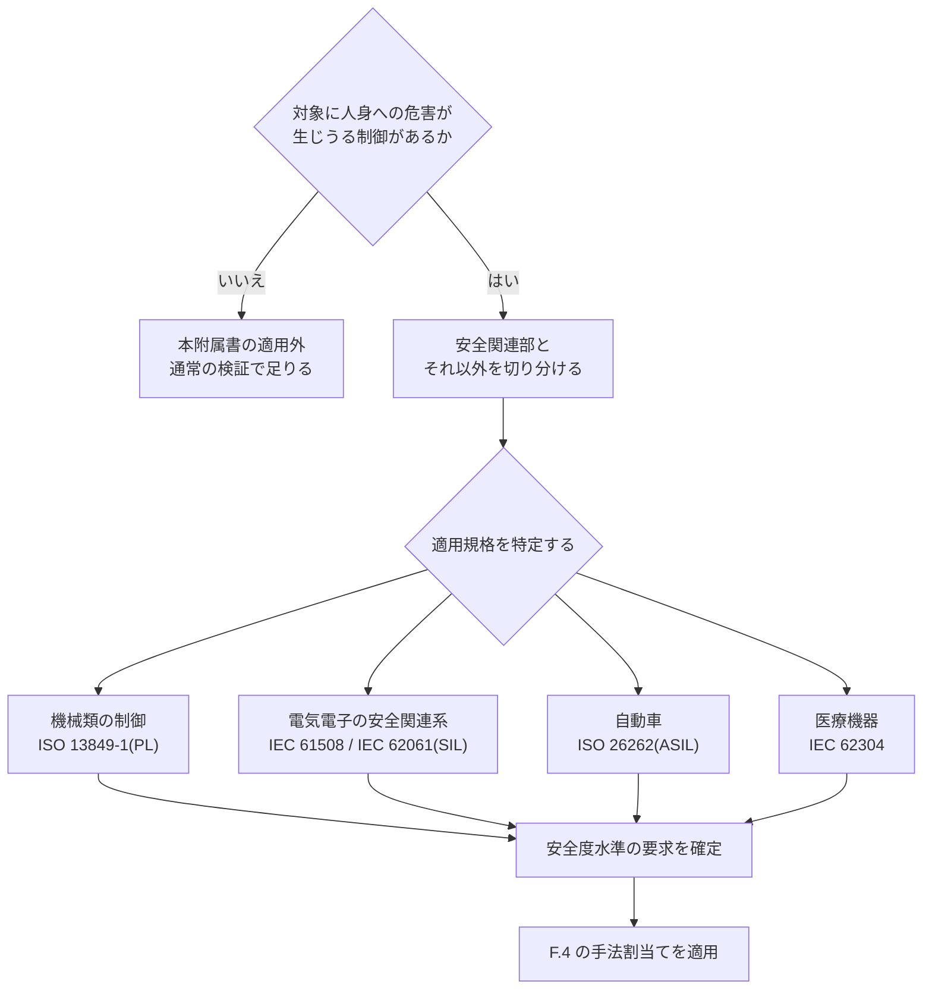

本附属書は、開発対象に**人身への危害につながりうる制御**が含まれる場合の検証手順を示します。**本附属書は規定です**(第1章 1.5)。[第5章 5.4](/process-compass/phase4-process-design/human-ai-boundary/)が、安全関連部の切り分けの判定手順を本附属書によると定めます。安全関連ソフトウェアの要求事項は[第5章 5.8](/process-compass/phase4-process-design/human-ai-boundary/)および[第6章](/process-compass/phase4-process-design/deliverable-templates/)にもあります。本附属書の記述がこれらと食い違う場合は、本文によります。

危険源の同定とリスクの低減は[第6章「AIエージェント安全リスクアセスメント」](/process-compass/phase4-process-design/deliverable-templates/)が扱います。本附属書は、そこで定めた保護方策のうち**ソフトウェアで実現する部分が、意図どおりに働くことを確かめる手順**を扱います。

## F.1 本附属書の位置づけ

本標準は特定の業界向けの規格適合ガイドではありません。したがって本附属書は、**どの規格を適用するかを標準側で決めず、適用規格を特定する手順を提供します**。

本附属書は、機能安全に関する各規格への適合性を証明しません。規格適合が必要な案件で、認証機関または適合性評価の担当部門の指示と本附属書が食い違うときは、本標準はその指示に優先しません。本附属書の記述は、規格本文ではなく公開されている解説に基づく箇所を含みます。

### 用語を安易に併記しない

安全度の要求を表す指標は、規格ごとに別の体系です。

| 指標 | 規格 | 対象 |
| --- | --- | --- |
| PL / PLr | ISO 13849-1 | 機械類の安全関連制御システム部。技術を問わない |
| SIL | IEC 61508 / IEC 62061 | 電気・電子・プログラマブル電子による安全関連系 |
| ASIL | ISO 26262 | 自動車の電気電子システム |

**「PLr/SIL」のように並べて書いてはなりません**。両者は算出方法が異なり、対応表は条件付きの参考情報です。PL a に対応する SIL は存在せず、算出値が区分の境界に近い場合は規格の附属書で帰属を判定する必要があります。

<!-- impl IMPL-0914 target=safety-verification-record state=undelivered check=manual plan=scheduled issue=448 review=2027-05 note="安全度の指標(PL/PLr・SIL・ASIL)を「PLr/SIL」のように並べて書かないこと。書く先は F.7 の「適用規格と安全度水準」の記録で、適用規格を特定してから具体的な指標を確定する。準拠テンプレートに F.7 の記録の様式が無く(templates/ と scripts/gate に「適用規格」の欄も検査も無い。2026-11-15)、併記を検出する検査も無い。 確かめる者: 計画の Issue(issue= の番号)の担当者(降ろすときに確かめる。それまでは降りていない規定として台帳に出る)" -->

上表の記述の根拠は、版を特定しない解説(二次)と、ISO 13849-1 の 2015 年版の解説(二次。下の 4.6 の記述は EV-0235)です。規格の本文は読んでおらず、読んだ版は特定していません。以下は、2026-11 時点の現行の版です(目録の頁で確かめました。現行の版は、表の記述の根拠の版ではありません)。

- ISO 13849-1: 現行は第4版(2023)で、2015 年版を置き換える(SRC-0740)。本頁の 4.6 の記述は 2015 年版の解説による
- IEC 62061: 現行は第2版(2021)。統合版に +AMD1:2024 がある(SRC-0741)。表の記述の根拠の版は不明
- ISO 26262: 現行は 2018 年版(第2部の発行日は 2018-12-17)。各部の版は確かめていない。改訂の素案(ISO/DIS 26262-2)が審議中(SRC-0744)。表の記述の根拠の版は不明
- IEC 61508: 第2.0版(2010)。目録で確かめた(SRC-0649)。本文は読んでいない。本節の記述は版を特定しない解説による

本標準の一般的な記述では、抽象語として「**安全度水準**」を用います。具体的な指標は適用規格を特定してから確定します。

## F.2 適用の判定

### 安全関連部の切り分け

安全関連システムに含まれるコードの**すべてが安全関連ソフトウェアではありません**。切り分けは次の基準で行い、結果を記録します。

| 区分 | 判定基準 |
| --- | --- |
| 安全関連部 | 安全機能の実現、安全状態への遷移、監視・診断のいずれかを担う |
| それ以外 | 障害時にも安全機能の動作を妨げないと、隔離または独立性の設計によって示せる |

切り分けを記録しないまま全体を安全関連として扱うと、検証の負荷が実態を超え、形式的な適合の記録だけが残ります。逆に切り分けの根拠を書かずに範囲を狭めると、安全機能へ影響する変更が通常の経路で入ります。**根拠を書くことが切り分けの成立条件です**。

Q1 の答えと理由、切り分けの結果と根拠は、安全重要度の判定の記録([第6章 テンプレ0](/process-compass/phase4-process-design/deliverable-templates/) 表10)に書きます。判定者と別の自然人が確かめます。Q1 が「はい」の案件では、確認者に段3 を求めます([第8章 軸E「判定の記録と確認」](/process-compass/phase4-process-design/tailoring-guide/))。

<!-- impl IMPL-0915 target=d0-template state=delivered check=presence note="安全関連部の切り分けの結果と根拠を、安全重要度の判定の記録に書くこと(Q1 の答えと理由。Q1 が「はい」なら切り分けの結果と根拠)。D-0 の節16「安全重要度の判定の記録」の欄「附属書F F.2 の回答」が、この記入を説明する(templates/00-d0-governance.md の節16の表)。欄が空・様式の説明のままであること、答えが「はい」「いいえ」で始まらないことは check-d0.mjs と cl-judgment.mjs が失敗させる(IMPL-0449)。「はい」のときに切り分けの結果と根拠が書かれているか、切り分けの内容の妥当性は確かめない。判定者と別の自然人の確認と、Q1 が「はい」なら段3 の確認は IMPL-0450・IMPL-0452 が追う。確かめる者: 判定者(判定の記録を書くとき)。所在を読んだ(実行して確かめていない)(単位: 欄)" -->

### 安全関連ソフトウェアの区分

機械類の制御では、安全関連ソフトウェアを次の2種に分けます。

| 区分 | 内容 | 記述言語 |
| --- | --- | --- |
| 組込ソフトウェア | 安全部品の内部で動作するもの。部品の供給者が開発する | 完全可変言語 |
| 応用ソフトウェア | 安全制御装置の上に構築する応用プログラム | 限定可変言語または完全可変言語 |

ISO 13849-1(2015 年版の 4.6)では、応用ソフトウェア向けの簡略化された手順は、**限定可変言語で記述する場合にのみ適用するとされています**。完全可変言語で書く場合は、組込ソフトウェアと同等の措置を求めるとされています。

<!-- impl IMPL-0916 target=safety-verification-record state=undelivered check=manual plan=scheduled issue=448 review=2027-05 note="機械類の制御の安全関連ソフトウェアを、組込ソフトウェアと応用ソフトウェアの2種に分けること。完全可変言語で記述する応用ソフトウェアには、組込ソフトウェアと同等の措置を求めること(簡略化された手順は限定可変言語の場合に限る。この読みは EV-0235 で暫定)。区分と措置を記録する置き場が準拠テンプレートに無い(F.7 の記録の様式が無い。2026-11-15)。 確かめる者: 計画の Issue(issue= の番号)の担当者(降ろすときに確かめる。それまでは降りていない規定として台帳に出る)" -->

:::caution[暫定 EV-0235 / 見直し 2027-05]
**対象**: 応用ソフトウェアの簡略化された手順の適用の条件を、ISO 13849-1 の 2015 年版の 4.6 の内容として紹介する記述。
**根拠の水準**: E1(間接)。
**差し替え条件**: ISO 13849-1 の原本(2015 年版と 2023 年版)で確かめた、該当する箇条の番号と文。

機能安全の解説の資料(`research/phase4-standard/123-safety-verification.md` 1.2)によります。原本は読んでいません。2023 年版で該当する箇条の番号も、確かめていません。
:::

また、最上位の安全度水準では、機械安全の規格による簡略化された手順は使えません。この場合、汎用の機能安全規格によるソフトウェア要求を適用します。**要求水準が上がるほど、規格間の委譲によって手法の要求は厳しくなります**。

<!-- impl IMPL-0917 target=safety-verification-record state=undelivered check=manual plan=scheduled issue=448 review=2027-05 note="最上位の安全度水準では、機械安全の規格による簡略化された手順を使わず、汎用の機能安全規格によるソフトウェア要求を適用すること。適用規格と水準の特定を記録する置き場(F.7)が準拠テンプレートに無い(2026-11-15)。 確かめる者: 計画の Issue(issue= の番号)の担当者(降ろすときに確かめる。それまでは降りていない規定として台帳に出る)" -->

## F.3 AI を用いる場合の追加要求

### 2つのケースを混同しない

| ケース | 内容 | 本附属書の扱い |
| --- | --- | --- |
| AI が安全機能そのものを実現する | 推論結果が制御出力になる | **本附属書の対象外**。適用規格の特定から専門部門と行う |
| AI が開発を支援する | 実装・テスト・文書の作成を支援する | **本附属書の対象** |

前者は、学習した振る舞いを安全機能として保証する問題であり、本標準の範囲を超えます。後者は、生成物を人間と機械の検証で捕捉する問題であり、既存の検証体系で扱えます。

<!-- impl IMPL-0918 target=claude-md-resident state=undelivered check=manual plan=scheduled issue=449 review=2027-05 note="AI が安全機能そのものを実現する場合(推論結果が制御出力になる)を本附属書の対象外とし、適用規格の特定から専門部門と行うこと。常駐の指示(template/CLAUDE.md「一律で AI に委譲できない領域」と claude-md-resident.json)に、推論結果が制御出力になる場合を名指す行が無い(D-0 節16 の欄は Q1 の答えと切り分けまで。templates/09 の適用条件は物理的な危険源・R1・本番資源・L2 以上で、この場合を名指さない。2026-11-15 に実物を開いて確認。試し c だけで規定とした。束 D 突合 D-F05 と議長の裁定)。 確かめる者: 計画の Issue(issue= の番号)の担当者(降ろすときに確かめる。それまでは降りていない規定として台帳に出る)" -->

### 追加要求

安全関連部に AI の支援を用いる場合、[第5章 5.8](/process-compass/phase4-process-design/human-ai-boundary/)の要求に加えて次を満たします。

| # | 要求 |
| --- | --- |
| 1 | AI自律レベルは L1 に固定する。引き上げの判定の対象としない |
| 2 | 生成に用いたモデルの版と指示を構成管理下に置き、成果物から参照できるようにする |
| 3 | 生成された各行が、要求へ追跡でき、コーディング規約に適合し、独立した担当者のレビューを受け、決定論的な試験で検証されている |
| 4 | テスト生成における分離の段階は[5.8.4](/process-compass/phase4-process-design/human-ai-boundary/)の段階「最強」を適用する。検証の担当者は、実装の責任者から組織上の距離の段([第1章 1.4](/process-compass/phase4-process-design/overview/))で、CL2 は段2 以上、CL3 は段3 以上の者とする |
| 5 | 安全度の評価を、実装の責任者・作成を指示した者・当該の判定者から組織上の距離の段で、CL2 は段2 以上、CL3 は段3 以上の担当者が行う([第8章 軸E](/process-compass/phase4-process-design/tailoring-guide/)) |
| 6 | 自己修正ループ([附属書E E.7](/process-compass/phase4-process-design/developer-guide/))の反復で自動検証が合格へ転じた場合、その合格をもって修正の完了としない |

<!-- impl IMPL-0919 target=autonomy-derivation state=undelivered check=manual plan=scheduled issue=448 review=2027-05 note="安全関連部に AI の支援を用いる場合に、AI自律レベルを L1 に固定し、引き上げの判定の対象としないこと。準拠テンプレートの構成は上限を案件の全体に掛け、安全関連部だけを L1 に固定する単位を持たない(scripts/init/generate-profile.mjs が autonomy.maxLevel へ落とす)。CL3 は全体を L1 とする側が IMPL-0762・0765(delivered)で降りており、降りていないのは CL2 の安全関連部だけである。同じ規定の「安全関連部の R1・L1 固定」は第5章の IMPL-0594 が追う。安全関連部の外に限って引き上げる側は IMPL-0766。 確かめる者: 計画の Issue(issue= の番号)の担当者(降ろすときに確かめる。それまでは降りていない規定として台帳に出る)" -->
<!-- impl IMPL-0920 target=safety-verification-record state=undelivered check=manual plan=scheduled issue=448 review=2027-05 note="安全関連部の生成された各行が、要求へ追跡でき、コーディング規約に適合し、独立した担当者のレビューを受け、決定論的な試験で検証されている(4条件)こと。4条件は生成物であるか人間の記述であるかを問わず同一で、生成物であることは検証を省く理由にも追加の検証を課す理由にもならない。4条件のうち、要求への追跡(トレーラ Spec: の検査)・コーディング規約への適合と決定論的な試験(G-5 の静的解析と試験)・独立した担当者のレビュー(G-6。IMPL-0080・0344)は、全変更に掛かる検査とレビューが運ぶ。降りていないのは、安全関連部の行ごとに4条件を満たしたことを示す記録の置き場だけである(F.7 の記録の様式が無い。2026-11-15。束 D 突合 D-F04)。 確かめる者: 計画の Issue(issue= の番号)の担当者(降ろすときに確かめる。それまでは降りていない規定として台帳に出る)" -->
<!-- impl IMPL-0921 target=implement-skill state=undelivered check=manual plan=scheduled issue=449 review=2027-05 note="自己修正ループの反復で自動検証が合格へ転じた場合に、その合格をもって修正の完了としないこと(安全関連部)。/implement の手順4 はループの停止条件(無進捗・連続失敗)と保留を置くが、合格へ転じた変更を完了とせず仕様へ戻す手順は無い(スキルの本文に「完了としない」「仕様へ戻」の語が無い。2026-11-15)。 確かめる者: 計画の Issue(issue= の番号)の担当者(降ろすときに確かめる。それまでは降りていない規定として台帳に出る)" -->

要求3の4条件は、生成物であるか人間の記述であるかを問わず同一です。**生成物であることは、検証を省く理由にも、追加の検証を課す理由にもなりません**。追加になるのは、要求2の再現性の確保と、要求4の独立性の確保です。

### 反復して合格へ至った修正の扱い

要求1は自律レベルを L1 に固定しますが、**自己修正ループは自律レベルによらず回ります**。L1 が定めるのは変更を人が確認する構成であり、確認へ至るまでの反復を止めるものではありません。要求6はこの区間を対象とします。

反復の末に合格へ転じた変更は、実装が仕様へ近づいた結果とも、検証を実装へ合わせた結果とも読めます。**結果からこの2つを判別する手段はありません**。安全関連部では、反復の記録を添えて仕様へ戻し、要求3の4条件を改めて満たします。

<!-- impl IMPL-0922 target=implement-skill state=undelivered check=manual plan=scheduled issue=449 review=2027-05 note="安全関連部で、反復の末に合格へ転じた変更を、反復の記録を添えて仕様へ戻し、要求3の4条件を改めて満たすこと。反復の記録(docs/self-heal)は self-heal.mjs が残すが、仕様へ戻す手順と4条件の再確認は /implement に無い(2026-11-15)。 確かめる者: 計画の Issue(issue= の番号)の担当者(降ろすときに確かめる。それまでは降りていない規定として台帳に出る)" -->

不変条件の記述と、その静的な検証を要するかは、**特定した規格の要求によります**。F.1 のとおり、本附属書は適用する手法を規格に先立って定めません。実行時に不変条件を確認する構成を採る場合、その確認は保護方策の一部であり、F.5 の故障挿入試験の対象になります。

<!-- impl IMPL-0923 target=safety-verification-record state=undelivered check=manual plan=scheduled issue=448 review=2027-05 note="実行時に不変条件を確認する構成を採る場合に、その確認を保護方策の一部として F.5 の故障挿入試験の対象にすること。故障挿入の結果を記録する置き場(F.7)が準拠テンプレートに無い(2026-11-15)。 確かめる者: 計画の Issue(issue= の番号)の担当者(降ろすときに確かめる。それまでは降りていない規定として台帳に出る)" -->

## F.4 検証手法の割当て

手法の推奨度は、機能安全の規格が用いる記法に倣います。

| 記法 | 意味 |
| --- | --- |
| HR | 強く推奨する。適用しない場合は、しない理由を記録する |
| R | 推奨する |
| — | 推奨も非推奨もしない |

| 手法 | R3 | R2 | R1 | 安全関連部 |
| --- | --- | --- | --- | --- |
| 独立レビュー(G-6) | R | HR | HR | HR |
| 静的解析・コーディング規約への適合 | R | R | HR | HR |
| 単体試験 | HR | HR | HR | HR |
| 境界値解析 | R | R | HR | HR |
| 構造カバレッジ(分岐) | R | HR | HR | HR |
| 構造カバレッジ(条件と判定の組合せ) | — | — | R | HR |
| ミューテーション試験 | — | R | R | HR |
| 故障挿入試験 | — | — | R | HR |
| 独立した安全性の評価 | — | — | — | HR |

:::note
安全関連部の列は、公開されている規格解説に基づく例です。条件と判定の組合せによるカバレッジは安全度水準が最上位で強く推奨され、故障挿入は上位の水準で強く推奨されます。監視タイマは水準によらず強く推奨されます。
:::

**安全関連部の列は例です。実際の適用では、特定した規格の該当する表によります**。

R1〜R3 の列は本標準が定めた既定値であり、規格に基づく値ではありません([第1章 1.7.7](/process-compass/phase4-process-design/overview/))。組織の実情に応じて第8章のテーラリングで調整します。

<!-- impl IMPL-0924 target=safety-verification-record state=undelivered check=manual plan=scheduled issue=448 review=2027-05 note="検証手法を、リスク区分と安全関連部ごとの推奨度(HR・R)に従って適用すること。F.4 の本文の「安全関連部の列は例である。実際の適用では、特定した規格の該当する表による」も同じ降ろし先である。HR の手法を適用しない場合は、しない理由を記録する(理由を書かない記録の差し戻しは F.7 の IMPL-0934)。G-6(独立レビュー)と G-5(静的解析・単体試験・カバレッジ)は手法の一部を運ぶが、手法ごとの割当てと適用の記録は持たない。準拠テンプレートに故障挿入試験・ミューテーション試験の割当ての検査は無い(独立した安全性の評価の記名は IMPL-0080 が追う。2026-11-15)。 確かめる者: 計画の Issue(issue= の番号)の担当者(降ろすときに確かめる。それまでは降りていない規定として台帳に出る)" -->

## F.5 故障挿入試験の実施手順

故障挿入試験は、**正常系では到達しない経路を強制的に通し、保護方策が働くことを確かめる**手法です。

### 手法の分類

| 分類 | 内容 | 本標準での用途 |
| --- | --- | --- |
| 実行前の挿入 | ソースまたはバイナリを改変して欠陥を作り込む | ミューテーション試験として CI で実行する |
| 実行時の挿入 | 実行中に変数・レジスタ・メモリを破壊する | 運用から切り離した環境(試験台の実機、または実機を模擬した環境)で実行する |
| ハードウェアによる挿入 | 信号線・電源へ物理的に故障を与える | 専門部門の設備で実行する |

**運用に供している(本番稼働中の)安全関連システムへ、故障を挿入してはなりません**。実行時の挿入とハードウェアによる挿入は、運用から切り離した環境で行います。この禁止は、第7章 7.3 の例外承認の対象にしません。挿入そのものが危険事象を起こしうるためです。

:::caution[暫定 EV-0293 / 見直し 2027-05]
**対象**: 運用中の安全関連システムへの故障挿入の禁止と、F.7 に挿入した環境を記録する義務(F.5)。
**根拠の水準**: E0(なし)。
**差し替え条件**: IEC 61508・ISO 26262 の故障挿入の条項の抜き書きを出典台帳(`research/sources/`)へ足し、本標準の禁止と照合します。稼働中の安全関連システムへの挿入による事故・ヒヤリの事例が見つかったときに見直します。

根拠は本標準のリスク論です。稼働中への挿入を明文で禁じる規格は、見つけていません。IEC 61508 と ISO 26262 の故障挿入の条項の逐語は、未確認です。
:::

:::danger
分散システムの可用性の検証で行う本番環境への障害注入は、安全関連部には及びません。禁止の定めは、前の段落にあります。
:::

<!-- impl IMPL-0925 target=safety-verification-record state=undelivered check=manual plan=scheduled issue=448 review=2027-05 note="運用に供している(本番稼働中の)安全関連システムへ故障を挿入しないこと(F.5 の本文の禁止。第7章 7.3 の例外承認の対象にしない)。F.5 の分類表の「ハードウェアによる挿入は専門部門の設備で実行する」も同じ降ろし先である。実行時の挿入とハードウェアによる挿入は、運用から切り離した環境(試験台の実機、または実機を模擬した環境)で行う。故障挿入を行う環境を記録する欄・検査が準拠テンプレートに無い(F.7 の記録の様式が無い。2026-11-15)。 確かめる者: 計画の Issue(issue= の番号)の担当者(降ろすときに確かめる。それまでは降りていない規定として台帳に出る)" -->

### 最小限の試験項目

安全関連部では、少なくとも次を試験します。

| # | 項目 | 確認する挙動 |
| --- | --- | --- |
| 1 | 監視タイマの不応答 | 定めた時間内に安全状態へ遷移する |
| 2 | 監視タイマの早すぎる応答 | 時間窓を持つ監視では、早い応答も異常として検出する |
| 3 | 入力の境界値と範囲外の値 | 範囲外を検出し、危険側へ倒れない |
| 4 | 入力の欠落と滞留 | 前回値の保持によって異常が隠れない |
| 5 | メモリまたは変数の破壊 | 診断が検出し、安全状態へ遷移する |
| 6 | 処理順序の誤り | 順序の監視が検出する |
| 7 | 安全状態からの復帰 | 定めた条件を満たさない限り復帰しない |

<!-- impl IMPL-0926 target=safety-verification-record state=undelivered check=manual plan=scheduled issue=448 review=2027-05 note="安全関連部で、最小限の試験項目(監視タイマの不応答、監視タイマの早すぎる応答、入力の境界値と範囲外の値、入力の欠落と滞留、メモリまたは変数の破壊、処理順序の誤り、安全状態からの復帰の7項目)を試験すること。故障挿入の試験項目と結果の欄・検査が準拠テンプレートに無い(templates/ と scripts/gate に「故障挿入」の語が無い。2026-11-15)。 確かめる者: 計画の Issue(issue= の番号)の担当者(降ろすときに確かめる。それまでは降りていない規定として台帳に出る)" -->

項目2を省いてはなりません。**時間窓を持たない単純な監視タイマは、異常に早い応答を正常として通します**。監視の実装が単純な形式である場合、その旨と診断能力の限界を記録します。

<!-- impl IMPL-0927 target=safety-verification-record state=undelivered check=manual plan=scheduled issue=448 review=2027-05 note="最小限の試験項目のうち、項目2(監視タイマの早すぎる応答)を省かないこと。項目ごとの試験結果を記録する置き場(F.7)が準拠テンプレートに無い(2026-11-15)。 確かめる者: 計画の Issue(issue= の番号)の担当者(降ろすときに確かめる。それまでは降りていない規定として台帳に出る)" -->
<!-- impl IMPL-0928 target=safety-verification-record state=undelivered check=manual plan=scheduled issue=448 review=2027-05 note="監視の実装が単純な形式(時間窓を持たない監視タイマ)である場合に、その旨と診断能力の限界を記録すること。記録の置き場(F.7)が準拠テンプレートに無い(2026-11-15)。 確かめる者: 計画の Issue(issue= の番号)の担当者(降ろすときに確かめる。それまでは降りていない規定として台帳に出る)" -->

項目7は見落とされやすい項目です。安全状態へ遷移する試験だけを行い、復帰の条件を試験しない構成では、異常が解消していない状態での自動復帰を検出する手段がありません。

### AI に故障挿入の試験項目を生成させる場合

生成させてよいのは**試験項目の候補**までです。次の順序を守ります。

1. 人間が、上表の項目と、対象に固有の安全要求から**期待する挙動**を先に書く
2. AI には期待する挙動のみを渡し、**実装コードを渡さずに**試験項目を生成させる
3. 生成された項目を、上表との突合と境界値の観点で人間が点検する
4. 不足を人間が補う

<!-- impl IMPL-0929 target=implement-skill state=undelivered check=manual plan=scheduled issue=449 review=2027-05 note="AI に故障挿入の試験項目を生成させるときの順序のうち、人間が上表の項目と対象に固有の安全要求から期待する挙動を先に書くこと、生成された項目を上表との突合と境界値の観点で人間が点検すること、不足を人間が補うこと(生成させてよいのは候補まで)。実装コードを渡さずに生成させる段階2は、IMPL-0182(テスト生成に実装コードを渡さない)が追う。/implement の手順2 は受入基準からテストを生成させ、CL2 以上の構成で人が受入基準を事前に定義し生成されたテストの十分性を人が判定することを求める(IMPL-0183 が運ぶ)が、故障挿入の項目に固有の、期待する挙動を先に書く手順・上表との突合・点検・補いは書かれていない(2026-11-15)。 確かめる者: 計画の Issue(issue= の番号)の担当者(降ろすときに確かめる。それまでは降りていない規定として台帳に出る)" -->

段階2で実装コードを渡すと、実装が想定している異常だけを試験する項目が生成されます。**実装が想定していない異常を試すことが故障挿入の目的**であるため、この順序を崩すと手法の意味が失われます。

## F.6 ミューテーション試験

### 位置づけ

ミューテーション試験は、コードへ意図的に小さな変更を加え、**試験がその変更を検出できるか**を測る手法です。機能安全の分野では、単体試験の水準における故障挿入の一形態として挙げられています。

本標準では、**AI が生成した試験の十分性を測る指標**として用います。

### カバレッジを試験の品質指標にしない

**行や分岐の網羅率は、AI が生成した試験の品質を表しません**。網羅率の高い試験群であっても、検出能力はほとんどない場合があります。実行はするが結果を検査しない試験は、網羅率を上げても欠陥を検出しません。

したがって、AI に試験を書かせる工程では、網羅率ではなく**ミューテーションスコアの閾値**を通過条件にします。

<!-- impl IMPL-0930 target=g5-adapter state=undelivered check=manual plan=scheduled issue=445 review=2027-05 note="AI に試験を書かせる工程で、行や分岐の網羅率ではなくミューテーションスコアの閾値を通過条件にすること。G-5 の入口(scripts/gate/adapter.mjs)のコマンドにミューテーション試験の段は無く、準拠テンプレートでは、知識ベースの規則 r-e-cl3(scripts/vendor/tailoring-kb.json)の注記に「ミューテーション試験を CI の必須チェックに加える」とあるだけで、G-5 の入口に段は無い(第8章の IMPL-0763 が同じ注記を降りていないと表示している。2026-11-15。束 D 突合 D-F03)。 確かめる者: 計画の Issue(issue= の番号)の担当者(降ろすときに確かめる。それまでは降りていない規定として台帳に出る)" -->

### CI への組み込み

| 項目 | 方針 |
| --- | --- |
| 実行範囲 | 差分に対する増分実行。全量実行は所要時間の面で現実的でない |
| 判定 | スコアの閾値による合否。閾値は組織が G-1 で定める |
| 対象 | 安全関連部および R1 の変更を優先する |
| 記録 | 生き残ったミューテーションの一覧を差し戻しの根拠として残す |

閾値は組織が定める値であり、本標準は値を定めません。既存コードの実測値から較正します。**外部の事例の数値をそのまま閾値にしてはなりません**。

<!-- impl IMPL-0931 target=g5-adapter state=undelivered check=manual plan=scheduled issue=445 review=2027-05 note="ミューテーション試験を CI に組み込むこと。差分に対する増分実行、スコアの閾値による合否、安全関連部と R1 の変更の優先、生き残ったミューテーションの一覧を差し戻しの根拠として残すこと。閾値は組織が G-1 で定める値で、既存コードの実測値から較正し、外部の事例の数値をそのまま閾値にしない。G-5 の入口にミューテーション試験の段が無い(2026-11-15)。出荷判定の側で一覧の読解を出荷判定者へ求めないことは G-5 の IMPL-0560 が追う。 確かめる者: 計画の Issue(issue= の番号)の担当者(降ろすときに確かめる。それまでは降りていない規定として台帳に出る)" -->

### 既知の限界を補う

AI が生成した試験は、**条件の境界をずらす変更を検出する検査を書けないことが多い**という傾向があります。生成された試験が境界値を検査しているかは、人間が別途点検します。ミューテーション試験のスコアだけで十分性を判定してはなりません。

<!-- impl IMPL-0932 target=implement-skill state=undelivered check=manual plan=scheduled issue=449 review=2027-05 note="生成された試験が境界値を検査しているかを人間が別途点検し、ミューテーション試験のスコアだけで十分性を判定しないこと。R1 の変更で、生成されたテストの十分性を人が判定する(IMPL-0183)が、スコアだけで判定しないことと境界値の点検は /implement に書かれていない(2026-11-15)。 確かめる者: 計画の Issue(issue= の番号)の担当者(降ろすときに確かめる。それまでは降りていない規定として台帳に出る)" -->

## F.7 記録

安全関連部の検証では、次を記録します。ゲート判定記録(テンプレ4)に添付します。

| 項目 | 内容 |
| --- | --- |
| 安全関連部の切り分け | 範囲と、そう判断した根拠 |
| 適用規格と安全度水準 | 特定した規格、要求される水準、特定の根拠 |
| 適用した手法 | F.4 の表のうち適用したもの。適用しなかった HR の項目は理由を記載する |
| 故障挿入の結果 | 試験項目ごとの挙動と、期待との一致。実行時の挿入とハードウェアによる挿入では、挿入した環境(試験台の実機・模擬環境・専門部門の設備の別と、その識別) |
| AI の利用 | 用いたモデルの版、指示の保存場所、テスト生成の分離の段階(第5章 5.8.4)。段階「最強」の検証の担当者と、その組織上の距離の段と段の根拠(指揮系統・資源・リリースの権限。[第1章 1.4](/process-compass/phase4-process-design/overview/)) |
| 独立した評価 | 評価者、評価者の組織上の距離の段と段の根拠(指揮系統・資源・リリースの権限。段4 は所属の法人と利害の有無)、評価の結論 |

<!-- impl IMPL-0933 target=safety-verification-record state=undelivered check=manual plan=scheduled issue=448 review=2027-05 note="安全関連部の検証の記録項目(安全関連部の切り分けの範囲と根拠、適用規格と安全度水準とその特定の根拠、適用した手法、故障挿入の結果(実行時の挿入とハードウェアによる挿入では、挿入した環境を含む)、AI の利用のモデルの版・指示の保存場所・テスト生成の分離の段階)を、ゲート判定記録(テンプレ4)に添付して残すこと。テンプレ4 の安全性の評価の欄は、安全性の評価者・評価の記録の所在・段と根拠・最強の検証の担当者まで(IMPL-0080・IMPL-0344 が追う)で、ほかの項目の様式は無い。規則 r-e-cl2 の safetyVerificationRecord を G-7 が照らさないことは IMPL-0761 が追う。 確かめる者: 計画の Issue(issue= の番号)の担当者(降ろすときに確かめる。それまでは降りていない規定として台帳に出る)" -->

**適用しなかった HR の項目について理由を書かない記録は、不完全な記録として差し戻します**。強く推奨される手法を採らない判断そのものは認められますが、判断の根拠が残らない構成では後から妥当性を検証する手段がありません。

<!-- impl IMPL-0934 target=safety-verification-record state=undelivered check=manual plan=scheduled issue=448 review=2027-05 note="適用しなかった HR の項目について理由を書かない記録を、不完全な記録として差し戻すこと。HR の項目と理由を書く記録の様式が準拠テンプレートに無く(F.7 の記録の様式が無い)、差し戻しの検査も無い(2026-11-15)。 確かめる者: 計画の Issue(issue= の番号)の担当者(降ろすときに確かめる。それまでは降りていない規定として台帳に出る)" -->

## F.8 関連する章

- AI が生成した成果物の統制と、テスト生成の分離の段階は[第5章 5.8](/process-compass/phase4-process-design/human-ai-boundary/)に規定する
- 危険源の同定とリスクの低減は[第6章](/process-compass/phase4-process-design/deliverable-templates/)に規定する
- 独立レビュー(G-6)の実施手順は[附属書C](/process-compass/phase4-process-design/review-guide/)に示す
- 検証の自動化と CI の構成の例は、[フェーズ5](/process-compass/phase5-implementation/ci-gates/)を参照
